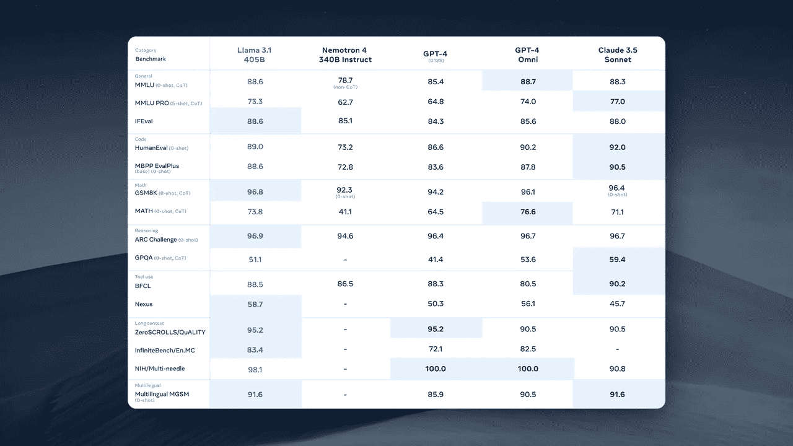
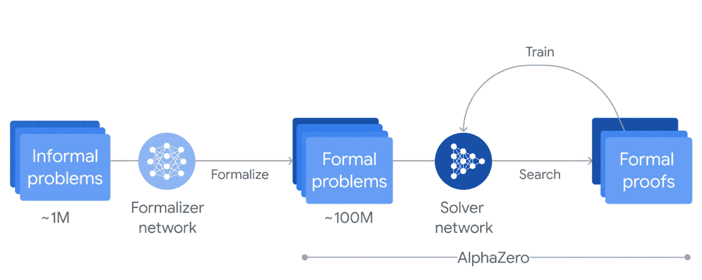
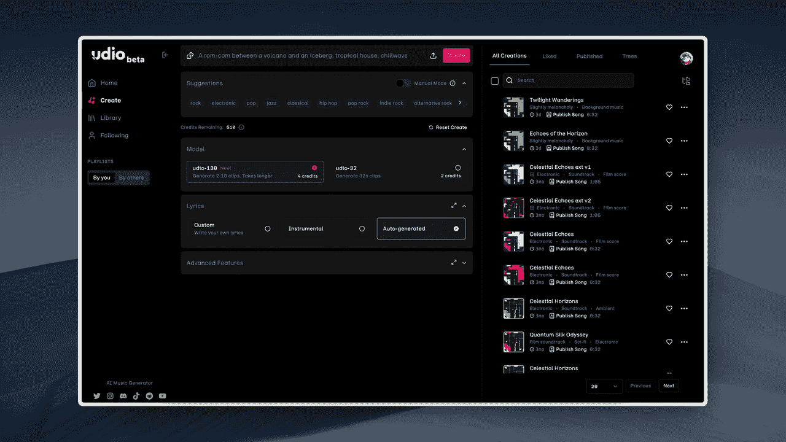
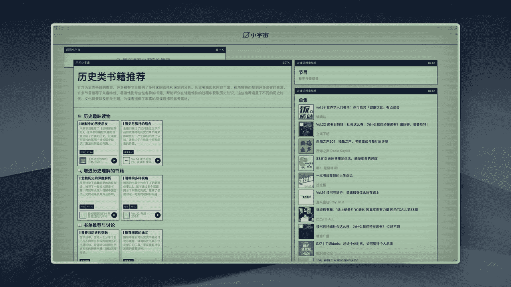
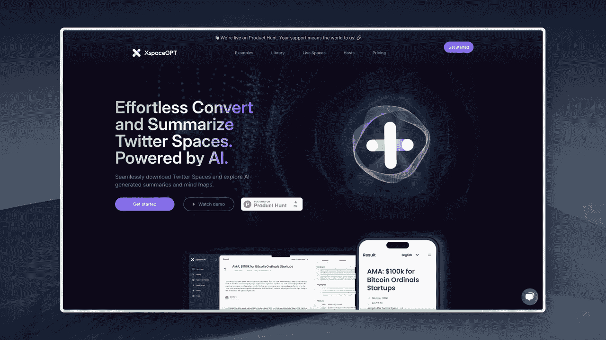
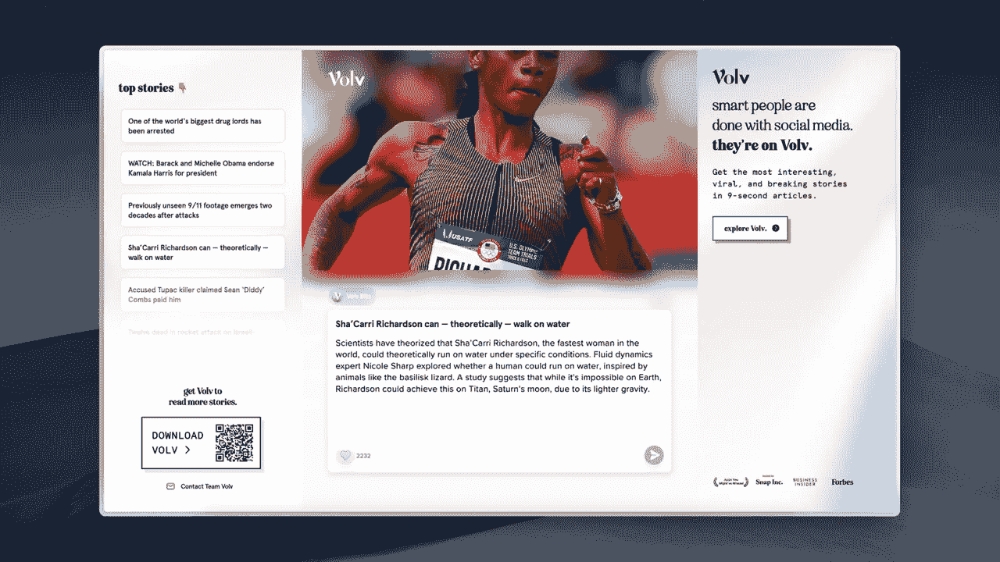

# AIGC Weekly #82

> 来源：[https://waytoagi.feishu.cn/docx/Yjg4dwrwaotjEzxYXbacn3nGnyb](https://waytoagi.feishu.cn/docx/Yjg4dwrwaotjEzxYXbacn3nGnyb)

> 🔗 原文链接： h[ttps://quail.ink/o](https://quail.ink/op7418/p/aigc-weekly-82-composite-data-and-reasoning-ability)p7418/p/aigc-wee...

> ⏰ 发布时间：2024-07-28

> 作者：歸藏

# 上周精选 ✦

## Meta 如约发布 Llama3.1 405B 模型

Meta 上周如约正式发布了 Llama3.1 版本模型，与泄露的内容一致包含8B、70B、405B 三个型号。

提供了更好的推理能力、更大的 128K token 上下文窗口，并改进了对8种语言的支持等其他改进。

405B 可以在多项任务上可以与领先的闭源模型竞争。还更新了许可证，允许开发者用 Llama 模型的输出，包括 405B 来改进其他模型。

405B对Meta确实很重要，以至于小扎还发布了一个对应的声明来介绍Meta的开源优势。

他认为开源人工智能（如 Llama 3.1）是未来发展的正确道路，它能够促进 AI 技术的更广泛的应用和创新，同时也有助于 Meta 保持技术领先地位和商业模式的可持续性。

**Llama 3.**1 405B 的 第三方评估结果 也都出来了：

SEAL 和 Allen AI 的 ZeroEval 两个独立评估机构给出了自己的结果，405B 确实。

SEAL 上405B指令遵循第一、代码第四、数学第二。ZeroEval 测试它整体性能介于 Sonnet 3.5 和 GPT4o 之间。

同时从 [技术报告论文 ](https://ai.meta.com/research/publications/the-llama-3-herd-of-models/)**来看，Llama 使用了**非常多的 合成数据来帮助训练模型 ：

+   代码的监督微调 (SFT for Code) ：405B 模型采用了 3 种合成数据方法来提升自身的代码能力，包括代码执行反馈、编程语言翻译和文档反向翻译。

+   数学的监督微调 (SFT for Math) ：使用了多种方法包括从数学背景中获取相关的预训练数据，并将其转换为问答格式，以用于监督微调；使用Llama 3来生成一组提示的逐步解决方案；训练结果和逐步奖励模型，以过滤其中间推理步骤错误的训练数据；提示Llama 3通过结合文本推理和相关的Python代码来解决推理问题；为了模拟人类反馈，我们利用不正确的生成进行训练，并进一步通过提示Llama 3来消除这些错误。

+   **多语言能力的监督微调 (SFT f**or Multilinguality) ："为了收集更高质量的非英语语言人工标注，我们从预训练过程中分出一个分支，继续在由 90% 多语言标记 (tokens) 组成的数据混合集上进行预训练，以此来培养一个多语言专家模型。"

+   **长文本处理能力的监督微调 (SF**T for Long Context) ：主要依靠合成数据来解决超长上下文训练的需求。长上下文预训练使用了8000亿（B）个Token，分为6个阶段，并有一个退火阶段。**使用早期版本的 Llama 3 来生成基于关键长文本处理场景的合成数据，包括多轮问答、长文档摘要和代码库推理。"

+   工具使用能力的监督微调 (SFT for Tool Use) ：针对 Brave Search、Wolfram Alpha 和 Python 解释器（一个特殊的新 ipython 角色）进行了训练，以实现单一、嵌套、并行和多轮函数调用的能力。

+   基于人类反馈的强化学习 (RLHF) ：大量使用了基于 Llama 2 生成结果的直接偏好优化 (DPO) 数据。

## [**Open AI 推**](https://openai.com/index/searchgpt-prototype/)出 AI 搜索 SearchGPT

泄露了三四个月的 Open AI AI 搜索 SearchGPT 终于发布了，他们说这个功能的目标是，通过结合 AI 模型的对话能力和实时网络信息，让用户更快地找到所需答案。

目前从演示以及一些获得资格的 [用户测试 ](https://x.com/yoimnotkesku/status/1817195448332890519)来看，相较于其他 AI 搜索 SearchGPT 为不同的数据展示形式做了非常多的工作。

比如搜索到的 youtube 视频可以在搜索结果直接播放，天气搜索结果会展示带图标的天气列表，数据类的结果会直接匹配适合的图表展示。

虽然 Open AI 的产品能力确实堪忧，但这次又给 AI 搜索展示了下一步的发展方向，就是获取到的信息打撒重新按照用户方便阅读的方式组合，尤其是除了文字之外的更多模态内容，实现图文、视频、数据混排。

## Deepmind 数学模型获得国际数学奥林匹克竞赛银牌

数学和代码LLM 推理能力的两个最重要的领域。

谷歌 Deepmind 上周宣布自己通过两个专门的数学模型解答了这次国际数学奥林匹克竞赛6 道题中的 4 道，获得了银牌。

两个模型分别是 AlphaProof 和 AlphaGeometry 2，AlphaProof 是一个基于自然语言和形式语言的 AI 系统，它通过强化学习自我训练，能够证明数学论断。

AlphaGeometry 2 是一个神经象征混合系统，语言模型基于Gemini，它在解决几何问题方面有了显著提升，包括关于物体运动和角度、比例或距离方程的问题。

另[外在推上有个](https://x.com/sama/status/1816580967764770998)博主拿着谷歌的图询问如果 Open AI 的模型的话可以的几分，Sam 给了一个很有趣的 语气词回答 ，可能在暗示 Open AI 可以获得金牌。

如果 Open AI 真的可以在 IMO 中获得金牌的话，按照 RLHF 的发明者 Paul Christiano 几年前的预测 如果 LLM 可以在 2025 年前在 IMO 中获得金牌，AGI 很快就会到来，如果不能的话 AGI 的到来可能需要几十年的时间。

期待 Open AI 在年底的新模型，很多的迹象都说明他们在集中攻克 LLM 的推理能力问题。

## AI 音乐生成工具 Udio 大规模更新

AI 音乐生成工具 Udio 发布大量更新。模型更新到了 V1.5 版本音质提升非常离谱。

V1.5 现在可以生成48kHz的立体声音轨,音质更高。乐器分离度更好,各种乐器声音更容易分辨。整体音乐性提高,听起来更动听、更连贯。推荐去博客页面试听官方提供的对比，或者自己去尝试一下。

功能的更新也非常多，有了更专业的功能：

+   **音轨分离：**可以将完整混音音轨拆分成四个独立的音轨:人声、贝斯、鼓点和其他乐器。

+   **音频重混功能 (上传音频进行重制)：**通过音频重混功能,用户可以上传自己的音轨并进行重新创作。这使您能够以全新的创意方式重塑自己的音乐作品。

+   **调性控制：**新增的调性控制功能让您能够将创作引导至特定的音乐调性。只需在提示中添加一个调性,比如 C 小调、降 A 大调等。

+   **多语言支持升级：**Udio v1.5 版本扩大了语言支持范围,其中就有中文，他们还专门放了一个中文的展示。

# 其他动态 ✦

+   L[uma 视](https://x.com/op7418/status/1816321699434139774)频生成工具 Dream machine 增加了尾帧生成视频的功能和循环视频生成功能，这里有 我的测试 。

+   [智谱 AI](https://chatglm.cn/?redirect=/video) 发布了自己的 DiT 视频生成模型 智谱清影 ，目前免费使用，加速生成需要付费，支持文生和图生视频。

+   Mistral 发布了 Mistral Large 2 模型 ，模型大小为123B，刚好适合单个H100推理。上下文长度扩展为 128k，对十几种主流语言有更好的支持。代码与推理有了大幅提升，支持十几种编程语言。有限开源。

+   Stability 还有新活，发布 Stable Video 4D模型 。可以从视频中生成更多角度的新视频。

+   [可灵也正式](https://klingai.kuaishou.com/)结束了完全免费生成体验，开启了 付费计划 。高性能模型一条为 10 个积分，高表现为 35 积分，1 元 10 积分，目前还有充值半价活动。

+   在上周六可灵发布了 [海外版本 ](https://klingai.com/)，目前每天免费 66 个积分，无法充值，不需要测试资格。

+   [Pixverse 更新了他们的](https://pixverse.ai/) V2 版本 DiT 视频模型 。支持 8 秒时长视频生成、细节和动作增强、支持最多 5 段内容一次性生成，无缝衔接。

+   马斯克大力出奇迹整了一个 [十万张 H100 的超算集群 ](https://x.com/elonmusk/status/1815325410667749760)。应该是现在已知最快的超算集群了，每秒性能达到2.5 exaflops（百亿亿次浮点运算）。目前最快的超级计算机是Frontier，性能为每秒1.2 exaflops。不过有人说他又吹牛了，根据现场图片看还没完工。

+   SD Web UI 更新了 [1.10 版本 ](https://github.com/AUTOMATIC1111/stable-diffusion-webui/releases/tag/v1.10.0)，正式支持了 SD3 模型。推荐使用 Euler 采样器；T5 文本模型默认禁用，需要在设置中启用。支持了英伟达的 Align Your Steps 调度器和 DDIM CFG++采样器。

+   谷歌在 Gemini 中 加入了 1.5 Flash 模型 ，针对速度和效率进行了优化，配备了 32K 上下文窗口。

+   Bing 推出了 [类似谷歌搜索概览 ](https://blogs.bing.com/search/July-2024/generativesearch)的功能，直接在搜索结果页展示搜索结果的总结和问题答案。

+   Open AI 推出了 GPT-4o mini 的模型微调功能 ，截至 9 月 23 日，每天前 200 万个免费 Token。

# 产品推荐 ✦

## ComfyUI nodes to use LivePortrait

快手的LivePortrait，开源的恰到好处，刚好在 DiT 视频模型获得突破的时候，顺利给了 AI 视频的面部表演一个可控途径。

kijai 更新了他的 LivePortrait ComfyUI 插件。基本实现了摄像头实时进行表情迁移以及将表情迁移到已有的视频中。而且还将原始项目中的人脸检测模型Insightface更换为了可以商用的谷歌MediaPipe。

## [问问小宇宙：博客内容搜索](https://ask.xiaoyuzhoufm.com/result?q=%E5%8E%86%E5%8F%B2%E7%B1%BB%E4%B9%A6%E7%B1%8D%E6%8E%A8%E8%8D%90)

即刻终于动手了，推出基于小宇宙的AI搜索“问问小宇宙”。除了给出总结外，还会给出推荐的单集中主播关于对应主题的讨论。这么好的数据源不做搜索真的浪费。

不过这个 UI 的体验真是一言难尽，背景和文字的对比度过低，同时可阅读信息的展示也过于分散，只能说如果小宇宙还是想好好做的话希望优化一下。

## XspaceGPT：推特 Space 提取分析工具

XspaceGPT 网站提供了一个服务，允许用户将 Twitter Spaces 的音频内容转换成文本格式，并提供 AI 生成的摘要和概要。服务包括将 Spaces 音频下载为 MP3 文件、转录成多种语言的文本、生成 AI 摘要、制作思维导图、提供高级内容库、支持上传音频文件以及将内容保存到 Notion（即将推出）。

Volv 是一个专为高效人士设计的新闻平台，提供简短的 9 秒新闻文章，涵盖新闻快讯、趋势、社交媒体讨论、视频和播客内容。

此外，Volv 还鼓励作家在其平台上发布内容，以被数万名读者发现。Volv 强调不同于社交媒体的 “不滚动” 体验，帮助用户以更高效的方式保持信息更新。

## Hey AI：AI 驱动的约会应用

AI 优先 - AI 先说话，AI 到 AI 破冰聊天，AI 驱动的后续对话主题建议使聊天变得有趣。

AI 驱动的效率 - AI 为你滑动、匹配和聊天，并找到可以促进你谈话的主题。

AI 驱动的高质量匹配 - 训练有素的 AI 360 度了解你的个性、品味，并为你找到最佳匹配。

个性化匹配报告 - 每次匹配都附有由 AI 到 AI 聊天互动生成的个性化匹配报告，帮助你更深入地了解潜在的伴侣。

与约会 AI 聊天 - 即使你的朋友不在线，也可以随时随地与他们的约会 AI 聊天，以保持沟通和互动。

# 精选文章 ✦

## Openresearch UBI（无条件现金）调研报告

Sam 自助的开放问题调研机构 openresearch 发布了一份规模非常庞大的 UBI（无条件现金）调研报告。

对确立后 AI 时代全民收入分配很有借鉴意义。报告涉及 UBI 对就业、健康、创业、主观能动性、人口迁移等多方面的影响：

+   **就业 **：受赠者比对照组参与者更不可能就业。受赠者平均每周工作时间比对照组参与者少 1.3 小时。

+   **健康 **：受赠者更愿意去治疗和检查，去年住院人数增加了 26%，去年急诊室（ED）就诊的概率增加了 10％。

+   **创业 **：受赠者表现出对创业的兴趣增加，并更有可能具备创业思维。拥有创业点子的可能性增加了3%。

+   **能动性 **：无条件现金对未来预算和规划、追求进一步教育以及对创业的兴趣产生了积极而显著的影响。

+   **迁移 **：受赠人对搬迁更感兴趣，并采取了行动寻找新住房，特别是在转移的最后一年。

据 404 Media 获得的一份大规模内部训练数据表格显示,市值数十亿美元的公司 Runway 开发的一款备受赞誉的 AI 视频生成工具,在训练过程中秘密使用了数千个来自知名 YouTube 创作者和品牌的视频,以及未经授权的电影内容。泄露这个消息的内部人士还给出了这些 youtube 频道的详细内容。

今年 6 月,当科技新闻网站 Techcrunch 询问 Runway 联合创始人 Anastasis Germanidis 关于 Gen-3 训练数据的来源时,Germanidis 并未透露具体细节。

他对 Techcrunch 表示:"我们有专门的内部研究团队负责监督所有训练过程,我们使用经过精心筛选的内部数据集来训练我们的模型。"

## LLM三角原则：构建可靠的人工智能应用程序

详细介绍了构建可靠大型语言模型（LLM）应用的原则和方法。作者通过对构建多个 LLM 系统的经验总结，提出了 LLM 三角原则，包括标准操作程序（SOP）、工程技术和上下文数据，以及模型选择作为加号原则。SOP 是指将专家的认知过程模拟为一系列步骤，以指导 LLM 应用的设计和实现。工程技术涉及实际编写代码和设计 LLM-Native 架构，包括流程工程和代理（agents）的使用。上下文数据强调了 LLM 作为上下文学习者的特性，以及如何通过示例学习和检索增强生成（RAG）技术提供相关信息。

## LLM应用评估的持续改进的双层评估框架

作者提出了一个双层评估框架，通过一个更高级别的 LLM 评委（最高 LLM 评委）来评估第一层 LLM 评委的评估结果。这个框架旨在提高评估的准确性和可靠性，减少不正确的评估。

作者通过实验验证了这个框架的有效性，发现最高 LLM 评委能够识别出第一层 LLM 评委错误评估的 70% 的案例。这一发现对于持续改进 LLM 应用的评估过程具有重要意义。

## 拾象：为什么我们相信英伟达能到 5 万亿

当一个大的科技革命到来时，我们永远无法预测它所带来的增量和长期的投资回报，这也是为什么我们坚信英伟达估值远没有饱和、将达到至少 5 万亿美元市值的底层逻辑之一。在这篇分享中，我们也对英伟达的 5 万亿之路进行了拆解。

1.  **AGI 潜力 **: AGI（Artificial General Intelligence）的定义和潜力尚未被充分理解。

1.  **AI 作为 GDP 驱动力 **: AI 预计在未来 10-15 年让全球 GDP 翻倍。

1.  **LLM 基建初期 **: 当前 AI 大模型处于大基建初期阶段。

1.  **AGI 基建工程问题 **: 可以通过资金和时间投入解决。

1.  **Coding 领域 AGI **: 未来 2-3 年可能看到 Coding 领域的 AGI。

## [专访 Luma AI 首席科学家：我](https://mp.weixin.qq.com/s/waH6Vudo2uybXQZ8S4dwsQ)们更相信多模态的 Scaling Law

Luma AI 通过其视频生成模型 Dream Machine 引起了广泛关注，该模型能够生成动作幅度大的视频内容，并且在理解物理世界方面表现出色。

首席科学家 Jiaming Song 在访谈中解释了 Luma AI 从 3D 领域转向视频生成的原因，以及视频生成如何帮助他们更好地理解和生成 3D 内容。他强调了多模态数据在提升模型理解能力方面的重要性，并讨论了 Luma AI 对于未来 AI 产品和商业模式的愿景。

Jiaming Song 还提到了 Luma AI 在研究和产品开发方面的平衡，以及他们如何利用用户反馈来指导公司的发展方向。

此外，他还探讨了 AI 技术发展的未来趋势，包括多模态模型的潜力、生成效率的提升、成本下降的可能性，以及新的商业模式的探索。

Sam Altman认为，我们正面临一个战略性选择：是由美国和盟国推进的民主愿景主导AI的未来，还是由不认同美国价值观的威权国家掌控。

为确保民主愿景胜出，Altman提出了四个关键策略：加强安全措施、发展基础设施、制定AI商业外交政策、建立全球AI治理机制。他强调了行动的紧迫性，指出美国虽然目前在AI领域领先，但这种领先地位并非永久。

文章呼吁美国及其盟友立即采取行动，以确保AI技术的发展能够最大化其益处，同时最小化风险，从而创造一个更加民主的世界。

## Ethan Mollick：面对不可能的未来

探讨了人工智能（AI）未来发展的不确定性，指出尽管 AI 的未来充满不确定性，但组织和个人应该为多种可能性进行规划。他指出，尽管 AI 的未来发展存在分歧，但许多 AI 实验室的内部人士相信在不久的将来实现人工通用智能（AGI）是可能的。

Mollick 强调，即使不考虑 AI 的进一步进步，现有的 AI 技术已经足够引起颠覆性变化，因此需要现在就开始规划和思考如何使用 AI。他还批评了 AI 系统的不透明性，认为 AI 文档对非技术用户来说不够友好，导致人们对 AI 当前能力的了解不足。

文章中还提到了 AI 能力的锐角形成，即 AI 在某些任务上表现出超过人类的能力，而在其他看似简单的任务上却表现出限制。

# 重点研究 ✦

## 使用基于规则的奖励改善模型安全行为

Open AI 关于利用基于规则的奖励（RBRs），通过调整模型行为来确保安全性的研究。

传统上，使用人类反馈进行强化学习（RLHF）微调语言模型一直是确保它们准确遵循指令的方法。

与人类反馈不同，RBRs 使用清晰、简单和逐步的规则来评估模型的输出是否符合安全标准。 当插入标准 RLHF 管道时，它有助于在保持有益同时防止伤害之间保持良好平衡，以确保模型在没有反复人类输入的低效情况下安全有效地运行。

**RBRs的工作原理**

1.  **命题定义 **：关于模型响应期望或不期望方面的简单陈述。

1.  **规则形成 **：基于命题制定规则，以捕捉安全和适当响应的细微差别。

1.  **响应类型分类 **：

+   **硬拒绝 **（Hard refusals）：简短道歉和无法遵从请求的声明。

+   **软拒绝 **（Soft refusals）：更具同情心的道歉，承认用户情绪状态，但最终拒绝请求。

+   **遵从 **（Comply）：模型应遵从用户请求。

## 谷歌：使用文生图模型和合成数据平滑编辑对象的材质属性

谷歌研究，对图像中对象材质属性的参数化编辑。

能够在保持图像逼真性的同时，对对象的颜色、光泽度或透明度等材质属性进行精确控制。

本质上还是滑块Lora的思路，数据集创建的思路可以借鉴，基于SD1.5做的。

## Diffree：基于文本引导的形状自由目标修复与扩散模型

Diffree，一种文本引导的对象插入技术，它能够在不改变图像背景一致性和空间适当性的前提下，根据文本描述将新对象自然地融入图像。

Diffree 通过在 OABench 数据集上训练，该数据集由 74K 个实世界的图像组成，包括原始图像、经过物体移除后的图像、物体掩码和物体描述。

OABench 数据集是通过高级图像修复技术移除物体后构建的，以实现高质量的文本引导对象添加。Diffree 不仅能够添加多种对象，而且能够通过生成的掩码在单个图像中迭代插入对象，同时保持背景的一致性。

Meta 推出的人像 ID 保持项目，该模型无需为每个用户单独微调,可以共享一个统一的框架。

+   提出了三个关键创新:

+   新的合成配对数据生成机制,提高图像多样性

+   全并行注意力架构,包含三个文本编码器和一个可训练的视觉编码器

+   新颖的粗到细多阶段微调方法,逐步提升视觉质量

通过大规模人工评估,证明该模型在身份保持、视觉质量和文本对齐方面均优于现有最先进模型。模型可以生成遵循复杂提示的高质量个性化图像,如改变表情、姿势等。

## Noise Calibration：腾讯的视频放大模型

提出了一种新的方法,同时兼顾视觉质量和内容一致性。我们通过设计一种新的损失函数 (loss function) 来确保内容一致性,该函数能够保持输入的结构特征。同时,我们利用预训练扩散模型的去噪过程来提升视觉质量。

为了解决这个优化问题,我们开发了一种即插即用 (plug-and-play) 的噪声优化策略,称为噪声校准 (Noise Calibration)。通过对初始随机噪声进行几轮迭代优化,我们可以在很大程度上保留原始视频的内容,同时显著改善增强效果。

## IMAGDressing-v1：可定制的虚拟试衣服装

腾讯开源的 SD 换装项目，支持对服装的灵活控制、可选的面部、姿势和场景。

模型包含一个服装 UNet,用于捕获来自 CLIP 的语义特征和来自 VAE 的纹理特征。还设计了一个混合注意力模块,包括一个冻结的自注意力 (self-attention) 和一个可训练的交叉注意力 (cross-attention),将服装 UNet 的特征整合到冻结的去噪 UNet 中,确保用户可以通过文本控制不同的场景。

IMAGDressing-v1 可以与其他扩展插件结合使用,如 ControlNet 和 IP-Adapter,以增强生成图像的多样性和可控性。