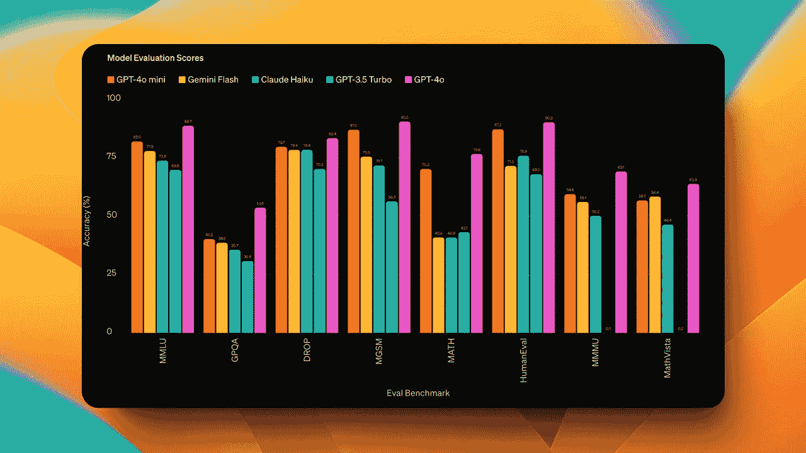
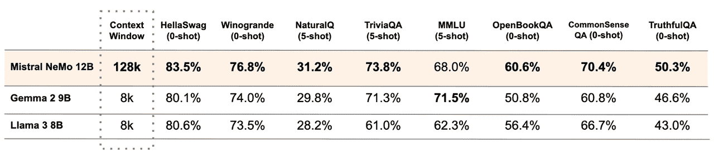
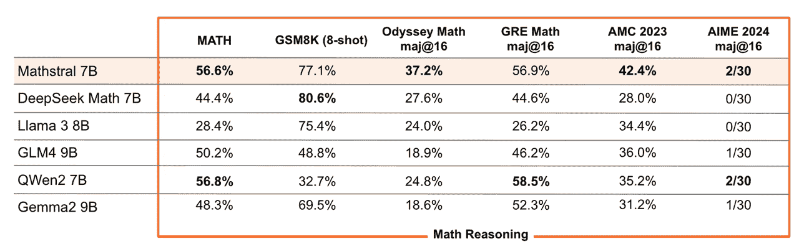
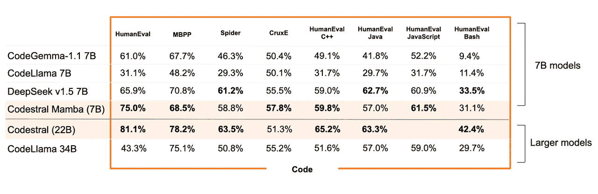
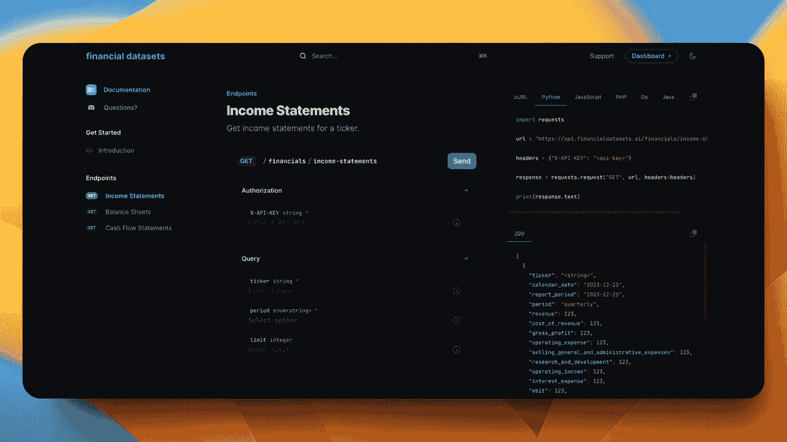
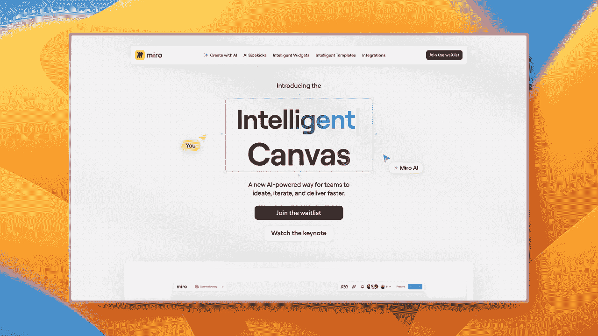
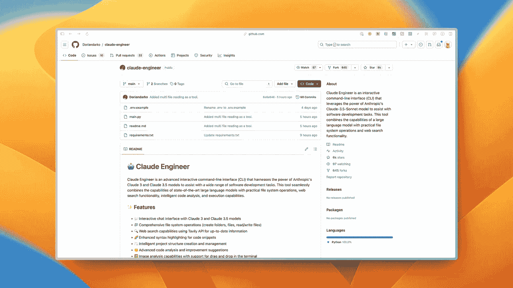

# AIGC Weekly #81

> 来源：[https://waytoagi.feishu.cn/docx/PenNdsbAqo2SkNxVHu8c8Rv2n3g](https://waytoagi.feishu.cn/docx/PenNdsbAqo2SkNxVHu8c8Rv2n3g)

> 🔗 原文链接： h[ttps://quail.ink/o](https://quail.ink/op7418/p/aigc-weekly-81)p7418/p/aigc-wee...

> ⏰ 发表时间：2024-07-22

> 作者：歸藏

# 上周精选 ✦

## Open AI 发布 GPT4o-mini

Open AI 居然还有货，发布了 GPT-4o mini 模型。

MMLU 得分为 82%，碾压其他同级别小模型。

价格也很低为 0.15 美元/100 万token输入和 0.6 美元/100 万token 输出。比 GPT-3.5 Turbo 便宜超过 60%。 具有 128k 的大上下文窗口，非常适合 RAG。

GPT-4o mini 在 API 中支持文本和图片，未来将支持文本、图像、视频和音频输入和输出。

GPT-4omini 接替 3.5 成为 ChatGPT 中的免费模型，目前还不支持多模态，而且 4o mini的 API 一旦涉及到图片 Token 数量也会大增。

## Mistral 发布三个小模型

Mistral 的模型发布也跟下仔一样，一周发布了三个模型都不大，不过基本都是同级别最好的，

### [Mistral NeMo](https://mistral.ai/news/mistral-nemo/)

一个 12B 的 LLM。模型有 128K 上下文长度，推理、世界知识和编码准确性都是最好的。

Mistral NeMo在训练过程中考虑了量化（quantisation），可以进行 FP8 无损推理。

模型经过多语言训练，在英语、法语、德语、西班牙语、意大利语、葡萄牙语、中文、日语、韩语、阿拉伯语和印地语方面特别强大。

Mistral NeMo 使用了基于 Tiktoken 的新 Tokenizer Tekken它在超过 100 种语言上进行了训练。 并比之前 Mistral 模型中使用的 SentencePiece tokenizer 更有效地压缩自然语言文本和源代码。

Mistral NeMo 经过了先进的微调和对齐。与 Mistral 7B 相比，它在遵循精确指令、推理、处理多轮对话和生成代码方面要好得多。

### [MathΣtral 数学模型](https://mistral.ai/news/mathstral/)

这是一个专门针对数学推理和科学发现设计的 7B 型号。32k 上下文窗口，Apache 2.0 许可开源。

模型在 MATH 上达到了 56.6％，在 MMLU 上达到了 63.47％ 最重要的是推理能力，这个模型可以通过更多推断时间计算实现明显更好的结果。

推出的那天刚好是阿基米德诞辰 2311 周年。

### Codestral Mamba 代码模型

与 Transformer 架构不同，Mamba 模型能够提供线性时间推理的优势，并具备理论上对无限长序列建模的能力。它允许用户大量与模型互动，快速响应，无论输入长度如何。这些特性特别适合用来生成代码。Codestral Mamba最多支持 256K 上下文。

可以使用 mistral-inference SDK 部署 Codestral Mamba，该 SDK 依赖于来自 Mamba GitHub 代码库的参考实现。该模型也可以通过 TensorRT-LLM 进行部署。

# 其他动态 ✦

+   DeepSeek开源了 DeepSeek-V2-Chat-0628 ，LMSYS Chatbot Arena 排行榜上总排名 11 超过了，所有开源模型。

+   三星国行Galaxy Z Fold6、Galaxy Z Flip6 手机的智能助手和 AI 视觉功能用了字节的豆包和火山引擎方案。

+   Runway 更新了 [iOS 客户端 ](https://x.com/runwayml/status/1813289383224885252)，可以使用 Gen3 生成视频了。

+   Andrej Karpathy 成立的一个 人工智能教育机构 Eureka Labs ，上次推荐的 LLM101 就是他们准备推出的首套课程。

+   Claude 移动端发布 [安卓版本 ](https://x.com/alexalbert__/status/1813240763737907364)，同时网页端将可能增加获取屏幕截图功能。

+   Claude 3.5 Sonnet API 输出的 长度限制已经从 4K 增加到了 8K 。 在API调用中添加请求头 "anthropic-beta": "max-tokens-3-5-sonnet-2024-07-15"。

+   在一个模型中支持多种 Controlnet 的模型 c[ontrolnet-](https://huggingface.co/xinsir/controlnet-union-sdxl-1.0/tree/main)union 更新了 ProMax 版本 。

+   [Menlo Ventures ](https://menlovc.com/anthology-fund/)和 Anthropic 合作创建了 一个基金 Anthology ，重点关注五个关键领域： AI 基础设施、前沿应用、消费者 AI、信任和安全工具以及用于社会公益的 AI。

+   可能由于[无法解释训练数据来源Met](https://www.reuters.com/technology/artificial-intelligence/meta-decides-suspend-its-generative-ai-tools-brazil-2024-07-17/)a决定 不在欧盟提供多模态 AI 模型服务 ，同时 不在巴西提供 AI 服务 。

+   [OpenAI 和 Tamm](https://www.youtube.com/watch?v=RfwiiIIDjUc)y Lovin 推出了 新的 Sora 视频演示 。

# 产品推荐 ✦

## Reflect New Tab：新标签页插件

Reflect 出的这个新标签页浏览器插件可太好看了。 支持天气、日历、网站快捷方式以及Google和Perplexity。 渐变可以自定义而且切换亮暗模式都有变化，非常优雅。

## [股票市场API](https://www.financialdatasets.ai/)

一个股票 API，包含所有 S&P 500 指数的股票。 资产负债表、收入报表、现金流报表都有。 支持 30 年的数据，正式版会包含一万五千个股票数据。 做金融类 AI 应用非常有用。

## Supermemory：自动化知识管理平台

一个综合性的知识管理平台，提供强大的搜索引擎、写作助手和画布等工具，帮助用户组织和利用保存的信息。核心功能包括创意记录、书签管理、联系人管理等。

用户可以通过 Chrome 扩展程序、iOS 快捷方式或 API 将内容导入应用。此外，它还提供了一个 markdown 编辑器，帮助用户基于已保存数据创作内容，并且具备聊天和知识画布等功能，让用户能够以自己理解的方式组织信息。

## Miro Intelligent Canvas：AI 白板功能

Miro 的 Intelligent Canvas 是一个基于人工智能的工作平台，旨在加速团队的创意和迭代过程。它能够将大脑风暴中的想法转化为产品简报和摘要，以推动工作进展。

用户只需提供画布上的内容，Miro AI 就能自动处理后续步骤，节省了制作图表、简报和摘要的时间。此外，Intelligent Canvas 提供了预设的动作和快捷方式，以及与 Agile 教练、产品负责人和市场营销专家等的即时协作，帮助团队做出更好的决策。该平台还推出了一系列智能小部件，用于团队互动和参与，如点投、调查和估算等。

## [Claude Engineer：在 CL](https://github.com/Doriandarko/claude-engineer)I 中使用 Claude 以及代码编辑器

Claude Engineer，这是一个高级的交互式命令行接口（CLI）工具，它利用 Anthropic 的 Claude 3 和 Claude 3.5 模型来协助软件开发任务。该工具结合了先进的语言模型、文件系统操作、网络搜索、代码分析和执行功能。

Claude Engineer 支持多种功能，包括创建文件夹、文件、读写文件、网络搜索、代码高亮、项目结构管理、代码分析、图像分析、自动化模式、代码执行和进程管理等。

## Morphic Studio：为创建受控视频做的 AI 视频平台

Morphic Studio 包括 Canvas 和 Compose 功能，Canvas 是一个全面的故事板和生成中心，提供了丰富的帧编辑工具，而 Compose 则是一个端到端的视频编辑器，结合了先进的人工智能和用户友好的设计。Morphic Playground 允许用户通过简单的消息创建资产。

## [Exa：新的 AI 搜索引擎](https://exa.ai/search)

Exa 是一家重新设计人工智能时代搜索的人工智能研究实验室，宣布获得由 Lightspeed Venture Partners 领投的 2200 万美元种子轮和 A 轮融资，NVIDIA 风险投资部门 NVentures 和 Y Combinator 也参与其中。

Exa 使用与 ChatGPT 相同的技术来训练嵌入模型，将网页转换为称为嵌入的数字列表。其结果是一种将大型语言模型 (LLMs) 的强大功能融入搜索过程本身的技术，使搜索比 Google 等关键字方法更加智能。更智能的搜索将人工智能应用置于最相关的世界知识中。

# 精选文章 ✦

Reddit 上这个 Claude Sonnet 3.5 代码编写提示词模板 V2 版本很有价值。 除了模板本身他还非常详细的解释了自己这么写的原因和结构。 另外里面还有 Claude Sonnet 3.5 的系统提示和 Artifacts 功能的系统提示。

这个引导式思维链包含 4 个步骤:代码审查、规划、输出、安全审查。

1.  代码审查: 这一步将结构化的代码分析引入上下文,为后续计划提供信息。

1.  规划:这一步会制定一个高层次的设计和实施计划,供我们在生成代码之前检查。

1.  输出: 一旦计划确定,我们就开始生成代码。

1.  安全审查: 我更倾向于在代码生成后进行安全审查。

## [如何成为一个 ML 工程师](https://www.maxmynter.com/pages/blog/become-mle)

Max Mynter 老哥写了一篇文章，介绍了一下如何成为一个 ML 工程师。

1.  首先，学习计算机科学的基本概念，并通过 CS50 课程和专门的 Python 资源掌握 Python 编程技巧。

1.  接着，学习基础的机器学习方法，以建立扎实的基础并培养处理数据的直觉。在此过程中，巩固你的数学基础，包括微积分、线性代数和概率论（如果能够学习数值计算和优化，那将是一个额外的加分项）。

1.  通过选择一些优秀的深度学习课程，如 Yann Le Cuns 的纽约大学讲座、fast. ai 或 deeplearning. ai 的深度学习专精课程，深入学习深度学习技术。

1.  从 fullstackdeeplearning 学习 MLOps 技能。如果需要，可以先通过 fullstackopen 学习软件工程的基本知识，包括 web 开发、分布式系统、DevOps 和关系数据库。

1.  寻找你感兴趣的领域，通过不断构建和完善你的作品集来发展专业技能。你可以从 Hugginface 的课程开始，深入挖掘你的兴趣方向，完成一些有趣的项目和论文实现，并将它们展示在 GitHub 上。

## 红杉：AI 的 6000 亿美元问题

AI 投资与收入的不平衡问题持续恶化，收入缺口从2000亿美元飙升至6000亿美元。 AI 泡沫正逼近临界点，接下来如何应对至关重要。疯狂囤积GPU引发的问题：

1.  缺乏定价权：GPU 数据中心的情况下，定价权要少得多。GPU 计算越来越成为一种按小时计费的商品。

1.  投资泡沫：即便是在铁路行业以及许多新兴技术领域，投机性的投资热潮往往会导致大量资本损失。

1.  设备折旧：半导体的性能往往会不断提升。英伟达将继续生产像 B100 这样更好的下一代芯片。这将导致上一代芯片价值迅速贬值。

1.  赢家与输家：我们需要仔细看待赢家和输家在过度基础设施建设期间总会有赢家。主要会对投资者造成伤害。

## 揭秘DeepSeek:一个更极致的中国技术理想主义故事

文章详细介绍了 DeepSeek，作为中国大模型创业公司中的一员，如何通过技术创新掀起了 AI 领域的价格战，并成为了业界关注的焦点。DeepSeek 背后的量化私募巨头幻方，一年前储备了万张 A100 芯片，而一年后，DeepSeek 发布的 DeepSeek V2 开源模型以其低成本的性价比成为了行业关注的热点，推动了中国大模型价格战的爆发。

DeepSeek 的成功不仅在于它的技术创新，如提出的 MLA 架构和 DeepSeekMoESparse 结构，而且在于它的商业模式，即专注于研究和技术创新，而非追求快速商业化。DeepSeek 的创始人梁文锋以其技术理想主义者的身份，强调了原创式创新的重要性，并讨论了中国 AI 技术创新的未来趋势，以及与硅谷技术社区的差异和交流。

## 双子座，请分析我的诗：诗人拥抱 AI 的方式

诗人西拉·埃尔曼探讨了人工智能在诗歌创作中的作用，特别是利用AI进行诗歌分析的好处。她强调AI不应被视为诗人的对手，而是一种工具，可以帮助诗人在保持人类声音的同时，提高创作效率。

Gemini，它能够快速且深入地分析她的诗歌草稿。Gemini的分析包括对诗歌的形式与结构、比喻与象征、声音与节奏、发言者与视角、主题与意义等方面的详细评论。这种分析帮助她在修订过程中做出更好的选择，如摒弃一些不够强或连贯的比喻和拟人化手法。埃尔曼认为，AI提供的新视角和即时反馈比人类的反馈更为有价值，尤其是在处理个人和敏感的诗歌内容时。

# 重点研究 ✦

## FasterLivePortrait

支持实时推理的 FasterLivePortrait 表情迁移。 可以拿这个顶着名人脸做直播了，如果不怕被封的话，哈哈。 使用 TensorRT 在 RTX 3090 GPU 上实时运行，达到了 30+ FPS 的速度。 无缝支持原生 gradio 应用程序，速度快几倍，并支持同时在多张脸上进行推理。

## [Qwen 2 技术报告](https://huggingface.co/papers/2407.10671)

阿里发布了 Qwen 2 的技术报告。 介绍了 Qwen 2 系列模型的模型架构、大致训练过程以及系列模型的测试结果。

## MUSCLE：兼容LLM Evolution的模型更新策略

当我们更新大型语言模型时,新模型可能会在一些任务上表现得比旧模型差,这会让用户感到困惑。

作者提出了一种叫MUSCLE的方法,可以在更新模型的同时,尽量保持新旧模型在行为上的一致性。

具体来说,他们发现模型更新后,有些以前能正确回答的问题现在反而答错了,这种情况叫"负翻转"。

为了减少这种情况,MUSCLE方法会训练一个"兼容性适配器",它会学习新旧模型的知识,尽量让新模型在保持整体性能提升的同时,减少与旧模型的差异。

## 苹果开源 DCLM-Baseline-7B

苹果也开源了一个小模型 DCLM-Baseline-7B。 重要的是这个模型开源了全链路的所有训练过程和素材。 包括预训练的数据集、数据处理过程、训练过程和评估组件。 模型的MMLU测试表现也与Mistral-7B-v0.3 和 Llama 3 8B 相当。

## Prover-Verifier Games提高语言模型输出的易读性

OpenAI 通过使用 Prover-Verifier 游戏训练强大的语言模型，提高了其输出的可读性，使得弱模型能够验证文本，同时也使得人类更容易评估这些文本。

1.  强调了语言模型输出的可读性对于使其对人类有帮助的重要性，尤其是在解决复杂任务（如数学问题）时。

1.  当强模型仅优化正确答案时，生成的解决方案可能变得难以理解，人类评估者在评估这些高度优化的解决方案时的错误率会增加。

1.  通过 Prover-Verifier 游戏，强模型生成的文本不仅能够被弱模型验证，而且能够被人类更有效地评估，这被称为提高可读性。

1.  研究通过对链式推理进行优化，实现了性能提升的同时保持了人类评估者准确评估解决方案的能力。

1.  通过使用强弱模型对，研究人员训练了强模型以生成易于人类理解的解决方案，并在训练过程中平衡了性能和可读性。

Groq 发布了一个专门为高级工具使用和函数调用任务优化过的模型。

训练方式：在 Llama 3 70B 基础模型上进行全面微调和直接偏好优化 (DPO)。伯克利函数调用排行榜 (BFCL) 得分：总体准确率 90.76%。该分数代表了 BFCL 上所有开源 70B LLMs 中的最佳性能。

## Q-Sparse:让所有大语言模型更高效运行的稀疏化方法

这篇论文提出了一种名为Q-Sparse的新方法,可以让大语言模型在推理时更加高效。

主要做法是对模型的激活值进行"稀疏化",也就是只保留最重要的一部分激活值,其他的置为零。这样可以大大减少计算量和内存使用,而且几乎不影响模型的性能。

研究人员还发现了稀疏化模型的一些规律,比如最佳的稀疏程度等。他们在各种场景下测试了这个方法,包括从头训练、继续训练现有模型,以及微调等,都取得了不错的效果。特别是,这个方法可以和其他的优化技术结合,比如低比特量化,有望大大提高大语言模型的效率。

## IMAGDressing-v1：可定制的虚拟试衣

腾讯的研究 虚拟穿衣 (Virtual Dressing, VD)。这项任务旨在生成可自由编辑的人物图像，其中服装是固定的，但其他元素（如面部、姿势和背景）可以根据需要进行调整。

同时，开发了一个名为"综合匹配度评估指标" (Comprehensive Affinity Metric Index, CAMI) 的评价体系，用于衡量生成图像与参考服装之间的一致性。

IMAGDressing-v1 的一大优势是它可以与其他AI模型扩展插件（如 ControlNet 和 IP-Adapter）无缝集成，进一步提高生成图像的多样性和可控性。