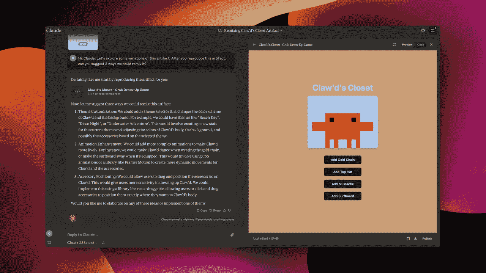
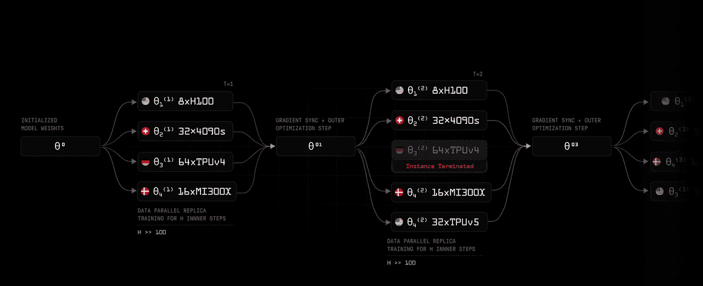
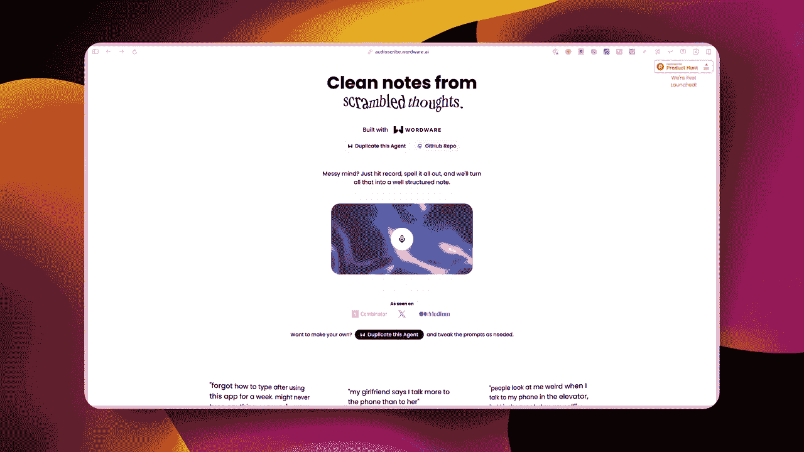
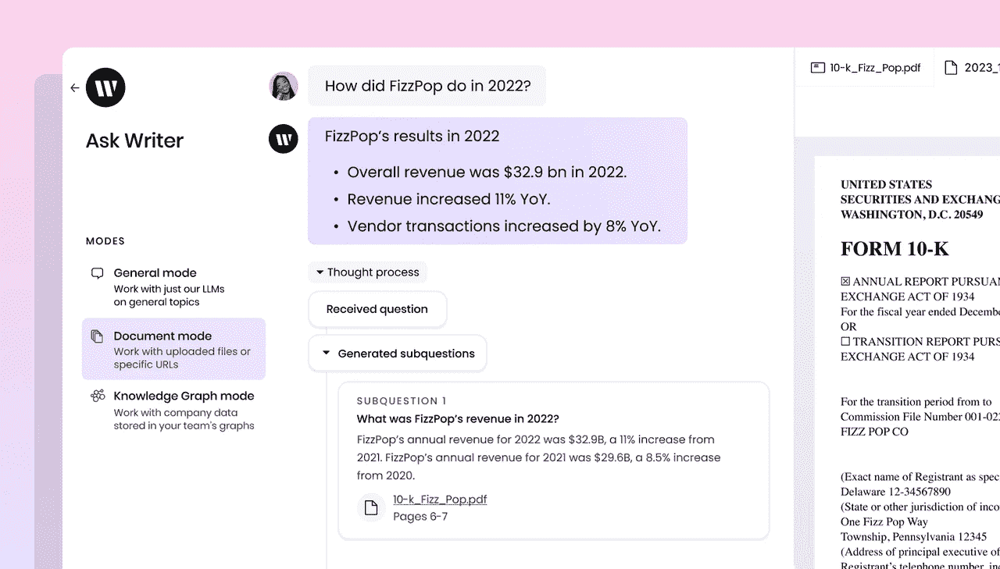
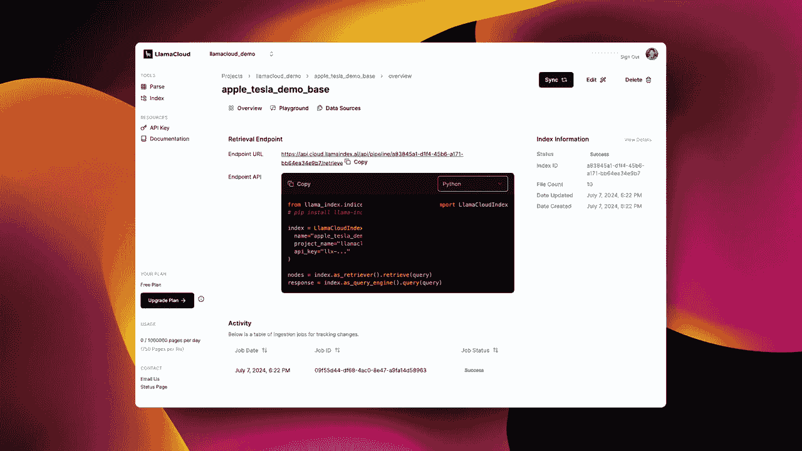
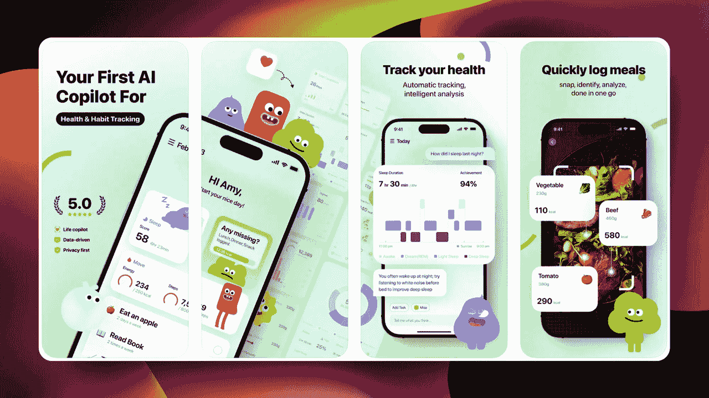

# AIGC Weekly #80

> 来源：[https://waytoagi.feishu.cn/docx/CZ3adfQuAoNuaHxKW5cc6B2UnXd](https://waytoagi.feishu.cn/docx/CZ3adfQuAoNuaHxKW5cc6B2UnXd)

> 🔗 原文链接： h[ttps://quail.ink/o](https://quail.ink/op7418/p/aigc-weekly-80)p7418/p/aigc-wee...

> ⏰ 发表时间：2024-07-15

> **作者：歸藏**

本文中的蓝色的字体都可以点击跳转

# 上周精选 ✦

## Anthropic：Artifacts可分享，后台功能更新

Anthropic 最近在产品上的迭代功能非常快，先是给Artifacts加上的分享功能，现在你可以分享自己的 artifacts 了。也可以快速重写别人分享的artifacts 。

开发者后台也更新了一堆功能，Anthropic 开发者后台现在可以生成提示词，创建测试变量，并排查看提示词的输出结果。

1.  可以使用 Claude 生成输入变量，然后运行提示语，查看 Claude 的响应结果。

1.  新的“评估”选项卡可以自动创建测试用例，用于评估你的提示语效果。

1.  当你对提示语进行不同版本的迭代时，你的主题专家可以比较这些响应，并在5分制上对其进行评分。

另外Claude 3 最小的模型Haiku，现在支持在Am[azo](https://www.anthropic.com/news/fine-tune-claude-3-haiku)n Bedrock上微调，这里是 介绍 。

## LLM 的分布式训练取得了重大进展

P2P 去中心化的模型训练可能是未来解决模型算力缺口的一个重要方向。Prime Intellect 发布了支持全球范围内的 AI 模型分布式训练框架 OpenDiLoCo。

他们利用这个框架进行了一个实验，在三个国家之间训练了一个模型。计算资源利用率达到了90-95%，并将其扩展到原始工作规模的三倍，证明了其对十亿参数模型的有效性。这个框架基于 Google Deepmind 的分布式低通信 (DiLoCo) 方法。

OpenDiLoCo 的特点包括：计算资源的动态调整、容错训练、点对点架构：没有主节点。

由于 DiLoCo 减少了通信时间，全归约瓶颈仅占训练时间的 6.9%，对整体训练速度的影响微乎其微。

## Odysseyml：重构视频生成技术

Odysseyml 这个AI 视频生成产品有点意思。

他们认为目前 AI 输出的视频是不可编辑的，是一个成品，灯光、运动、场景等，只要有一个元素出问题就得重新开始。

所以他们需要基于3D 技术，从头构建一个AI 视频生成工具来生成好莱坞级别的影视资源。

他们的模型可以单独生成几何形状、材质、灯光和动作。

但这个视频看起来是虚幻引擎应该做的或者可以做的更好的事情。

现在视频生成模型的问题当然是控制方式，但从图像模型的发展来看我们是可以基于现在的技术方案发展控制方式的，从头走一套新的方案是不是必须的事情？不好说。

而且看起来他们现在啥也没有，希望他们可以真的走出一条新路来。

# 其他动态 ✦

+   ComfyUI 上周 [更新内容 ](https://blog.comfy.org/new-models-versioned-release-beta-ui-new-models/)：增加顶部菜单，支持保存工作流和历史记录；增加了对SD3 Controlnet、Stable Audio 1.0 、AuraFlow的支持。

+   Ollama 的 [两个大更新 ](https://x.com/ollama/status/1810480544976626159)：1）并行处理请求，每个请求只需占用少量额外内存。2）支持同时加载不同的模型，模型会根据请求和GPU内存的使用情况自动进行加载和卸载。

+   OpenAI 内部定义了 [5 个 AGI 级别 ](https://www.bloomberg.com/news/articles/2024-07-11/openai-sets-levels-to-track-progress-toward-superintelligent-ai)。这 5 个级别分别是 Chatbots、Reasoners、Agents、Innovators 和 Organizations。

+   [FutureSearch ](https://futuresearch.ai/request-openai-report)通过各种渠道统计和梳理之后得到了 OpenAI 现在的年度 ARR 收入为 34 亿美金。

+   [Fireworks AI ](https://fireworks.ai/blog/fireworks-ai-series-b-compound-ai)已在由红杉领投的 B 轮融资中 筹集了 5200 万美元 。Fireworks AI是一家专门提供 AI 推理和部署服务的公司。

+   [英特尔资本正在向 Bui](https://x.com/PimDeWitte/status/1811385393851384056)ltdot 投资 1500 万美元 ，Builtdot正在开发人工智能建筑软件。

+   Regard 筹集了 [6100 万美元 ](https://techcrunch.com/2024/07/11/ai-powered-regard-nabs-61m-to-find-missed-illness-boost-hospital-revenue/)，以发现被忽视的疾病，提高医院收入。

+   三星发[布会发布一堆](https://www.youtube.com/watch?v=F0lHIMxoZEw)新款设备包括折叠手机 Z Flip 6 和 Z Fold 6、Galaxy Watch 7 和 Watch Ultra、Galaxy Buds 3 和 Buds 3 Pro 耳机以及 Galaxy Ring 智能戒指，Galaxy AI继续增加了 一堆新功能 。

+   AMD 以 6.65 亿美元 [收购 Silo AI ](https://www.amd.com/en/newsroom/press-releases/2024-7-10-amd-to-acquire-silo-ai-to-expand-enterprise-ai-sol.html)，Silo AI 是欧洲最大的私人人工智能实验室，总部位于芬兰赫尔辛基。

+   Groq 与 BlackRock 达成交易 ，目前估值接近 22 亿美元。

+   微软 [放弃了 ](https://www.axios.com/2024/07/10/microsoft-openai-board-seat-observer)OpenAI 董事会观察员席位。

+   Poe 发布了 类似Claude Artifacts的功能 - 与 AI 聊天时制作的可交互 Web 应用程序。

+   [Hebbia 完成由 a16](https://www.hebbia.ai/blog/hebbia-raises-usd130m-series-b)z 领投的 1.3 亿美元 B 轮融资 。Hebbia 是一个针对企业的 AI 服务平台。

# 产品推荐 ✦

## Audioscribe：开源项目将语音转为结构化笔记

Audioscribe 是一个由 Wordware 开发的 AI-powered Record-to-Text 工具，它允许用户通过语音记录将思维转化为整洁的笔记。用户可以通过复制 GitHub 上的 Agent 来自定义提示，以满足不同的需求。Audioscribe 适用于多种场景，包括项目撰写、头脑风暴、邮件撰写、个人信息、日记记录、任务规划、面试记录、社交媒体帖子和创意生成。Wordware 的目标是让领域专家能够直接参与到大型语言模型应用的构建过程中，而不需要深入编程或与工程师频繁沟通。

## [Klipy：AI CRM](https://klipy.ai/)

Klipy 是一个全面的增长管理平台，提供包括客户关系管理（CRM）自动化、管道协调、通话分析、策略指南和预测等多项功能。该平台使用人工智能技术来帮助销售团队记录、分析和教练所有活动，以加速交易闭幕，增长销售渠道和销售团队。

## Writer：下一代聊天机器人应用程序

Writer 最近推出了一系列升级，使企业能够构建更强大、透明且易于使用的聊天应用程序。这些升级包括内置的 RAG（Retrieval-Augmented Generation）技术，能够分析高达 1000 万字的文档，提高了知识检索的准确性；增强了 AI 的解释性和透明度，能够展示 AI 生成回答的思考过程；以及引入了专门的操作模式，提高了用户体验和输出质量。此外，还提供了自定义指令和语音重写等功能，以适应不同的用户需求和风格。

## LlamaCloud：为LLM应用程序提供数据处理层

LlamaCloud 提供了 LlamaParse 工具，支持多种语言和文档格式，以及托管的数据摄取服务，支持多种数据源和深度自定义。此外，还提供了高级检索功能，如混合搜索、重新排名和元数据过滤，以及 LlamaCloud 体验平台，用于测试和优化数据摄取和检索策略。

## Doti：AI 驱动的健康和习惯追踪器

Doti 应用程序旨在帮助用户全面提升健康和福祉。它通过智能习惯跟踪和日程规划功能帮助用户组织日常生活，并通过睡眠报告和情绪日记功能帮助用户了解和改善睡眠质量和情绪状态。同时，Doti 还提供 AI 聊天机器人，以提供个性化的指导和支持，以及梦境分析功能，帮助用户探索梦境背后的含义。

# 精选文章 ✦

## GraphRAG 宣言：为 GenAI 增加知识

微软前几天发布的 GraphRAG 架构非常厉害，但是具体的原理和内容可能不太好理解。

Neo4j 的 CTO 写了一篇详细的文章《GraphRAG 宣言：为 GenAI 增加知识》。

通俗易懂的介绍了 GraphRAG 的原理、与传统 RAG 的区别、GraphRAG的优势、知识图谱的创建和利用知识图谱工作。

## [LLMs中的外在幻觉](https://lilianweng.github.io/posts/2024-07-07-hallucination/)

Open AI 研究员 Lilian Weng 再发重磅文章，完整遍历了 LLM 产生幻觉的原因、检测方法和防止幻觉的方法。

首先，文章分析了预训练数据集的问题以及微调阶段引入新知识的风险，指出这些因素可能导致模型生成幻觉内容。接着，作者介绍了几种幻觉检测方法，包括基于检索的评估、基于抽样的检测、未知知识校准和间接查询等。在介绍这些方法时，作者强调了它们在提高模型事实正确性方面的重要性。文章还总结了多种抗幻觉的策略，如基于检索的生成与编辑（RAG）、行动链、抽样方法、针对事实正确性的微调以及针对归因的微调。

## 如何面试和招聘 ML/AI 工程师

文章主要提供了面试和招聘机器学习 / 人工智能工程师的指导和建议，包括技术和非技术能力的评估，以及如何进行电话筛选、面试循环和讨论，以及面试官和招聘经理的技巧。

强调了面试系统的重要性，即要准确、有效地评估候选人是否适合角色和团队。接着，阐述了在面试过程中需要考虑的技术技能，包括编程能力、数据素养、对不透明模型的舒适度以及对模型评估的理解。此外，对于更接近研究或应用科学的角色，还需要评估科学的广度、深度和应用。

## [红杉：人工智能现已准备就绪](https://www.sequoiacap.com/article/ai-data-center-buildout/)

David Cahn 在 Sequoia Capital 发布的这篇文章中，提出了五个关于即将到来的数据中心建设繁荣期的预测。

首先，他认为 AI 将成为能源转型的催化剂，推动新的太阳能发电、电池创新和核能复兴。

其次，随着数据中心需求的迅速变化，一些现有的大型云服务提供商可能会发现自己不够灵活，新的工业级 AI 参与者将出现以填补这一空白。

接下来，他预测在未来六个月内，由于液冷系统、集群大小和电力获取问题，数据中心建设将出现延误新闻报道。

此外，构建新的 AI 数据中心的工业能力将作为经济刺激，创造就业机会，涉及钢铁、能源、运输和建筑等行业。

最后，当新的数据中心容量投入使用时，AWS、Azure 和 GCP 提供的训练和推理成本将降低，这将有利于初创企业。

## [The AI summer](https://www.ben-evans.com/benedictevans/2024/7/9/the-ai-summer)

本文讨论了人工智能（AI）技术，特别是大型语言模型（LLMs）如 ChatGPT 在消费者和企业中的应用和接受程度，以及这些技术在实际产品和市场中的成熟与否。

即使是成功的技术产品，也需要一段时间来被市场广泛接受。 iPhone 和云计算的采纳过程表明，即使是革命性的产品，也需要经过一段时间的发展和市场的适应。

ChatGPT 的用户重复使用率不高，表明技术的实用性并未达到预期。 这可能是因为 LLMs 并不能直接解决用户的实际问题。

**LLMs 可能陷入了一种陷阱，即它们看起来像是成熟的产**品，但实际上并不能直接满足用户的需求。 这种错觉可能导致了对于 LLMs 实际应用的过度乐观。

## 人工智能距离取代产品经理还有多远？

Lenny 的新闻通讯中，Mike Taylor 探讨了人工智能（AI）在产品管理领域的发展，并尝试通过实际案例来评估 AI 是否能够取代人类产品经理。

他与 Lenny 合作，利用提示工程技术，对 AI 在处理困难的产品经理任务时的表现进行了测试。通过在 Twitter 和 X 平台上进行盲审评估，他们发现 AI 在三个具体任务中的表现颇具竞争力。这些任务包括制定产品策略、定义绩效指标和估算功能的投资回报率。结果显示，在两个任务中，AI 生成的答案被评为优于人类的答案，尤其是在定义绩效指标方面，AI 的答案获得了大多数人的支持。

Mike Taylor 还分享了他如何通过提示工程来优化 AI 的输出，以及他对未来 AI 在产品管理领域可能发展的看法。他认为，随着 AI 技术的不断进步，它可能会在不久的将来，成为产品经理的有力助手，甚至可能在某些领域替代人类。

## 2024 年如何构建 AI 语音应用

详细介绍了作者在构建 AI 语音应用方面的经验和建议。文章首先提到，由于 OpenAI 推出的 Whisper Speech To Text 模型和 ChatGPT Voice，语音技术得到了显著提升，使得构建高质量的语音应用成为可能。作者分享了自己在构建语言学习应用时的失败经历，以及如何利用新技术改进应用。文章接着讨论了 AI 语音应用的核心技术模型，包括 Speech-to-text、Large Language Model（LLM）和 Text-to-speech，以及如何选择合适的数据传输方式（REST API、Websockets API、WebRTC）。作者强调了 WebRTC 在实时语音处理中的优势，并解释了为什么应该避免使用 Websockets。

## Agents 开发和工程师创意过程的案例

主要探讨了机器学习中建立智能代理（Agent）的过程，强调工程师需要发展和保护自己的创造性思维过程，以适应这一非线性且与工作建立关系的开发过程。

+   **非线性建设 **：代理基础设施的开发不是一个线性的过程，它要求工程师能够适应不断变化的技术和环境。

+   **与工作的关系 **：工程师在构建代理系统时，需要建立一种新的关系，这种关系涉及到代理的记忆和理解能力，以及对用户的认知。

+   **工程师作为艺术家 **：在构建智能系统的过程中，工程师需要像艺术家一样拥有创造性的思维过程，这包括接受不确定性、冒着失败的风险以及对创作过程的控制。

+   **创造性过程的价值 **：创造性的过程能够帮助工程师在面对复杂性和挑战时保持创新，这对于推动社会进步至关重要。

# 重点研究 ✦

## AuraFlow v0.1 图像生成模型

Fal 开源了 AuraFlow v0.1图像生成模型，试了几张图看起来还行，模型很大。

AuraFlow 采用了多层次的技术改进：

将 MMDiT 块替换为 DiT 编码器块

使用 torch.compile 优化训练

实现零射击学习率转移

重新标注数据集以及优化模型架构的宽高比

ComfyUI 和 Diffusers 都已经支持。

## FlashAttention-3：Transformer 加速

FlashAttention-3 相较于之前的 FlashAttention 在各个方面都有非常大的提升：

**更高效的 GPU 利用率：**大型语言模型的训练和运行 (LLMs) 比以前的版本快1.5-2 倍。

**较低精度下的更好性能：**FlashAttention-3 可以使用较低精度的数字 (FP8)，同时保持准确性。

**能够在 LLMs 中使用更长的上下文：**通过加速注意力机制，FlashAttention-3 使 AI 模型能够更有效地处理更长的文本片段。

## Paints-Undo：生成图片的绘画过程图

ControlNet 作者敏神又有新项目了。Paints-Undo 可以生成模拟人类绘画过程的动画。

支持输入单图倒推出绘制这个图片某一步的过程，也可以给两张图，生成一个绘制过程动画。这两个目前是两个模型控制，模型基于 SD1.5.

这个项目对于一些画师粉丝的刺激还是比较大的，由于AI生成的绘画过程跟真实的并不完全一样，最直观的用法就是伪造绘画过程用AI图当手绘的，所以在github上就有比较极端的人开始辱骂作者。

Meta 的新论文，如何在移动智能设备上运行 十亿参数以下的 LLM 。他们提出了一系列方法在移动设备上保持较小模型参数的同时显著提升了模型性能。

**论文要点有：**

对于小型模型,深度比宽度更重要,采用"深而窄"的架构设计。

利用嵌入共享、分组查询注意力等技术可以提高模型参数利用率。

提出了相邻块之间的权重共享方法,在不增加模型大小的情况下进一步提升性能。

## UltraPixel：直接生成超大分辨率图片

UltraPixel 一个可以生成超大分辨率图片的模型。支持直接生成从 1K-6K 分辨率的模型。

从演示图片来看，图片的细节非常离谱，而且补充的细节都没有问题。模型基于 Stable cascade 进行的训练和微调，即将开源。

UltraPixel在去噪的后期阶段，通过低分辨率图像的丰富语义信息，指导高分辨率图像的生成，显著降低了复杂性。

此外，提出了隐式神经表示，用于连续上采样，并引入了适应不同分辨率的尺度感知归一化层。

值得注意的是，无论是低分辨率还是高分辨率的处理，都是在最小空间内进行的，两个过程共享大部分参数，高分辨率输出所需的额外参数不到3%，极大地提高了训练和推理的效率。

## controlnet-union：Controlnet ++的开源实现

Xinsir 开源了 Controlnet ++ 模型。

可以通过一个模型实现十多种条件的控制。与独立训练相比，在任何单个条件上都没有明显的性能下降。支持多条件生成，在训练过程中学习条件融合。无需设置超参数或设计提示。

比如一个模型就可以支持 Openpose 以及Canny 输入，这样就不需要频繁更换模型了。

## UltraEdit：基于指令的大规模细粒度图像编辑

我们的关键思想是解决现有图像编辑数据集（如 InstructPix2Pix 和 MagicBrus）中的缺陷，并提供一个系统化方法来生成大规模且高质量的图像编辑样本。

UltraEdit 具有几个明显优势：

1）通过利用大型语言模型（LLMs）的创造力以及来自人类评分者的上下文编辑示例，它具有更广泛的编辑指令范围；

2）其数据源基于真实图像，包括照片和艺术作品，相较于仅由文本到图像模型生成的数据集，提供了更大的多样性和减少了偏见；

3）它还支持基于区域的编辑，通过高质量的自动生成区域注释进行增强。我们的实验表明，在 UltraEdit 上训练的基于经典扩散的编辑基线在 MagicBrush 和 Emu-Edit 基准上创造了新纪录。我们的分析进一步确认了真实图像锚点和基于区域的编辑数据的关键作用。