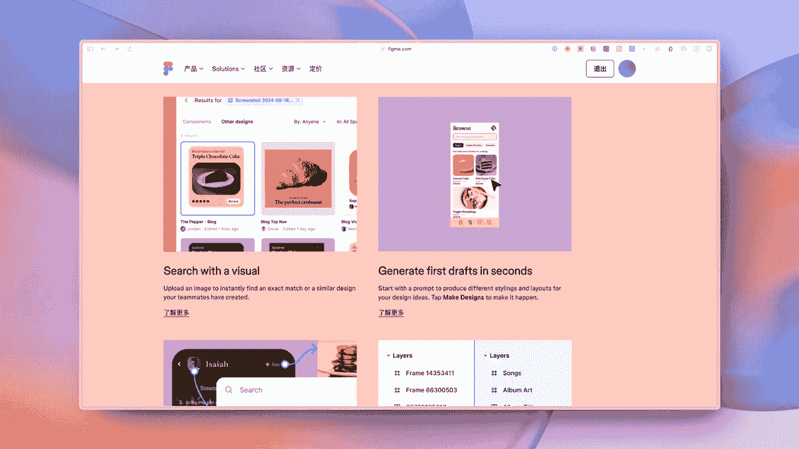
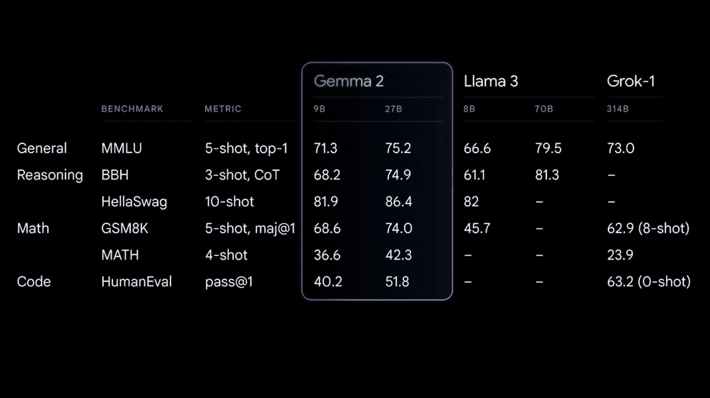
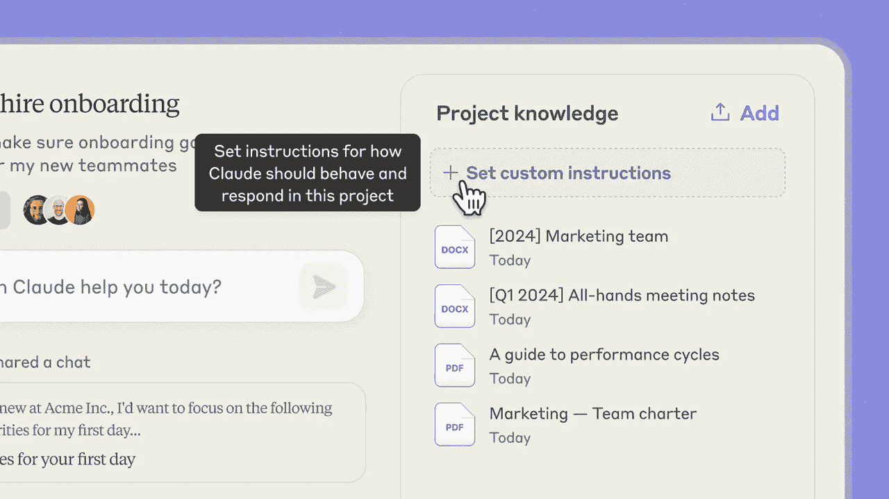
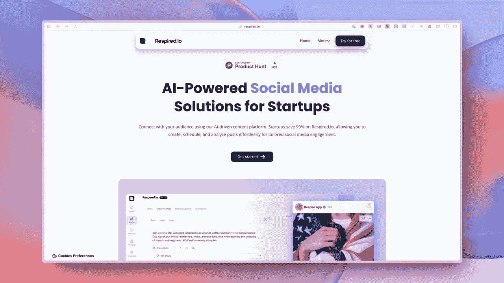
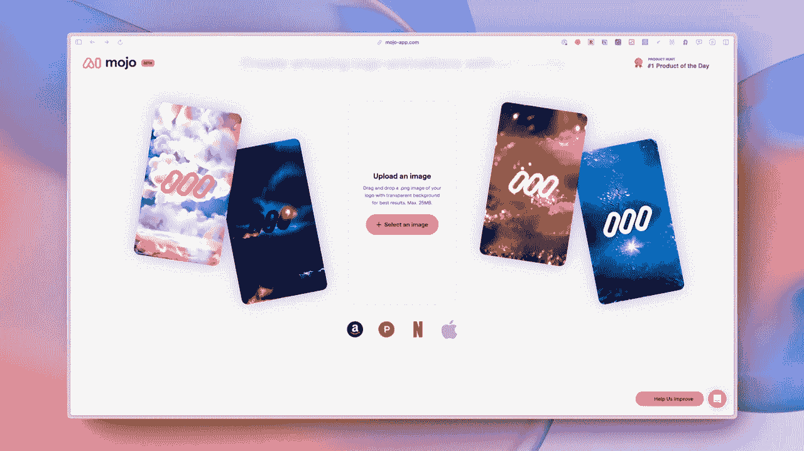
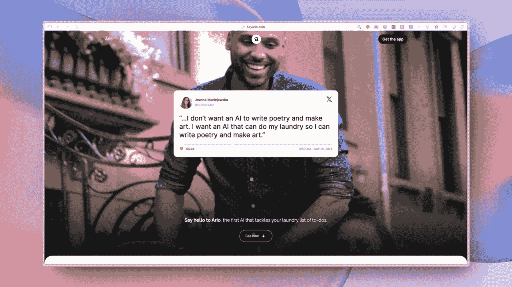
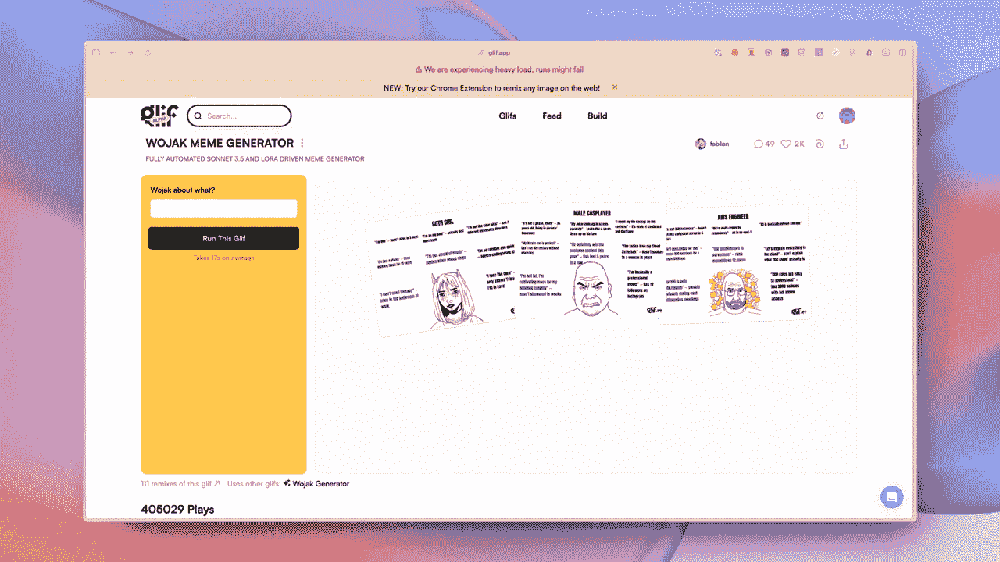

# AIGC Weekly #78

> 来源：[https://waytoagi.feishu.cn/docx/ExZldO2xXoJSSdxliskcYdKgn7f](https://waytoagi.feishu.cn/docx/ExZldO2xXoJSSdxliskcYdKgn7f)

> 🔗 原文链接： h[ttps://quail.ink/o](https://quail.ink/op7418/p/aigc-weekly-78)p7418/p/aigc-wee...

> ⏰ 发表时间：2024-07-01

# 上周精选 ✦

## Figma Config 大会发布多项AI能力

Figma 上周发布会终于带来了一大波更新，饱受诟病的 UI 界面升级，一大堆 AI 功能以及 PPT 制作和演示的能力。

AI 能力的话跟我们预期的都差不多，没有惊喜：

+   **AI 自动生成设计稿**：输入文字需求后 Figma 会自动检索需要的[设计资源生](https://x.com/op7418/status/1806288374598344973)成设计稿。从已经开通权限的人 尝试视频 来看，不支持使用自己的设计系统。

+   **AI 自动生成交互原型**：不需要自己连线，AI 可以自动链接合适的设计稿页面生成交互原型。

+   **AI 自动整理和优化设计稿：**

+   上传图片自动搜索相似的组件和页面设计稿

+   AI 可以自动重命名所有的图层名称

+   自动表格、列表和卡片填充虚拟内容

+   上传后的图片支持一件抠图去背景

+   支持一键将所有设计翻译为别的语言

AI 能力目前没有全部开放，只提供给有限的用户测试。

他们还发布了一个最应该发布的能力 PPT 创建和演示功能 Figma Slides，现在不需要了进入 Figma Slides 之后可以在 PPT 编辑和画布编辑之间切换，演示需要的功能也都有。目前测试阶段免费，后续 6 美元一个月也不贵。

## Google 开源了 Gemma 2 的 9B 和 27B 版本

谷歌宣布全球推出 Gemma 2，这是一款性能卓越、高效的开源模型，旨在帮助解决人类面临的一些最迫的问题。Gemma 2 有两种规格，分别为 90 亿和 270 亿参数，它们在推理效率和性能上都有显著提升，尤其是 270 亿参数的版本，性能甚至能与更大的模型竞争，同时降低了部署成本。

Gemma 2 支持多种硬件和 AI 框架，包括 Hugging Face Transformers、JAX、PyTorch 和 TensorFlow 等，使得模型能够在不同的环境中快速运行。

此外，谷歌还提供了 Gemma Cookbook，包含了实用的示例和指南，帮助用户构建应用程序并针对特定任务微调模型。

## Claude 更新 Projects 功能

Claude 上周更新了 Projects 功能，适用于所有专业版和团队版客户，使用 Claude 3.5 Sonnet提供服务。

每个Projects包括一个 200K 的上下文窗口，相当于一本 500 页的书，因此用户可以添加所有相关文件、代码和见解。

同时还可以为每个Projects自定义对应的提示词，，包括指示Claude使用更正式的语调或从特定角色或行业的视角回答问题。

Claude 团队用户还可以将与 Claude 的最佳对话的快照分享到团队的共享项目活动动态中。

Artifacts 加上 Projects 让 Claude 产品体验变的非常好，他们在做产品上选择了跟 Open AI 完全不一样的路线，Open AI 完全是为了提高渗透率和获取数据设计的，Claude 在体验和这两者取得了更好的平衡。

# 其他动态 ✦

+   [Runwa](https://x.com/op7418/status/1806868643852251554)y 的Gen-3视频生成模型开始内测，这里有 我的评价 。

+   Luma 上线了 [首尾帧生成视频 ](https://x.com/LumaLabsAI/status/1807150009907097908)的能力。

+   Gemini 1.5 Pro 上 200 万 Token 上下文 向所有开发者开放。

+   [chara](https://x.com/character_ai/status/1806336150988353902)cter ai 的语音通话功能 全量上线 了需要在 app 里才能体验。

+   Etched发布了号称 史上最快的 AI 芯片 Sohu ，Sohu 每秒运行 Llama 70B 超过 500,000 个Token*。一台 8xSohu* 服务器可取代 160 台 H100。

+   [Comfy o](https://civitai.com/articles/5884)rg Invoke 和 Civitai一起发起了 开放模型倡议 。致力于打造与闭源模型和工作流程具有相同或更高质量的开源模型。

+   Chrome 已经可以使用本地的[ Gemi](https://x.com/op7418/status/1805566529876246684)ni 模型了。只需要两行代码 就能调用 。

+   Open AI 收购了 [多人协作工具 Multi ](https://x.com/with_multi/status/1805258780898386368)。

+   字节发布了 [Marscode ](https://www.marscode.com/)，一个在线的 AI IDE 工具，提供代码自动完成、生成、解释、调试、插件开发与部署等功能。

# 产品推荐 ✦

## Respired：社交媒体批量管理

一个针对初创企业的 AI 驱动的社交媒体管理平台，通过分析、内容创建、多渠道调度和性能分析等功能，帮助企业高效地管理社交媒体，

+   **多渠道社交媒体管理 **: 该平台支持在多个社交媒体渠道上调度内容，帮助企业保持一致和有影响力的社交媒体存在。

+   **详细的分析和优化工具 **: Respired.io 提供详细的性能分析，帮助企业根据关键指标优化社交媒体策略。

## [Mojo：制作 Logo 动画](https://mojo-app.com/ai)

用 Animatediff 和 Controlnet 制作 Logo 动画，这个流程早就有了，没想到这个也能被打包成产品，从 Demo 来看优化的不错。

## Eureka：第一位 AI 医生专注于糖尿病和甲状腺疾病

可以在现实世界中下订单实验室并提供护理。它像医疗保健提供者一样由健康保险覆盖，并已经在美国与甲状腺患者合作。它比美国大多数护理快 90 倍，9 成用户希望继续使用 Eureka 的建议。

Eureka 像医生一样思考，像侦探一样推理。在任何护理开始之前，经过董事会认证的医生会审查尤里卡的建议，以确保一切井然有序。目前专注于内分泌疾病，如甲状腺问题和糖尿病。

## Ario：忙碌父母的人工智能助手

Ario 是一款专注于帮助用户处理日常琐事的人工智能助理。它能够提前通知用户子女的牙医预约是否与工作会议冲突，根据孩子的兴趣爱好推荐夏季活动，以及在女儿生日一个月前提供个性化的派对建议。Ario 还能与亚马逊账户同步，确保用户不会错过退货期限。

## [WOJAK MEM](https://glif.app/@fab1an/glifs/clxtc53mi0000ghv10g6irjqj)E GENERATOR： meme图片生成器

上周很火的一个小工具，由 Glif 开发的完全自动化的 Wojak meme生成器。效果很好。

# 精选文章 ✦

## Andrej Karpathy 在 UC Berkeley 的演讲

认为我们正进入一个新的计算时代,类似1980年代的计算机革命。将大语言模型比作新的"操作系统",处理tokens而非bytes。提到电影《她》,展示了AI在情感智能方面的潜力。引用电影《我,机器人》,探讨了AI广泛应用可能带来的社会影响。

## [扭转人工智能局面-iA](https://ia.net/topics/turning-the-tables-on-ai)

现在每家公司的产品都在利用 AI 直接给出答案。让用户跳过思考的过程。著名的写作工具 iA 想反过来用 AI 帮助你进行思考。

1.  不要问人工智能，让人工智能问你：让 ChatGPT 提示我们。让 AI 向你询问有关你所写内容的问题。督促自己清楚地表达自己真正想说的话。比如：我想写关于[主题]的[格式]。一次问一个问题，迫使我解释我的想法。

1.  不要卖偷来的东西——自己创造：如果ChatGPT生成了我想保留的有用内容怎么办？可以将它作为注释粘贴，并标记为AI生成。使用引号和标记，并注明其来源。

1.  不要模仿。要创造：如果人工智能正好说出了我想说的话怎么办？重新思考并用自己的话来表达。先问问生成的内容是否真的正确。

## 从「文风测试」到「 OC 分析」，AI产品的一波流也有春天

王登科把这种一波流 AI 小工具总结了一套方法论出来，可以持续产出爆款还是挺强的能力。

介绍了两个 AI 产品 —— 文风测试和 OC 分析 —— 的创意、开发、流行和商业化过程，以及它们如何以低成本和小模型实现大规模用户接入和产品传播。

+   **AI 产品不一定需要大模型 **: 文风测试和 OC 分析的成功展示了小模型在特定场景下的高效和低成本，反对了大模型无脑使用的趋势。

+   **用户兴趣是产品流行的关键 **: 这两个产品的流行表明，从用户的兴趣和需求出发，即使是简单的工具也能获得广泛的关注和使用。

+   **产品的 “一波流” 特性 **: AI 产品可能会有明显的流行周期，但即使是短暂的流行也能带来实际的商业价值和用户增长。

+   AI 产品的商业化并非唯一目标 : 主创团队的纯粹兴趣驱动和对技术的热爱也是产品成功的重要因素之一。

+   **AI 内容产品的未来可能性 **: 作者认为，AI 产品如果能够从真实的需求出发，即使是单一形态或一波流，也有可能成为爆款，并且这种成功是可以复现的。

## [苹果智能和 AI 极简主义](https://www.ben-evans.com/benedictevans/2024/06/20/apple-intelligence/)

苹果公司在人工智能领域倡导了一种与 AI 极大主义相对立的策略，认为生成式 AI 应该作为基础设施而非平台或产品，强调将 AI 集成到设备中，以提供新的功能和能力。

+   苹果认为生成式 AI 应该作为基础设施，而非独立的产品或平台。

+   苹果的 AI 策略强调将 AI 集成到设备中，利用设备上的用户上下文来提供个性化的功能。

+   苹果区分了上下文模型和世界模型，后者可能会成为可互换的插件。

+   苹果的策略可能会减少对云计算的依赖，推动 AI 技术的商品化。

+   OpenAI 在与苹果合作中的地位并不稳固，苹果可能会将更多功能转移到自己的模型上。

+   AI 技术的未来可能不会有一个单一的赢家，而是会有多个参与者共存。

+   苹果的 AI 芯片和软件栈的发展可能会推动更多的 AI 计算从云端转移到边缘设备。

## [**I Will Fucking Piled**](https://ludic.mataroa.blog/blog/i-will-fucking-piledrive-you-if-you-mention-ai-again/)rive You 如果你再提 AI 的话

作者是一位数据科学家，对 AI 技术的最近进展持怀疑态度，批评了 AI 技术在商业领域的盲目追求和过度推广，强调企业应该解决基础问题和文化问题，而不是盲目投入 AI 项目。

1.  AI 技术的进步并不意味着所有公司都需要投入 AI 项目 ：作者认为，尽管 AI 技术有其潜力，但许多公司在追求 AI 技术时缺乏明确的目标和实际需求。

1.  企业应该优先解决基础问题和文化问题 ：在谈论 AI 之前，企业应该首先关注如何改善运营效率和公司文化，而不是追求未经证实的 AI 解决方案。

1.  AI 技术的推广往往充满虚假宣传和不切实际的期望 ：作者批评了 AI 技术在商业领域的盲目推广，指出许多 AI 项目和演示是虚假的，没有达到宣传的效果。

1.  AI 技术的应用需要谨慎考虑，而不是盲目跟风 ：作者认为，企业在考虑使用 AI 技术时，应该有明确的用例和目标，而不是仅仅因为 AI 是一个热门话题而去追求。

1.  AI 技术可能不会像人们预期的那样改变世界 ：作者提出了对 AI 技术未来发展的三种可能情况，并强调，即使 AI 技术取得了突破，也不一定意味着它会在所有领域产生深远影响。

1.  AI 技术的过度推广可能导致资源的浪费 ：作者认为，企业在 AI 技术上的过度投资可能会导致对其他更重要社会问题的资源忽视。

## 惊喜，你的数据仓库可以用于RAG

介绍了如何利用现有的数据仓库功能构建一个简化的、基于RAG 的 AI 系统。

1.  数据成熟度是实施 RAG 的关键 : 在投资 RAG 之前，组织需要确保已经建立了一定的数据基础设施，包括日志记录、ETL、分析和仪表板等。

1.  RAG 管道的构建需要明确的评估和测试 : 在实施 RAG 之前，应该建立一个评估框架，并对假设进行测试，以确保 RAG 的实施能够提高结果的质量。

1.  数据仓库的先进功能可以简化 RAG 管道 : 利用数据仓库（如 BigQuery）的先进功能，如计算文本嵌入、创建向量索引和进行最近邻向量搜索，可以简化 RAG 管道的构建，减少对外部系统的依赖。

1.  文本嵌入式搜索与关键词搜索的权衡 : 虽然文本嵌入式搜索在处理复杂查询时效果更好，但关键词搜索更为简单直接。在某些情况下，可以考虑使用混合搜索策略。

1.  RAG 管道的实施应该根据组织的实际情况而定 : 不同的组织可能适合不同的解决方案。在选择是否使用数据仓库构建 RAG 管道时，应考虑到成本、延迟和系统复杂性等因素。

## ESM3：用语言模型模拟5亿年的进化

EvolutionaryScale 公司推出了 ESM3，一种前沿的生物学语言模型，能够模拟 5 亿年的进化过程，通过对序列、结构和功能进行多模态推理，生成新的蛋白质，为医药、生物技术和清洁能源等领域的研究提供了强大的工具。

ESM3 通过多模态推理能力，使得科学家能够以前所未有的精度控制新蛋白质的生成。例如，通过多模态提示，ESM3 能够为 PETase 的活性部位设计一个潜在的骨架，这是一个能够分解聚偏二酸（PET）的酶，对于减解塑料垃圾具有重要意义。

EvolutionaryScale 公司还展示了 ESM3 如何通过模拟 5 亿年的进化过程来生成新的荧光蛋白（GFP）。通过对自然 GFP 核心残基结构的推理，ESM3 能够生成新的 GFP 候选蛋白，其中一种蛋白质 esmGFP 与自然界中最接近的荧光蛋白序列相比，相似性仅为 58%。这种蛋白质的生成，相当于模拟了超过 5 亿年的自然进化过程。

# 重点研究 ✦

## Adam-mini：使用更少的学习率获得更多

Adam-mini可以大幅优化模型训练的效率：将AdamW的内存占用减少了45%-50%。

同时在大型语言模型的预训练、微调和RLHF任务上,达到了与AdamW相当或更好的性能。

Adam-mini显著提高了训练吞吐量,例如在Llama2-7B预训练中比AdamW快49.6%。

Adam-mini的核心思想是：

减少Adam中学习率资源的使用,通过根据Hessian矩阵结构将参数分成块,并为每个块分配单一但有效的学习率。

## 用 GPT-4 找出 GPT-4 的错误

已经离职的OpenAI超级对齐负责人 Jan Leike的研究。

基于人类反馈的强化学习（RLHF）本质上受限于人类评估模型的能力——它无法很好地扩展。

可扩展监督的目的是通过使用AI来帮助人类进行评估，从而解决这个问题。浴室尝试了一个最简单的想法：训练一个评论员来指出缺陷。

直观地看，确认一个缺陷应该比找到它更容易。

实际上，用RLHF训练的代码评论员找到了比人类训练师更多的错误。

它甚至可以在四分之一的ChatGPT生产数据中发现人类评为完美的缺陷（不仅限于代码）。

研究代码，因为它是一个目前模型可以帮助解决的实际任务，但这些技术可以应用于任何任务。

## [AuraSR：图像超分模型](https://t.co/7V5vRG21KI)

AuraSR，一个从 GigaGAN 论文中衍生出的具有 6 亿参数的上采样模型。

模型完全开源，可以将图片放大四倍并且补充细节，也可以重复进行放大。

从演示和我自己尝试的效果来看相当不错，速度也很快，非写实内容也可以处理。

## MOFA-Video：多种方式混合的视频控制

腾讯开源了一个非常全面的视频控制方式 MOFA-Video

支持通过箭头控制视频内容的运动方向，类似运动笔刷。

还支持将原有视频的面部表情迁移到新生成的人脸视频上。

上面两种控制方式也可以同时在一个画面中使用。

为了实现这两种控制，他们设计了多个域感知运动适配器，用于控制视频生成过程中的运动。

## EvTexture：视频超分项目

随着视频生成的不断成熟，视频超分算法也越来越重要，目前的超分工具在细节补充上都不太好。

EvTexture 这个视频超分算法可以非常好的补充视频缺失的的细节和纹理，项目将会开源。

通过利用事件信号的高频细节，更好地恢复视频超分辨率中的纹理区域。

这是一套强大、开放可用的、专门为代码优化任务设计的预训练模型。

LLM编译器建立在 Code Llama 的基础上，增强了对编译器中间表示（IRs）、汇编语言和优化技术的理解。该模型已经在包含 5460 亿个 LLVM-IR 和汇编代码标记的庞大语料库上进行了训练，并经过指令微调以解释编译器行为。

## Cambrian 1 - Vision Multimodal LLM

纽约大学发布 Cambrian 1 - Vision Multimodal LLM，击败了几乎所有 8-34B 的其他闭源竞争者。

研究使用LLMs和视觉指导调整作为接口，评估各种视觉表示，为不同模型和架构提供新的见解--基于对超过 20 个视觉编码器进行实验，包括自监督、强监督或二者的组合。

对现有的 MLLM 基准进行了批判性审查，解决了整合和解释来自各种任务结果的困难，并引入了一个新的以视觉为中心的基准，CV-Bench。为了进一步改善视觉基础。

提出了空间视觉聚合器（SVA），这是一个动态的、具有空间意识的连接器，将高分辨率的视觉特征与LLMs集成在一起，同时减少令牌数量。