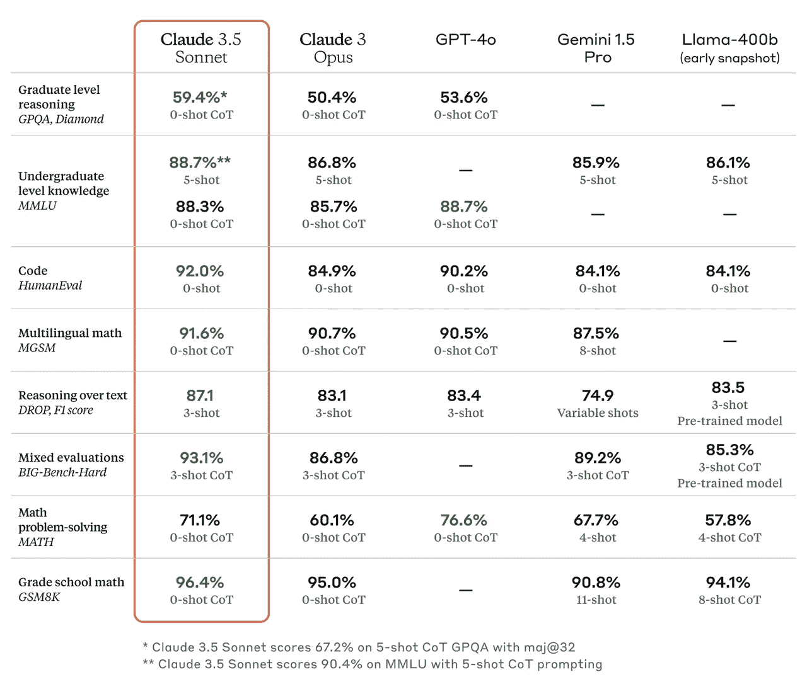
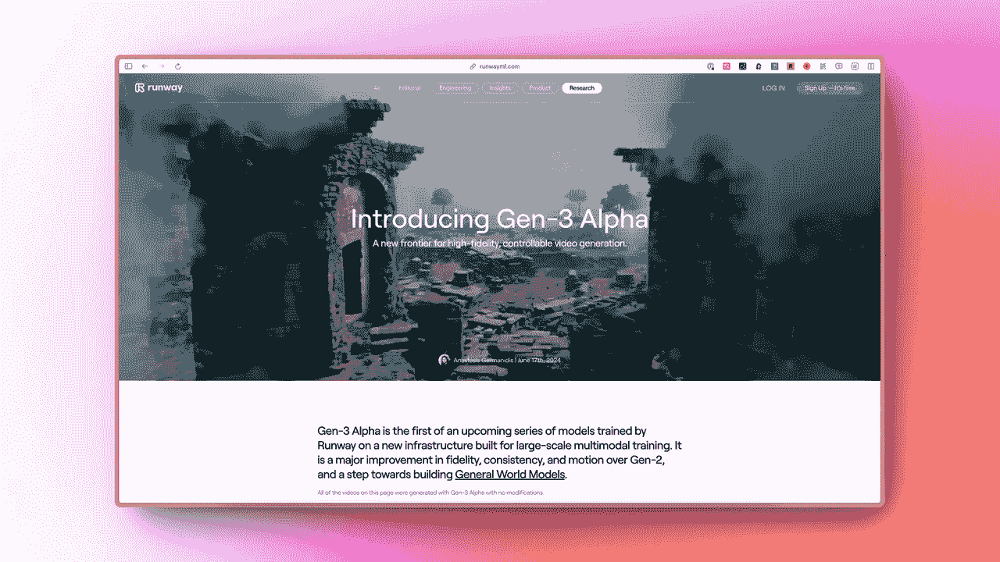
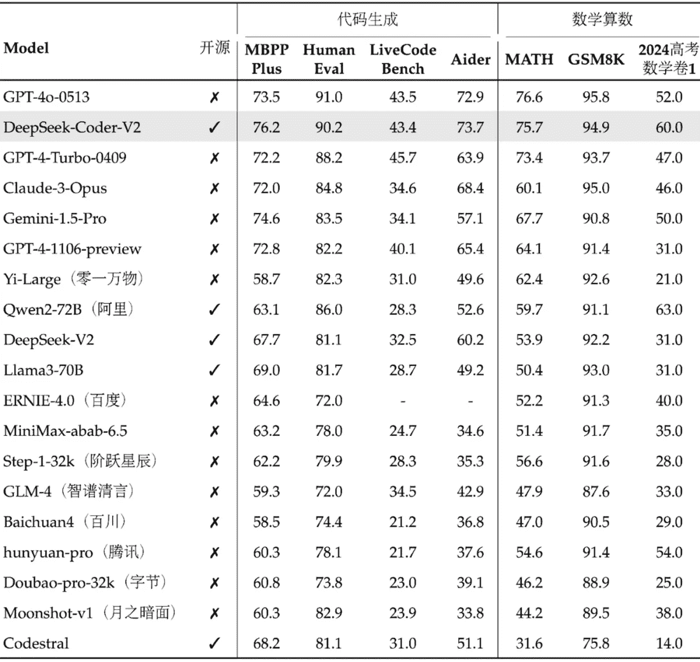
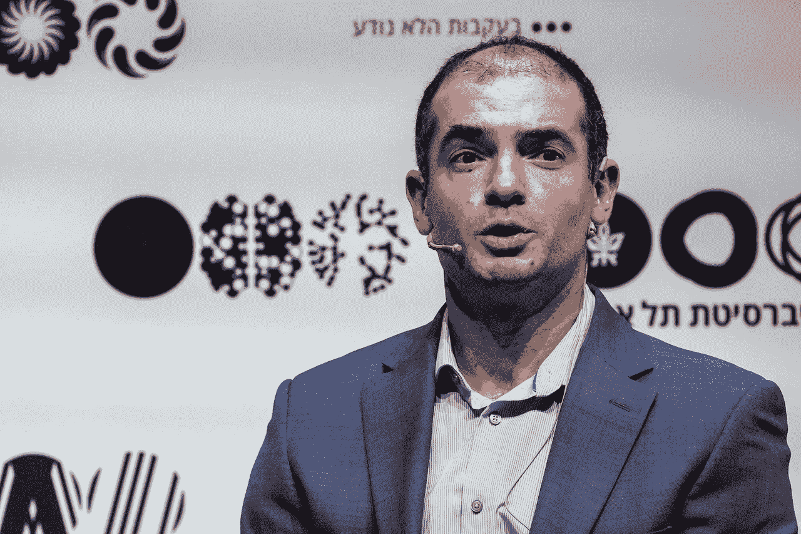
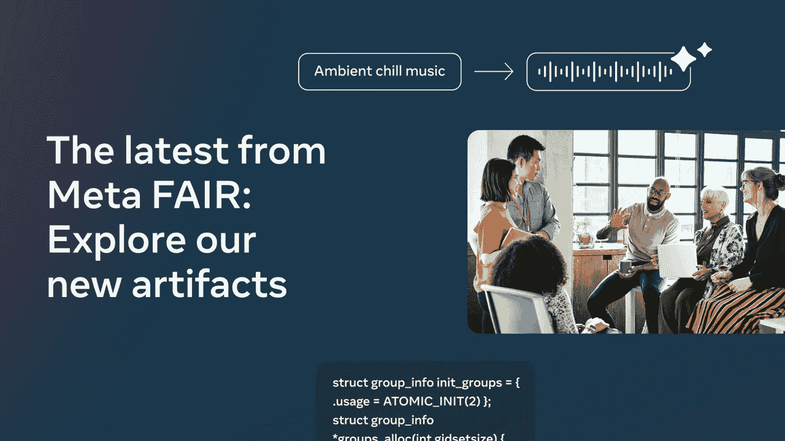
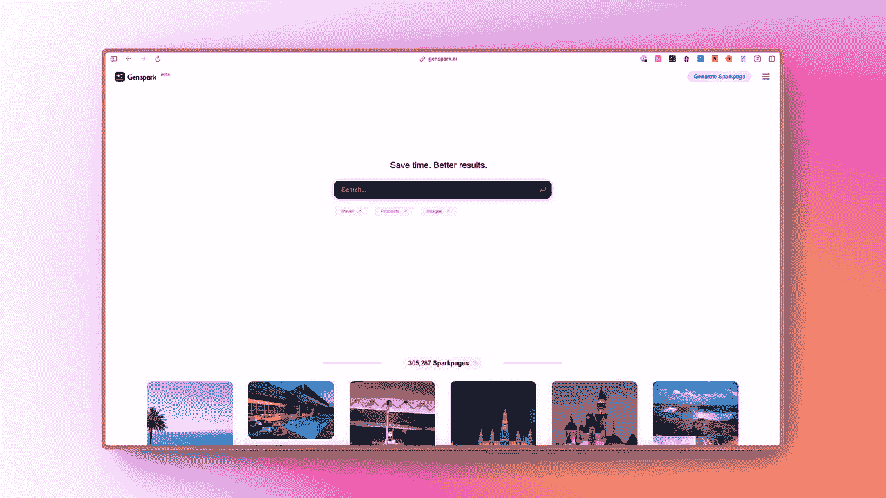
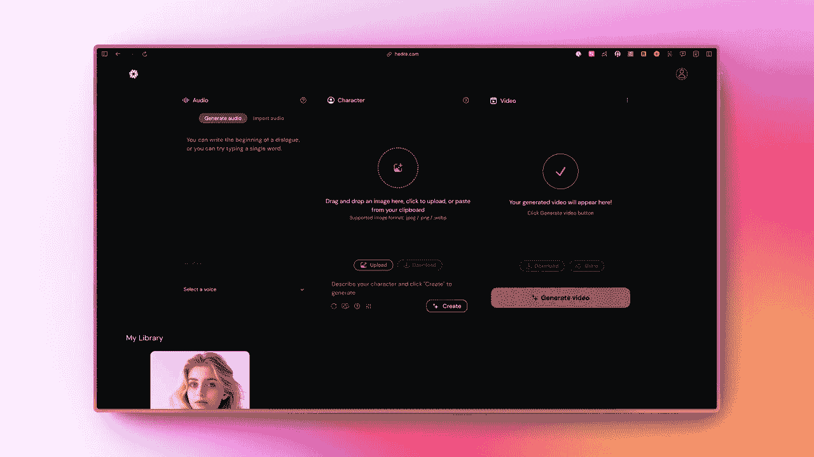
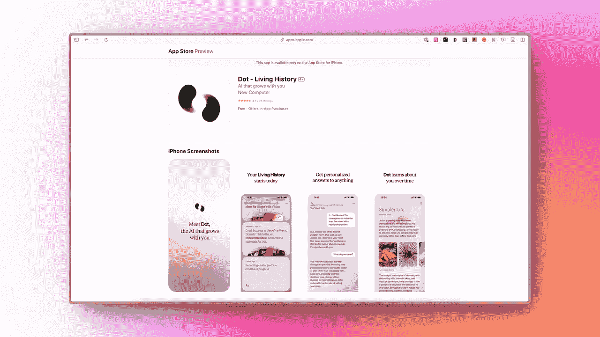
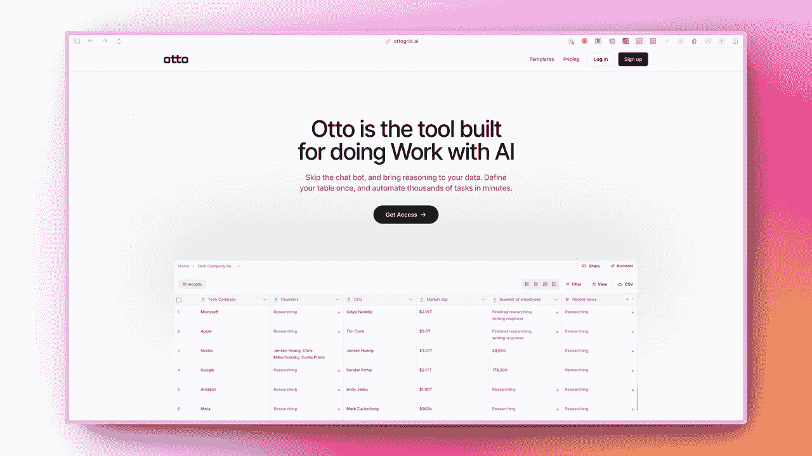
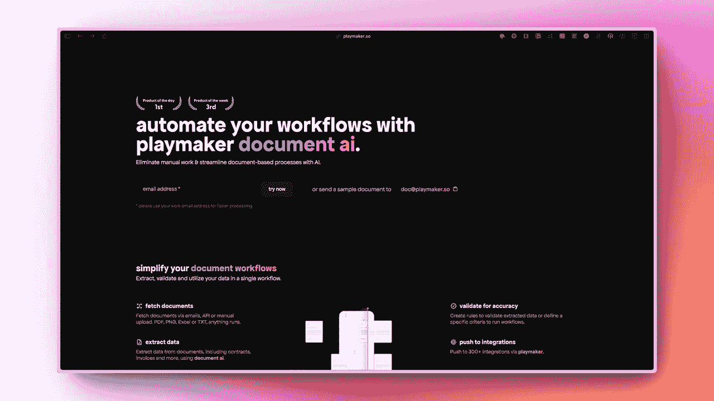

# AIGC Weekly #77

> 来源：[https://waytoagi.feishu.cn/docx/XNhkd1UlhoISh7xvA5ucj3gJn9g](https://waytoagi.feishu.cn/docx/XNhkd1UlhoISh7xvA5ucj3gJn9g)

> 🔗 原文链接： h[ttps://quail.ink/o](https://quail.ink/op7418/p/aigc-weekly-77)p7418/p/aigc-wee...

> ⏰ 发表时间：2024-06-24

# 上周精选 ✦

## Anthropic 发布 Claude 3.5 Sonnet

Anthropic 虽然关注LLM 的可解释性并且在上面投入了非常多的资源，但是看起来并没有影响他们的研发进度，在 GPT-4o 推出一个月之后就推出了和 4o 差不多的 Claude 3.5 Sonnet，不知道 3.5 Opus 会有多强。

### Claude 3.5 Sonnet 介绍

Anthropic 推出了Claude 3.5更新，首先更新的是 Claude 3.5 Sonnet。

Claude 3.5 Sonnet 在评分上已经全面超过了Claude 3 Opus。 跟GPT-4o比就MMLU差一些。而且Claude 3.5 Sonnet 现在可以免费使用

Claude 3.5 Sonnet 的运行速度是 Claude 3 Opus 的两倍。主动编码评估中，Claude 3.5 Sonnet 解决了 64%的问题，而Claude 3 Opus 解决了 38%。

### Artifact

另外Claude. ai还推出了新的交互方式 Artifact。

当用户要求 Claude 生成代码片段、文本文件或网站设计等内容时，这些 Artifact 将出现在他们的对话旁边的专用窗口中。

在这里他们可以实时地看到、编辑和构建 Claude 的创作，并将 AI 生成的内容无缝地整合到他们的项目和工作流中。

这个功能对于很多没有代码编译环境的普通用户来说非常好用，立刻可以获得代码的运行结果，甚至可以快速做一些小的 Demo。

## Runway 发布视频生成模型 Gen-3

在可灵和 Luma 的压力下，沉寂了半年的视频生成龙头 Runway 终于坐不住了，发布了自己的 DiT 视频生成模型 Gen-3。

从 Demo 和一些内部人员发布的视频来看，模型生成的视频质量甚至比 Sora 还要高很多，主要在美学表现和光影表现上。

基于视频和图像的联合训练，Gen-3 Alpha 将为 Runway 的文本转视频、图像转视频和文本转图像工具提供动力，现有的控制模式例如 Motion Brush、高级摄像头控制、导演模式，以及即将推出的更精细控制结构、风格和动作的工具。

**模型的主要特点有：**

+   **细粒度的时间控制 **：Gen-3 Alpha 经过高度描述性、时间密集的字幕训练，使得它能够进行富有想象力的过渡，并精确地对场景中的元素进行关键帧定位。

+   **逼真的人像表现 **：Gen-3 Alpha 擅长生成具有丰富动作、手势和情感的生动人物形象，拓展了新的叙事机会。

+   **为艺术家训练 **：Gen-3 Alpha 的训练是研究科学家、工程师和艺术家跨学科团队的协作努力。 它旨在解释各种风格和电影术语。

同时 Gen-3 还支持对模型进行更细力度的微调，实现更加风格统一和一致的角色，并且针对特定的艺术和叙事需求等功能进行定位。不过这个是 2B 的能力，用来服务各种影视公司的。

## Deepseek 发布代码模型及代码助手

Deepseek 上周也发布了他们的 DeepSeek-Coder-V2 代码模型，总参数 236B，激活 21B。在代码能力上超过了 GPT-4 turbo，仅次于 GPT-4o。

模型还是开源的，主要有两个模型：

+   DeepSeek-Coder-V2：总参 236B（即官网和 API 版模型），单机 8 80G 可部署，单机 8 80G 可微调（需要技巧）。

+   DeepSeek-Coder-V2-Lite：总参 16B，激活 2.4B，支持 FIM，代码能力接近 DeepSeek-Coder-33B（V1），单卡 40G 可部署，单机 8*80G 可训练。

除了代码模型本身外他们还在自己的模型测试平台上快速适配了类似 Artifact 的代码自动渲染功能。

在输出代码结束后点击运行，这功能就会把代码渲染成网页或者图表。

## Ilya 出走后成立新公司 SSI

Ilya 从 Open AI 走了以后的去向终于确定了，这下真是三家分晋了，原来的的 Open AI 分裂成了 SSI 以及 Anthropic。

SSI 全称为 Safe Superintelligence Inc，这个”安全的超级智能”名字就是他们的使命、名字以及全部产品的路线图，这是唯一的关注点。

另外Ilya接受的彭博社的一篇采访也透露了这个公司一些其他的信息：

+   Ilya 拒绝透财务支持者的名字，也拒绝透露筹集了多少资金。

+   新公司将通过在AI系统中融入工程突破来实现安全，而不是依赖临时的保护措施。

+   Sutskever有两位合伙创始人。一个是投资者Daniel Gross，曾任Apple Inc.的AI负责人。

+   另一个创始人是Daniel Levy，他在OpenAI与Ilya合作训练模型。

+   Ilya 说，他已经花了多年时间思考安全问题，并且已经有了一些方法。可能很快会有一些成果出来。

+   Ilya 新公司的目标可以比喻为一个能够自主开发技术的巨大数据中心，这个系统将比 LLM 更通用、扩展性更强。

## Meta 集中发布了四个开源模型

Meta 上周集中发布了四个开源模型，分别是：

+   Meta Chameleon7B 和 34B 语言模型

+   Meta Chameleon 可以在单一的模型架构中生成文本和图像，类似于 GPT-4o，不过少一个音频模态。

+   Chameleon是一组早期融合、基于Token的混合模态模型，能够按照任意顺序理解和生成图像与文本。

+   在图像描述生成任务中达到领先水平，在纯文本任务中也超越了Llama-2，还能进行复杂的图像生成。

+   Meta Multi-Token Prediction 用于代码补全的模型

+   Meta Multi-Token Prediction通过多Token预测来构建更好、更快的大语言模型（LLM）。这种方法训练语言模型一次预测多个未来的词语，而不是传统的逐词预测。这不仅提升了模型的能力和训练效率，还提高了速度。

+   Meta JASCO 音乐模型

+   Meta JASCO 音乐模型可以接受各种条件输入，如特定的和弦或节拍，从而提高对生成音乐输出的控制。

+   具体来说，结合时间模糊技术与信息瓶颈层来提取与特定控制相关的信息。这使得在同一个文本到音乐生成模型中能够结合符号和基于音频的条件。

+   AudioSeal 音频水印技术

+   AudioSeal，这是一种专为本地化检测AI生成语音设计的音频水印技术，可以在更长的音频片段中精准定位AI生成的部分。AudioSeal通过专注于检测AI生成内容，而非隐写术。

+   AudioSeal以往方法相比，检测速度提升了多达485倍，非常适用于大规模和实时应用。

# 其他动态 ✦

+   快手可灵推出了 [图片生成视频的模式 ](https://x.com/Kling_ai/status/1804064065670779233)，支持视频延长，最长可以延长到 3 分钟。

+   Midjourney 推出了 [风格混合和自定义模型混合功能 ](https://x.com/midjourney/status/1803824810713133381)，同时支持混合时的权重调整，现在已经支持 Google 授权登录。

+   [谷歌推出了 Ge](https://ai.google.dev/gemini-api/docs/caching?hl=zh-cn)mini 1.5 Flash 和 1.5 Pro 的 上下文缓存功能 。避免了每次请求都向 LLM 输入同样的提示词和上下文。大幅降低使用模型时的 Token 消耗和费用。

+   C[omfyUI 作者、](https://www.comfy.org/)StableSwarmUI作者、ComfyUI-Manager作者等 ComfyUI 核心贡献者一起成立了 Comfy Org 。

+   Luma 新的 [视频控制方式 ](https://x.com/LumaLabsAI/status/1802678788490494128)开始内测，支持对视频画面中的内容分区域变化，并且跟已有内容融合。

+   [谷歌 V2A ](https://deepmind.google/discover/blog/generating-audio-for-video/)将视频像素与自然语言文本提示结合起来，为视频中的动作生成丰富的声音景观。

+   [Eleven La](https://www.videotosoundeffects.com/)bs 开源了基于他们的文本生成音效工具开发的， 视频生成音效工具 ，相当于谷歌 V2A 的弱化版本。

+   [HeyGen 已在 A 轮](https://www.heygen.com/article/announcing-our-series-a)融资中 筹集了 6000 万美元 ，愿景为通过让所有人都能以视觉方式讲述故事来帮助企业成长。

# 产品推荐 ✦

## Genspark：可以生成文章的 AI 搜索

主要特点是可以根据用户的搜索内容快速生成对应的内容页面。

Genspark 是一个 AI 智能体引擎，能够基于用户的查询实时生成自定义页面，称为 Sparkpages。

这些页面是动态生成的，将网络知识精炼并整合为一个完整的页面。每个 Sparkpage 都内置了一个 AI 副驾驶，通过回答用户的问题和提供定制的信息来帮助用户。

## Hedra：通过文字及图片生成说话视频

Hedra 的目标是通过创新技术赋予创作者完全的创意控制权，让他们能够想象和创造世界、角色和故事。

Character-1 是 Hedra 推出的一个工具，它能够生成具有表现力和可操控性的人物视频，为创作者提供了一个新的视觉故事讲述平台。

Hedra 计划推出 “Worlds” 功能，这将使用户能够构建自己的虚拟世界，进一步扩展了创作者的创造空间。

## [Dot：AI 伴侣应用](https://apps.apple.com/us/app/dot-living-history/id6450016041)

Dot 是由 New Computer 公司开发的一款 AI 伴侣应用程序。该应用程序由 Jason Yuan（前苹果设计师）和 Sam Whitmore（工程师）共同创立，并获得了来自 Lachy Groom、OpenAI Fund 和 South Park Commons 等的 370 万美元融资。

Dot 的独特之处在于它能够记忆用户的对话，并通过这些对话建立对用户的深入理解。它不仅仅是一个更智能的搜索引擎，而是一个关系式 AI 的早期体现。Dot 使用多达 7-10 个不同的 LLMs 和 AI 模型，包括 OpenAI、Anthropic 和 Google 的模型，以创建一个关于用户的 “心理模型”。Dot 的设计目标是在朋友和同事之间的范围内，提供一个温馨、专业且敏感的伴侣。

## Otto：表格形式的 AI 应用

Otto 是一个专为 AI 工作设计的工具，它跳过了聊天机器人的限制，允许用户通过定义一次表格来自动化成千上万的任务。Otto 提供了多种模板，如公司研究、竞争对手格局分析和外向邮件创建器，以展示用户可以用 Otto 构建的内容。

## Playmaker Document AI：文档自动化

Playmaker Document AI 是一款旨在消除手动工作和优化文档工作流程的自动化工具。用户可以通过电子邮件、API 或手动上传方式提交 PDF、PNG、Excel 或 TXT 格式的文档。该工具能够验证提取的数据，确保准确性，并支持多种文档类型，如合同、发票、银行对账单、工资条、简历和身份证明等。用户可以将提取和验证后的数据推送到超过 300 个集成的系统中。

# 精选文章 ✦

## Andrej Karpathy 新课程 LLM 101

会教你从零开始构建一个专门讲故事的 LLM 应用，这个应用可以与AI共同创造、完善并绘制小故事。使用 Python、C 和 CUDA，并且只需很少的计算机科学知识。最终目标是让你对人工智能、LLMs和深度学习有比较深入的理解。目前只有目录，还在施工。

## Lex Fridman 对 Perplexity CEO 的访谈

在 Lex Fridman 的播客中，Aravind Srinivas，Perplexity 的 CEO，探讨了人工智能的未来，特别是搜索引擎和 AI 的结合。Srinivas 强调，AI 提供的答案应该像学术论文一样，有明确的来源支持，以提高准确性和可靠性。他还谈到了 Perplexity 的起源，以及公司是如何通过解决实际问题，如健康保险的复杂性，来发展和完善其产品的。

还讨论了 Perplexity 与 Google 在搜索和答案提供方面的不同之处，以及 Perplexity 如何通过提供直接答案和综合信息来挑战传统的搜索引擎。他提出了关于 AI 如何处理广告和收入模式的问题，并探讨了开源对 AI 安全的重要性。

## [如何建设人工智能数据中心](https://www.construction-physics.com/p/how-to-build-an-ai-data-center)

随着 AI 技术的发展，尤其是LLM如 GPT-4 的训练，对计算能力的需求急剧增加。文章介绍了数据中心的基本结构和运作原理，包括它们的规模、功耗、冷却系统以及如何提高能效。

随着计算需求的增加，数据中心变得越来越大，消耗的能源也越来越多，一些大型数据中心的功率需求已经达到了 100 兆瓦以上。数据中心的能源消耗主要用于计算机硬件和冷却系统，而冷却系统的设计和效率对数据中心的运营至关重要。为了提高效率，数据中心业界引入了能耗效率指标（PUE），并通过改进设备和运营方式不断提高数据中心的能效比。

## HeyGen 公司 CEO 兼创始人 Joshua Xu 的采访

Heygen 公司的使命是通过 AI 替代传统摄像头，使视频内容创作变得更加普及和个性化。他们的技术可以生成全身 AVATAR，并通过 AI 编辑将其组合成最终视频。Haan 公司的产品应用非常广泛，包括营销销售、内部研讨会、学习发展等领域，并支持将视频内容翻译成超过 175 种语言和方言。

Haygen 公司在研究和开发方面面临的挑战，包括将 AI 模型与客户需求相结合，以及在保持视频质量的同时，实现大规模个性化内容的生成。他认为，AI 生成的视频内容将彻底改变企业如何通过视频增长业务、进行沟通和营销。

## 从GTC看英伟达如何一步步迈入3w亿俱乐部

文章详细回顾了从 2016 年到 2024 年间的 GTC 大会，强调了英伟达在人工智能领域的持续创新和市场估值的大幅增长。2016 年，英伟达推出了 DGX-1 和支持 NVLink 的 P100 GPU，标志着 AI 领域的新时代。2017 年，引入了 Tensor 核心的 V100 GPU，进一步巩固了其在 AI 领域的领导地位。到了 2020 年，随着 A100 和 Megatron 的推出，英伟达专注于大型语言模型（LLM）的优化。2021 年，英伟达宣布开发基于 ARM 架构的 Grace CPU，为未来的数据中心解决方案奠定基础。2022 年，推出了针对 LLM 优化的 H100 GPU，以及全新升级的 Omniverse 和 Digital Twin 技术。这些创新不仅推动了英伟达的股价和市值大幅上涨，而且使其成为 AI 浪潮的缔造者之一。

# 重点研究 ✦

## 大规模药物分子量子化学数据集及神经网络模型基准测试

这篇论文介绍了一个叫∇2DFT的新数据集,包含了大约200万个类似药物的分子的量子化学性质。研究人员用这个数据集测试了几种最先进的神经网络模型,看它们在预测分子能量、原子间力和哈密顿矩阵等任务上的表现如何。他们还专门测试了这些模型在优化分子构象方面的能力。总的来说,这个数据集和基准测试为开发更好的量子化学机器学习模型提供了重要资源。

## [魔鬼在细节中：用于细节丰富的样式GAN反演和高质量](https://github.com/AIRI-Institute/StyleFeatureEditor)图像编辑的样式FeatureEditor

StyleGAN Inversion 是一种通过 StyleGAN 生成器的潜在变量来操纵真实图像属性的技术。研究者们一直在探索如何在保证高质量图像重建的同时，实现对图像的灵活编辑。这一过程中需要平衡重建的质量和编辑的能力，以满足不同的应用需求。

通过使用 LPIPS↓ 和 FID↓ 等指标进行评估，StyleFeatureEditor 在重建质量和编辑能力方面都展现出了优势。与传统的编码方法相比，StyleFeatureEditor 能够更好地处理具有挑战性的跨域示例，并且在保持高质量重建的同时，实现了高效的编辑。

## 长视频问答测试:全面评估AI看视频能力

这篇论文介绍了一个叫MMBench-Video的新测试集。这个测试集用来考察AI模型看长视频的能力。它包含了600多个YouTube上的长视频,每个视频都配有好几个问题。这些问题涵盖了26种不同的能力,比如识别物体、理解事件因果关系等。研究人员用这个测试集评估了市面上主流的AI模型,发现专门做视频理解的AI模型表现并不理想,反而是一些通用的大模型表现更好。

## [微软 ](https://huggingface.co/microsoft/Florence-2-base)Florence-2 图像标注模型开源

Florence-2 是一种先进的视觉基础模型，采用基于提示的方法来处理各种视觉和视觉语言任务。Florence-2 可以解释简单的文本提示，执行标题、物体检测和分割等任务。它利用我们的 FLD-5B 数据集，其中包含了 1.26 亿张图像的 54 亿个注释，来掌握多任务学习。该模型的序列到序列架构使其在0-shot 和微调设置中表现出色，证明它是一个有竞争力的视觉基础模型。

Comfyui 插件地址在这里：https://github.com/kijai/ComfyUI-Florence2

## [利用大型语言模型实现视觉压缩](https://arxiv.org/abs/2406.12275)

论文提出了一种名为VoCo-LLaMA的新方法,可以利用大语言模型自身的能力来压缩图像中的视觉信息。

它在视觉指令调优阶段引入了特殊的VoCo压缩 token,通过注意力蒸馏的方式,将语言模型对视觉 token的理解迁移到对VoCo token的理解中。

这样做可以在尽量减少信息损失的同时,大幅度压缩视觉 token的数量,节省计算开销。

VoCo-LLaMA还可以通过持续学习压缩后的视频帧序列,捕捉视频中的时序信息。

该方法在大幅节省计算量的同时,仍然在图像理解和视频问答任务上取得了优异的性能。

## 多语言文本编码器Glyph-ByT5-v2

微软开源的一个文本编码器Glyph-ByT5-v2。

支持使用十多种语言生成图片。

还搭配了一个使用这个文本编码器的 SDXL 模型，可以直接生成中文海报和内容。

从演示来看排版都挺好的。

1.  创建了一个高质量的多语言字形文本和图形设计数据集，包含超过100万个字形文本对和1000万个图形设计图像文本对，覆盖另外九种语言；

1.  构建了一个多语言视觉段落基准数据集，包括1000个提示，每种语言100个，用于评估多语言视觉拼写准确性；

1.  采用最新的步进感知偏好学习方法，提高了视觉美学质量。