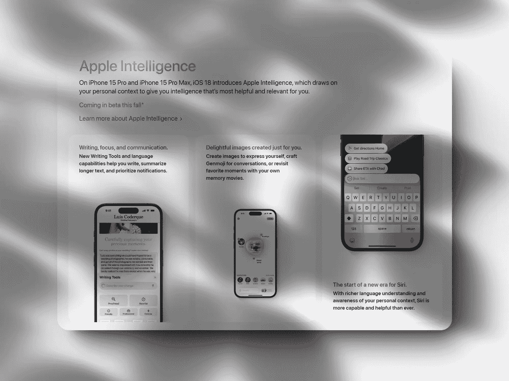
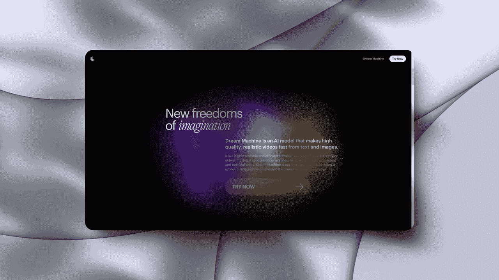
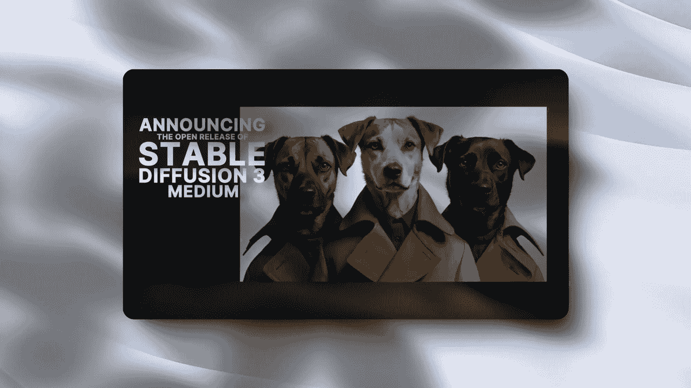
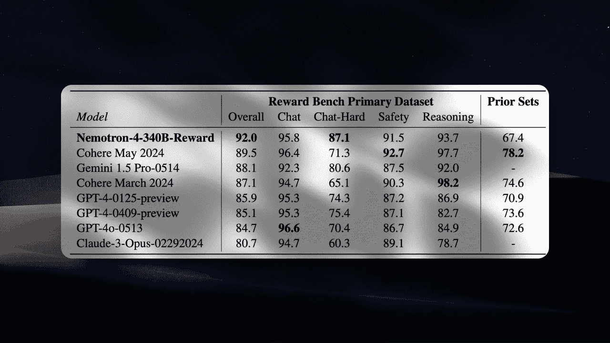
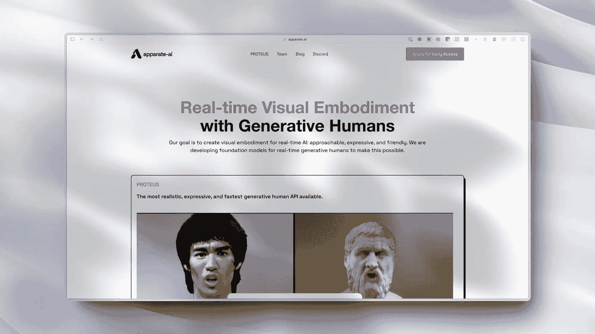
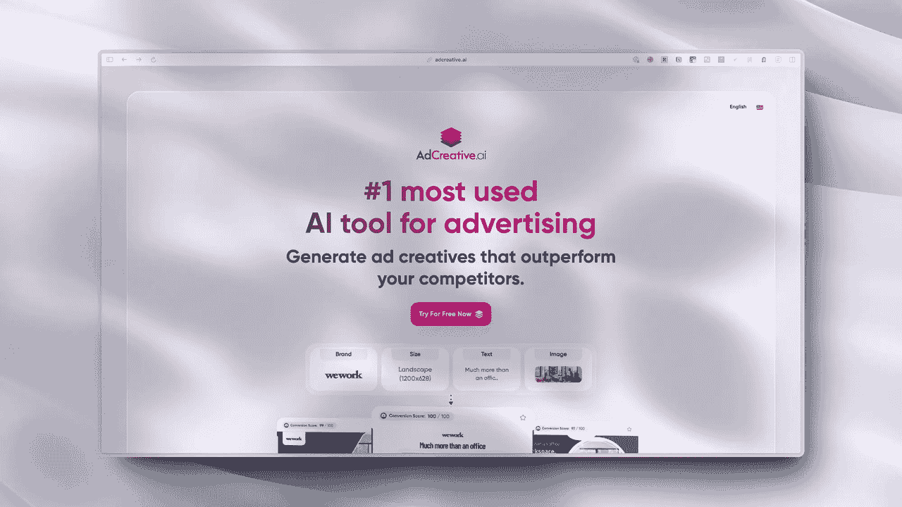
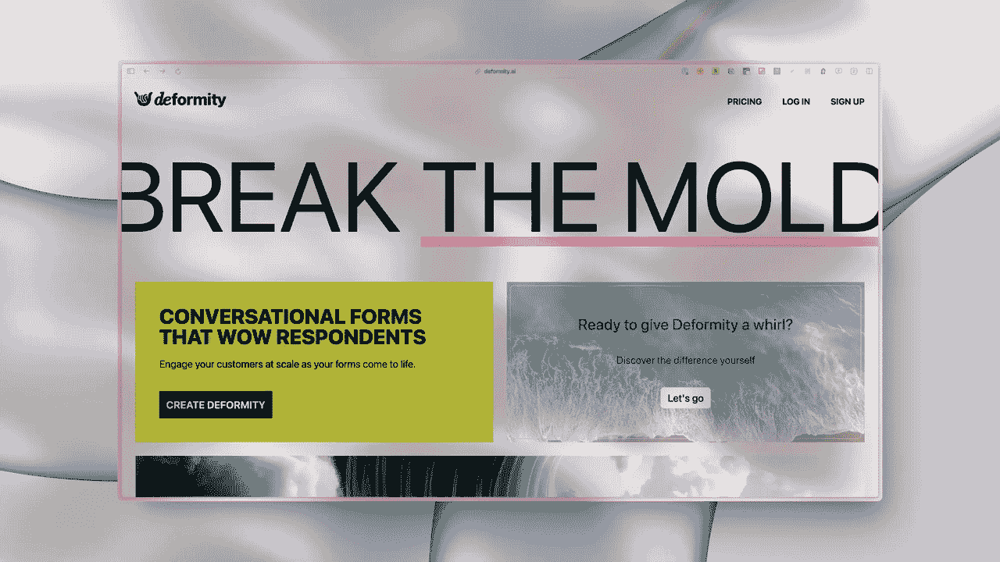
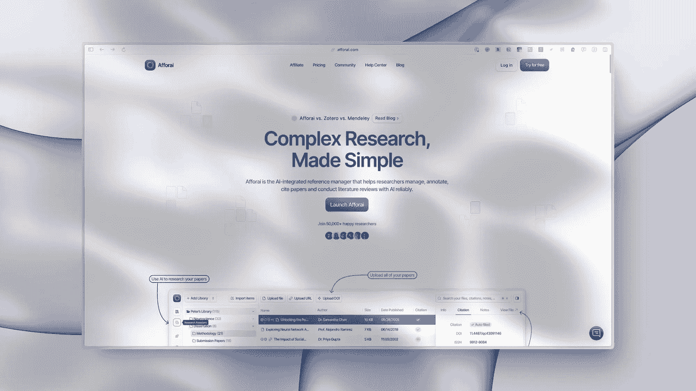
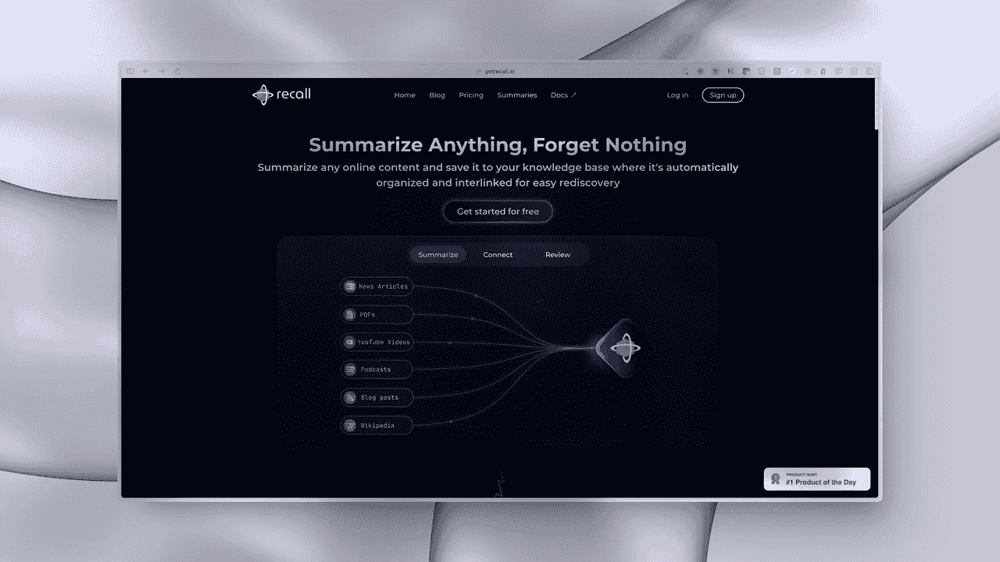

# AIGC Weekly #76

> 来源：[https://waytoagi.feishu.cn/docx/O6bcd7U5Do7gcax156jcyE2tndf](https://waytoagi.feishu.cn/docx/O6bcd7U5Do7gcax156jcyE2tndf)

> 🔗 原文链接： h[ttps://quail.ink/o](https://quail.ink/op7418/p/aigc-weekly-76)p7418/p/aigc-wee...

> ⏰  发表时间：2024-06-17

> 作者：歸藏

# 上周精选 ✦

## 苹果与 Open AI 合作在 ios 18 中提供AI服务

上**周苹果的W**WDC24靴子终于落地，iOS 18将非常深入的整合AI能力，AI能力更新主要包含在Siri、写作助手以及图像生成 三个部分 ：

+   Siri 利用 Apple Intelligence 实现全新超能力。凭借全新的设计、更丰富的语言理解能力以及随时输入 Siri 的能力，与 Siri 的交流比以往任何时候都更加自然。

+   Siri 采用 **全新设计 **，与系统体验更加深度融合，优雅的光芒环绕屏幕边缘。

+   只要双击 iPhone 或 iPad 屏幕底部，当**不想大声说话时，可以从系**统中的任何位置 输入内容给 Siri 。

+   **利用 Si**ri 掌握的有关你设备功能和设置的广泛 产品知识 。学习如何在 iPhone、iPad 和 Mac 上做新事情时，可以提出问题，Siri 可以快速提供分步指导。

+   **Apple** Intelligence 为 Siri 提供了 屏幕感知 功能，因此它可以理解屏幕上的内容并采取行动。

+   了解您的 **个人背景 **使 Siri 能够以你独有的方式为您提供帮助。Siri 可以利用其对设备上信息的了解来帮助找到所需信息。

+   使用 Siri在应用程序内和应用程序间 无缝执行操作。

+   Apple Intelligence 为新的写作工具提供支持，可帮助你在写作时随时随地找到合适的词语。借助增强的语言功能，可以在几秒钟内总结整个讲座，获取较长的群组讨论的简短版本。

+   可以校对文本、重写不同版本直到语气和措辞恰到好处，并且只需轻点一下即可总结所选文本。

+   优先通知显示在卡片顶部，一眼就知道需要注意什么。通知会汇总，以便您可以更快地浏览它们。

+   邮**件中的**优先消息会将时间敏感的消息提升到收件箱的顶部 - 例如今天截止的邀请或今天下午航班的登机提醒。点按即可在邮件应用中显示长电子邮件的 摘要 ，直奔主题。您还可以直接从收件箱中查看电子邮件摘要。

+   只**需在 **Notes 或 Phone 应用中点击录制即可录制音频和文字记录。Apple Intelligence 会生成文字记录 摘要 ，一眼便可了解最重要的信息。

+   使用邮件中的 **智能回复 **功能，快速起草包含所有正确详细信息的电子邮件回复。

+   Apple Intelligence 让你以全新的方式用视觉表达自我。创建有趣、原创的图像和全新的 Genmoji。使用 Image Wand 将草图变成与笔记相得益彰的相关图像。

+   借助应用程序中的Image Playground 体验，只需几秒钟即可制作有趣的原创图像。根据描述、建议的概念，甚至照片库中的人物，创建全新的图像。

+   在专用的Image Playground 应用程序 中尝试不同的概念并尝试动画、插图和草图等图像样式。创建自定义图像以在其他应用程序或社交媒体上与朋友分享。

+   直接在键盘上制作全新的 **Genmoji **，以匹配任何对话。提供描述以查看预览，并调整描述直到完美。

+   **Image Wand **可以将你的草图转换为 Notes 应用中的相关图像。使用手指或 Apple Pencil 在你的草图周围画一个圆圈，Image Wand 会分析其周围的内容以产生互补的视觉效果。

+   输入描述，Apple Intelligence 会找到最匹配的照片和视频。然后，它会根据识别的主题，用独特的章节制作故事情节，并将照片排列成具有自己叙事弧线的影片。

+   **使用照片应用中的清理 **工具去除照片中的干扰物。Apple Intelligence 可识别背景物体，需轻点一下即可将其移除，从而拍出完美的照片，同时保留原始图像。

苹果也发布了 [一篇内容 ](https://machinelearning.apple.com/research/introducing-apple-foundation-models)介绍了一下他们的 **LLM 部署方案 **，主要有三层结构组成：

+   设备端LLM推理：未来的iOS版本将包含一个小型低延迟的AI模型（30亿参数），它能够理解用户命令、当前屏幕并在应用程序上执行操作。该模型不仅能处理总结等简单任务，还可以为Siri的“AI智能体”功能提供支持，例如处理需要打开和使用多个应用程序的用户命令——比如“嘿Siri，叫一辆Uber到最近的Costco”。最重要的是，该模型运行在Apple Silicon芯片（如M系列芯片）上。

+   私有云计算：设备端的大语言模型可能会将某些复杂任务卸载给Apple数据中心托管的更强大模型（称为“私有云计算”）。这些数据中心也将完全运行在Apple的M系列芯片上。传输的数据将完全加密和保护。服务器由Apple自主制造。换句话说，Apple已经垂直整合了在设备端和数据中心内运行AI所需的一切。

+   第三方模型推理：用户还可以通过Siri或某些iOS应用直接使用OpenAI的ChatGPT。请注意，这并不是用ChatGPT替代Siri——这是许多人对OpenAI合作的误解。实际上，ChatGPT在特定情况下作为Apple模型的替代方案提供。例如，当用户即将修订电子邮件时，可以选择ChatGPT的响应。

Open AI 也发布了 [一个公告 ](https://openai.com/index/openai-and-apple-announce-partnership/)来 **介绍跟苹果的合作 **：

+   ChatGPT 集成功能会免费提供给 ios 用户，付费会员可以登录后使用付费功能。

+   连文字改写都用的ChatGPT，图像看起来用的 DALL-E。

+   Siri 也可以在需要时调用 ChatGPT 的智能。调用需要用户同意。

+   用户无需在不同工具之间切换即可使用 ChatGPT 的功能，包括图像和文档理解。



## [Luma 发布视频生成模型 ](https://lumalabs.ai/dream-machine)[**Dream Machine**](https://lumalabs.ai/dream-machine)

上周最大的黑马内容就是Luma AI发布了Dream Machine视频生成模型，图生视频的表现相当惊艳，绝对是电影级表现。分辨率、运动幅度、美学表现都是非常牛批，同时立刻向所有人开放了免费试用。

发[布之后社区也很快](https://x.com/fofrAI/status/1801198998289608925)玩了起来，除了用AI生成的图片生成视频之外，用已有的表情包图片生成的视频也都很生动和搞笑，比如这个著名的 奥斯卡合影图片 。

也有很多很好的短片，比如这个 [美少女混剪 ](https://x.com/KakuDrop/status/1800928377693687890)和 [可爱怪物动画 ](https://x.com/LumaLabsAI/status/1800921393321934915)。

**我自己的 **[**跑了一些测试 **](https://x.com/op7418/status/1801138865224454480)**，总结了一些发现的要点：**

+   Luma 文生视频的质量不如可灵，基本不可用。

+   图生视频很令人惊喜，一致性，运动幅度都很好。

+   它可以补充出画面没有的内容，同时已有的风格和内容依然可以保证一致。

+   与可灵类似的是，如果是模型不理解的概念，即使图生视频质量也很差。

+   短提示词效果很好，最好只说图片中的运动内容在如何运动就行。

**Luma **[**官方发布的视频 **](https://x.com/op7418/status/1801828221996122144)中也介绍了一下模型的特点和擅长的内容：

+   生成的视频质量很高,分辨率可达1024像素。

+   能很好地理解提示并生成符合美学风格的视频。

+   推理速度快,缩短了等待时间,有利于快速迭代创意。

+   可以生成连贯的动作和运动,不像之前的模型那样画面静止和慢动作。

+   对物理和人物运动有很好的理解。

+   在同一视频中,人物和物体能保持一致性。

+   可以生成有趣的镜头运动,而不仅仅是静止的角度。

**找资料查了一下Luma AI的团队**成员背景确实都很离谱，创业天团了可能是：

+   **Alex Yu **：Luma AI的联合创始人兼CTO，曾是UC Berkeley的AI研究员，专注于实时神经渲染和从单一图像生成3D模型的研究。

+   **Amit Jain **：Luma AI的联合创始人兼CEO，曾在Apple工作，负责Vision Pro的多媒体体验，专注于计算机视觉和产品设计。

+   **Jiaming Song **：Luma AI的首席科学家，曾在NVIDIA的生成式AI组工作，领导了扩散模型（如DDIM）的研究，这些模型显著提升了生成式AI的性能。

+   **Matthew Tancik **：Luma AI的应用研究团队负责人，曾帮助创建神经辐射场（NeRF），这是3D神经渲染领域的重要方法之一。

+   Angjoo Kanazawa ：Luma AI的首席科学顾问，加州大学伯克利分校电气工程与计算机科学系助理教授，研究方向为计算机视觉、计算机图形学和机器学习，特别关注动态3D世界的视觉感知。



## [SD3 2B 模型开源](https://huggingface.co/stabilityai/stable-diffusion-3-medium)

SD3的2B模型终于如约发布，但是发布完成测试后大家发现模型在人体生成以及躺着的人方面存在着非常严重的问题，同时模型对于短提示词的响应也没那么好，引发了社区的议论。

我自己尝试了一下跟社区测试的结果也差不多，如果提示词写好，避免人手的情况下图片质量和提示词理解都是在线的。

Stability AI 前CEO Emad确认了模型的这些问题基本上都是由于安全对齐引起的，DALL-E和谷歌的图像模型都有类似的问题，不过由于SD3模型是开源的这些问题是可以被修复的，社区和SD3训练者都在积极寻找修复的办法。

另外在生态适配上社区进展也比较乐观，Lora的训练代码已经发布，同时Instant团队也发布了多个适配 SD 3的ControlNet模型 。

另外这次SD3的开源是非商用的，而且关于模型微调部分条款也模糊不清，部署的时候需要注意。

**SD3的优势 **：

+   照片写实主义：克服了手部和面部常见的伪像，提供高质量图像，无需复杂的工作流程。

+   提示遵循：理解涉及空间关系、构图元素、动作和风格的复杂提示。

+   排版：在DiT架构的帮助下，实现了生成文本而不产生伪影和拼写错误的前所未有的结果。

+   资源利用效率高：由于其较低的 VRAM 占用，适合在标准消费级 GPU 上运行而无性能降级。

+   Fine-Tuning:能够吸收小数据集中的微妙细节，非常适合定制化。

**模型文件主要由这几部分组成 **：

sd3_medium.safetensors 包括 MMDiT 和 VAE 权重，但不包括任何文本编码器。

sd3_medium_incl_clips_t5xxlfp8.safetensors 包含所有必要的权重，包括 T5XXL 文本编码器的 fp8 版本，提供质量和资源需求之间的平衡。

sd3_medium_incl_clips.safetensors 包括所有必要的权重，除了 T5XXL 文本编码器。它需要最少的资源，但模型的性能将在没有 T5XXL 文本编码器的情况下有所不同。

example_workfows 文件夹包含示例Comfyui的工作流程。

**推荐参数 **：

fofr 用 SD3 生成的图片看起来质量比较高，他也说了自己用的参数：28 steps, 3.5 CFG, 896x1088, 28 steps, sd3_medium_incl_clips_t5xxlfp8.safetensors，之前 Emad 介绍的 SD3 推荐采样器是 DMP++ 2M。



## [英伟达开源规模最大的 LLM](https://blogs.nvidia.com/blog/nemotron-4-synthetic-data-generation-llm-training/)

英伟达开源了目前为止规模最大的大语言模型 Nemotron-4 340B，主要目的是帮助开发人员用来合成数据训练LLM。

Nemotron-4 340B 系列包括基础、指导和奖励三个模型权重，Base 模型在 9 万亿 Token 的语料库上预训练，有50 多种自然语言和 40 多种编程语言。

经过了SFT、DPO、RPO三种对齐方式。

整个对齐过程中依赖约 20K 个人工标注的数据，数据生成流水线合成了用于监督微调和偏好微调（DPO 和 RPO）的数据的 98%以上。

模型可以商业化使用，而且可以自由创建和分发衍生模型。

Nemotron-4-340B-Instruct 是标准的仅解码器 Transformer，训练时序列长度为 4096 个标记，使用分组查询注意力（GQA）和旋转位置嵌入（RoPE）。

训练用了768 DGX H100集群，每个集群包含8 H100 80GB SXM5 GPUs。



# 其他动态 ✦

+   Open AI 在微调API接口中加入了对[tools参数的支](https://x.com/OpenAIDevs/status/1801652414317264960)持, 可以微调模型以 进行并行函数调用 。

+   A[bacus A](https://x.com/bindureddy/status/1801010849160818701)I和 Yann LeCunn团队一起发布了一个LLM测试基准，测试集会不断更新防止模型作弊，并且产出了 第一期的排行 。

+   KREA AI上线了 [视频放大和增强服务 ](https://x.com/krea_ai/status/1801136756802073062)，试了一下还可以，有需求可以试试。

+   [过去的六个月里，O](https://www.theinformation.com/articles/openais-annualized-revenue-doubles-to-3-4-billion-since-late-2023)penAI 的 年度收入翻了一番 ，达到34亿美元。收入几乎全部直接来自于 ChatGPT 和其他 OpenAI 产品的销售。

+   [Open AI 董事会](https://openai.com/index/openai-appoints-retired-us-army-general/)新成员是 前美国国家安全局局长 ，一辈子都在军方供职。

+   [uizard ](https://app.uizard.io/)发布了 Autodesigner 2.0 UI 生成方案。

+   美图发布会也发了一个 DiT 视频模型，从[演示效果来看还比较早期。同时推](https://www.moki.cn/)出了一个 AI 视频编辑平台 Moki 。

+   Midjourney 发布了 [自定义模型 ](https://x.com/midjourney/status/1800693675686834450)的能力会根据你日常点赞和 Tsak 选择的图片训练一个经过你微调的模型。

+   [Mistral AI 在 ](https://x.com/arthurmensch/status/1800558395872731379)B 轮融资中 筹集了 600 百万欧元 。General Catalyst 领投了这轮融资，使公司估值达到 60 亿美元。

+   Open AI 认命了 [新的 CFO 和 CPO ](https://openai.com/index/openai-welcomes-cfo-cpo/)，凯文·韦尔（前 Instagram 产品副总裁）将加入担任首席产品官，而萨拉·弗莱尔（前 NextDoor 首席执行官、前 Square 首席财务官）将加入担任首席财务官。

# 产品推荐 ✦

## Apparate：让图片变成说话视频

Proteus 0.1，实时视频生成为您的 AI 注入活力。Proteus 可以大笑、说唱、唱歌、眨眼、微笑、说话等等。只需一张图片。



## [Mapify：AI 思维导图](https://mapify.so/cn)

Mapify（原名 Chatmind）是一款 AI 思维导图工具，能够快速从各种格式的内容（如文本、网页、视频、图像、语音等）中提取关键信息，并生成结构化的思维导图，旨在提升用户的生产力和创造力。

Mapify 集成了 AI 对话功能，允许用户在思维导图上与 AI 进行交互，完成查询、修改和扩展的操作。


## AdCreative：AI 生成广告创意

AdCreative.ai 是一个专注于广告创意生成的 AI 平台，它通过分析和机器学习，帮助用户生成高转化率的广告创意。该平台拥有大量的广告创意数据库，能够生成各种尺寸和类型的广告素材，包括社交媒体帖子、视频广告、产品拍摄等。用户可以通过该平台提高广告效果，降低设计成本，并且获得对竞争对手广告策略的洞察。AdCreative.ai 提供不同级别的服务计划，包括免费试用、初创企业、专业人士和代理商等，满足不同规模用户的需求。此外，平台还提供了 50% 的折扣优惠，以及针对企业客户的定制解决方案。



## Deformity：AI 创建表单

Deformity.ai 提供了一个创新的表单创建平台，通过人工智能技术，用户可以快速制作出生动的对话式表单。这些表单能够以多种语言与用户互动，有助于全球化的客户参与。平台支持多种功能，包括捕获客户联系信息、资格审查以筛选潜在客户、收集客户反馈以改进产品或服务、设计有趣的测验以了解受众群体、举办抽奖活动以提高参与度，以及进行研究以确保数据收集的质量。



## Afforai：AI 文献研究工具

Afforai 是一个为研究人员设计的 AI 驱动的研究助手和聊天机器人，它提供了一系列工具来简化研究流程。用户可以通过 Afforai Reference Manager 上传和管理研究论文，使用 Afforai Notebook 对论文进行注释和笔记，以及利用 Afforai Cite 管理引用和元数据。该平台支持多种文档格式，并且提供了三种不同的搜索模式，包括文档检索模式、学术搜索模式和谷歌搜索模式，以帮助研究人员梳理和比较大量的文献。



## Recall：AI 驱动的内容收集工具

Recall 提供了一种新型的知识管理方法，它能够自动总结用户在线遇到的各种内容，如播客、YouTube 视频、新闻文章、PDF 等，并将其保存到用户的知识库中。这个知识库不仅自动组织和分类内容，还通过知识图谱技术帮助用户发现信息之间的联系，从而更深入地理解复杂主题。此外，Recall 还提供了间隔重复学习功能，帮助用户更好地学习和记忆。



# 精选文章 ✦

## 那个团子和Stable Diffusion的1000天

详细回顾了 Dango233（团子）和 huoju 在开源 AI 社区的贡献历程。三年前，团子因为兴趣加入了 EleutherAI 的 Discord 社区，开始接触 CLIP+VQGAN，并逐步参与到更深层次的图像生成技术讨论中。随着时间的推移，他参与了多个项目，如 Disco Diffusion 和 Majesty Diffusion，并受邀加入 StabilityAI 公司，这个公司由 Emad Mostaque 创立，致力于开源 AI。团子在这个过程中也面临了职业选择的十字路口，最终选择了参与 Stable Diffusion 的开发，这一决定极大地改变了他的职业轨迹。

## 智变时代 / 全面理解机器智能与生成式 AI 加速的新工业革命

将温故 AI 发展波澜壮阔的一年，尝试抓住生成式 AI 变革的本质，拨开喧嚣与迷雾，追寻科技巨头与 AI 机构们在更高智能道路上的探索，以及变革会如何全面改变人机交互、世界的产业、经济还有我们自己。

全文 36000 字，共分五个章节：

1.  模型 - 竞争、泛化与变革的本质

1.  应用 - 智能代理、智能体与组织新形态

1.  智变 - 廉价诱导需求、从中心到边缘算力、新工业革命

1.  演化 - 模型如何理解和进化、自主目标与自动化的 AGI

1.  选择 - 职业变迁、自我提升与科技恒大

## [生成式AI不会为你建立工程团队](https://stackoverflow.blog/2024/06/10/generative-ai-is-not-going-to-build-your-engineering-team-for-you/)

作者通过自己的经历讲述了软件工程行业的成长和变化，指出软件工程是一门学徒制的职业，需要通过实践和时间积累经验。文章强调，尽管生成式 AI 可以快速生成代码，但这些代码往往不可靠，需要经验丰富的工程师进行审查和修改。

AI 生成的代码仅仅是软件工程中最容易的部分，而真正的挑战在于理解、维护和操作这些代码。文章还讨论了初级工程师在团队中的价值，以及为什么持续招聘初级工程师对团队和整个行业都是有益的。

尽管招聘初级工程师需要时间和资源进行培训，但这是一个值得的投资，因为它有助于培养未来的资深工程师，并保持团队的多样性和创新能力。最后，作者呼吁工程师和工程管理者要亲自推动招聘和培训初级工程师的工作，以确保行业的持续发展和繁荣。

## [中间代码的兴起](https://dagster.io/blog/the-rise-of-medium-code)

探讨了中间代码（Medium Code）在软件开发中的兴起，强调了人工智能（AI）在加速中码实践中的作用，并认为中码将是 AI 原生软件开发的未来。

+   软件并没有消亡，反而有越来越多的人正在构建软件。

+   通过Dagster（数据编排工具），观察到一类新的软件开发人员的出现，如分析工程师和数据科学家，他们不是全栈工程师，但仍然将关键任务代码部署到生产环境中。

+   这类人员被称为中间代码实践者，他们通过更人性化的接口，更高效地编写更多的生产代码。

## 苹果的人工智能告诉我们什么：实验模型

Ethan Mollick 在内容中分享了对苹果 AI（或称 “苹果智能”）发布的一些初步看法。

虽然他没有亲自使用过苹果的 AI，但他认为这次发布突出了当前 AI 领域正在进行的四种模型的实验：AI 模型、使用模型、商业模型和未来的心智模型。

在 AI 使用模型方面，苹果专注于让 AI 为用户完成具体任务，而前沿 AI 模型如 Gemini 1.5 和 GPT-4o 则更像是智能助手，能够处理更广泛的任务，但也可能出现意想不到的行为。在商业模型方面，苹果可能会从免费服务开始，但未来可能会收费。

## LLM能发明更好的方法来训练LLM吗？

S**akana** AI 正在探索将自然进化中的优化概念应用于人工智能领域，特别是在大型语言模型（LLMs）的培训中。他们提出了一种名为 LLM² （LLM-squared）的自我改进过程，旨在利用 LLMs 来自动化地发现和优化培训 LLMs 的算法。Sakana AI 的最新报告展示了他们使用 LLMs 来合成新的偏好优化算法的成果，并提出了一种名为 Discovered Preference Optimization （DiscoPOP）的算法。

## [红队AI系统的挑战](https://www.anthropic.com/news/challenges-in-red-teaming-ai-systems)

论了人工智能（AI）系统的红队测试（red teaming）挑战，总结了不同的红队测试方法，并强调了建立标准化实践和政策建议的重要性。

文章指出了 AI 领域缺乏标准化红队测试实践的问题，并强调了需要建立这些实践和标准的紧迫性。接着，文章详细描述了多种红队测试方法，包括：

+   **领域特定的专家红队测试 **，涵盖信任与安全政策漏洞测试、国家安全前沿威胁红队测试，以及多语言和多文化红队测试。

+   **使用语言模型进行红队测试 **，介绍了自动化红队测试的方法，通过模型之间的红队（攻击）和蓝队（防御）动态来提高系统的鲁棒性。

+   **在新模态中进行红队测试 **，特别是针对多模态 AI 系统（如 Claude 3）的测试，这些系统能够处理图像和文本等不同类型的输入。

+   **开放式、通用的红队测试 **，包括众包红队测试以及社区参与的红队测试，这些测试旨在发现一般性的伤害和系统局限性。

# 重点研究 ✦

## Hallo：复旦发布的开源版本EMO

通过输入音频让面部照片开始说话，并且有对于的表情。看起来效果很自然。

采用端到端的扩散范式，引入了分层的音频驱动视觉合成模块，以提高音频输入与视觉输出之间的对齐精度，包括唇部、表情和姿势的运动。

分层音频驱动的视觉合成模块提供了对表情和姿势多样性的自适应控制，更有效地实现了针对不同身份的个性化定制。

## TC-Bench： 视频生成测试

TC-Bench 一个视频生成模型的测试集，用来测试视频生成模型的时间组合性。评估生成的视频应像现实世界的视频一样，随着时间推移，包含新概念的出现及其关系的变化。

**测试分析结果：**

大多数视频生成器实现的组合变化不到 20%，当前的视频生成模型在解释组合变化的描述和动态地映射不同时间步骤的语义方面存在困难。

提出了一种新颖的架构Pixel Transformer(PiT),它能够直接将每个像素作为token输入到Transformer中,而无需先将图片分割成patch。

PiT的好处在于,它去除了convolution和patchification这两个步骤中隐含的局部性偏置(locality bias),让模型能够从像素级别自主学习特征表示。

实验证明,PiT在图像分类、自监督学习、图像生成等任务上都取得了优于ViT的结果。

## Depth Anything V2

字节发布Depth Anything V2深度模型。比 Depth Anything V1 更精细的细节。与基于 SD 构建的模型相比效率显著更高（快了10倍以上）且更准确。提供了不同规模的模型（参数从25M到1.3B不等），以支持各种应用场景。

通过三个关键实践产生了更精细和更鲁棒的深度预测：

1.  用合成图像取代所有标注的真实图像，

1.  扩大教师模型的容量，

1.  通过大规模伪标注的真实图像作为桥梁来教授学生模型。

## MotionClone： 从已有视频控制生成的内容

随着视频生成模型的不断成熟，视频控制的方式的研究也越来越重要。

上海人工智能实验室这个研究可以**从参考视频中克隆动作来控制文本生成的视频。**从演示来看效好，有没有因为原始视频的风格或者内容污染。

采用时间注意机制在视频反转过程中表示参考视频中的动作，并引入主要时间注意引导以减轻注意权重中的噪声或细微动作的影响。

提出了一种位置感知语义引导机制，该机制利用参考视频中前景的粗略位置和无分类器引导特征来引导视频生成。

## [发现大型语言模型的偏好优化算法](https://arxiv.org/abs/2406.08414)

这篇论文提出了一种新方法,通过大语言模型自动发现和生成高性能的偏好优化目标函数,而无需专家人工设计。具体来说,他们反复提示语言模型根据之前评估的性能指标,输出新的候选目标函数的代码实现。通过这种迭代优化过程,成功发现了一些此前未知但表现优异的偏好优化算法。其中表现最好的算法被命名为DiscoPOP,它自适应地混合了logistic loss和exponential loss。实验表明,DiscoPOP在基准测试和实际任务中都取得了业界领先的性能。

## SelfGoal：您的语言代理已经知道如何实现高级目标

由大型语言模型（LLM）提供支持的语言代理作为游戏和编程等领域的决策工具越来越有价值。然而，这些代理经常面临在没有详细说明的情况下实现高级目标以及适应反馈延迟的环境的挑战。在本文中，我们介绍了SelfTarget，这是一种新颖的自动方法，旨在增强代理在有限的人类先验和环境反馈的情况下实现高级目标的能力。SelfTarget的核心概念涉及在与环境交互期间自适应地将高级目标分解为更实用的子目标的树形结构，同时确定最有用的子目标并逐步更新该结构。实验结果表明，SelfTarget显着增强了语言代理在各种任务中的性能，包括竞争、合作和延迟反馈环境。

## Follow-Your-Emoji：腾讯生成面部说话视频的研究

他们没有通过音频驱动，而是做了面部表情的迁移，可以将任何人的面部表情迁移到对应的照片上生成视频。

这样不止可以生成说话的视频，即使没有声音只有表情也可以同步的很好。

包括真人、卡通、雕塑甚至动物，都可以很好的迁移。

---

```
想要玩 Stable Diffusion AI 画图但是没有好的硬件的可以看一下揽睿星舟，
做了很好的适配可以一键部署 SD 价格也很划算。最近还上线了优化的非常好的Comfyui，感兴趣可以试试
https://www.lanrui-ai.com/register?invitation_code=9778

code
code
```

```
一直有很多朋友跟我说看推特或者微博的时候信息获取效率太低，因为有很多无关的信息，希望我整一个比较垂直的站展示最近的 AI 资讯。
搞了一个 guizang.ai ，感兴趣可以来看看，每天更新最新的 AI 资讯和值得关注的研究内容，我的一些深度内容也会整理后放在这里。

code
code
```

感谢[大家看](https://okjk.co/r1Ju8n)到这[里，如](https://twitter.com/op7418)果有[觉得有意思的相关](https://quail.ink/op7418)内容也可以私信我或者给我发邮件投稿。

你可以在这里找到我：

| 即刻 | 推特 | Quail订阅 | 微信公众号：歸藏的AI工具箱 |邮箱：guohao631@gmail.com

也可以分享给更多的朋友，让大家都有机会了解这些内容。

