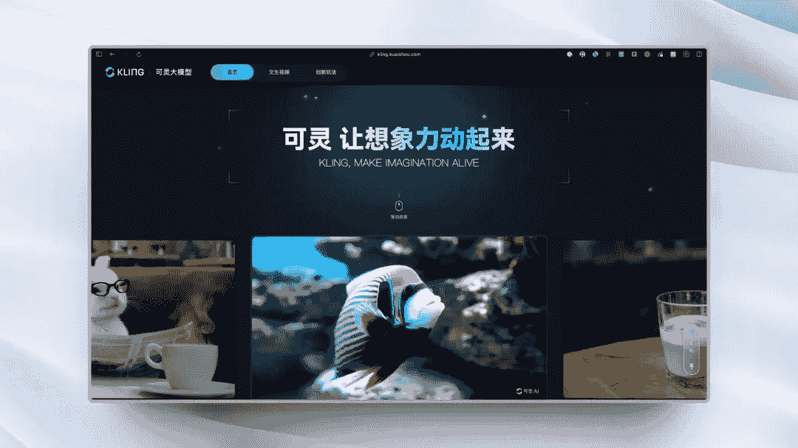
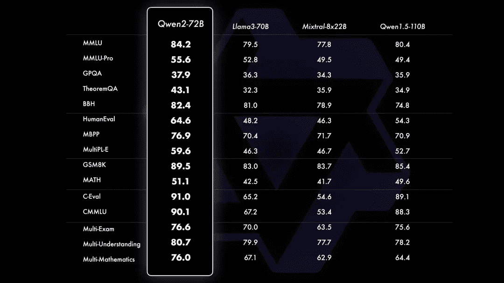
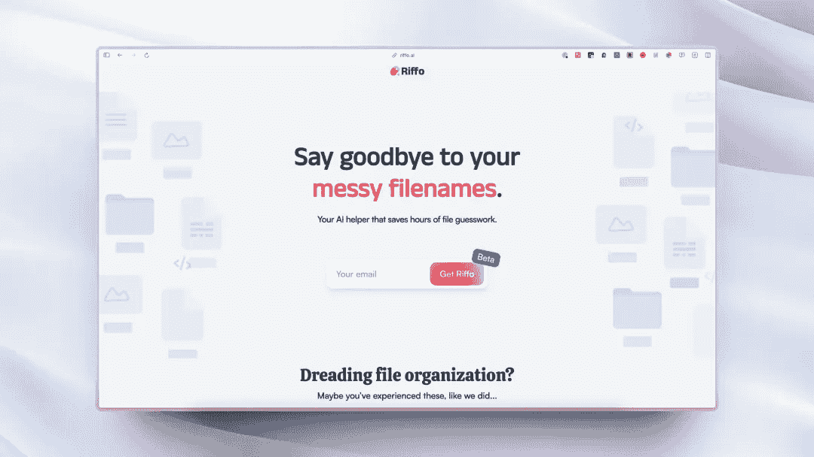
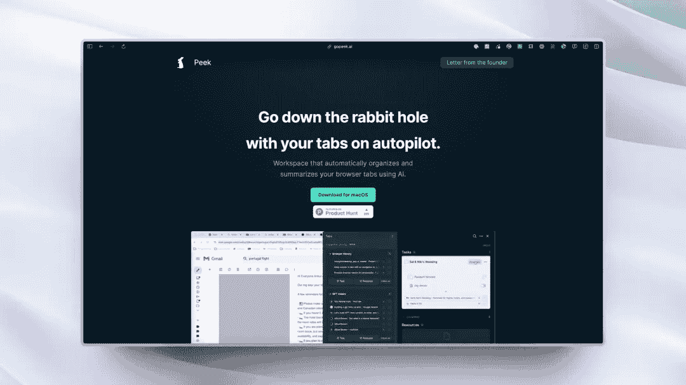
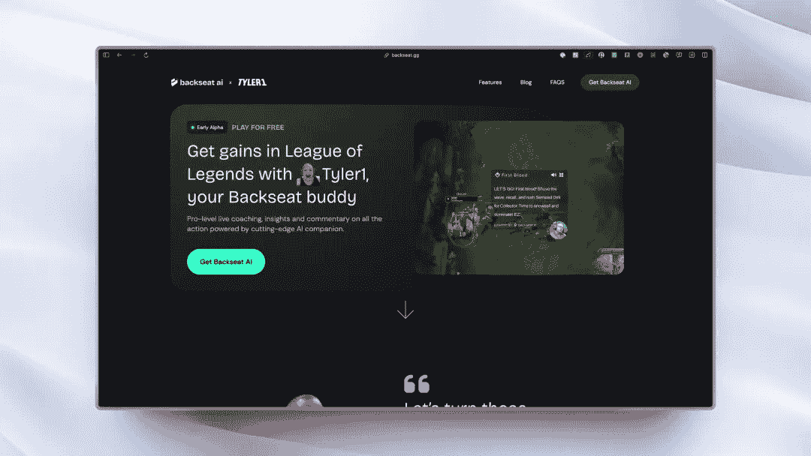
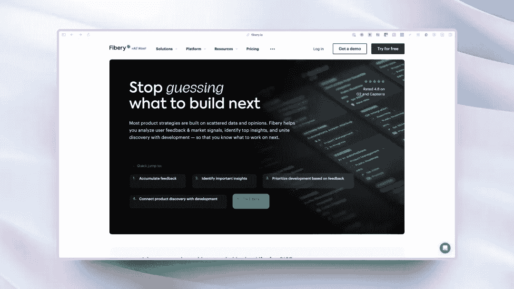

# AIGC Weekly #75

> 来源：[https://waytoagi.feishu.cn/docx/VI3sdkazeoM9wDxTHt3c4sK0nMl](https://waytoagi.feishu.cn/docx/VI3sdkazeoM9wDxTHt3c4sK0nMl)

> 🔗 原文链接： https://quail.ink/op7418/p/aigc-weekly-75

> ⏰ 发布时间：2024-06-11

> 作者：歸藏

## 上周精选 ✦

## 快手发布对标Sora的视频模型可灵 [3]

快手上周发布了对标 Sora 的可灵视频生成模型，支持生成最长两分钟 30FPS 1080P 的视频。生成质量是现在普通用户能接触到的天花板，5 秒视频这个等级完全超越了谷歌Voe 视频模型。运动幅度、不同比例、一致性、物理特性都是除了 Sora 之外现在看到最好的。

发布之后果然爆了，而且是国外的热度明显高过了国内，在 Twitter 以及 Readdit 上都有相当高的讨论热度。基本上海外 AI 圈子的所有大佬都转发了，a16z 的 Justine Moore 甚至都亲自制作了教外国人申请测试资格的教程，一些大 V 开始在任何有测试资格的人下面私信，甚至急的都打中文。

如果说 Open AI 的 Sora 让大家看到了 Dit 架构在视频生成这个路线上的希望的话，可灵通过实践真实的构思大家这个路径是可以复制的。

整体框架采用了类Sora的DiT结构，用Transformer代替了传统扩散模型中基于卷积网络的U-Net。还对模型中的隐空间编/解码、时序建模等模块进行了升维。

主流的视频生成模型通常沿用Stable Diffusion的2D VAE进行空间压缩，但这对于视频而言存在明显的信息冗余。于是自研了3D VAE网络，实现时空同步压缩。

时序信息建模上，快手大模型团队设计了一款计算高效的全注意力机制（3D Attention）作为时空建模模块。

团队专门设计了专用的语言模型，可以对用户输入的提示词进行高质量扩充及优化。

目前你可以在快影 APP 中的 AI 玩法-AI 生视频申请测试资格，我也跑了一些 Demo 测试，感兴趣可以来这里看看： https://x.com/op7418/status/1799047146089619589 [4]

如果[想要对视频生成的模型架构多了](https://lilianweng.github.io/posts/2024-04-12-diffusion-video/)解一些的话还是推荐看一看 Open AI 大神 Lilian Weng 的这篇《 视频生成的扩散模型 [5] 》。

## 阿里开源通义Qwen2模型 [6]

阿里上周开源了通义Qwen2模型，可以说是现阶段这个规模最强的开源模型。发布后直接在 Huggingface LLM 开源模型榜单获得第一名，超过了刚发布的 Llama3 和一众开源模型。

Qwen2在代表推理能力的代码和数学以及长文本表现尤其突出。推理相关测试及大海捞针测试都取得了很好的成绩。

**模型概览：**

Qwen 2 模型组成包括 Qwen2-0.5B、Qwen2-1.5B、Qwen2-7B、Qwen2-57B-A14B和Qwen2-72B。其中Qwen2-57B-A14B为 MoE 模型。

模型在中文、英文语料基础上，训练数据中增加了27种语言相关的高质量数据；

增大了上下文长度支持，最高达到128K tokens（Qwen2-72B-Instruct）。

**LLM 竞技场成绩：**

LLM 竞技场成绩也相当不错，成为目前中文中表现最好的开源模型（排名第7）。

相较于 v1.5-110B 有显著提升 整体表现上能与 GPT-4-0314 媲美 在处理“难题”上，几乎赶上了表现最好的开源模型 Llama-3-70B。

模型下载： https://huggingface.co/collections/Qwen/qwen2-6659360b33528ced941e557f [7]

## 其他动态 ✦

+   Udio 开始支持通过上传音频，对原始音频进行 扩展和风格变化 [8] 。

+   Stability AI 开源了 Stable Audio Open 音乐生成模型 [9] ，单次生成时长 47 秒，可以创建鼓点、乐器旋律、环境声音、配音，可以实现音频样本的音频变化和风格转移。

+   Suno 即将推出使用哼唱的声音 生成歌曲 [10] 。

+   Nijijourney 模型更新 [11] ，改进了日文文本的渲染效果，现在可以渲染简短的日文假名文本，提升了图像的细节表现。

+   谷歌NotebookLM更新 [12] ，使用Gemini 1.5 Pro，将 Google 幻灯片和网页 URL 添加为来源，内嵌引用功能可以直接滚动到相关段落，理解图像。

+   智谱 开源GLM-4-9B [13] ，支持 26 种语言，有1M 上下文长度版本。

+   字节跳动通过 从甲骨文租赁 GPU [14] 来规避美国制裁。

## 产品推荐 ✦

## Underlord：AI 视频和音频编辑工具 [15]

AI 编辑助手 Underlord，它提供了一系列 AI 工具，旨在简化视频和播客制作过程，包括自动编辑、音频增强、视觉效果调整、内容转换、文本生成等功能。

它能够自动完成一系列繁琐的编辑任务，如剪辑视频、提高音频质量、调整视频合成、去除填充词、生成社交媒体帖子等。它支持多种语言的翻译，可以帮助用户创建吸引人的视频标题和描述，以及撰写脚本和大纲。

## Riffo：AI 文件管理 [16]

Riffo 是一个利用人工智能技术帮助用户快速整理和重命名文件的工具，旨在解决文件管理的繁琐和混乱问题。

它提供了批量重命名的功能，允许用户根据自己的命名习惯进行无需人工干预的文件管理。Riffo 的处理速度极快，利用并行处理技术能够在几秒钟内完成大量文件的重命名任务。

## Peek：AI浏览器整理 [17]

Peek 是一款旨在通过 AI 自动组织和总结浏览器标签页的工作空间应用程序，帮助用户更高效地管理和利用在线信息。

用户可以通过智能提示一键组织标签页，避免标签页的混乱和重复。此外，Peek 能够从一组网页中提取关键信息，如日期、价格和名字，并且能够总结私人信息。用户可以通过重新排序、合并和嵌套主题和任务来优先处理和切换不同的主题，同时还可以为标签页组添加笔记，使想法和标签页一起整理。

## Backseat：游戏语音陪聊 [18]

著名的英雄联盟解说 Tyler1 发布了一个英雄联盟助手，可以在你玩游戏的时候用他自己的声音跟你聊天，教你玩游戏。还附带了常见的英雄联盟辅助功能，插眼提醒，出装帮助等。

## Wix 应用构建器 [19]

Wix 提供了一个品牌化应用程式开发平台，允许用户在 App Store 和 Google Play 商店发布彻底以自己品牌为主的应用程式。用户可以自由设计应用程式图标、定制布局、外观和风格，同时利用内置功能如商店、预订、论坛等来增强业务。Wix 的应用程式创建工具支持直观的拖放操作，无需编写代码即可为 iOS 和 Android 平台创建原生应用程式。

## Fibery：竞品发现和分析 [20]

Fibery 是一个产品发现和开发平台，旨在通过分析用户反馈和市场信号，识别关键洞察，并将产品发现与开发连接起来，帮助团队确定下一步工作的优先级。

平台通过将客户反馈和市场信号集中到单一位置，并利用 AI 快速发现洞察，将产品发现与开发无缝连接。Fibery 提供了一个定制的优先级排序公式，允许团队根据最重要的事实和信号（如目标客户的反馈）来决定开发的优先级。此外，Fibery 还提供了高级工作管理功能，如 AI 摘要、自动化和报告，以及对产品和开发团队协作的支持，包括共享愿景、道路图和与开发工具的集成。

## 精选文章 ✦

## Andrej Karpathy：让我们重现GPT-2（124M） [21]

Andrej Karpathy 新的教学视频，教你从零开始实现124M大小的GPT-2模型。真是菩萨，视频有4小时，足够手把手，他说即使你完全没有基础也可以跟着实现。

我们从一个空文件开始，最后得到一个 GPT-2 (124M) 模型：

1）首先我们构建 GPT-2 网络

2）然后我们优化它，使其训练速度非常快

3）接着我们参考 GPT-2 和 GPT-3 的论文来设置训练优化和超参数

4）然后进行模型评估

5）最后希望一切顺利，去睡觉 第二天早上，我们查看结果，享受有趣的模型生成。

用Memo翻译了一个版本： https://pan.quark.cn/s/d1c2f539ee28#/list/share [22]

## a16z：AI 如何改变营销和销售 [23]

AI 改变营销主要会有三个阶段：营销副驾驶的发展，营销智能体的引入，最后是自主营销团队的崛起。

**营销副驾驶：**

由于 AI 的出现，营销人员不需要每天撰写用于 SEO 和邮件的营销文章。他们可以将初稿外包给 ChatGPT 和其他工具，将时间花在更高级别的任务上。

**营销智能体：**

预计在这一阶段，营销将从一对多模式转变为一对一的高度个性化活动。营销人员将能够根据特定受众和偏好数据个性化每个向客户展示的广告，而不是创建吸引普通客户的广告活动。

**AI 营销团队：**

让AI智能体完全承担首席营销官（CMO）的职责，作为一个自主的营销团队运作。在这个阶段，大量AI智能体将重现或补充团队的全方位服务能力。通过整合和优化所有单一用途的智能体，覆盖所有媒介，这些智能体将能够制定完整的营销计划策略和资源。

## Arc 浏览器 CEO Josh Miller 关于下一代革命性设备的讨论 [24]

1. AI的未来不会存在于聊天应用中 2. 赢得AI市场的界面将比我们想象的更为熟悉 3. 回顾计算机历史，第1和第2点在事后看来都是显而易见的

以往的流行设备变革都是在现有工具上增加具有催化作用的界面创新。

所以变革路径应该是取一种现有的、流行的工具，在其上叠加具有催化作用的界面创新，在这个交叉点释放独特的价值。

AI的催化界面创新是计算机现在可以阅读和看见、计算机现在可以模仿人类。

未来AI计算机的主要界面将更像我们生活中现有的工具，而不是全新的东西。

新颖性将出现在高杠杆点上，这些点“与我们今天使用的工具相遇”。

## 使用人工智能进行工作的指南（2024 年中期版） [25]

介绍了使用人工智能技术进行实用工作和娱乐活动的最新趋势和方法，同时提供了 AI 技术的应用指南和对未来 AI 发展的展望。

他建议首先通过音乐制作、与 AI 对话等轻松的方式体验 AI，例如使用 Suno 或 Udio 平台创作歌曲，或者通过 Google 的 Illuminatedemo 听取 AI 转换的学术论文为 NPR 风格的广播节目。作者指出，即使是通过游戏体验 AI，也能展示其潜力和局限性。

## AI 动漫洪水-对 9 万张图片的侵权调查 [26]

尼经新闻通过对三个 AI 生成图像分享网站的分析，发现了超过 90,000 张模仿现有动漫作品的图像。其中约 2,500 张图像与原作非常相似，可能构成版权侵权。报道指出，尽管 AI 技术快速发展，但未经许可的使用已经对日本动漫产业造成了威胁。调查揭示，AI 图像生成平台允许用户通过提示生成并发布图像，这些图像可能包含了版权作品的特征。例如，对于像皮卡丘和马里奥这样的知名角色，AI 生成的图像数量多达数千张，其中一些图像与原作几乎无法区分。调查还提到，AI 通过大量数据学习生成内容，而这些数据中可能包含了未经授权的版权作品。在全球分销的动漫市场价值接近 3 万亿日元的背景下，AI 生成的动漫图像泛滥，引发了对如何处理这一新型版权侵犯的讨论。

## AI 应用爆发前夜的三个信号｜鹅库2402

松鹅撰写，主要讨论了 AI 应用即将到来的爆发前夜的三个关键信号。

大模型效果和成本的提升是 AI 应用发展的核心驱动力 ：模型效果的提升和推理成本的大幅下降是 AI 应用商业化的关键。只有成本真正降低，才能让一些应用的商业模式成立。 已有互联网产品加入 AI 后的营收增长是 AI 商业价值的体现 ：这些产品具备市场地位、行业知识、客户关系等优势，理应最早收获 AI 带来的价值。文章预测，会有一些产品因为加入 AI 而使得营收增长至少 30%。 共识下的应用层创业者的出现和成功是 AI 创新的关键 ：这些创业者因市场共识迅速获得融资，他们的成功将激励更多创业者进入市场，推动 AI 应用层的快速发展。

## Vinod Khosla、Marc Andreessen和亿万富翁为AI的未来而战 [27]

讨论了维诺德・科斯拉（Vinod Khosla）、马克・安德森（Marc Andreessen）等硅谷亿万富翁投资者在人工智能未来发展方向上的影响力战争，涉及人工智能的安全性、监管和开源问题。

这场争论涉及到 AI 的国家安全影响、与中国的 AI 竞赛、以及如何平衡创新与风险。科斯拉和霍夫曼认为，通过监管可以减少风险并保留正面影响，而安德森和他的盟友则认为监管会阻碍 AI 的发展。这些投资者通过与政治家的会面、在社交媒体上发表意见、以及提交政策建议等方式，试图影响 AI 的未来。

## 我们与 LLM 一年的共建中中学到了什么（第二部分） [28]

这篇文章是关于大型语言模型（LLMs）在实际应用中的一年学习总结的第二部分，涵盖了数据、模型、产品和团队等方面的操作层面的经验教训。

对于数据方面，作者们强调了需要定期检查 LLM 的输入输出，以及如何测量和减少开发与生产环境之间的数据偏差。他们还提到了如何通过数据日志来快速识别和适应新的模式或故障模式。

在模型方面，作者们讨论了如何将语言模型集成到技术栈中，以及如何考虑模型的版本控制和迁移问题。他们还指出了迁移提示词时可能遇到的困难，以及如何选择合适的模型版本。

在产品方面，文章强调了设计师在产品开发过程中的重要性，以及如何设计人类在循环（HITL）的用户体验。作者们还讨论了如何优先处理产品需求，以及如何根据用例调整产品风险承受能力。

## 重点研究 ✦

## Meta：将神经机器翻译扩展到200种语言 [29]

Meta 发表在 nature上的一篇论文，“无语言被遗忘”计划——这是一个利用迁移学习的大规模多语言模型。我们基于“稀疏门控专家混合（Sparsely Gated Mixture of Experts）”架构开发了一种条件计算模型，使用专门为低资源语言设计的新数据挖掘技术进行训练。

通过多种架构和训练改进措施来防止在大量任务训练中出现过拟合问题。我们利用特别设计的工具（如自动基准测试FLORES-200、人工评估指标XSTS和涵盖所有语言的毒性检测器）评估了模型在40000个翻译方向上的表现。相比之前的最先进模型，我们的模型在翻译质量方面平均提升了44%的BLEU分数。通过展示如何将NMT扩展到200种语言。

## Open AI：稀疏自动编码器的缩放和评估 [30]

Open AI 也放出了对 GPT-4 的大语言模型可解释性研究跟Anthropic竞争。

开发了新的大规模自动编码器方法，用于将 GPT-4 的内部表示分解为 1600 万个可解释的模式。

终于发了一篇论文详细介绍了一下这个编码器实验的研究。

## Anthropic：Claude 的性格 [31]

Claude 3 的性格塑造过程，以及通过特定的训练方法如何让 Claude 具备更加丰富和立体的性格特质，如好奇心、开放性、思考性等，以及如何让 Claude 在价值观和伦理问题上保持诚实和适度的自信。

为了让 Claude 的性格特质得到内化，Anthropic 使用了一种特殊的宪法 AI 训练方法，通过让 Claude 自行生成与性格特质相关的人类消息，并根据这些特质来评估和排序其自身的回应。这种方法使用了 Claude 自身生成的合成数据，但整个过程需要人类研究人员的密切监督和调整。

## 阿里：Towards Scalable Automated Alignment of LLMs [32]

全面概述了大语言模型自动对齐的主要技术路径。

自动对齐旨在以最少的人工干预,建立高质量、可扩展的对齐系统,使得语言模型能够满足人类需求。

论文将现有的自动对齐方法分为四大类:

1)利用模型固有偏好实现对齐; 2)通过模仿其他模型行为实现对齐; 3)利用其他模型反馈实现对齐; 4)通过环境交互获得对齐信号。

此外,论文还探讨了自动对齐背后的机理,以及实现有效自动对齐的关键因素。

## Flash Diffusion:加速任何条件扩散模型 [33]

能让已经训练好的扩散模型在生成图片时更快、更高效。就像老师（一个复杂的模型）教给学生（一个简化的模型）怎么快速画出漂亮的画一样，Flash Diffusion让学生模型学会在几步之内就能生成高质量的图片。这个方法不仅速度快，而且在不同的任务上都能用，比如把文字变成图片、修复破损的图片、改变图片中的面孔、提高图片的清晰度等。而且，这个方法还提供了官方的实现代码，方便大家使用和研究。

## 腾讯：V-Express 照片生成人像说话视频 [34]

腾讯开源了利用人像照片生成视频的模型 V-Express。

不知道为啥，项目演示页面的视频都挂了，看不了效果。

通过一系列逐步丢弃操作来平衡不同控制信号的简单方法。通过我们的方法，较弱的信号逐渐能够发挥作用，从而实现同时兼顾姿态、输入图像和音频的生成能力。

## 字节： Seed-TTS 语音生成模型 [35]

字节的语音生成模型从 Demo 表现来看相当强大。

Seed-TTS，这是一系列大规模的自回归文本到语音（TTS）模型，能够生成几乎与人类语音无法区分的语音。Seed-TTS作为语音生成的基础模型，在语音上下文学习方面表现出色，在说话者相似性和自然度方面的表现，在客观和主观评估中均与真实人类语音相当。

提出了一种用于语音分解的自蒸馏方法，以及一种增强模型鲁棒性、说话者相似性和可控性的强化学习方法。我们还提出了Seed-TTS模型的非自回归（NAR）版本，命名为Seed-TTSDiT，该版本采用完全基于扩散的架构。

---

**感**谢大家看到这里，如果你也有想推荐的内容的话，可以私信我或者给我发邮件投稿。也可以分享给更多的朋友，让大家都有机会了解这些内容。

### **References**

[1] 💎查看更多风格和提示词: https://catjourney.life/

[2] : https://quail.ink/op7418/p/aigc-weekly-75

[3] 快手发布对标Sora的视频模型可灵: https://kling.kuaishou.com/

[4] : https://x.com/op7418/status/1799047146089619589

[5] 视频生成的扩散模型: https://lilianweng.github.io/posts/2024-04-12-diffusion-video/

[6] 阿里开源通义Qwen2模型: https://qwenlm.github.io/blog/qwen2/

[7] : https://huggingface.co/collections/Qwen/qwen2-6659360b33528ced941e557f

[8] 扩展和风格变化: https://x.com/udiomusic/status/1798755278550450468

[9] Stable Audio Open 音乐生成模型: https://huggingface.co/stabilityai/stable-audio-open-1.0

[10] 生成歌曲: https://x.com/suno_ai_/status/1797635285368680826

[11] Nijijourney 模型更新: https://x.com/midjourney/status/1799228813265760612

[12] 谷歌NotebookLM更新: https://blog.google/technology/ai/notebooklm-goes-global-support-for-websites-slides-fact-check/

[13] 开源GLM-4-9B: https://github.com/THUDM/GLM-4

[14] 从甲骨文租赁 GPU: https://www.theinformation.com/articles/chinas-nvidia-loophole-how-bytedance-got-the-best-ai-chips-despite-u-s-restrictions

[15] Underlord：AI 视频和音频编辑工具: https://www.descript.com/underlord

[16] Riffo：AI 文件管理: https://riffo.ai/

[17] Peek：AI浏览器整理: https://www.gopeek.ai/

[18] Backseat：游戏语音陪聊: https://www.backseat.gg/

[19] Wix 应用构建器: https://zh.wix.com/app-builder

[20] Fibery：竞品发现和分析: https://fibery.io/

[21] Andrej Karpathy：让我们重现GPT-2（124M）: https://www.youtube.com/watch?v=l8pRSuU81PU

[22] : https://pan.quark.cn/s/d1c2f539ee28#/list/share

[23] a16z：AI 如何改变营销和销售: https://a16z.com/ai-marketer-how-gen-ai-based-software-is-advancing-marketing-and-sales/

[24] Arc 浏览器 CEO Josh Miller 关于下一代革命性设备的讨论: https://x.com/joshm/status/1797945824066101539

[25] 使用人工智能进行工作的指南（2024 年中期版）: https://www.oneusefulthing.org/p/doing-stuff-with-ai-opinionated-midyear

[26] AI 动漫洪水-对 9 万张图片的侵权调查: https://asia.nikkei.com/static/vdata/infographics/ai-anime/index.html

[27] Vinod Khosla、Marc Andreessen和亿万富翁为AI的未来而战: https://www.forbes.com/sites/alexkonrad/2024/06/04/inside-silicon-valley-influence-battle-for-ai-future/

[28] 我们与 LLM 一年的共建中中学到了什么（第二部分）: https://www.oreilly.com/radar/what-we-learned-from-a-year-of-building-with-llms-part-ii/

[29] Meta：将神经机器翻译扩展到200种语言: https://www.nature.com/articles/s41586-024-07335-x

[30] Open AI：稀疏自动编码器的缩放和评估: https://cdn.openai.com/papers/sparse-autoencoders.pdf

[31] Anthropic：Claude 的性格: https://www.anthropic.com/research/claude-character

[32] 阿里：Towards Scalable Automated Alignment of LLMs: https://arxiv.org/abs/2406.01252

[33] Flash Diffusion:加速任何条件扩散模型 : https://gojasper.github.io/flash-diffusion-project/

[34] 腾讯：V-Express 照片生成人像说话视频: https://tenvence.github.io/p/v-express/

[35] 字节： Seed-TTS 语音生成模型 : https://bytedancespeech.github.io/seedtts_tech_report/#applications-samples