# AIGC Weekly #74

> 来源：[https://waytoagi.feishu.cn/docx/Iz7Wd4x1XoUw00xTDD7c9gZbnSc](https://waytoagi.feishu.cn/docx/Iz7Wd4x1XoUw00xTDD7c9gZbnSc)

> 🔗 原文链接： h[ttps://quail.ink/o](https://quail.ink/op7418/p/aigc-weekly-74)p7418/p/aigc-wee...

> ⏰  发表时间：2024-06-03

# 上周精选 ✦

## 即时设计放出AI 生成设计稿演示

即时设计上周利用 GPT-4o 自动生成 Figma 设计稿的演示看着很震撼，GPT-4o 这个速度快并且生成质量高的模型确实补上了最后一块拼图。

**Demo 的一些具体能力：**

+   支持使用中高质量的设计系统，如 Ant Design Mobile 和 Arco Mobile。

+   理解并解析产品需求文档（PRD）为特定数据格式。

+   使用本地样式、自定义图标库和文本内容进行合理填充。

+   已测试的桌面网页结果虽然比移动应用精细度低约 30%（当时重点放在移动端，我相信生成桌面端的设计草稿不会有问题）。

+   可以实现多个页面之间的交互链接，并且已经有了实现路径。

+   所有生成的设计草稿都是自动布局（支持自适应拉伸）并具有语义化命名的图层。

## Mistral AI 发布编程模型 Codestral

Mistral AI 发布了一个精通 80 多种编程语言的模型，从他们自己的测试结果来看还是挺强的。

Codestral 是一个开放权重的生成式 AI 模型，专门设计用于代码生成任务。它帮助开发人员通过共享指令和完成 API 端点编写和交互代码。

+   精通 80 多种编程语言，括最流行的语言，如 Python、Java、C、C++、JavaScript 和 Bash。

+   模型大小为 22B

+   上下文长度为 32K

+   模型无法商用

+   在RepoBench、Spider、FIM基础测试上表现都很好

模型下载：https://huggingface.co/mistralai/Codestral-22B-v0.1

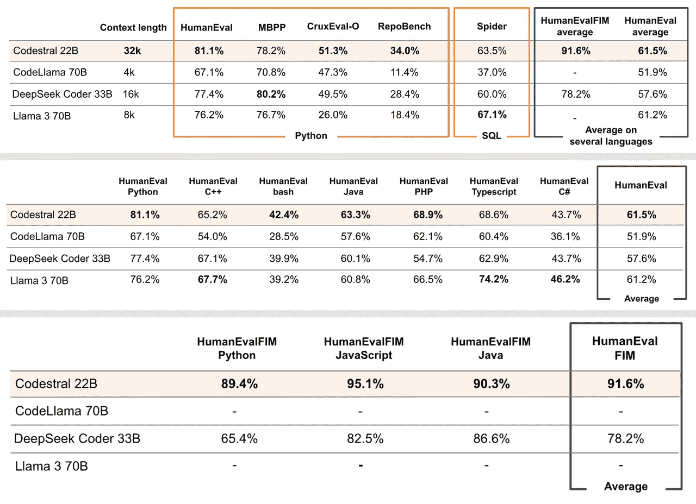

## Scale AI 推出私密专家评估平台

Scale AI 推出了一个对领先前沿模型进行私密专家评估的平台。除了 LLM 竞技场的 Elo 评估机制外就只有这种不开放测试集的专家测评相对可信了，不过这种也有暗中操作的可能。

**评估的原则是 **：

+   私密且不可被利用，评估不会被过拟合。

+   领域专家评估 。

+   不断更新新的数据和模型。

**评估维度有 ****：编程、数**学、指令跟随和多语言。

评估结果 ：编程-GPT-4 Turbo 、数学- Claude3 Opus 、指令跟随- GPT-4o 、西班牙语- GPT-4o。

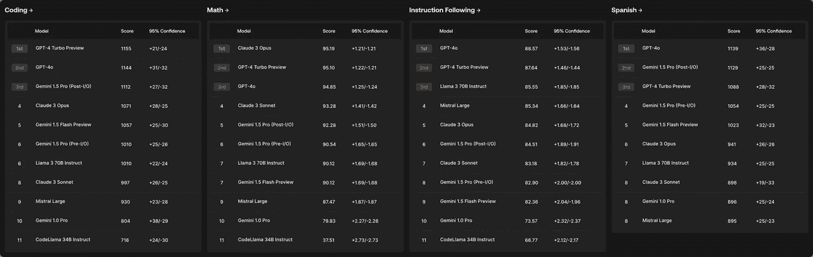

## 音频方面的进展

上周音频方面有些进展可能是看到了 GPT-4o 演示带来的影响，Open AI 真是行业明灯了。

### Cartesia 发布低延迟音频生成模型

Cartesia 发布了一个拥有极快推理速度和超低延迟的语音生成模型。

+   模型延迟仅135毫秒

+   能够展现出人类的情感和表达能力

+   10秒录音，即可模仿说话者的韵律、语调和声音特征

+   可以调节音调、速度、情感、发音和速度

### Suno 发布音乐生成模型 3.5 版本

Suno 在宣布了自己的 1.25 亿美元融资之后，也发布了自己的 3.5 版本模型，模型的主要特点是：

+   可以制作 4 分钟的歌曲

+   创建最长 2 分钟的歌曲扩展

+   显著改进的歌曲结构

目前免费用户可以使用 3.5 生成，但是生成的音乐无法下载。Suno 社区里面还有关于如何书写 Suno 提示词的教程：https://www.suno.wiki/

### [ChatTTS 语音生成模型](https://github.com/2noise/ChatTTS/blob/main/README_CN.md)

上周另一个爆火的语音生成模型是一个 B 站 UP 自己训练的 ChatTTS 模型。

ChatTTS是专门为对话场景设计的语音生成模型，用于LLM助手对话任务，对话语音，视频介绍等。

支持英文和中文两种语言。最大的模型使用了10万小时以上的中英文数据进行训练。

开源的版本是 4 万小时训练并且没有经过 SFT 的版本所以有些小的瑕疵。

**主要特点有：**

**对话式 TTS **: ChatTTS针对对话式任务进行了优化，实现了自然流畅的语音合成，同时支持多说话人。

**细粒度控制 **: 该模型能够预测和控制细粒度的韵律特征，包括笑声、停顿和插入词等。

**更好的韵律 **: ChatTTS在韵律方面超越了大部分开源TTS模型。同时提供预训练模型，支持进一步的研究。

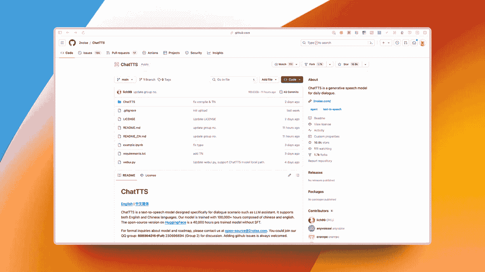

## Omost：通过微调的 LLM 控制图像生成

Controlnet 作者新项目 Omost 也太强了。这玩意对现有图像模型的提示词理解有巨大帮助。

在生成图像的过程中，尤其是通过扩散模型（SD）生成图像时，精确定位和描述图像中的各个元素是一个重大挑战。传统的方法依赖于精确的像素坐标或区域描述，但这种方式对于非专业用户来说非常复杂且不直观。

**项目解决的问题**

本项目引入了一种通过大型语言模型（LLM）辅助生成图像的方法，简化了图像生成过程中的定位和描述问题。具体来说，本项目通过预定义的位置、偏移量和区域三大参数来简化图像元素的描述，使得用户能够更直观地指定图像中各个元素的位置和大小，从而生成高质量、符合预期的图像。

**主要功能和作用**

1.  **简化图像描述 **：通过预定义的九宫格位置、偏移量和区域大小，用户可以轻松地描述图像中元素的位置和范围，无需精确的像素坐标。

1.  **提高生成精度 **：结合LLM的强大语言理解能力，自动调整和优化图像生成参数，提升生成图像的质量和准确性。

1.  **增强用户体验 **：用户可以通过自然语言进行图像描述，降低了专业知识的门槛，使得非专业用户也能轻松生成高质量的图像。

1.  **泛应用场景 **：适用于多种图像生成需求，如设计、广告、教育等领域，通过简单的文字描述即可生成符合需求的图像。

这里体验Omost：https://huggingface.co/spaces/lllyasviel/Omost

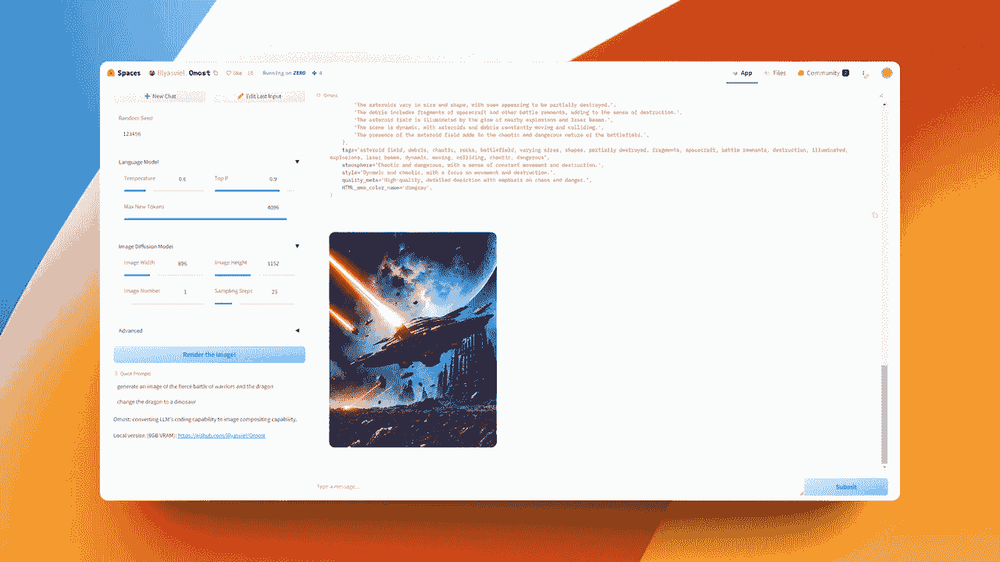

# 其他动态 ✦

+   腾讯发布AI 搜索工具 [元宝 ](https://yuanbao.tencent.com/chat/naQivTmsDa)[以及 ](https://yuanqi.tencent.com/create)Agents 创建和使用平台 元器 。

+   智谱的 GLM4 和通义 2 模型都将会在本周（0603） 开源。

+   Elevenlabs的 [文本转音效 ](https://x.com/elevenlabsio/status/1796567542565118151)已经向所有人推出。

+   Jina AI 推出了 [PDF 解析服务 ](https://x.com/JinaAI_/status/1796250699438739824)，在 r. jina .ai的链接后面跟上 PDF 文件的地址就可以返回解析结果。

+   [视频生成软件 ](https://x.com/PixVerse_/status/1796364739179913319)PixVerse发布了自己的 运动笔刷功能 ，产品的可用性上升了一大截。

+   Open AI [宣布 ](https://x.com/OpenAI/status/1795900306490044479)免费用户现在都可以使用 GPT-4o 以及几乎所有的 ChatGPT 功能，有条数限制。

+   [RewardBen](https://huggingface.co/spaces/allenai/reward-bench)ch 推出了一个专注于奖励模型的 测试基准和排行榜 。

+   [马斯克的 XAI ](https://x.ai/blog/series-b)完成了可能是历史上最大的 单轮 B 轮融资 60 亿美元。

+   在 Open AI 离职的超级对齐负责人 Jan Le[ike 入职 A](https://x.com/janleike/status/1795497960509448617)nthropic 担任 新的安全负责人 。

# 产品推荐 ✦

## Perplexity page： 用 AI 搜索帮忙生成完整的文档

Perplexity 推出了Page 创建功能，你可以像写文档一样创建整个页面。

每次只需要写对应部分标题就行他会给你补全内容，也可以随时在任何地方添加图片帮助理解。

生成的页面可以分享，AI 搜索正在向越来越丰富的格式和更好的阅读体验迈进。

Arc 选择自动生成，Perplexity则是人和 AI 共创。

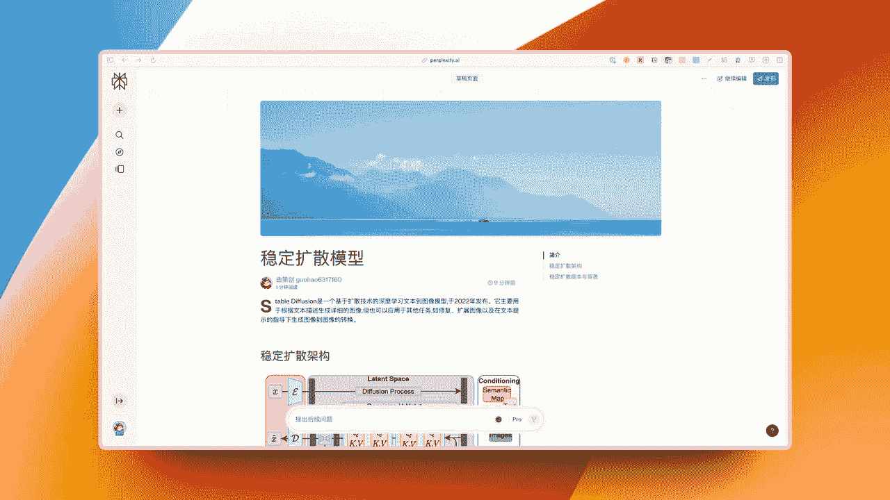

## 闪念贝壳：移动端的快速 AI 笔记应用

轻松记录灵感和日记

+   语音转文字：不用再担心打字的烦恼。只需说出你的想法或日记，ideaShell就能准确地把它们转换成文字，并自动过滤无关内容，让记录变得简单又精准。

+   AI优化文本：自动整理文本结构，生成标题和摘要，并添加标签，在保留原意的同时，使内容清晰易读，方便搜索和检索。

+   快速记录：使用智能按钮和各种快捷方式，快速捕捉灵感火花或日记内容，提高效率。

+   智能日记建议（即将推出）：根据你的活动，智能推荐日记内容，解决“不知道写什么”的困扰；晚上，AI会自动整理你的一天，提供反馈和建议。

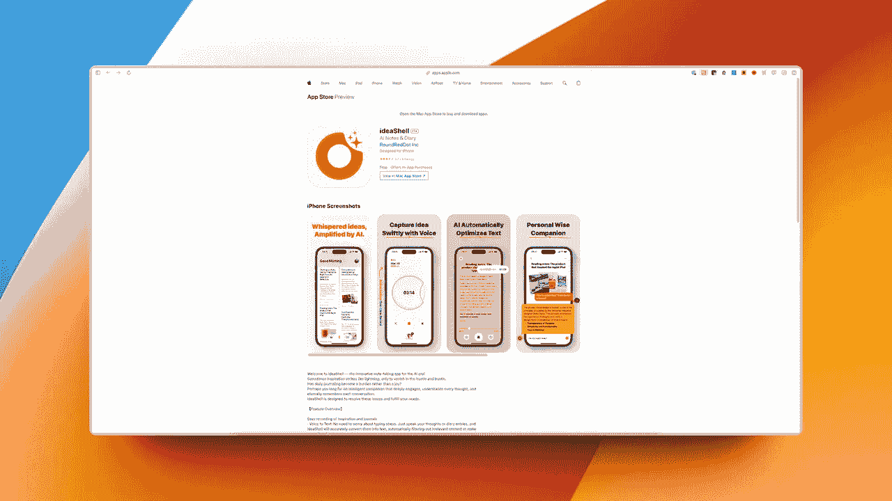

## Graphite：AI SEO 策略

Graphite平台是一个专为主题SEO（Topical SEO）设计的AI驱动平台，旨在帮助用户创建、执行和优化高影响力的SEO策略。该平台通过分析3,000个网站的博客数据发现，95%的页面仅带来不到5%的流量，因此Graphite专注于帮助用户找到和优化这5%最重要的内容。

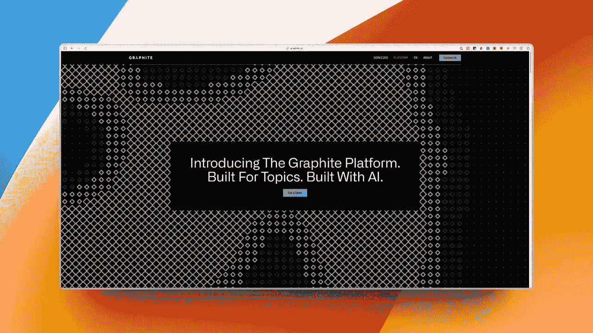

## Talestitch：跟 AI 一起创建故事

在Talestitch，讲故事成为前所未有的沉浸体验。从分享你的情节想法和相关图片开始，然后看着AI引擎将它们编织成详细而深刻的完整短篇小说。无论你是经验丰富的作家还是刚刚起步，直观的界面都能轻松将你的想法变为现实，并与你志同道合的讲故事社区分享。

但魔法并未止步于此。在Talestitch，合作是关键。通过扩展他人的故事，编写附加章节，一起探索新的叙事可能性，与其他用户互动。通过沉浸在多样的故事世界中，激发你的创造力，每一个故事都等待被发现和扩展。

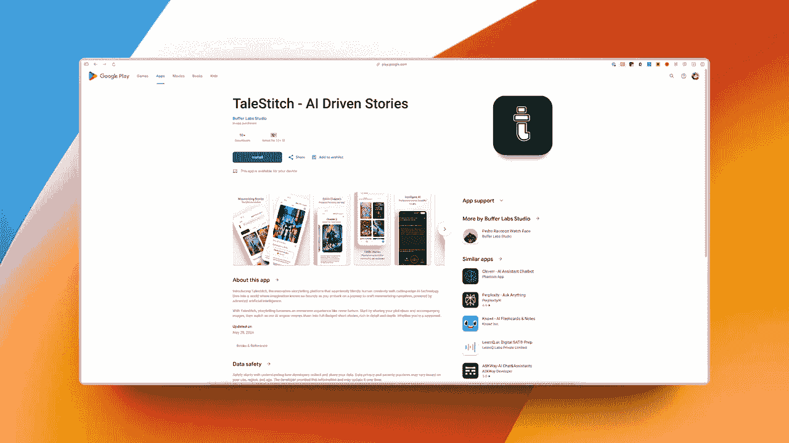

## illuminate：将论文转换为对话音频

谷歌的新项目，这下可以在上下班听论文了，如果有中文就好了。

可以将论文转换为通俗易懂的对话音频，帮助你更好的理解和学习论文内容。

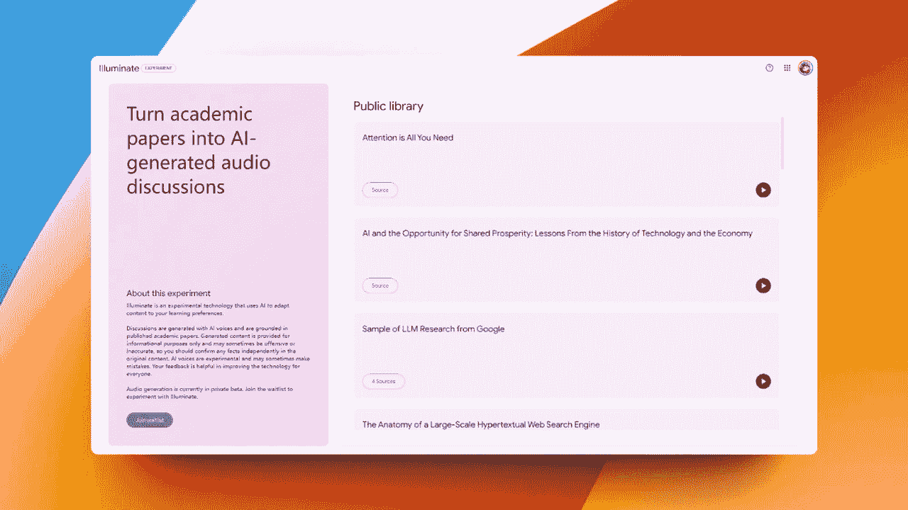

## AnyNode：利用 LLM 自动生成 ComfyUI 节点

你可以输入提示词让 LLM 帮你编写任何功能的节点。AnyNode 会根据你的要求编写一个 Python 函数，然后把这个节点链接到你要求的输出格式节点就行。

比如作者案例里面就通过提示词实现了文本总结节点、颜色通道调整节点，Ins 滤镜节点，甚至一个边缘检测器。

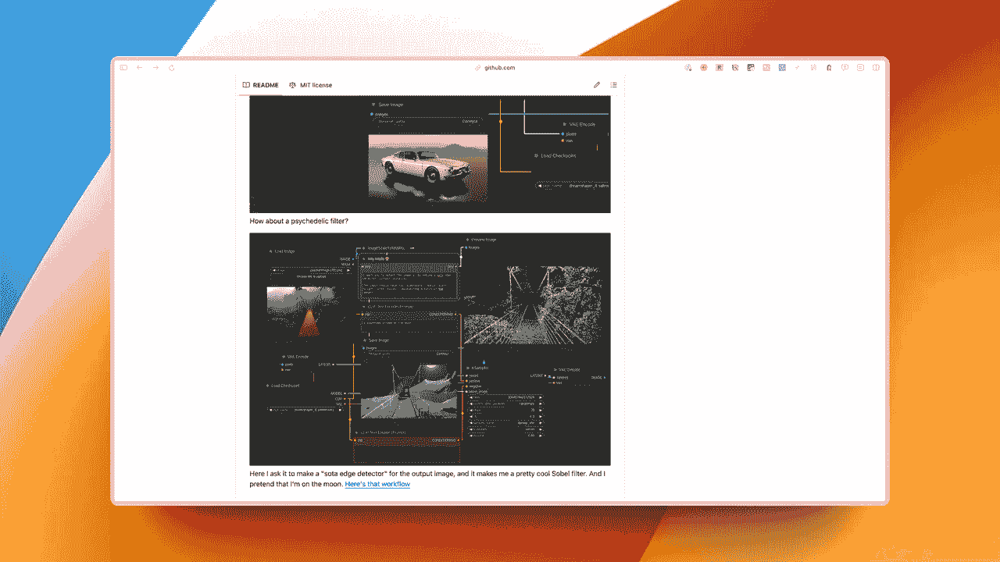

## Hyperaide： AI驱动的 To-Do 应用

Hyperaide 是一款个人助理应用程序,帮助用户管理任务、项目和目标,提高工作效率。可以快速捕捉任务,并自动处理任务细节,如截止日期和计划时间。可以在任何地方捕捉任务,只需点击一个快捷键即可。可以在任何地方捕捉任务,只需点击一个快捷键即可。

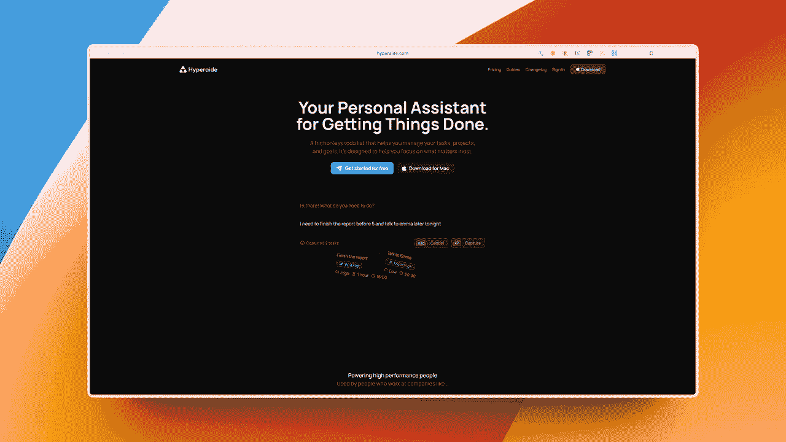

# 精选文章 ✦

## [大模型的扑克牌：独家内幕故事](https://mp.weixin.qq.com/s/YfFN7yjbyyPIy3MC89HdXA)

张小珺这篇内容用了一个主线将国内AI 领域资本市场的时间线和不同阶段下不同的选择串联了起来。

1.  中国投资圈一度热衷于德州扑克牌局,但现在已经转向品红酒聊天。这些投资人正在将目光转向中国大模型产业,在这个新兴领域打起了一副沉默的牌。

1.  美团联合创始人王慧文成立了"中国OpenAI"公司光年之外,以2亿美元估值融资5000万美元,引发了一场大佬云集的"Club Deal"。

1.  其他大模型公司如月之暗面、百川智能等也纷纷获得大额融资,估值迅速上升。

1.  中国主要投资机构如红杉、高瓴等采取了不同的投资策略,有的采取"赛道覆盖"的广撒网方式,有的则选择重点投资少数几家。

1.  阿里、腾讯等科技巨头也纷纷入局,成为大模型公司的重要投资方。

## [a16z： ](https://a16z.com/ai-voice-agents/)嗨，AI：我们关于AI语音智能体的论文

提出了关于 AI 语音助手的理论和市场机会。文章指出，随着通用人工智能（gen AI）的发展，人类将不再需要进行电话通话，而是将通过 AI 语音助手来处理更有价值的通话。对于企业来说，这意味着节省时间和成本，重新分配资源以增加收入，并降低风险以提供更符合规定和一致的客户体验。对于消费者，AI 语音助手能够提供接近人类水平的服务，而无需支付或与真人匹配，目前包括心理咨询、教练和陪伴等服务，未来可能会包括更广泛的基于语音的体验。

文章对 B2B 和 B2C 语音助手的发展进行了分类讨论。对于 B2B 语音助手，文章认为，随着从基于电话树的 1.0 AI 语音向基于 LLM 的 2.0 波进行转变，企业将能够实现更大规模和准确性的提升。文章还指出，不同行业的特定需求和集成要求可能导致垂直化的 AI 语音助手的爆炸性增长。

## 我们从与LLMs一起建设一年中学到的经验

文章由六位不同背景和专业领域的作者共同撰写，分享了他们在过去一年中使用大型语言模型（LLMs）构建应用的经验和教训。

文章分为三个部分：战术、运营和战略，本文是第一部分，聚焦于战术层面的实践。

详细探讨了如何利用大型语言模型（LLMs）构建产品，包括提示工程、信息检索、工作流程优化、评估与监测等关键技术和策略。

## AI搜索选哪个？18家AI搜索产品横向测评

橘子的新文章，对国内外已有的 18 家 AI 搜索做了一下测评：

0分组：豆包、秘塔AI、天工AI、文心一言、Bing、跃问、千问

1分组：万知、Gemini、

2分组：智谱、海螺、kimi、元宝、thinkany

3分组：Perplexity、ChatGPT、360 AI 搜索、百川

## 六个国家的公众如何看待新闻中的生成人工智能？

介绍了六个国家（阿根廷、丹麦、法国、日本、英国和美国）公众对生成人工智能（AI）在新闻领域应用的认知、使用情况以及对其未来影响的期望。

公众对生成 AI 在新闻行业的使用持有复杂的看法。他们认为新闻从业者可能已经在使用 AI 进行文本编辑、数据分析和翻译等任务，但对于 AI 生成的新闻内容的可靠性和透明度持怀疑态度。大多数人认为 AI 生成的新闻可能更新时效性更好，成本更低，但可信度和透明度可能会降低。因此，公众普遍认为，新闻媒体使用 AI 生成内容应该进行适当的披露或标注。

## 研究的四个奇点-AI 崛起创造的危机和机遇

作为一名商学院教授，Ethan Mollick 意识到人工智能正在对学术研究产生深远的影响。即使在 ChatGPT 之前，学术界已经面临着创新速度减缓的问题，各领域的研究进展似乎正在放缓。AI 可能会帮助解决这个问题，但同时也带来了新的挑战。Mollick 提出了四个 “狭义奇点”，即 AI 将如此深刻地改变学术研究，以至于我们无法完全预见其变革后的世界。

## [袖珍AI模型可以开启计算新时代](https://www.wired.com/story/pocket-sized-ai-models-unlock-new-era-of-computing/)

随着 ChatGPT 在 2023 年 11 月发布后的快速发展，微软研究院推出了 Phi-3-mini 系列 AI 模型，这些模型能够在智能手机等个人设备上运行，体现了 AI 模型迷你化的趋势。Phi-3-mini 在多项标准 AI 基准测试中表现与 GPT-3.5 相当，即使在小型模型上通过精选的训练数据进行训练，也能展现出令人惊讶的能力。

未来的 AI 系统不仅需要通过扩展规模来提高智能水平，而且需要通过精细化的训练方法来提升效率和能力。此外，迷你化的 AI 模型能够提高设备的响应速度和隐私保护，同时也可能激发出全新的 AI 应用场景。

# 重点研究 ✦

## Jina CLIP：CLIP 模型也是文本检索器

对比语言-图像预训练（CLIP）是一种被广泛使用的方法，它通过将图像和文本转换成固定大小的向量，使它们在一个共同的嵌入空间中对齐，从而训练模型。这些模型对于多模态信息检索和相关任务非常重要。然而，与专门用于文本的模型相比，CLIP模型在仅文本任务中的表现通常不如人意。这导致了信息检索系统在处理仅文本任务和多模态任务时需要分别保留不同的嵌入和模型，从而造成效率低下的问题。为了解决这个问题，我们提出了一种新颖的多任务对比训练方法，并用该方法训练了jina-clip-v1模型，使其在文本-图像和文本-文本检索任务中都达到了最先进的性能。

## RB-Modulation：谷歌的风格迁移项目

RB-Modulation 谷歌发布的一个图片风格迁移项目，可以将原图的风格迁移到生成的图象上。

跟 InstantStyle和IP-Adapter的主要区别是避免了对 Controlnet 的依赖，所以不会导致生成的图片被原图的姿势或者内容影响。

## ToonCrafter 收尾帧生成动画

腾讯发布了ToonCrafter，一个给出首尾帧生成动画视频的项目。

从演示来看效果很好，过渡很顺滑，而且没有明显问题。

还设计了一个灵活的草图编码器，使用户能够对插值结果进行互动控制。

## The Road Less Scheduled

这个论文提出了优化机器学习模型的新方法，叫做“无计划学习率”（Schedule-Free Learning）。

传统的学习率计划需要提前设定训练何时停止，而这种新方法无需提前知道训练何时停止，也不需要额外的超参数。

如果这项技术能推广开来，它可能会在学习率优化领域引起重大变革

## [PCM：阶段一致性模型](https://g-u-n.github.io/projects/pcm/)

又有新的SD加速模型可以用了，PCM解决了原来LCM模型的各种问题。并且支持对 AnimateLCM 也做了优化，用PCM直接生成动画也可以保证质量了。

PCM主要改善了三个LCM原有的问题：

+   LCM 只能接受小于 2 的 CFG 规模。较大的值会导致图像过度曝光。此外，LCM 对负面提示不敏感。

+   LCM 在不同的推理步骤中无法产生一致的结果。当推理步骤过大或过小时，其输出的结果会变得模糊。

+   LCM 的损失项无法实现分布一致性，在低推理步骤下会产生质量较差的结果。

## SDXL Openpose 及 Scribble 模型

SDXL 终于有了足够好的 Openpose 和 Scribble 模型。

xinsir 发布的Openpose 和 Scribble 模型质量相当好，尤其是 Openpose。不过只支持姿态不支持面部。

再加上前几天的 Anyline 线条预处理器和 Canny 模型。SDXL 的生态终于在发布快一年的时候成熟了

## [**EasyAnimate：基于 Trans**](https://easyanimate.github.io/)former 架构的高性能长视频生成方法

阿里出的 Dit 架构视频生成模型论文，这是一种利用Transformer架构强大性能的视频生成先进方法。扩展了最初为2D图像合成设计的DiT框架，通过引入运动模块来适应3D视频生成的复杂性。该模块用于捕捉时间动态，从而确保生成一致的帧和无缝的运动过渡。

运动模块可以适应各种DiT基线方法，以生成不同风格的视频。在训练和推理阶段，它还可以生成具有不同帧率和分辨率的视频，适用于图像和视频。此外，还引入了slice VAE，这是一种新颖的方法，用于压缩时间轴，促进长时间视频的生成。

## SWE-agent：代理-计算机接口实现自动化软件工程

SWE-agent，这个系统使LM智能体能够自主使用计算机来解决软件工程任务。SWE-agent的定制智能体-计算机接口（ACI）显著增强了智能体创建和编辑代码文件、浏览整个代码库以及执行测试和其他程序的能力。在SWE-bench和HumanEvalFix上的评估中，SWE-agent分别取得了12.5%和87.7%的pass@1率，远远超过了以往非交互式LM所达到的最新技术水平。最后，我们提供了关于ACI设计如何影响智能体行为和性能的洞察。