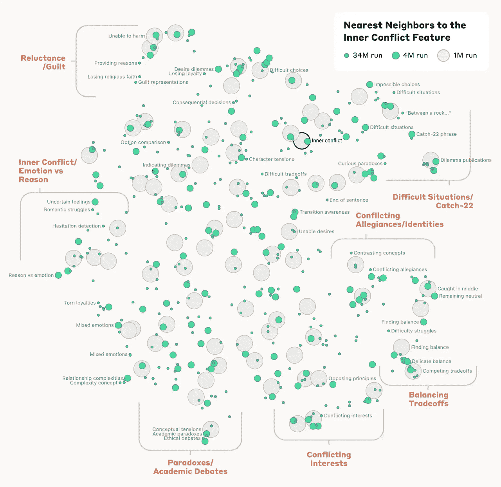
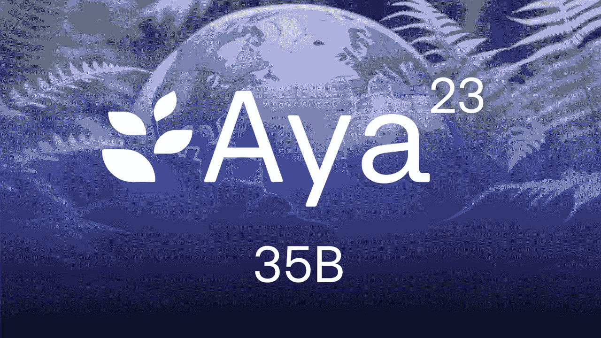
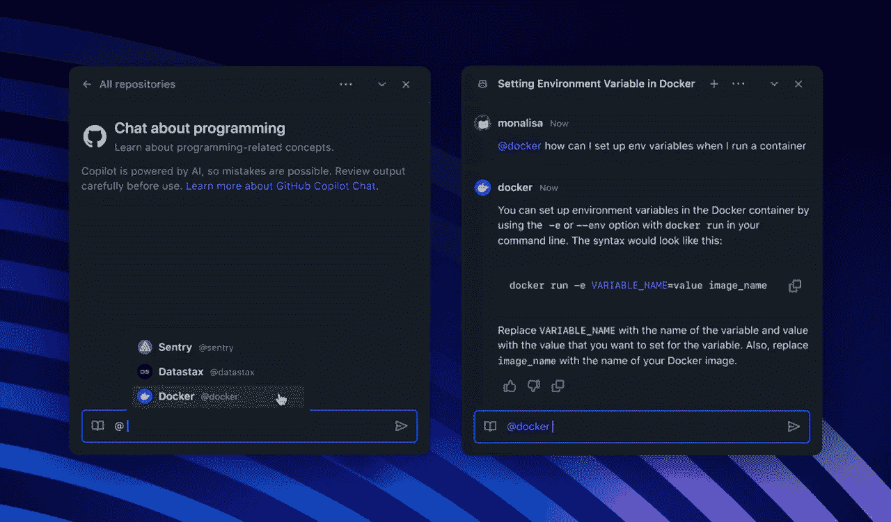
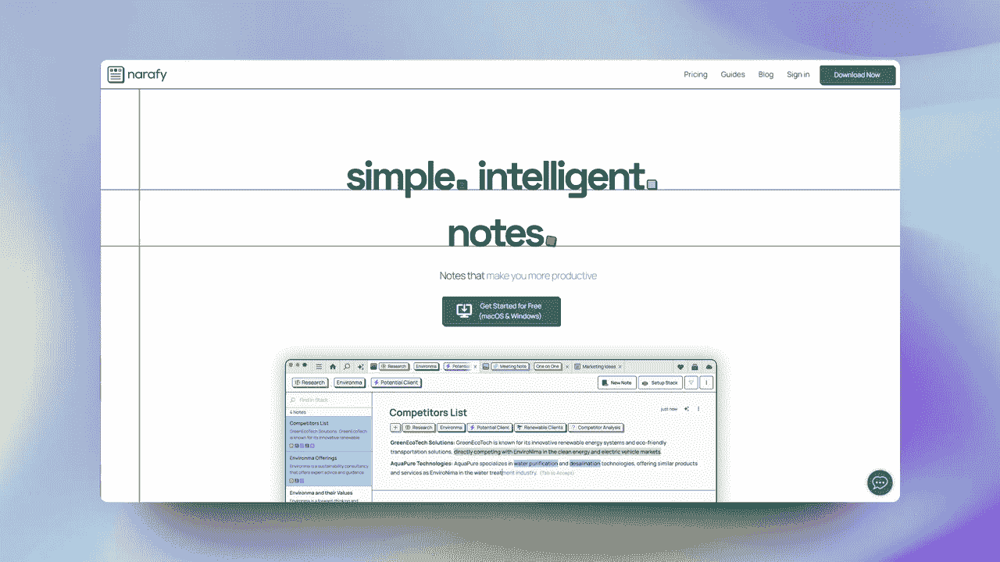
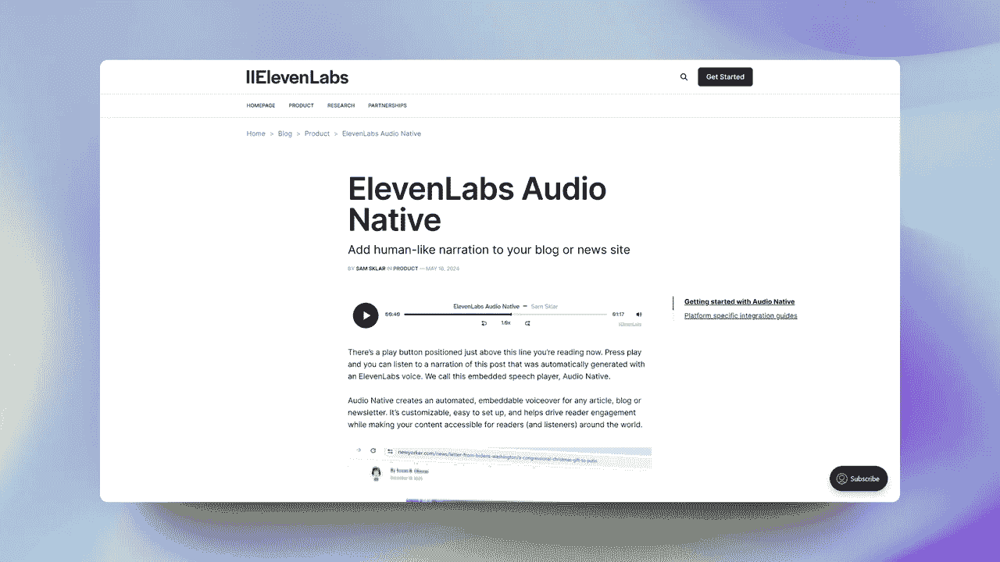

# AIGC Weekly #73

> 来源：[https://waytoagi.feishu.cn/docx/QH5FdUaMGo6GzjxfhwAcOvY5nlc](https://waytoagi.feishu.cn/docx/QH5FdUaMGo6GzjxfhwAcOvY5nlc)

> 🔗 原文链接： h[ttps://quail.ink/o](https://quail.ink/op7418/p/aigc-weekly-73)p7418/p/aigc-wee...

> 作者：⏰ 发表时间：2024-05-27

# 上周精选 ✦

## 微软 Build 2024 开发者大会发布内容

微软上周错峰开了发布会发布了一系列关于开发者的内容和完全革新的 Copilot+ PC，不过内容远没有谷歌 I/O 那么丰富。

Copilot+ PC的硬件介绍：

+   Surface 首款 Copilot+ PC：全新的 Surface Pro 和 Surface Laptop。

+   可以实现超过 40 TOPS（每秒万亿次操作）的运算速度。

+   在运行 AI 工作负载时，性能提升多达 20 倍，效率提高多达 100 倍。

+   在持续多线程性能方面，Copilot+ 电脑比 Apple 的 MacBook Air 15" 高出多达 58%。

+   保持全天电池续航，可以提供长达 22 小时的本地视频播放或 15 小时的网页浏览。

Copilot+ PC的软件更新：

+   Recall：电脑会截图保存你所有的操作历史，用户可以用自然语言搜索自己看到或编辑过的任何内容。

+   图片编辑：Cocreator可以将简笔画实时生成图像，Restyle Image可以通过 AI 来重新编辑照片，比如更改前景、背景以及更换风格。

+   与 Adobe 合作将 Adobe 全家桶的 AI 能力增强，优化这些应用程序中的人工智能以适配 NPU。

+   LiquidText：完全在设备上通过 NPU 运行的 AI 功能，更快更智能地对文档进行注释。

+   实时字幕翻译：自动实时翻译 40 多种语言的录音频成英文字幕，离线状态下也行。

+   Windows Studio Effects：自动美化视频中用户外观和声音，暗光环境增强前景、三种色彩滤镜。

+   Copilot更新：带有新 Copilot 键的键盘上可以一键唤起Copilot，支持用 GPT-4o 进行语音对话和屏幕实时浏览并给出建议，比如指导你应该怎么玩游戏。

**Build开发者大会介绍：**

+   **Real-Time Intelligence：**可帮助具有简单低代码/无代码经验的分析师，也可使专业开发人员受益，提供代码丰富的用户界面。

+   Fabric 工作负载开发工具包 ：通过使独立软件供应商（ISV）和开发人员能够在 Fabric 内扩展应用程序。

+   GPT-4o，OpenAI 最新的旗舰模型，现已在 Azure AI Studio 和作为 API 中提供。

+   **Phi-3-vision **：这是一个将语言和视觉能力结合在一起的42 亿参数多模态模型。现在也可通过 Azure AI 的模型作为服务提供。

+   微软正在授权可汗学院向所有 K-12 年级的美国教育工作者提供免费访问 Khanmigo for Teachers，这是一款由人工智能驱动的教学助手，可以节省教师的时间。

+   **Cobalt 100 **：基于 Arm 的虚拟机是第一代具有微软新 Cobalt 处理器的虚拟机，该处理器基于 Arm 架构定制构建，并针对运行通用和云原生工作负载时的效率和性能进行了优化。客户可以期待与可比较的 Azure 虚拟机相比提高多达 40%的性能。

+   **Team Copilot **：将能够在协作的地方调用 Copilot - 在 Teams、Loop、Planner 等中。Team Copilot 可以在会议中担任会议主持人，管理议程，跟踪时间并记录笔记。它可以在聊天中充当协作者，展示重要信息，跟踪行动项目并解决未解决的问题。

+   Microsoft Copilot Studio ：正在推出新的Agents功能，赋予开发人员建立可主动响应数据和事件、针对特定任务和功能定制的副驾驶的能力。

+   Copilot extensions ：包括插件和连接器，允许客户通过将其连接到新的数据源和应用程序来增强 Microsoft Copilot，从而扩展其功能。

## CanvaCreate 大会用 AI 增强设计

Canva 24号开了他们 2024 CanvaCreate 大会，主题是重新设计工作。整体依托数据反馈和 AI 工具对Canva做了相当大的重构，上线了一堆非常好用的 AI 设计功能：

+   **Magic Media **：可以用文本生成适合各种场景的简单插图。

+   **Highlights **：可以自动剪辑所选视频，快速生成多段高亮片段。

+   Resize & Magic Switch ：可以将任何设计转变为排版很好的文档。

+   **Magic Grab **：图片编辑功能，选中对应区域后移动元素或者调整大小。

+   **Styles **：只需点击一下，将任何设计的风格应用到另一个设计中。

+   **Magic Write **：升级过的 AI 文档能力，快速生成清晰有影响力的文本。

+   **Enhance voice **：音频优化，消除背景噪音。

+   **Layouts **：快速获得多种符合品牌形象的布局建议，可以选择合适的使用。

## Anthropic 关于 LLM 可解释性的新研究

Anthropic 一直专注于 LLM 的可解释性研究以及对齐，上周他们发布了一个在他们看来是重大进展的研究，他们确定了数百万个概念在Claude Sonnet内部是如何表示的。

他们成功地从 Claude 3.0 Sonnet 的中间层中提取了数百万个特征，为其计算过程中间阶段的内部状态提供了一个粗略的概念地图。这是第一次详细地观察现代、生产级大型语言模型内部。

这些特征对应于各种实体，如城市（旧金山），人物（罗莎琳德·弗兰克林），原子元素（锂），科学领域（免疫学）和编程语法（函数调用）。这些特征是多模态和多语言的，可以对给定实体的图像以及其名称或描述在许多语言中做出响应。

还有更多抽象特征——比如回应计算机代码中的错误、讨论职业中的性别偏见，以及谈论保守秘密。

操纵这些特征会导致行为上的相应变化，这证实了这些特征不仅仅与输入文本中概念的存在相关，而且还在因果上塑造了模型的行为。

之后他们用这个发现整了个大活给 Claude 加了一个金门大桥模式，现在点击Claude 右上角大桥图标可以进入金门大桥模式，金门大桥这一概念在模型中被大幅加强。

即使没有提到金门大桥，回答也全跟大桥相关，这个研究的意义非常重大，普通人可以可以直观感受到 LLM 中概念合集的影响。

## Cohere 发布 Aya 系列模型

Cohere前两天的一个大活，他们联合 119 个国家的 3000 多名独立研究人员发布了 Aya 模型项目最离谱的一个模型支持 101 种语言的响应。

**项目包括：**

+   Aya Collection 多语言数据集：

+   目标是通过构建一个涵盖65种语言的人类整理的指令跟随数据集来弥合语言差距。

+   与来自世界各地的流利语言使用者合作，收集自然语言的指令和完成情况。

+   通过模板化和翻译现有数据集，迄今为止创建了最广泛的多语言集合，包含114种语言的5.13亿个实例。

+   Aya 23模型是一种大规模多语言语言模型系列：

+   能够用 101 种语言遵循指令。包括 Aya23-8B、Aya23-35B 以及 Aya101-13B。

+   在大多数任务上，Aya的表现优于mT0和BLOOMZ，同时覆盖的语言数量是它们的两倍。

+   引入了广泛的新评估套件，扩展了99种语言的多语言评估的最先进水平——包括判别性和生成性任务、人类评估以及涵盖持出任务和分布内表现的模拟胜率评估。

+   Aya Dataset 技术报告：

+   Aya 23 在覆盖的语言上优于之前的多语言模型Aya 101，以及其他常用的模型，如Gemma和Mistral。

+   Aya 23 在多个任务和语言上的表现优异，包括判别任务、生成任务和数学推理任务。

+   Aya 23 是一个多语言指令调优模型，支持23种语言，基于Cohere的Command模型，旨在提升非英语语言的性能。

# 其他动态 ✦

+   Meta正在研发他们的 Meta AI 助手的高级版本 ，很可能会采取类似其他公司的月费模式。

+   Open AI [更新了离职协议 ](https://www.cnbc.com/2024/05/24/openai-sends-internal-memo-releasing-former-employees-from-non-disparagement-agreements-sam-altman.html)，包括前员工也收到了更新的协议，他们承诺永远不会收回前员工的股权，也不会有类似不许诋毁公司的条款。

+   Open AI 在 Vivatech 上的演示 说明 ChatGPT 可以通过多种模型生成视频素材然后剪辑成完整的视频。

+   OpenAI 已与 [News Corp 签署协议 ](https://openai.com/index/news-corp-and-openai-sign-landmark-multi-year-global-partnership)。News Corp 拥有《华尔街日报》、《纽约邮报》、《MarketWatch》等出版物。

+   Scale AI 在 13.8 亿[美元估值的情](https://scale.com/blog/scale-ai-series-f)况下完成了 10 亿美元的 F 轮融资 。

+   Suno [已筹集了 1.25 亿美元 ](https://suno.com/blog/fundraising-announcement-may-2024)，以打造一个任何人都可以制作音乐的未来。

+   [Open AI在首尔A](https://openai.com/index/openai-safety-update)I峰会上发表了他们的 十项AI安全实践概述 。

+   TikTok周二宣布推出 TikTok Symphony AI工具系列 。帮助营销人员撰写脚本、制作视频并增强当前资产。

+   Mistral 7B v0.3 发布 。词汇表扩展到 32768 个词，支持新的 v3 Tokenizer，支持函数调用。

+   ChatGPT 数据分析的 [优化已经上线 ](https://x.com/op7418/status/1792834688983384160)。上传的表格数据会直接展示在界面上你可以选择行或者列来询问问题。生成的大部分常见图表都是可以进行交互的。

+   LLM 竞技场推出了 长难句提示词（Hard Prompts）测试 ，可以比较好的表现模型的推理和解决问题的能力。

+   [字节跳](https://apps.apple.com/cn/app/%E7%8C%AB%E7%AE%B1-%E5%BC%80%E5%90%AF%E4%BD%A0%E7%9A%84-ai-%E5%A5%87%E9%81%87/id6475000292)[动推出](https://apps.apple.com/cn/app/%E6%98%9F%E7%BB%98/id6475072892)了专门的 AI 陪伴型机器人应用 猫箱 ，以及针对 AI 绘画以及 AI 写真的应用 星绘 ，其中猫箱的聊天记录会跟豆包同步。

# 产品推荐 ✦

## Arc Sreach：打电话获得需要的信息

Arc Sreach 上周的新功能支持通过打电话的方式跟 Arc 语音交流获得对应的信息，其中有很多非常好的设计，比如屏幕上会展示返回和输入声音的文字，为了改善 LLM 的延迟给回复间隙加上了类似电话客服的音乐。长按浏览器图标选择”Call Arc”使用这个功能。

Perplexity与Tako合作给数据相关的问题加上了可交互图表，这是一种新型的人工智能搜索引擎，用于可视化和分享世界知识。自然语言搜索生成可共享、引人入胜的显示，可以将其嵌入应用程序、搜索和叙事中。实时从权威、经过审查的提供者那里获取所有数据。

## [GitHub Copilot Extensions](https://github.blog/2024-05-21-introducing-github-copilot-extensions/)：将 Github 与其他工具和服务连接

GitHub宣布推出GitHub Copilot Extensions，这是一种新的扩展功能，旨在通过与合作伙伴生态系统的集成，进一步提升开发者的体验和效率。

通过Copilot Extensions，开发者可以在不离开IDE或GitHub.com的情况下，使用自然语言与这些工具进行交互，从而保持开发流程的连贯性，提高技能，并加速创新。

企业可以创建私有的Copilot Extensions，以便将内部API库或自定义监控系统的知识集成到开发者的工作流程中。

## [Tone：一直在线的录音吊坠](https://tone.computer/)

这是一种始终录音的吊坠，所以永远不会忘记事情。会自动捕捉生活经历、对话、想法和待办事项。

并帮助你运用它们做出更明智的决策和更有创意的选择。第一批（1000 台）将于 2024 年第四季度发货。

## [**Timmy：AI财务助理**](https://www.timmyapp.com/)

你的 AI 消费伙伴。获取个性化的支出建议，Timmy 实时分析你的支出，建议预算，并提供每周任务，以实现财务目标。

## Narafy：以标签为中心的AI笔记应用

Narafy 是一个专为提高笔记效率而设计的应用程序，它具备以下特点：自动完成用户的句子，帮助用户保持组织性和专注，提供标签建议，使用 AI 助手从笔记中快速找到所需信息，以及通过标签组合创建不同的笔记堆栈以自动化工作流程。此外，Narafy 提供强大的搜索功能，帮助用户在知道 precisely 要查找的内容时快速找到笔记。它还支持制作美观的笔记，整理思绪，插入吸引人的图像，并且可以通过网络剪贴板捕捉信息。Narafy 的笔记存储在用户的设备上，确保随时可以访问，即使在没有互联网连接的情况下。数据同步功能可实现笔记的云端同步，使其在不同设备间可用。

## [**ElevenLabs Audio Na**](https://elevenlabs.io/blog/audio-native/)tive： 可以嵌入网页的AI阅读播放器

ElevenLabs 推出了一个名为 Audio Native 的工具，它能够自动为在线内容生成语音旁白，并允许用户将其嵌入到网站中。使用 Audio Native 的步骤包括登录、添加网站域名到允许列表、选择声音、自定义播放器外观，以及将嵌入代码复制并粘贴到网站上。此外，网站还提供了针对不同平台（如 React、Ghost、Squarespace、Webflow、Framer 和 WordPress）的集成指南。

# 精选文章 ✦

## Github CEO TED 演讲：AI 可以帮助任何人成为程序员

Thomas Dohmke讲述了AI对编程的革命性影响，特别是通过GitHub Copilot实现的，让更多人能轻松参与编程。他以乐高为比喻，展示了如何通过自然语言与代码互动，并预示了未来更多人将成为开发者。

**乐高比喻 **：Dohmke热爱乐高，并将其比喻为一种低门槛的创意实现方式，类比编程的未来。

**编程语言的演变 **：从1940年的Plankalkül到1991年的Python，编程语言变得更接近自然语言，但仍然复杂。

GitHub Copilot的诞生 ：通过GPT-3，GitHub Copilot可以预测和完成代码，大大简化了编程过程。

**自然语言编程 **：Copilot和ChatGPT结合，使得任何人都可以用自然语言编写代码，实现了人机语言的融合。

**未来展望 **：Dohmke预测到2030年，将有超过十亿开发者，编程将变得像搭乐高一样简单。

## Google CEO谈论基于人工智能的搜索和网络的未来

AI 将为用户提供直接的答案。这一变化可能会对网站流量产生深远影响，尤其是对于新闻和媒体内容创作者。Sundar Pichai 认为，尽管这一变化可能会引起短期内的混乱，但他对网络的未来持乐观态度，认为新技术总是伴随着短期的干扰。

Pichai 强调，Google 对于维护一个健康的生态系统非常关心，并且认为用户对高质量内容的需求是不断增长的。他提到，AI 概览实际上增加了用户点击链接的比例，这表明用户对于更深入的内容仍然有兴趣。尽管有些网站所有者对于 Google 的变化表示担忧，认为这可能会导致他们的流量急剧下降，甚至破坏他们的业务，但 Pichai 认为这种转变不一定是零和游戏。

## 与她聊天 - Mac 上的 ChatGPT 应用程序

Tomasz Tunguz 是一位风险投资家，他近期尝试了 OpenAI 推出的 Mac ChatGPT 应用程序。他认为这种与计算机对话的方式无疑是人机交互的未来，因为说话比打字更加自然。

Tunguz 看到了这类助手的潜力，比如通过语音撰写和发送邮件、在 Asana 中分配任务、总结网页内容并发表评论，以及校对文章并发布。他还提到了自己过去写的关于语音作为未来主导用户界面的文章，并认为我们现在比以往任何时候都更接近这一愿景。

## a16z：GPT-4o 和 Gemini 找到自己的声音

在AI领域，这是非常重要的一周，因为OpenAI和Google都发布了重大更新。这次更新非常重要，因此我们决定与消费者合作伙伴Bryan Kim和Justine Moore一起，以一种新的形式进行解析。我们讨论了那些已经具备语音功能的多模态助手，同时也探讨了为什么不同音频之间存在差异，以及速度和个性等细微之处为何如此重要。

## 人工智能已经改变了管理——公司必须决定如何应对

根据 LinkedIn 和 Microsoft 的调查，大多数白领工作者已经在工作中使用了 AI，且多数情况下是在没有告知雇主的情况下使用自己的设备。这表明 AI 技术的普及已经超出了企业的直接控制。AI 的使用正在改变工作的本质，例如自动化报告和电子邮件等文档工作，这要求管理者重新评估员工的工作价值和贡献。随着 AI 生成的内容质量的提升，管理者面临着如何保持工作质量和深度的挑战。AI 也可以作为一个强大的辅助工具，帮助管理者进行个性化的员工培训和发展，但同时也可能导致员工感到被监控。因此，企业必须在使用 AI 的同时，平衡员工的自主性和隐私。

# 重点研究 ✦

## LiteVAE：用于潜在扩散模型的轻量高效变分自动编码器

是一系列用于LDMs的自动编码器，通过利用二维离散小波变换来提高标准变分自动编码器（VAEs）的可扩展性和计算效率，且不牺牲输出质量。我们还研究了LiteVAE的训练方法和解码器架构，并提出了若干改进，提升了训练效果和重建质量。我们的基础LiteVAE模型在编码器参数减少六倍的情况下，达到了当前LDMs中现有VAEs的质量，从而训练速度更快且GPU内存需求更低，而我们的大模型在所有评估指标（rFID、LPIPS、PSNR和SSIM）上均优于复杂度相当的VAEs。

## [并非所有语言模型特征都是线性的](https://arxiv.org/abs/2405.14860)

探讨了一些语言模型表示是否本质上具有多维性。我们首先提出了不可约多维特征的严格定义，判断这些特征是否可以分解为独立或非共现的低维特征。受这些定义启发，我们设计了一种可扩展的方法，使用稀疏自动编码器自动识别GPT-2和Mistral 7B中的多维特征。这些自动识别的特征包括一些显著可解释的例子，例如表示星期几和月份的圆形特征。我们确定了利用这些圆形特征解决涉及星期几和月份的模运算任务。最后，我们通过对Mistral 7B和Llama 3 8B进行干预实验，提供了这些圆形特征是这些任务中计算基本单元的证据，并通过将这些任务的隐藏状态分解为可解释的组件，识别了更多的圆形表示。

## ReVideo：通过运动和内容控制重新制作视频

能够在特定区域通过同时指定内容和运动进行精确的视频编辑，从而区别于现有方法。内容编辑通过修改第一帧实现，而基于轨迹的运动控制提供了直观的用户交互体验。

ReVideo解决了一个涉及内容和运动控制之间耦合和训练不平衡的新任务。为了解决这一问题，我们开发了一个三阶段训练策略，从粗到细逐步解耦这两个方面。

此外，提出了一种时空自适应融合模块，在各种采样步骤和空间位置上整合内容和运动控制。大量实验表明，我们的ReVideo在几个精确的视频编辑应用上表现出色，即（1）在保持运动不变的情况下局部更改视频内容，（2）保持内容不变并定制新的运动轨迹，（3）同时修改内容和运动轨迹。我们的方法还可以无缝扩展到多区域编辑，无需特定训练，展示了其灵活性和稳定性。

## 你的Transformer其实是线性的

揭示了Transformer解码器特有的一种线性特征，包括GPT、LLaMA、OPT、BLOOM等模型。我们分析了连续层之间的嵌入转换，发现了几乎完美的线性关系（Procrustes相似度得分为0.99）。然而，当去除残差组件时，因为Transformer层的输出范数一致较低，线性度下降。

我们的实验表明，移除或线性近似Transformer中一些最线性的块并不会显著影响损失函数或模型性能。此外，在我们对小型模型的预训练实验中，我们引入了一种基于余弦相似度的正则化方法，旨在降低层的线性度。这种正则化在Tiny Stories和SuperGLUE等基准测试中提高了性能指标，同时也成功地降低了模型的线性度。

## FIFO-Diffusion：无需训练即可生成无限视频

提出了一种基于预训练扩散模型的新型推理技术，用于文本条件下的视频生成。我们的方法称为FIFO-Diffusion，理论上无需训练即可生成无限长的视频。

实现方式是通过迭代执行对角去噪，同时处理队列中噪声水平不断增加的一系列连续帧；方法在队列头部取出完全去噪的帧，同时在队列尾部加入新的随机噪声帧。然而，对角去噪是一把双刃剑，因为尾部附近的帧可以通过前向参考利用更干净的帧，但这种策略会导致训练和推理之间的差异。

为此，我们引入了潜在分区以减少训练和推理的差距，并通过前瞻去噪来利用前向参考的优势。

## [智能体规划中的世界知识模型](https://arxiv.org/abs/2405.14205)

借鉴人类的心理世界知识模型在人类执行任务前提供全局先验知识，并在任务期间维护局部动态知识的方式，本文提出了参数化世界知识模型（WKM），以促进智能体规划。具体来说，我们引导智能体模型从专家和采样轨迹中自动综合知识。随后，我们开发了WKM，提供先验任务知识以指导全局规划，同时提供动态状态知识以辅助局部规划。

我们在三个复杂的真实世界模拟数据集上使用了三种最先进的开源大语言模型（Mistral-7B、Gemma-7B和Llama-3-8B）进行实验，结果表明我们的方法相比各种强基线表现更优。

此外，我们的分析表明，WKM能够有效缓解盲目试错和幻觉性行为问题，为智能体理解世界提供强有力的支持。

其他有趣的发现包括：1）我们的实例级任务知识可以更好地泛化到未见任务，2）弱WKM可以指导强智能体模型规划，3）统一的WKM训练具有进一步发展的潜力。