# AIGC Weekly #72

> 来源：[https://waytoagi.feishu.cn/docx/RGPDdsw1koomK1xGfuxcVBINnMh](https://waytoagi.feishu.cn/docx/RGPDdsw1koomK1xGfuxcVBINnMh)

> 🔗 原文链接： h[ttps://quail.ink/o](https://quail.ink/op7418/p/aigc-weekly-72)p7418/p/aigc-wee...

> ⏰  发表时间：2024-05-19

# 上周精选 ✦

## Open AI 的 GPT-4o 发布和 ChatGPT 演示

上周一 Open AI 的发布会虽然只有短短 25 分钟，但是直接把所有人都震撼了，能够把比 GPT-4 还强很多的真正的多模态模型的推理速度压缩到这个地步真是离谱。

Open AI 虽然产品能力不行，但是可以用模型的进步替代产品的优化和复杂迭代。

而且这次的产品和模型更新摆明了就是要收集更多的多模态信息，但是没办法我还是得用，同时再加上跟最大入口 Apple 的合作，数据问题现在应该已经不是问题了。

强烈推荐看一遍 GPT-4o 发布页的所有视频演示和文本演示。

Sam 自己写了 [一条博客 ](https://blog.samaltman.com/gpt-4o)来阐述他对 GPT-4o 的看法。他们的阶段性目标获得了更新：

“用最低的价格甚至是免费，将最好的模型提供给世界上所有人”

### [关于 GPT-4o 模型更新](https://openai.com/index/hello-gpt-4o/)

+   它可以接受任意组合的文本、音频和图像作为输入，并生成任意组合的文本、音频和图像输出。

+   它可以在 232 毫秒内响应音频输入，平均为 320 毫秒，这与人类在对话中的响应时间相似。

+   在英文和代码文本方面，它与 GPT-4 Turbo 的性能相当，对非英语文本的文本有显著改进。

+   同时在 API 方面更快速、价格更便宜 50%。与现有模型相比，GPT-4o 在视觉和音频理解方面表现特别出色。

+   与 GPT-4 Turbo 相比，GPT-4o 速度提高了 2 倍，价格减半，限制速率提高了 5 倍。

+   他们也承认之前在 LLM 竞技场上的 GPT2-Chatbot 模型就是 GPT-4o，LLM 竞技场中 GPT-4o 的评分比 GPT-4 0409 高了整整 50 分。

### [ChatGPT 产品层面的更新](https://openai.com/index/gpt-4o-and-more-tools-to-chatgpt-free/)

+   新的 ChatGPT 更新，支持利用 GPT-4o 进行实时的语音和视频对话。

+   网页端和移动端全新的 UI 设计。

+   发布 Mac 版本的 ChatGPT 客户端，支持获取桌面内容进行对话，支持类似 Raycost 的快速拉起。

+   免费用户可以使用 GPT-4o，同时使用 GPT-4o 的时候可以免费使用原来 ChatGPT Plus 的发布分功能，目前只有文本模型，额度有限制 3 小时 10 条。

+   Sam 也确认了目前在 ChatGPT 中的 GPT-4o 只有文本模式，其他的多模态声音、图像、视频都没有实装。

[除了上面在发布会发布的能力之](https://openai.com/index/improvements-to-data-analysis-in-chatgpt/)外，Open AI 还发布了一部分 新的 ChatGPT 能力 ：

+   直接从 Google Drive 和 Microsoft OneDrive 上传最新文件版本。

+   在新的可展开视图中与表格和图表进行交互。

+   定制并下载用于演示和文档的图表。

### 一些产品使用方法和技巧

orangeai 发布的破解 ChatGPT Mac 版本使用权限的方法：https://x.com/oran_ge/status/1791825374143488160

使用 GPT-4o 快速从白板草图生成前端组件的案例：https://x.com/op7418/status/1791279683910451305

使用 ChatGPT Mac 版本用一分钟生成一个 Mac 应用的案例：https://x.com/op7418/status/1791697320079430134

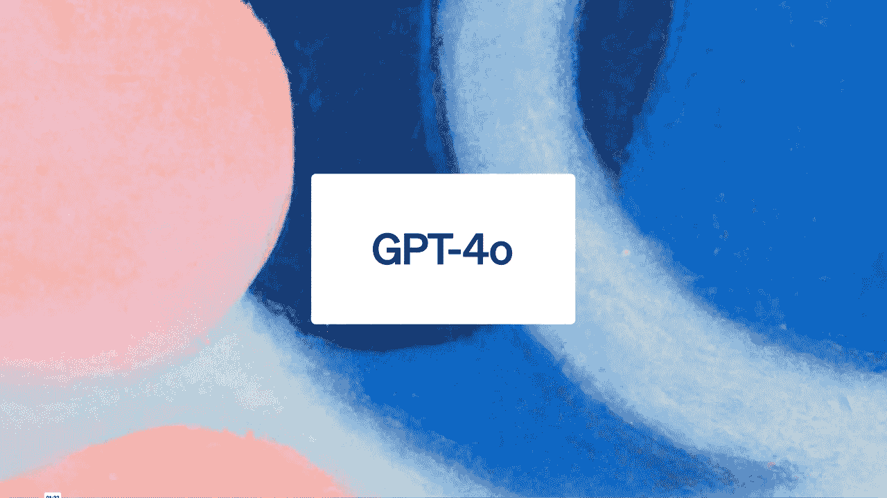

## Google I/O 发布会的内容

Google 紧随 Open AI 开了今年的 I/O 发布会，一个字概括就是全。模型层面所有的指标都在卷，同时也发布了所有现在主流的模型类型。产品层面所有的产品内容全部都接入了 AI 能力，包括命根子搜索也做了大刀阔斧的 AI 改革。

### [模型侧的更新内容](https://blog.google/technology/developers/gemini-gemma-developer-updates-may-2024/)

+   Gmini 1.5 Pro 宣布开始支持 200 万上下文，跨关键用例的一系列质量改进，例如翻译、编码、推理等”，但没有发布测试结果。

+   Gemini Flash：这款更小的 Gemini 模型针对较窄或高频任务进行了优化，其中模型响应时间的速度最为重要。提到百万 Token 的价格比 GPT-3.5 要便宜。

+   Gemini 模型家族的构成：

1.  Ultra：“最大的模型”（仅在 Gemini Advanced 提供）

1.  Pro：“最佳总体性能模型”（在 API 预览版中提供）

1.  Flash：“轻量级速度/效率模型”（在 API 预览版中提供）

1.  Nano：“设备上模型”（将内置于 Chrome 126 中）

+   Gemini Gems 谷歌的 GPTs，支持自定义与 Gemini 的互动方式。

+   Gemini Live ：“使用声音进行深入的双向对话的能力。”，Project Astra 实时视频理解个人助理聊天机器人，就是基于这个能力。

+   Gemma 2：6 月发布规模为 27B（之前为 7B 和 2B），以一半的尺寸提供接近 Llama-3-70B 的性能。

+   PaliGemma：谷歌的第一个视觉语言开放模型，灵感来自 PaLI-3 。

+   Veo：DeepMind 对标 Sora 的模型，HN 上有些体验过的人表示不太行，国际象棋的棋盘和棋子生成的都不对。

+   Imagen 3：图像模型，能够理解人们自然书写的提示，生成更高质量的逼真图像，并且在渲染文本方面表现卓越。

+   Music AI Sandbox：旨在彻底改变音乐创作方式的 AI 工具套件。用户能够全新创作乐器部分，轻松在不同曲目间转换风格。

+   Trillium：最新的 TPUs，在每颗芯片的计算性能上，相比上一代 TPU v5e，实现了高达 4.7 倍的显著提升。

[其中值得关注的演示内容](https://x.com/GoogleDeepMind/status/1790435824598716704)有两个一个是 Veo 视频生成模型 的，一个是 Project Astra 多模态融合交互 的。

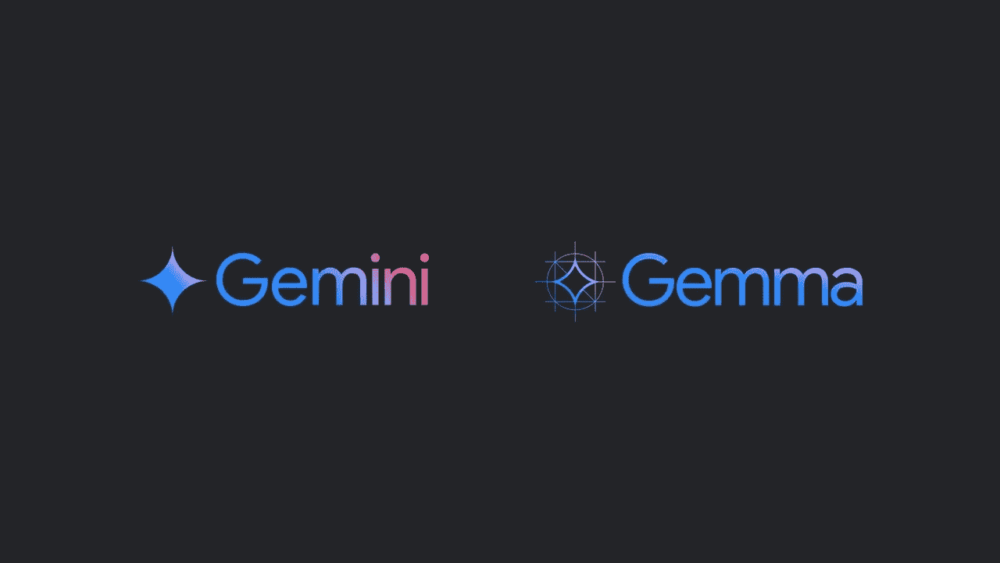

### [产品侧的更新内容](https://blog.google/products/search/generative-ai-google-search-may-2024/)

+   谷歌搜索的更新：

1.  AI Overviews：今天将开始向美国所有人推出，很将能够通过选项调整 AI 概述，以简化语言或更详细地解释。

1.  引入多步骤推理能力，这一功能能够将复杂的问题拆解成多个小部分，明确解决问题的顺序和方法。

1.  很快就能在搜索中使用视频提问了。

1.  提前计划：在搜索中直接具有规划功能，可以为需要的任何事物制定计划，从餐饮到度假。

1.  AI 组织的搜索结果：搜索将使用生成式人工智能与您进行头脑风暴，并创建一个由人工智能组织的结果页面（跟 Arc 那个 Demo 类似）。

+   Workspace（Gmail）： 内置了 Gemini Pro 1.5，可以帮助总结查找邮件内容和编写邮件回复。

+   谷歌文档：侧边栏的 Gemini Pro 1.5 集成，文档的改写总结等。

+   谷歌表格：使用 Gemini 和 Data Q&A 功能请求帮助，创建表格和数据分析等功能在今年晚些时候推出。

+   Google Photos：Ask Photos 可以帮助用自然语言搜索图片和视频，可以理解并回答复杂问题。

+   Circle to Search：现在成为了极佳的学习小帮手，可以在手机或平板上圈选复杂的物理问题，获得分步骤的指导帮助你学会解题。

## 要安全还是要发展：Open AI 宫斗第二季梳理

Open AI 宫斗积累的剩余矛盾终于在 GPT-4o 的发布会结束之后爆发了，感觉 Open AI 的宫斗跟快成了发布会之后的保留节目了。

核心还是 Ilya 主张的安全为主的加大对模型安全投入的超级对齐团队和以 Sam、Greg 为首的主张优先发展模型效果的管理层的矛盾。

[首先是 15 号长时间没有发声](https://x.com/ilyasut/status/1790517455628198322)的 Ilya 宣布正式离开 Open AI ，场面很和气同时还说会在合适的时候公布自己新事业的信息，Sam 和 Greg 也发了推回应和感谢了 Ilya 的付出。

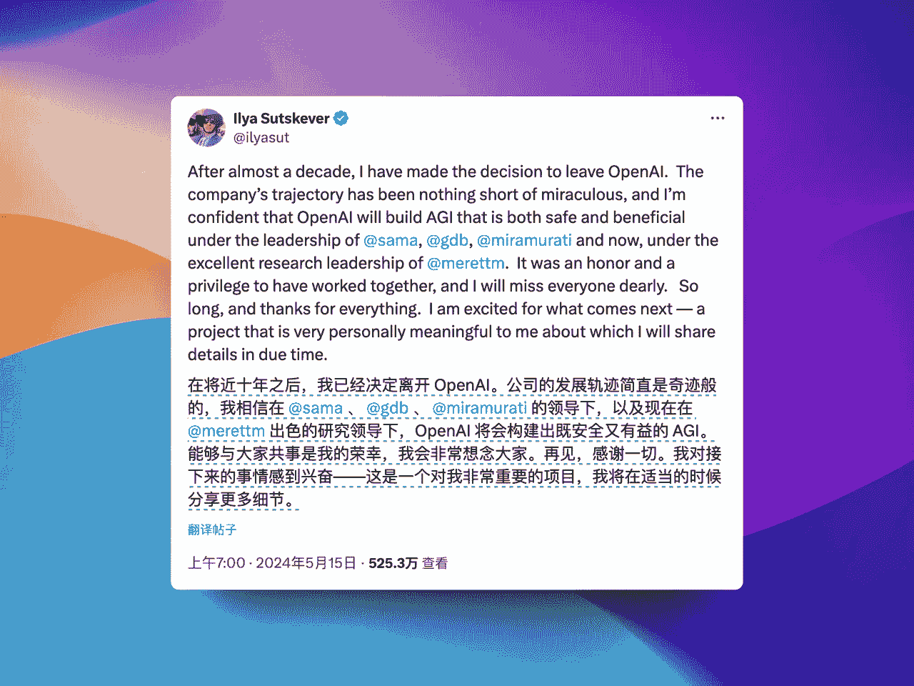

[然后是现任的 Open AI ](https://x.com/janleike/status/1791498174659715494)超级对齐团队负责人 Jan Leike 宣布离职 ，同时还曝光了 Open AI 对模型对齐团队不公平的对待。

他认为 OpenAI 领导层在公司核心优先事项上存在分歧，导致 Jan Leike 的团队在过去几个月里遇到了很多困难，包括计算资源不足等问题，使得关键研究工作变得越来越困难。

同时 Jan Leike 认为 OpenAI 应该把更多精力放在为下一代 AI 模型做准备，包括安全、监控、应变能力等方面。

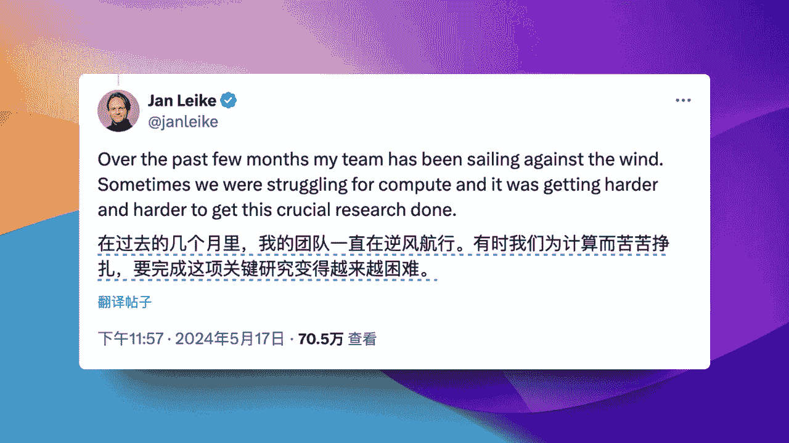

J[an Lei](https://www.vox.com/future-perfect/2024/5/17/24158403/openai-resignations-ai-safety-ilya-sutskever-jan-leike-artificial-intelligence)ke 应该是离职的人中首次明确的说自己受到的不公正待遇的，然后晚上 Sigal Samuel 就发布了一 篇爆料文章 解释了为什么之前从 Open AI 离职的人一般不会说明自己的情况。

因为 OpenAI 通常会要求离职员工签署包含不贬损条款的离职协议。如果拒绝签署，他们将失去公司股权，这可能意味着损失数百万美元。

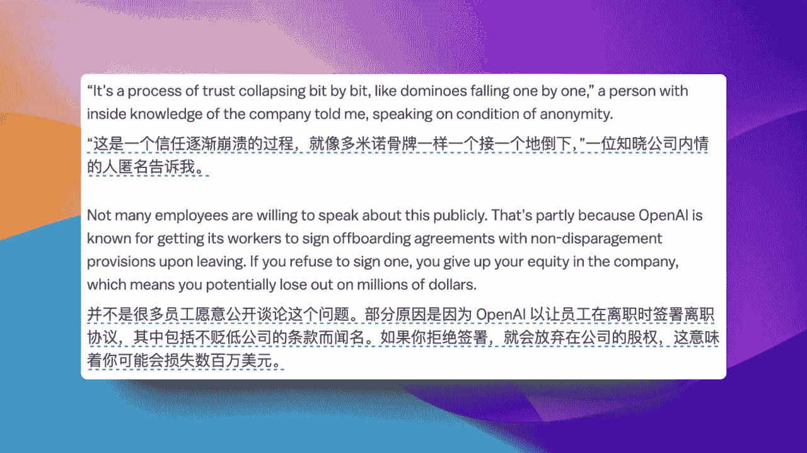

然后在 18 号 Sam 发推文承认，公司离职文件中确实有一项关于“潜在股权取消”的条款，但是他们从来没有真的启用过这个条款收回过任何人的股权，同时他不知道协议中有这条内容，公司也正在修改这项条款。

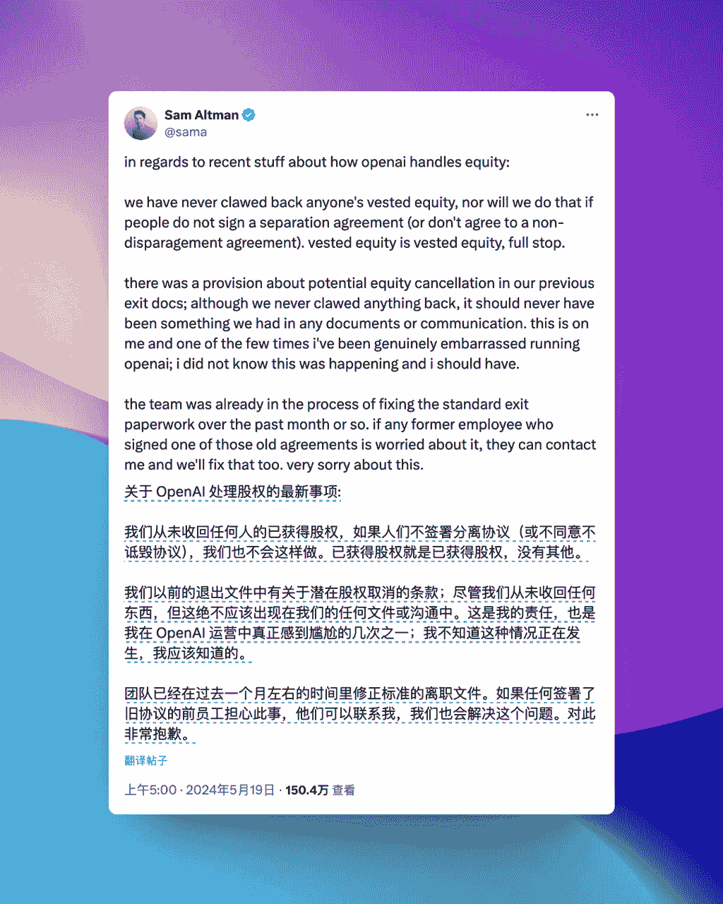

[有趣的是 ](https://blog.samaltman.com/employee-equity)2014 年还在 YC 的时候 Sam 还写过 一篇博客 ，阐述了初创公司对于员工股权分配的问题并且给出了一些如何保障初创公司员工正常获取股权收益的建议。

过了十年曾经的屠龙者变成了恶龙。

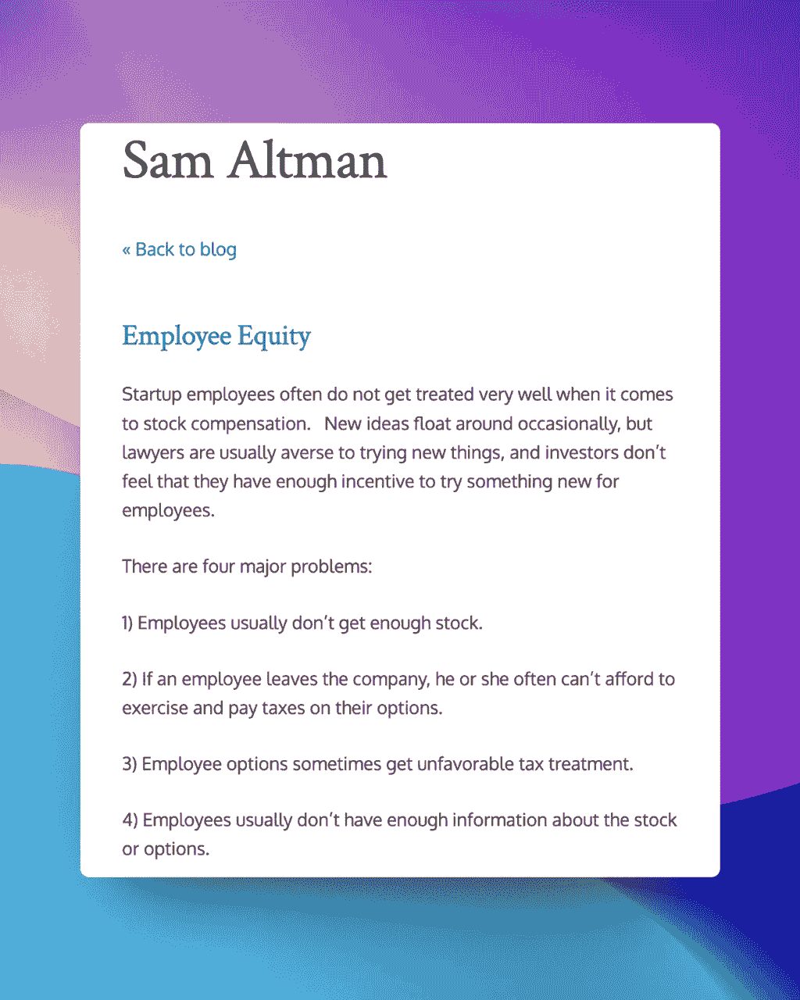

同时 Sam 和 Grog 还针对 Jan Leike 的发言起草了一个声明大致意思是说模型的安全和能力发展同样重要，他们也做了很多事情来保证模型的安全。这个声明看起来很长但其实都是片汤话，评论里很多人说感觉像 ChatGPT 写的。

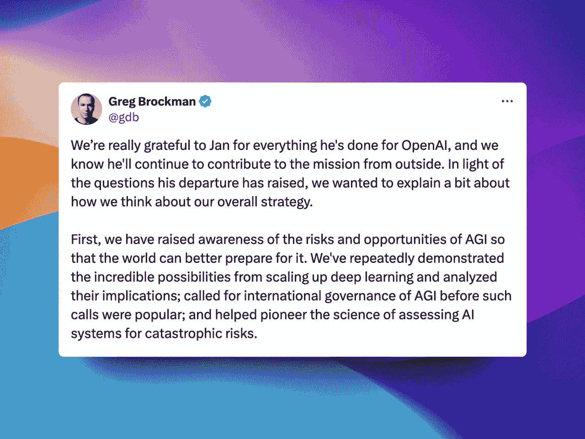

上面就是事件目前的一个发展情况，同时社区也有一些其他的看法比如 Daniel Jeffries 认为 超级对齐团队的离开不是因为他们看到了他们无法应对的超级先进 AI，而是因为他们研究后认为这种 AI 短时间不可能出现。

然后 Open AI 的领导层就开始缩减给超级对齐研究团队的资源开始做一些更实用的事情，比如用来构建产品改善体验。

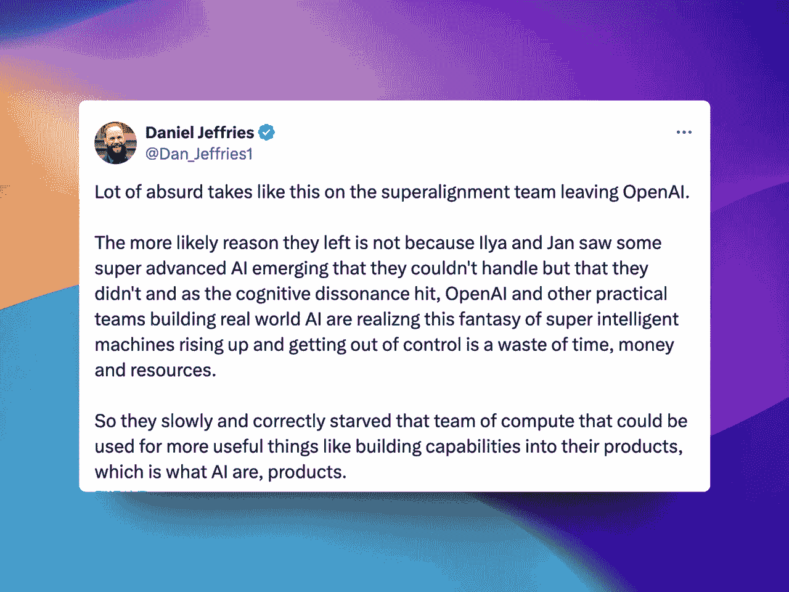

杨[立坤也表示认同上面这](https://x.com/ylecun/status/1791890883425570823)种说法。同时也罕见的认为 Sam 的这个操作是正确的担心现在的 AI 模型会造成 安全问题是杞人忧天 。

他将现在担心 AI 安全的人比喻成 1925 年有人说“我们迫切需要弄清楚如何控制能够以接近音速跨越大洋、运输数百名乘客的飞机。”

“在发明涡轮喷气发动机之前，在任何飞机能不间断飞越大西洋之前，长途客机的安全性是难以保证的。然而，现在我们可以安全地乘坐双引擎喷气式飞机飞越半个地球。

这并不需要什么神奇的安全配方。而是经过了几十年的精心设计和不断改进。”

我们的人工智能还处于早期阶段需要很多年才能达到人类的智能水平，别说超过人类了，所以需要不断的平衡效率和安全性，而不是把安全无限放大。

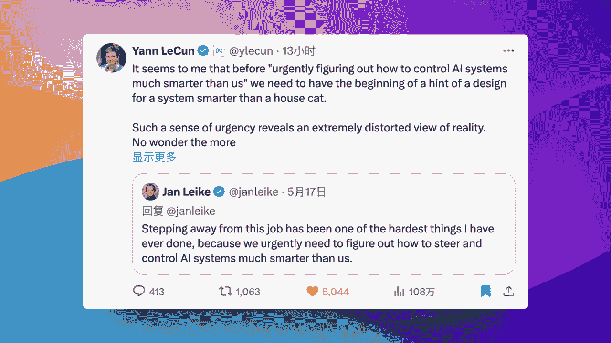

我总体上认同他的意见，人工智能现在是很早的阶段，我们还有非常多重要的事情要做，安全很重要但在早期阶段吃饱饭更重要。

# 其他动态 ✦

+   [Kimi 智能](https://x.com/op7418/status/1791339355338129539)助手推出达到峰值时通过 打赏稳定使用 的付费计划最高 399 元。

+   [Arc Sea](https://x.com/op7418/status/1791296013678109180)rch AI 搜索更新，简单的问题会 直接展示答案 。

+   Anthropic 聘请前 Instagram 联合创始人[和首席技术官 M](https://www.anthropic.com/news/mike-krieger-joins-anthropic)ike Krieger 担任首席产品官 。

+   Hume 的 EVI API 现在支持原生网页搜索功能的 TTS，他们顺便推出了一个 互动式 AI 播客 Chatter 。

+   [Midjour](https://x.com/midjourney/status/1791605135657107884)ney 私人 Room 创建功能开放 ，可以创建自己的房间邀请朋友一起画图。

+   字节发布 [豆包系列模型 ](https://mp.weixin.qq.com/s/4j3A3Cd0oMg1BlVnd91ecw)，主打的卖点是价格。

+   零一万物发布了一个 千亿参数模型 Yi-Large ，百万 Token 的价格是 20 人民币，上下文长度为 16K。

+   宇树科技发布 [Unitree G1 ](https://x.com/op7418/status/1789984209026638182)机器人，9.9 万人民币起步。

+   OpenAI 宣布 与 Reddit 达成合作伙伴关系 。OpenAI 将获得 Reddit 的数据，用于 ChatGPT 和“新产品”。

# 产品推荐 ✦

## viva：首个可供使用的 Dit 架构视频生成工具

海外产品 viva 发布了首个开放给全部用户使用的 Sora 同架构视频生成模型，而且现阶段免费。支持文本生成视频、图片生成视频以及 4K 分辨率放大功能，另外也支持提示词的自动优化。文生视频单次可以生成一条 5 秒的视频，图生视频是 4 秒视频。

我测试了一下应该是目前运动幅度最大的视频生成模型，同时图像分辨率也是现在可以用的视频生成产品中最大的。

## Slax Reader：AI 阅读辅助浏览器插件

AI 辅助阅读的浏览器插件，不是非常简单的内容总结，这个可以给出非常详细的文章大纲和思维导图帮你理解文章内容，

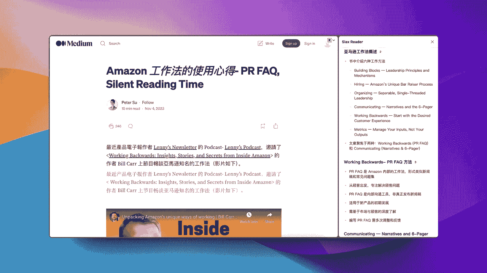

## Wegic：即时设计团队推出的 AI 网页生成工具

尝试了一下，Wegic 这个 AI 网页生成工具也太好了。

通过对话来生成和修改页面门槛确实低了很多。整体网站设计和 IP 都太好了。 IP 尤其可爱。

而且生成的网站从内容和美观度上都很好，内容也很丰富。如果补齐一下能力的话可能是 Framer 一个很强力的对手。

## TestSprite - 全自动端到端 AI 测试解决方案

TestSpriteAI 驱动的全自动端到端测试解决方案。该平台旨在加速产品发布并提高成本效率。主要功能包括：

+   **全自动化测试 **：利用 AI 技术实现测试过程的全自动化，减少人为干预。

+   **端到端解决方案 **：覆盖从测试设计到执行和报告的整个测试流程。

+   **加速产品发布 **：通过自动化和智能化的测试流程，显著缩短产品发布周期。

+   **成本效率 **：减少测试所需的人力和时间成本，提高整体测试效率。

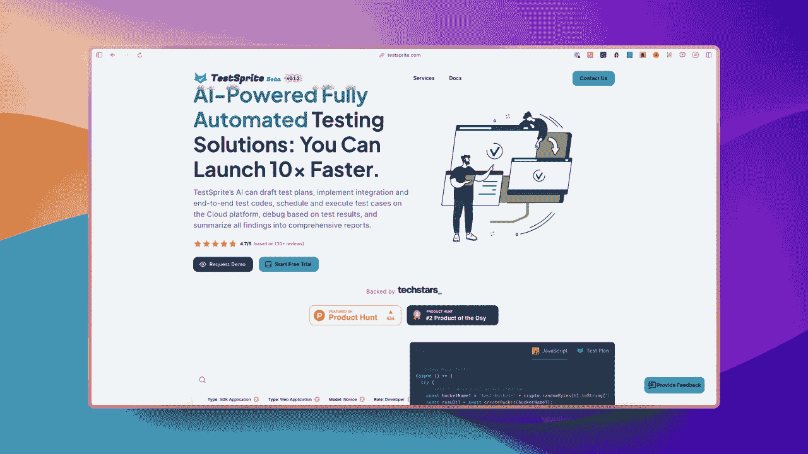

## User Evaluation：AI 帮助进行用户研究

User Evaluation 是一个利用人工智能（AI）来提升用户研究和数据分析的工具。

**功能特点**

+   **AI 驱动的转录 **：支持 57 种以上语言的转录功能，能够即时转录视频和音频内容。

+   **AI 洞察 **：从数据中快速生成有用的洞察，每个洞察都附有数据来源。

+   **集合管理 **：使用直观的看板（Kanban）板来组织和分享洞察，添加标签和笔记。

+   **AI 生成报告 **：生成包含文本、表格和图表的行为分析报告等。

+   **AI 生成演示文稿 **：一键生成包含 AI 洞察和数据可视化的 PPTX 演示文稿。

+   **多样化数据源 **：分析来自音频、视频、文本或 CSV 文件的信息以改进产品用户体验。

+   **洞察模板 **：提供多种洞察模板，帮助提取最有价值的数据洞察。

+   **情感分析 **：解释音频和视频文件中的客户情感，识别情绪趋势以优化策略。

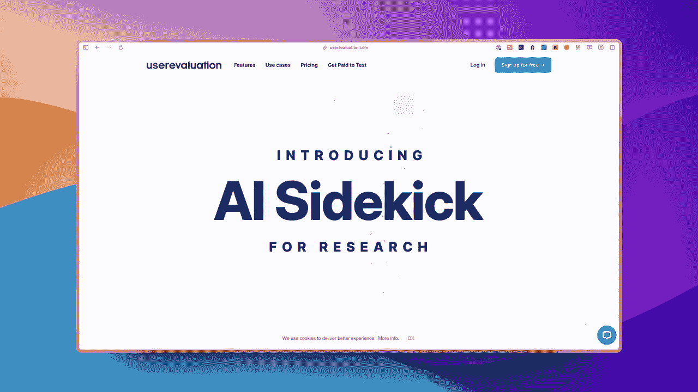

## FeaturesVote：利用用户反馈帮助增长

FeaturesVote 是一个帮助企业通过用户反馈来驱动产品增长的工具。其主要功能包括：

+   **用户投票板 **：用户可以发布和投票他们希望看到的功能，企业可以根据投票结果优先开发这些功能。

+   **快速设置 **：只需 2 分钟即可完成设置，并提供免费计划。

+   **无缝集成 **：可以将投票小部件无缝添加到应用中，用户无需再次登录即可发布和投票，减少摩擦并增加反馈。

+   **定制化 **：支持内置的浅色/深色模式，用户识别和配置。

+   **透明度和信任 **：通过展示不断交付和构建用户需要的功能来增加用户信任和留存率。

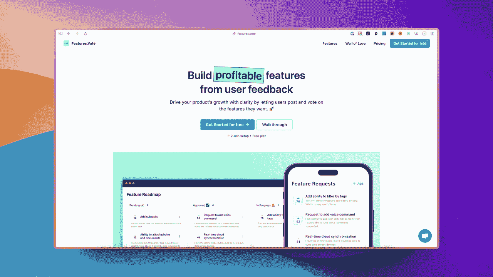

# 精选文章 ✦

## [SEO 2.0 的必要性](https://x.com/gregisenberg/status/1791075214136103017)

随着 AI 搜索越来越多，包括谷歌自己也在搜索前加上了 AI 总结，可能针对 AI 的 SEO 也越来越重要。比如搜索最适合数字游民的城市谷歌 AI 概览的结果就和正常的搜索结果排序不同。

里面简要介绍了什么是 SEO2.0 以及怎么做针对 AI 的 SEO。

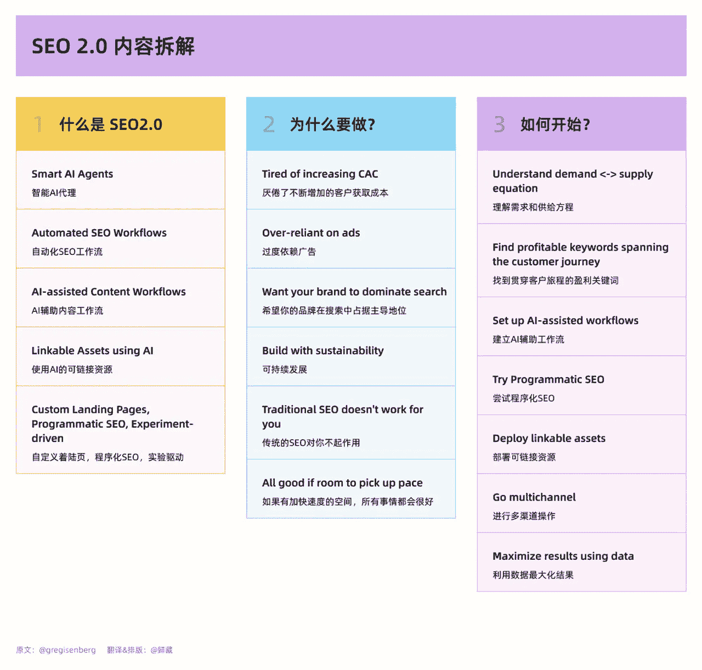

## AI Native Apps 开发的一些实践和思考

前 MiniMAX 产品 orangesai 关于 AI Native Apps 的一些思考，如果你也踩过这些坑应该会很有共鸣，下面是几条我觉得重要的：

+   不要老想终局，你是创业者，不是投资人。也不要老想壁垒，你是创业者，你不是大厂。

+   AI 的核心作用是让之前的不可能变为可能。

+   对于 C 端用户来说 SOTA 没有意义，不是 100 分就是 0 分（张月光）。

+   一个项目需有两个 PM，一个做系统构建的 PM，设计用户-技术-商业闭环，一个懂模型的 PM，定义清楚的技术指标。

+   有自己的模型团队，有时候会成为燃料，有时候会成为镣铐。

## 斯坦福 CS25：语言模型微调和对齐

之前介绍过的斯坦福大学新的 CS25 课程放出了 Nathan Lambert 博士讲课的视频，他是 AI2 的研究科学家。

新的 CS25 课程将会邀请各大 AI 公司的顶尖人才讲解前沿的 Transformer 研究。

这节课的主要内容是希望为听众提供对语言模型微调和对齐领域的深刻理解。

人工智能是否只是另一种工具？如果我们追溯工具的历史到最早的已知例子，我们会发现在肯尼亚发现的估计有 300 万年历史的磨尖石头。这些石头可能用于切割和砍伐。它们也可能被用作武器。虽然工具扩展了人类的创造力和同情心，但它们也扩展了我们的残酷性。

我们应该问人工智能能为我们做些什么，而不是它会对我们做些什么。

## John Schulman（Open AI 联合创始人）访谈

John Schulman 表示，预训练的目标是生成网络内容，后训练针对聊天助手等具体行为。未来几年，模型将更强大，执行更复杂任务，改善泛化能力和样本效率。预训练和后训练的组合将增加新应用场景，提高工作效率。需要制定监管政策以保持人类参与和模型对齐。OpenAI 发布的模型规范旨在解决冲突，遵循指令，帮助用户和开发者，避免伤害。讨论了机器学习文献质量和 AI 助手未来发展。

## 十字路口的好莱坞：“每个人都在使用人工智能，但他们害怕承认这一点”

文章讨论了好莱坞在使用人工智能（AI）方面的现状和争议。尽管 AI 在电影制作中被广泛使用，但许多人不愿公开承认。电影协会 CEO Charles Rivkin 认为，如果有适当的保护措施，AI 可以创造就业机会。文章提到了一些具体案例，如恐怖电影《Late Night With the Devil》和 A24 的《Civil War》，它们因使用生成式 AI 工具制作的图像而引发争议。观众对这些 AI 生成的图像表示不满，认为它们存在不准确和不一致的问题。尽管这些电影的制作成本中雇佣或委托概念或图形艺术家的费用微不足道，但使用 AI 的先例可能会导致未来编剧和视觉特效艺术家的工作被取代。行业领导者对 AI 的看法不一，有人认为它能解锁创造力和机会，而另一些人则担心它会威胁就业。

## [a16z： ](https://a16z.com/how-generative-ai-is-remaking-ui-ux-design/)生成式 AI 如何重塑 UI/用户体验设计

探讨了生成式人工智能（Generative AI）在用户界面（UI）和用户体验（UX）设计中的应用及其带来的变革。以下是文章的主要内容：

1.  **生成式 AI 工具的应用 **：文章介绍了在一个名为 AI-Tamago 的项目中，使用了 Vercel v0 等生成式 AI 工具来设计 UI。通过多次迭代和细化描述，生成式 AI 工具帮助团队快速从概念到可操作的应用程序。

1.  **效率提升 **：生成式 AI 技术显著缩短了从创意到实现的时间。这种效率提升为创意过程带来了新的可能性，使生成式 AI 成为设计过程的核心。

1.  **设计过程的变革 **：生成式 AI 技术在快速原型设计和代码完成方面表现出色，能够弥合设计和工程之间的差距。大语言模型（LLM）可以作为设计的灵感来源，每个提示都会生成多个模型，从而激发创造力。

1.  **跨学科理解 **：生成式 AI 模型通过在多样化数据集上的训练，发展了对编程语言、设计原则和 UX 指南的复杂理解。这使得它们能够应用 UI 模板和框架，如 Tailwind，来简化设计过程。

1.  **未来展望 **：尽管生成式 UI 在日常软件中的应用还处于初期阶段，但已有足够的例子表明其未来前景广阔。生成式 UI 的兴起不仅改变了行为模式，还将设计和工程的语言统一起来，减少了翻译过程中的信息丢失。

## 研究：通过埃森哲量化 GitHub Copilot 对企业的影响

主要探讨了 GitHub Copilot 在企业环境中的实际影响，特别是与埃森哲（Accenture）合作进行的研究结果。以下是文章的主要内容总结：

1.  **研究背景 **：

+   GitHub 与埃森哲合作，研究 GitHub Copilot 在大型工程组织中的实际应用效果。

+   研究的目的是量化 GitHub Copilot 对开发者效率、满意度和代码质量的影响。

1.  **研究方法 **：

+   通过实验室研究和开发者调查，评估 GitHub Copilot 的使用情况和效果。

+   研究包括对开发者日常工作流程的观察和调查，以了解他们如何整合和使用 GitHub Copilot。

1.  **主要发现 **：

+   **开发效率 **：使用 GitHub Copilot 的开发者编码速度提高了 55%。

+   **代码质量 **：85%的开发者表示 GitHub Copilot 提高了他们对代码质量的信心。

+   **工作满意度 **：90%的开发者表示使用 GitHub Copilot 后工作更有成就感，95%的开发者感到工作满意度显著提升。

1.  **具体改进 **：

+   GitHub Copilot 帮助开发者减少构建错误，提高构建成功率。

+   通过改进的辅助技术，提升了开发者在处理问题和拉取请求时的导航和交互体验。

# 重点研究 ✦

## Chameleon: 混合模态早期融合基础模型

Meta 的论文，它可以同时处理图像和文本。Chameleon 通过将图像和文本转化为同一种表示方式，使得一个模型能够理解和生成混合内容。该模型在图像描述、文本生成等任务中表现出色，甚至超过了一些专门处理单一模态的模型。就是类似 GPT-4o 的模型。

1.5 Pro 超过了 1.0 Ultra，1.5 Flash（Google 最快的模型）几乎与 1.0 Ultra 相当。

在技术报告的第 7 节中，展示了 Gemini 1.5 Pro 的一个专门用于数学的变体的新成果，这个变体在竞赛级数学问题上表现出色，包括在 Hendryck 的 MATH 基准测试中取得了 91.1%的突破性成绩，而且不需要使用任何工具。

## 超越缩放定律：使用联想记忆理解变压器性能

这个论文有意思，详细研究了基于 Transformer 的语言模型在记忆过程及性能变化上的机制。

一定程度解释了为什么简单地增大 Transformer 模型的规模并不一定能提升其性能。

论文将 Transformer 模型的行为与 Hopfield 记忆网络进行类比，提出每个 Transformer 层都在执行近似的最近邻搜索。

## Idefics2，一个拥有 80 亿参数的高效基础 VLM

Idefics2，一个拥有 80 亿参数的高效基础 VLM。开源了模型（基础版、指令版和对话版）以及用于其训练的数据集。

通过广泛的实验，研究了预训练模型、模型架构、数据选择和训练方法，目的是找出哪些设计选择对模型性能有实际影响。

## [腾讯混元 DiT 图像生成模型](https://huggingface.co/Tencent-Hunyuan/HunyuanDiT)

这是一个具有对英语和中文进行细粒度理解的文本到图像扩散变压器。为了构建混元-DiT，我们精心设计了变压器结构、文本编码器和位置编码。我们还从头开始构建了一个完整的数据管道，用于更新和评估数据以进行迭代模型优化。为了进行细粒度的语言理解，我们训练了一个多模态大型语言模型来完善图像的标题。最后，混元-DiT 可以与用户进行多轮多模态对话，根据上下文生成和完善图像。

## Anyline：强大的 Controlnet 线条预处理器

Anyline 是一个 ControlNet 线预处理器，可以准确提取大多数图像中的对象边缘、图像细节和文本内容。用户可以输入任何类型的图像，快速获得具有清晰边缘、足够细节保留和高保真度文本的线条图，然后将其用作 Stable Diffusion 中条件生成的输入。目前只可以在 ComfyUI 中使用。

## CAT3D：使用多视图扩散模型在 3D 中创建任何东西

谷歌的研究，它通过多视角扩散模型模拟这种现实中的捕捉过程，从而能够在 3D 中创建任何东西。无论输入多少张图像，只要设定好目标视点，我们的模型都能生成高度一致的场景新视图。这些生成的视图可以作为稳健的 3D 重建技术的输入，用来生成可从任何视点实时渲染的 3D 表示。CAT3D 可以在短至一分钟内创建整个 3D 场景，并且在单图像和少视图 3D 场景创建方面表现优于现有方法。