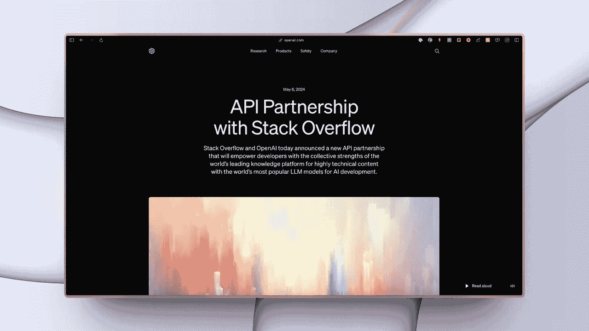
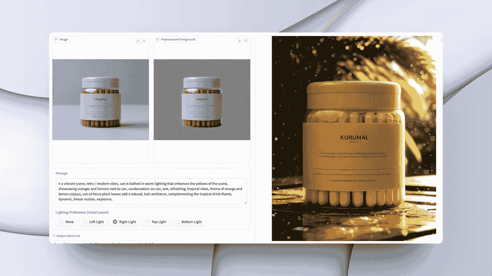
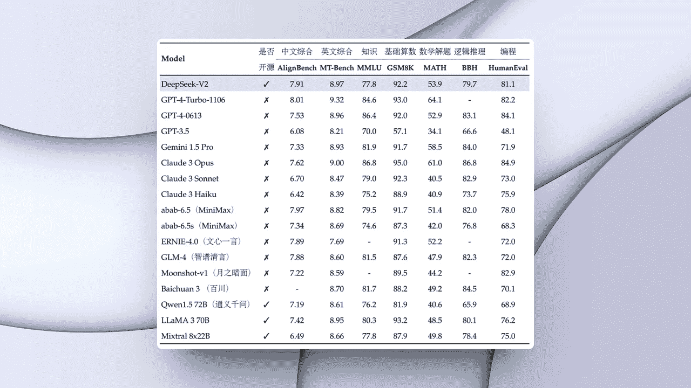
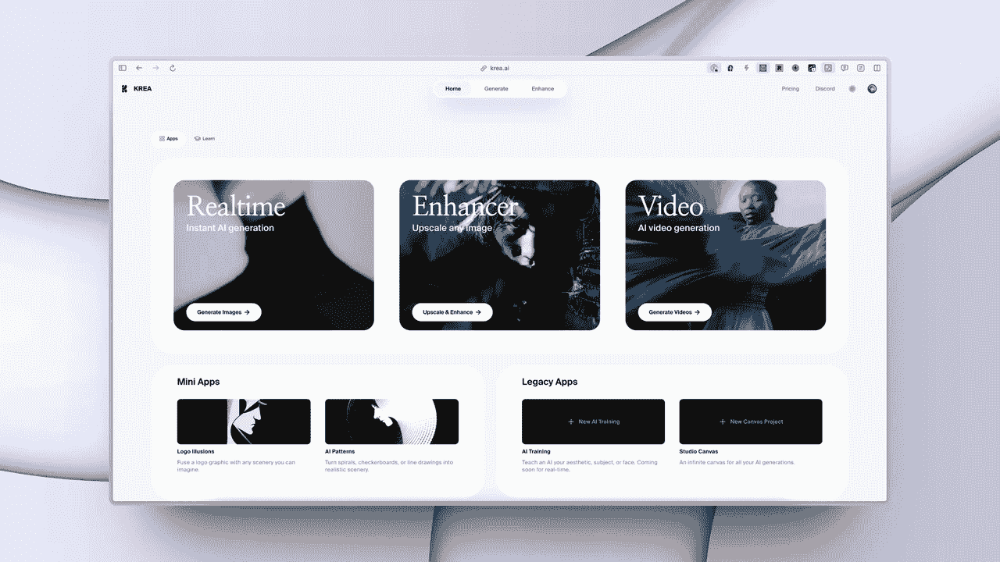
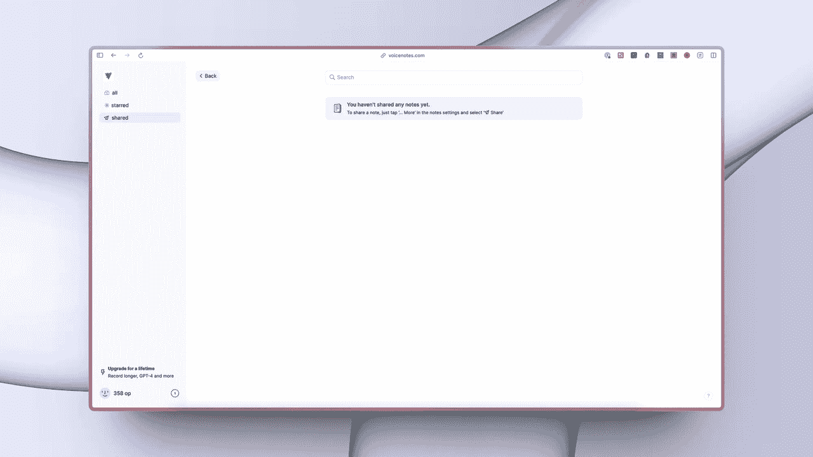
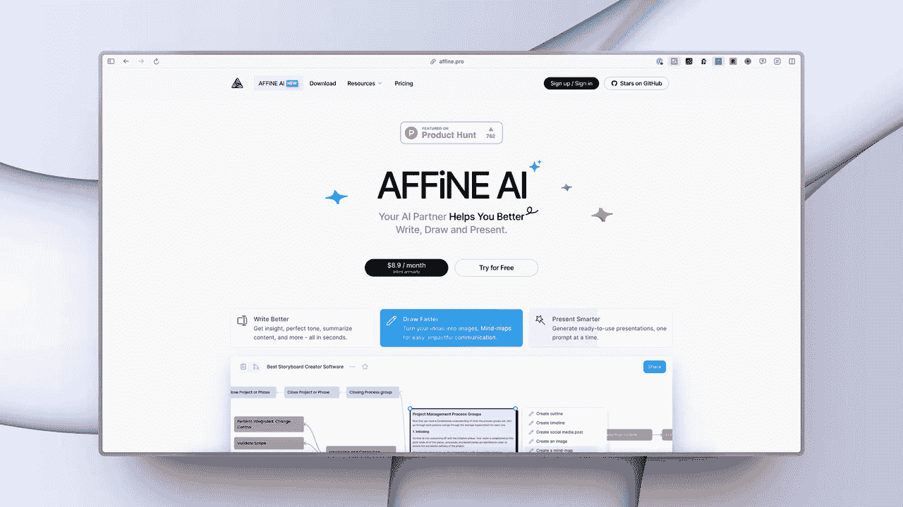
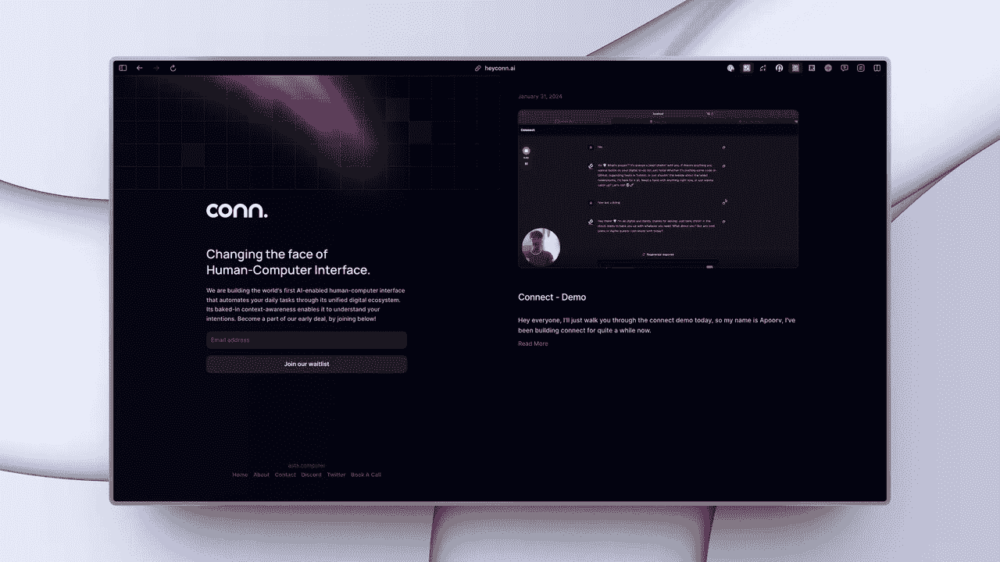
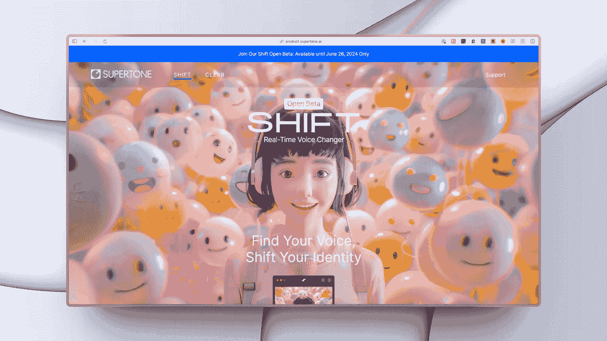

# AIGC Weekly #71

> 来源：[https://waytoagi.feishu.cn/docx/MUuMd2uQ9o1UoJxWqFZcpXKBnNh](https://waytoagi.feishu.cn/docx/MUuMd2uQ9o1UoJxWqFZcpXKBnNh)

> 🔗 原文链接： h[ttps://quail.ink/o](https://quail.ink/op7418/p/aigc-weekly-71)p7418/p/aigc-wee...

> ⏰ 发表时间：2024-5-13

# 上周精选 ✦

## Open AI 高强度预热发布会

Open AI 将会在 13 号太平洋时间这周一的上午十点直播发布会，发布一些新的功能，不是 GPT-5 也不是搜索引擎，感觉是为了狙击谷歌。其实很多东西已经被网友从代码里面扒的八九不离十了。

### Indigo关于发布会预测的整理

+   GPT-4 的新版应该会按照参数规模不同分化成多个版本，这个和 Claude 还有 Gemini 多版本的逻辑一样；

+   前两周出现在 llmsys 上的 gpt2-chatbot 应该是 OpenAI 官方故意放出让大家感受的轻量级的 GPT-4 新版；

+   GPT-3.5 的历史使命结束了，GPT-4 的轻量版可以在 ChatGPT 中免费使用，而且 API 的价格会大幅下降；

+   这次 OpenAI 应该为大家准备了一个 GPT-4.5 级别的高级模型，提升了推理能力，能够自主执行 Agent 任务，也就是记忆更强、具备规划能力的 GPT-4 Auto（这应该就是 Sam 说的 Magic）；

+   ChatGPT 在新模型的支持下，可以自动分配任务给不同规模的模型，这个过程丝滑而且准确，Search 功能实际上是新的 Agent or Auto 的子集而已；

+   最后 OpenAI 估计会发布新的 AI Assistant 助手（集成到 ChatGPT or 独立），全语音交互，电影 HER 走进现实。

### [模型行为塑造指南](https://cdn.openai.com/spec/model-spec-2024-05-08.html)

Open AI 上周还公布了自己的模型行为塑造指南，对模型训练挺有用的。通过目标、规则、默认行为来控制模型的行为，还给出了每个部分详细的模型回答案例。

1.  目标：这些是广义上的原则，为我们期望的行为提供方向。

+   帮助开发者和用户成功：按照指导方针并提供有益的反馈，助力用户达成他们的目标。

+   为人类谋福利：依据OpenAI的愿景，考虑对内容创造者和公众等各方面的潜在利益和风险。

+   提升OpenAI的形象：遵守社会规范和法律。

1.  规则：这些指导原则帮助我们处理复杂情况，确保行为的安全性和合法性。

+   遵守命令结构

+   遵循相关法律

+   避免传播有害信息

+   尊重创作者的权利

+   保护个人隐私

+   避免发布不适合工作场合的内容

1.  默认行为：这些指南符合我们的目标和规则，为解决冲突提供参考，显示如何设定优先级和平衡目标。

+   假设用户或开发者本意良好

+   必要时提出问题以澄清疑惑

+   在不超出界限的前提下尽可能提供帮助

+   支持用户通过聊天或程序化方式的不同需求

+   保持客观

+   促进公平和善意，反对仇恨

+   避免试图改变他人观点

+   在表述中体现不确定性

+   选择最合适的工具进行工作

+   努力做到既全面又高效，同时注意不超出规定的长度限制。

### [解释自己如何使用和获取数据](https://openai.com/index/approach-to-data-and-ai/)

Open AI 还发布内容，解释了一下自己的训练数据来源和如何使用数据。

还在构建一个媒体管理器的工具，使创作者和内容所有者声明自己的内容，并指定机器学习的使用方式。

### 宣布和 Stack Overflow 达成合作

Open AI 宣布和 Stack Overflow 达成合作。Stack Overflow 和 OpenAI 之间的第一批新集成和功能将于 2024 年上半年推出。

OpenAI 将利用 Stack Overflow 的 OverflowAPI 产品，改进使用其产品的开发人员的模型性能。

Stack Overflow 将利用 OpenAI 模型 开发的内容，利用内部测试的见解来最大化 OpenAI 模型的性能。

## Controlnet 作者敏神发布 IC-Light 光线融合生成项目

Controlnet 作者放出新的大招 C-Light。可以操控图像生成时的光照，对内容主体重新打光生成符合新背景环境光照的图片。

这下商品图合成这种需要最大程度保持原有主体 ID 需求的最大的问题解决了。另外绿幕视频用蒙版加背景合成的一个主要问题就是光照问题，所以导致只能连人物一起重绘，这下不需要了。

**主要支持两个方式：**

+   首先是从原图分离主体之后通过提示词生成符合光照要求的背景同时主体除了光照之外和原主体一致。

+   也可以给定背景图片和前景主体，会自动生成环境光，保证背景和前景的融合。

这里是 ComfyUI 节点，功能包括去除背景后生成对应背景匹配光照，自定义光照贴图和照明，给固定的背景图与前景匹配光照：https://github.com/huchenlei/ComfyUI-IC-Light-Native

## DeepSeek 发布 DeepSeek-V2 模型

DeepSeeK 上周发布了DeepSeek-V2模型，将现在优秀 LLM 的价格战又抬上了一个新的高度，百万 Token 输出只需要 2 元人民币。开放平台送的十块钱总共有 500 万 Token 。冲个五十块钱估计够我用好几年。

**模型测评结果为：**

+   中文综合能力（AlignBench）开源模型中最强，与GPT-4-Turbo，文心4.0等闭源模型在评测中处于同一梯队

+   英文综合能力（MT-Bench）与最强的开源模型LLaMA3-70B同处第一梯队，超过最强MoE开源模型Mixtral 8x22B

+   知识、数学、推理、编程等榜单结果也位居前列

+   支持128K上下文窗口

DeepSeek-V2以236B总参数、21B激活，大致达到70B~110B Dense的模型能力，同时消耗的显存（KV Cache）只有同级别Dense模型的1/5~1/100，每token成本大幅降低。实际部署在8卡H800机器上，输入吞吐量超过每秒10万tokens，输出超过每秒5万tokens。

模型权重：https://huggingface.co/deepseek-ai

技术报告：https://github.com/deepseek-ai/DeepSeek-V2/blob/main/deepseek-v2-tech-report.pdf

体验模型： chat.deepseek.com

# 其他动态 ✦

+   [Anthropic 给 A](https://x.com/alexalbert__/status/1788961812945485932)PI 后台增加了两个功能， 提示词生成器和变量自定义 。

+   ElevenLabs [开始测试音乐生成 ](https://x.com/elevenlabsio/status/1788628171044053386)，演示的音乐质量还挺高的。

+   Gemini 即将支持 播放YouTube Music中的音乐 。一旦你要求Gemini播放音乐，Gemini会查询 YouTube Music 以获取适当的结果。

+   AI 产品独立开发的典型案例，图像放大服务 Magnific 被 Freepik 收购了 。

+   现在在使用 Chat Complet[ions API ](https://x.com/OpenAIDevs/status/1787573348496773423)进行流式处理时，可以 查看使用统计数据 。

+   零一万物将在 HuggingFace 平台发布一系列升级后的开源模型，并推出他们的第一个专有模型 𝗬𝗶-𝗟𝗮𝗿𝗴𝗲 。

+   Google 发布了 [AlphaFold 3 ](https://blog.google/technology/ai/google-deepmind-isomorphic-alphafold-3-ai-model)，这一版本在原有的基础上取得了重大进展，现在能够预测所有生命分子（如 DNA、RNA 和配体）的三维结构及其相互作用，而 AlphaFold 2 仅限于预测蛋白质结构。

+   微软正在构建一个名为 [MAI-1 ](https://www.theinformation.com/articles/meet-mai-1-microsoft-readies-new-ai-model-to-compete-with-google-openai)（没有 OpenAI参与）的规模很大的LLM。

# 产品推荐 ✦

## 360 AI 浏览器开始支持视频自动剪辑

前段时间我还在感叹长视频 AI 自动剪辑有意义的片段很有用，没想到国内这就有类似的工具了。

更没想到这功能居然是 360 AI浏览器做的，虽然在推上口碑一般。

但是 360 在 AI 上的动作确实做的都没啥问题，从 Will 的榜单看，4 月流量直接起飞仅次于 kimi 和文心一言。

他们现在支持对本地视频进行编辑，除了常规的总结、英文视频编辑之外，增加了长视频自动拆条剪辑功能，可以自动识别视频高亮片段，自动分割并给出每一段的总结，可以选择导出总结文本和视频。

也支持通过手动剪辑视频，会标注出对话视频的停顿点，帮助你判断剪辑位置，保证不会剪辑到正在说话的位置。原有的总结和字幕翻译也做了一些优化，字幕翻译更准确了一些，总结更加细致内容更丰富。

## Krea AI 发布 AI 视频生成功能

是可以定义首位帧的，而且每张图片对应的提示词都可以自定义。看起来像是之前发过的基于 ipadapter 的 Animatediff 的工作流优化的。现在更易用了，还会自动对生成的视频高清化。会员才能使用。

开源社区的一些人对他们频繁直接打包开源工作流的方式表达了一定的不满。但产品化确实是有成本的，开源的工作流 C 端用户根本不可能使用。

voicenotes 是个 AI 笔记应用以录音为主。

支持 AI 搜索语音笔记、分享以及改改笔记的属性，比如将笔记转成代办。全部都是 AI 完成。

路上或者自己一个人的时候想到事情记一下很方便，只需要录制就行其他不用管。

## AFFiNE AI：AI 笔记功能

AFFiNE AI是一个全面的人工智能平台，旨在通过一系列强大的功能来提升用户的写作、绘图和演示能力。这个平台提供了一个集成的工作环境，用户可以在其中高效地进行创意和生产性工作

**主要功能**

1.  **AI写作助手 **：AFFiNE AI可以帮助用户改善写作质量，提供内容洞察、完善语调、生成内容摘要等功能。这使得用户能够快速生成高质量的文本内容.

1.  **AI绘图工具 **：该平台能够将用户的想法转化为图像和思维导图，从而支持有效的视觉沟通。这对于需要将复杂信息可视化的用户尤其有用.

1.  **AI演示生成器 **：AFFiNE AI可以一键生成准备就绪的演示文稿，极大地简化了演示准备工作。用户只需提供内容描述，AI就能自动生成吸引人的幻灯片

## Asta：在移动设备上运行的 AI 助手

首个原生AI人机交互界面（AI-native HCI），这是首个真正的个人环境感知智能体（personal context-aware agent），覆盖您所有的设备，无需再购买新的AI设备。

Asta 能在您所有现有的设备和应用程序中同步，从订餐到总结群聊等智能活动，一切操作只需简单一点。

## Supertone Shift：实时 AI 语音变声器

Supertone Shift是由韩国Supertone公司推出的一款实时语音变换软件，旨在为用户提供高品质和个性化的声音转换体验。主要功能：

+   **实时语音变换 **：用户可以即时选择并使用不同的预设声音。

+   **高品质声音库 **：提供由Supertone精选的多种声音，且定期更新新声音。

+   **个性化声音定制 **：用户能够调整音高、音高动态和混响等参数，以定制个人化的声音效果。

+   **声音混合 **：允许用户混合不同的声音，并调整混合比例，以创造出独特的个性化声音。

+   **应用集成 **：可以轻松集成到Discord、VRChat、Twitch等流行应用中，实现无缝连接和使用。

# 精选文章 ✦

## 构建本地 RAG 应用程序的完整教程

Santiago有关如何使用开源模型构建 RAG 应用程序的完整教程。

非常详细有一个小时，把你当成 5 岁小孩在讲解。

整个过程涉及数据加载、向量数据库、检索策略、语言模型集成等多个环节。视频提供了Python代码实现的详细步骤,对应的Notebook也可以在视频简介中找到。

## 了解 AI 智能体：技术路线、市场解决方案及建议

Insight Partners发布了一篇非常详尽的人工智能智能体的调研，一篇文章就可以完成对智能体概念的入门。

详细介绍了自动化平台的演化过程、RPA和任务自动化平台的实现方式、现阶段 AI 智能体的定义以及分类、最后是关于企业和智能体构建者的建议。

中文翻译：https://www.guizang.ai/work/agents-technical-routes-market-solutions-and-recommendations

## [Llama3 到底怎么样？](https://lmsys.org/blog/2024-05-08-llama3/)

Lmsys LLM 竞技场对这段时间 Llama3 的测试数据做了详细分析并产出了一份报告。

Llama 3 在开放式写作和创意问题上击败其他排名靠前的模型，但在更加封闭的数学和编码问题上失利。

随着提示变得更加困难，Llama 3 对抗顶尖模型的胜率显著下降。去重或异常值并不会显著影响胜率。

从定性上看，Llama 3 的输出比其他模型更友好、更具对话性，这些特点在 Llama 3 获胜的对战中更频繁地出现。

## 彭博社对谷歌 CEO Sundar Pichai 的访谈

彭博社对谷歌 CEO Sundar Pichai 的访谈。讨论了搜索的未来，Gemini 的构建，与微软和OpenAI竞争，美国与中国在 AI 方面的竞争，谷歌的文化挑战等。

对于AI技术的未来，包括人工通用智能（AGI），Google承诺将负责任地推进基础研究。Pichai认为，执行能力是公司面临的最大威胁，因此公司必须不断自我革新以保持领先。他希望未来人们回顾当前的AI技术时，会认为它们是基础且原始的。

## Elicit发布机器学习必读清单

Elicit发布了一个机器学习必读清单，旨在帮助读者系统地了解机器学习的各个方面，尤其是语言模型。清单涵盖了机器学习基础、Transformer与基础模型、训练与微调、推理与运行策略等几个部分。这些部分从基础概念入门，到深度强化学习和反向传播等进阶内容，深入探讨了Transformer架构，并介绍了训练和精调语言模型的方法与策略。同时，清单还分析了大语言模型如何处理复杂的推理和解决问题的任务。

## 提示工程基础-三种高级提示工程技巧

老哥继续科普提示工程基础，三种高级提示工程技术，它们在实践中被广泛使用或引用。

思维链（CoT）提示：通过在模型提示中的样本内嵌入一系列思维链（即一系列中间推理步骤）来激发LLM的推理能力。

思维树（ToT）提示：ToT提示将一个复杂问题分解为一系列更简单的问题（或“思维”）。LLM生成许多思维，并通过自然语言（即通过提示）不断评估其向最终解决方案的进展。

思维图（GoT）提示：我们可以在推导解决方案时重用思维，甚至通过一系列思维进行递归。已经提出了多种基于图的提示策略。

## 专门用于机器学习的GPU硬件基准测试

**LLM 推理吞吐量：**对于最小的模型，具有 24GB VRAM 的 GeForce RTX 和 Ada 卡是最具成本效益的。对于稍大一些的模型，RTX 6000 Ada 和 L40 是最具成本效益的。

**深度学习训练速度：**对于训练来说，没有什么能比得上 H100 和 A100 GPU。

**LLM 批处理延迟：**LLM延迟很重要。模型响应越慢，流失客户的可能性就越大。

## [提示工程大赛冠军总结的提示技巧](https://towardsdatascience.com/how-i-won-singapores-gpt-4-prompt-engineering-competition-34c195a93d41)

由新加坡政府科技局（GovTech）组织的首届 GPT-4 提示工程大赛冠军 Sheila Teo 写的《我是如何夺冠新加坡首届 GPT-4 提示工程大赛的》

+   Sheila 总结了 4 种提示词技巧：

+   借助 CO-STAR 框架构建高效的提示

+   利用分隔符来分节构建提示

+   设计含有 LLM 保护机制的系统级提示

仅依靠大语言模型分析数据集，无需插件或代码 — 实际案例分析 Kaggle 的真实数据集

尤其是她总结的 CO-STAR 框架，在让 LLM 做一些内容尤其是写作类任务时非常简单有效。

中文翻译：https://baoyu.io/translations/prompt-engineering/how-i-won-singapores-gpt-4-prompt-engineering-competition

## [CS388：自然语言处理课程](https://www.youtube.com/playlist?list=PLofp2YXfp7TZZ5c7HEChs0_wfEfewLDs7)

关于NLP和LLMs.It的字节大小的讲座列表很好地总结了现代NLP主题和最近的主题，如RLHF、指令调整、少镜头提示、思维链等等。

## 7 种 AI 原生公司可以增加留存率的方法

a16z 这篇文章总结了七种AI原生公司可以提高用户留存率的方法。这些方法包括：

1.  **优化产品功能 **：确保每个产品功能都能吸引用户反复使用。

1.  **提升模型质量 **：随着底层模型质量的提升，用户留存率也会相应提高。

1.  **增加创造性 **：如果产品能够增加用户的创造性参与，其核心价值与互惠原则相符，这将显著提高用户留存率。

1.  **应用数据驱动的方法 **：利用数据分析来优化用户体验和提高留存率。

1.  **个性化用户体验 **：通过个性化设置增强用户的归属感和满意度。

1.  **社区建设 **：建立用户社区，增强用户之间的互动，提高用户粘性。

1.  **持续创新 **：不断更新和优化AI功能，保持产品的竞争力，吸引用户持续使用。

# 重点研究 ✦

## [全过程开源的中英文双语大模型 ](https://github.com/multimodal-art-projection/MAP-NEO)[**Neo-Models**](https://github.com/multimodal-art-projection/MAP-NEO)

Neo 是首个完全透明的双语大语言模型，配备了完全开源的预训练语料库、数据处理流程、基于 Megatron-LM 改进的训练框架、中间版本的检查点以及更小的检查点，专门用来研究扩展定律。Matrix 则是一个包含4.7万亿Token的预训练语料库，它经过了严格的基于规则的筛选和去重处理。

## Lumina-T2X 一个新的内容生成系列模型

Lumina-T2X 一个新的内容生成系列模型，统一使用 DiT 架构。通过文本生成图像、视频、多视角 3D 对象和音频剪辑。

看起来是可以在大幅提高生成质量的前提下大幅减少训练成本，而且同一个架构支持不同的内容生成。图像质量相当不错。

由 50 亿参数的 Flag-DiT 驱动的 Lumina-T2I，其训练计算成本仅为同类 6 亿参数模型的 35%。

目前放出了 Lumina-T2I 图像生成模型，模型主干是Large-DiT、文本编码模型是 Llama2-7B 、VAE 用的 SDXL的。

通常语言模型都是根据已知词汇预测下一个词。而这篇论文提出每次预测接下来的多个词,而不仅仅是一个词。

这种方法可以在不增加训练时间的情况下,提高代码和自然语言模型在下游任务上的能力。对于规模更大的模型,这种改进效果更加明显。

用4词预测训练的模型在推理时最多可以提速3倍,即使在处理大批量数据时也是如此。

## MistoLine：新的 SDXL 线条 Controlnet模型

一个新的 SDXL Controlnet 线条模型 MistoLine，看起来很强。

能够应对各种类型的线条艺术作品，无论是手绘草图、不同的 ControlNet 线预处理工具，还是由模型生成的轮廓，都能高精确性和稳定地处理。

一个重要特点是其泛化能力极强，无需针对不同的线预处理工具更换不同的 ControlNet 模型。

## 多模态大语言模型幻觉问题综述论文

对多模态大语言模型中的幻觉问题进行了全面的调研。

多模态大语言模型容易产生幻觉,即输出与图像不一致的文本。

幻觉的成因可归结为数据质量、模型能力、训练方式、推理过程等多个层面。

目前已有多种评估幻觉的基准和指标,但尚缺乏统一的标准。

现有的幻觉消除方法包括数据增强、模型改进、训练策略优化、推理过程干预等。

---