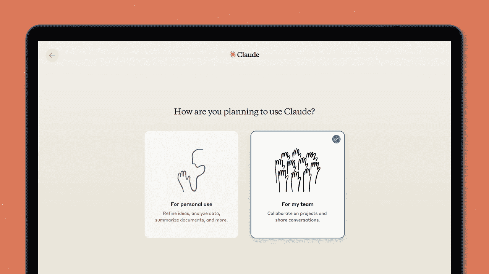
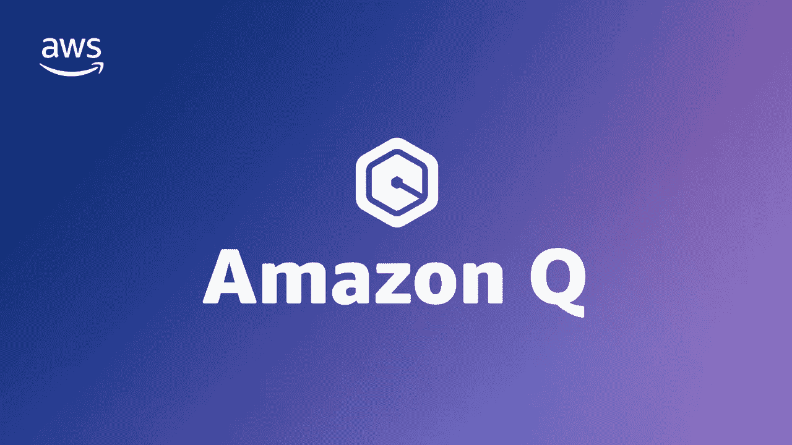
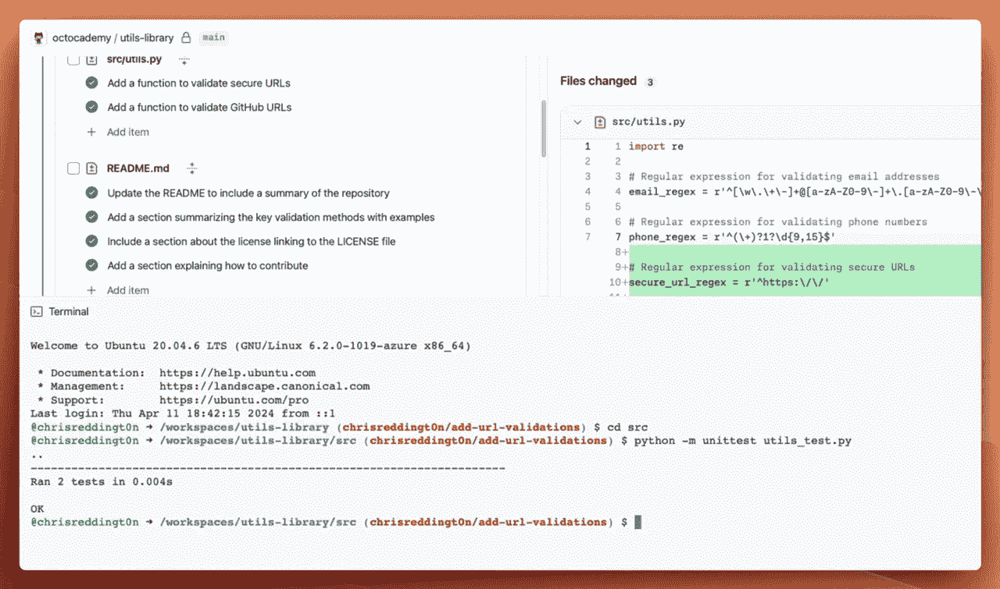
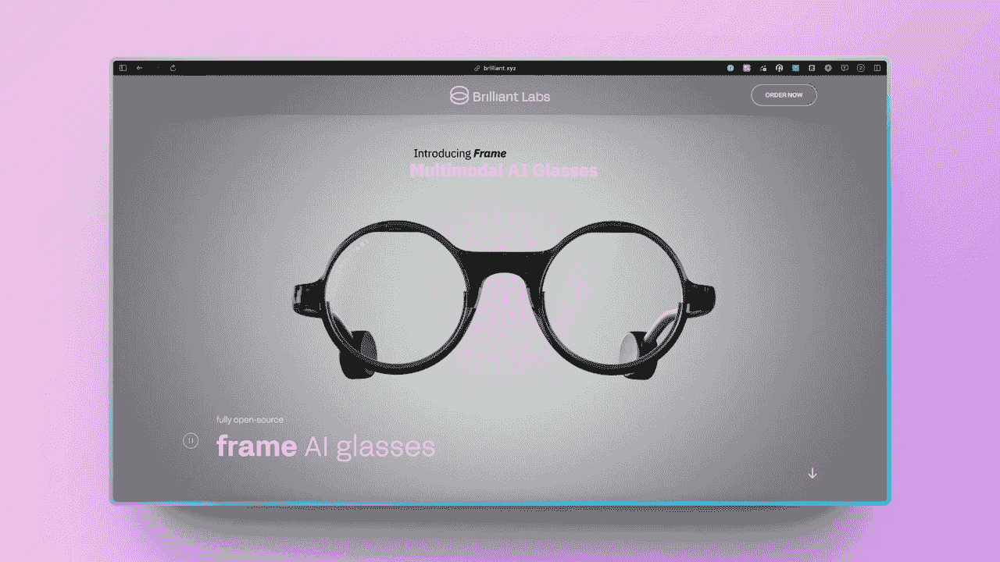
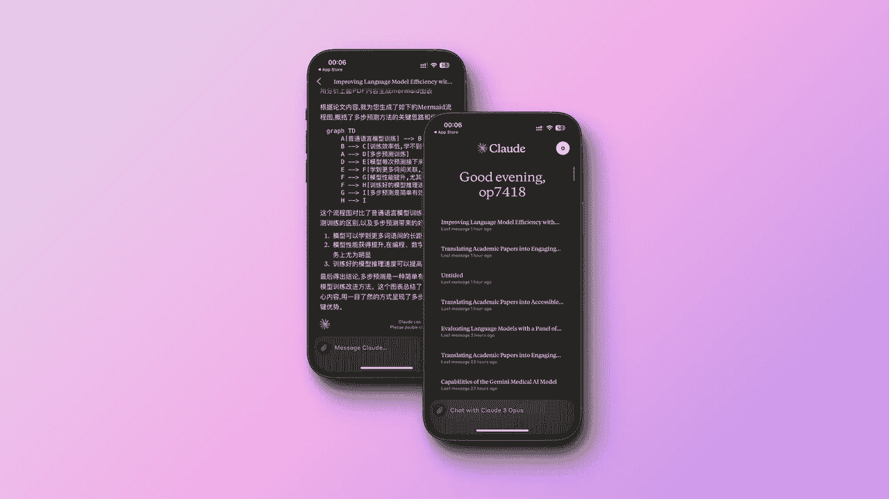
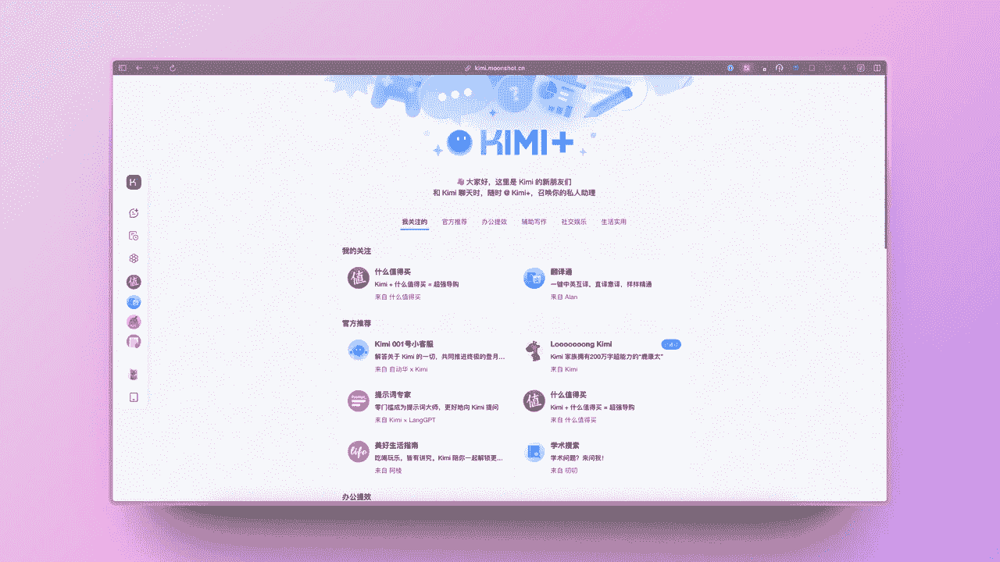
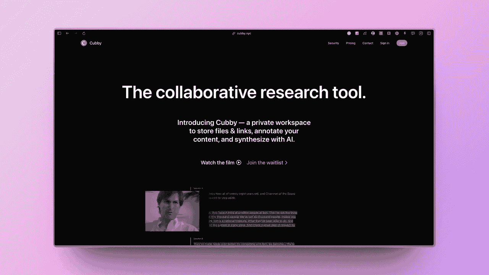
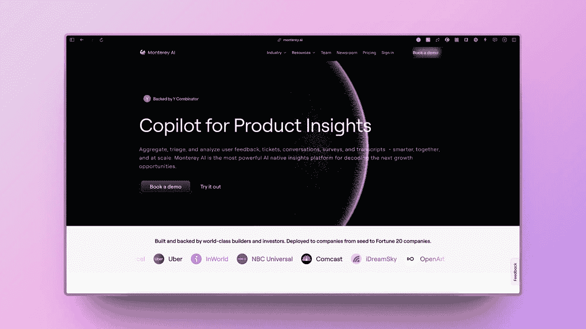
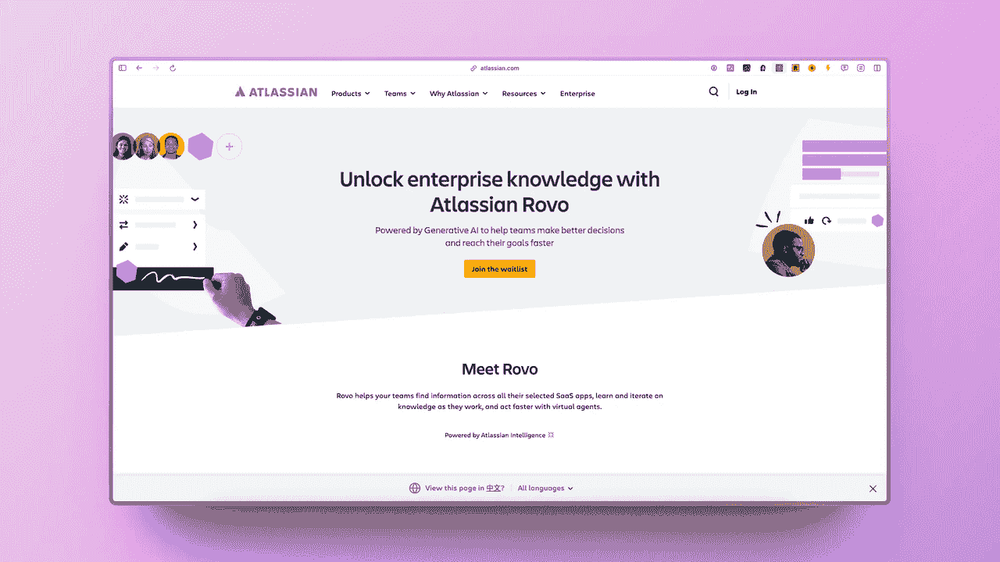

# AIGC Weekly #70

> 来源：[https://waytoagi.feishu.cn/docx/QPOydpLpuoCmxCxu5YvcVBOangB](https://waytoagi.feishu.cn/docx/QPOydpLpuoCmxCxu5YvcVBOangB)

> 🔗 原文链接： h[ttps://quail.ink/o](https://quail.ink/op7418/p/aigc-weekly-70)p7418/p/aigc-wee...

> 发表时间：2024 年 5 月 6 日

# 上周精选 ✦

## Claude推出移动应用以及团队版计划

Anthropic的商业化进度开始加速，这周先是推出了 Claude 的 iOS 应用，然后又推出了团队计划开始赚 2B 的钱。

iOS 应用的功能还比较简陋，重点支持的是文件上传已经识图功能，官方给出的案例也是拍摄会议板书整理成笔记。

团队计划的主要功能有：

+   团队计划使团队能够创建一个工作空间，增加成员和管理用户和计费工具的使用。

+   每个月每个成员收费 30 美元。

+   与专业计划相比，为每个团队成员提供更大的使用量。

+   提供完整的Claude 3 型号系列，包括 Opus、Sonnet 和 Haiku。

+   200K 上下文窗口：使企业能够处理长篇文档（例如研究论文、法律合同）、讨论复杂话题（例如财务预测、产品路线图）并保持多步对话。

+   引入管理工具，方便地控制用户和计费管理。

+   Pro 版中的所有功能：包括 Claude Pro 的所有功能，包括在高流量时段的优先访问、提前访问新功能、更高的使用率等。

## 最近突然爆火的两款SD图像风格

节前是毛绒风格的应用图标风格突然开始在小红书上爆发， 由于需要相对复杂的 SD 流程没有人打包，只局限在圈子内部，普通用户没办法参与，顶多使用画好的图标更换手机主题。

然后五一开始的时候黏土风格的图片突然就爆火了，得益于 Remini 这个非常好上手的 AI 修图 app，这次彻底出圈了。

基于 AI 的图像玩法还有非常大的机会，不只能出一个妙鸭这种爆款，Remini 的爆火证明了这一点。

毛绒风格和冰块风格的工作流可以用KeJun这个工作流：https://openart.ai/workflows/kejun/furry-and-fluffy-icon-v11-v11/XueYOY1PYXXAHMcarWl8

[黏土风格的图片基于 SD 实现](https://civitai.com/models/59569?modelVersionId=153730)的话[可以用 Clay An](https://civitai.com/models/208168?modelVersionId=236248)imation 和 Claymation 这两个 Lora 搭配好一点的 3D SDXL 模型实现。

## 亚马逊推出了 Amazon Q AI 助手

亚马逊推出了 Amazon Q AI 助手，一共有两个版本Amazon Q Developer 和 Amazon Q Business。

可以自动完成软件开发和业务数据分析的各项任务，从而提高工作效率。

### Amazon Q Developer

这一版本旨在帮助开发者减少在维护任务上花费的时间，使他们能够将更多精力放在编码上。

它可以协助编码、测试、升级应用程序、排查故障、执行安全扫描和修复，以及优化 AWS 资源。其目标是让开发者能够投入更多时间创造独特的用户体验，并加快项目部署速度。

### Amazon Q Business

Amazon Q Business 致力于让员工能够轻松访问公司数据，从而做出数据驱动的决策。

它可以回答问题、提供摘要、生成内容，并以安全的方式完成任务。该版本与 Amazon QuickSight 集成，提供了一个生成式商业智能助手，通过自然语言命令简化 BI 仪表板和可视化的创建过程。

### Amazon Q Apps

Amazon Q Apps 是一项新功能，允许员工使用自然语言构建由生成式 AI 驱动的应用程序，无需编码技能。

这一功能是 Amazon Q Business 的一部分，可帮助员工高效地自动化日常任务。

## [GitHub 推出 GitHub Copi](https://github.blog/2024-04-29-github-copilot-workspace/)lot Workspace 的技术预览版

通过 Copilot Workspace，开发者可以用自然语言进行头脑风暴、规划、构建、测试和运行代码。

**其工作原理如下：**

**一切从任务开始：**

从一个 GitHub Issue、Pull Request 或仓库中打开 GitHub Copilot Workspace。（截图显示了 octoacademy 仓库中的一个 Issue。）

**计划的制定：**

从任务进展到规范化步骤，概述你想通过 Copilot Workspace 实现的目标。这些步骤是可编辑的，允许你反复迭代。

**全面可编辑：**

Copilot Workspace 提供的所有内容，从计划到代码，都可以完全编辑，使你能不断调整，直到对计划满意。你也可以通过集成终端运行测试、构建等步骤。

**直接运行：**

计划完善后，你可以在 Copilot Workspace 中运行代码，并在 Codespace 中调整，直到对最终结果满意。你还可以通过链接分享 Workspace，使团队成员查看你的工作并进行迭代。

**提交与审查：**

完成后，提交 Pull Request，运行 GitHub Actions 和代码扫描，并请求团队成员进行审查。他们可以通过 Copilot Workspace 查看你从构思到代码的全过程。

**移动兼容：**

GitHub Copilot Workspace 支持在任何设备上使用，使你可以随时随地进行开发。

# 其他动态 ✦

+   Llama3-70B 的 Lora ，可以让任何基于 Llama-3 70B 微调的模型都具有 524K 的上下文。Lora 是从 Llama-3-70B-Instruct-Gradient-524k 中提取的。

+   Gradient发布 [Llama-3-70B-Inst](https://huggingface.co/gradientai/Llama-3-70B-Instruct-Gradient-1048k)ruct-Gradient-1048k ，一百万上下文的 Llama3 70B 版本。

+   [相当优秀的 SD1.5 人像模](https://www.liblib.art/modelinfo/721fa2d298b262d7c08f0337ebfe58f8)型 AWPortrait 1.4 开放下载。

+   微软已经 禁止美国警察部门使用企业级人工智能工具进行面部识别 ，利用GPT-4对来自人体摄影机的音频进行总结。这样很容易因为LLM的幻觉和人种偏见造成误判。

+   [可以识别使](https://dev.hume.ai/docs/empathic-voice-interface-evi/tool-use)用者情绪的模型EVI现在已经支持 函数调用 工具。

+   Open AI 发布了一个 Assistants[ API 和 ](https://github.com/openai/openai-assistants-quickstart)NextJS 构建项目的 快速入门指南 。具有流式传输、工具使用（代码解释器和文件搜索）和函数调用能力。

+   Midjoureny 的 [alpha 网站 ](https://alpha.midjourney.com/)已经向所有生成超过 100 张图片的用户开放，房间功能也已经开放。

+   [机器人公司 Sa](https://x.com/TheSanctuaryAI/status/1785702834337468523)nctuary AI 宣布 和微软展开合作 ，加速通用机器人的人工智能开发。

+   字节开始在抖音中 [内置豆包聊天助手 ](https://x.com/op7418/status/1785373014781255997)，入口在消息页面置顶区域，点击顶部按钮可以拉起豆包应用。

+   [HuggingChat 也支](https://huggingface.co/chat/assistants)持 Assistants 创建 了，但是创建功能很强大该有的都有了，而且也支持动态提示将站外的内容插入到聊天中。

+   ChatGPT的 [记忆功能 ](https://x.com/OpenAI/status/1784992796669096181)现在已经向所有Plus用户推出。使用的方式很简单，说出你想让它记住的事情，并且告诉他记住就行。

+   Chrome 桌面地址栏中的新快捷方式可以 快速开始与 Gemini 聊天 ，在桌面地址栏中输入“@”，然后选择与 Gemini 聊天。

# 产品推荐 ✦

## Simulon：混合现实 3D 模型软件

只需要下载app扫描周围环境，然后选择对应的模型。之后等几分钟就会渲染好跟现实环境融合的MR视频。没有官网只有申请测试的表单。

## [Frame：开源的 AI 眼镜](https://brilliant.xyz/)

由一个开源的AI硬件 ，Frame AI 眼镜。

你可以通过语音和 Frame 进行沟通，它的回复会显示在眼镜屏幕上，而且会有小图标表示现在的情绪。Frame 是多模态的可以看到你现在看到的东西，这玩意很强啊，如果响应速度快点的话。

## Claude iOS 移动端发布

终于来了，Claude 的 iOS 应用程序发布了。

试了一下还比较简陋只有账号系统和聊天还有文件上传功能。直接拍照然后询问问题还是挺方便的。

## Kimi 智能助手更新 Kimi+ Agent 能力

Kimi 更新了自己的智能体功能，叫 Kimi+ 。产品层面考虑的非常完整，首批 Kimi+ 的内容都很有用。比如什么值得买驱动的商品挑选，还有我使用最多的翻译、内容改写。

主要还支持在聊天中@不同的 Kimi+ 接力聊天，这样可以在一个窗口里完整个工作流。比如先翻译内容，之后再改写，最后生成单个媒体格式的文案。在后面智能体数量丰富之后非常有用。

## [Cubby：内容协作工具](https://cubby.nyc/)

Cubby 是一个专为增强研究协作而设计的工具，它使用户能够存储、标注并整合来自诸如 YouTube 和播客等多个平台的文章、PDF、视频和音频文件。Cubby 的核心功能包括：在一个私密的工作空间内无限制地添加链接或文件、在内容的原始形态上进行标记和高亮显示、自动转写音视频内容。用户还可以对这些转录内容进行标注，听取它们，甚至下载片段。此外，Cubby 允许用户直接在 PDF 和其他文档上作画式标注，帮助用户保持笔记的条理和易于访问性。

## Monterey：帮助企业分析非结构化数据

Monterey AI 是一个专为企业打造的强大分析平台，专注于管理和分析大量非结构化数据。这类数据目前占所有新企业数据的90%。预计到2025年，这类数据的总量将达到1750亿太字节，但其中只有少部分得到存储和分析。Monterey AI 能够高效并准确地分析这些数据，通过电话、电子邮件和在线聊天等多个客户互动渠道提供实时分析。

该平台拥有多项功能，能自动识别并初步处理各类问题，从杂乱无章的数据中提炼出有价值的信息，并通过一个无需编程的友好界面与数据进行互动。它能够辨识导致客户满意或不满的关键因素，并确保相关信息能够及时传达给负责处理的团队。

## Mindtrip：AI 驱动的旅游聚合应用

Mindtrip 是一个旅行相关的服务平台，它通过汇集成千上万的资源，并根据用户的独特偏好，提供定制化的旅行体验和灵感。该平台能够在几秒钟内为用户提供互动且可定制的行程计划，包括交通、酒店、餐厅和活动的所有预订信息，所有这些都可以在一个地方进行管理。

Mindtrip 的特色之一是它提供的旅行体验不仅仅是阅读，还包括丰富的照片、互动地图和评论，让用户仿佛已经身处目的地。无论是用户所在城市的最佳餐厅还是世界各地的最佳海滩，Mindtrip 都能提供相关的推荐，并允许用户将喜欢的推荐添加到旅行计划中。

## Atlassian Rovo：帮助团队查找内容快速决策

Atlassian Rovo是一个由生成式AI驱动的工具，旨在帮助团队更好地做出决策并更快地实现目标。Rovo通过整合团队所选的所有SaaS应用中的信息，使团队能够找到、学习并迭代知识，并通过虚拟代理更快地采取行动。Rovo提供了一系列功能，包括：

+   **Rovo搜索 **：一次搜索，找到所有相关结果，帮助团队跨所有选择的SaaS应用找到最相关的信息。

+   **Rovo聊天 **：与Rovo聊天，连接到正确的团队，揭示关键洞察，直到用户感觉了解所有必要的组织话题。

+   **Rovo代理 **：理解复杂任务并采取正确行动的代理，帮助团队高效完成工作。这些代理包括创建和审查代理、工作流管理代理、知识管理代理、团队文化代理和维护代理，用户可以直接使用、通过无代码界面创建自己的代理，或在Atlassian市场上探索各种代理。

# 精选文章 ✦

## [深度学习的CUDA/C++起源](https://x.com/karpathy/status/1786537319576789425)

有趣的是,许多人可能听说过 2012 年的 ImageNet / AlexNet 时刻,以及它引发的深度学习革命。

而鲜为人知的是,支持这一获奖作品的代码是由 Alex Krizhevsky 从头开始手动用 CUDA/C++ 编写的。

这是 CUDA 用于深度学习的首批重要应用之一,正是 CUDA 所带来的计算规模,使得这个网络在 ImageNet 基准测试中取得了如此优异的性能。实际上,这也是一个相当复杂的多 GPU 应用,例如采用了模型并行,将两个并行的卷积流分割到两个 GPU 上。

## The Prompt with Trevor Noah

这个系列的主角是微软首席问题官特雷弗·诺亚，他以好奇著称。在每一集里，他和他的嘉宾都会讨论一个与公共辩论相关的新提示，他们如何使用人工智能来解决紧迫的全球问题，以及人工智能对公共安全、健康、教育等的影响。他探索技术的前沿，跨越界限，向世界各地的技术专家、工程师、科学家和社区学习。

宝玉的中文翻译版本：https://x.com/dotey/status/1786526865370325166

## [提示工程背后的基本思想](https://twitter.com/cwolferesearch/status/1786025095959298234)

通过设计输入数据、示例、指令等提示组件,可以显著提高LLM执行各种任务的效果。

文中总结了提示工程的关键原则:实证驱动、从简单开始、具体直接、使用示例、避免不必要复杂性。

## 斯坦福创业思想领袖讲座Sam Altman分享

每一年AI系统都将变得更智能，这是人类历史上最引人注目的事实之一。未来6年，人工智能将带来巨大改变。他建议学生投身AI研究，相信AI基础设施将成为未来最重要的投入之一。

Sam认为应对AGI潜在危险，需要采取更加迭代渐进的部署方式，并与社会各方密切协调。他也相信，尽管AGI可能带来一些挑战，但总体上对人类社会是巨大的正面影响。

Sam Altman以其独到见解和丰富经验，分享了他对AI发展现状、未来趋势以及如何应对潜在风险的看法，让读者对AI有了更全面深入的认识，并为职业发展指明了方向。

## 名人 Embedding 创建指南

Civitai 上的一个 Embedding 创建指南，详细介绍了在创建TI方面的个人旅程和洞察，特别是名人的TI。

**要点包括：**

作者认为创建LoRA比TI更容易，但他更喜欢使用TI。作者使用了A1111和Kohya等工具来创建TI，由于其简单性和有效性，更倾向于使用A1111。

成功训练TI最关键的因素是数据集的质量和准备。即使训练参数不是最优的，一个准备充分的数据集也能带来不错的结果。

数据集准备的各个方面，如图像大小、图像数量和预处理需求。他们强调图像的选择及其处理显著影响TI的“个性”。

还介绍了训练参数，包括学习率、批量大小、梯度累积步骤和训练步数的设置。这些参数应根据特定数据集和训练目标进行调整。

## [最近提示工程的研究成果总结](https://x.com/cwolferesearch/status/1784992130777137362)

老哥有个非常简短的内容总结了最近提示工程的研究成果。还给出了对应的论文，可以挑自己感兴趣的深入看一下。并且分了四类分别是推理、工具使用、上下文窗口和更好的写作。

推理：简单的提示技术对许多问题都有效，但解决多步骤推理问题需要更复杂的策略。

工具使用：LLMs功能强大，但它们有明显的局限性。我们可以通过教LLM如何利用外部的、专业的工具来解决这些局限性。

上下文窗口：鉴于最近的LLMs对RAG/少样本学习的长上下文的强调，上下文窗口和上下文中学习的特性已经深入研究。

更好的写作：LLMs最受欢迎的用例之一是改善人类写作，提示工程可以用来制作更有效的写作工具。

Android Authority的一篇文章对Rabbit R1进行了深入探讨，这是一款基于Android的AI设备。文章反驳了制造商关于设备必须要有特别固件才能运行的说法。

尽管Rabbit公司声称R1必须要装载一个“非常定制的AOSP”（Android开源项目）才能正常工作，但调查结果表明，该设备的核心功能实际上可以在没有任何特殊权限或改动的标准Android硬件上运行。Android Authority与逆向工程师合作的测试表明，R1能够在常规Android手机，比如小米13T Pro上，实现其所有宣传的功能，尽管其初次发布时并不受欢迎。

文章还指出，Rabbit对由MediaTek提供的标准Android开源项目仅作了极少量修改，比如加入了R1的启动应用和一些小的调整，这与Rabbit所声称的对设备运行至关重要的大幅定制需求形成了鲜明对比。

# 重点研究 ✦

## 用于超大数据集实时渲染的分层3D高斯表示

可以实现几乎实时的 3D 高斯泼溅渲染。

只需要在车上装上设备正常前进就行，中等质量的渲染可以保证每秒60帧，高质量的可以保证30帧。

项目能够在保持大型场景的视觉质量的同时，通过高效的细节层次方案，实现远处内容的高效渲染，确保层级间的平滑过渡和明确的层级选择。

## Prometheus 2 专门用于评估大语言模型质量的模型

之前也有一些开源的评测模型,但它们要么和人类评分差异很大,要么只能做固定形式的评测。

Prometheus 2的特点是:

1.  它的评分和人类非常接近;

1.  它既可以给文本直接打分,也可以比较两个文本哪个更好;

1.  它可以根据用户给的具体标准来评分,而不局限于通用的标准。

论文作者通过合并两个模型的参数得到了Prometheus 2:一个模型是用直接打分的数据训练的,另一个是用文本比较的数据训练的。

## ** StoryDiffusion**：远程图像和视频生成的一致自注意

StoryDiffusion 这个字节的新项目表现很好啊。

能够生成细节丰富、内容多样的图像和视频，同时保持角色身份和服饰的一致性。可以帮助生成长篇漫画或者带连续剧情的视频。

与IP-Adapter和PhotoMaker等方法相比，StoryDiffusion在保持角色一致性的同时，还能更好地控制文本提示，生成与描述更匹配的图像和视频。

**关键组件：**

Consistent Self-Attention是StoryDiffusion框架的核心组件之一，它通过在生成过程中引入参考图像的样本Token，增强了不同图像间的一致性。

Semantic Motion Predictor是StoryDiffusion中的另一个关键组件，它专门用于长距离视频生成。

## InstantFamily：多 ID 保持图形生成项目

SK 电讯出的零样本多ID保持项目 InstantFamily，只需要每个人的一张照片就可以生成多人合照。

同时解决了多 ID 生成中常见的问题,例如生成的多个人脸身份不一致、人脸细节缺失等。

采用新颖的掩码交叉注意力机制和多模态嵌入堆栈 来实现零样本多 ID 图像生成的方法。

能有效保留 ID,因为它利用了来自预训练的人脸识别模型的全局和局部特征,并与文本条件相结合。

## 用模型评委团取代单一评委,以更好地评估大语言模型

以往,人们常常使用单一的大模型(如GPT-4)作为评委来打分其他模型的输出。

但作者认为这种做法有局限性,不仅成本高、速度慢,还会受到评判模型自身偏好的影响。

作为替代,他们提出组建一个由多个不同类型小模型组成的"模型评委团"(Panel of LLM Evaluators, 简称PoLL)。

通过让评委团的多个模型独立打分,再综合它们的评判结果,可以降低个别模型的偏差,得到更加客观公正的评估。

实验表明,在多个任务上,PoLL的评判结果与人类判断的相关性更高,同时成本却比单一大模型评委低7倍以上。这说明PoLL是一种很有前景的评估方案。

## 基于 Gemini 微调的医疗领域模型 Med-Gemini

在临床推理、多模态理解和长文本处理方面都有很大的提升。研究人员用了14个医疗基准测试Med-Gemini的能力。结果发现,它在10个基准上都取得了最佳表现,远超之前最强的GPT-4模型。

比如在流行的医学问答测试MedQA上,Med-Gemini达到了91.1%的准确率,比之前最好的模型高出4.6%。

Med-Gemini不仅擅长文本任务,在理解医学图像、视频、心电图等多模态数据上也很在行。它能看懂医学影像,回答相关问题。还能看医学教学视频,掌握手术操作步骤。

此外,Med-Gemini还能快速阅读冗长的病历,找出关键信息,总结患者的主要病况。在一些现实医疗任务上,比如病历摘要、转诊信撰写等,它的表现甚至超过了人类医生。