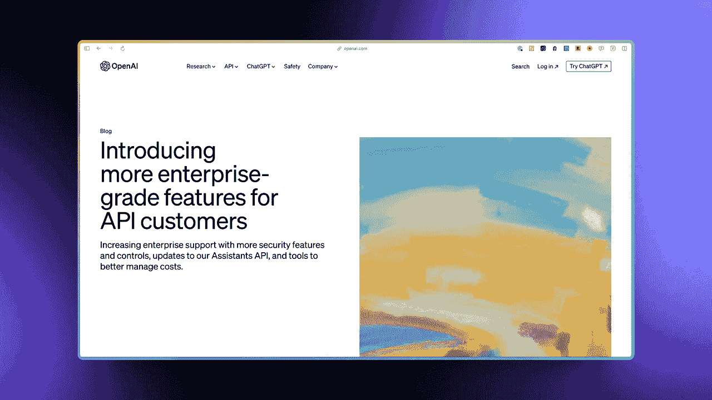
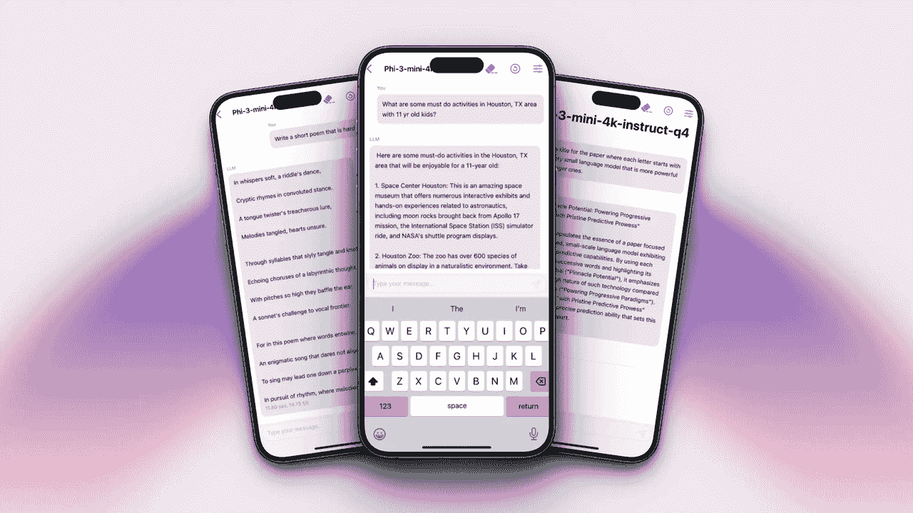
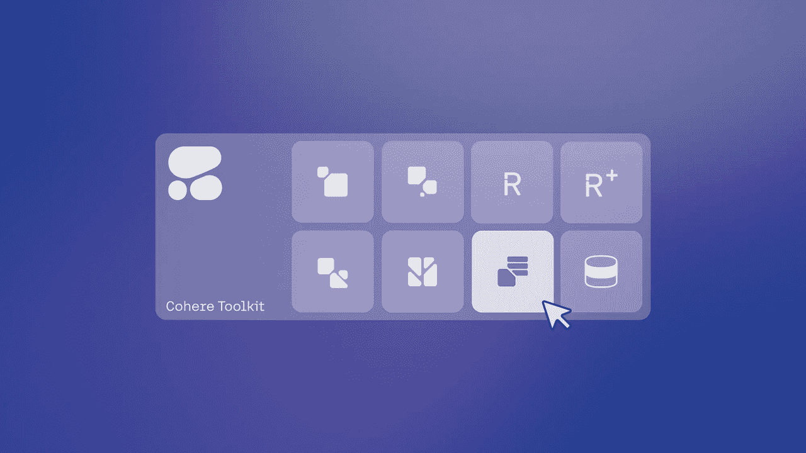
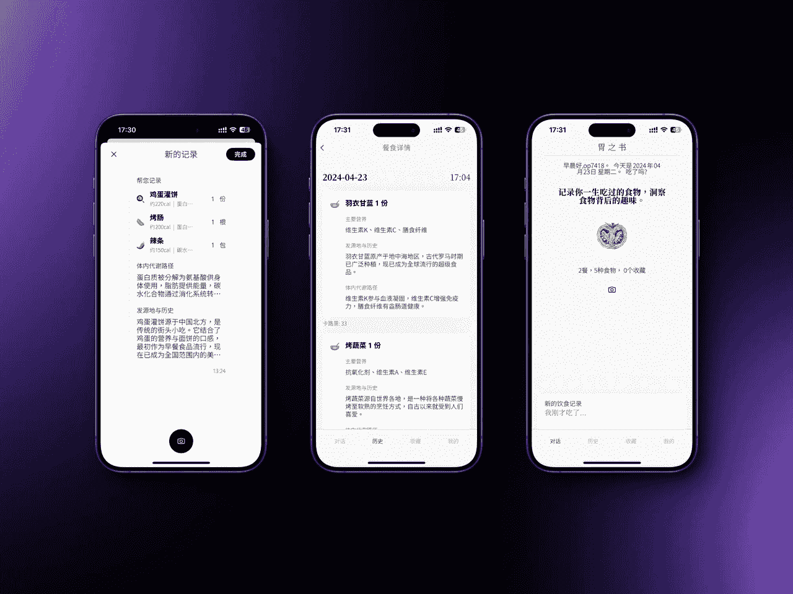
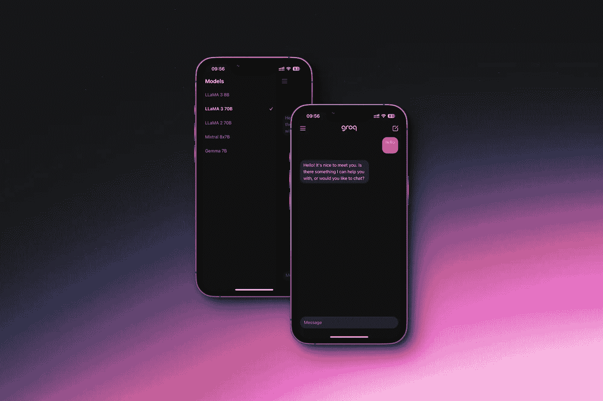
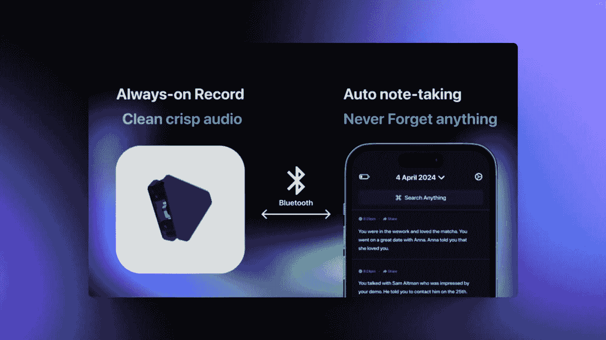
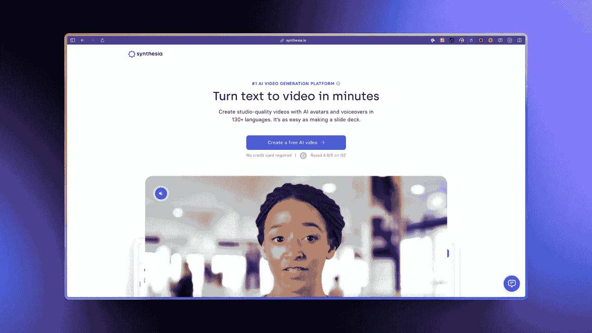
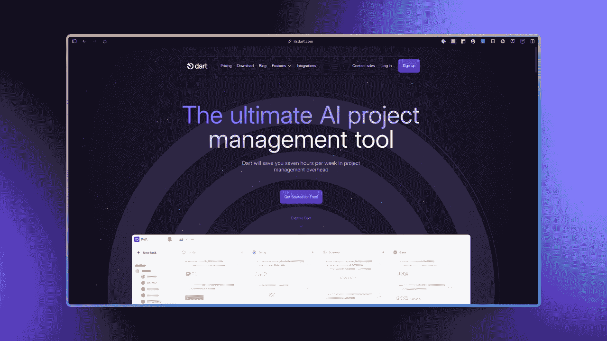
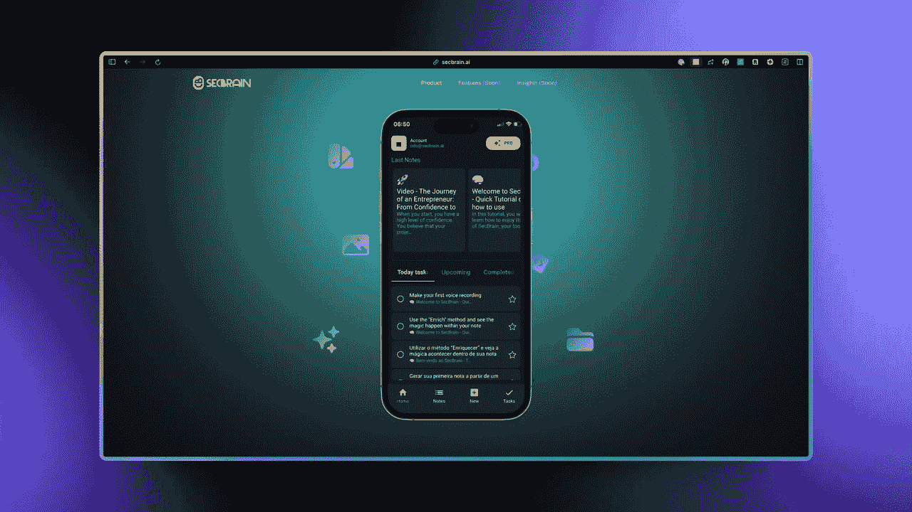

# AIGC Weekly #69

> 来源：[https://waytoagi.feishu.cn/docx/QQbEdYMipoy6HOxHmmucdl28nQg](https://waytoagi.feishu.cn/docx/QQbEdYMipoy6HOxHmmucdl28nQg)

> 🔗 原文链接： h[ttps://quail.ink/o](https://quail.ink/op7418/p/aigc-weekly-69)p7418/p/aigc-wee...

> 发表时间：2024-04-29

# 上周精选 ✦

## Open AI 的动态：企业服务、起初研究和 ChatGPT 体验优化

首先是 Open AI 官方两条内容，首先是介绍了为企业 API 客户做的一些功能上的更新，基本上前几天都说过了就是总结一下。

包括更多企业安全措施、更好的 API 控制、Assistants API的一系列更新和节约成本的措施。

另外还久违的发布了一篇关于模型安全的论文，帮助减少 LLM 提示注入和越狱在内的多种攻击。

### 企业 API 客户做的一些功能上的更新包括：

推出 Private Link，客户可以确保 Azure 和 OpenAI 之间直接通信的新方式，最大限度地减少对开放互联网的暴露。

发布了原生的多因素身份验证（MFA），以帮助确保符合日益增加的访问控制要求。

组织将能够更精细地控制和监督 OpenAI 中的个别项目。这包括将角色和 API 密钥范围限定于特定项目，限制/允许提供哪些模型，设置基于使用量和速率的限制以提供访问权限并避免意外超支。

Assistants API 引入了几项更新，以实现更准确的检索、围绕模型行为和用于完成任务的工具的灵活性，以及更好地控制成本。

达到承诺的每分钟 Token 吞吐量的客户可以获得 5%-10% 的折扣。

客户可以使用新批处理 API 异步运行非紧急工作负载。批处理 API 请求的定价为共享价格的 50％，提供更高的速率限制，并在 24 小时内返回结果。

### 训练LLM优先考虑特权指令，避免越狱的措施包括：

造成这种漏洞的一个主要原因是，LLM往往无法区分来自系统的指令和来自不可靠用户或第三方的文本，对它们给予相同的优先级处理。

为此，我们设计了一种指令优先级系统，明确规定了在不同优先级指令发生冲突时，模型应如何响应。

接着，我们开发了一种自动数据生成技术，通过这种技术，可以训练LLM在处理指令时有选择性地忽视那些权限较低的指令。

应用这种方法后，我们发现它显著增强了LLM的安全性，即便面对训练阶段未曾遇到的新型攻击，也能保持高度的鲁棒性，同时对模型的常规功能几乎没有影响。

### ChatGPT 体验优化：

+   现在 Open AI 给免费的 GPT3.5 用户增加了使用速率限制，达到限制会要求注册账号。

+   “Context Connectors”，它的首次实现很可能是与 Microsoft 365 或 Google Drive 相集成。并且免费的 CHatGPT 用户也可以上传文件。

+   ChatGPT 可以胃自定义 GPT s 设置联系人清单，即其它GPTs 可以与你的 GPTs 通信。

## 微软发布 phi-3-mini 微型模型

微软发布 phi-3-mini 模型，4 位量化之后可以部署在 iPhone 14 上，只占用 1.8G 内存，每秒输出 12 个 Token 。模型能力上跟 Mixtral 8x7B 和 GPT-3.5 差不多。

这几天这个模型被部署到了各个苹果设备上，甚至是 Vision Pro。

**详细介绍：**

一个新型语言模型 phi-3-mini，该模型拥有38亿参数，训练数据高达3.3万亿 Token。

根据学术基准和我们的内部测试，phi-3-mini 的整体性能与 Mixtral 8x7B 和 GPT-3.5 等大型模型相当（例如，在 MMLU 测试中达到69%，在 MT-bench 测试中得分为8.38），但其体积小到足以部署在手机上。

这种创新归功于我们的训练数据集，它是 phi-2 所用数据集的扩大版本，包括了经过严格筛选的网络数据和合成数据。此外，这个模型还进一步优化了其鲁棒性、安全性和适应聊天的格式。

还初步展示了在训练达4.8万亿 Token 的情况下，使用7B和14B参数的模型（名为 phi-3-small 和 phi-3-medium）所取得的成效，这两个模型的性能均显著优于 phi-3-mini（例如，在 MMLU 测试中分别达到75%和78%，在 MT-bench 测试中分别得分为8.7和8.9）。

模型下载：https://huggingface.co/microsoft/Phi-3-mini-128k-instruct-onnx

Adobe 发布了Firefly Image 3模型，Photoshop（测试版）也大规模更新了很多功能。包括文本转图像、生成相似图像、参考图像等。

**详细介绍一下模型升级的细节：**

新模型可以生成更高质量的图像，更好地解释提示，自动应用与提示匹配的样式，并在图像中提供更准确的文本。

Image 3 Model 还与结构参考和样式参考功能一起工作，提供出色的用户控制和最先进的视觉质量。

Image 3 Model 更好地理解文本提示和场景，实现更好地反映长、复杂提示并包含更丰富细节（包括文本）的图像生成。

在 Firefly web 应用程序的生成填充模块中引入了生成扩展功能。这通过允许更改原始图像的长宽比或大小。

## 生数科技发布Vidu 视频生成模型

生数科技不声不响整了个大活。发布 Vidu 视频生成模型，支持长达 16 秒 1080P 视频直接生成。

从演示视频来看一致性、运动幅度都达到了 Sora 水准，就是时长上还差一些，不过已经吊打现在的所有视频生成模型了。

该模型采用团队原创的Diffusion与Transformer融合的架构U-ViT，支持一键生成长达16秒、分辨率高达1080P的高清视频内容。Vidu不仅能够模拟真实物理世界，还拥有丰富想象力，具备多镜头生成、时空一致性高等特点。

链接里有演示视频。

# 其他动态 ✦

+   Perplexity 宣布 [新一轮 6270 万美元融资 ](https://x.com/AravSrinivas/status/1782784338238873769)，估值达到 10.4 亿美元。并推出企业版本。

+   阿里开源了 [Qwen1.5-110B ](https://qwenlm.github.io/zh/blog/qwen1.5-110b/)模型，模型在基础能力评估中与Meta-Llama3-70B不相上下。支持32K Token 的上下文长度。

+   [黄仁勋亲自向 Sa](https://x.com/gdb/status/1783234941842518414)m 交付了第一胎 DGX H200 ，一台的总GPU显存高达19.5TB。

+   MyShell 发布 Introduce OpenVoice V2 ，一款能够模仿任何人声并支持多种语言发音的文本转语音模型。

+   Snowflake 发布了一个面向企业的顶尖LLM Snowflake Arctic 。Arctic 擅长企业任务，例如 SQL 生成，编码和指令遵循。

+   [Morph Studio ](https://t.co/5BYCVGE5Kr)AI 视频生成和编排工具现在正式向所有用户推出。

+   XTuner 团队发布了基于 Llama3 的多模态模型， llava-llama-3-8b-v1 。

+   [可以识别](https://x.com/hume_ai/status/1782817178971963831)对话客户情感的 EVI 正式发布了 API ，支持使用自己的模型接入。

+   [Meta 在雷朋 Meta](https://x.com/Ahmad_Al_Dahle/status/1782803345914413453) 眼镜上推出了 多模态的 Meta AI 。

+   [伊隆·马斯克的人工智能初创](https://www.theinformation.com/articles/musks-xai-is-close-to-raising-6-billion-from-sequoia-others)公司 xAI 正在敲定一轮 价值 60 亿美元的投资 ，估值达到 180 亿美元。

+   [美国政府成立了一个由](https://www.wsj.com/tech/ai/openais-sam-altman-and-other-tech-leaders-to-serve-on-ai-safety-board-7dc47b78)数十位首席执行官、研究人员和政客组成的 人工智能安全委员会 。 Sam Altman以及微软、谷歌和英伟达的首席执行官等大公司的重要人物都在其中。

+   [Perplex](https://x.com/AravSrinivas/status/1783560121202901216)ity 为 Pro 用户推出 语音对话问答 模式。

+   [Cognition Lab](https://www.theinformation.com/articles/six-month-old-ai-coding-startup-valued-at-2-billion-by-founders-fund)s，Devin 背后的初创公司 现在估值为 20 亿美元 。Founders Fund 领投了 1.75 亿美元的融资。演示造假都能搞这么多钱。

# 产品推荐 ✦

## Cohere 发布 Cohere Toolkit AI 工具包

Cohere 发布 Cohere Toolkit AI 工具包，初始应用程序是一个知识助手。

可以连接到企业数据并针对特定团队定制的知识助手可以通过提供快速访问信息、自动化任务。

**主要特点有：**

会话式: Cohere 的模型默认驱动此应用程序，并经过训练，以了解对话背后的意图，记住对话历史，并使用 RAG 完成企业用例。

接地：开箱即用，助手会为来自自定义数据源的响应添加细粒度的相关引用。

可定制：开发人员可以使用Cohere的100多个预构建连接器来添加增强助手响应的自定义数据源，或自定义工具，以便知识助手可以采取行动。

## [胃之书：AI 饮食记录](https://bellybook.cn/)

赵纯想的新项目胃之书上线了，支持通过照片和文字自动记录摄入食物的热量和其他信息。

也可以拍摄自己喝过的咖啡杯奶茶等杯子抠图，放进 APP 的收藏里面。

整个 APP 设计感非常强，iOS 的震动真的爽，有类似需求懒得自己选食物详细信息的可以试试。

## [Gorq：官方 AI 聊天应用](https://testflight.apple.com/join/Y9X0wGsi)

Gorq 的 iOS 应用已经推出，支持的模型有 Llama3 8B 、 70B 、 Llama2 70B 、 Mixtral 8X7B 、 Gemma 7B 。

输出速度非常快，目前不需要登录并且免费，通过下面的testflight链接安装。

测试链接已经满员了，可以等正式发布再用。

## Friend：开源的语音对话AI 硬件

轻松捕捉对话。只需将其连接到移动设备，无论您走到哪里，都会自动保存会议、聊天和语音备忘录的高质量转录。

获取即时摘要、重点亮点、思维导图、待办事项列表等 - 无需繁琐的记笔记。通过这种终极免提解决方案，解放自己，全身心投入对话。

## [Synthesia： ](https://www.synthesia.io/)EXPRESS-1 模型驱动的数字人

EXPRESS-1 模型驱动，以实现逼真的头像表现。通过训练模型理解我们说什么以及我们如何说的微妙关系，表达力化头像现在可以用正确的语调、肢体语言和嘴唇同步来表演脚本，就像真正的演员一样。

EXPRESS-1 实时预测每一个动作和面部表情，与口语的节奏、语调和重音完美对齐。

## [Dart：AI 项目管理工具](https://www.itsdart.com/)

Dart 是一个 AI 助力的项目管理工具，它通过集成多种办公工具来提升工作效率，提供智能任务管理、项目路线图、日历视图和高效的文档处理等功能。用户特别喜爱它亲和的界面设计，能够取代其他看板应用，并且它的生成式AI (generative AI) 集成功能可以帮助自动完成任务和子任务。

## SecBrain：AI 语音笔记应用

SecBrain 正在开发一款 AI 智能应用，旨在简化创建和管理语音笔记的流程。用户可以录制语音，应用随后自动为其生成对应的图标、标题、摘要以及进行文本优化，所有内容均存储于云端。此外，这款应用还能自动生成额外的文本段落、创建待办事项列表，并且用户只需点击一次，即可将语音笔记转换成电子邮件或视频脚本。

# 精选文章 ✦

## Sam Altman 4月24日斯坦福闭门分享

+   下一个模型会比 gpt4还强大非常非常多

+   copy很容易，已经有gpt4了，Google很容易copy出来Gemini，难得是innovation newthings 怎样 define next paradigm

+   iPhone get a long way，Al也一样

+   为什么不开源:因为目标是 AGI，不认为开源是最好的做法，希望通过像公众提供免费无广告的 ChatGPT来实现社会影响力

+   不担心 AI太强，gpt4一出来人们觉得变天了，现在人们觉得gpt4还是不够好想要gpt5

+   如何消除不公:让便宜的 ai计算 flood theworld，让ai超级便宜

+   很多人的创业/研究方向是在补全现在ai的缺陷，本质是在赌ai不会变得更好，但是去来会有 gpt5、6，这样的工作就没意义了

+   人类始终更喜欢人类，就算现在ai下棋吊打人类，人类还是只喜欢看人类下棋;不过也有一些反例，比如青少年更喜欢跟ai聊而不是跟心理医生聊

+   认为 Sora会实现全新的娱乐方式，每次看都会不同，会根据你的喜好、互动实时生成会实现 something between movie and game

+   openai最大的组织变化:意识到scaling很重要之后，把所有组的计算资源都聚集起来做一件事

+   会实现不需要全新的 data也能让模型推理能力不断提升

+   现在是一个很好的时间去做 ai startup，但是不会因为用上了 ai就超过所有已有的产品，ai也不会违背商业的定律

+   openai在做的是 tool for human，而不是新的生物，所以不觉得 chatgpt需要有情感

+   有同学问Sora的训练数据用了多少 YouTubevideo? Sam: let's pass this question

+   未来一个高薪工作是给模型生成的结果提“专业反馈

## 埃森哲：AI 对职工、公司和工作内容的影响

埃森哲发布了一份关于 AI 的报告，重点关注职工、企业和工作内容在 AI 时代的重塑。

目前,大多数公司仍处于生成式AI的规划和试验阶段。但纵观全局,生成式AI已经开始影响商业变革、人力资源、法规环境、高管观点和员工情绪等方方面面。

调查显示,员工和高管在生成式AI可能带来的影响上存在认知差异。相比高管,更多员工担心失业、隐私泄露和工作压力增大等问题。

研究表明,如果企业能够以负责任的、以人为本的方式大规模采用生成式AI,到2038年可以额外创造10.3万亿美元的经济价值。

想要实现生成式AI的全部潜力,领导者需要以信任和谦逊的心态,掌握新技能来引领组织适应生成式AI。

## 如何在 Mac Book Pro 上微调 Phi-3

在 Mac 上微调 Phi-3 的教程，M1 或者 M2 芯片的 Mac 都行，看了一下不是很难，感兴趣的可以试试。主要的步骤包括：

安装AutoTrain Advanced工具

使用AutoTrain CLI进行SFT训练

使用AutoTrain CLI进行ORPO训练

使用AutoTrain UI进行训练

## Shapeof：AI 产品体验设计指南

随着 AI 领域相关产品的投入越来越大，相关产品的体验越来越重要。

好的视觉和交互体验甚至会非常明显的影响产品的传播效果。

Shapeof 推出了一份非常详细的 AI 产品体验设计指南，涵盖的内容有：

如何设计标识

如何规划页面导航

如何帮助用户使用和获取提示词

如何让用户自定义模型设置获得自己期望的结果

让用户控制响应并评估其准确性

中文翻译： [https://www.guizang.ai/wor](https://www.guizang.ai/work/%E6%8E%A2%E7%B4%A2%E4%BA%BA%E5%B7%A5%E6%99%BA%E8%83%BD%E7%9A%84%E4%BA%A4%E4%BA%92%E6%A8%A1%E5%BC%8F-%E5%A6%82%E4%BD%95%E8%AE%BE%E8%AE%A1%E6%A0%87%E8%AF%86)k/探索人工智能的交互模式-如何设计标识

## [AI模型中的“it”是数据集](https://nonint.com/2023/06/10/the-it-in-ai-models-is-the-dataset/)

“模型的行为并非由其架构、超参数或是优化器的选择所决定，而是由数据集所决定。”

“当我们谈论“Lambda”、“ChatGPT”、“Bard”或“Claude”时，我们实际上是在讨论它们所基于的数据集，而非模型本身的权重。”

Yi Tay 的反对意见：https://x.com/YiTayML/status/1783273130087289021

## Anthropic：如何创建 LLM 评估测试集

Anthropic 这个教程教你如何创建一个自己的语言模型评估测试集。

LLM 评估 体系通常包含4个部分：

输入提示集、模型对这些提示的响应、用来与模型输出对比的“标准答案”、根据某种评分方法得出的分数。

前三部分相当直观 —— 你需要写一些提示，为每个提示编写理想答案，并在你正在评估的模型上测试这些提示。

第四部分（基于某种评分方法的分数）可能有些棘手。有3种常见的评分方法：

代码：代码：使用代码来检查精确匹配或关键短语（快速且可靠）

人工：人工比较输出与标准答案（较慢且成本高）

模型：利用大语言模型（LLM）来评估输出

## [AI 创新者的窘境和新机会](https://www.notion.so/9283e4365d4e4764a1d1aac28ecdacdb?pvs=21)

orange离职之后疯狂输出，借着一些 AI 领域的见闻再一次介绍了一下创新者的窘境和新机会。

宏观上，在1-N很成功的系统里，0-1很难获得支持。当你有资源在手，COPY 其他人的 PMF 是成功概率是最高的策略。

微观上，并不是聪明才智或者资源差异，而只是每个人都把注意力投入到ROI最高的事情上。稳定收入vs创新风险，每个人都会做出理性的选择。

## [**SORA气球人视频的创作过程**](https://www.fxguide.com/fxfeatured/actually-using-sora/)

该片经过大量后期处理以确保画面的一致性和整体质量。

SORA 主要通过将文本提示转换成视频片段来操作，但目前还不能接受多模态输入，也不能完全控制连贯性。用户需要通过 ChatGPT 来扩展视频提示和生成视频剪辑，之后这些视频还需经过色彩调整、稳定和画质提升等多种后期处理。虽然 SORA 非常先进，但目前还处于预测试阶段，尚未对外公开。

Shy Kids 团队在使用 SORA 时遇到了一些挑战，如如何保持对象的一致性表示、如何准确地导引摄像机方向以及如何缩短渲染时间。他们选择了纪录片式的剪辑方式，通过高频率的拍摄来打磨最终的影片。此外，他们还解决了一些不期望出现的慢动作效果，并利用自己的音频处理技能完成了整个项目。

# 重点研究 ✦

## 四个新的ID保持项目

+   PuLID：优势是除了 ID 保持更好之外，还最小化了对原始模型的影响。PuLID 的一个显著特点是，无论是在身份信息加入前后，图像的背景、光线、布局和风格等元素都保持了高度一致。

+   链接：https://github.com/ToTheBeginning/PuLID

+   CharacterFactory：把名人的名字嵌入视为身份生成任务的真值，并训练一个GAN模型来学习从潜在空间到名人嵌入空间的映射关系。还设计了一种上下文一致性损失，以确保所生成的身份嵌入在不同环境下能够生成一致的身份图像。

+   链接：https://qinghew.github.io/CharacterFactory/

+   ID-Aligner：通过引入身份一致性奖励的调整策略，利用面部识别模型的反馈来改进身份的准确呈现。还提出了一种身份美学奖励的调整方法，这一方法结合了人工标注的偏好数据和自动生成的反馈，以优化图像的美观度。ID-Aligner能够兼容LoRA和Adapter模型，有效提升了性能。

+   链接：https://idaligner.github.io/

+   ConsistentID：大幅提升了身份保持的准确性。还提供了一个包含超过500,000张面部图片的细粒度肖像数据集FGID，该数据集的多样性和全面性超过现有的公共面部数据集。

+   链接：https://ssugarwh.github.io/consistentid.github.io/

## Hyper-SD：字节的图像加速算法

字节 lightning 团队发布了新的图像模型蒸馏算法 Hyper-SD。

从一步到八步的推理结果都比之前的蒸馏方式强很多，而且 SD1.5 和 XL 都支持。八步的 Lora 相当可以弥补了 1.5 没有较好的图像加速模型的问题。

首先，我们推出了分段轨迹一致性蒸馏（Trajectory Segmented Consistency Distillation），通过在预设的时间段内进行蒸馏，从而从高层次上保证了原始ODE轨迹的完整性。

其次，我们引入了人类反馈学习机制，旨在提升模型在较少推理步骤下的表现，并减少蒸馏过程中的性能损失。

最后，我们加入了分数蒸馏技术，进一步增强模型在低步推理下的生成能力，并首次尝试通过统一的LoRA机制来支持全过程的推理。

我的一些测试结果：https://x.com/op7418/status/1782686348509630850

## 苹果完全开源 OpenELM 一系列模型

完全开源了 OpenELM 一系列模型，包括270M、450M、1.1B和3B四个规模的模型：

不仅包括模型权重和推理代码，还包括了在公开数据集上进行模型训练和评估的完整框架，涵盖训练日志、多个保存点和预训练设置。

还开源了CoreNet：深度神经网络训练库：

使研究人员和工程师能够开发和训练各种标准及创新的小型和大型模型，适用于多种任务，如基础模型（例如，CLIP和大语言模型（LLM））、物体分类、检测以及语义分割。

OpenELM采用按层分配参数的策略，有效提升了Transformer模型各层的参数配置效率，显著提高模型精度。例如，在大约十亿参数的预算下，OpenELM的准确率较OLMo提升了2.36%，且预训练所需的Token数量减少了一半。

## 英伟达-Align Your Steps：加速图像生成

英伟达发布了一个巨牛皮的项目Align Your Steps，可以大幅提高 SD 低推理步数生成图像的效果。

而且不只是针对图像生效，对 SVD 模型也有很好的效果。

ComfyUI 已经原生支持了这个算法，试了一下 10 步的时候效果相当好。

Meta 推出了LayerSkip，一种全新的端到端解决方案，专门用于提高大语言模型（LLM）的推理速度。

在不同规模的Llama模型上进行的多种训练实验中，LayerSkip推理解决方案均展现出显著的性能提升。

例如在CNN/DM文档摘要任务上速度提升至2.16倍，在编程任务上提升至1.82倍，在TOPv2语义解析任务上提升至2.0倍。

## 谷歌：系统的评估现有的图片模型评价体系

图像模型评估的准确性一直是一个问题，谷歌这篇论文系统的评估了现有的图片模型评价体系。

还创建了新的基于问答（QA）的自动评估标准。

研究成果主要包括三个方面：

（1）我们推出了一个全面的基于技能的基准测试，能够根据不同的人类评估模板，区分各模型的性能。此基准测试将提示语分为多个子技能类别，帮助从业者不仅识别哪些技能具有挑战性，还能了解在何种复杂程度下，这些技能会显得尤为困难。

（2）我们通过四种不同的模板和四种T2I模型，收集了超过10万份人类评价。这有助于我们理解差异产生的原因：是提示本身的模糊性，还是评估标准和模型质量的差异。

（3）最后，我们引入了一种新的基于问答（QA）的自动评估标准，与我们的新数据集、不同的人类评估模板及TIFA160上现有标准相比，这一新标准与人类评价的相关性更高。