# AIGC Weekly #68

> 来源：[https://waytoagi.feishu.cn/docx/KXdQdtBH0oU3i5xagQGceOjgnnf](https://waytoagi.feishu.cn/docx/KXdQdtBH0oU3i5xagQGceOjgnnf)

> 🔗 原文链接： h[ttps://quail.ink/o](https://quail.ink/op7418/p/aigc-weekly-68)p7418/p/aigc-wee...

> [歸藏](https://quail.ink/u/1833) 2024-4-22

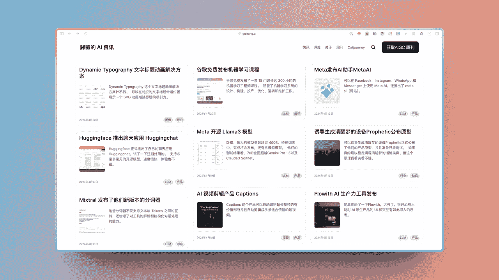

> 一直有很多朋友跟我说看推特或者微博的时候信息获取效率太低，因为有很多无关的信息，希望我整一个比较垂直的站展示最近的 AI 资讯。

> 上周用一天搞了一个 [**guizang.ai **](http://guizang.ai/)，感兴趣可以来看看，每天更新最新的 AI 资讯和值得关注的研究内容，我的一些深度内容也会整理后放在这里。移动端也做了很好的适配，觉得不错的话可以加个书签。🙏

Midjourney提示词：extreme macro photo of clean polished glass, edges with light from four different color[s, depth of ](https://catjourney.life/)field, blurred, dark navy and dark azure, grey background, natural colors --ar 16:9 --style raw --stylize 0 💎查看更多风格和提示词

# 上周精选 ✦

## Meta 正式发布 Llama3 8B 、 70B 模型

Meta 在上周终于发布了 Llama3，目前先发布的是 8B 以及 70B 两个模型，还有多模态以及一个 400B 规模的模型正在训练，预计在夏天发布，即使是 70B 的模型也已经足够强大，在 LLM 竞技场的英文评价下已经仅次于 GPT-4 超过现在的所有模型。

### 模型详细介绍：

+   **性能测试：**

+   预训练和指导微调模型是目前 8B 和 70B 参数尺度上最好的模型。

+   后期训练程序的改进大大降低了错误拒绝率，提高了对齐度，并增加了模型响应的多样性。

+   还发现，推理、代码生成和指令跟踪等能力也有了很大提高，这使得 Llama 3 的可操控性更强。

+   **模型架构：**

+   Llama 3 使用了一个 128K 词库的标记化器，它能更有效地编码语言，从而大幅提高模型性能。

+   为了提高 Llama 3 模型的推理效率，在 8B 和 70B 大小的模型中都采用了分组查询关注 (GQA)。

+   在 8,192 个词组的序列上对模型进行了训练，并使用掩码来确保自我关注不会跨越文档边界。

+   **训练数据：**

+   Llama 3 在超过 15T 的词库上进行了预训练，这些词库都是从公开来源收集的。

+   训练数据集是 Llama 2 的七倍，包含的代码数量也是 Llama 2 的四倍。

+   为了应对即将到来的多语言使用情况，Llama 3 的预训练数据集中有超过 5% 的高质量非英语数据，涵盖 30 多种语言。

+   开发了一系列数据过滤管道。这些管道包括使用启发式过滤器、NSFW 过滤器、语义重复数据删除方法和文本分类器来预测数据质量。

+   **如何使用：**

+   Llama 3 模型将很快在 AWS、Databricks、Google Cloud、Hugging Face、Kaggle、IBM WatsonX、Microsoft Azure、NVIDIA NIM 和 Snowflake 上提供，并得到 AMD、AWS、戴尔、英特尔、NVIDIA 和高通提供的硬件平台的支持。

+   可以在Meta官方助手Meta AI上体验。

+   **未来支持：**

+   在接下来的几个月里，将推出新的功能、更长的上下文窗口、更多的型号尺寸和更强的性能，并将与大家分享 Llama 3 研究论文。

### 周边信息：

+   Gorq 已经开始支持 Llama3 8B 和 70B 的推理，速度分别达到了 800Token/s 和 220Token/s：https://x.com/mattshumer_/status/1781355430914015482

+   Ollama 已经开始支持 Llama3：https://ollama.com/library/llama3

+   Arena Leaderboard 榜单上 Llama3 70B 跟Gemini Pro 1.5 和 Claude 3 Sonnet 在同一梯队。在英文分类下仅次于 GPT-4：https://chat.lmsys.org/?leaderboard

+   HuggingChat中已经支持 Llama3 体验：https://huggingface.co/chat/

### 大牛观点：

+   Jim Fan 认为 GPT-5 可能会在 Llama 3 400B 之前发布，确实有道理。如果 Llama3 400B 发布的时候 Open AI 还是之后 GPT-4 可以用，感觉估计很多客户都不续费了：https://x.com/DrJimFan/status/1781386105734185309

+   anton也说 Llama3 400B 发布之后会大幅压低 LLM Token 的价格。因为所有人都可以自己部署 GPT-4 级别的模型了，但是 400B 推理成本也很高未必有现在的 GPT-4 便宜：https://x.com/abacaj/status/1781443464246559180

+   九原客关于 Llama3 的核心概括，具备中文能力需要提示词激发、70B 性能碾压gpt-3.5-turbo，不足GPT-4：https://x.com/9hills/status/1781101920805155001

+   Andrej Karpathy关于 Llama3 的介绍，加入了很多详细的解释：https://x.com/karpathy/status/1781028605709234613

+   Llama3 作者之一Aston Zhang的介绍：https://x.com/astonzhangAZ/status/1780990210576441844

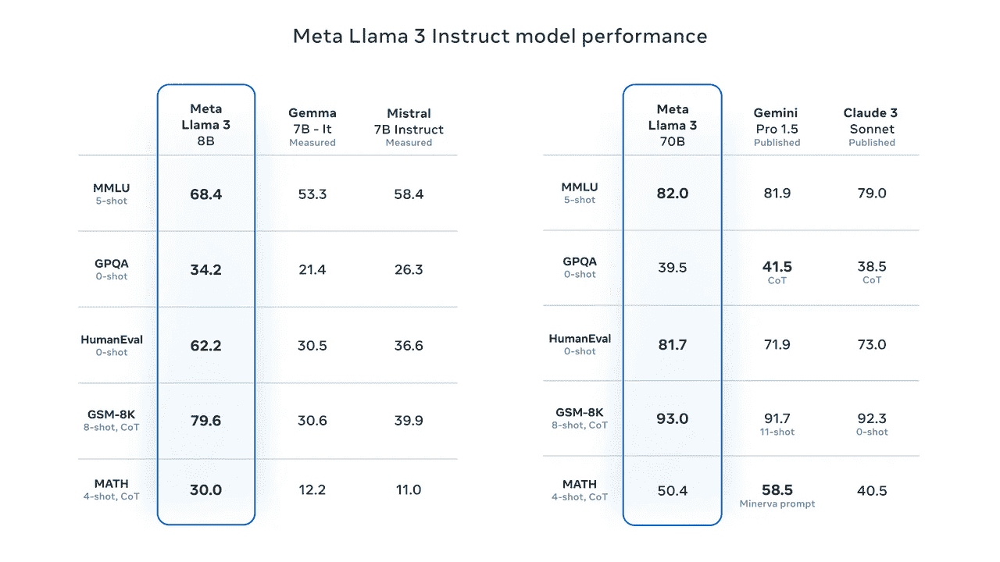

## Open AI 的动态：Assistants API 更新等

Open I 上周小动作不少首先是Assistants API发布了比较大的更新：

+   文件搜索功能现在可以支持每个助理处理多达10,000个文件，极大地提升了知识检索的能力。这一功能与我们新开发的向量存储对象协同工作，自动完成文件的解析、分块和嵌入。

+   新增的 Token 控制选项使您能够设定每次操作的最大输入和输出字符数，有效管理成本。您还可以自定义在进行上下文截断时参考的最近消息数量。

+   还增加了工具选择支持，您现在可以指定在特定操作中是使用文件搜索、代码解释器还是其他特定功能，从而提高助理操作的精确度。

Open AI 还给 API增加了一个项目维度。创建项目之后可以单独管理和查看对应项目 API 的限制和数据：https://x.com/OpenAIDevs/status/1780290177669439823

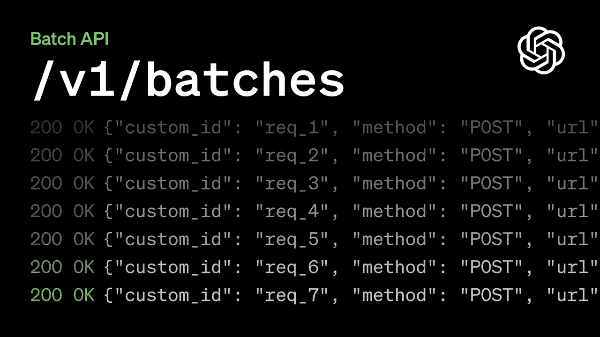

## Reka Core 发布，一个 GPT-4 级别的多模态 LLM

Reka Core 发布，一个 GPT-4 级别的多模态 LLM 。看了一下介绍确实非常强大。它具有图像、视频和音频的强大上下文理解能力，并且是仅有的两个商用综合多模态解决方案之一。

### **测评结果：**

在 MMMU 方面，Core 可与 GPT-4V 相媲美；在由独立第三方进行的多模态人类评估中，Core 优于 Claude-3 Opus；

在视频任务方面，Core 超越了 Gemini Ultra。在语言任务方面，Core 在成熟的基准测试中可与其他前沿模型媲美。

### **模型能力：**

多模态（图像和视频）理解：Core 不仅仅是一个前沿的大型语言模型。它对图像、视频和音频具有强大的上下文理解能力，是仅有的两个商用综合多模态解决方案之一。

128K 上下文窗口。Core 能够摄取并精确调用更多的信息。

推理能力：Core 拥有超强的推理能力（包括语言和数学），适合执行需要进行精密分析的复杂任务。

编码和Agent工作流程：Core 是顶级代码生成器。它的编码能力与其他功能相结合，可增强Agent工作流程的能力。

多语言：Core 对 32 种语言的文本数据进行了预训练。它能说流利的英语以及多种亚洲和欧洲语言。

部署灵活：与其他模式一样，Core 可通过应用程序接口、内部部署或设备来满足客户和合作伙伴的部署限制。

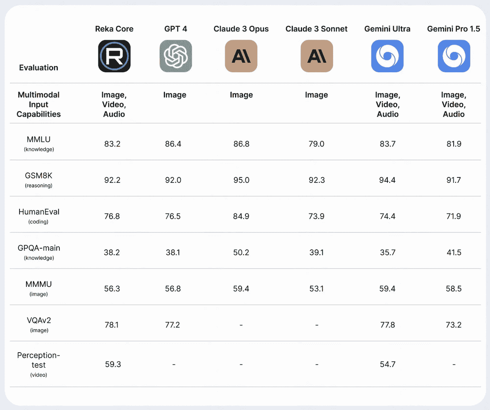

## Mixtral8X22B 模型开源

Mixtral8X22B在只公布了一个磁力链接之后，又正式发布了模型的技术报告：

+   Mixtral 8x22B是一个稀疏混合专家（SMoE）模型，它在141B个参数中仅激活了39B个，为其大小提供了无与伦比的成本效率。

+   Mixtral 8x22B具有多种优势，包括对英语、法语、意大利语、德语和西班牙语的流利支持，强大的数学和编程能力，以及64K令牌的上下文窗口，允许从大型文档中精确回忆信息。

+   该模型以Apache 2.0许可证发布，是完全开放的，旨在促进AI领域的创新和合作。

+   Mixtral 8x22B在性能和成本效率方面均优于其他模型，其稀疏激活模式使其比任何密集的70B模型都要快，同时比任何其他开放权重模型都更有能力。

+   在标准行业基准测试中，Mixtral 8x22B在推理、知识、多语言能力、数学和编程任务方面的表现均优于其他开放模型。

+   特别是，在数学和编程任务中，Mixtral 8x22B的表现最佳，其在GSM8K maj@8的得分为90.8%，在Math maj@4的得分为44.6%。

+   Mistral AI鼓励开发者社区探索Mixtral 8x22B，并加入他们以共同定义AI前沿。

Mixtral 还发布了他们新版本的分词器。

这些分词器不仅支持文本与 Tokens 之间的互转，还增添了对工具的解析和结构化对话处理的能力。

还发布了应用程序接口中使用的验证和规范化代码。

项目地址：https://github.com/mistralai/mistral-common

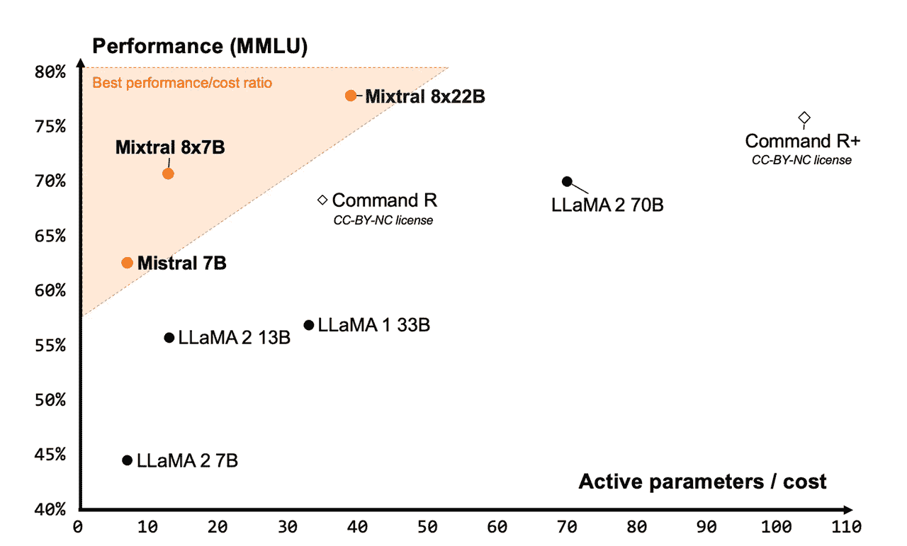

# 其他动态 ✦

+   Krea 即将推出视频生成功能，界面也进行了大改版：https://www.krea.ai/home

+   视频生成工具Pixverse开启收费计划，付费可以去除水印并且加快生成速度：https://app.pixverse.ai/subscribe

+   可以诱导生成清醒梦的设备Prophetic正式公布了他们的产品原型，并且准备开放测试：https://x.com/PropheticAI/status/1780968931718533507

+   Meta还发布了基于Llama3打造的AI助手，可以在 Facebook、Instagram、WhatsApp 和 Messenger 上使用 Meta AI。还推出了 meta . ai（网站），支持图片生成：https://about.fb.com/news/2024/04/meta-ai-assistant-built-with-llama-3/

+   Midjourney 新增社交功能Room，用户可以在聊天室中一起创作图像，你可以看到房间中所有人创作的图像：https://x.com/op7418/status/1781010087949275564

+   Stable Diffusion 3 的 API 版本正式发布，并且模型会在未来几个月开源：https://stability.ai/news/stable-diffusion-3-api

+   通义千问开源了基于Qwen1.5的代码模型CodeQwen1.5，7B 参数、GQA 架构、支持 92 种编程语言、支持 64K 的上下文：https://qwenlm.github.io/zh/blog/codeqwen1.5/

+   在线的 3D 编辑工具 Spline 发布了他们自己的3D 生成工具，支持从文字和图片生成 3D 模型，支持混合 3D 模型，生成之后可以用Spline丰富的工具对模型和场景进行编辑：https://app.spline.design/generate

+   Cohere 发布了他们新的嵌入模型 Cohere Compas，可对多方面数据进行索引和搜索：https://cohere.com/blog/compass-beta

+   WizardLM 推出了他们的新模型 WizardLM-2，包括三种模型型号WizardLM-2 8x22B, 70B, 和7B：https://x.com/WizardLM_AI/status/1779937307690471834

# 产品推荐 ✦

## 360 AI 浏览器支持 Youtube 视频

LLM 的出现让英语知识的获取变得比以前简单非常多，尤其是文字类的内容，翻译以及总结门槛都低了非常多。

但是很多知识都在视频里面，我也使用了很多的视频翻译工具或者产品，还有自己攒的流程，一直没有一个门槛足够的并且效果足够好的产品可以解决这部分问题。

这几天一直在关注 360 在AI 产品上的进展，没想到在 Youtube 视频的总结、理解以及翻译上他们居然成了做的最完善的产品。

最近更新的最炸裂的一个功能，支持 Youtube 视频的 AI 翻译，在 AI 助理的字幕 Tab 下就可以启用。而且字幕支持导出Srt格式。

另外一个新功能对这种对谈类的视频很有用，可以用时间轴分析出不同的发言人对应的时间段，同时还能单独总结某一个发言人的观点，忽略另外的发言人。

即使是超长的视频也可以很快的完成分析和总结，并且简介以及思维导图都会用中文进行总结，重点分析的能力感觉也升级了，总结的很详细，也可以点击跳转到对应的位置开始播放。

而且上面这些能力全是免费的。另外他们的Mac版本即将发布。各位要是有类似需求可以看看。

只能说老周可能是真的天天从 youtube 看视频学 AI，可以准确把握用户痛点。

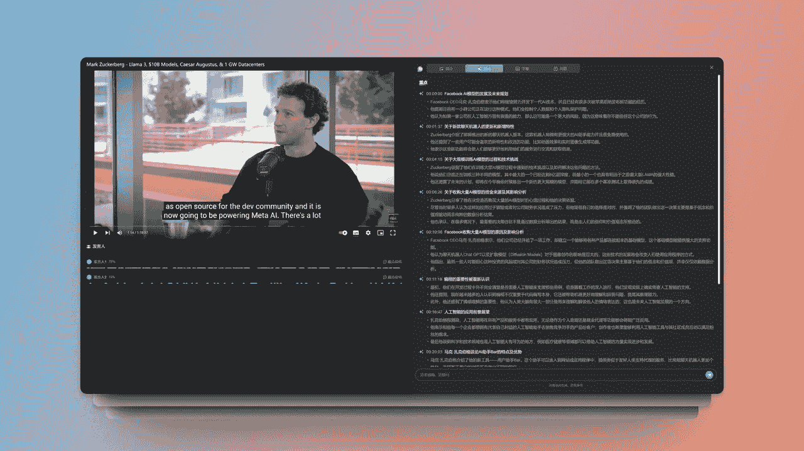

## Flowith：AI 生产力工具

简单体验了一下Flowith，太强了，很开心有人能对 AI 原生产品的 UI 和交互有如此深入的思考。

整个产品在生成式 UI 的探索上比现在的所有产品都要靠前。

而且很好的结合了无线画布和思维导图的优势，巧妙的用卡片来承接对应不同数据格式的展示，卡片样式的适配也非常多。

在输入的时候还会巧妙的利用光效对用户进行引导。

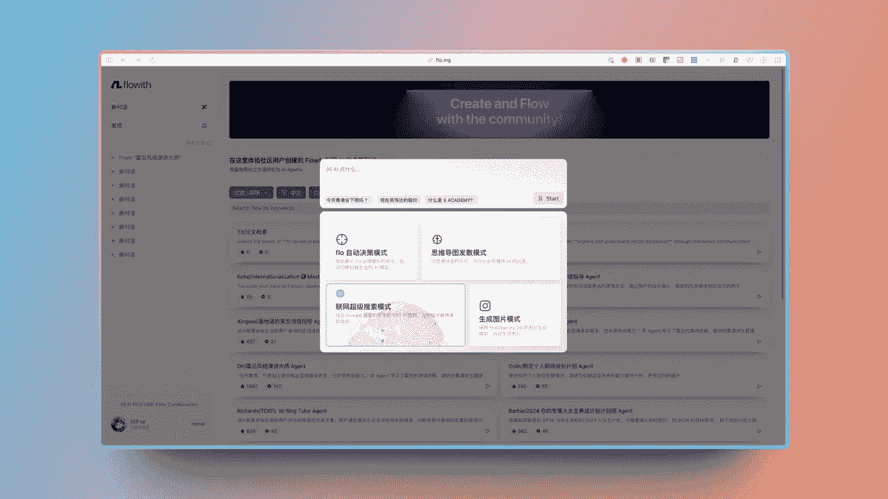

## Captions：AI 自动视频剪辑工具

Captions 这个产品可以自动识别超长视频的有价值判断并且自动剪辑成多条适合传播的短视频。

生成的短视频可以选择对应的字幕模板，并且支持AI 自动在对应的视频片段添加音效、贴纸等增加氛围的内容。

此外还支持AI眼神注视、AI 降噪、 AI 唇形同步、 AI 调色等一系列自动化的 AI 能力。

最重要的还是网页版本的，任何平台都能用，这要完善一点不得把剪映干稀烂？

可惜的是暂时还不支持翻译，看选项后面会有自动字幕翻译。

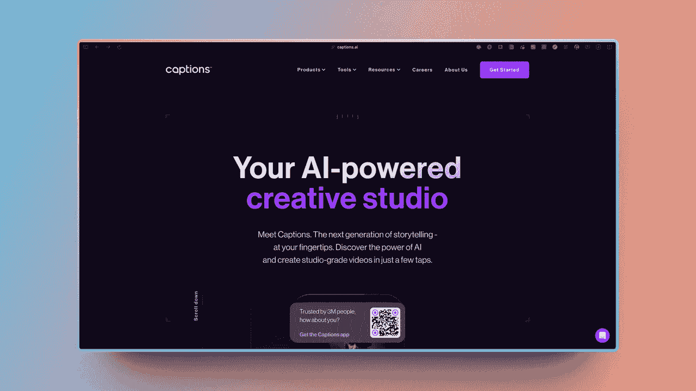

## Hugging Chat：Hugging 推出自己的 AI 聊天产品

Huggingface 正式推出了自己的聊天应用 Huggingchat，试了一下还挺好用的。

支持非常多常见的开源模型，速度很快，体验也不错。

尤其推荐 Command R+，中文的能力真的很强，感觉比国内的几个都要强了。

网页版还支持搜索模式，普通使用够用了。

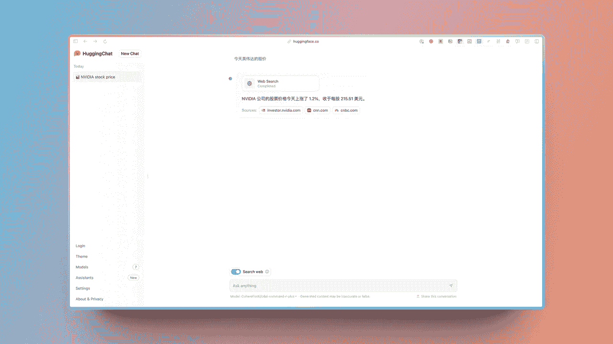

## CaiCai：系统级 AI 文字编辑应用

CaiCai 开发的一个文字编辑和修改应用 Haye。

支持在系统的任何地方拉起，对所选内容进行优化、翻译、总结和修改。

官网设计也很好看，在 Discord 里面有内测版本。

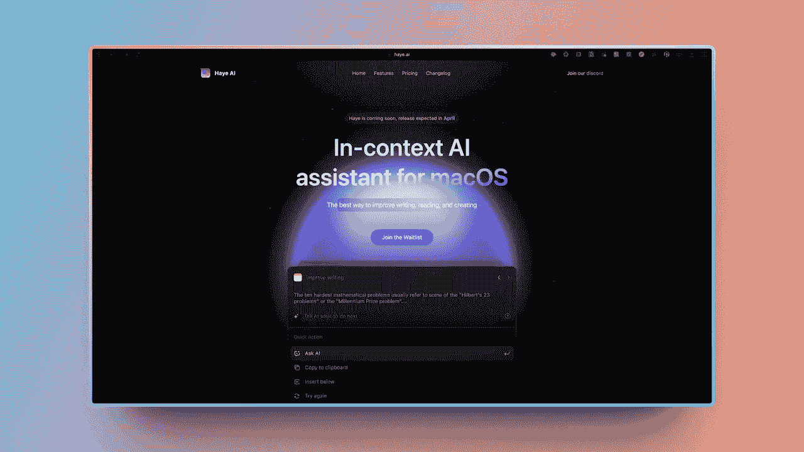

## [Bestever： ](https://www.bestever.ai/)[**创意人工智能广告工具**](https://www.bestever.ai/)

Bestever 是一个专门为品牌定制图像和视频广告的平台。它提供多种工具，让用户能轻松地将品牌的标志、颜色和字体整合到广告创意中。这些创意能够自动调整至适合各种屏幕比例的尺寸，确保在各种平台上都能展现出最佳效果，还可以一键将静态广告变为动画。

其主要功能包括：通过与人工智能设计师的对话来简化广告创意的编辑过程，并能不断生成新的广告概念，帮助用户解决创意瓶颈。用户还可以在平台上自定义品牌视觉风格，包括颜色、标志和字体，并且可以直接上传特殊字体到自己的账户。

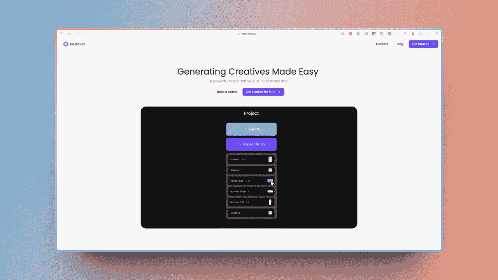

## [Micro1：AI 面试官](https://www.micro1.ai/gpt-vetting)

旨在通过 AI 在短短 15-30 分钟内完成对候选人的技术能力和人际交往能力的评估，从而简化招聘流程。这种 AI 驱动的面试工具有效减少了传统招聘方式所需的时间和资源投入，例如多轮面试和冗长的技术评估。它基于一种活跃的监控算法提供了一个“信任度评分”，并对每一项评估都提供了包括成绩单在内的详尽反馈，以减少 AI 偏见的可能性。据报道，这一工具已经将招聘过程缩短了 50% 到 60%，极大地提高了企业吸引顶尖人才的效率。

# 精选文章 ✦

## AI Agents设计模式：多智能体协作

吴恩达讨论了使用多智能体方法处理像软件开发这样的复杂任务的好处。这种方法包括将任务分解为由不同AI智能体处理的子任务，每个智能体都专门处理特定的角色。这种方法与使用单一智能体相比显示出更优越的性能，并有助于更有效地管理复杂的工作流程。

## 斯坦福大学 HAI 发布 2024 人工智能指数报告

报告内容非常丰富，可视化也做的很好，推荐看看。

探讨了人工智能领域的几个关键趋势。报告中特别强调了基础模型（foundation models）在AI发展中的核心地位，性能评估标准的下降可能预示着评估方式或技术进步的变化，AI技术相关成本的急剧上升，以及美国在全球AI领域的领先地位，其影响力远超其他国家。

+   截止到 2023 年底，AI 在很多任务上都超越了人类；

+   前沿大模型的价格正在变得越来越昂贵；

+   美国大幅领先中国、欧盟和英国，成为了顶级 AI 模型的主要来源国；

+   针对 LLM 的安全与标准化评估严重缺乏；

+   全球对生成式 AI 的投资急剧增加；

+   数据显示 AI 使员工更有生产力，并提高了工作质量；

+   得益于 AI 的快速发展，科学进步进一步加速；

+   美国对 AI 的合规条例数量急剧增加；

+   随着全球各地的人们对 AI 的潜在影响了解越多，担忧也就越多。

## Anthropic的可解释性团队月刊

发现个好东西，Anthropic的可解释性团队每个月都会出一篇内容。介绍他们发现的在 LLM 领域可能有价值的研究和想法。内容都比较前沿，很多只有一些小点，不值得写论文的都会被记录在这里。

**比如三月份的内容主要是：**

用字典学习技术在Othello游戏训练的模型中探索电路发现，以及研究Transformer层实现复杂布尔逻辑功能的可能性。

激活贴片技术及其更高效的替代技术——归因贴片技术，这些技术帮助将行为具体定位到大型语言模型的特定部件。

还涉及到语言模型中的自我修复现象，即模型中的某些部件能够在其他部件失效时进行补偿，保证模型输出的整体准确性。这种自我修复能力与神经网络中LayerNorm组件的非线性特性有关。

## 人工智能引领服务即软件的范式转变

Foundation Capital 这篇文章的论点非常有意思。

他们认为AI公司正在颠覆SaaS平台的本质，即SaaS平台将会从软件即服务快速过度到服务即软件的范式。

在传统软件业务中,公司出售平台或工具的访问权限,但客户仍需要使用该工具来实现预期目标。

而在服务业务中,实现预期目标的责任则由销售服务的公司承担。

他们在文章中详细探讨了范式转变到服务即软件(或更

## 谷歌免发布一套长达 300 小时的机器学习工程师课程

谷歌免费发布了一套 15 门课长达 300 小时的机器学习工程师课程。涵盖了机器学习系统的设计、构建、投产、优化、运转和维护工作。

**详细的学习内容有：**

+   机器学习基础：涵盖机器学习的基本原理和方法。

+   特征工程：探讨如何有效地处理和转换数据，以提高模型性能。

+   生产级机器学习系统：介绍如何将机器学习模型部署到生产环境中。

+   计算机视觉与自然语言处理：涉及图像和语言数据的分析和应用。

+   推荐系统：讨论如何构建个性化推荐引擎。

+   MLOps：聚焦于机器学习操作的实践，包括模型的部署、监控和维护。

+   TensorFlow、Google Cloud、VertexAI：介绍这些工具和平台如何支持机器学习项目的开发和部署。

## [视频生成的扩散模型](https://lilianweng.github.io/posts/2024-04-12-diffusion-video/)

作者是正在 Open AI 工作的 Lilian Weng。强烈建议正在研究视频生成模型的人阅读。前提是你能看懂。用一篇文章详细介绍了从扩散模型到 Dit 模型和 3D U-net涉及到的各种算法原理。

**内容简介：**

**从头开始的视频生成建模**

扩散模型已经在图像合成领域取得了很好的效果,现在研究界开始将其应用于更具挑战性的视频生成任务。

与图像相比,视频生成需要在时间维度上保持一致性,这就要求模型能够建模时序信息和更多的世界知识。此外,高质量的文本-视频配对数据也比图像数据更难大规模获取。

视频生成建模的一个基本思路是在时间维度上对帧施加高斯噪声,然后学习逆转这个添加噪声的过程以生成清晰的视频。

**参数化和采样基础知识**

在定义了视频生成的前向噪声添加过程后,可以用DDIM更新规则来逐步去噪并生成视频帧。

一个值得注意的技巧是使用v-prediction参数化而不是直接预测噪声,这有助于避免视频生成过程中的颜色偏移问题。

对于条件视频生成,即根据给定视频生成新视频,一种有效的方法是重建指导采样。

具体来说,是将原始的去噪模型调整为以给定视频为条件,同时保留视频的内容和动态特征。

模型架构:3D U-Net和DiT

视频生成模型的架构主要有两大类:基于U-Net的卷积网络和基于Transformer的DiT。

其中一个代表性工作是将2D图像的U-Net扩展到3D空时域并分解为空间和时间两个维度分别处理。在空间维度应用2D卷积和自注意力,在时间维度使用1D卷积和时序注意力。

这种分解处理能在一定程度上缓解计算开销,而添加的时序注意力模块则有助于提高生成视频的时间一致性。类似地,Imagen Video使用了一系列级联的3D U-Net,通过时空超分辨率模块来分阶段提高视频的时空分辨率。另一种架构DiT则将输入视频分解为时空块,然后套用Transformer的自注意力和前馈操作。

**将图像模型改编为生成视频**

除了从头开始构建视频生成模型,另一种更常用的方法是将预训练的文本到图像扩散模型改造为支持视频生成。

这通常包括两个主要思路:

在视频数据上微调或无需训练的适配。微调方法一般是向预训练图像扩散模型中插入时空卷积/注意力层,并在视频数据上重新训练这些新增的时空模块。

例如Make-A-Video在预训练图像模型的基础上添加了时空卷积/注意力层,并利用跨帧注意力去提高视频连贯性。

Gen-1则考虑在视觉和时间两个维度分别建模视频的结构与内容。无需训练的适配思路则更有创意,如 Text2Video-Zero 通过对潜码施加平移变换来引入运动动力学,并利用新的跨帧注意力替换原有的帧内自注意力以提高前景对象的一致性。而ControlVideo则进一步增强了跨帧交互,并提出了交错帧平滑和分层采样等改进。

## Dwarkesh Patel 对扎克伯格的访谈

小扎表示，Meta AI发布了新版本Llama-3模型，计划集成Google和Bing并提供更多创作功能。AI发展将带来根本变化，提供创造性工具，但也带来风险。开源AI系统有助于保持力量均衡。马克讨论了开源对科技产业的积极影响，开发者的意义，以及开源的效益和挑战。他还提到了Meta公司的责任和关注点以及芯片的使用计划。

谈论的内容主要有：

+   Llama 3

+   向通用人工智能 (AGI) 的开源进展

+   定制化硅基芯片、合成数据及其对扩展性的能源制约

+   凯撒·奥古斯都、智能爆炸、生物武器、耗资100亿美元的模型等多项议题

## 约时报对 Anthropic CEO 的采访

纽约时报发布了对 Anthropic CEO 的采访，这个老哥很少接受采访，所以这个采访可以关注一下。

Amodei 分享他对不久的将来的预见，内容包括：

即将到来的技术突破有哪些？

什么问题最令他担忧？

在变革面前，适应能力较弱的社会应该如何准备？

图表上那一抹曲线，又预示着什么？

[中文总结](https://www.guizang.ai/work/new-york-times-interview-with-dario-amodei)

## Roberto Nickson对扎克伯格的访谈

在Roberto Nickson这个采访里谈论了Meta AI最新突破、AR眼镜未来、元宇宙发展及个人感悟。

### Meta AI的最新进展和应用

Meta近期推出了新一代AI助手系统,整合了Llama 3语言模型,号称成为目前最智能的免费AI。新版Meta AI增加了许多实用功能,如实时知识整合、跨平台集成、实时图像生成等。扎克伯格表示,Meta AI未来将进一步与公司各产品深度整合,为用户在信息获取、内容创作等方面提供更强大的支持。

扎克伯格本人已是Meta AI的深度用户,每天数十次使用AI助手解决问题、获取信息。他预测不久的将来,Meta AI能为每一个创作者和企业提供量身定制的智能助手服务。除了工作,扎克伯格也喜欢利用AI与孩子们互动,一起探索创造的乐趣。

### Ray-Ban Stories智能眼镜与AR眼镜的未来

去年,Meta与著名眼镜品牌Ray-Ban合作推出了智能眼镜Ray-Ban Stories,集成了音频通话、音乐播放等实用功能,兼具时尚外观,成为广受好评的爆款产品。谈及AR眼镜的未来发展,扎克伯格认为下一代产品有望整合更强大的AI助手,可以实时回答佩戴者的问题,并在其视野中显示通知、呈现可视化信息。

Meta的最终目标是打造一款轻薄时尚、支持全息成像的AR眼镜,让用户佩戴起来就像普通眼镜一样自然舒适。扎克伯格坦言,实现这一理想仍需几代产品的迭代,但他对前景非常乐观。当被问及对元宇宙(Metaverse)的看法时,扎克伯格表示尽管发展仍处早期,但大势所趋,指日可待。他尤其看好下一代消费级脑机接口,有望通过佩戴在手腕的设备,读取神经信号来控制AR眼镜。

### Meta Quest 3与Reality Labs的发展

今年是Meta收购Oculus十周年,其虚拟现实部门Reality Labs也已成立近三年。扎克伯格对团队的成果感到骄傲,最新推出的Mix Reality一体机Meta Quest 3代表了该领域的重大突破,综合性能全面领先于更昂贵的同类产品,有望成为首款走向主流市场的MR设备。

此外,Ray-Ban Stories智能眼镜的第二代产品也获得了积极的市场反馈,销量远超预期。谈及Meta多年来在VR/MR领域的投入,扎克伯格坦言外界还存在不少质疑,但他对公司的技术积累和未来规划充满信心,相信随着产品体验的不断提升,市场和用户也将逐步认可其价值。

## [Sam Altman 和 Open A](https://www.youtube.com/watch?v=G8T1O81W96Y&t=203s)I 的 COO 接受了 VC20 的专访

OpenAI创始人Sam和Brad在采访中提到了AI发展策略、合作伙伴关系、决策过程以及模型改进的速度。他们认为创业公司应该押注在AI模型改进的前提下发展，并平衡技术进步和社会需求。OpenAI将继续推动科学进步，解决重大问题，包括癌症治疗，并专注于提高产品质量和推动科学研究。

# 重点研究 ✦

## 微软发布VASA-1：图片及音频生成说话视频

微软这个VASA-1通过照片和声音生成人物说话视频的项目抢的有点离谱。从显示效果来看基本不存在瑕疵了。视频生成的技术瓶颈又一个被突破。

**项目特点：**

+   可以捕捉到大量的情感和表情细微差别以及自然的头部动作，从而增强真实感和生动感。

+   支持接受可选信号作为条件，例如主眼注视方向和头部距离，以及情绪偏移。

+   能够处理超出训练分布的照片和音频输入。它可以处理艺术照片、歌唱音频和非英语语音。

+   支持表情和姿势的编辑。

+   在离线批处理模式下以每秒 45 帧的速度生成 512x512 大小的视频帧，在在线流模式下可支持高达每秒 40 帧的速度，之前的延迟时间仅为 170 毫秒。

## Best-fit Packing方法来减少不必要的文档截断

16 号的一个论文，提出用Best-fit Packing方法优化语言模型训练,通过减少不必要的文档截断,最大程度保留原文完整性。

该方法在多个任务上取得显著性能提升,同时有效降低幻觉生成问题。

**论文简介：**

+   Best-fit Packing方法来减少不必要的文档截断

+   作者提出了Best-fit Packing方法来减少训练中的文档截断。该方法首先将长文档分割成最大长度的块,短文档则保持原样。
然后使用组合优化算法将这些文档块紧密地装箱成训练序列。通过这种方式,Best-fit Packing避免了不必要的文档截断,在满足最大长度限制的前提下最大程度地保留了原文的完整性。
同时,通过算法优化,该方法实现了与连接再截断方法相当的训练效率,几乎没有额外开销。

+   通过数学模型分析截断对学习的影响

+   为了更好地理解截断对学习的影响,作者还构建了一个简化的随机过程模型。
通过理论推导,他们证明了即使在数据充足的情况下,在截断数据上训练的模型性能也会严格劣于在完整数据上训练的模型。进一步的分析表明,截断信息的影响程度取决于后续token与被截断token之间的相关性。
如果后续token与被截断的信息高度相关,则截断的负面影响会持续更长时间。

+   Best-fit Packing算法的具体步骤和优化

+   Best-fit Packing算法的核心是将文档装箱问题转化为一个组合优化问题。
作者证明了该问题的NP难度,因此采用了近似算法First/Best-Fit-Decreasing来获得次优解。
得益于文档长度分布的特点(大部分文档都远小于最大长度限制),作者进一步将算法的时间复杂度优化到了O(NlogL),其中N为文档数,L为最大长度。实验表明,优化后的算法在10亿量级的大规模文档数据上依然具有良好的线性可扩展性。

## Dynamic Typography 文字标题动画解决方案

Dynamic Typography 这个文字标题动画解决方案针不戳。可以在对应的文字标题合适位置展示一个 SVG 动画增强标题的吸引力。

**论文简介：**

一个名为“动态排版（Dynamic Typography）”的自动化文字动画方案，它结合了变形字母表达语义和根据用户指令添加动态效果这两项技术难题。

我们的方法采用了矢量图形表示和端到端的优化框架，使用神经位移场技术将字母转换成基本形状，并配合逐帧动态效果，确保动画与文字的意图保持一致。

通过形状保持技术和感知损失正则化，我们确保了动画在整个制作过程中的可读性和结构完整性。

## Meta 发布自己的图像模型蒸馏技术

Meta 除了 Llama3 之外还发布了他们在 Meta AI 中使用的图像生成蒸馏技术。通过三步的推理就可以生成跟原始模型一样质量的图像。

此方法包括三大核心技术：

+   逆向蒸馏（Backward Distillation），此技术通过在模型自身的逆向路径上进行微调，以减少训练与推理间的差异；

+   动态重构损失（Shifted Reconstruction Loss），这一策略能根据当前的时间步骤动态调整知识传递；

+   噪声修正（Noise Correction），这是一种在推理阶段使用的技术，通过改善噪声预测的精确度来提升样本质量。

## Stability Audio 的技术论文，用 DiT 架构生成音乐

通过对生成模型在长时间序列上的训练，能够创作出长达4分45秒的音乐作品。

模型采用了一种高度压缩的连续潜在表示，运用Diffusion-Transformer 技术处理（潜在频率为21.5Hz）。根据音频质量和与输入提示的对齐程度等评价指标，这种模型达到了最新技术水平。

## MagicClothing：AI 换装项目

MagicClothing 这个AI 换装的演示效果有点强啊。而且还可以与 ControlNet 和 IP-Adapter 等其他技术结合使用。还是开源的，期待对应的 ComfUI 节点。

**项目简介：**

推出了一种名为 Magic Clothing 的新型网络架构，它基于潜在扩散模型（LDM）进行开发，专门处理一项新的图像合成任务——服装驱动的图像合成。

该系统旨在生成根据不同文本提示定制的、穿着特定服装的角色。在这一过程中，图像的可控性至关重要，主要是要确保服装的细节得以保留，并且生成的图像要忠实于文本提示。

为了实现这一点，我们开发了一种服装特征提取器，用以详细捕捉服装的特征，并通过自注意力融合技术，将这些特征有效整合到预训练好的LDMs中，确保目标角色的服装细节不发生改变。

同时，我们还使用了一种称为联合无分类器指导的技术，以平衡服装特征和文本提示在生成图像中的影响。

此外，我们提出的服装提取器是一个可插拔模块，可以应用于多种经过微调的LDMs，并能与 ControlNet 和 IP-Adapter 等其他技术结合使用，进一步提高生成角色的多样性和可控性。

我们还开发了一种名为匹配点LPIPS（MP-LPIPS）的新型评估指标，用于评价生成图像与原始服装之间的一致性。

## Ctrl-Adapter 一个专门为了视频生成做的Controlnet

为各种图像及视频扩散模型增添丰富的控制功能，并优化视频的时间对齐。

Ctrl-Adapter 具备包括图像控制、视频控制、稀疏帧视频控制、多条件控制、与各种基础模型的兼容、适应新的控制条件和视频编辑等多项能力。

**大致思路：**

训练了适配层，将 ControlNet 的预训练特征与不同的图像/视频扩散模型融合，同时冻结了 ControlNets 和扩散模型的参数。

Ctrl-Adapter 结合了时间和空间模块，有效保证视频内容的连贯性。

此外，为了更好地适应不同的基础模型和稀疏控制，还引入了潜在跳过技术和逆时间步采样策略。

Ctrl-Adapter 通过简单地对 ControlNet 的输出进行加权平均，实现了从多个条件进行控制。

**测试结果：**

在与多种图像和视频扩散模型（如SDXL、Hotshot-XL、I2VGen-XL和SVD）的实验中，Ctrl-Adapter 在 COCO 数据集上实现了与 ControlNet 相当的图像控制效果。

而在视频控制方面，它不仅超越了所有基线模型，在 DAVIS 2017 数据集上还达到了最高的准确率，且计算成本大幅降低（在不到10个GPU小时内完成）。

## Video2Game：视频转换为游戏环境

Video2Game这个新项目有意思。它能够自动把现实世界的场景视频转化为逼真并且可以互动的游戏环境。

**系统核心由三个主要部分组成：**

+   一个神经辐射场 (NeRF) 模块，这一模块有效地捕捉了场景的几何形状和视觉表现；

+   一个网格模块，用于从 NeRF 中提取信息，从而加快渲染速度；

+   一个物理模块，该模块处理物体间的互动和物理运动。遵循我们精心设计的流程，可以创建一个可交互、可操作的现实世界的虚拟复制品。

这个系统不仅能实时生成极为逼真的图像，还能在此基础上开发互动游戏。