# AIGC Weekly #67

> 来源：[https://waytoagi.feishu.cn/docx/SFWxdewLXoMOfex0KH9cAgOXn5d](https://waytoagi.feishu.cn/docx/SFWxdewLXoMOfex0KH9cAgOXn5d)

> 🔗 原文链接： h[ttps://quail.ink/o](https://quail.ink/op7418/p/aigc-weekly-67)p7418/p/aigc-wee...

> 作者：歸藏

Midjourney提示词：Closeup of light reflecting on polished surfaces, creating beau[tiful shadow](https://catjourney.life/)s and highlights, in the style of kodak film photography. --ar 16:9 💎查看更多风格和提示词

# 上周精选 ✦

## [谷歌发布了一堆AI能力和升级](https://www.youtube.com/watch?v=V6DJYGn2SFk&t=1s&ab_channel=GoogleCloud)

Google Next 2024上周放出了不少狠货，这次 Open AI 没能够压下去热度。

首先是 Gemini Pro 1.5 进行了一大波升级，并且所有人都可以使用了。详细更新内容有：

+   Gemini现在可以理解音频内容：Gemini 不仅能理解多达9.5小时的音频内容，还能感知你话语中的语调和情感。甚至可以听到背景音。

+   能处理无限量的文件:现在几乎可以上传无限数量的文件（包括图片、视频帧和音频）让Gemini处理。

+   函数调用和系统指令的进一步改进：可以选择模式来限制模型的输出，提高可靠性。选择文本、函数调用或仅函数本身。

+   推出了JSON模式：指示模型仅输出 JSON 对象。此模式可从文本或图像中提取结构化数据。

+   具有改进性能的新嵌入模型：新模型 text-embedding-004在 MTEB 基准测试中实现了更强的检索性能，并超越了具有相似维度的现有模型。

详细的更新公告在这里：https://developers.googleblog.com/2024/04/gemini-15-pro-in-public-preview-with-new-features.html

Google的 Imagen 2 图像生成模型现在已经可以通过文本生成4秒的视频。

介绍，没找到在哪用：https://cloud.google.com/blog/products/ai-machine-learning/google-cloud-gemini-image-2-and-mlops-updates

还开源了一个基于 Gemma 的系列模型 CodeGemma。CodeGemma 7B模型在数学推理方面的能力出众，代码生成能力很强。经过指令调优的CodeGemma 7B模型，在Python编程方面表现更为强大。

技术报告地址：https://storage.googleapis.com/deepmind-media/gemma/codegemma_report.pdf

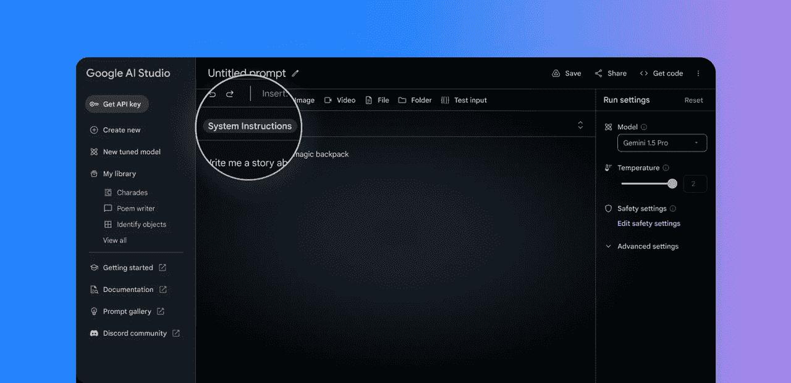

## [AI音乐生成工具Udio发布](https://www.udio.com/)

音乐生成应用Udio正式发布比Suno有更多的自定义能力。同时整个软件的设计也更偏向内容消费，不只是单纯的当工具在做。

前谷歌DeepMind的顶尖AI研究员和工程师创立，得到了a16z的投资，每人每月可以免费生成1200首音乐。

属实离谱，Udio除了可以生成音乐和歌曲之外还可以通过自定义歌词生成其他音频。

比如喜剧、演讲、NPC 对话、商业广告、广播节目、ASMR等。

演示视频：https://x.com/mckaywrigley/status/1778867824217542766

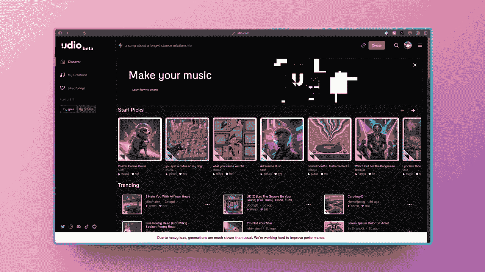

## Open AI发布 GPT-4 Turbo正式版

为了狙击谷歌 Open AI 发布了 GPT-4 Turbo 正式版。同时新的 GPT-4 Turbo 也开始向所有 ChatGPT 用户提供。

另外 Claude 3 刚在 LLM 竞技场中超过 GPT-4，GPT-4Turbo 正式版就又超回来了。

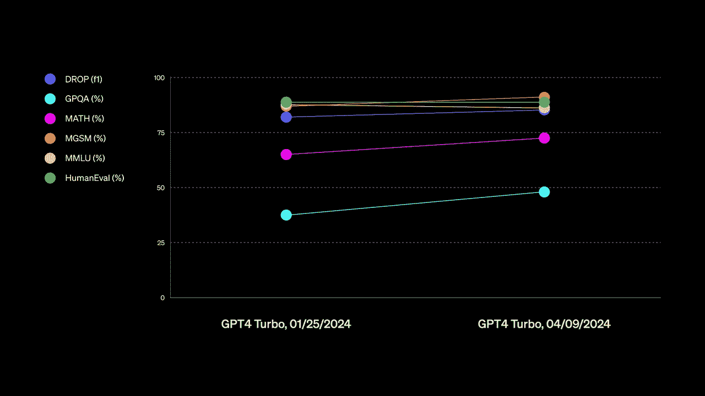

## AI画图应用Ideogram发布模型更新

Ideogram 发布了一大波更新，模型能力再次增强，平时做海报和普通图片挺好用的。

**主要升级内容有：**

增强的文字渲染和照片写实效果：减少了15%的文字错误率，大幅提高了图像的连贯性与逼真度。

Describe功能：一个将图像转化为详细描述的提示词助手。

渲染质量和速度控制：快速、默认和质量。快速模式优先考虑速度，大约在 5 秒内生成图像。另一方面，质量模式优先考虑更细节的内容，大约在 20 秒内生成图像。

负向提示词：告诉模型不想在输出图像中看到什么，可以使用此功能删除特定对象，甚至改善图像的风格。

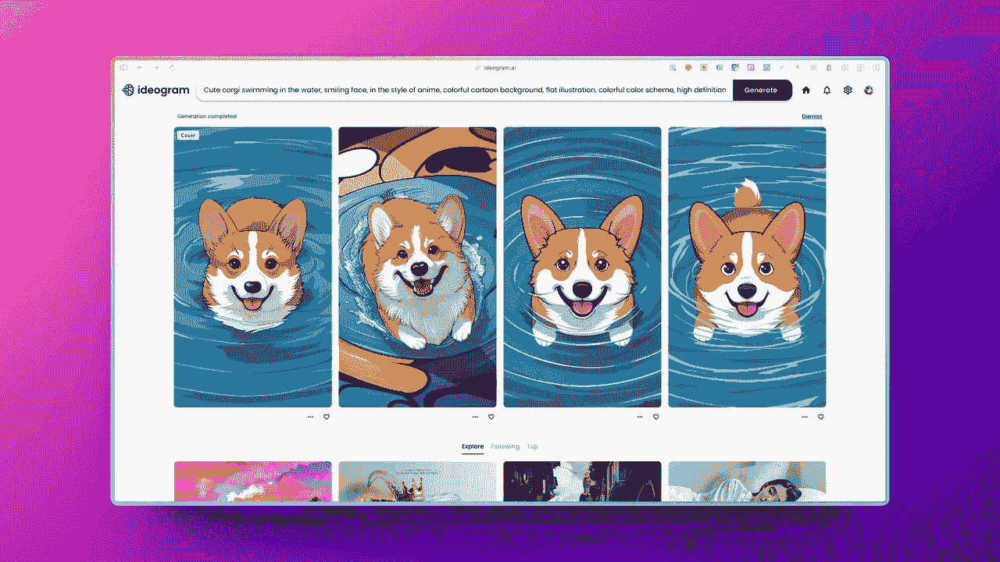

## X AI 公布了 Gork 1.5V 多模态 LLM

X AI 咋老是周五发消息，他们的宣传风格和其他家不太一样啊。正式发布了 Grok-1.5 V 多模态模型。

那个真实世界QA比GPT-4V和Claude3都强。

为了测评对真实世界的理解他们还推出了一个专门的测试集RealWorldQA。

该基准旨在评估多模态模型的基本真实世界空间理解能力。数据集是开源的。

最初发布的 RealWorldQA 包含 700 多张图片，每张图片都有一个问题和易于验证的答案。

除其他真实世界的图像外，该数据集还包括从车辆上拍摄的匿名图像（从特斯拉薅的？）。

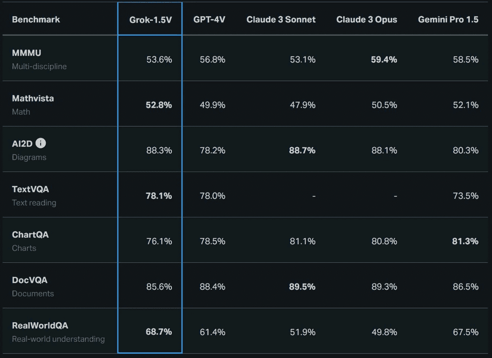

# 其他动态 ✦

+   Open AI 发布了 GPT-4 Tubro 模型正式版，推理能力和代码能力很强。

+   SDXL 的 Tile 模型 2.0 发布了演示的效果非常强，可以用在图片内容修改和放大上。

+   [Cohere 还发布了一个专](https://txt.cohere.com/rerank-3/)门为了RAG设计的 基础模型 Rerank 3 。

+   M[eta 正在印度和非洲](https://x.com/MeeraMystery/status/1779542972863766852)部分地区的 WhatsApp、Instagram 和 Messenger 用户中 测试 Meta AI 。

+   Claude 3 Opus 已经可以在 谷歌 Vertex AI 上使用 。

+   [Comma](https://x.com/seb_ruder/status/1778385359660867744)nd R+ 模型专门为了东亚语系做了优化，他们的 技术报告 。

+   Meta公布了其下一代训练和 [推理加速器（MTIA） ](https://x.com/AIatMeta/status/1778083237480321502)的详细信息，这款MTIA芯片在计算和内存带宽方面相比前一代有了显著提升，旨在高效服务于提供高质量推荐的排名和推荐模型。已经可以在

+   Mixtral-8X22B 正式开放下载，Perplexity Labs 使用速度很快，想要体验的可以试试。 http://labs.pplx.ai

+   [Stabilit](https://huggingface.co/stabilityai/cosxl)y AI 发布了 CosXL模型 ，包括基础的CoXL模型和Edit CosXL模型，它能够生成从深邃黑色到纯净白色的全部颜色范围。

# 产品推荐 ✦

## Reader：jina开源的网页内容爬取工具

将网络信息灌输到大语言模型（LLM）中是实现信息实体化的关键步骤，但这一过程充满挑战。最直接的方法是直接抓取网页内容并提取其 HTML 数据。然而，抓取操作往往复杂且容易受到封锁，且原始 HTML 往往包含大量无用的元素，如多余的标记和脚本代码。Reader API 解决了这些问题，它能从网址提取出核心内容，并将其转化为干净、易于大语言模型处理的文本，确保为你的 AI 智能体及 RAG 系统提供高品质的数据输入。

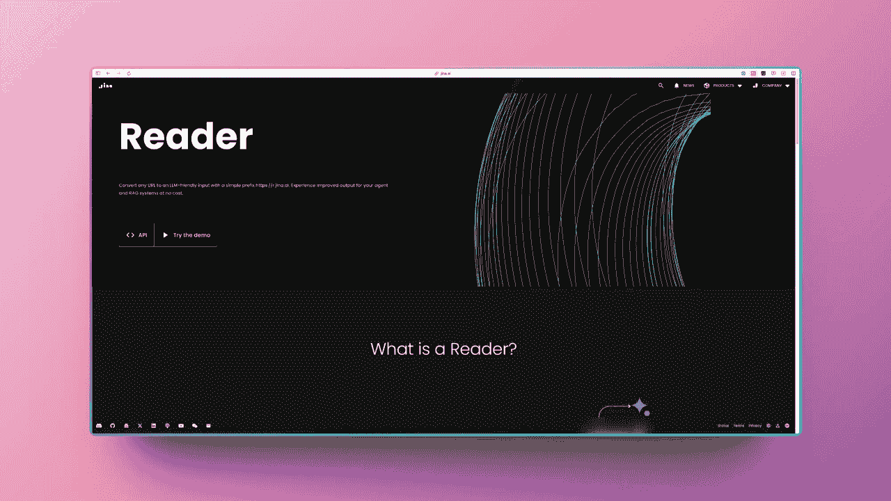

## CiCi：字节 AI 聊天机器人推出客户端和浏览器插件

字节的豆包或者 CiCi 虽然移动版的体验非常离谱，过于想把每个能力都在界面上展示了。

但是网页是真不错，尤其是海外版本还避免了模型问题，浏览器插件和客户端也还行。

特别是浏览器插件支持翻译和总结，翻译体验做的很好，总结的内容和客户端还是同步的。

有需求的可以白嫖一下。

## [**Perplexity-Inspired LLM Answe**](https://github.com/developersdigest/llm-answer-engine)r Engine：开源的 AI 搜索应用

一个开源的类似 Perplexity 的 AI 搜索应用，含构建复杂答案引擎所需的代码和指令，利用Groq、米斯特拉尔人工智能的Mixtral、Langchain. JS、勇敢搜索、服务器应用编程接口和开放人工智能的功能。该项目旨在根据用户查询有效返回来源、答案、图像、视频和后续问题，是对自然语言处理和搜索技术感兴趣的开发人员的理想起点。

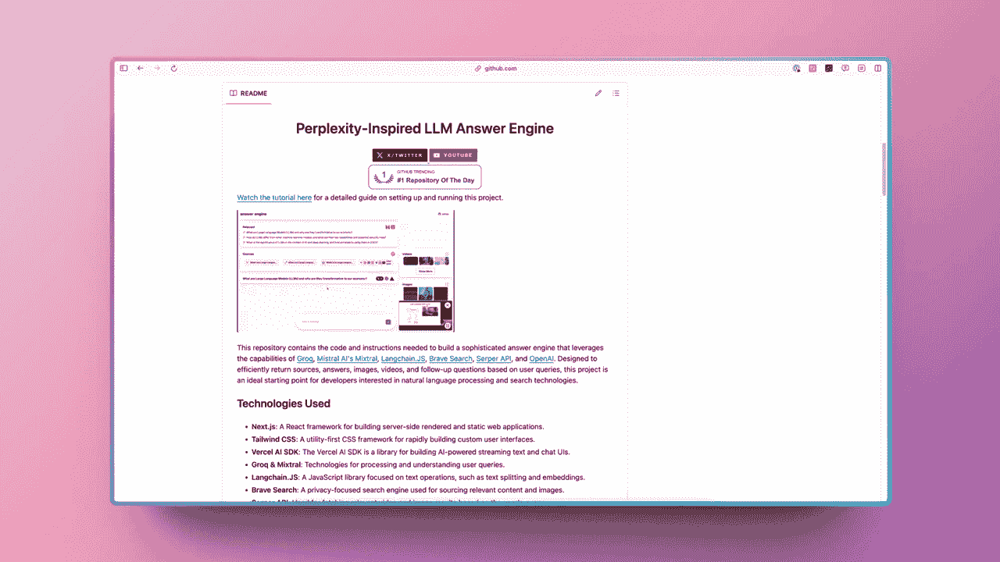

## [Steerable Motion：利用 An](https://github.com/banodoco/steerable-motion?tab=readme-ov-file)imatediff 将图片做成连续的动画

支持通过图片插值控制 Animatediff 生成视频的ComfyUI 插件和对应的工作流Steerable Motion升级到 1.3。这个工作流玩好的话，可以制作很多神奇的效果。

增加了可控性，流畅度和高分辨率输出。这个流程跟我昨天发的那个视频的工作流类似。

**主要设置项如下：**

关键帧间隔：指定在您设置的每两个关键帧之间生成的帧数。

影响范围：确定 IP-适配器（IPA）的影响应用于哪些帧的范围。

影响强度：设定每一帧的最低和最高影响点。

图像忠实度：设定对原始输入图像保持忠实的程度。

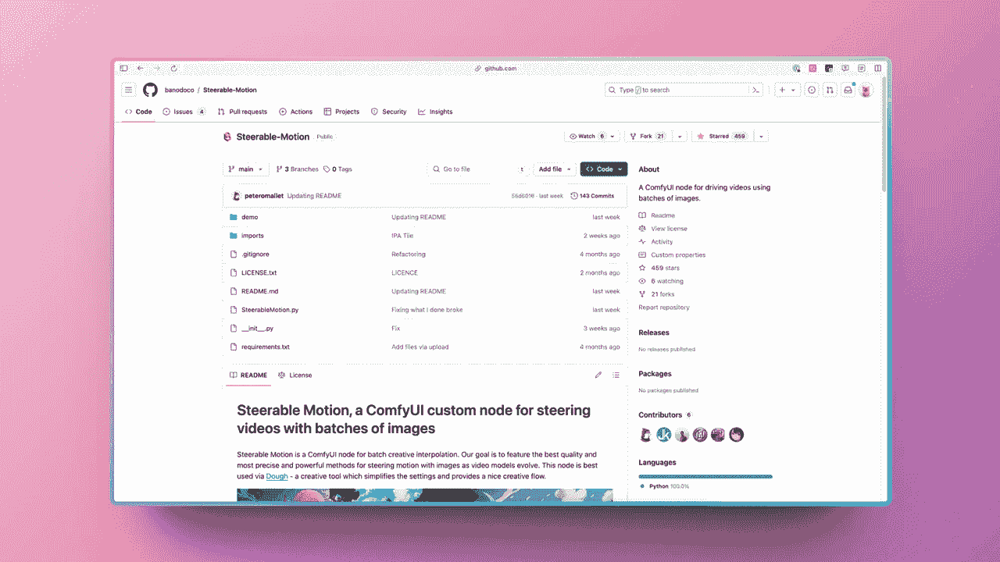

## Kimi Copilot：Kimi chat 驱动的 AI 总结助手

用Kimi AI一键总结网页内容。安装后，在浏览网络文章时点击插件图标，或使用快捷键 Ctrl/Cmd+Shift+K，即可一键召唤Kimi.ai总结网页内容。总结的非常详细，而且使用Kimi还不需要付费。

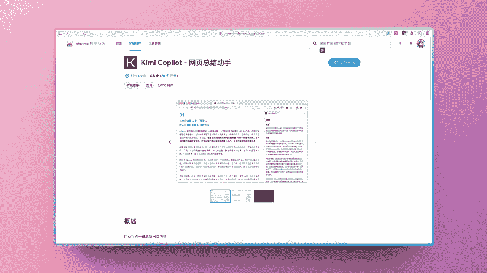

## Chordio：专门用于用户体验优化的 AI 助手

输入你的要求之后这个产品会为你的产品制作意制作简单的交互稿，这个还是挺不错的，很多产品一点交互能力没有。可以用这个试试。

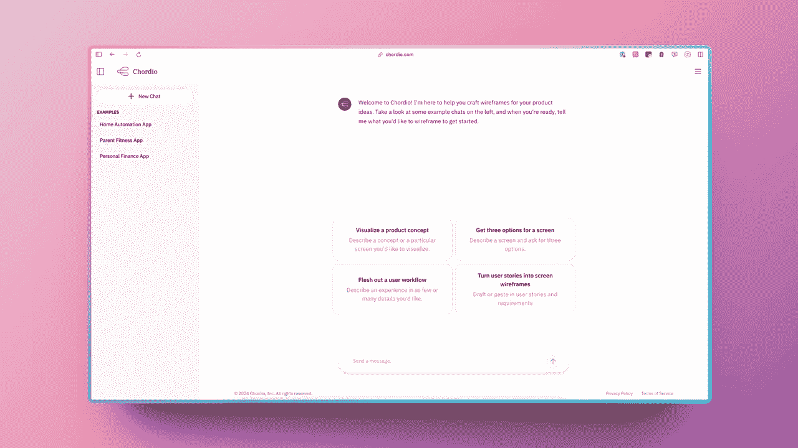

## Strut：AI 驱动的写作应用

Strut是一款支持人工智能的协作工作区，将您的笔记、文档和写作项目整合在一起。从混乱到清晰，Strut将所有写作工具集合到一个简单的应用程序中。捕捉笔记，组织项目，并与团队一起协作。Strut让您的写作不断前进。

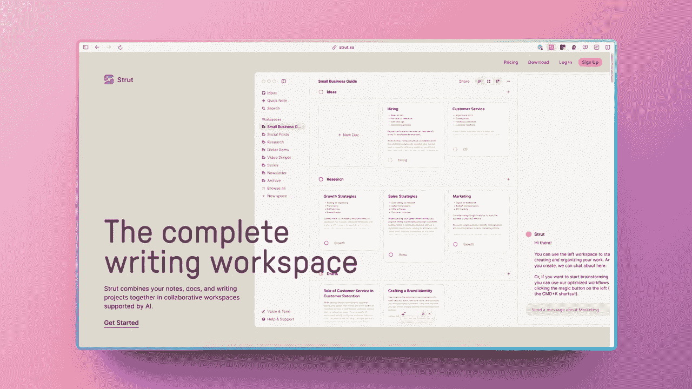

# 精选文章 ✦

## 红杉和福布斯联合发布 2024 AI 50 强名单

红杉发布了 2024 他们评选出的前 50 家 AI 公司。

**当前的趋势**

突显了生成式人工智能如何提高企业和行业的生产力。企业通用生产力类别今年翻了一番，从四家公司增加到八家。

图像编辑器 Photoroom，视频生成应用程序 Pika 和游戏构建器 Rosebud 表明，消费者和半专业用户之间的界限在创意软件领域变得模糊。

行业垂直类别较少，但出现了一个新的工业领域。机器人领域的 Figure，工业维护领域的 Tractian 和自动驾驶领域的 Waabi 开始展示了人工智能软件与硬件的整合将如何改变物理世界的工作。

2023年对基础设施来说是一个强劲的年份，其中包括一些强大的新参与者，如Mistral，它是基础模型领域的主要竞争者。

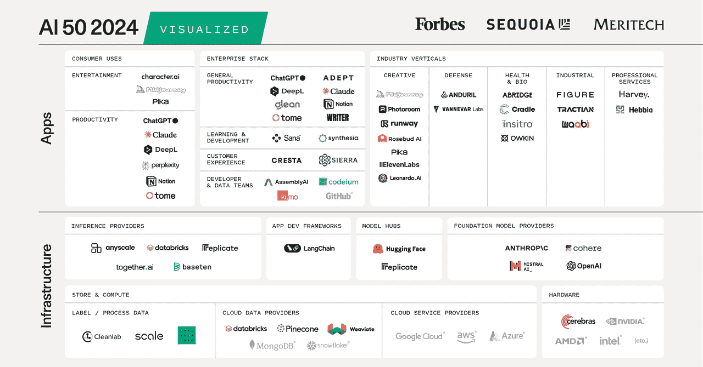

点击标题可以跳转：

## [如何开始深度学习的旅程](https://www.vikas.sh/post/how-i-got-into-deep-learning)

Vik Paruchuri 写了自己是如何从一个学历史的普通工程师，用了一年的时间学习AI并且训练出相当优秀的OCR PDF模型的历程。

里面给了一下他自己的学习路径和学习渠道，感觉想要入门的都可以看看。

中文翻译：https://quail.ink/op7418/p/e5a682e4bd95e5bc80e5a78be6b7b1e5baa6e5ada6e4b9a0e79a84e69785e7a88b

## 揭穿Devin：“第一位AI软件工程师”Upwork谎言曝光

这个老哥分析了Devin的演示视频，并且尝试复现其中的演示。

结果他发现Devin 并不能按照雇主的要求去完成完整的任务，一方面 Devin 只是挑选了需求的一部分去完成，另一方面 Devin 并不能像一个真正的工程师一样，跟雇主去提方案。

Devin被宣传为世界上“第一个AI软件工程师”，但实际上这是不真实的。视频中的描述和声明都是虚假的，这种夸大其词的营销手法会对人们产生错误的认知。人们应该保持怀疑态度，不要盲目相信互联网上的信息。

## Stable Diffusion 生态最重要的 70 篇论文精选

Stable Diffusion 生态最重要的 70 篇论文精选，而且还根据不同的作用做了分类，除了论文地址还有对应的代码仓库和模型下载地址。

非常适合深入学习 SD 的朋友研究。参与整理的人都是 SD 社区的大佬哦，有的甚至是里面论文的作者。

## [Andrej Karpathy ](https://github.com/karpathy/llm.c/tree/master)为什么用 C 重写 gpt-2 训练代码

Andrej Karpathy 用 C 开始重写 GPT-2 的训练代码，顺便还在对涉及到的对应内容做一些科普和教学。比如讲解了LayerNorm的一些原理和应用：https://github.com/karpathy/llm.c/blob/master/doc/layernorm/layernorm.md

还用非常通俗的解释介绍了自己用 C 语言实现 GPT-2 训练代码的原因以及这样做的优势和劣势：

大语言模型训练背后的复杂性与本质:

PyTorch等库简化了流程但引入了复杂度,而直接用C语言实现能揭示LLM训练的数学本质。

这种简化的尝试虽有局限,但有助于加深理解,未来或许还能带来实用价值。

详细内容：https://x.com/karpathy/status/1778153659106533806

## 刚刚发生了什么，接下来会发生什么

目前最好的大型语言模型的改进速度估计为每5至14个月翻一番。虽然我们已经有了GPT-4等前沿模型，但我们仍然没有完全发挥现有AI的能力。AI的潜力仍然难以确定，因为大多数人在一种方法行不通时就停止尝试。此外，AI在使用工具方面的能力也是一个重要因素。

AI在事实核查方面甚至可以超越人类。此外，AI在医疗领域和其他专业领域也表现出了很高的水平。机器人代理人可能成为将AI与组织整合的关键，它们可以作为“AI合同工”来完成任务，并且与人类更自然地交互。然而，目前的AI仍然存在一些局限性，如果下一代模型能够显著改进，那么不确定的上限能力、在某些领域的“超人”能力和自主代理人将变得非常重要。

**关键段落**

+   AI的潜力无法确定: 大多数人在某种方法行不通时就停止尝试，因此很难确定这些模型的能力究竟有多大。但是，通过仔细的引导，AI通常可以做到看似不可能的事情。

+   AI在使用工具方面的能力：当AI可以使用像Google搜索这样的工具时，它们在事实核查等方面的表现甚至可以超过人类。最近的研究表明，AI在某些非常人类的任务上甚至可以超越人类的表现。

+   AI在医疗领域的应用：AI在处理医疗数据和进行临床推理方面的表现优于医生。这并不意味着AI可以取代医生，但它表明AI可以模仿医生在诊断方面的一些强大过程

+   机器人代理人的出现：机器人代理人可能成为将AI与组织整合的关键，它们可以作为“AI合同工”来完成任务，并且与人类更自然地交互。机器人代理人的出现也预示着未来的巨大变革。

## [人工智能将如何影响产品管理](https://www.lennysnewsletter.com/p/how-ai-will-impact-product-management)

Lenny是一位产品经理，他相信人工智能（AI）将对产品管理的高级技能产生最深远的影响，如制定战略、构思愿景、发现新机会和设定目标。AI在分析大量数据、提供简明扼要的答案方面非常擅长，这使得它在识别巧妙战略方面具有巨大潜力。然而，人们的软技能，如产品感知、沟通能力、创造力和团队合作能力，仍然是AI难以取代的领域。

**关键部分**

+   **产品塑造工作 **：AI将在这方面发挥最大的作用，通过分析市场、数据、客户需求和未来的见解，制定一个超级智能的计划。产品经理在这里的角色将转变为擅长选择合适的数据和提出正确问题。工具：ChatGPT、Claude、Gemini、Perplexity。

+   **目标设定和跟踪 **：AI工具将越来越智能地建议你应该优化的目标，基于你的战略、业务要求和限制。产品经理将成为超级智能建议的编辑者。工具：ChatGPT、Claude、Gemini。

+   **产品需求文档（PRD） **：AI工具已经可以通过人类语言描述你想要的产品，得到80%的完成稿，然后进行修改和发布。工具：ChatPRD、WriteMyPRD、Uizard、tldraw。

+   **了解客户需求 **：AI工具将使寻找信息变得更加容易，但客户仍然希望与真实的人交流，分享他们的挑战、想法和体验。沟通、创造力等技能将变得越来越重要。工具：Dovetail、Sprig、Kraftful、Notably、Viable、Maze。

+   **制定产品路线图 **：AI工具将根据你的战略、用户研究和目标给出一个强大的初稿，并帮助你对想法进行优先级排序，但你仍然需要与团队一起进行头脑风暴、审查数据和用户研究、讨论权衡和完善路线图。工具：Productroadmap.ai。

+   **产品发布前的反馈 **：这是需要人类参与的领域，以确保用户体验简单、连贯和愉悦。然而，AI工具可能会在指出用户体验方面的挑战和提出最佳实践方面发挥作用。

## [G](https://stratechery.com/2024/an-interview-with-google-cloud-ceo-thomas-kurian-about-googles-enterprise-ai-strategy/)oogle Cloud CEO Thomas Kurian 关于 Google 企业人工智能战略的采访

本次采访是与Google Cloud首席执行官Thomas Kurian进行的。在采访中，他谈到了Google Cloud的战略、AI在企业领域的应用以及Google Cloud如何在这个领域取得成功。他强调了Google Cloud提供的开放平台和工具，以及其在AI基础设施和全球规模方面的优势。

**关键片段**

+   Google Cloud的产品战略是帮助客户利用数字工具和人工智能来转变他们的核心业务。他们提供了一个平台，可以调整模型、将其与企业系统连接、委托任务、测量模型质量、测试、部署和监控。

+   Google Cloud的开放架构使客户能够使用各种不同的模型，包括来自Google和合作伙伴的模型。

+   AI的应用场景主要包括优化内部流程、改善客户体验、重塑产品和进入新市场。

+   Google Cloud的AI平台不仅提供模型，还提供与之配套的服务，如数据分析、网络安全等。

+   Google Cloud的AI平台是开放的，客户可以选择使用不同的模型，无需锁定在特定的操作系统上。

# 重点研究 ✦

## [谷歌公布无限长度上下文的方案](https://arxiv.org/abs/2404.07143)

Infini-attention是一种创新的注意力机制,它将压缩记忆与局部causal注意力和长期线性注意力相结合,极大地增强了Transformer语言模型处理超长文本的能力。局部注意力机制负责处理当前的文本片段,而长期注意力则从压缩记忆中检索出与当前上下文最相关的历史信息。Infini-attention巧妙地复用点积注意力层已有的query,key和value状态来更新压缩记忆,避免了额外的计算和存储开销。压缩记忆通过一个关联矩阵以线性时空复杂度存储和检索历史上下文的key-value绑定,使得模型可以在保持记忆大小不变的情况下处理任意长度的输入序列。

将Infini-attention集成到Transformer结构中,就得到了一种新的语言模型架构——Infini-Transformer。Infini-Transformer在多个长文本建模任务上展现出了卓越的性能。例如,在长距离语言建模基准测试中,它以114倍的记忆体积压缩率超越了之前的最佳结果;在百万长度的passkey上下文检索任务中,仅需要在5000长度的序列上进行短暂的微调就轻松解决;在50万token的超长书籍摘要任务上,也刷新了SOTA成绩。

与之前的长文本Transformer模型相比,Infini-Transformer展现出了更优的性能和效率。相比于Transformer-XL和Memorizing Transformers等基于片段级别显式存储上下文的方法,Infini-Transformer以较小的参数开销实现了更大幅度的上下文压缩,并在准确性上更胜一筹。相比于RMT和AutoCompressor等基于输入压缩的方法,Infini-attention采用了一种即插即用的设计,只需要对预训练的语言模型进行轻量级的增量训练,就能灵活高效地适应超长文本推理,在工程实践中更具优势。

Infini-attention为Transformer语言模型打开了高效处理超长文本的大门,有望在对话、问答、摘要、检索等领域大幅拓展语言模型的应用范围和性能上限。它简洁优雅的设计也为后续研究指明了可能的方向,即进一步探索基于神经记忆(而非显式存储)的高效注意力机制。

Open Sora plan团队发布了另一个视频生成项目 MagicTime。

只可以制作变形时光延续视频，比如花朵开放，冰块融化等，能够学习并应用现实世界的物理规律已经放出了代码实现。

**详细介绍：**

首先开发了一套名为 MagicAdapter 的技术，通过分开处理空间和时间训练，它能从变形视频中提取更多的物理知识，并使预训练的T2V模型能够生成这类视频。

接着，引入了动态帧提取策略，这个策略特别适用于变形时光延续视频，因为这类视频变化范围广泛，涵盖了物体戏剧性的变化过程，从而包含了更丰富的物理知识。

还设计了一种名为 Magic Text-Encoder 的工具，用以提升对这类变形视频提示信息的理解。

此外，还特别创建了一个名为 ChronoMagic 的时光延续视频-文本数据集，旨在提升变形视频生成的能力。

Kijia 已经将这个项目的模型与 Animatediff 原本的 Motion Lora 以及模型合并。

现在直接下载模型就可以在 ComfyUI 的 Animatediff 插件中使用。

模型下载：https://huggingface.co/Kijai/MagicTime-merged-fp16

## UniFL：兼顾美学表现和推理速度的项目

生成质量方面比 ImageReward 高出 17%的用户偏好，并且在 4 步推理中比 LCM 和 SDXL Turbo 表现出 57%和 20%的优势。

**详细简介：**

当前扩散模型存在的问题：

尽管扩散模型在图像生成方面取得了显著进展，但它们仍然存在一些问题，如生成的图像质量不足、缺乏符合人类审美的吸引力以及推理过程效率低下。这些问题限制了扩散模型在实际应用中的潜力和实用性。

UniFL框架的关键组件：

UniFL框架的核心在于三个关键组件：感知反馈学习用于提升视觉质量，解耦反馈学习用于增强美学吸引力，对抗性反馈学习用于优化推理速度。这三个组件共同作用，使得UniFL能够有效地解决当前扩散模型面临的问题。

UniFL的实验验证和用户研究：

通过一系列深入的实验和广泛的用户研究，UniFL证明了其在提升生成模型质量和加速推理方面的优越性能。实验结果显示，UniFL在多个类型的扩散模型上都取得了显著的性能提升，并且在各种下游任务中展现出强大的泛化能力。

## [苹果发布了专门用于理解应用 UI](https://arxiv.org/abs/2404.05719) 界面的 MLLLM Ferret-UI

苹果发布了专门用于理解应用 UI 界面的 MLLLM Ferret-UI 。

专门针对移动UI屏幕进行了优化，具备了指向、定位和推理等多种能力。

看来 iOS 18 有可能会有类似通过Siri自动操作应用界面的能力？

Ferret-UI是一个新的MLLM，专门为提高对移动UI屏幕的理解而设计。它具备引用、定位和推理能力，

能够处理UI屏幕上的各种任务。Ferret-UI的一个关键特点是其“任何分辨率”（any resolution）技术，该技术通过放大细节来解决UI屏幕中小型对象的识别问题，从而提高模型对UI元素的理解精度。

## Anthropic 的新研究：测量模型的说服力

他们开发了一种方法来测试说服性语言模型的说服力，并分析了不同版本的 Claude 的说服力。

**详细信息：**

研究发现，随着模型的规模和能力的增加，其说服力也呈现出增长趋势，其中最新且最强大的模型Claude 3 Opus在说服力上与人类撰写的论证无统计学差异。

**研究方法包括三个步骤：**

1.  向参与者展示一个声明并询问他们对其的同意程度；

1.  向他们展示一个试图说服他们同意该声明的论证；

1.  再次询问他们对原始声明的同意程度。

**最终结果：**

克劳德3 Opus大致上和人类一样具有说服力。尽管人类撰写的论点被认为是最具说服力的，但克劳德3 Opus模型达到了相当的说服力得分，没有统计学上的显著差异。

观察到一个普遍的规模趋势：随着模型变得越来越大和更有能力，它们变得更有说服力。

对照组按预期工作。正如预期的那样，在对照条件下的说服力得分接近于零 - 人们不会改变对不可争议的事实主张的看法。

## SwapAnything：SD 图片编辑项目

推出了 SwapAnything，这是一种创新的框架。

它能够将图片中的任何物体与参考资料提供的个性化概念交换，同时保持原有环境的不变性。

与现有的个性化主体交换方法相比，SwapAnything具有三大独特优势：

(1) 精确控制任意物体及其部分，而非仅仅是主要对象；

(2) 更加忠实地保存背景像素；

(3) 更好地将个性化概念融入图片中。

我们首先提出了“目标变量交换”（targeted variable swapping）方法，通过对潜在特征图的区域控制，交换遮罩变量，以忠实地保存背景并进行初始语义概念交换。

接着，我们引入了“外观适应”（appearance adaptation），在图像生成过程中，就目标位置、形状、风格和内容等方面，将语义概念无缝融入原始图像中。

我们在人工和自动评估中得到的大量结果表明，与基线方法相比，我们的方法在个性化交换方面有显著提升。

此外，无论是单个对象、多个对象、部分对象还是跨领域的交换任务，SwapAnything都展现了其精确和忠实的交换能力。

在基于文本的交换及像对象插入这类超出交换范畴的任务上，SwapAnything也展现出卓越的性能。

## OpenEQA 开放词汇的具身问答评测工具

OpenEQA —— 一个开放词汇的具身问答评测工具。它通过诸如“我把我的徽章放在哪里了？”这样的开放式问题，来评估AI智能体对物理环境的理解能力。

目前所有最先进的视觉加语言模型（VLMs）的表现，与人类相比都大大落后。

OpenEQA包括超过1600个高质量的人工生成问题，这些问题源自超过180个真实世界环境。除了数据集之外，我们还开发了一种自动的大语言模型（LLM）评估协议，与人类评判标准高度一致

## 小型语言模型可以帮助大型语言模型更好地推理吗？： LM引导的思考链

这篇引人入胜的论文展示了如何利用多种创新思路来提升小型语言模型在推理任务上的表现，使其更接近大型语言模型的能力。

研究团队首先利用知识蒸馏技术（knowledge distillation），让一个小型模型学习大型模型生成的推理步骤，从而提高小模型的推理效率。小型模型专注于生成推理步骤，而复杂的答案预测则交给了性能更强的大型模型处理，这种方法节省了资源，免去了对大模型进行频繁微调的需要。

此外，研究者还通过强化学习技术（reinforcement learning），引入了针对推理逻辑和任务表现的激励机制，进一步精细化小模型的推理能力。

在多步骤的问题解答实验中，这种新策略的表现超越了所有传统方法，证明了其高效的答案预测能力。强化学习的应用不仅提升了推理的质量，也优化了整体的问答性能。

该论文提出的 LM 引导思考法在多项对比中显示出领先优势，包括传统的提示方法和其他思考链技术。同时，自我一致性的解码方法也为模型性能的提升做出了贡献。