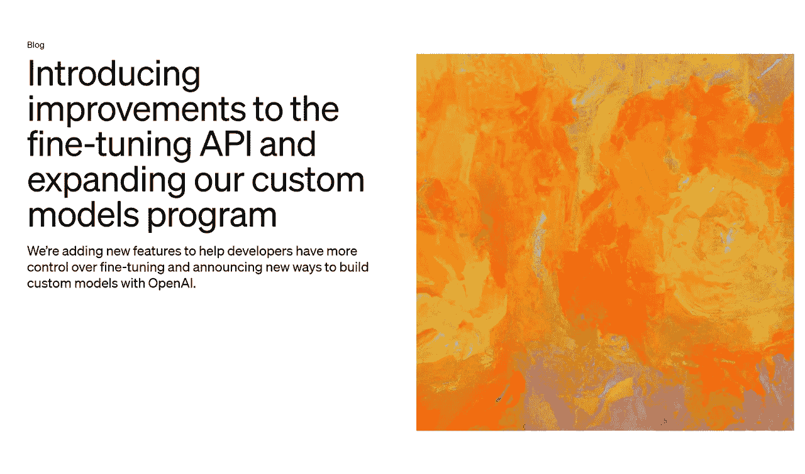
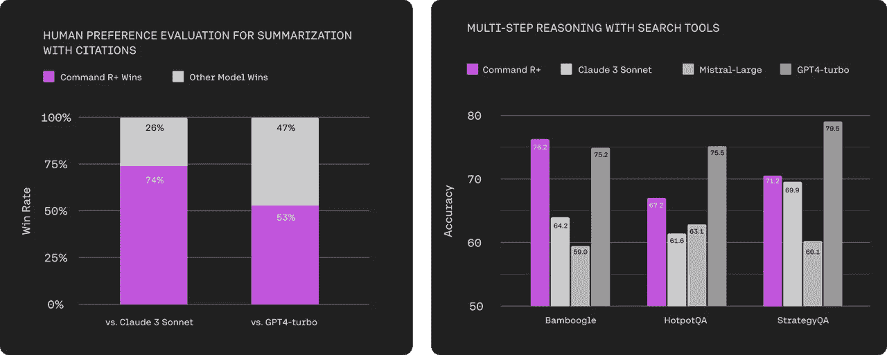
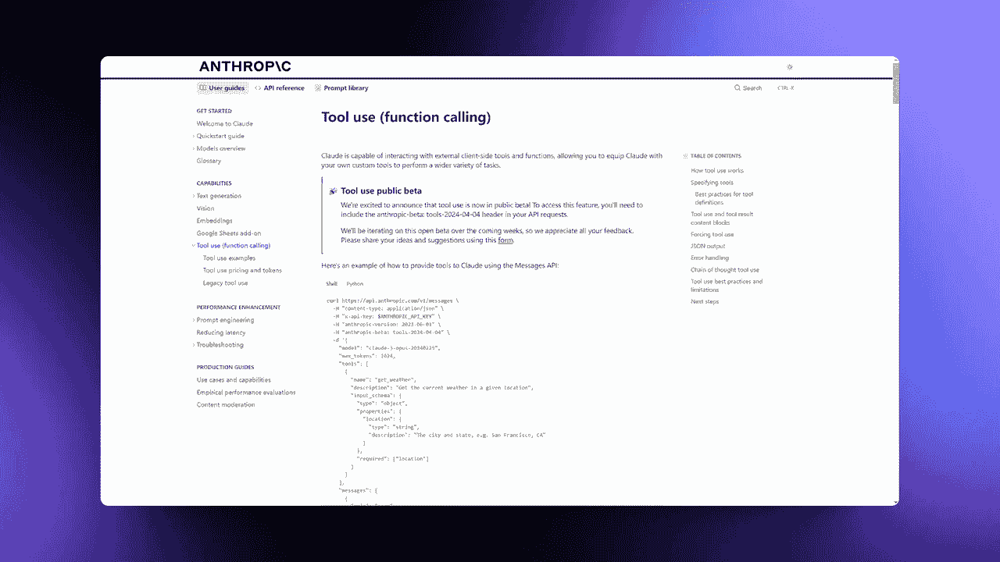
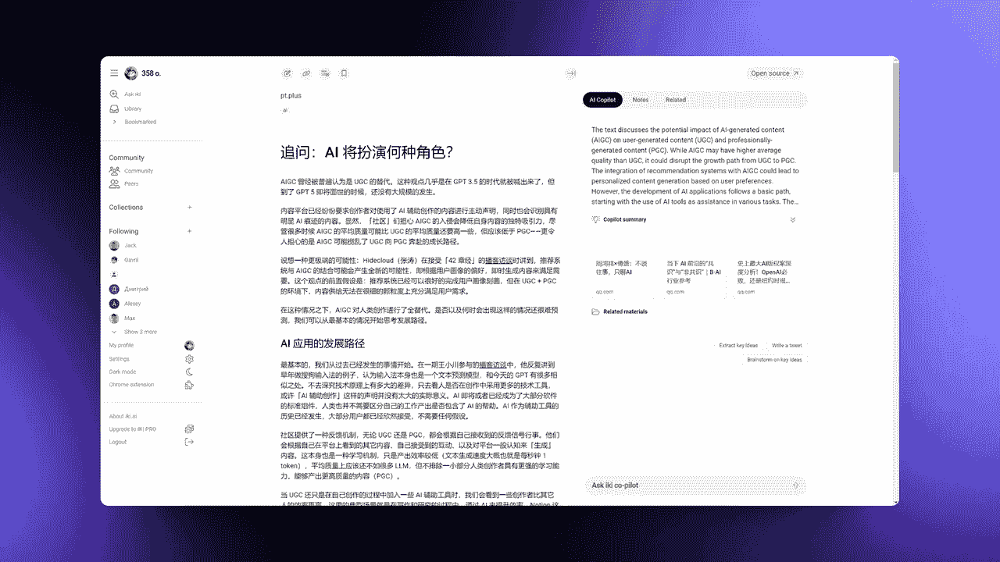
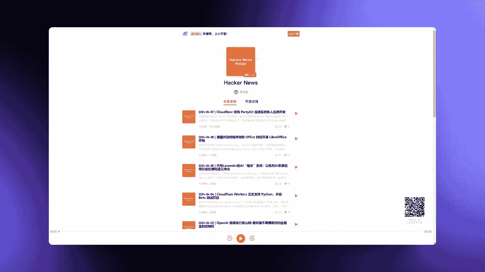
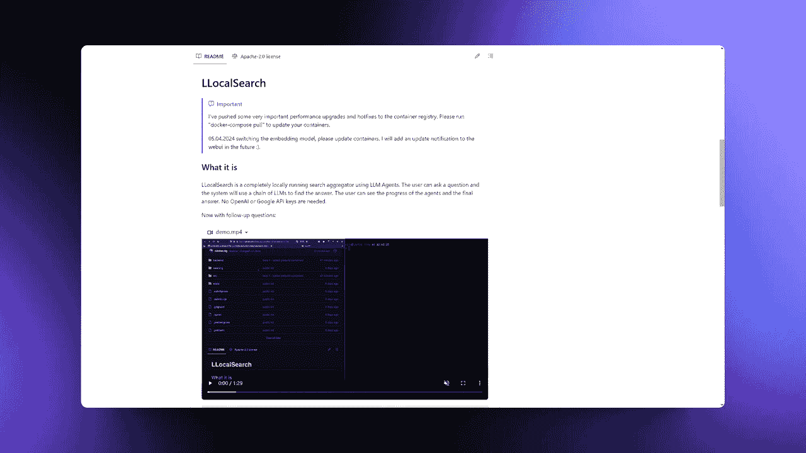
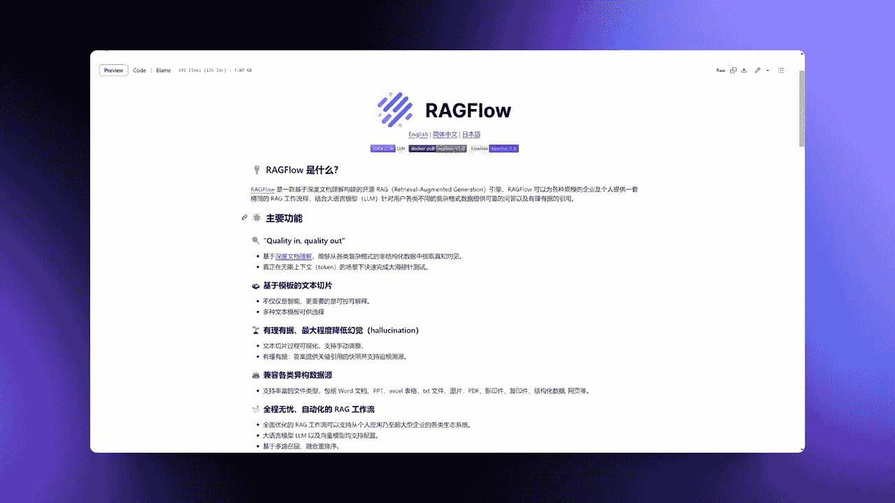
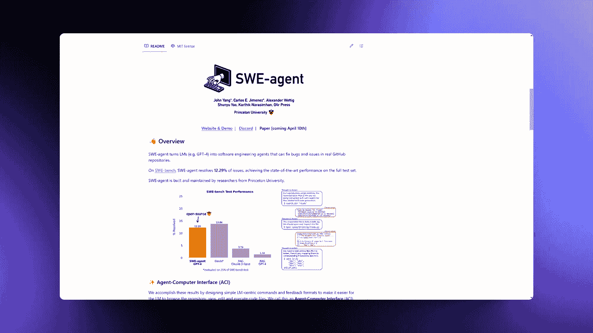
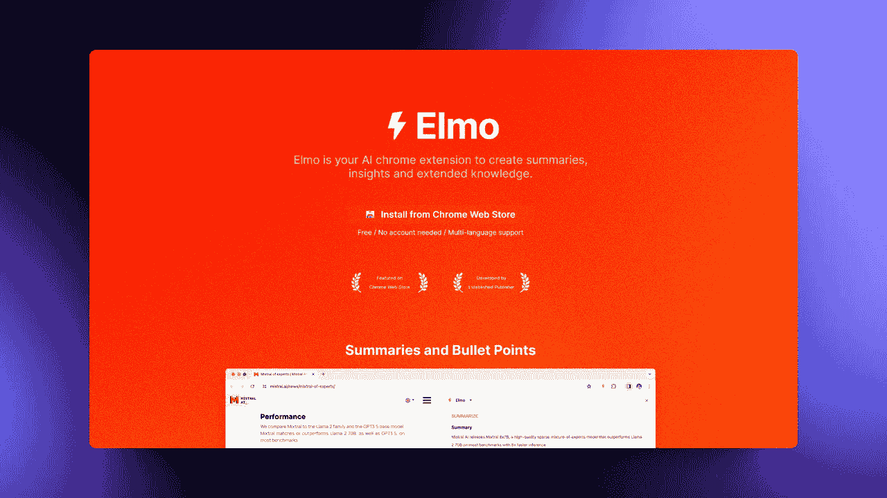

# AIGC Weekly #66

> 来源：[https://waytoagi.feishu.cn/docx/O4d6dBk3BoDHx3xIujxcHPQinFg](https://waytoagi.feishu.cn/docx/O4d6dBk3BoDHx3xIujxcHPQinFg)

> 🔗 原文链接： h[ttps://quail.ink/o](https://quail.ink/op7418/p/aigc-weekly-66)p7418/p/aigc-wee...

> 作者：[歸藏](https://quail.ink/u/1833)

Midjourney提示词：smooth blurry dark blue gr[adient --ar ](https://catjourney.life/)16:9 --style raw --stylize 0 💎查看更多风格和提示词

# 上周精选 ✦

## [Open AI 发力模型定制](https://openai.com/blog/introducing-improvements-to-the-fine-tuning-api-and-expanding-our-custom-models-program)

OpenAI又有动作了，推出了一系列新功能和程序，让开发者在微调和创建定制模型时有更多的控制权和灵活性。

**主要功能包括：**

+   在每个训练周期中保存完整的微调模型检查点，这可以显著减少后续重训练的需要，尤其是在模型出现过拟合时尤为重要。

+   引入了一种全新的并排比较式Playground界面，它允许开发者在单个提示下，直观地比较和评估不同模型或微调状态的输出质量和性能。

+   支持与第三方平台（本周起首先与Weights and Biases合作）集成，使开发者能够将详细的微调数据与他们使用的其他技术栈共享。

+   每个训练周期结束时，将通过验证数据集（而非之前的样本批次）计算得到的性能指标，如token损失和准确率，从而更好地展示模型性能并提供关于模型泛化能力的反馈。

+   现在，开发者可以直接在Dashboard上配置可用的超参数，而不再局限于仅通过API或软件开发工具包（SDK）进行设置。

+   对微调Dashboard进行了多项改进，包括配置超参数的功能，查看更详细的训练度量，以及能够根据先前的配置重新运行任务。

## Cohere推出了大型语言模型Command R+

专为企业级工作负载设计，优化了高级检索增强生成(RAG)功能，以减少错误生成，并支持10种关键语言的多语言覆盖。

**详细信息：**

在 Command R+ 中，新增了多步骤工具使用功能，允许模型在多个步骤中结合多种工具来完成困难的任务。

Command R+ 甚至可以在尝试使用工具但失败时（例如遇到工具中的错误或故障时）进行自我纠正，使模型可以多次尝试完成任务，提高成功率。

Command R+ 针对高级 RAG 进行了优化，新模型提高了响应的准确性，并提供可减少幻觉的在线引用。

Command R+首先在Microsoft Azure上提供，不久后也将在Oracle Cloud Infrastructure (OCI)以及未来几周内的其他云平台上提供。

Cloud可以使用的工具由JSON模式表示，模型可以调用其中的任何工具，客户端可以将结果分发并返回。而且能够将多个不同的工具链接在一起完成任务，模型可以调用其他模型作为工具，帮助解决问题。

**在使用工具时的最佳实践包括：**

使用 Claude 3 Opus 模型进行复杂的工具操作，限制工具数量以保证准确性，简化复杂或多层的工具，并为连续使用工具设计工作流程。

**Anthrop**ic还发布了一种名为“ 多次尝试越狱 ”的技术，可以利用超长上下文的模型特性将对应的长提示对模型越狱。

多次尝试越狱”通过在单一提示中包含大量特定配置的文本，迫使LLMs产生可能有害的回应，尽管它们被训练为不这样做。研究表明，随着包含对话（“尝试”）数量的增加，模型产生有害回应的可能性增加。结合其他已发布的越狱技术，可以使这种技术更为有效，减少模型返回有害回应所需的提示长度。

这种越狱技术的有效性与“上下文中学习”（in-context learning）的过程有关，即LLM仅使用提示中提供的信息进行学习，而不需要任何后续的微调。研究发现，正常情况下的上下文中学习遵循与多次尝试越狱在增加的示例演示数量上相同的统计模式（幂律分布）。

了解详情：https://www.anthropic.com/research/many-shot-jailbreaking

# 其他动态 ✦

+   通义千问开源新的 [Qwen1.5-32B模型 ](https://huggingface.co/Qwen/Qwen1.5-32B)，在语言理解、支持多语言、编程和数学能力方面表现出色。

+   苹[果许多标志性产品背后的著名](https://www.theverge.com/2023/9/27/23892135/jony-ive-sam-altman-ai-device-openai-ceo-apple-designer)设计师 Jony Ive 和 OpenAI 首席执行官 Sam Altman 正在合作开发一个 突破性的 AI 硬件项目 。

+   OpenAI 使用了 超过 100 万小时的 YouTube 视频 转录来训练其最先进的大型语言模型 GPT-4。这是他们收集高质量训练数据工作的一部分，这些数据对于开发和改进 GPT-4 等人工智能模型至关重要。

+   OpenAI 首席执行官山姆-奥特曼（Sam Altman）已 放弃对 OpenAI 初创基金的控制权 ，将正式控制权移交给伊恩-哈撒韦（Ian Hathaway）。

+   Stability AI还推出了 Stable Audio 2.0 。它不仅能从一个简单的提示生成高质量的完整音轨，还拥有连贯的音乐结构，最长可达三分钟。

+   D[ALL-E](https://x.com/op7418/status/1775352473106182374)3 终于也有局部重绘了。试了一下重绘的效果很精准，跟原图的融合度也很好，起码比 Midjoureny 的好用很多。 我的体验。

+   [Pixverse 上线了](https://app.pixverse.ai/login)只需要一张图片就可以 生成 ID 一致的视频 ，目前只支持真实风格的文生视频。

+   Adobe 推出了 Adobe Express GPT ，可以在 ChatGPT 中直接用对话创建营销图片素材。

+   上周Open AI宣布无需注册就可以 在 Chatgpt 使用 gpt3.5 。

+   Assemblyai发布了一个新的 语音识别模型 Universal-1 ，比Whisper Large-v3更准确，比fast Whisper更快。

# 产品推荐 ✦

## [Midreal：AI小说生成](https://midreal.ai/?ref=gz)

最近发现之前推荐过的 Midreal AI 互动小说游戏更新了网页版本，不需要在 Discord 里面使用了。

这次升级非常强大，Midreal已经不只是小说生成工具，正在朝着互动式内容消费平台进化。

每句都能生成图片之后，比之前到分支的时候才生成会强非常多，图片从原来的DALL-E3 变成了他们自己训练的 SD 模型，图像质量和提示词遵循都比之前强很多。

除了支持生成图片之外，现在网页版的Midreal分享功能也非常好用，分享出去就是一个带插图的完整小说页面，阅读体验很不错，还有评论和转发能力。

他们自己训练的图像模型现在也有一个专门的页面可以使用，只用来生成图片也是可以的。

## [IKI：RAG驱动的内容收藏](https://app.iki.ai/ask)

终于有产品能够用AI重新思考和构建稍后阅读和内容收集工具了。iki这个笔记工具非常强大，你不需要整理自己收藏的内容一切都交给AI来完成。它可以处理你收集的大量杂乱、非结构化数据，让应用程序为你组织和显示信息，而不必你自己动手。

**主要功能有：**

+   自动提取和总结

+   自动在聊天和任何现有笔记中显示相关数据

+   为任何文件添加个人注释

+   与团队共享数据集合

+   关注社区其他人创建的合集和阅读内容

我的体验视频：https://x.com/op7418/status/1776139198988497144

## Hacker News：完全AI驱动的中文科技播客

一个完全由AI驱动的中文播客，每天总结Hacker News热门的前十条信息。TTS语音现在是真的自然语言类节目基本不需要人口播了。

## LocalSearch：开源的完全本地化的AI搜索工具

LocalSearch 一个开源的完全本地化的AI搜索工具，无需 OpenAI 或 Google API 密钥。过去24小时增长了一千颗星星。感兴趣的话可以部署一下试试。

**项目特点：**

完全本地化运行，不需要连接到外部API，因此无需API密钥。

适用于性能相对较低的大型语言模型硬件，例如在演示视频中使用的是7b模型。

提供详细的进度日志，这有助于用户更好地理解搜索和处理过程。

支持用户提出后续问题，以便深入探讨或解决问题。

界面对移动设备友好，适合在手机或平板电脑上使用。

使用Docker Compose工具，可以快速且轻松地部署此服务。

提供网络界面，使用户可以从任何设备轻松访问和使用。

该服务提供精心设计的用户界面，支持浅色和深色模式，满足不同用户的视觉偏好。

## RAG Flow：新的RAG开源框架

InfiniFlow开源的项目叫RAG Flow，有下面这些特点：

RAGFlow的核心功能是文档的智能解析和管理，支持多种格式，并允许用户使用任何大型语言模型查询他们上传的文档。

RAGFlow提供了多种智能文档处理模板，以满足不同行业和角色的需求，如会计、人力资源专业人员和研究人员。

它还强调了智能文档处理的可视化和可解释性，允许用户查看文档处理结果，进行比较、修改和查询。

RAGFlow的一个关键优势是它允许LLM以受控方式回答问题，提供了一种理性和基于证据的方法来消除幻觉。

## SWE-agent：类似AI 程序员Devin的项目

SWE-agent 将 LM（例如 GPT-4）转变为软件工程代理，可以修复真实 GitHub 存储库中的错误和问题。在完整的SWE-bench测试集上 SWE-agent 12.3 分只差了Devin一分Claude3 opus只有 3 分多。

**SWE-agent的一些特点：**

+   当发出编辑指令时，加入了一个代码检查器（linter）来运行，如果代码语法不正确，就不会执行该编辑指令。

+   为智能体提供了一个专门构建的文件查看器，这不仅仅是执行cat命令那么简单。这个文件查看器在每次仅展示100行内容时效果最佳。构建的文件编辑器配备了上下滚动和文件内搜索的命令。

+   还为智能体提供了一个专为全目录字符串搜索而设的命令。这个工具在简洁地列出搜索匹配结果时尤为重要，因此我们只列出了每个包含至少一个匹配项的文件。为模型展示每个匹配更多的上下文信息，反而会使模型感到困惑。

+   当某个指令没有任何输出时，会返回一条提示信息：“您的指令已成功运行，但并未产生任何输出。

## [Elmo：浏览器AI总结插件](https://www.elmo.chat/)

贾扬清公司出的AI总结插件，全部都用的开原生态的服务。模型使用的是 Mixtral 8x7b，Host 在LeptonAI上，所以速度飞快，HTML Parser用的mozilla/readability。

# 精选文章 ✦

## [**超入门级Lora训练教程-使用 **](https://civitai.com/articles/4789/lazy-lora-making-with-onetrainer-and-ai-generation)OneTrainer 轻松制作 LoRA

作者作为一名 LoRA 模型制作的新手,通过自己的学习实践,总结了一份简明扼要的制作教程。

这份教程不涉及太多理论知识,而是直奔主题,手把手教初学者如何训练自己的 LoRA 模型。

作者坦诚分享了自己从最初尝试 Embedding 和 LoRA 时遇到的问题,以及后来找到的解决方法,为读者提供了宝贵的经验参考。

所需工具介绍 要制作 LoRA 模型,需要准备一些必要的工具。作者推荐使用自己喜欢的模型和图像生成工具,他个人使用的是 StableSwarmUI 和 GhostXL 模型。

此外,还需要一个训练工具,作者选择了 OneTrainer,因为有人说它比另一个常用的工具 Kohya 更易用。作者还提到,训练时如果需要将 SDXL 格式的图像转换为 SD 格式,需要在设置中开启分辨率覆盖选项。

中文翻译：https://quail.ink/op7418/p/lazy-lora-making-with-onetrainer-and-ai-generation

## [Claude 3 提示词优化器](https://x.com/dr_cintas/status/1776625701401014446)

这个Claude 3提示优化提示词可以将简单的提示变成高级的提示模板。

我用这个提示词让他写一个将长文总结成推特的提示词真的不错，比简单写的提示词生成的内容效果好很多。

## CS25: Transformers United V4

斯坦福大学CS25课程将会向所有人开放，你可以通过Zoom接入直播参与课程。

英语好的人推荐看看，课程内容和讲师都很强。

这个课程主要会每周邀请Transformer研究的前沿专家，来分享他们在最新突破上的成就。比如英伟达、OpenAI以及Mistral AI的人。

内容涵盖从大型语言模型（如GPT和Gemini）到在艺术创作（比如DALL-E和Sora）、生物学和神经科学应用、机器人学等领域的创新应用。

## Models All The Way Down

非常详细的剖析 LAION-5B 这个图像数据集中的组成和实现方式，利用这个例子揭示了现在图像和 LLM 训练中存在的一些问题。

强烈建议看看，下面是里面的一些关键结果：

+   首先，算法式的内容筛选通常依赖于一些数字化的标准，而这些标准往往并没有被充分理解。

+   其次，关于AI训练数据集的编制过程存在一种内在的循环性问题。

+   模型之上有模型，训练集之上有训练集。

+   只有通过查看数据集，我们才能更好地了解人工智能模型的工作原理以及可能出现的差距、错误和偏见。

+   由于数据集选择的偏好，关于什么视觉效果吸引人这一概念，极可能受到少数个体品味的强烈影响，以及数据集创建者在策划数据集时所选择的流程。

## 什么是 GPT？ transformer的可视化介绍

3Blue1Brown大神非常好的一个演示视频，通过可视化清晰的介绍了 LLM 的核心 Transformer 架构的原理。

包括词嵌入、自注意力机制等关键技术。对了解GPT-3等大型语言模型的内部结构很有帮助。

中文翻译在这里：https://x.com/op7418/status/1775376278843191296

## ComfyUI 1600个节点详细介绍

发现个好东西，Salt 将 200 个 ComfyUI 官方节点和 1400 个第三方节点用 AI 分析并且制作了对应的文档。

你可以在文档里搜索节点，并且会展示节点的作用，以及节点每个选项的作用。还有节点的代码实现。

以后找不到节点或者不知道选项的作用可以去搜一下。

## [优化人机协作](https://uxpsychology.substack.com/p/optimising-human-ai-collaboration)

本文探讨了如何优化人工智能（AI）在写作过程中的协作，特别是通过“支架理论”（scaffolding theory）的视角。支架理论最初源于教育领域，旨在通过提供适时的支持和指导来帮助学习者掌握他们尚未能独立完成的技能。文章通过Dhillon等人（2024年）的研究，系统评估了不同级别的AI支架对写作质量、用户满意度、认知负荷和生产力等方面的影响。研究发现，与控制组相比，低级别的支架（如单句建议）降低了输出质量，而高级别的支架（如段落建议）显著提高了输出质量，尤其对非常规和技术不太熟练的写作者更为有益。然而，随着AI协助的增加，用户满意度和拥有感却呈现相反的趋势，尽管质量有所提高。

文章还强调了对用户体验（UX）专业人员的建议，包括了解用户的需求、设计能够适应不同用户专业水平的界面、实现个性化和定制化、逐渐调整AI支持的级别以及促进用户的主动性和拥有感。通过这些策略，我们可以显著提升用户体验，使AI工具不仅有用，而且在实现多样化活动目标中变得不可或缺。

## 万字复盘我的AI作品《Devices》| 解析AI创作中的变与不变

这篇文章是晨然在 VisonOS 开发者大会的作品 《Devices》实践经验分享。

作者探索了如何通过调整AI模型的提示词（prompt）来改善生成的图像质量。例如，使用“one blue phone, hand drawing, (clean background), flat color”这样的详细背景描述，可以帮助生成更干净、视觉上不干扰的单色调背景图像。作者还发现，添加如“clean background”这样的提示词可以显著改善背景的清晰度，但可能会牺牲动画的观赏性。此外，作者提到了一些特定的词汇，如“iphone, hand drawing, (clean background)”可以帮助避免生成图像中出现杂乱的线条和不成形的人物雏形。文章还提到了对模型进行调整，如限制数量（如“one iphone”）和使用特定模型（如“4xUltraSharp”）进行图像放大，以及如何通过调整权重来进一步优化结果。

这篇文章提供了一系列技巧和策略，用于指导AI创作中的变与不变，帮助创作者更好地控制AI生成内容的质量和风格。

# 重点研究 ✦

## [**InstantStyle: Free Lunch towards Styl**](https://github.com/InstantStyle/InstantStyle)e-Preserving in Text-to-Image Generation

InstantID作者的新项目，InstantStyle 风格保持项目发布，一个强化版的IPapadter。一定程度解决了风格泄露的问题，同时也避免了繁琐的权重调整。

**完整简介：**

+   无需调节的扩散式模型（diffusion-based models）在图像个性化和定制方面展现出了巨大潜力。

+   然而，即便如此，目前的模型在生成风格一致的图像时仍面临诸多挑战。首先，“风格”这一概念本身就难以界定，它包括颜色、材质、氛围、设计和结构等多种因素。

+   其次，基于反演的方法（inversion-based methods）容易导致风格的退化，这通常会导致细节的丢失。

+   最后，基于适配器的方法（adapter-based approaches）通常需要对每张参考图片进行精细的权重调整，以平衡风格的强度和文本的可控性。

+   在本论文中，我们首先探讨了一些重要但经常被忽视的观点。接下来，我们介绍了InstantStyle，这是一个框架，旨在通过两个关键策略来解决这些问题：

+   一是通过一个直观的机制，将风格和内容从参考图像中的特征空间（feature space）解耦，这是基于这样一个假设：同一空间中的特征可以相互加减。

+   二是只将参考图像的特征注入到专门处理风格的模块中，这样可以防止风格的泄露，同时也避免了繁琐的权重调整，这一问题通常出现在参数更多的设计中。

## 谷歌新论文Transformer可以动态分配计算资源

谷歌新论文Transformer可以动态分配计算资源。通过限制每层处理的token数量,网络可以灵活调整不同时间点和深度上的资源分配。这种方法训练的模型在性能上匹配基准,训练时间也相当。

**完整简介：**

+   在语言模型领域，Transformer通常将计算资源（即FLOPs）均匀地分布到输入序列的每一个部分。

+   然而，我们的研究显示，Transformer实际上能够学会动态地调配这些计算资源，针对序列中的特定部分进行优化分配，同时在模型不同层级上也进行调整。

+   我们的方法是通过限制每一层能参与自注意力和MLP（多层感知器）计算的token（词元）的数量（即k个）来控制总体计算资源。哪些token会被处理是由网络通过一种“top-k”机制来决定的

+   这个程序的一个特点是，尽管k个token是提前确定的，但它们具体是哪些却是可变的，因此我们的方法可以在不同时间点和模型深度上灵活地分配计算资源。

+   这样，虽然总体的计算资源是固定的，但在每个token的层面上却是动态且根据上下文变化的。

+   最重要的是，以这种方式训练的模型不仅能高效地动态分配计算资源，而且在性能上能够匹配基准模型，同时在训练时间上几乎相当。

+   更令人印象深刻的是，在前向传播时这些模型所需的FLOPs只有一小部分，并且在训练后的采样阶段速度可以提升高达50%。

## [**Cross-Attention Makes Inference Cumb**](https://arxiv.org/abs/2404.02747)ersome in Text-to-Image Diffusion Models

非常有意思的研究，通过计算出，交叉注意力（cross-attention）的输出会趋向于一个固定点。然后在保真度提升阶段忽略文本条件不仅可以减少计算的复杂性。还提出了TGATE这种简单而无需训练的方法，用于高效地生成图像。TGATE的做法是，一旦交叉注意力的输出达到收敛，就将其缓存下来，并在剩余的推理步骤中保持不变。

**完整简介：**

在文本到图像的扩散模型中，交叉注意力是一个关键组件，它在模型的初期推理步骤中发挥着重要作用。然而，研究表明，交叉注意力的输出在经过几个推理步骤后会收敛到一个固定点，这一点自然地将整个推理过程分为两个阶段：语义规划阶段和保真度提高阶段。在语义规划阶段，模型依赖交叉注意力来规划以文本为导向的视觉语义；而在保真度提高阶段，模型则尝试根据先前规划的语义生成图像。令人惊讶的是，在保真度提高阶段忽略文本条件不仅可以降低计算复杂性，而且还能保持模型性能。

## [**C**](https://hehao13.github.io/projects-CameraCtrl/)ameraCtrl: Enabling Camera Control for Text-to-Video Generation

上海人工智能实验室发布了可以给 Animatediff 增加相机控制的项目CameraCtrl。哈哈 这下 Animatediff 的含金量还在提高。

**项目简介：**

CameraCtrl，这是一个可以在文本到视频（T2V）模型中实现精准摄像机姿态控制的新工具。

在对摄像机轨迹进行精确参数化后，我们在 T2V 模型中训练了一个可随时加入使用的摄像机模块，而不影响其他组件的工作。

此外，我们还对不同数据集的影响进行了全面研究，发现具有不同摄像机角度和相似视觉风格的视频确实可以提高系统的可控性和适应性。

实验结果表明，CameraCtrl 在实现精确的领域适应摄像机控制方面表现卓越，这在利用文本和摄像机姿态输入来创造动态、个性化的视频叙事领域里是一大进步。

## [**Getting it **](https://spright-t2i.github.io/)[**Right **](https://spright-t2i.github.io/)[**:**](https://spright-t2i.github.io/) Improving Spatial Consistency in Text-to-Image Models

Hugging 和 英特尔发布了提高文生图模型空间一致性的方案，大幅提高了模型对提示词中空间关系的理解能力。还有一个详细标注了空间关系的 600 万张图片的数据集，模型和数据集都会开源。

**完整简介：**

当前将文字描述转换为图像的技术（T2I）面临一个关键短板，那就是它们往往无法精准地生成与文字提示中所描述的空间关系相符的图像。

在本文中，我们全面调查了这一限制，并开发了一些数据集和方法，以此达到行业领先水平。

首先，我们发现目前的图文数据集对空间关系的表达不够充分。为了解决这个问题，我们创建了SPRIGHT——第一个专注于空间关系的大规模数据集，方法是重新标注了来自四个广泛使用的图像数据集的600万张图片。

经过三重评估和分析，我们发现SPRIGHT在捕捉空间关系方面大幅超越现有数据集。我们仅使用约0.25%的SPRIGHT数据，就在制作空间准确的图像方面取得了22%的提升，并且在FID（图像质量评分）和CMMD（跨模态匹配度评分）上也有所改进。

其次，我们还发现，在包含大量物体的图像上进行训练，可以显著提高图像的空间一致性。特别地，我们在少于500张图片上进行微调后，在T2I综合比赛平台（T2I-CompBench）上达到了0.2133的空间得分，创造了新的最高记录。

最后，通过一系列严格的实验和测试，我们记录了多项发现，这些发现有助于深入理解影响文字描述转换为图像技术在空间一致性方面的各种因素。

## [**D**](https://arxiv.org/abs/2403.19928)iJiang: Efficient Large Language Models through Compact Kernelization

华为的一个项目通过频域核化和加权准蒙特卡洛采样,大幅降低训练成本,加快推理速度,同时保持与原模型相似性能。

使用这个方法训练出的DiJiang-7B模型在多个基准测试中的表现与LLaMA2-7B相媲美，但其训练成本只有后者的约1/50。

## [**Tr**](https://arxiv.org/abs/2403.20041)ansformer-Lite: High-efficiency Deployment of Large Language Models on Mobile Phone GPUs

OPPO 发布了一种移动推理引擎Transformer-Lite，专为在手机上高效部署大型语言模型设计。

通过符号表达式、算子优化、FP4量化和KV缓存技术克服移动设备性能限制，显著提升智能助手、文本摘要等应用的推理速度。

**完整简介：**

Transformer-Lite是由OPPO AI Center开发的一种移动推理引擎，专门用于在移动设备的GPU上高效部署大型语言模型（LLM）。

该引擎通过一系列优化技术，实现了与Qualcomm和MTK处理器的兼容性，从而能够在智能手机上提供智能助手、文本摘要、翻译等功能，改善用户体验。

Transformer-Lite通过提出四种优化技术来解决挑战：

(a) 基于符号表达式的方法支持动态形状模型推理

(b) 算子优化和执行优先级设置以提高推理速度和减少手机延迟；

(c) 引入FP4量化方法M0E4减少量化开销；

(d) 子张量技术消除LLM推理后KV缓存复制的需要。

## [**A**](https://mmstar-benchmark.github.io/)re We on the Right Way for EvaluatingLarge Vision-Language Models?

上海人工智能实验室发布了一套多模态 LLM 视觉评价体系MMStar。他们还利用这套评价体系对现在的多模态 LLM 进行了评价产出了对应的排行，GPT-4V 还是毫无疑问的第一。但即使是 GPT-4 在这个体系中也没有及格，多模态还有很长的路要走。

**完整简介：**

MMStar包含1500个经过人工精心挑选的高质量多模态评估样本，旨在全面评估视觉语言模型在6个核心能力和18个具体维度上的多模态能力。

在MMStar上，GPT-4V的高分辨率版本表现最佳，准确率达到57.1%。但在细粒度感知、逻辑推理、科学技术和数学等能力上，所有模型的表现都未达到令人满意的水平。

值得一提的是，小模型TinyLLaVA-3B的表现出乎意料地好，超过了一些7B和13B的模型，凸显了小规模视觉语言模型的潜力。

还提出了两个新的评估指标：多模态收益(MG)和多模态泄漏(ML)。MG衡量视觉语言模型从多模态训练中获得的实际性能提升，而ML衡量评估样本在多模态训练过程中的泄漏程度。

## [ReFT： 语言模型的表征微调](https://arxiv.org/abs/2404.03592v1)

本文的作者来自斯坦福大学，他们提出了一种新的语言模型微调方法，称为表示微调（ReFT）。这种方法旨在通过操作模型的隐藏表示来适应新任务，而不是调整模型权重，从而提高参数效率和性能。

+   **表示微调（ReFT）方法 **：
ReFT方法通过在冻结的基础模型上学习特定于任务的干预来操作隐藏表示。这些方法直接受到最近关于LM可解释性的工作的启发，这些工作通过干预表示来寻找可靠的因果机制，并在推理时引导模型行为。

+   **Low-rank Linear Sub**space ReFT (LoReFT) ：
LoReFT是ReFT家族中一个强大且高效的实例，它通过在低秩线性子空间中干预隐藏表示来实现。LoReFT在多个标准基准测试中与现有的PEFT方法相比，使用更少的参数同时实现了最先进的性能。

+   **实验评估与结果 **：
LoReFT在常识推理、算术推理、指令遵循和自然语言理解等多个领域的20多个数据集上进行了评估。实验结果显示，LoReFT在所有这些评估中都提供了效率和性能之间最佳平衡，并且在几乎所有情况下都优于最先进的PEFT方法。