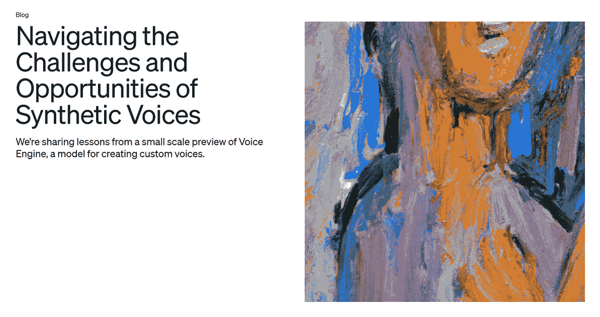
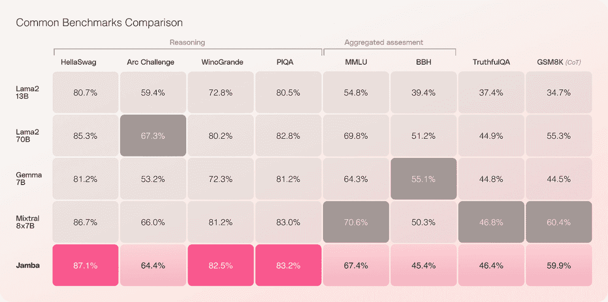
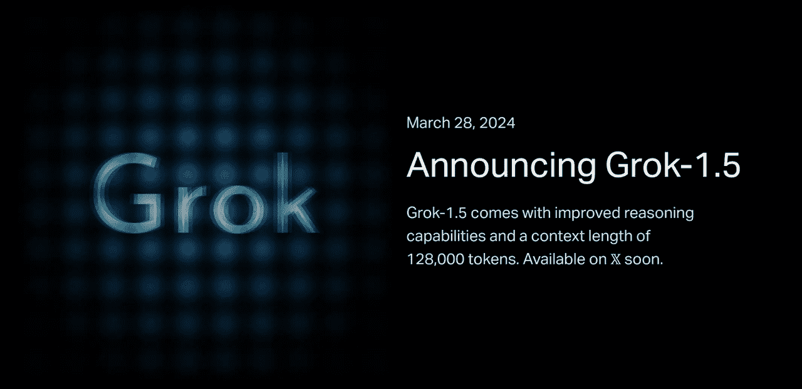
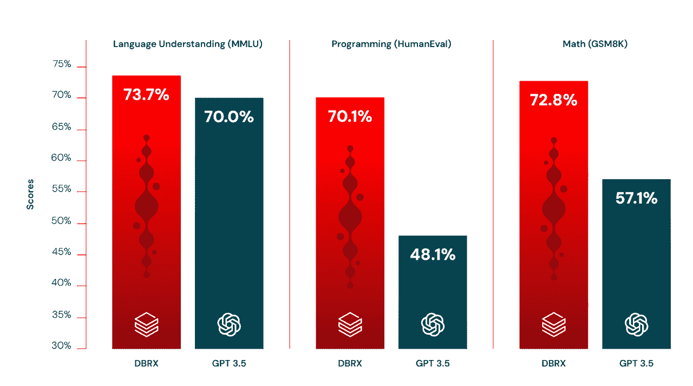
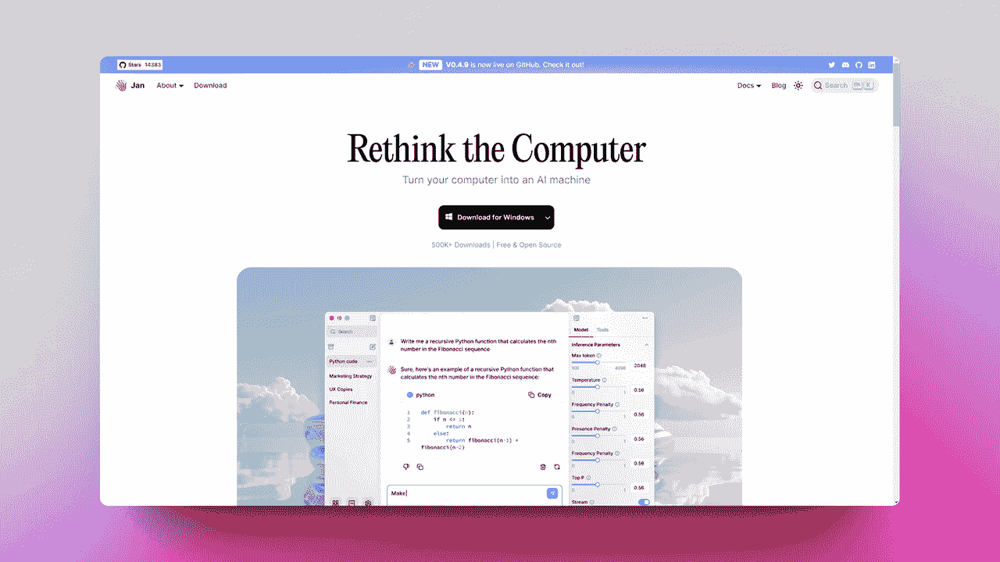
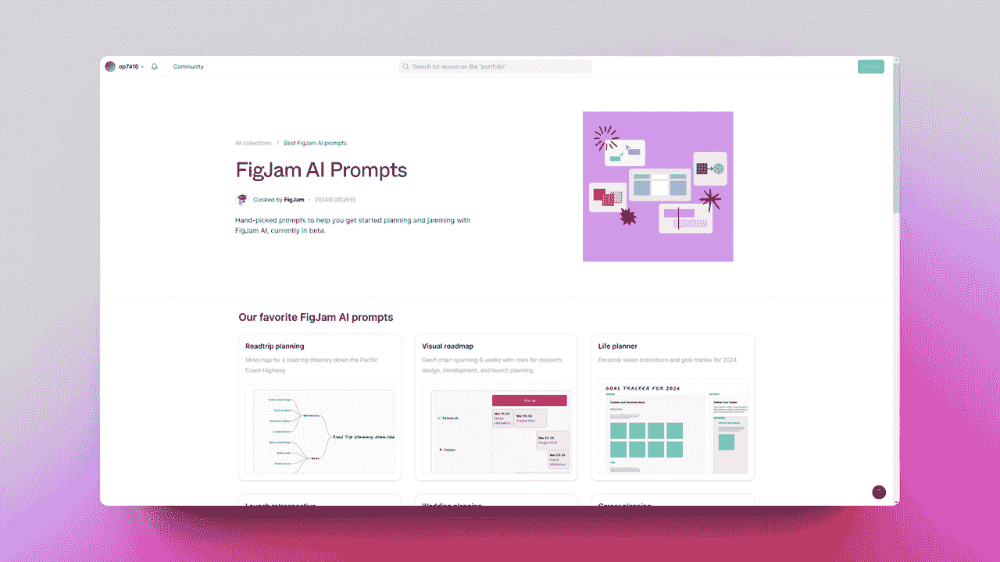

# AIGC Weekly #65

> 来源：[https://waytoagi.feishu.cn/docx/XcdIdJVd1o1Kbcxp66TcjjJunNf](https://waytoagi.feishu.cn/docx/XcdIdJVd1o1Kbcxp66TcjjJunNf)

> 🔗 原文链接： https://quail.ink/op7418/p/aigc-weekly-65

> ⏰ 发布时间：2024-04-01

> 作者：[歸藏](https://quail.ink/u/1833)

Midjourney提示词：closeup[** photo of an**](https://catjourney.life/) amorphous blob of metallic iridescent liquid floating in a minimal white void with particles of minerals suspended around , realistic materials, hyper-realistic rendering, depth of field, --ar 16:9 --style raw --stylize 0 💎查看更多风格和提示词

# **上周精选 ✦**

## Open AI 发布了语音克隆方案及Sora艺术家测试视频

多模态的任何一环Open AI都想做啊，这个语音克隆的功能也上了，声音和面部以及身体数据是未来内容生产能力爆炸之后，每个人线上线下自我认同的纽带。

OpenAI 正在开发一个名为 Voice Engine 的模型,它可以使用文本输入和一个 15 秒的音频样本生成与原始说话者非常相似的自然语音。他们目前正在与一小群可信赖的合作伙伴进行小规模测试,以更好地了解该技术的潜在用途[。一些早期的应用包括:

+   为非读者和儿童提供阅读辅助,使用更广泛的说话者的自然、富有情感的声音。

+   翻译视频和播客等内容,让创作者和企业能够用自己的声音流利地接触全球更多人。

+   在偏远地区改善基本服务,用每个社区卫生工作者的主要语言提供互动反馈。

+   为非语言障碍者提供支持,如为影响语言能力的个人提供治疗应用。

+   帮助患有突发或退行性语言障碍的患者恢复语言能力。

OpenAI 认识到生成类似人声的语音存在严重风险,因此正在与各方合作伙伴接触,以确保在开发过程中吸收他们的反馈。他们还实施了一系列安全措施,包括水印和主动监控。

另一件事是Open AI发布几位艺术家和创意人员使用 OpenAI 的新模型 Sora 的初步体验和感受。

视频可以在这里查看：[https://openai.com/blog/so](https://openai.com/blog/sora-first-impressions)ra-first-impressions

## AI21 Lab 推出了一种新的 LLM 架构 Mamba

AI21 Lab 推出了一种新的 LLM 架构 Mamba，同时发布的还有基于这个架构的模型 Jamba。模型将会开源。

Mamba是一款创新的结构化状态空间（SSM）模型，其设计目的是为了克服传统Transformer架构的限制，但它本身也存在一些不足。而Jamba则结合了这两种技术的优点。

**Jamba模型的特点：**

+   首个基于创新SSM-Transformer混合架构的生产级Mamba模型

+   与Mixtral 8x7B相比，在长文本上的吞吐量提高了3倍

+   模型支持高达256K的大规模上下文窗口，使更多用户能够访问和使用

+   是其大小类别中唯一一个能在单个GPU上适应高达140K上下文的模型

+   以开放权重在Apache 2.0下发布

+   可在Hugging Face上获取，并即将登陆NVIDIA API目录

## X AI 发布了Grok-1.5更新

X AI 发布了Grok-1.5更新，具有更好的图里能力及 128K 的上下文长度。马斯克还说普通的 Premium 用户马上也可以使用 Gork 了。

**详细介绍：**

+   Grok-1.5 在编码和与数学相关的任务中的性能得到了显著改善。Grok-1.5 在 MATH 基准测试中获得了 50.6%的分数，在 GSM8K 基准测试中获得了 90%的分数。

+   Grok-1.5 的一个新功能是能够在其上下文窗口内处理长达 128K 个标记的上下文。这使得 Grok 的内存容量增加了先前上下文长度的 16 倍，使其能够利用来自更长文档的信息。

+   基于 JAX、Rust 和 Kubernetes 的自定义分布式训练框架构建的 Grok-1.5，为先进的大型语言模型（LLMs）研究提供了强大而灵活的基础设施。

+   还将在未来几天发布几个基于 Gork 的新功能。

## Hume 发布第一个可以感知对话者情绪的语音 AI EVI

Hume 发布第一个可以感知对话者情绪的语音 AI EVI。而且可以跟任何 LLM 兼容。

**EVI有下面的一些特点：**

它能根据你的表情用类似人类的语调回应。

对你的表情作出反应，用符合你需求、能极大提升满意度的语言进行交流。

EVI 能够判断什么时候说话，因为它能通过你的语调精准探测谈话是否结束。

如果被打断，它会暂停，但随时能从停下的地方继续。

通过不断学习你的反应并自我完善，EVI 能让你越来越快乐。

## Databricks 发布了新的可能是现在最强的开源模型 DBRX

**模型架构：**

132B参数的MoE模型，一共拥有16个专家，每个Token激活4个专家，意味着有36B的活跃参数，Mixtral只有13B的活跃参数（少了近3倍）。

**性能表现 ：**

它在语言理解、编程、数学和逻辑方面轻松击败了开源模型，如 LLaMA2-70B、Mixtral 和 Grok-1

DBRX 在大多数基准测试中超过了 GPT-3.5。

DBRX 是基于 MegaBlocks 研究和开源项目构建的专家混合模型（MoE），使得该模型在每秒处理的标记数量方面非常快速。

**数据训练：**

以12万亿Token的文本和代码进行预训练，支持的最大上下文长度为32k Tokens。

## [**国内LLM的新参赛者阶越星辰**](https://stepchat.cn/chats/83384625128837120)

上周六又一家叫阶跃星辰的公司加入了大语言模型的战场。

发布了一个千亿参数（100B）多模态大语言模型 Step-1， 同时还发布了对应的聊天机器人产品跃问和类似 C AI 的陪伴型应用冒泡鸭。

多模态大语言模型 Step-1：

一个 100B 左右参数量的多模态大语言模型，支持图像、视频、音频的理解。支持联网搜索以及超长上下文窗口（演示用的时间简史，但是没说具体多长）。

据说还有 1000B 的多模态 MOE 模型 Step-2 可以提供有限的预览，需要申请。

**聊天机器人产品跃问：**

整体比较简洁，功能类似之前的 kimi，支持图片上传以及文档上传，支持联网搜索，我用自己常用的提示词试了一下，生成的内容可读性和逻辑不如 Kimi 。

**陪伴型应用冒泡鸭：**

就是正常的类似 C AI的应用，可以选择对应角色的智能体对话，没有类似星野的集卡机制。一个比较好的交互是在对话结束后智能体会主动给出可选择的回复比单纯的打字要方便很多。

# **其他动态 ✦**

+   [C](https://x.com/OpenAI/status/1773738074041717109?s=20)hatGPT 又把前段时间弱化的链接来源加强了：https://x.com/OpenAI/status/1773738074041717109?s=20

+   H[e](https://x.com/HeyGen_Official/status/1773119891068883240?s=20)yGen 趁着昨天那个 AI 广告产品的视频，发了他们的Avatar in Motion 1.0，可以生成户外走动的数字人：https://x.com/HeyGen_Official/status/1773119891068883240?s=20

+   GPTs 开始尝试分成了，如果你没办法保证自己的账号不[被](https://x.com/OpenAI/status/1773032605002203559?s=20)封的话最好不要在这个上面花费较多时间：https://x.com/OpenAI/status/1773032605002203559?s=20

+   S[t](https://stability.ai/news/introducing-stable-code-instruct-3b)ability AI 开源了Stable Code 3B代码模型的升级版本Stable Code Instruct 3B：https://stability.ai/news/introducing-stable-code-instruct-3b

+   L[L](https://x.com/lmsysorg/status/1772759835714728217?s=20)M竞技场 ELO 机制评分下Claude-3 Opus 正式超过了 GPT-4 的最新版本，成为最强 LLM：https://x.com/lmsysorg/status/1772759835714728217?s=20

+   [部](https://x.com/btibor91/status/1772389053767332231?s=20)分GPT Plus的用户GPT-4使用量限制被放开了：https://x.com/btibor91/status/1772389053767332231?s=20

+   Mistral开源了Mistral 7B[的](https://x.com/marvinvonhagen/status/1771609042542039421?s=20)新版本Mistral 7B v0.2：https://x.com/marvinvonhagen/status/1771609042542039421?s=20

# **产品推荐 ✦**

## Adobe GenStudio：AI驱动的品牌营销内容创建工具

Adobe  推出了 Adobe GenStudio，汇集了营销人员在跨渠道活动中所需的工具。

基于生成式人工智能构建，帮助营销团队在多个平台上轻松地规划、制作、管理、发布和评估与品牌形象一致的内容。

GenStudio 的核心功能包括：

1.  创作：通过 Adobe 的 AI 技术，营销人员可以迅速制作出高品质的品牌内容，这些内容都是基于经过品牌认证的模板，并受到 AI 技术的保护，确保品牌形象不受损害。

1.  内容中心：该平台提供了一个直观的界面，让营销人员可以方便地搜索、编辑、重复使用和分享营销活动的素材。

1.  活动管理：GenStudio 提供了一个集中的活动概览，包括活动简介和活动时间表，使得活动策划过程更为高效。

1.  发布：该产品与 Adobe Experience Cloud 的多个产品（如 Journey Optimizer、Experience Manager、Marketo 和 Target）实现了无缝集成，并且可以轻松导出到其他第三方应用。

1.  数据洞察：营销人员可以实时了解内容在不同渠道的使用情况和效果，通过 AI 技术生成不同的内容版本，进而提升活动的效果。

## Miraa： AI驱动的语言跟读学习

Miraa是一个利用人工智能技术为媒体生成双语字幕和学习材料的应用。设计和体验都非常好。

它具有以下特点:

+   使用AI将媒体转录为字幕[

+   根据指示器和你的节奏生成同步的配音

+   可以与AI聊天,解答你的问题

+   将字幕实时翻译成你的语言

## [**Jan： 本地LLM聊天软件**](https://jan.ai/)

一个全平台的本地 LLM 聊天软件Jan，支持自动下载模型以及非常详细的设置。懒得配置 Ollama 的可以试试。

除了支持本地模型以外，在线的模型可以使用 API 接入，All in one  的模型管理。交互和 UI 也都很合理。

同时支持在系统的任何可以输入的地方调取模型能力。

## [**FigJam AI 提示词**](https://www.figma.com/community/collections/best-figjam-ai-prompts)

精选的启发性提示，助你轻松开启与正在测试中的FigJam AI的规划和创作之旅。

## Terra：由 AI 设计的袖珍指南针

非常离谱的硬件：TERRA是一种专为有意识漫游而设计的伴侣。它结合了AI的科学和正念的智慧，TERRA是一个令人难以置信的口袋大小指南针，让您在漫游时不会迷路。 每一次旅程都始于一个提示。TERRA的复杂AI将您的意图、可用时间和准确位置转化为量身定制的GPS坐标路线。

## LLM训练器 - 自动从提示进入微调模型

该项目的目标是探索一种实验性的新流程，以训练一个高性能的任务特定模型。试图抽象出所有的复杂性，使得从想法到性能良好的完全训练模型尽可能简单。

只需输入任务描述，系统将从头开始生成数据集，将其解析为正确的格式，并微调 LLaMA 2 或 GPT-3.5 模型。

# **精选文章 ✦**

## 三种专家混合模型 (MoE) 的简短教程

关于三种类型的专家混合模型 (Mixture of Experts, MoE) 的简短教程，包括预训练的 MoE、升级的 MoE 和 FrankenMoE。作者还提供了推荐的论文列表，可以去原贴查看。

## [**迈向 1 bit机器学习模型**](https://mobiusml.github.io/1bit_blog/)

Mobius Labs 关于1bit量化LLM的探索，探讨了使用HQQ+对预训练模型进行极低位(2位和1位)量化的细节。

结果表明,即使在1位量化下,在HQQ量化模型的基础上仅训练一小部分权重,输出质量也会显著提高,超过了更小的全精度模型。

接对Llama2-7B等小模型应用1位量化会产生次优结果。但经过微调后,其输出质量会大幅提升。

对于2位量化,当给予更专业的数据时,模型表现会非常出色。事实上,使用HQQ+的Llama2-7B 2位基础模型在wikitext上的表现超过了全精度模型。

## [**如何对大语言模型的质量进行评估**](https://hamel.dev/blog/posts/evals/)

一篇写的非常好的文章，详细介绍了如何对大语言模型的质量进行评估。流程包括单元测试、人工评估、模型评估和 A/B 测试,强调快速迭代和数据管理的重要性。一个好的测试流程是模型进步的必要条件，如果没办法准确测试模型质量，就没办法帮助模型进步。

## Mistral 傻瓜式微调（具有 16k、32k、128k+ 上下文）

一个讲的很细的大语言模型微调教程，详细介绍了整个流程,包括数据准备、参数设置、资源监控等关键步骤。

基本没有技术能力也可以完成微调。想要了解 LLM 原理的可以按这个实践一下。

## OpenAI 前研究员 Karpathy 访谈

Stephanie Zhan  对  OpenAI 前研究员 Karpathy 进行了访谈。谈论内容有 LLM 操作系统、创业公司如何同大公司竞争、从马斯克那里学到了什么、对AI未来的展望等。只能说还得是安德烈，半小时的内容比 Sam 两小时的采访有效信息多多了。

[我](https://x.com/op7418/status/1773194599756173716?s=20)翻译了视频并且整理了文字版本感兴趣可以看看：https://x.com/op7418/status/1773194599756173716?s=20

## 吴恩达：关于 AI Agents 的看法以及设计模式

当前的AI agent主要有四种设计模式。

第一种是自反,即让语言模型自己检查和修正生成的内容,比如代码;

第二种是工具使用,语言模型可以使用各种工具进行分析、信息获取和行动;

第三种是规划,语言模型可以自主地制定计划,执行一系列步骤以完成复杂任务;

第四种是多智能体协作,通过prompt让同一语言模型扮演不同角色,互相配合完成任务。

这四种设计模式极大地拓展了语言模型的能力边界。

中文翻译：[h](https://x.com/op7418/status/1773245031350149168?s=20)ttps://x.com/op7418/status/1773245031350149168?s=20

## ComfyUI IPadapter Plus v2官方教程

ComfyUI IPadapter Plus作者发布了更新后的插件的教程，此次IP Adapter更新幅度较[大](https://x.com/op7418/status/1772482896831602884?s=20),新版本与之前的工作流不兼容。用户需要使用新的节点来重建自己的工作流,视频后面的内容将介绍新节点的使用方法。中文翻译：https://x.com/op7418/status/1772482896831602884?s=20

## [**Claude 3 Opus + **](https://x.com/9hills/status/1772467763165958602?s=20)ChainForge 提升提示词编写效率

Claude 3 Opus + ChainForge，明显提升了 Prompt 编写效率。工作流：

1.  手动编写测试用例种子和原始 Prompt。

1.  让 Claude 3 根据 Prompt和种子，生成大量测试用例。

1.  在 ChainForge 上构建 workflow，尤其是测试。

1.  让 Claude 3 迭代 Prompt。

1.  不断的测试，拿到最好的效果。

## [**对软件开发未来的思考**](https://www.sheshbabu.com/posts/thoughts-on-the-future-of-software-development/)

软件开发者 Shesh 这个对软件开发未来的思考有点意思，描述了一下为什么他认为 AI 不会取代“软件开发人员”。

1.  软件开发的核心在于管理复杂性，将业务问题从现实世界转化为数字模型。

1.  尽管Excel和低代码工具为业务用户提供了低门槛的数据组织、数据分析和流程自动化手段，但它们无法处理复杂的业务工作流程

1.  业务逻辑必须以明确无误的格式定义，这是编程语言、Excel公式或低代码流程的共同特点。

1.  即使未来的AI编码者能够根据对话英语指令生成软件产品，后台仍然需要一个正式的业务逻辑定义，这在本质上类似于“代码”

1.  即使AI编码者能够从对话英语中生成业务逻辑，仍然需要人们理解后台生成的代码，并在必要时进行修改。

因此，直到AI编码者能够以确定性的方式生成这些业务逻辑，软件开发者的需求仍将存在。

# **重点研究 ✦**

## TextCraftor： 文本编码器可以是图像质量控制器

TextCraftor是一种创新的文本编码器微调技术，能够显著提升文本到图像生成模型的性能。从演示图片来看效果相当好。通过奖励函数优化，它改善了图像质量与文本对齐，无需额外数据集。

## ObjectDrop：谷歌的图像局部重绘项目

谷歌发这个图像局部重绘的项目ObjectDrop效果真的不错，模拟了物体对场景的影响，包括遮挡、反射和阴影，实现了逼真的物体移除和插入。

## 通过自动提示优化提高文本到图像的一致性

Meta 的一个新的框架，可以利用 LLM 提高 SD 图像生成过程中提示词到图像的一致性。

OPT2I框架包括预训练的T2I模型、LLM和一个自动提示-图像一致性评分器。

该框架通过迭代地利用提示-评分对的历史来建议修订后的提示，从而提高与用户意图更一致的图像。

## AniPortrait：音频驱动的真实肖像动画合成

又一个输入图片和语音就可以生成说话视频的项目AniPortrait。没有 EMO 演示的那么好，但是这玩意直接开源，需要的直接冲。

首先，从音频中提取出三维的中间数据，并将这些数据转换成一连串的二维面部轮廓标记。

然后，利用一种强大的扩散模型，并结合一个运动模块，把这些面部轮廓标记转化为既真实又流畅的人脸动画。

## SDXS：具有图像条件的实时一步潜扩散模型

小米也发布了一个大幅增强SD 图片生成速度的项目SDXS，可以在单个 GPU 上实现 SD 1.5 每秒 100 张图的生成速度，SDXL 每秒 30 张图。估计是为了在小米的本地设备上运行 SD 模型而研究的。

针对这些问题,可以采用剪枝、知识蒸馏、量化等常见的模型压缩方法。本文的优化思路主要有两个方面:一是模型微型化,二是减少采样步数至1步。

采用了知识蒸馏技术来简化U-Net架构和图像解码器，同时，我们还引入了一种创新的单步训练技术，这种技术通过特征匹配和成绩蒸馏来训练扩散模型。

## 解码压缩信任： 审查压缩条件下高效 LLM 的可信度

这个论文很值得看一下，调研和测试了LLM 不同的压缩方式对模型的影响，同时还建立了一套评估体系来测试压缩效果。

实验结果表明，7B大小的压缩模型在效率、性能、可信度等方面都展现出了优势。这启示我们，压缩大模型可能是获得高效且可信的小模型的有效途径。

## Champ 基于 3D 的人物图片转视频动画

使用了 SMPL 模型生成的渲染深度图、法线贴图和语义贴图，结合基于骨架的动作指导，为潜在扩散模型提供了全面的 3D 形状信息和详细的动作属性。

还使用了一个多层运动融合模块，该模块整合了自注意力机制，能够在空间层面上整合形状和动作的信息。

通过将 3D 人类参数模型作为动作指导的依据，可以在参考图像和源视频动作之间进行精确的形状匹配。