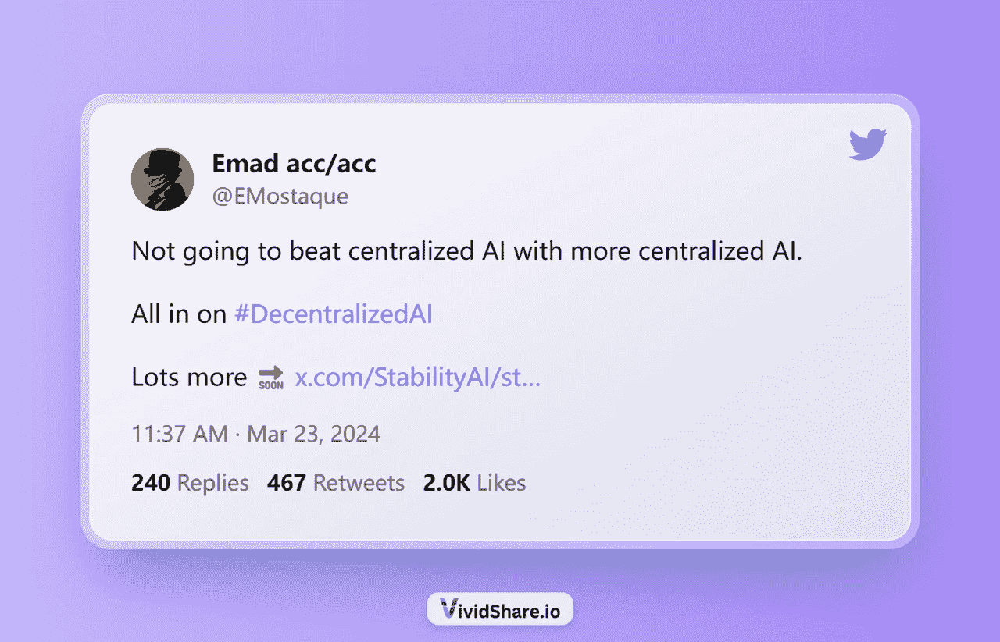
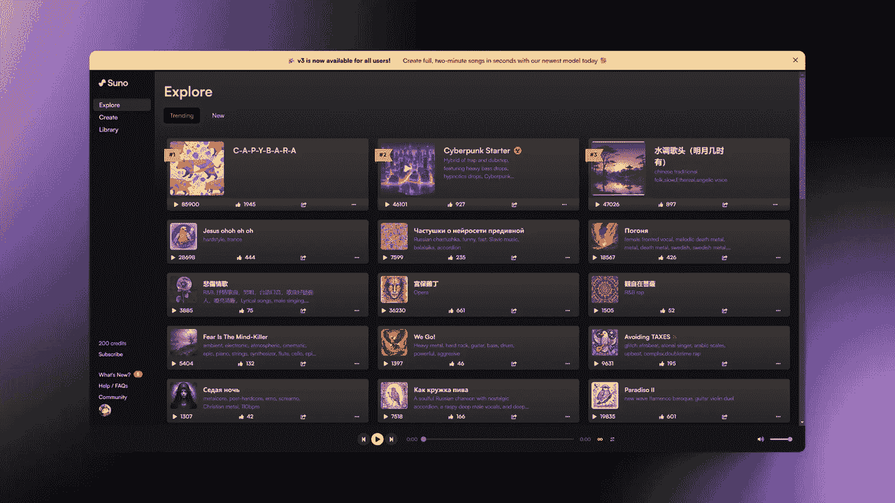
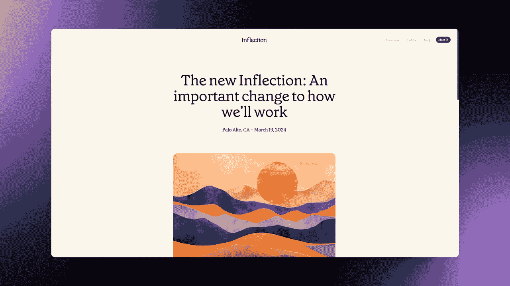
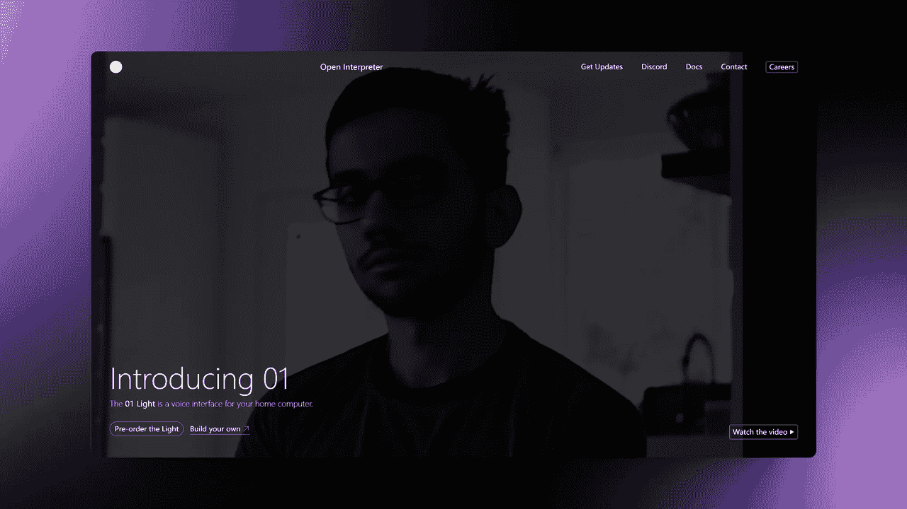
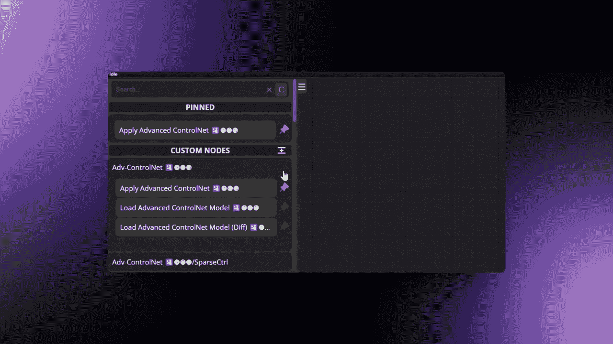
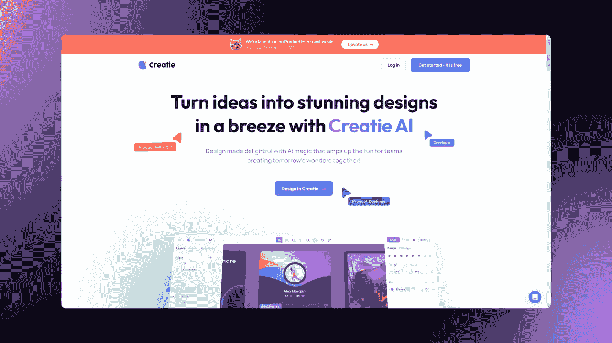
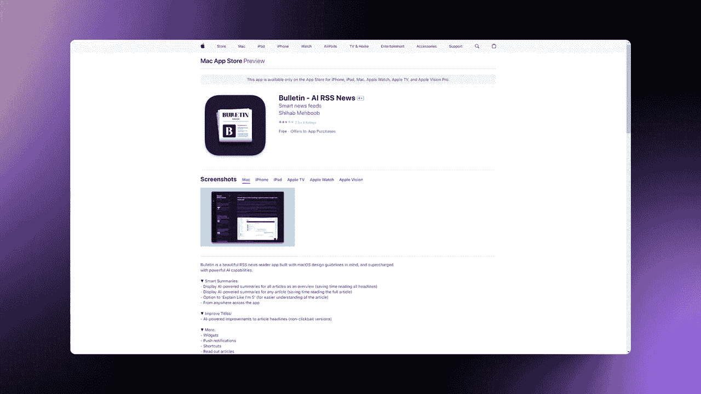
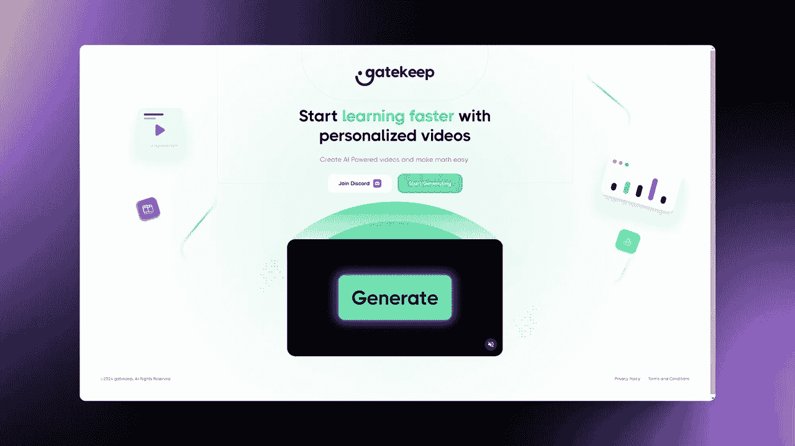

# AIGC Weekly #64

> 来源：[https://waytoagi.feishu.cn/docx/SLibdkWZooUjl5xnUqzcaFHLnef](https://waytoagi.feishu.cn/docx/SLibdkWZooUjl5xnUqzcaFHLnef)

> 🔗 原文链接： h[ttps://quail.ink/o](https://quail.ink/op7418/p/aigc-weekly-64)p7418/p/aigc-wee...

> ⏰ 发布时间：2024-03-25

[Midjourney提示](https://catjourney.life/)词：This is an incredibly attractive and beautifully colorful gradient scene, minimalist style, Olafur Eliasson's work. It is depicted within the confines of a physical space, resembling a wall surface. The junction between the wall and the floor is gently rounded, adding a soft and welcoming touch to the environment. The scene features a variety of colors, transitioning from deep blue gradients to fresh green, and then to gentle yellow tones, each layer radiating its own unique brilliance. The overall composition is simple yet fluid, evoking a sense of pure beauty, as if immersed in an abstract artwork and enchanted by the magic of colors. --ar 16:9 --style raw 💎查看更多风格和提示词

# 上周精选 ✦

## Stability AI CEO 辞职

上周六Emad Mostaque 辞去了 Stability AI CEO 的职位，转而追求去中心化的人工智能。

董事会已任命首席运营官Shan Shan Wong和首席技术官 Christian Laforte 担任 Stability AI 的临时联席首席执行官，并且在寻找一位永久首席执行官。

这是AI开源领域的一个重要事件，图像和视频生成的开源生态能有这么蓬勃的发展与Stability AI和Emad 坚持开源的信念是分不开的。

Emad 个人当然有很多问题，他可能不是一个好的CEO，但是对开源领域的贡献是非常大的。我现在还记得22年SD1.5内测那天晚上他的直播。当时也许他自己也想不到SD开源生态会生长到现在这个规模。

Emad 这次离开开始去追求发展去中心化的人工智能，可能也是看到了现在开源生态的问题，优秀的开源贡献者无法或者与之内容匹配的回报，这是不可持续的。Web 3 恰巧有很多方式保证根据贡献度获得对应的收益，AI和Web3目前都处于一个重要的阶段，希望他可以走出一条合适的道路。

## Suno 发布了自己的歌曲生成模型V3版本

Suno 正式发布了他们的 V3 音乐生成模型，现在所有人都可以使用。

**V3 改进的内容主要是：**

◦ 音质更佳，带来更加清晰动听的音频体验

◦ 更丰富的音乐风格和流派选择

◦ 提高了对用户指令的精准响应，显著减少误解现象，并确保音乐结尾更加流畅自然

我尝试了一下新的 V3 模型，效果非常好，V3 我感觉起码我愿意在工作的时候循环听了。

Gorden Sun还搞了一个简单的提示词书写教程：https://x.com/Gorden_Sun/status/1771523810371788927?s=20

## Inflection CEO入职微软负责微软自己的AI团队

上周Inflection公司的Mustafa 和 Karén 将离开 Inflection，前往微软成立的新部门 Microsoft AI，该部门将整合他们在消费者 AI 方面的工作，以及 Copilot、Bing 和 Edge。新的是首席执行官肖恩-怀特（Sean White）。

同时微软已同意向 Inflection 支付约 6.5 亿美元，主要是以许可协议的形式，使 Inflection 的模型可以在软件巨头的 Azure 云服务上销售。

公司的很多人也入职了微软的AI部门，几乎已经把Inflection掏空了，他们的新的定位为 "人工智能工作室"，帮助其他企业训练和微调人工智能模型，跟收购没啥区别，感觉是为了反垄断？

## Open Interpreter 开源O1语音智能助手

一个完全开源的可以控制家里电脑的AI语音设备O1，介绍视频已翻译。它可以看到你的屏幕内容学习使用你常用的应用，并且你无论在哪都能让它帮你操作电脑完成任务。用户只需按下按钮、讲话，然后系统会思考并回应用户的需求。

这个设备的CAD文件、电路设计、代码完全是开源的，有能力的开发者可以直接制作这个设备。

灵感来自Andrej Karpathy 的 LLM 操作系统，10月份他的LLM科普视频含金量还在上升。O1运行一个代码解释语言模型，并在计算机内核发生特定事件时调用它。

项目地址：https://github.com/OpenInterpreter/01

## 英伟达GTC大会发布新的Blackwell计算平台

英伟达上周召开了GTC大会发布了一堆新硬件和机器人平台，其中Blackwell架构比前代Hopper架构的训练性能提升2.5倍，推理性能提升5倍，太强了。

+   NVIDIA推出新的Blackwell计算平台，旨在为万亿参数的大语言模型实现实时生成式AI。

+   Blackwell架构比前代Hopper架构的训练性能提升2.5倍(FP8)，推理性能提升5倍(FP4)，采用第五代NVLink互连，可扩展到576个GPU。

+   NVIDIA GB200 Grace Blackwell超级芯片通过900GB/s超低功耗NVLink芯片间互连，将两个Blackwell B200 GPU连接到Grace CPU，实现高度集成和内存一致性。

+   NVIDIA推出NVLink Switch芯片，每个可以以1.8TB/s的速度连接四个NVLink，并通过片上通信减少来降低网络开销。

+   NVIDIA GB200 NVL72是一个多节点、液冷、机架式系统，在单机架内可提供720 PFLOPS的AI训练性能和1.4 EFLOPS的AI推理性能。

+   全新NVIDIA DGX SuperPOD采用NVIDIA GB200 Grace Blackwell超级芯片，专为万亿参数模型设计，可提供11.5 EFLOPS的AI超算能力(FP4)和240TB高速内存。

+   NVIDIA发布NIM(NVIDIA Inference Microservices)，通过组装加速库和生成式AI模型，让开发者能更轻松地构建和部署定制化AI应用

+   NVIDIA Omniverse Cloud以API形式开放，让开发者能将Omniverse核心技术集成到设计、自动化软件和仿真工作流中，加速构建数字孪生应用。

+   NVIDIA发布Isaac机器人平台更新，包括Isaac Perceptor感知SDK和Isaac Manipulator机械臂控制库。同时宣布面向人形机器人的Jetson

+   Thor计算机和Project GR00T通用基础模型。

+   NVIDIA与台积电、新思科技合作，将突破性的计算光刻(computational lithography)平台cuLitho推向量产，可将芯片制造中的光刻工艺加速40-60倍。

# 其他动态 ✦

+   Mistral开源了Mistral 7B的新版本Mistral 7B v0.2模型：https://x.com/marvinvonhagen/status/1771609042542039421?s=20

+   字节跳动视频生成模型Dreamina开始内测：https://dreamina.jianying.com/ai-tool/home

+   通义千问免费开放了 1000 万长文档处理能力：https://www.ithome.com/0/757/573.htm

+   Gemini Pro 1.5 以及 100 万上下文已经向所有人开放：https://aistudio.google.com/app/prompts/new_chat

+   Arc 浏览器公司获得了 5000 万美元融资，估值 5.5 亿美元：https://techcrunch.com/2024/03/21/the-browser-company-raises-50-million-at-550-million-valuation/

+   育碧昨天发布了他们和英伟达合作的 AI 游戏 NPC 项目“Neo NPCs”：https://www.theverge.com/2024/3/19/24105748/nvidia-neo-npc-prototypes-gdc-2024

+   月之暗面发布200万字上下文能力我的测试结果：https://x.com/op7418/status/1770084390061961346?s=20

+   试图通过开源生态复刻 Sora 模型的 Open-Sora 现在已经开源了他们的阶段性成果 1.0 模型：https://github.com/hpcaitech/Open-Sora

+   Stability AI 推出了一款名为 Stable Video 3D (SV3D) 的3D生成模型：https://stability.ai/news/introducing-stable-video-3d

# 产品推荐 ✦

一个ComfyUI节点查找和管理工具，终于解决了 Comfyui 原始的垃圾搜索工具鼠标移动就消失了问题，就这一个理由就值得装。还支持把常用的节点置顶，这样很方便就能找到。

不过他们开发插件的时候操作按钮都往左上角堆，搞得按钮都重叠了。

## Raycast推出了一个浏览器插件

Raycast推出了一个浏览器插件装上以后就可以获取当前网页的内容，然后用Raycast AI进行处理，比如内置的这三个：

总结网站：命令可以获得网页的 3 个主要内容。

检查网站：可以窥探用于构建网站的技术堆栈。

总结 YouTube 视频：获取 YouTube 视频的摘要和精华语录。

## Creatie：主打AI功能的UI设计软件

我去 Creatie 这个 AI UI 设计工具有点强啊，做的相当完整，基本上可以当做一个加上了 AI 功能的 FIgma。

而且全部都是免费的，AI 能力也很强，选择区域输入需求直接就会展示对应备选的组件，你可以自己拼装和修改，还能使用自己的设计系统。国内蓝湖的出海产品。

Bulletin应用的核心特色之一是其智能摘要功能。这项功能利用人工智能技术，为用户提供了一种快速浏览新闻文章的方法。用户可以在阅读所有头条新闻时，通过AI生成的摘要来节省时间，或者在需要深入了解某篇文章时，使用AI生成的全文摘要。此外，Bulletin还提供了一个“像对五岁孩子解释”的选项，帮助用户以更简单的方式理解文章内容。这项功能在应用的任何位置都可用，极大地提高了用户的阅读效率和理解度。

为了提升用户体验，Bulletin还提供了文章标题改进功能。通过AI技术，应用能够优化文章的标题，去除那些常见的点击诱饵式标题，让用户能够更直观地了解文章的主要内容，从而避免误导和浪费时间。

## [**绘蛙：阿里的AIGC营销平台**](https://www.ihuiwa.com/)

绘蛙AI是一个专注于电商营销内容创作的平台，旨在帮助商家提升商品的市场曝光度和吸引力。通过使用先进的人工智能技术，绘蛙AI能够快速生成吸引人的图文内容，让商品在第一时间吸引消费者的注意，从而被“种草”。该平台以其简单易用的操作界面和高效的内容生成能力，成为电商营销人员的有力工具。

## Gatekeep：AI可视化学习应用

Gatekeep是一个提供个性化视频以帮助用户更快学习的平台。它特别强调了其利用人工智能生成视频的能力，这些视频旨在简化数学学习过程。

# 精选文章 ✦

## ComfyUI发色更换工作流教程

根据Datou的工作流发散了一下做了一个更换发色的工作流还有对应的讲解。

我会先大概讲一下原理，然后再讲对应节点的作用和参数。最后会发散一下其他的方式，比如更换美瞳以及换衣服。

**工作流原理：**

主要用到了 SD 中局部重绘的原理，关键在于如何选中我们需要选中的区域，这里的突破主要是 Yolo World 这图像分割项目以及 ZHO 的 Comfyui 节点。

这个项目可以精准的识别和分割人物的不同区域的位置，我们根据不同区域的组合就可以选到需要的区域去重绘。

**节点作用及参数：**

YoloWorld Model Loader 和 ESAM Model Loader：加载模型用的用默认设置就行。

YoloWorld ESAM：输入框输入需要分割区域的单词，Confidence_threshold 需要分割的区域越精细数值越小，反之越大。

遮罩相减：取两个链接遮罩的交集。

遮罩扩展：扩大遮罩选取范围，倒角是让选区更加平滑。

采样器：降噪幅度，修改的内容与原图越不同重绘幅度需要越大。

## [**P**](https://www.youtube.com/watch?v=SY-MB0VWjJI)erplexity 的创始人 Aravind Srinivas 与 Stripe 的 David Singleton 炉边谈话

Aravind Srinivas，Perplexity（困惑度）平台的创始人，与 Stripe 的 David Singleton 进行了一次深入的对话，探讨了 Perplexity 从创立到发展的各个方面，包括其内部管理、招聘策略和未来的发展蓝图。

### 创立与成长

+   Perplexity 平台大约在一年半前成立，最初致力于开发一款将自然语言转换为 SQL 的工具，其灵感来源于搜索引擎和 Google 的发展历程。

+   他们开发了一个与 Stripe 紧密相关的原型，进而创造了 Bird-SQL，这是一个将 Twitter 数据整理成可搜索表格的工具，成功吸引了首批投资者的关注。

+   随后，他们的策略转向从链接中提取原始数据，并在推理时间内完成在线处理任务，推出了一款集成了 GPT 3.5 和 Bing 的通用搜索工具。

### 借鉴大公司的经验

+   团队成员在 Google 等大型科技公司的工作经验，对 Perplexity 的工程文化产生了深远影响，特别强调工程卓越和对延迟等细节的重视。

### 内部管理

+   Perplexity 目前拥有约 45 名员工，初期招聘并非通过传统面试，而是通过实际任务的测试。

+   公司制定了明确的发展规划，将具体的小型项目分配给由后端、全栈和前端工程师组成的团队，并设定具体的完成时间。

+   每周一和周五的固定会议用于确定工作重点和回顾成果，而周三则为小团队举行简短的站立会议。

中文版本：https://baoyu.io/translations/transcript/aravind-srinivas-perplexity-and-david-singleton-stripe-fireside-chat

## [智能体设计模式](https://twitter.com/AndrewYNg/status/1770897666702233815)

吴恩达认为人工智能代理工作流程将在今年推动人工智能的巨大进步——甚至可能超过下一代基础模型。这是一个重要的趋势，我呼吁所有从事人工智能工作的人都关注它。

构建代理的设计模式框架包括反思、工具使用、规划和多代理协作。反思是指LLMs审视自身工作并提出改进方法；工具使用是指赋予LLMs如网络搜索、代码执行等工具以帮助其收集信息、采取行动或处理数据；规划是指LLMs制定并执行多步骤计划以实现目标；多代理协作则涉及多个AI代理共同工作，通过分工、讨论和辩论来提出比单个代理更好的解决方案。这些设计模式为构建高效的AI代理提供了指导，并将在下周进一步详细阐述并提供相关阅读建议。

## Codesignal推出的免费提示工程教程

刚刚Codesignal推出了一个非常通俗易懂并且给出了丰富实践经验的免费提示工程教程。

如果你之前看过一些提示工程的教程但是都很复杂看不懂的话。强烈建议你看一下这个，可以很好的帮助你学习提示词书写。教程的质量非常高。

**总共分为五部分 **，分别是：

了解 LLM 和基本提示技巧、

调整大型语言模型的输出大小、

在Prompt Engineering中探索格式控制之旅、

精确文本修改的提示工程、高级技术在提示工程中的应用。

## Lex Fridman采访了Sam Altman

Lex Fridman采访了Sam Altman，这次采访有快两个小时，基本上谈到了所有需要谈的内容。包括GPT-5、Sora、董事会闹剧、马斯克、Ilya去向以及最重要的AGI。

计算力将成为未来最宝贵的财富之一,人工智能的发展将是一场巨大的权力斗争。

Sam回顾了在OpenAI董事会经历的困难时刻,称其为职业生涯中最痛苦、混乱和令人沮丧的经历,但这些经历有助于增强韧性。

OpenAI正在寻找新的董事会成员,希望引入具有不同专业背景的人才,包括非营利组织、学习型公司、法律和治理等领域的专家。

董事会需要回应全球的需求,而不仅仅是自身利益。

人们对产品发布策略的反思,认为应该更加迭代地发布,避免突然的更新,以满足用户的需求。

GPT-4是一个重要的里程碑,但并不足以改变世界。真正意义上的AGI应该能够显著提高科学发现的速度。

大部分真正的经济增长来自科学技术的进步。

Sam期望首个AGI系统能够回答关于宇宙统一理论和外星文明存在性等重大科学问题。

没有任何一个个体或机构应该对AGI拥有绝对控制权,需要建立一个强大的治理系统来管理AI的发展。

我的中文视频翻译：https://x.com/op7418/status/1769779299450781969?s=20

## 我该使用哪款 AI？AI 模型的超能力与现状

探讨了当前 AI 模型的发展趋势，尤其是像 GPT-4 这样的高级模型，还包括 Anthropic 公司开发的 Claude 3 Opus 和 Google 的 Gemini Advanced。这些模型以其模仿人类对话的能力、多模态交互功能（例如图像理解）、无需用户指导以及相似的交互方式而著称。虽然它们有许多共同点，但每个模型都有其独到之处和优势：GPT-4 功能全面，还具备代码解释器等特色功能；Claude 在写作和深度洞察方面备受好评；而 Gemini 则擅长提供清晰的解释。

文章还提到了 "上下文窗口" 和 "检索增强生成"（RAG）这两个概念，它们是为 AI 提供超出其训练数据范围的上下文信息的方法。GPT-4 的上下文窗口能够处理 8,000 至 32,000 字的内容，Claude 3 的上下文窗口超过 150,000 字，而 Gemini 1.5 能够处理高达一百万个 Token。RAG 系统通过从外部资源检索信息来扩展 AI 的知识库，但有时也可能导致 AI 产生虽然合理却不正确的 "幻想"。

文章还介绍了 "智能体" 的概念，这是一种有明确目标的自主 AI 程序。例如，Devin 是一个由 GPT-4 支持的 AI 软件工程师，它能够独立规划和执行任务，比如自主创建网页。

作者指出，尽管目前还没有模型能够超越 GPT-4 所设立的基准，但 AI 领域的发展势头迅猛，未来将有 GPT-5 和 Gemini 2.0 等新模型问世。文章提倡通过使用 GPT-4 级别的模型来熟悉它们的能力，并为将来的新技术做好准备，这些新技术将带来新特性和与 AI 互动的新方式，例如智能体和更广阔的上下文理解能力。

# 重点研究 ✦

## DepthFM: 使用深度流匹配技术的快速单目深度预测

一个深度图分析模型，通过流匹配（Flow Matching）技术，可以有效地实现这一目标，因为它在解空间中形成的直线轨迹既高效又能保证质量。我们的研究表明，一个预训练的图像扩散模型（Image Diffusion Model）可以作为流匹配深度模型的合适先验，仅使用合成数据进行高效训练，就能泛化到真实图像的处理。我们还发现，加入一个辅助性的表面法线损失（Surface Normals Loss）可以进一步提升深度预测的准确性。得益于我们方法的生成式特性，模型能够可靠地评估其深度预测的准确性。在复杂自然场景的标准基准测试中，尽管只使用了少量合成数据进行训练，我们的模型仍然展现出了最先进的性能，并在计算成本上具有明显优势。

ComfyUI插件地址：https://github.com/ZHO-ZHO-ZHO/ComfyUI-DepthFM

## VoiceCraft：超过XTTS的语音模型

+   **VOICECRAFT模型介绍 **：
VOICECRAFT是一个先进的神经编解码语言模型，专门用于语音编辑和零样本文本到语音（TTS）任务。该模型采用了Transformer解码器架构，并引入了一个独特的令牌重排程序，该程序结合了因果掩蔽和延迟堆叠技术，使得模型能够在现有序列内生成内容。这种设计使得VOICECRAFT在自然度方面与未编辑的录音几乎无法区分，并且在零样本TTS任务上超越了以往的模型。

+   **语音编辑任务 **：
语音编辑是VOICECRAFT的核心功能之一，它允许用户修改语音记录中的特定部分，以匹配目标转录文本。这包括插入新词汇、删除不需要的部分或替换错误的词汇。通过这种方式，VOICECRAFT能够生成与原始录音在自然度上几乎无法区分的编辑后语音，这对于内容创作者和教育工作者等用户来说非常有价值。

+   零样本文本到语音（TTS）任务 ：
零样本TTS是VOICECRAFT的另一个重要功能，它允许模型在没有听过目标声音的情况下，仅根据目标转录和一小段参考录音来合成语音。这对于创建多样化的声音内容非常有用，尤其是在需要快速生成大量不同声音的情况下。

+   **模型架构和训练方法 **：
VOICECRAFT的架构基于编解码器，它首先将语音波形量化为一系列可学习的离散单元，然后使用Transformer解码器来预测这些单元。通过因果掩蔽和延迟堆叠技术，模型能够在自回归序列预测中有效地利用双向上下文信息。这种训练方法使得模型在处理长序列时表现出色，并且能够生成高质量的语音输出。

项目地址：https://github.com/jasonppy/VoiceCraft?tab=readme-ov-file

## AnyV2V：适用于任何视频到视频编辑任务的即插即用框架

+   **AnyV2V框架的介绍 **：
AnyV2V是一个新颖的训练免费框架，旨在简化视频编辑任务。它将视频编辑分解为两个主要步骤：首先使用现成的图像编辑模型来修改视频的第一帧，然后利用图像到视频生成模型进行DDIM反演和特征注入，以生成与源视频外观和动作一致的新视频。这个框架的关键在于它的通用性，能够适配各种不同的视频编辑需求，无需额外的训练或复杂的设置。

+   **视频到视频编辑任务的挑战 **：
视频到视频编辑任务要求AI模型能够根据源视频和提供的控制信息（如文本提示、主题或风格）编辑源视频，生成新的视频。这一任务的挑战在于，新生成的视频不仅要与源视频保持一致，还要准确地融入额外的控制信息。传统方法通常只限于特定类型的编辑，这限制了它们满足广泛用户需求的能力。

+   **AnyV2V的两阶段编辑过程 **：
AnyV2V框架的核心在于它的两阶段编辑过程。在第一阶段，AnyV2V利用现有的图像编辑工具来编辑视频的第一帧。在第二阶段，它使用图像到视频模型来执行DDIM反演，并注入中间特征，以确保生成的视频在外观和动作上与源视频保持一致。这种分阶段的方法使得AnyV2V在编辑操作上具有很高的灵活性和兼容性。

+   **AnyV2V的兼容性和简单性 **：
AnyV2V的一个显著特点是它与所有图像编辑方法的兼容性。这意味着AnyV2V可以将任何图像编辑方法扩展到视频领域，而无需额外成本。此外，AnyV2V的简单性体现在它不需要任何额外的视频特征来实现高外观和时间一致性，这使得它在操作上更加直观和易于使用。

## Mora：借助多智能体系统实现通用视频生成

微软的一个视频生成项目 Mora，利用 Agents 来复原 Sora 的能力，基本还原了 Sora 所有的能力，目前支持生成 1024*576 分辨率的 12 秒视频。

还原的能力包括：

1）将文本转换为视频

2）根据文本条件将图片转换为视频

3）扩展已生成的视频

4）进行视频到视频的编辑

5）串联视频以及

6）模拟数字世界

项目简介：

本论文提出了一种新型的多AI智能体框架——Mora。Mora融合了多个尖端视觉AI智能体，致力于复刻Sora所展示的通用视频生成能力。

具体来说，Mora能够运用多个视觉智能体，在多种任务中成功模仿Sora的视频生成能力。

我们的广泛实验结果显示，Mora在这些任务上的表现已经接近Sora。然而，如果从整体上评估，我们的模型与Sora之间还是存在一定的性能差距。

总的来说，我们希望这个项目能够引领未来视频生成技术的发展方向，通过多AI智能体的协同工作来实现。

## FRESCO：实现零样本视频翻译的空间与时间匹配技术

终于有完整的视频转视频的项目了，不用在搞复杂的工作流，北大发布了FRESCO视频转视频项目

支持将视频转换为不同的风格，而且支持只转换视频的某一部分。代码已经开源。

**项目介绍：**

本文提出了FRESCO，它不仅考虑帧间对应，还引入了帧内对应，从而建立了一个更加稳定的时空约束机制。

这种改进确保了视频中跨帧语义相似内容的连续性。我们的方法不止是对注意力机制的指导，还包括对特征的显式更新，使得结果视频在时空上更加一致，极大地增强了视频的视觉连贯性。

## OMG: 在扩散模型中友好处理遮挡的个性化多概念生成

腾讯这个新研究，支持多角色多概念在一张图片中生成。以前的 ID 或者概念保持项目只能将一个人还原在图片里面，有了这个项目以后就可以多人合照了。

项目还支持与原有的 ID 保持项目一起使用比如 Lora 以及InstantID。代码已经开源，大佬们可以看看插件实现了。

**项目介绍：**

我们提出了一个名为OMG的新框架，它是专门为个性化生成设计的，并能友好地处理遮挡问题，能够在一幅图像中无缝集成多种概念。

我们的框架包含两个阶段：第一阶段专注于图像布局的生成和为处理遮挡而收集视觉理解信息；第二阶段则利用这些视觉理解信息，并结合精心设计的噪声混合技术，将多个概念融合在一起，同时考虑遮挡因素。

我们还发现，在噪声混合过程中选择合适的开始去噪时间点对于保持人物身份和图像布局至关重要

此外，OMG还能与多种单概念生成模型兼容，如LoRA和InstantID，无需额外调整。尤其值得一提的是，LoRA模型可以直接从这个网址获取并使用。

## 字节发布了AnimateDiff-Lightning 模型

字节发布了AnimateDiff-Lightning 模型，只需要 4-8 步的推理就可以生成质量非常不错的视频。

跟 Contorlnet 也可以很好的配合，视频转绘的工作流需要升级了。他们还给出了对应的 Comfyui 工作流，这开源非常到位。

模型是从 AnimateDiff SD1.5 v2 中提炼出来的。 包含 1 步、2 步、4 步和 8 步提炼模型的模型。 2 步、4 步和 8 步模型的生成质量非常好。

还建议使用运动 LoRA，因为它们能产生更强的运动。使用强度为 0.7~0.8 的运动 LoRA 来避免水印。

## APISR：以动漫制作为灵感，实现现实图像的动漫风格超分辨率增强

基于动漫制作流程的图像超分辨率数据集（API）

作者提出了一种新的动漫图像收集管道，并介绍了基于动漫制作的图像（API）数据集。这个数据集专注于从视频源中选择最少压缩和信息最丰富的帧。研究中还强调了将动漫图像恢复到其原始的720P生产分辨率的重要性。

**动漫实用降解模型**

研究中开发了一个动漫降解模型，特别关注在互联网传输和物理老化过程中动漫图像易受损的手绘线条。这种模型可以模拟网络压缩造成的伪影，为超分辨率网络提供更加真实的训练数据。

**动漫手绘线条增强**

论文中提到，为了解决手绘线条在动漫生产中的衰退问题，提出了一个专门的手绘线条增强方法。该方法通过提取和增强动漫图片中的手绘线条来改善其清晰度和可见度，从而使得动漫图片在超分辨率处理后能更好地保留原有的。