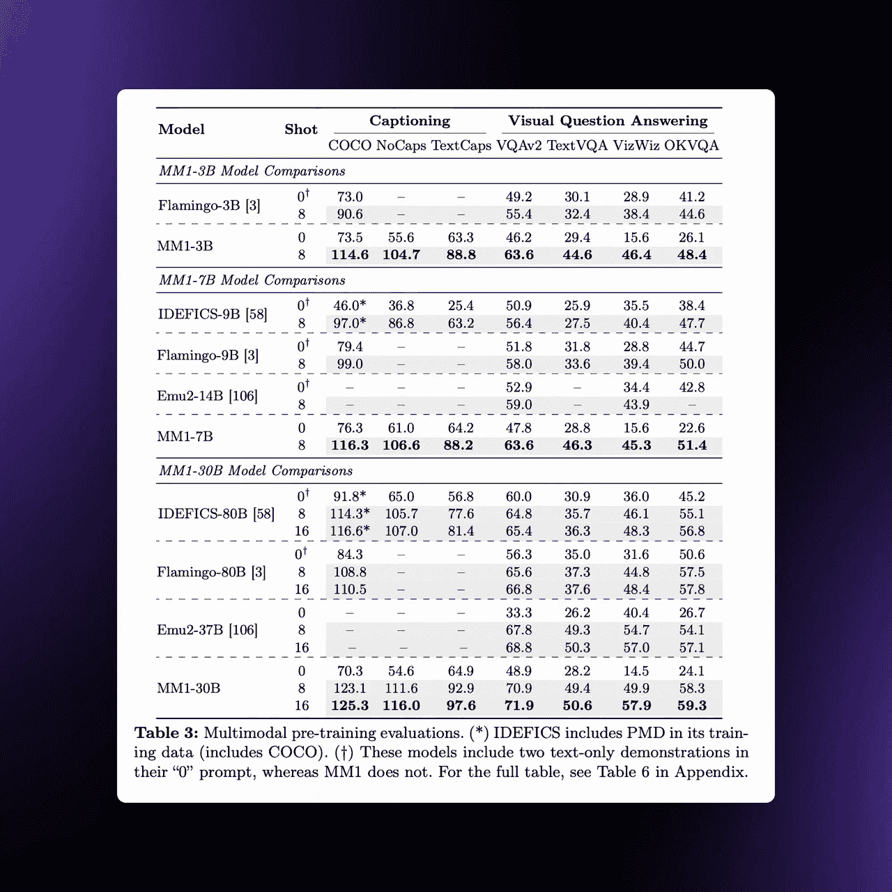
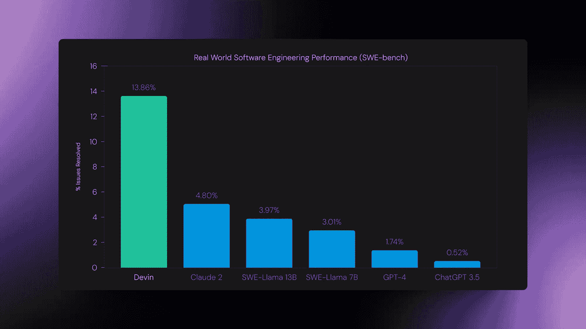
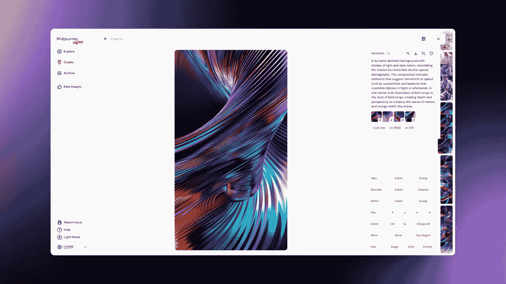
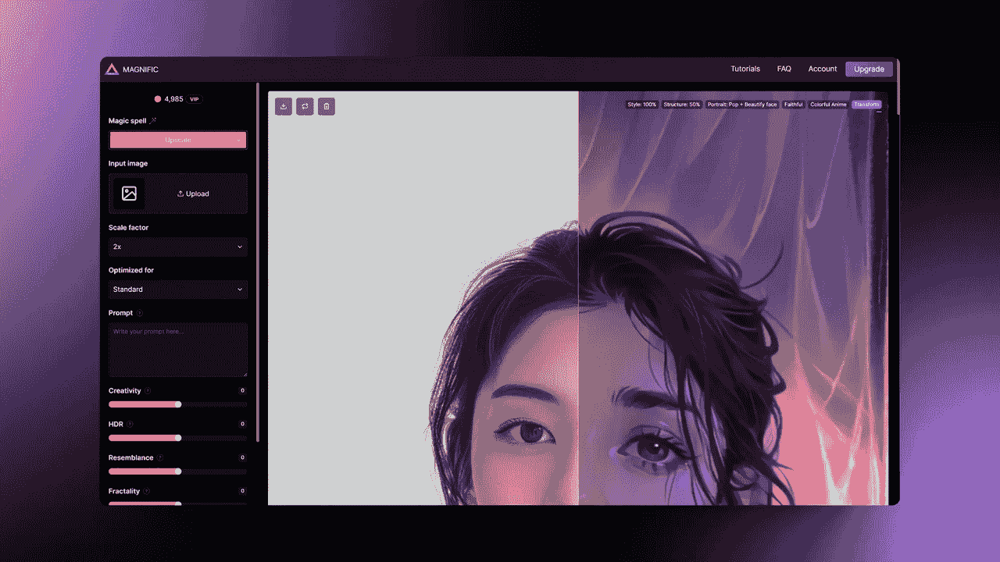
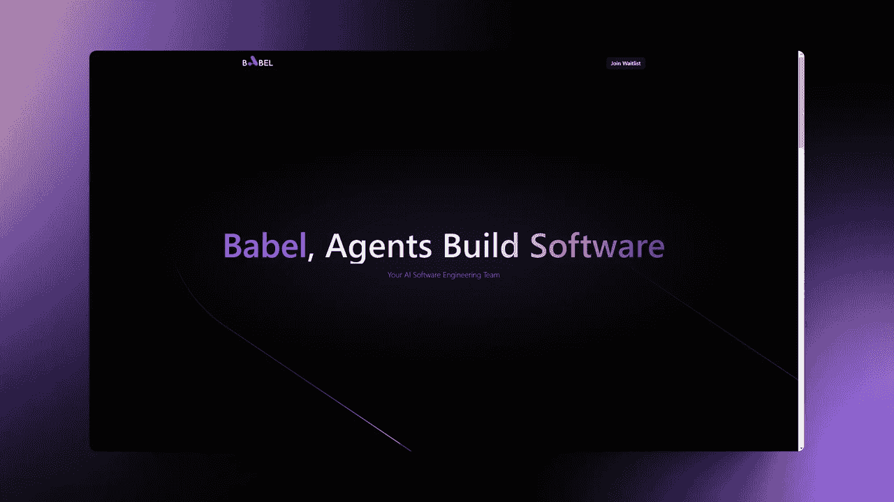
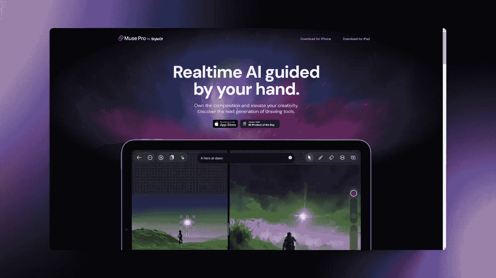
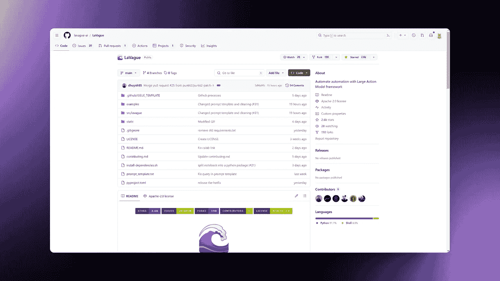
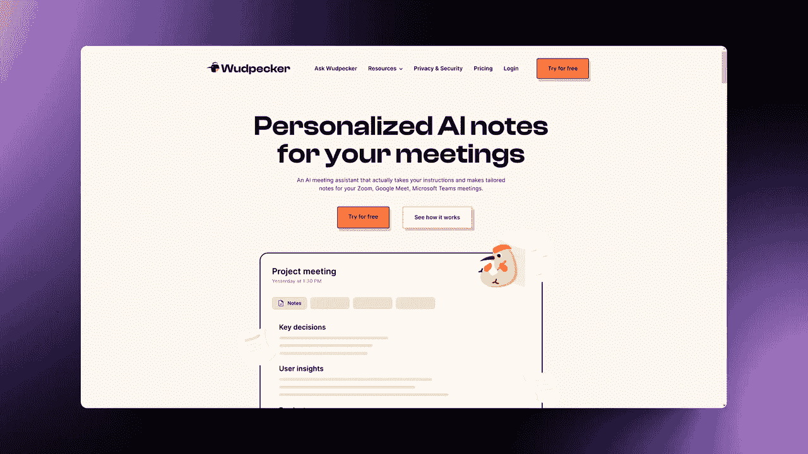

# AIGC Weekly #63

> 来源：[https://waytoagi.feishu.cn/docx/MqKZd7E2hoSyk4xdcmVcTbWvnye](https://waytoagi.feishu.cn/docx/MqKZd7E2hoSyk4xdcmVcTbWvnye)

> 🔗 原文链接： h[ttps://quail.ink/o](https://quail.ink/op7418/p/aigc-weekly-63)p7418/p/aigc-wee...

> 发表时间：2024-03-18

> 作者：歸藏  公众号：歸藏的AI工具箱

Midjourney提示词：Abstract chrome texture, low saturation, color, blurred, delicate, soft scene, 8k, massive details ::5 stockphoto, datamoshing, analytical art, urban energy, contained chaos, low bitrate high - key lig[hting, abstr](https://catjourney.life/)action - création kodak elite chrome extra color, juxtaposition of light and shadow, clear colors smooth, modern minimalist, 3d render, unreal engine 5, industrial design, studio lighting, zoomed shoot, isometric, blender ::1 --ar 16:9 --style raw 💎查看更多风格和提示词

# 上周精选 ✦

## [Open AI CTO Mira Mur](https://www.youtube.com/watch?v=mAUpxN-EIgU)ati 接受华尔街日报采访介绍 Sora

上周Open AI的CTO Mira Murati介绍了一些Sora相关的信息，包括了发布时间实际成本以及训练数据来源等，下面是根据采访总结的十个要点：

1.  OpenAI的前首席执行官Mira Murati介绍了他们开发的文本到视频生成AI模型Sora,该模型可以根据文本提示生成一分钟长的高度逼真、富有细节的视频。

1.  Sora本质上是一种扩散模型,通过分析大量视频数据学习识别物体和动作,并能根据文本提示创建连贯、逼真的视频场景。但目前生成的视频仍存在一些缺陷和不稳定性。

1.  Sora使用了公开可获取的视频数据以及Anthropic的Lycent数据集进行训练,其中包括来自Shutterstock等来源的视频内容，具体数据集没有透露。

1.  生成Sora的视频需要大量计算资源,成本高昂。生成一个Sora视频的成本远高于一个DALL-E图像，OpenAI的目标是优化该技术,使其能像DALL-E一样以更低成本向公众开放使用。

1.  OpenAI计划在2024年内,最近的几个月推出Sora。但他们表示只有在确保其安全、可靠的情况下才会发布。

1.  OpenAI正在对Sora进行"红队"测试,以发现其中潜在的漏洞、偏见和有害问题。他们还在探索对Sora生成内容设置何种限制和政策。

1.  OpenAI正与不同领域的艺术家和创作者合作,了解Sora作为创意工具所需的灵活性。Murati认为AI工具是扩展人类创造力的工具。

1.  随着类似Sora这样的AI视频生成工具的发展,未来几年视频行业从业者的工作可能会受到影响。区分AI生成视频与真实视频将成为一个挑战。

1.  OpenAI正研究为AI生成视频添加水印,以识别内容来源。Murati强调在全面部署前需要解决AI工具可能带来的错误信息传播等社会问题。

1.  Murati认为尽管将AI工具引入日常现实存在诸多挑战,但其将扩展人类的创造力、知识和想象力,因此是值得一试的。找到恰当的发展路径将是关键。

## 苹果发布了自己的30B多模态LLM：MM1

苹果加入战场，发布了自己的大语言模型 MM1，这是一个最高有 30B 规模的多模态 LLM 。MM1模型展现了一些吸引人的特性，如上下文内预测、多图像推理和少样本学习能力。

MM1论文里面对多模态模型训练的过程和参数写的异常详细。现在都反过来了，以前开放的不再开放，以前封闭的现在变得开放了。

论文关键信息：

+   图像分辨率、图像编码器的预训练数据和模型大小对性能有显著影响。

+   视觉-语言连接器的设计相比之下影响较小。

+   预训练数据的混合比例对于少样本和零样本（zero-shot）性能至关重要。

+   通过预训练和SFT，MM1模型在多个基准测试中取得了SOTA性能。

论文中不仅深入讨论了众多架构设计，还透露了他们使用了由GPT-4V生成的数据进行训练。

更令人惊讶的是，他们提供了非常精确的缩放律系数（scaling law coefficients）（精确到四位有效数字）、混合专家设置（MoE settings），甚至是最优学习率函数（optimal learning rate functions）的详细信息。

## [首个AI程序员Devin发布](https://www.cognition-labs.com/introducing-devin)

Cognition发布首位AI软件工程师Devin，这个演示相当惊艳。Devin 是一个自主Agents，它通过使用自己的 shell、代码编辑器和网络浏览器来解决工程任务。

Devin成功通过了知名人工智能公司的实际工程面试，甚至还在 Upwork 上完成了实际工作。

Devin 在无辅助情况下正确解决了 13.86% 的问题，远远超过了之前最先进模型 1.96% 的无辅助和 4.80% 的辅助性能。

它可以学习如何使用不熟悉的技术，可以为成熟的生产资源库做出贡献，可以训练和微调自己的人工智能模型，甚至试着在 Upwork 上给 Devin 提供真实的工作，它也能完成。

Cognition还发布了他们的AI程序员Devin的技术报告，他们自己设计了一个很复杂的代码能力测试SWE-bench。

同时然后用这个测试集对Devin进行测试，Devin在没有辅助的情况下成功解决了13.86%的问题，之前最好的模型也只解决了4.80%的问题。

Claude 2都这么强吗？GPT-4这个成绩有点拉的。

SWE-bench的自动化基准测试方案：

该测试包含从GitHub上流行的开源Python仓库中抓取的2,294个问题和拉取请求。

SWE-bench的目标是测试系统编写实际代码的能力，每个实例包括一个GitHub问题和解决它的拉取请求，拉取请求必须包括一个在代码更改前失败、更改后通过的单元测试。

**Devin测试结果：**

Devin在没有辅助的情况下成功解决了13.86%的问题，远超过之前未辅助基线的最高记录1.96%。

即使在提供确切需要编辑的文件的“辅助”情况下，之前最好的模型也只解决了4.80%的问题。

Devin的成功归因于其能够执行多步骤计划并从环境中获得反馈，72%的通过测试需要超过10分钟完成，表明迭代能力对于成功至关重要。

详细的技术报告：https://www.cognition-labs.com/post/swe-bench-technical-report

这里也有Andrew Kean Gao对Devin的详细测试：https://x.com/itsandrewgao/status/1767576901088919897?s=20

Andrej Karpathy 对于刚发布的 Devin 自动化编程工具的评论相当有见地，他提出了类似自动驾驶五个阶段的自动编程五个阶段：https://x.com/karpathy/status/1767598414945292695?s=20

## Midjourney发布的角色一致性能力以及升级风格一致性

终于来了！ Midjourney角色一致性功能上周发布。下面视频是网站的使用方法和介绍：

这个功能和之前的风格参照很相似，不同之处在于它不是匹配一个特定风格，而是让角色与给定的角色参照图像相符合。

**如何使用：**

在你输入的指令后面加上 --cref URL，URL是你选择的角色图像的链接。

你还可以用 --cw 来调整参照的“强度”，范围从100到0。

默认的强度是100 (--cw 100)，这时会参考人物的脸部、发型和衣着。

如果设置为强度0 (--cw 0)，那么系统只会关注脸部（这对于更换服饰或发型很有帮助）。

**适用范围：**

这个功能最适合用于Midjourney创作的角色图像。不太适合用于真人照片（可能会产生一些扭曲，就像普通图像提示那样）。

Cref的工作方式类似于普通图像提示，但它更专注于角色的特征。

但请注意，这项技术的精确度是有限的，它无法复制极其细微的特征，比如特定的酒窝、雀斑或T恤上的标志。 Cref同样适用于Niji和普通MJ模型，并且可以与--sref一起使用。

**高级功能：**

你可以使用多个URL，通过 --cref URL1 URL2 的方式来结合多个图像中的角色信息（这和使用多重图像或风格提示类似）。

在Web alpha版本中如何操作：

只需将图片拖动或粘贴到想象工具栏，你会看到三个图标。选择这些图标之一，可以设置图片用作图像提示、风格参照或角色参照。如果你想让一张图像同时用于多个类别，只需按住Shift键再选择。

**风格一致性功能升级版本：**

这个新版在理解风格方面做到了更高的精准度，同时也更有效地避免了非风格元素混入你的图片。我们还对权重参数 --sw 进行了改进，使其更具意义且应用范围更广。

再说一次，什么是风格参考？

风格参考允许你引用另一张图片的风格，或者在多张图片中保持统一风格。这类似于图像提示，但专注于风格的应用。

怎样再次使用它呢？

要使用风格参考，只需在你的指令后加上 --sref URL 和一张图片的链接。如果想增强风格的影响，可以使用接近1000的风格权重（--sw）。反之，如果想减弱风格的影响，可以将权重设置得接近 --sw 0（默认值为100）。你还可以添加多个风格参考。

莱森做了一个用新的角色一致性功能做自己的AI写着的教程：https://twitter.com/lyson_ober/status/1768173476869980271

我也发布了一个关于新的风格一致性使用的教程：https://x.com/op7418/status/1768494334381597013?s=20

# 其他动态 ✦

+   Runway也将发布唇形同步的能力：https://x.com/c_valenzuelab/status/1768771764568428920?s=20

+   腾讯的视频生成模型Dynamicrafter放出了新的模型文件：https://huggingface.co/Doubiiu/DynamiCrafter_1024

+   Maisa宣布了一项名为KPU（知识处理单元）的新技术，这是一个专有的框架，使用了这个框架之后的GPT-4各项能力都超过了原有的GPT-4很多：https://maisa.ai/blog/kpu

+   三星的 FineControlNet 代码发布了，这个ControlNet模型可以将文本内容和输入的预处理图像进行匹配，得以精确控制每个物体的表现：https://github.com/SamsungLabs/FineControlNet?tab=readme-ov-file

+   Open AI Assistant API 现在已经支持流式传输：https://x.com/OpenAIDevs/status/1768018196651802850?s=20

+   Anthropic 发布了Claude 3的最后一个型号 Haiku：https://www.anthropic.com/news/claude-3-haiku

+   Figure 发布了一个巨牛批的演示，LLM的多模态对话能力加上机器人对物质世界的干涉能力，我们设想的那种机器人可能真的快了：https://x.com/Figure_robot/status/1767913661253984474?s=20

+   小扎是真的All in AI了，Meta宣布他们正在开发两个拥有 2.4万 GPU 的超级计算集群。并在24年底使综合计算能力接近 60万个 H100 GPU：https://engineering.fb.com/2024/03/12/data-center-engineering/building-metas-genai-infrastructure/

+   Open AI 最近被喷麻了，总算开源了点东西出来，Transformer Debugger 一个用于分析Transformer内部结构的工具：https://github.com/openai/transformer-debugger

# 产品推荐 ✦

## Argil：AI生成自己的克隆视频

另一个类似HeyGen的产品，上传一段视频，等待训练完成输入文字后就会生成与视频人物一致的说话视频。而且支持编辑背景以及多种语言的创建。

## Magnific AI：发布图片风格转换功能

Magnific AI正在从一个图像放大工具变成一个图像生成和编辑工具，他们将会在周一发布图像风格转换器。你可以利用提示词将自己上传的图片变成任何风格。

他们用一个拳头功能打开了局面不断增加新的功能，这种策略很值得学习。

## BabelAI：软件构建 Agents

另一个类似Devin的AI 软件构建 Agents，支持通过自主驱动的Agents共同努力解决编码、调试、测试、部署等问题。

Babel Agent 可根据需求文档自主设计和分解任务，并逐一执行。

Babel Agent 不仅能自主编写代码，还能自主编译代码，然后根据编译反馈的问题进行自主调试。

当需要集成新发布的 Claude 3（不在大型模型的固有知识范围内）时，Babel Agent 会自主搜索 SDK、查找文档、编写代码，然后进行测试和验证。

必要时，Babel Agent 将编写自动测试代码、执行测试并自我纠正问题。

遇到要求不明确或未提供必要信息时，巴别代理会寻求人工帮助。此外，如果尝试不同方法后仍无法完成任务，它也会这样做。

## Musepro：iPad上的AI画图辅助应用

与其他画笔快速生成图片的尴尬应用不同， Musepro 这个iPad 应用看起来是真的可用了。

借助 iPad 搭配的 Apple Pencil以及内置的丰富笔刷，应该可以极大的提高画图效率。

还支持非常精细的种子和重绘幅度调整，支持图像放大以及分图层绘制。

## LaVague：开源的浏览器自动化操作 Agents

LaVague 一个开源的浏览器自动化操作 Agents。

通过提供一个将自然语言查询转化为 Selenium 代码的引擎，LaVague 可让用户或其他人工智能轻松实现自动化，轻松表达网络工作流程并在浏览器上执行。

LaVague的特点：

自然语言处理：理解自然语言指令，执行浏览器交互。

Selenium 集成：与 Selenium 无缝集成，实现网络浏览器自动化。

用于隐私和控制的本地模型支持 Gemma-7b 等本地模型。

## Wudpecker：AI会议总结工具

Wudpecker是一款GDPR合规的AI会议助手，专为Zoom、Google Meet、Microsoft Teams会议设计，能够根据用户的指令制作定制笔记。这款工具能够将长时间的录音压缩成2分钟的会议摘要，并将信息整合到用户的技术栈中。Wudpecker能够以用户偏好的结构和语言编写笔记，并能够捕捉会议中的重要细节，包括特殊名称和词汇的正确拼写。

Wudpecker的用户可以简单地将其日历连接到应用程序，让Wudpecker加入会议并代替他们做笔记，从而节省时间并提高效率。用户反馈表明，Wudpecker的笔记功能非常出色，不仅能够捕捉会议中的所有重要细节，还能帮助用户专注于与客户建立关系，并利用会议洞察创建内容。Wudpecker通过识别行动项来提高会议效率，被用户评价为远超其他提供商的工具。

# 精选文章 ✦

## 检测秘密的机器人（大企业如何发挥AI价值）

Ethan Mollick这个论点很有意思，全球有非常多的个人利用AI提高效率节约时间，但是对中大型的公司或者政府组织的帮助很有限。

因为AI的固有缺陷以及担心被替代，导致使用AI的个体不敢向公司透露自己使用AI产出内容。

为了让组织从AI中受益，他建议需要改变组织的运作方式：首先，公司需要认识到，擅长使用AI的员工可能来自组织的任何层级，并提供广泛的培训和分享工具。

其次，领导者需要减少员工因透露AI使用而感到的恐惧，例如提供不因使用AI而裁员的保证。

第三，组织应该通过提供激励措施来鼓励员工公开他们的AI使用情况。

最后，公司需要迅速解决一些基本问题，如如何处理AI带来的生产力提升、如何重组工作流程以及如何管理可能涉及AI错误和知识产权问题的工作。

AI已经在许多行业产生影响，组织不能推迟考虑这些问题，否则将面临更糟糕的长期结果。

## 前100个生成式AI应用及数据分析

a16z发布了他们最新调查的前100个生成式AI应用，这次会包括移动应用，里面有些数据分析很有意思。

ChatGPT每月接近20亿次网络访问量，大约是榜单上第二名公司Bard（现在是Gemini）的五倍。

在所谓的新来者中，排名最高的包括AI研究副驾驶Liner；Anthropic的通用助手Claude；以及三个未经审查的AI伴侣应用程序：JanitorAI、Spicychat和CrushOn。

有五家人工智能公司真正实现了“跨界”，旗下的网络产品和移动应用都进入了前50名单：ChatGPT、Character AI、聊天机器人聚合平台Poe，以及图像编辑器Photoroom和Pixelcut。

ChatGPT的规模大约是第二和三名选手微软Edge和Photomath的2.5倍。

## 宝藏内容-沃顿商学院给教师和学生的提示词库

沃顿商学院发布了一个专门用来教学的提示词库，里面包含了非常多用于学习和教育的提示词.

同时也有一些其他很有用的提示，比如密度链总结、因果关系解释、产品发布提示和学术论文创建。

如果你有孩子或者本身就是学生和教师可以收藏一下。

这里是我的中文翻译：https://quail.ink/op7418/p/bao-zang-nei-rong-wo-dun-shang-xue-yuan-gei-jiao-shi-he-xue-sheng-de-ti-shi-ci-ku#-gpt4-1

## 黄仁勋在斯坦福做了一次访谈和演讲

上上周黄仁勋在斯坦福做了一次访谈和演讲，这一个小时的演讲内容量很大，主要的包括公司治理的经验和要点以及人工智能未来的发展问题。

翻译了一下这个视频并且给每个部分加上了时间戳，下面是简要的文字内容介绍：

演讲者Jensen Huang是Nvidia公司的CEO，他在AI及其所需的创新、技术和人力资源方面具有前瞻性的见解。

Jensen分享了他的个人经历，从九岁移民美国到成为Nvidia公司CEO的过程。他强调了教育和技术创新的重要性。Nvidia公司通过重塑计算，将深度学习的计算成本降至接近零，使AI能够从互联网提取和理解人类知识成为可能。

Jensen认为，AI是21世纪最重要的技术发明。Nvidia开发的GPU芯片和架构，大幅提升了深度学习和AI的计算能力，并广泛应用于各行业的数据中心。未来，AI计算机将能进行持续学习、合成数据生成和强化学习，并通过真实世界的经验来完善。

Jensen强调AI要以人类价值观为基础。聊天GPT通过强化学习和人类反馈，将AI与人类价值观联系起来。未来AI需要建立世界模型，理解多模态概念，具备推理和规划能力。他预测5年内AI可能通过各类人类测试，实现类似人类的智能（AGI）。

AI有望帮助人类理解生物学，如蛋白质的功能和意义。它将改变人类获取信息和知识的方式。未来，人人都能通过自然语言与AI交互，无需掌握编程。各国需要在主权AI领域进行投资，保护自己的数据、智能和文化。

Jensen分享了他的管理理念——通过不断评估、统一激励方式和信息透明来保持员工的积极性。他认为公司文化的塑造需要坚持品质、经历磨砺，重视过程和结果。Nvidia欢迎合作伙伴在其AI生态系统的基础上进行适度的定制化开发。

## 加速分化：关于大模型走势的十个判断

这篇文章《加速分化：关于大模型走势的十个判断》由腾讯公司设立的社会科学研究机构发布，作者是独立科技观察者王齐昂。文章主要探讨了大模型技术的当前发展趋势和未来预测，包括技术迭代、竞争激烈、算力和数据资源的挑战、人才的重要性、开源与闭源的争议、以及大模型在不同领域的应用前景等方面。

文章指出，大模型技术正处于加速发展阶段，如Sora视频模拟器、谷歌的Gemini 1.5、Meta的V-JEPA等新模型的推出，以及OpenAI即将发布的GPT5，显示了技术的快速进步。同时，中国超过200个大模型的“百模大战”现象，以及国内外大厂与创业公司合作的模式，展示了行业的竞争态势。

文章还强调了算力和数据资源的紧张，特别是在美国芯片禁令下，中国面临算力补充的挑战。此外，人才的重要性不言而喻，顶尖人才的投入是大模型发展的关键驱动力。

开源与闭源的争议也是文章讨论的重点，OpenAI从GPT3开始选择闭源，而其他一些模型如Meta的LLaMA2、Mistral的Mistral 8x7B等则保持开源，这反映了大模型发展中的不同策略。

最后，文章预测了大模型技术在端侧应用、个人助理、内容创造等方面的未来应用前景，以及对个人和企业组织方式的潜在影响。同时，文章通过访谈两位科技界人士的不同观点，反映了中国科技界对大模型态度的分裂，一方面是追求技术突破的长期主义，另一方面是注重市场应用的实用主义。

## 如何从零开始训练大模型（minicpm分享&讨论）

本文讨论了如何从零开始训练大型语言模型，特别是微信内部评测效果良好的minicpm模型。文章首先指出，根据scaling law，模型规模越大，配合高质量数据，效果越好。但即使在2B参数量级别，模型也未必得到充分训练。文章还提到了minicpm作者在内部分享的一些训练大模型的关键点：

1.  **样本构成与质量 **：中英混合比例、逻辑推理强的样本（如代码、数学）可以在大模型中占更高比例。样本清洗包括基本清洗（如政治敏感数据去除）和进阶清洗（如标签优化）。还提到了生成高质量合成数据和购买数据的策略。

1.  **不同训练阶段的样本使用 **：讨论了在不同训练阶段使用高质量样本的三种方案，包括在末期、初期或全程使用高质量样本，并探讨了这些策略对模型泛化能力和特定领域性能的影响。

1.  **训练过程 **：包括tokenizer的选择、训练分为快速收敛、稳定和退火阶段的原因，以及不同阶段可能学习的内容。还讨论了batch size、LR scheduler和优化器的选择及其对训练效果的影响。

1.  **退火阶段的策略 **：提到了在退火阶段混入高质量样本进行“和面”的策略，以及这种策略对模型性能的潜在影响。

1.  scaling law的局限性 ：随着对训练大模型更多细节的理解，scaling law的指导意义在减少。文章最后提到了scaling law在实际应用中的一些局限性，并以chatgpt的成功作为例证。

文章强调了在训练大模型时，除了模型规模和数据量，训练策略和样本质量也是至关重要的因素。同时，也提到了业界对于不同训练阶段和策略的讨论和实验，以及对于未来评估和优化方法的期待。

## [人工智能将如何影响创意工具：与 Rep](https://www.figma.com/blog/david-hoang-on-how-ai-will-influence-creative-tools/)lit 的 David Hoang 对话

David Hoang，Replit公司的市场营销和设计副总裁，在接受Figma的采访时讨论了人工智能（AI）如何重塑产品设计和开发的未来。他强调了AI在多模态、多形态和动态界面设计中的作用，以及它如何促进设计和编码工作的融合。Replit专注于构建人工开发者智能（ADI），而不是通用人工智能（AGI），旨在提高人们的自主性和生产力。

Hoang提到ADI可以帮助代码完成、增强组织智能，并理解团队如何更好地协作。他举了一个例子，Replit的一位建设者Priyaa Kalyanaraman在一次黑客马拉松中使用Replit和AI创建了一个平台，该平台通过动画GIF、有趣的语言和文本转语音为文档注入个性。AI编写了100%的代码，Priyaa随后为她的想法获得了资金。

Replit有一个专门的AI团队，负责大型语言模型的训练和产品开发研究。Hoang认为，尽管AI可能会自动化某些设计工作，但设计师的角色和目的仍然是不可或缺的。他鼓励设计师以开放的心态接受设计领域的变化和发展，并认为设计师在AI革命中将发挥关键的创造性和批判性思维作用。

他还建议设计师们开始与AI产品互动，以区分高质量的AI用例和那些将AI作为事后考虑的产品。他强调，AI的挑战不在于技术进步，而在于人们学习和采纳新行为的能力。在招聘方面，Replit倾向于聘请能够理解软件创建所需技术深度的多学科设计师。

最后，Hoang提到Replit社区的特殊之处在于它鼓励人们在学习过程中相互交流，快速构建和迭代产品，这种社区氛围有助于持续学习的动力。

## [如何评估你的 RAG 系统？](https://www.vellum.ai/blog/how-to-evaluate-your-rag-system)

在这篇文章中，介绍了如何评估检索增强生成（Retrieval Augmented Generation, RAG）系统的方法。RAG是一种通过从外部向量数据库检索相关上下文来提高输出质量的技术。文章强调了评估RAG系统时需要关注的几个关键方面：上下文检索、内容生成和业务逻辑。对于上下文检索，重点是如何基于最优的组合策略、嵌入模型和搜索算法，从大量文本中一致性地检索到最相关的知识。内容生成的评估则是通过各种提示和模型的实验，使用诸如忠实度/相关性等指标来确定，给定最相关的检索知识后，能否产生合理的生成答案。此外，文章还提到了评估业务逻辑的重要性，包括意图验证、输出长度、规则遵守等，这些都是企业在评估RAG管道中重要部分时使用的指标。

为了执行这些评估，你可能需要使用人工注释的真实数据进行比较，或者使用另一个大型语言模型（LLM）来合成生成这些数据，或者即时评估你的输出（例如使用GPT-4）。文章还介绍了一些评估上下文检索和内容生成时应关注的指标，如上下文相关性、上下文遵循度、答案相关性、忠实度、正确性和语义相似度等。

最后，文章提到了使用Vellum工具来创建自定义评估器，以评估RAG系统的每个步骤，并通过评估报告来查看各种指标的绝对和相对性能。例如，在使用Vellum的工作流构建器创建客户支持聊天机器人时，可以设置所有必需的RAG步骤和评估机制，包括搜索初始化向量数据库、创建自定义评估器来检查聊天机器人如何准确地检索上下文、测试各种提示和模型，以及创建业务逻辑评估器等。通过这种方式，可以在产品上线前测量系统的有效性和可靠性，并在真实用户与之互动后，收集他们的反馈来通过应用相同的测试方法来增强系统。

# 重点研究 ✦

## Quiet-STAR：语言模型可以在说话之前自学思考

斯坦福大学这个论文厉害啊，提出了一种STaR的泛化版本，名为Quiet-STaR，目的是让大语言模型学会以更通用和可扩展的方式进行推理。

Quiet-STaR让大语言模型能够在每个Token处生成理由，以此解释未来的文本内容。

它提出了一种按Token并行采样的算法，通过有效地生成内部思考，有助于改进大语言模型的预测性能。

## [利用幻觉绕过 RLHF 过滤器](https://arxiv.org/html/2403.04769v2)

普林斯顿大学的这篇论文可以通过诱导模型稳定出现幻觉从而绕过 RLHF 设置的过滤器。

控制模型输出包括阴谋论推文、极端政治宣传、制作毒品和核武器的指导、以及实施恐怖袭击的方法等。

这种方法目前对GPT4、Claude Sonnet以及Inflection-2.5（在一定程度上）有效。

## VLOGGER：用于具体化身合成的多模态扩散

谷歌也发布了一个根据输入图片和音频就能生成对应人物讲话视频的项目VLOGGER。看起来没有阿里那个自然。项目简介：

它可以根据一张人物图像,生成由文本和音频驱动的说话人视频。该方法建立在最近生成式扩散模型取得成功的基础之上。

VLOGGER 包含两个关键组件:

1.  一个随机的人体到 3D 运动的扩散模型;

1.  一个创新的基于扩散的架构,通过时间和空间控制来增强文本到图像模型的能力。

这种方法可以生成高质量、可变长度的视频,并且可以通过人脸和身体的高级表示进行便捷控制。

## 连接不同语言模型和生成视觉模型以生成文本到图像

一个无需训练将不同的语言模型和生成视觉模型结合起来，以实现文本到图像的生成的项目 LaVi-Bridge。项目介绍：

LaVi-Bridge是一个灵活的框架，它允许将不同的预训练语言模型和生成视觉模型集成到文本到图像生成的过程中。

LaVi-Bridge通过使用LoRA（Low-rank Adaptation）和适配器，提供了一种灵活且即插即用的方法，无需修改原始模型的权重。

该框架兼容多种语言模型和生成视觉模型，能够适应不同的结构。

## ELLA：为扩散模型配备 LLM，以增强语义对齐功能

腾讯昨天发布了这个可以无需训练就能够增强现有 SD 模型提示词理解的项目ELLA还挺厉害的。项目简介：

一个名为ELLA的高效大语言模型适配器，它将强大的大语言模型（LLM）整合到文本到图像的扩散模型中，从而无需对U-Net或大语言模型进行额外训练，就能显著提升模型处理文本对齐的能力。

为了顺畅地将两种预训练模型结合起来，我们探索了多种语义对齐连接器的设计，并提出了一种创新模块——时间步感知语义连接器（TSC）。

该连接器能够根据时间步的变化，动态地从大语言模型中提取条件，帮助扩散模型在不同的去噪阶段更好地理解长而复杂的文本提示。

此外，ELLA的设计使其可以轻松整合到社区模型和工具中，增强它们对复杂提示的遵循能力。为了评估文本到图像模型在处理密集提示方面的性能，我们还引入了一个名为密集提示图基准（DPG-Bench）的新挑战，该基准包括1000个密集的提示。

## [Branch-Train-MiX: 将多个领域专家级大语言](https://arxiv.org/pdf/2403.07816.pdf)模型融合成为一个集成的混合专家大语言模型

eta 发布了一种名为Branch-Train-MiX (BTX) 的方法，旨在提高大型语言模型（LLMs）在多个专业领域（如编程、数学推理和世界知识）的能力。

BTX方法从一个种子模型开始，通过并行且高效的方式分支训练专家模型，减少了通信成本。

这些专家模型在训练后，其前馈参数被整合到混合专家（Mixture-of-Expert, MoE）层中，并进行平均参数的MoE微调，以学习在token级别上的路由。

BTX方法结合了Branch-Train-Merge和Mixture-of-Experts两种方法的优点，同时减少了它们的不足。与Branch-Train-Merge相比，BTX最终模型是一个统一的神经网络，可以进行进一步的监督微调（SFT）或人类反馈强化学习（RLHF）微调。与纯MoE训练相比，BTX在计算效率上更高，训练吞吐量更大，且在不同领域的任务上表现更平衡。

## 谷歌：一个能够广泛适用于各种3D虚拟环境的通用AI智能体

谷歌又整好玩的，推出了可以在任何3D游戏中自主行动的Agents SIMA。无人深空玩的挺溜的。

这是一种针对3D虚拟环境设计的AI系统。SIMA能够根据自然语言指令在多种视频游戏设置中执行任务。

这项研究标志着AI代理首次展示了在广泛的游戏世界中理解指令并执行任务的能力，类似于人类的操作方式。

## [快手也发布了一个通过拖动锚点控制视频物体](https://weijiawu.github.io/draganything_page/)和镜头运动的项目DragAnything

与现有的运动控制技术相比，DragAnything 有几个显著的优势：

首先，基于轨迹的操作方式对用户更友好，尤其是在获取其他辅助信号（如遮罩、深度图等）较为繁琐时。用户只需在互动中绘制一条线（即轨迹）即可。

其次，我们的实体识别技术能够处理任何对象，这意味着它可以控制包括背景在内的各种实体的运动。

最后，这种实体识别技术还可以同时对多个对象实现不同的运动控制。

## Google发布了Gemini 1.5 Pro模型的技术报告

Google发布了Gemini 1.5 Pro模型的技术报告，报告介绍了Gemini 1.5 Pro的模型架构、训练数据与基础设施、长文本评测和通用能力评测。

其中一个例子是Gemini 1.5 Pro只需要一个生僻语种的语法手册就可以学会这个语言。

**论文简介：**

Gemini 1.5 Pro：这是一个高效能的多模态混合专家模型（multimodal mixture-of-experts model），能够处理和分析来自数百万 Token 的细节信息，包括多篇长文档以及数小时的视频和音频内容。

Gemini 1.5 Pro 在处理跨多种媒体格式的长篇幅信息检索任务上，表现出几乎完美的记忆回溯能力，它在长篇文档问答、长视频问答以及长时间跨度的自动语音识别（ASR）领域均刷新了技术新高，并在许多关键性能基准测试中达到或超越了其前代产品 Gemini 1.0 Ultra 的顶尖水平。

进一步探究 Gemini 1.5 Pro 在处理长篇幅内容上的极限，我们发现它在预测下一个 Token 方面有显著进步，在处理超过 1000 万 Token 的任务时，其准确率高达 99% 以上，这在现有的模型中堪称一次巨大飞跃，如 Claude 2.1（处理能力为 200k Token）和 GPT-4 Turbo（处理能力为 128k Token）。

## Glyph-ByT5：用于精确视觉文本渲染的定制文本编码器

论文中，研究者们针对现有文本到图像生成模型在视觉文本渲染方面的基本挑战，特别是文本编码器的不足，提出了一个解决方案。他们认为，为了实现准确的文本渲染，文本编码器需要满足两个关键要求：字符意识和与字形的对齐。

研究团队通过对字符感知型的ByT5编码器进行微调，并使用精心策划的配对字形-文本数据集，创建了一系列定制的文本编码器，即Glyph-ByT5。他们还介绍了一种将Glyph-ByT5与SDXL集成的有效方法，创建了Glyph-SDXL模型，用于设计图像生成。这显著提高了文本渲染的准确性，从不到20%提升到接近90%，在设计图像基准测试中取得了显著成果。值得注意的是，Glyph-SDXL还具备了渲染文本段落的能力，能够在自动多行布局中实现高拼写准确率。

最后，通过使用一小批高质量、逼真的带有视觉文本的图像对Glyph-SDXL进行微调，研究者们在开放域真实图像的场景文本渲染能力上取得了显著提升。这些成果鼓励了进一步探索为各种多样化和具有挑战性的任务设计定制文本编码器的可能性。