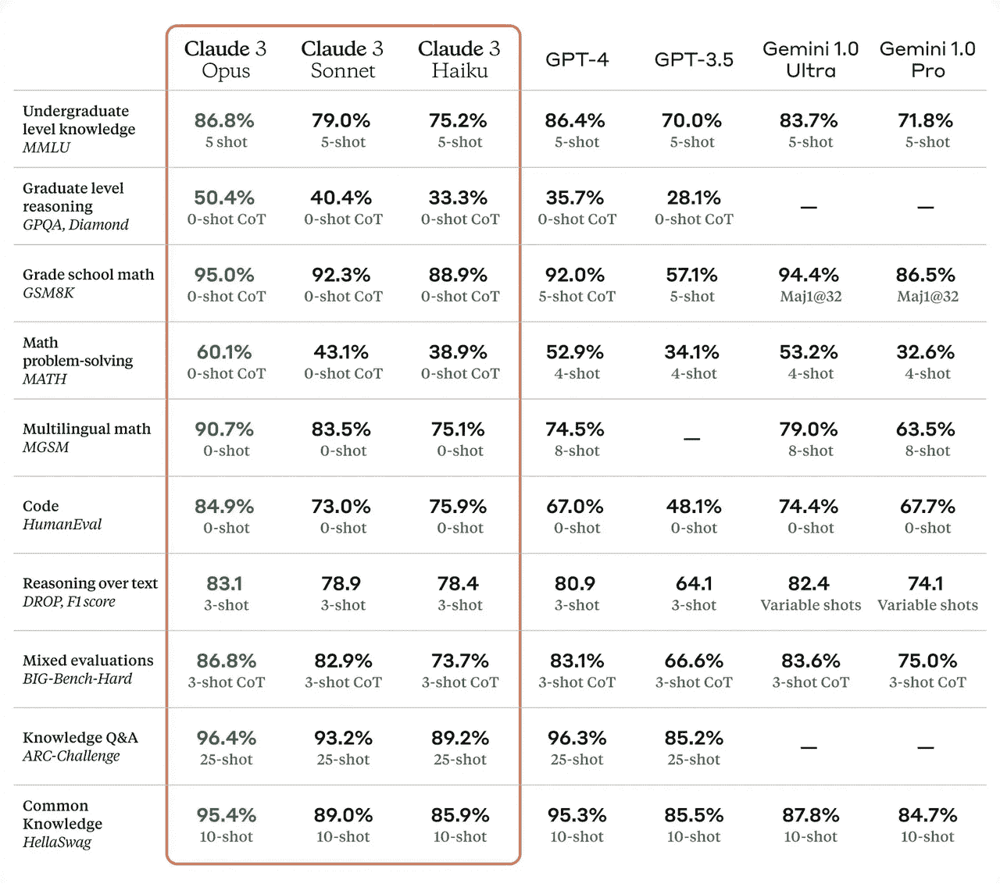
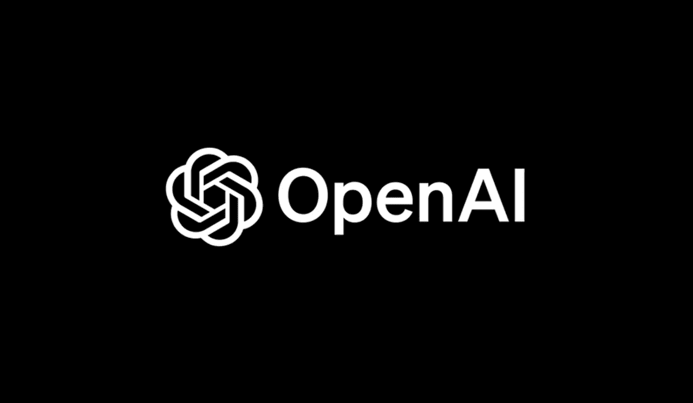
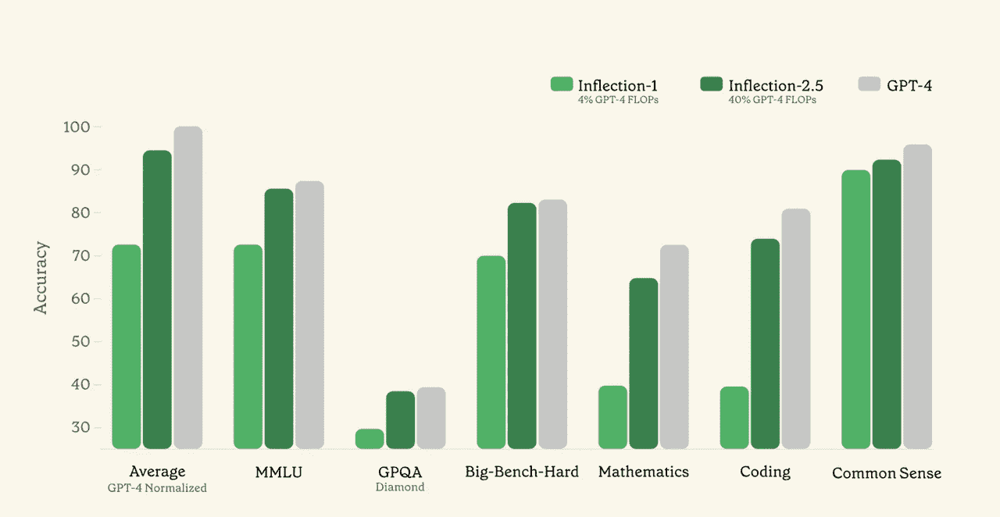
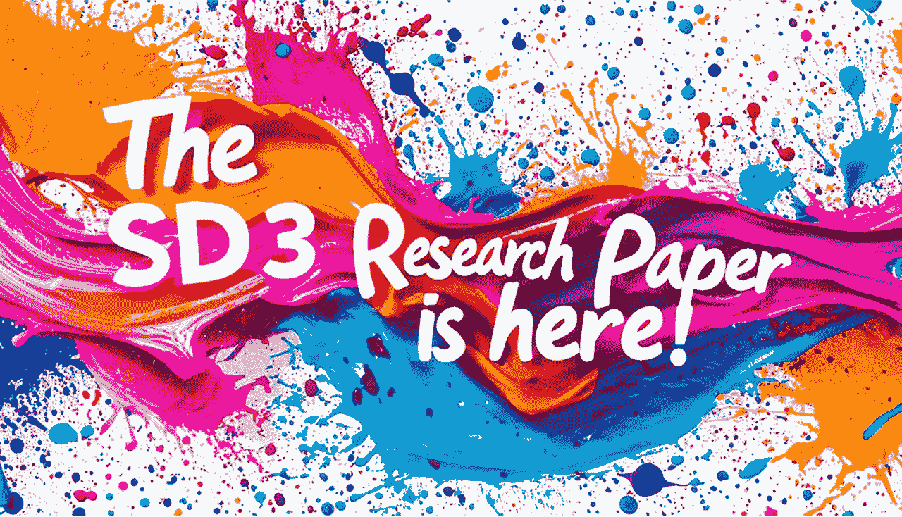
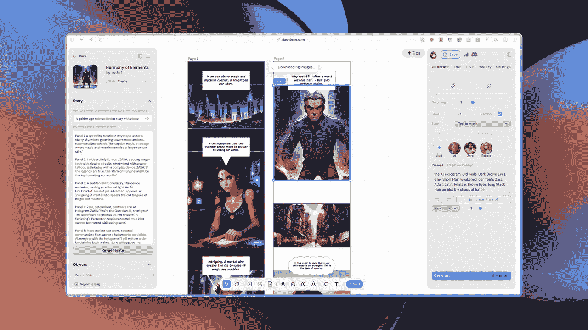
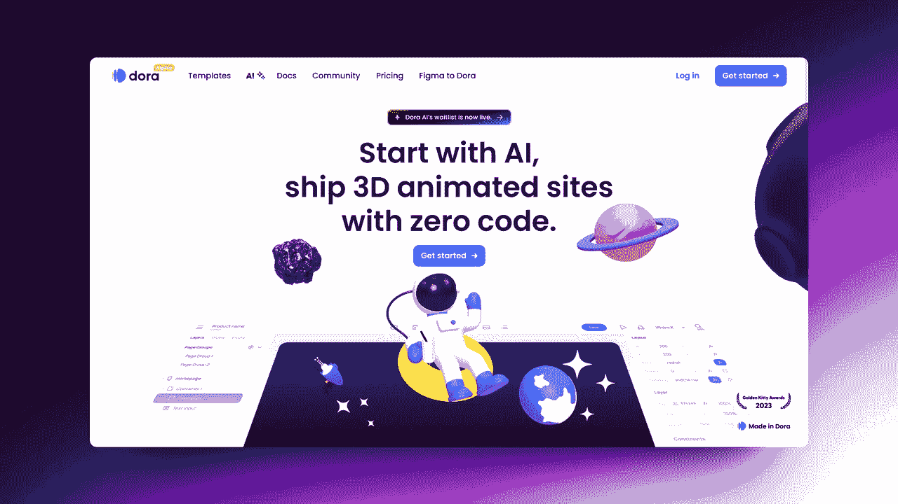
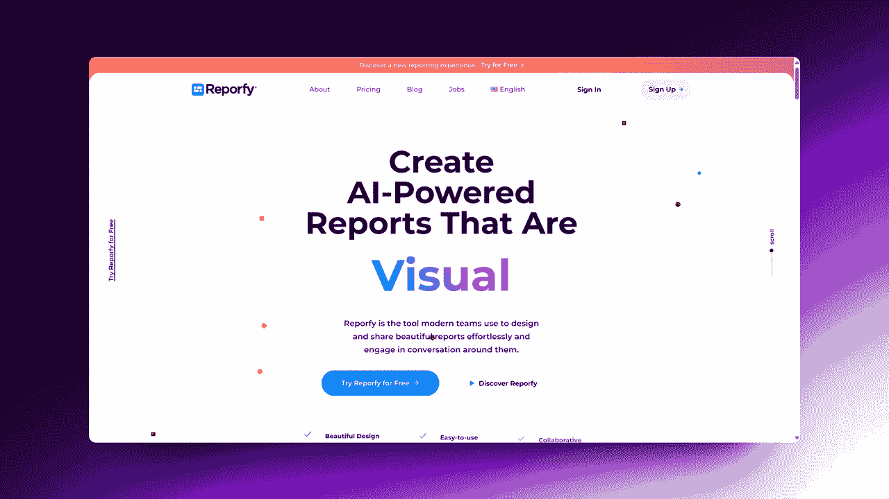
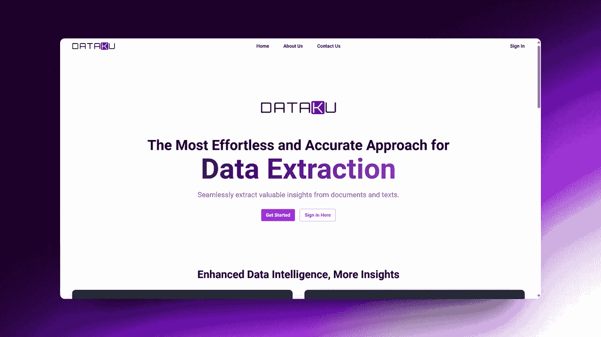

# AIGC Weekly #62

> 来源：[https://waytoagi.feishu.cn/docx/QgVKddL4jo7A99xO6vec6e63nqc](https://waytoagi.feishu.cn/docx/QgVKddL4jo7A99xO6vec6e63nqc)

> 🔗 原文链接： h[ttps://quail.ink/o](https://quail.ink/op7418/p/aigc-weekly-62-llm-competition-heated-up)p7418/p/aigc-wee...

> 发表时间：2024-3-11

Midjourney提示词： max[imu](https://catjourney.life/)[**m White mi**](https://catjourney.life/)nimalism 3d abstract smooth in snow microsoft design style, background, 4k, high resolution, --ar 16:9 --style raw 💎 查看更多风格和提示词

# 上周精选 ✦

## Anthropic发布了Claude 3模型

上周最重要的事情就是Anthropic发布了Claude 3模型，他们自己测试的结果是吊打GPT-4发布这段时间也有各种测试，说完全超过GPT-4可能不太够，但是起码跟GPT-4是同一个水平了，同时他们也有自己超长上下文以及文字内容情感丰富的优势，可以说真的能够跟GPT-4进行竞争了，大家终于在2024年追上了Open AI 2022年的进度。

该系列包括三种最先进的型号（按功能升序排列）：Claude 3 Haiku、Claude 3 Sonnet 和 Claude 3 Opus。支持100万Token上下文。

**详细介绍：**

Haiku是市场上智能类别中最快速、最具成本效益的模型。它可以在不到三秒的时间内阅读一篇arXiv上信息密集、数据丰富的研究论文（约10,000个标记），包括图表和图形。

对于绝大多数工作负载，Sonnet比Claude 2和Claude 2.1快2倍，并具有更高水平的智能。它擅长需要快速响应的任务，如知识检索或销售自动化。

Claude 3型号具有与其他领先型号相媲美的复杂视觉能力。它们可以处理各种视觉格式，包括照片、图表、图形和技术图解。

Opus、Sonnet和Haiku更不太可能拒绝回答接近系统底线的提示，相比以往的模型，克劳德3模型表现出更加细致的请求理解，识别真实伤害，并且拒绝回答无害提示的频率大大降低。

与Claude 2.1相比，Opus在这些具有挑战性的开放性问题上的准确性（或正确答案）实现了两倍的改进，同时也展现出了降低的错误答案水平。

所有三个模型都能够接受超过100万个标记的输入，可能会向需要增强处理能力的特定客户提供这一功能。

Claude 3模型更擅长遵循复杂的多步指令。它们特别擅长遵循品牌语调和响应指南，并开发用户可以信任的客户体验。此外，Claude 3模型更擅长生成流行的结构化输出，如JSON格式。

Opus和Sonnet现已可在API中使用，该API现已普遍可用，使开发人员能够立即注册并开始使用这些模型。Haiku将很快可用。

你现在可以在 https://claude.ai/chats 以及 https://poe.com/ 上使用新的Claude 3模型。

## Open AI 的一些动态

Open AI上周基本上都在处理之前遗留的外部和内部问题，首先是针对马斯克的诉讼，公开了一部分跟马斯克的邮件记录，终于又在 Open AI 的文件中看到了Ilya的名字。看来还是没有完全闹掰。马斯克也针对这篇内容嘲讽他们说只要他们改名字为Closed AI他就撤诉。

OpenAI发布了一篇博客，详细介绍了其与埃隆·马斯克（Elon Musk）的关系以及公司的使命。OpenAI的使命是确保人工通用智能（AGI）惠及全人类，这不仅包括构建安全、有益的AGI，还包括帮助创造广泛分布的利益。OpenAI意识到，构建AGI将需要比最初想象的更多资源。马斯克建议宣布对OpenAI的初始10亿美元资金承诺。自2015年底成立以来，该非营利组织从马斯克那里筹集了不到4500万美元，从其他捐赠者那里筹集了超过9000万美元。

在讨论为了进一步使命而采取的营利性结构时，马斯克希望OpenAI与特斯拉合并，或者他希望拥有完全控制权。最终，马斯克离开了OpenAI，表示需要有一个能与谷歌/DeepMind竞争的相关对手，并且他将自己去做。2017年底，OpenAI和马斯克决定下一步是创建一个营利性实体。马斯克希望拥有多数股权、最初的董事会控制权，并担任CEO。在这些讨论中，他暂停了资金支持。

马斯克理解使命并不意味着开源AGI。随着OpenAI接近构建AI的目标，他们开始变得不那么开放。OpenAI表示，他们对与曾经深受尊敬、激励他们设定更高目标的人——马斯克的关系走到这一步感到遗憾，尽管他后来告诉他们他们会失败，启动了一个竞争对手，然后在他们开始朝着OpenAI的使命取得有意义的进展时起诉他们。

声明全文：https://openai.com/blog/openai-elon-musk

然后又在周六宣布了新的董事会结构，Dr. Sue Desmond-Hellmann、Nicole Seligman、Fidji Simo将加入董事会。Sam也将会回到董事会。新加入的几个人的背景分别是：

Dr. Sue Desmond-Hellmann：是一位非营利组织领导者和医生。她曾担任宝洁、Meta（Facebook）和比尔及梅琳达·盖茨医学研究所的董事。她曾担任比尔及梅琳达·盖茨基金会的首席执行官，任期为2014年至2020年。2009年至2014年期间，她担任加利福尼亚大学旧金山分校（UCSF）的教授和校长，成为该职位的首位女性。她还曾担任基因泰克产品开发总裁，在开发第一批基因靶向癌症药物中发挥了领导作用。

Nicole Seligman：是一位全球公认的企业和公民领袖和律师。她目前在三家上市公司董事会任职 - Paramount Global、MeiraGTx Holdings PLC和Intuitive Machines, Inc。Seligman曾在索尼公司担任多个高级领导职务，包括担任索尼公司的执行副总裁和总法律顾问，负责全球法律和合规事务等职能。她还曾担任索尼娱乐公司总裁，并同时担任索尼美国公司总裁。Seligman目前还在纽约市的Schwarzman动物医学中心和The Doe Fund担任非营利组织领导职务。

Fidji Simo：是一位消费科技行业资深人士，拥有超过15年的领导世界领先企业运营、战略和产品开发经验。她是Instacart的首席执行官和董事长。她还担任Shopify董事会成员。在加入Instacart之前，Simo曾担任Facebook App副总裁和负责人。

公告原文：https://openai.com/blog/openai-announces-new-members-to-board-of-directors

## Inflection发布Inflection-2.5模型

LLM竞争白热化了，Inflection发布Inflection-2.5模型，他们称这是世界上最好的语言模型，Inflection-2.5 现已向所有 Pi 用户开放。

Inflection-2.5 接近 GPT-4 的性能，但仅使用了 40% 的计算量用于训练。

我们在编码和数学等智商领域取得了特别的进步。

Pi 现在还融入了世界一流的实时网络搜索功能，以确保用户获得高质量的突发新闻和最新信息。

Inflection-1 使用的训练 FLOP 约为 GPT-4 的 4%，平均而言，在各种 IQ 导向的任务中，其表现约为 GPT-4 水平的 72%。现在为 Pi 提供支持的 Inflection-2.5，尽管只使用了 40% 的训练 FLOP，但其平均性能却达到了 GPT-4 的 94% 以上。

你现在可以在 https://pi.ai/talk 使用Inflection-2.5模型。

## Stable Diffusion 3 技术报告

Stability AI 发布了他们最强的图片生成模型 Stable Diffusion 3 的技术报告，披露了 SD3 的更多细节。

据他们所说，SD3 在排版质量、美学质量和提示词理解上超过了目前所有的开源模型和商业模型，是目前最强的图片生成模型。

技术报告要点如下：

+   根据人类偏好评估,SD3 在排版质量和对提示的理解程度上,均优于目前最先进的文本生成图像系统,例如 DALL·E 3、Midjourney v6 和 Ideogram v1。

+   提出了新的多模态扩散 Transformer (Multimodal Diffusion Transformer,简称 MMDiT) 架构,其使用独立的权重集分别表示图像和语言。与 SD3 的先前版本相比,该架构改善了系统对文本的理解能力和拼写能力。

+   SD3 8B 大小的模型可以在 GTX 4090 24G 显存上运行。

+   SD3 将发布多个参数规模不等的模型方便在消费级硬件上运行，参数规模从 800M 到 8B 。

+   SD3 架构以 Diffusion Transformer (简称"DiT",参见 Peebles & Xie,2023)为基础。鉴于文本嵌入和图像嵌入在概念上存在较大差异,我们为这两种模态使用了独立的权重集。

+   通过这种方法,信息得以在图像 Token 和文本 Token 之间流动,从而提高了模型生成结果的整体理解力和排版质量。我们在论文中还讨论了如何轻松地将这一架构扩展至视频等多模态场景。

+   SD3 采用了矫正流 (Rectified Flow,简称 RF) 的公式 (Liu et al.,2022;Albergo & Vanden-Eijnden,2022;Lipman et al.,2023),在训练过程中,数据和噪声被连接在一条线性轨迹上。这导致了更直的推理路径,从而可以使用更少的步骤进行采样。

+   扩展矫正流 Transformer 模型：使用重新加权的 RF 公式和 MMDiT 主干网络,对文本到图像的合成任务开展了模型扩展研究。我们训练了一系列模型,其规模从 15 个 。Transformer 块 (4.5 亿参数) 到 38 个块 (80 亿参数) 不等。

+   灵活的文本编码器：通过在推理阶段移除内存密集型的 T5 文本编码器 (参数量高达 47 亿),SD3 的内存占用可以大幅降低,而性能损失却很小。

# 其他动态 ✦

+   Midjourney 上线了/describe和V6 Turbo模式及：https://x.com/midjourney/status/1765909128344658369?s=20

+   零一万物发布 Yi-9B 大语言模型，在代码、数学、常识推理和阅读理解方面表现出色。接受 3 万亿Token培训。英汉双语：https://huggingface.co/01-ai/Yi-9B

+   Perplexity现在可以用Playground V2.5 模型生成搜索结果的图片：https://x.com/AravSrinivas/status/1764775826661253260?s=20

+   推理速度超级快的 Gorq API 现在所有人都可以申请，文档和 Playground 页面均已推出：https://console.groq.com/keys

+   Stability AI 跟Tripo AI 联合推出了 TripoSR 3D 生成模型，可以在不到 1 秒的时间里生成高质量的 3D 模型：https://stability.ai/news/triposr-3d-generation

+   移动端的 ChatGPT 消息支持了朗读功能：https://x.com/OpenAI/status/1764712432939995549?s=20

+   近日，中国AI初创企业MiniMax完成新一轮融资，由阿里巴巴领投。目前该公司估值已超过10亿美元，成功跻身AIGC独角兽行列：https://www.jiemian.com/article/10885235.html

+   Pika推出Sound Effects功能，可以在生成视频的时候顺便生成对应的音效：https://x.com/pika_labs/status/1766554610188095642?s=20

+   ChatGPT现在可以启用多重身份验证：https://x.com/OpenAI/status/1765835660852674944?s=20

# 产品推荐 ✦

## Simply News：AI自动生成的不同领域播客

发现一个很有意思的应用 Simply News，它会使用 Agents 查找特定领域的新闻内容自动生成播客。

相对于 AI 生成视频，现在来看自动个生成对应播客的技术可能更成熟，最近也看到了很多探索，比如 Perplexity 也有个类似的播客。

他们的 Agents 主要由四部分组成：

The Sorter：扫描大量新闻源，根据文章的相关性和对播客类别的重要性进行筛选。

The Pitcher：为每篇筛选出的文章制作引人入胜的提案，考虑文章呈现的叙事角度。

The Judge：评估提案并做出编辑决定，选择哪些应该被报道。

The Scripter：为Judge选中的文章草拟吸引人的脚本，确保听众能清晰、准确地理解。

## [WIX：AI建站工具](https://www.wix.com/ai-website-builder)

无代码网站构建工具 WIX 推出了他们的人工智能建站工具，看起来比 Framer 的稍微好点。

它利用人工智能技术帮助用户在几分钟内创建网站。这个工具通过对话界面与用户互动，根据用户的需求快速生成高质量的网站。

用户可以灵活地调整网站的主题、布局、图片和文本，直到满意为止。

## Dashtoon：AI漫画生成应用

尝试了一下Dashtoon 这个 AI 漫画生成应用，发现做的挺成熟的，该有的功能都有，可以一次性生成也给了充分的编辑和自定义空间。

国内的很多小说视频还是手工用各种 AI 工具拼凑的阶段，可以借鉴一下这个产品的实现方式，是个机会。

他的人物一致性是通过内置的非常多人物 Lora 实现的，目前来看这确实是最稳定的方案。

## [Dora：AI无代码建站工具](https://www.dora.run/)

去年热度非常高的无代码建站工具Dora 终于上线了。Dora是一个无需编码即可设计和发布3D动画网站的平台，它为设计师、自由职业者和创意专业人士提供了一个直观的工具，让他们能够专注于设计而不是编码。该平台支持响应式设计，确保动画设计能够在不同设备上无缝转换。Dora特别适合那些重视设计美学而不想深入后端开发的专业人士，以及那些从Figma、Framer或Webflow等工具转换过来的用户。Dora提供了一个无摩擦的体验，用户可以直接进入视觉画布，并将设计以3D动画的形式呈现出来。此外，Dora AI是该平台的一个特性，它允许用户通过简单的提示生成强大的网站。Dora还提供了从Figma导入、直接在编辑器中导入3D对象和场景等功能，使用户能够轻松创建复杂的滚动动画。

## Reporfy：AI生成调研报告

Reporfy 是现代团队用来毫不费力地设计和分享精美报告并围绕报告展开对话的工具。可以毫不费力地创建、分享和互动报告，为每家公司带来商业智能的未来。从项目进度跟踪到投资者更新，Reporfy 让您以人工智能的速度创建精美、易读和互动的报告。通过用户友好的拖放平台，以可视化方式创建、组织、共享和跟踪数据。经过行业检验的报告和指标模板，可轻松管理任何类型的项目或公司。Reporfy 可轻松收集、分析和消化主要关键绩效指标和信息，以提高清晰度，并推动持续迭代和进步的文化。

## Creo：AI帮助构建企业内部工具

Creo是一个由人工智能驱动的内部工具构建器，它旨在通过简单易用、高效率和代码优先的设计来提升团队的生产力。Creo解决了构建内部工具所需的大量努力，并提供了一系列功能，包括清晰的用户体验（UX）、合理的默认设置、无缝部署、Creo身份验证、团队权限、审计日志、丰富的组件库以及无缝部署。Creo支持React，无需担心无代码工具的学习曲线，使得开发人员可以直接编写由AI辅助的代码。

## Dataku：人工智能驱动的智能数据提取助手

DATAKU.AI 是一个提供高级数据提取和分析服务的人工智能平台。该平台专注于利用人工智能技术来进行数据的提取和分析，旨在帮助用户从大量数据中提取有价值的信息，以支持决策制定和业务优化。

# 精选文章 ✦

## 从零开始在荒野中完全自主训练出色的大型语言模型

作者Yi Tay分享了在Reka成功训练出强大的多模态语言模型的经验，特别是从零开始构建基础设施和训练大型语言及多模态模型的挑战和经验教训。文章详细讨论了在非谷歌外部环境中遇到的问题，包括硬件获取的难题、计算提供商的不稳定性、硬件质量的巨大差异、以及如何应对这些挑战。作者强调了在大型语言模型（LLMs）时代，硬件的选择和质量变成了一种“硬件彩票”，即使是相同的硬件（如GPU），在不同的服务提供商那里也可能有着天壤之别的表现。

文章还探讨了使用GPU与TPU的不同体验，作者分享了自己在谷歌使用TPU训练大型语言模型的经历，以及在Reka使用GPU时遇到的挑战。此外，文章还涉及了在不同计算集群上设置新环境的复杂性，以及如何在缺乏大型AI公司那样的高级ML训练基础设施的情况下，开发内部工作流以缓解这些问题。

作者也分享了在野外编写代码的经验，包括对外部代码库的评价，以及在初创公司环境中，如何快速而不那么原则性地扩展模型的必要性。尽管遇到了许多挑战，但作者和团队凭借技术实力克服了计算资源稀缺和计算提供商不可靠带来的困难，成功训练出了性能优异的模型，并在不到一年的时间里，从头开始建立了一切，达到了与Gemini pro/GPT 3.5相匹配甚至超越许多其他模型的成就。

总的来说，这篇文章为那些对从零开始训练大型语言模型感兴趣的人提供了深刻的见解和宝贵的经验教训，展示了在初创公司环境中，面对资源限制和技术挑战时，创新和坚持的重要性。

也可以看看Andrej Karpathy对于这篇内容的看法：https://twitter.com/karpathy/status/1765424847705047247

## Claude 3模型系统提示词解析

Anthropic AI 官方工作人员发布了对 Claude 3 系统提示每部分的详细解释。我们使用系统提示的原因是什么呢？第一，系统提示能够让我们向模型实时更新信息，比如当前的日期。第二，系统提示使我们能够在训练结束后对模型进行定制化调整，以及在下一次细致调优之前微调模型的表现。这个系统提示正是为了实现这两个目的。

我也把这部分内容做了张图片帮助理解：https://x.com/op7418/status/1765256131147120795?s=20

## [Claude 3 提示词库](https://docs.anthropic.com/claude/prompt-library)

伴随 Claude 3 推出的还有一个提示词库，里面有Anthropic提供的非常多的示例提示词，方便开发者和用户尝试。

详情页还给出了对应提示词的示例回答和 API，可以去看看学一下 Claude 的提示词写法。

## Scaling Law 的方法论

Scaling Law 是2020年OpenAI提出的概念。

在这波 AI 浪潮中已经成为第一性原理。

Transformer 能大放异彩是因为其容易 Scaling 的特性。

Sora 相比 SD 能有更大的潜力，是因为其使用了 Transformer 替换 U-net，使其具备了 Scaling 的可能性 。

Scaling Law 的原本含义是说，模型的性能主要和计算量、模型参数量、数据大小三者相关。

但本文将不讨论其定义 ，而讨论 Scaling Law 的方法论，不仅适用于技术，也适用于商业和个人。

希望你从中可以获得启发。

## [去你妈的，给我看看提示](https://hamel.dev/blog/posts/prompt/)

这篇博客文章讨论了大型语言模型（LLM）抽象化工具的使用和潜在问题。作者强调，虽然这些工具旨在通过重写或构建提示（prompt）来改善LLM的输出，使其更安全、确定、结构化、弹性，甚至针对某些指标进行优化，但它们也可能导致用户与提示构建过程的脱节。文章中提到了几个工具，如DSPy、guidance、langchain等，它们通过自动生成提示来简化与LLM的交互。然而，作者指出，这种自动化可能会引入不必要的复杂性，并且在某些情况下，直接与LLM交互可能是更好的选择。

为了帮助用户更好地理解这些工具是如何工作的，作者展示了如何使用mitmproxy拦截和查看这些工具发送给LLM的API调用和提示。通过这种方式，用户可以直接看到工具是如何构建提示的，从而做出更明智的决策，比如是否真的需要使用某个框架，或者是否可以直接采用生成的提示而不使用框架。

文章还讨论了采用这些抽象化工具时的潜在风险，特别是在增加意外复杂性方面。作者建议，在采用任何抽象化之前，重要的是要考虑它们可能带来的风险，并探索是否有更简单的方法来实现相同的目标。通过提供具体的例子和解释，文章强调了理解和检查这些工具生成的提示的重要性，以确保它们真正符合用户的需求。

总的来说，这篇文章提醒了用户在使用LLM抽象化工具时要保持警惕，避免不必要的复杂性，并鼓励用户直接参与到提示构建过程中，以确保最终的输出既符合预期也高效。

## [**互动，叙事——迷茫与希望**](https://chat.openai.com/g/g-uBhKUJJTl-ke-ji-wen-zhang-fan-yi/c/87f917ff-7d64-4cd0-a13c-c47f9cfc0a1b)

在这篇文章中，讨论了AI Chatbot在社交互动和叙事方面的应用及其潜力。文章首先探讨了AI陪伴产品的普遍理解，并提出了AI Chatbot是否能满足真实社交需求的问题。接着，提出了AI红娘的概念，并探讨了AI Chatbot与XR（扩展现实）结合可能产生的化学反应。文章还提到了一些关于AI Chatbot场景的有趣事实。

在AI互动叙事方面，文章讨论了产品发展从AI陪伴到AI互动叙事的转变，以及互动叙事是否类似于游戏中的故事讲述。叙事部分涉及了故事主题、情节、角色间关系等方面，讨论了什么样的世界观能吸引人、AI是否能够处理复杂的情节和角色演绎，以及视觉效果在当前阶段的重要性。

互动部分则关注了用户参与度、个性化选择以及如何提供挑战性以增加用户的参与感和延缓疲劳感。文章还探讨了满足用户需求的商业机会，包括中年男性和女性用户的在线娱乐偏好。

最后，文章通过几位不同角色的观点，讨论了内容的相关性、同人作品的局限性、内容游戏化的社交平台的潜力、用户对AI生成内容的付费意愿、以及代入感在内容消费中的作用。还提到了虚拟角色创造的问题、剧本杀游戏中AI的潜在应用，以及小说具象化后用户期望的问题。

整体而言，文章深入探讨了AI在社交和叙事领域的应用，以及如何通过各种方式提高用户体验和参与度。同时，也指出了AI在持续叙事和情感表达方面的局限性，以及在设计可扩展的互动叙事体验时需要考虑的因素。

## [Groq高级品牌副总裁访谈](https://cerebralvalley.ai/blog/our-chat-with-groqs-chief-evangelist-mark-heaps-pt1-dq3kR3kldWUanpvO6iyZi)

在这篇文章中，Groq的首席布道官兼品牌高级副总裁Mark Heaps分享了Groq的创立故事、为什么语言处理单元（LPU）优于图形处理单元（GPU），以及Groq近期引起广泛关注的瞬间。Groq是一家位于人工智能驱动芯片革命中心的初创公司，由曾是Google张量处理单元（TPU）主要发明者之一的Jonathan Ross创立于2016年。Groq的使命是通过其专有的LPU——一种新型的端到端处理单元系统，为计算密集型应用（如大型语言模型LLMs）提供最快的推理速度。

## AI提示工程已死？提示工程将会永远存在

自从2022年秋季ChatGPT问世以来，各界人士都在尝试所谓的提示工程（prompt engineering），即寻找巧妙的方式来向大型语言模型（LLM）或AI艺术或视频生成器提问，以获得最佳结果或绕过保护措施。商业领域的公司现在正在利用LLM构建产品副驾驶、自动化繁琐工作、创建个人助理等，但新的研究表明，提示工程最好由模型本身完成，而不是由人类工程师完成。这使得人们对提示工程的未来产生了怀疑，并增加了对提示工程工作可能只是一时风尚的猜疑。

VMware的Rick Battle和Teja Gollapudi通过系统测试了不同的提示工程策略对LLM解决小学数学问题的影响，发现结果出人意料地不一致。他们发现，自动生成的提示在几乎所有情况下都比通过试错找到的最佳提示表现得更好，而且过程更快。他们的研究表明，没有人应该再手动优化提示。

此外，图像生成算法也可以从自动生成的提示中受益。英特尔实验室的Vasudev Lal领导的团队开发了一个名为NeuroPrompts的工具，该工具可以自动增强简单的提示，以产生更好的图片。他们使用强化学习来优化这些提示，以创建更具审美价值的图像。尽管自动化提示的优化可能成为行业标准，但Tim Cramer、Austin Henley和Vasudev Lal等人认为，提示工程师或类似职位的需求不会很快消失，因为适应行业需求的生成AI是一个复杂的多阶段任务，预见到未来人类将继续在循环中发挥作用。

# 重点研究 ✦

## 通过强化学习教授大型语言模型的推理能力

Meta 的一篇论文，详细比较了多种基于反馈的学习方法对于 LLM 推理能力提升的帮助。

主要结论为：

+   测试的所有强化学习算法在进行推理任务时表现出了类似的效果，而在大多数情况下，专家迭代（EI）算法的表现最为出色。

+   即便没有经过监督式微调（SFT），EI和邻近策略优化（PPO）也能够迅速达到收敛状态，大约只需要进行60,000次模型操作。

+   无论是EI还是PPO，都没有从对象关系映射（ORM）的指导或更加密集的奖励设置中获得显著的提升。

+   与单纯的监督式微调不同，EI和PPO的微调同时优化了maj@1得分和pass@n得分，这是一个显著的进步。

## StableDrag：拖动锚点进行图像编辑

还记得DragGAN吗？可以拖动锚点进行图像编辑，当时代码发布以后大家发现生成速度慢，而且不能自己自定义外部图片就没人理了。

现在又有一个StableDrag，是基于Diffusion 模型的，也可以完成类似的拖动锚点编辑图片的能力。如果真的跟演示的效果一样的话，那图片编辑就太方便了。

## PixArt-\Sigma：华为直出4K的图像生成模型

华为发布 DiT 架构的图像生成模型，可以直出 4K 分辨率图像。PixArt-\Sigma,一个能够直接生成 4K 分辨率图像的 Diffusion Transformer (Diffusion Transformer, DiT) 模型。相比其前身 PixArt-\alpha,PixArt-\Sigma 有了显著进步,提供了明显更高保真度的图像,并改进了与文本提示的一致性。

## [GaLore: 利用梯度低秩投影技术，实现](https://arxiv.org/abs/2403.03507)大语言模型 (LLM) 训练的内存高效化

通过他们的方案可以在整个大语言模型训练过程中显著降低内存占用。

只需要一张 24GB 内存的消费级 GPU（RTX 4090），就可以预训练 Llama 7B 大语言模型。

一种允许全参数学习,但比常见的低秩自适应方法 (如 LoRA) 更节省内存的训练策略。我们的方法在优化器状态中减少了高达 65.5% 的内存使用,同时在 LLaMA 1B 和 7B 架构上使用 C4 数据集 (最多 19.7B 个 Token) 进行预训练,以及在 GLUE 任务上微调 RoBERTa 时,都保持了效率和性能。

## ResAdapter：用于扩散模型的域一致性分辨率适配器

字节发布ResAdapter可以解决SD生成超大图片和非训练分辨率图片时的肢体异常以及画面崩坏问题。同时可以与现有的IPadapter以及Controlnet模型兼容。

它是一种专门为扩散模型（比如Stable Diffusion和个性化模型）设计的适配器，能够生成任何分辨率和长宽比的图像。与其它多分辨率生成方法不同，ResAdapter能直接生成动态分辨率的图像，而不是在后期处理中调整静态分辨率的图像。这种方法使得图像处理变得更加高效，避免了重复的去噪步骤和复杂的后期处理流程，显著缩短了处理时间。

在不包含任何训练领域风格信息的情况下，ResAdapter利用广泛的分辨率先验，即使只有0.5M的容量，也能为个性化扩散模型生成不同于原训练领域的高分辨率图像，同时保持原有风格。