# AIGC Weekly #61

> 来源：[https://waytoagi.feishu.cn/docx/SLPadQMXaol12GxwLJ3ch7OnnFf](https://waytoagi.feishu.cn/docx/SLPadQMXaol12GxwLJ3ch7OnnFf)

> 🔗 原文链接： h[ttps://mp.weixin.q](https://mp.weixin.qq.com/s/GogOHqlC2HSCq1rLAmdV_A)q.com/s/GogOHqlC...

原创 op7418 歸藏的AI工具箱 2024-03-04 16:42  北京

# **Summary 总结**

每周一更新，主要介绍上周AIGC领域发布的一些产品以及值得关注的研究成果

1. Mistral推出了新的大模型Mistral Large,性能仅次于GPT-4。

2. LTX推出了一款可以通过文字直接生成视频的软件。

3. LayerDiffusion项目可以直接用扩散模型生成透明PNG图片。

4. 还汇报了一些公司和项目的动态,如OpenAI、Midjourney、Ideogram等。

5. 推荐了一些新产品,如Vercel AI SDK、OLMo-7B-Instruct等。

本篇正文共 12023 字，仔细阅读约 31 分钟

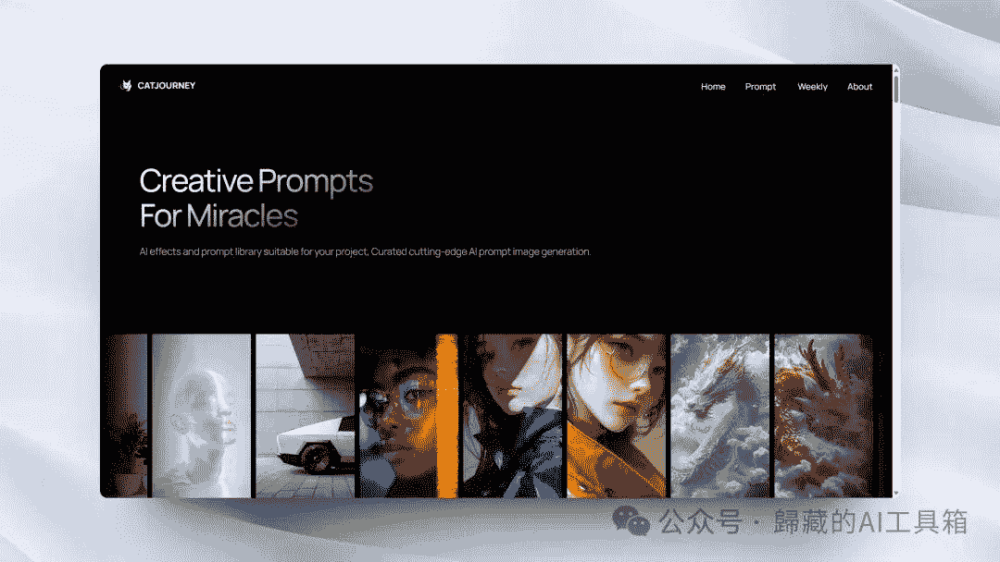

给自己的产品宣传一下， Catjourney 是一个AI图像提示词和图片的收集网站，里面所有的图片和提示词都是精心挑选和整理的，最近新设计了网站的首页以及整体的视觉语言，日常工作有图片需求的可以常来看看。这里访问 Catjourney： https://catjourney.life/

# **上周精选 ✦**

## Mistral 正式发布 Mistral Large

链接： **https://mistral.ai**/news/mistral-large/

Mistral 正式发布 Mistral Large在基准测试中仅次于GPT-4，超过其他所有模型。

Mistral Large具有新的功能和优势：

它在英语、法语、西班牙语、德语和意大利语方面拥有母语般流利的能力，并对语法和文化背景有细致的理解。

其32K令牌的上下文窗口允许从大型文档中精确地寻找信息。

它精确的指令跟随能够让开发者设计他们的管理政策 - 我们用它来建立 le Chat 的系统级管理。

它本身就能够进行函数调用。这一点，再加上在la Plateforme上实现的受限输出模式，使得应用程序开发和技术栈现代化能够大规模进行。

支持在La Plateforme、Azure和私有部署。

还发布了具有低生成延迟的Mistral Small，Mistral Small的性能优于Mixtral 8x7B，并且具有更低的延迟。

其中，JSON格式模式强制语言模型输出为有效的JSON。此功能使开发人员能够更自然地与我们的模型进行交互，以提取结构化格式的信息，这些信息可以轻松地在其余的流水线中使用。

可以在Mistral官方的聊天应用le Chat中体验最新的Mistral Large模型： https://chat.mistral.ai/chat/

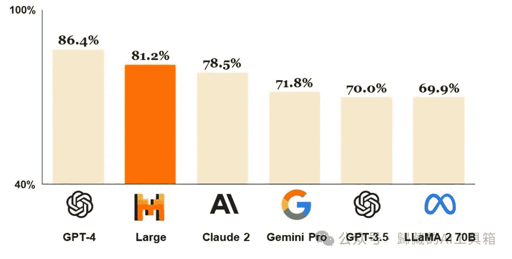

## **LTX：AI剪辑和视频生成软件**

链接： https://ltx.studio/

LTX 一款AI驱动的电影生成和剪辑软件。介绍视频已经翻译好支持通过文字直接生成复杂的剧情视频，包含语音、音效以及视频画面，支持编辑画面内容。支持通过故事板组织和剪辑生成的视频，你可以自定义演员场景和造型。

**他**们还放出了两个用这个软件生成的短片以及对应的界面： https://x.com/LTXStudio/status/1762932353192644823?s=20

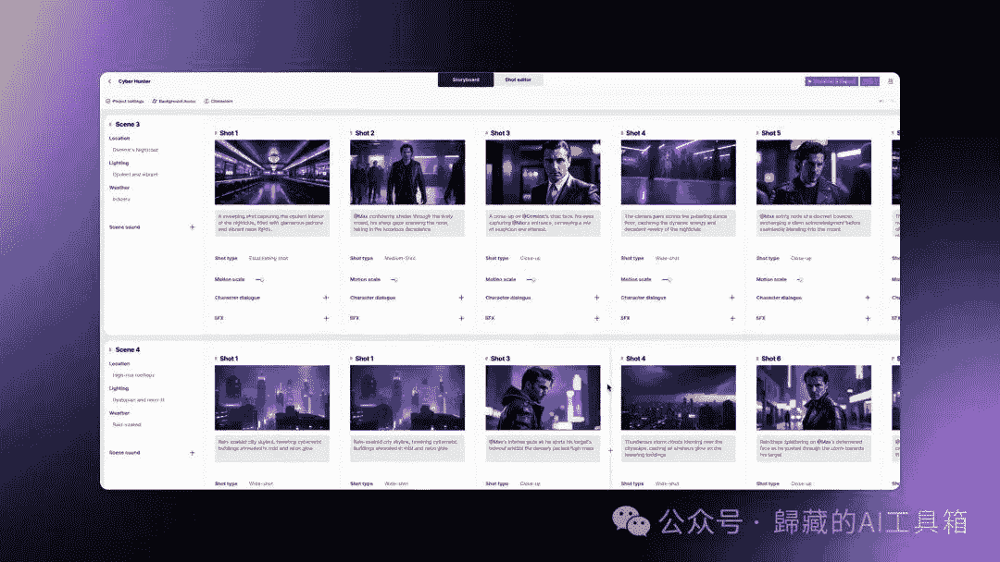

## LayerDiffusion：直接生成透明的PNG图片

链接： https://arxiv.org/abs/2402.17113

一个非常有意思的项目可以用 SD 直接生成透明的 PNG 图片，也可以直接生成带有透明度分层的图片。

LayerDiffusion使得大型已经过预训练的潜在扩散模型（latent diffusion model）能够创造透明图像。

这项技术不仅可以生成单独的透明图像，还能生成多层透明图层。它通过一种被称为“潜在透明度”的方法，将透明度（即 alpha 通道）整合到预训练的潜在扩散模型的潜在结构中。

这样做的好处是，它通过以潜在偏移的形式加入透明度，几乎不改变模型原有的潜在分布，从而保持了模型的高质量输出能力。基于这种方法，任何一个潜在扩散模型都可以通过对潜在空间的微调，转化为透明图像生成器。

我们训练这个模型时，使用了一种涉及人机互动的方法，收集了一百万组透明图像层数据。我们的研究显示，这种潜在透明技术不仅可以应用于不同的开源图像生成器，还可以适配多种条件控制系统，实现例如基于前景/背景条件的层生成、层的联合生成、对层内容进行结构控制等多种应用。

**目**前已经可以在forge的扩展上使用了，你可以在这里下载： https://github.com/layerdiffusion/sd-forge-layerdiffusion

**同时ComfyUI也有人适配了插件，这里下载： https:/**/github.com/huchenlei/ComfyUI-layerdiffusion

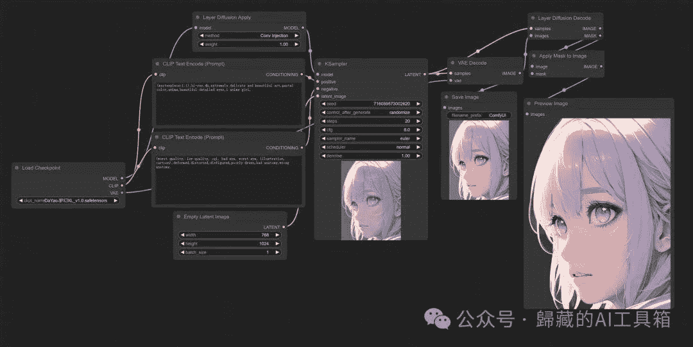

# **其他动态 ✦**

+   **O**pen AI 负责开发者关系的老哥也离职了： https://x.com/OfficialLoganK/status/1763580712874094693?s=20

+   Open AI 将 API 页面的定价 Token** **数量单位从一千变为了 100 万个： https://x.com/OpenAIDevs/status/1763297877353464249?s=20

+   M**i**djoureny 的 Office Time 中说角色一致性可能会在下周推出，新的提示词提取也会开始测试： https://x.com/aliejules/status/1762962503695253894?s=20

+   C**o**mfyUI SUPIR 一个 ComfyUI 的图像放大节点，演示效果看起来非常好，是SUPIR图像放大项目的 ComfyUI 实现： https://github.com/kijai/ComfyUI-SUPIR?tab=readme-ov-file

+   Figure，获得了高达6.75亿美元的融资，估值达到26亿美元。同时他们还与 Ope**n**AI 达成了合作协议，共同研发专用于人形机器人的下一代AI（人工智能）模型： https://x.com/Figure_robot/status/1763202496959521036?s=20

+   Ideogram 发布 Ideogram 1.0 图像生成模型，优势在于强大的文字生成能力和提示词理解能力： https://ideogram.ai/

+   Me**ta **计划在今年七月发布 Llama 3，最大版本的模型预计有 1400 亿参数。The Information 透露 Meta 解除了 Llama 3 的一些限制，更能回答棘手问题： https://www.theinformation.com/articles/meta-wants-llama-3-to-handle-contentious-questions-as-google-grapples-with-gemini-backlash

+   Gi**thub 官方正式推出了GitHub Copilot Enterprise，它可以在链接**代码库以后帮助初级用户快速熟悉代码库，帮助高级用户快速定位问题，定价 36 美元一个月： https://github.blog/2024-02-27-github-copilot-enterprise-is-now-generally-available/

+   Pika 推出 Lip Sync。支持**将**生成视频中人物的嘴部动画和音频同步： https://x.com/pika_labs/status/1762507225455604165?s=20

+   R**u**nway 运动笔刷做了个厉害的功能，鼠标悬停的对应区域上的时候会自动分割选中对应区域（类似 PS 的对象选择）： https://x.com/iamneubert/status/1762407001244471697?s=20

+   P**erplexity宣布开始与韩国移动运营商SKT合作，所有 SK Telecom** 用户很快都将可以使用 Perplexity Pro： https://blog.perplexity.ai/blog/perplexity-pro-is-coming-to-all-sk-telecom-users

+   D-ID Agents：用自己的照片做虚拟人，再克隆上声音，能实现只有2秒延迟的视频对话： https://studio.d-id.com/agents

+   微软即**将发**布 Copilot for OneDrive，Copilot for OneDrive 将扮演某种研究助理的角色，能够从各种文件中查找、总结和提取信息。其中包括文本文档（Word 和富文本）、演示文稿、电子表格、HTML 页面、PDF 文件等： https://www.theverge.com/2024/3/1/24088026/copilot-for-onedrive-file-find-summary-prompts-natural-language

+   现在可以使用iMessage直接跟Pi聊天对话： https://pi.ai/imessage

+   Playground发布了Playground** v2.5图像生成模型，开放模型下载： htt**ps://playground.com/blog/playground-v2-5

# **产品推荐 ✦**

## Vercel AI SDK 3.0：组件流式传输

链接： **https://vercel.com/blog/ai**-sdk-3-generative-ui

Vercel 在 2024 年 3 月 1 日宣布开源其 v0.dev 生成式 UI 设计工具的技术，并发布了 Vercel AI SDK 3.0。这个工具最初是在去年十月推出的，它可以将文本和图像提示转换为 React 用户界面（UI），简化了设计工程流程。AI SDK 3.0 允许开发者创建超越纯文本和 Markdown 的聊天机器人，提供基于组件的丰富界面。

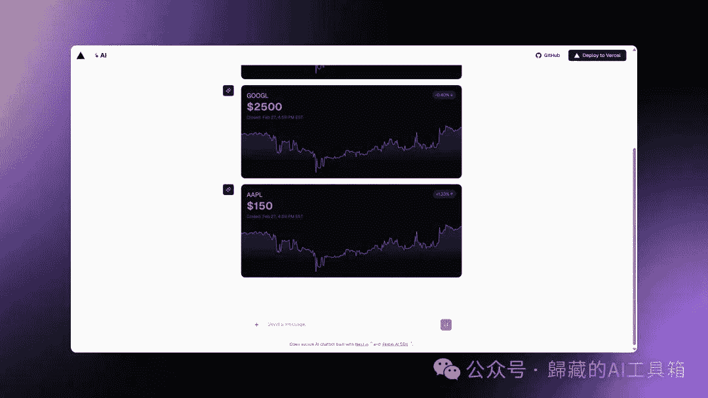

## OLMo-7B-Instruct：完整的开源LLM

链接： https://allenai.org/olmo

Allen AI 开源了微调模型 OLMo-7B-Instruct，真正意义上的开源。

你可以通过他们给出的资料了解从预训练模型到RLHF微调模型的所有信息。自己复刻一遍微调过程。

发布的内容包括：

完整的预训练数据：该模型是基于AI2的Dolma数据集构建的，该数据集包括了用于语言模型预训练的三万亿标记的开放语料库，包括生成训练数据的代码。

训练代码和模型权重：OLMo框架包括四种7B规模模型变体的完整模型权重，每个模型至少训练了2T个标记。推理代码、训练指标和训练日志都已提供。

评估：我们已发布了开发中使用的评估套件，每个模型每1000步都有500多个检查点，并在Catwalk项目的框架下提供了训练过程和评估代码。

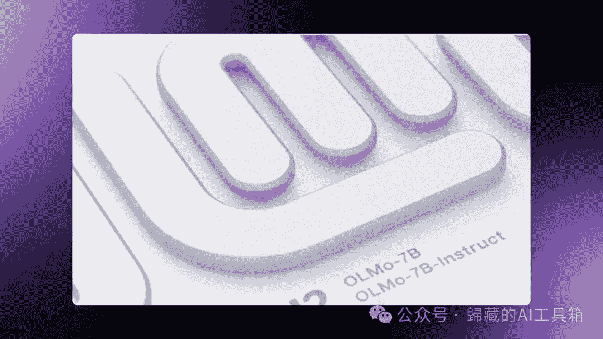

## Devv Agent：更详细的搜索

链接： https://devv.ai/en

发布 Devv Agent，Devv Agent 可以提供更准确、更详细的回答，它会理解你的需求，并分解任务，最终输出一个详尽的答案。

Devv Agent 底层基于的是 Multi-agent 的架构，根据不同的需求场景，会采用不同的 Agent 和语言模型。

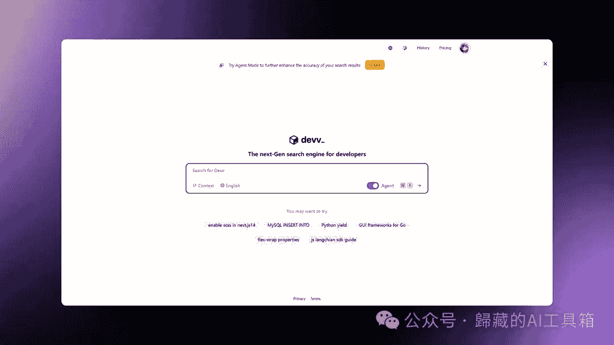

## Chat-with-mlx：本地LLM运行程序

链接： **https://github.com/qn**guyen3/chat-with-mlx

受NVIDIA's Chat with RTX启发做的项目chat-with-mlx。

支持自动下载本地模型，并且可以同本地文件进行交互，支持多种语言，包括英语、西班牙语、中文和越南语。

该项目的一个关键特点是易于集成，用户可以轻松集成任何HuggingFace和MLX兼容的开源模型。

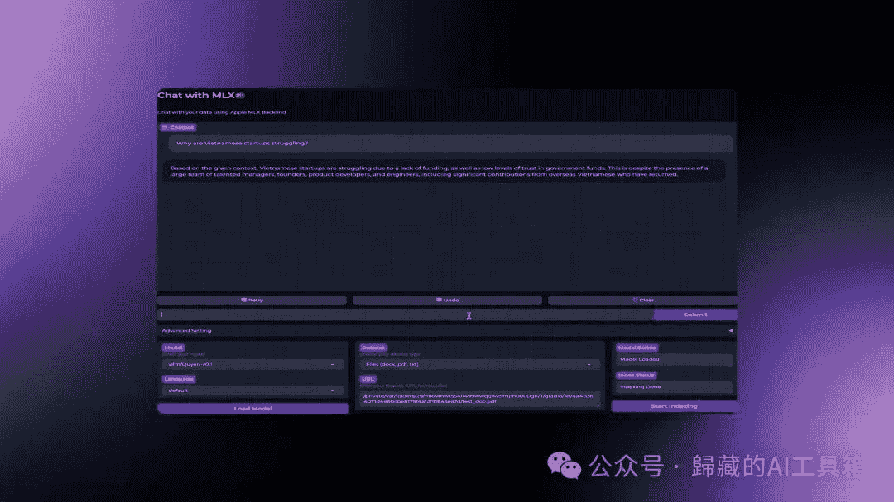

## **Toona：给黑白漫画上色**

链接： https://toona.io/colorizer

一个可以批量给黑白漫画上色的工具 toona，尝试了一下效果非常不错。

各位看不下去黑白漫画的可以冲了，重绘速度也很快，目前还是免费的。

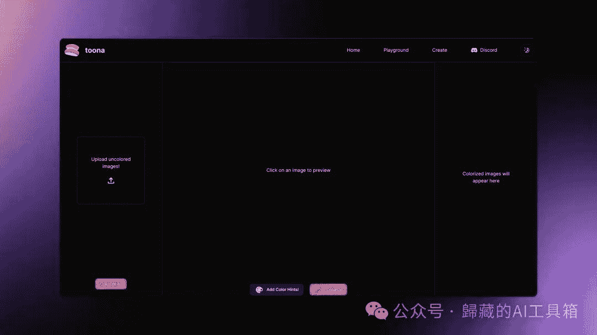

## Morphstudio：AI生成及视频编辑

链接： **https://app.morp**hstudio.com/waitlist

Stability AI 和 Morph 联合推出了使用类似Comfyui 交互的视频生成平台，支持从文本、图像或现有视频中生成或者转绘视频。

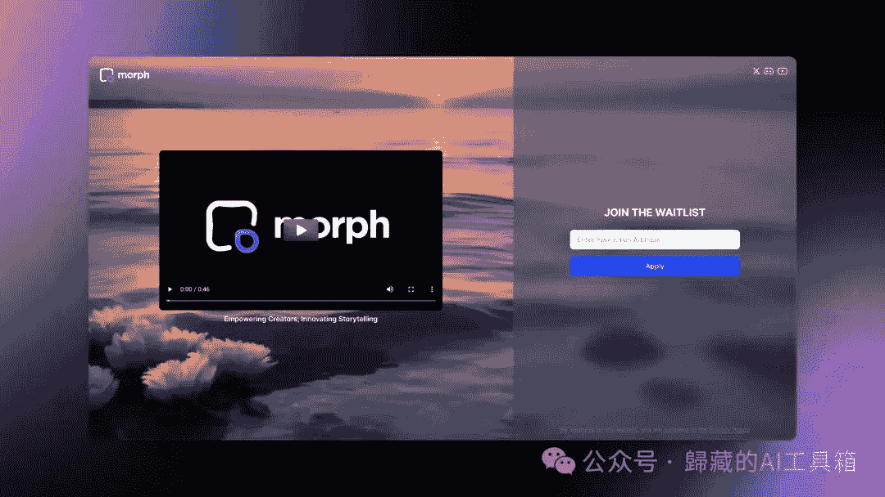

## **Findsd：根据图片找模型**

链接： https://www.findsd.art/find-sd

挺好玩的一个项目，根据你上传图片的风格帮你找到 Civitai 里面类似风格的 SD 模型。

找到的模型会展示模型生成的图片和得分，你可以直接前往Civitai下载模型。

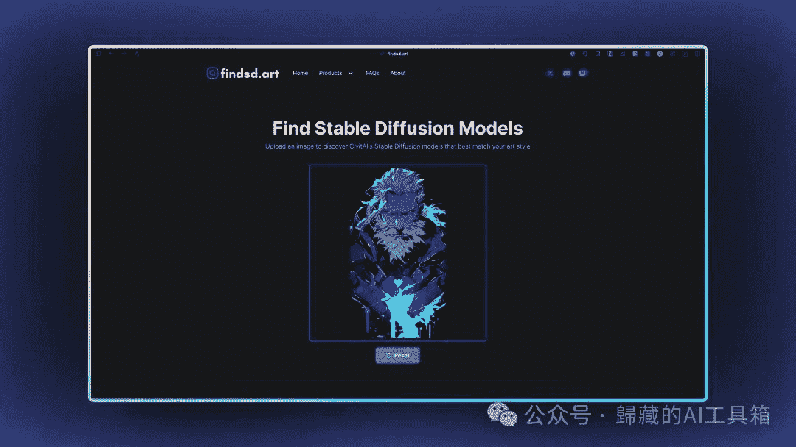

## Qingwu-zimu：字幕提取和翻译

链接： **https://github.c**om/melon/qingwu-zimu

青梧字幕是一款基于whisper的字幕自动提取工具。青梧字幕AI文字提取程序底层使用的是C++版本的 whisper.cpp [1] ，前端界面使用 Electron + vite + typescript ，开源版本的青梧字幕是完全本地化的程序，除了第三方翻译过程外不需要联网，所有数据存于本地，数据库使用的是 sqlite 。

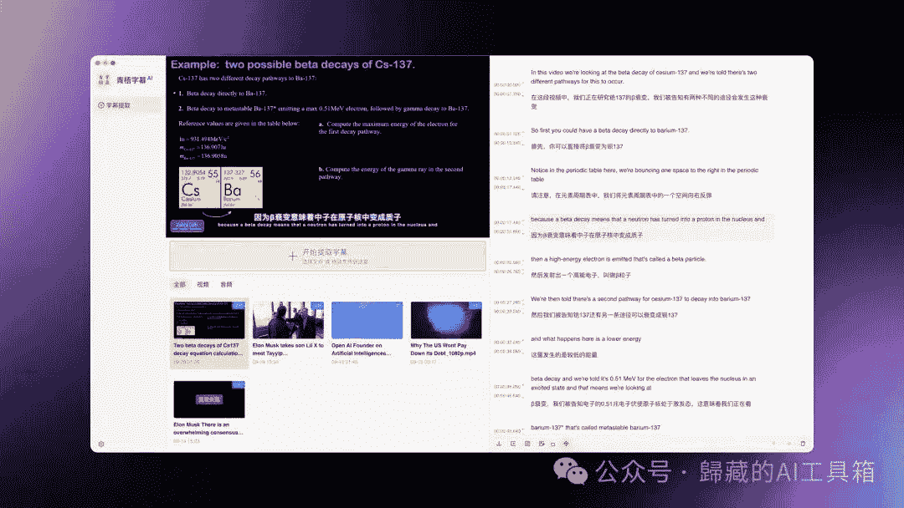

## Particle.news：人工智能处理新闻和信息

链接： https://www.particlenews.ai/

Particle.news 是一家由前 Twitter 工程师领导的初创公司，他们正在重新思考如何利用人工智能帮助人们处理新闻和信息。该公司最近进入了私人测试阶段，提供一种个性化的“多视角”新闻阅读体验。Particle.news 不仅利用 AI 来总结新闻，还旨在以一种公平补偿作者和出版商的方式来实现这一点，尽管它尚未分享其商业模式。随着人们对 AI 对日益萎缩的新闻生态系统影响的日益关注，Particle.news 的推出正值其时。

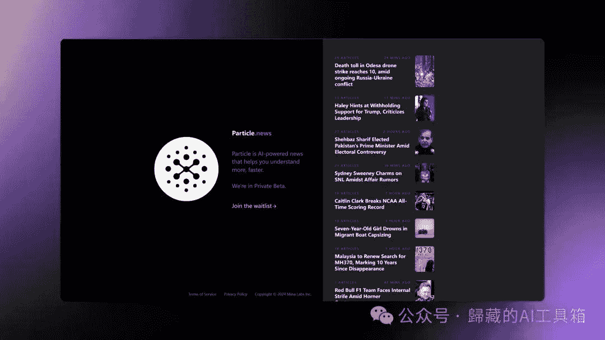

# **精选文章 ✦**

## 设计师需要为人工智能时代打造的 3 项能力

链接： **https://uxdesign.cc/the-3-capabilities-every-de**signer-needs-for-the-ai-era-e6cef9db2fd8

在AI时代，设计师需要构建的三大能力概述了设计师在人工智能时代所需发展的关键能力，以及设计在未来AI体验中的重要性。文章强调了设计师在理解和塑造AI体验方面的独特角色，以及他们如何帮助塑造人与AI模型之间的互动。随着AI技术的发展，设计师的角色和能力需要适应新的挑战。通过发展AI策略、AI交互设计和模型设计的能力，设计师可以在塑造未来AI体验中发挥关键作用。这不仅要求设计师具备对AI技术的深入理解，还要求他们能够创新地思考如何将这些技术应用于解决用户需求，从而推动设计领域向前发展。

这里有中文翻译版本： **h**ttps://twitter.com/op7418/status/1763414381042581869

## 对话月之暗面杨植麟：向延绵而未知的雪山前进

链接： [**ht**](https://mp.weixin.qq.com/s?__biz=MzU0MDk3ODUwMA==&mid=2247484401&idx=1&sn=a9108605ca23cb736dce15599c81bf83&poc_token=HIJv5GWjtXqHWpbX3Te7DanhUEVlybE2unIePywe&scene=21#wechat_redirect)tps://mp.weixin.qq.com/s/qVXcyw96IEPjrvZeA_1VMQ?poc_token=HIJv5GWjtXqHWpbX3Te7DanhUEVlybE2unIePywe

看了几遍腾讯新闻对月之暗面杨植麟的专访，把我认为一些认同的重点的内容记了一下。

+   AI 组织的要素：更多的人才，更多的资本。

+   AI不是我在接下来一两年找到什么PMF，而是接下来十到二十年如何改变世界。

+   真正的 AGI 肯定是全球化的，不存在由于某种保护机制你可以只做某个区域的 AGI 公司，全球化、 AGI 、和大用户量产品是成功的必要条件。

+   AI 领域接下来的竞争中会有更多的差异化，需要提前做预判和准备到底什么是“成立的非共识”。

+   接下来会有两个大的milestone（里程碑）。一是真正的统一的世界模型，就是它能统一各种不同模态，一个真正的scalable和general的architecture（可扩展、通用的系统结构）（Sora 启发）。二是能在没有人类数据输入的情况下，使AI持续进化（详细见 AK 10 月份视频倒数第二部分）。

+   “应用”本身是实现 AGI 的手段，也是实现 AGI 的目的。

+   AI唯一work就是next token prediction + scaling law，只要token足够完整，都是可以做的。

+   想知道但还不知道的事情：我不知道AGI的上限是什么样的，它会产生一个什么样的公司，这个公司能产生出来什么样的产品。这是我现在最想知道的事。（重点）。

## **扩散模型蒸馏的悖论**

链接： **https://sander.ai/202**4/02/28/paradox.html

Deep Mind 研究科学家Sander Dieleman写的关于《扩散模型蒸馏的悖论》。

特别关注了各种形式的蒸馏方法，这是通过用一个模型（学生）的预测结果受到另一个模型（教师）的监督来训练新模型的做法。这些蒸馏方法为扩散模型带来了极其引人注目的结果。

详细解释了为什么扩散模型需要多个步骤才能获得好的结果，以及如何通过各种方法减少这些步骤而不会太大程度上损害输出质量。

还探讨了多种扩散采样算法，这些算法旨在更快地通过输入空间移动并减少达到一定输出质量所需的采样步骤数量。

## Sora：大视觉模型的背景、技术、局限性和机遇回顾

链接： https://arxiv.org/abs/2402.17177v1

微软的论文，基于已经发布的内容和他们自己的逆向工程，全面回顾了 Sora 的背景、相关技术、新兴应用、当前的局限性和未来的机遇。非常全面和条理，建议全文阅读。

论文简介：本文基于公开的技术报告和对Sora的逆向工程分析，全面评述了该模型的发展背景、相关技术、应用领域、当前面临的挑战以及文字到视频AI模型的未来趋势。

文章首先回顾了Sora的发展历程，并深入探讨了构建这一“虚拟世界模拟器”的关键技术。随后，文中详细介绍了Sora在电影制作、教育、市场营销等多个行业中的应用及其可能带来的影响。

我们还讨论了要大规模部署Sora所需解决的主要挑战和限制因素，例如如何确保视频生成的安全性和公正性。

最后，文章探讨了Sora以及视频生成模型的未来发展方向，以及该领域的进步如何可能为人类与AI的互动开辟新的方式，从而提高视频制作的效率和创造力。

这里有宝玉的中文翻译： **htt**ps://baoyu.io/translations/ai-paper/2402.17177-sora-a-review-on-background-technology-limitations-and-opportunities-of-large-vision-models

## 即刻AIGC大目录第十期《真实世界的脉络》

链接： **h**ttps://m.okjike.com/originalPosts/65dbd40d38849f879f2bc369

推荐个即刻的宝藏帖子，Szhans每过一段时间会总结即刻里面的精华 AI 内容。除了一些常见的咨询以外，很多即刻用户自己总结的相关认知挺值得看一看的。

第十期即刻AIGC大目录来了，本期名为《真实世界的脉络》。距离上期《即将到来的浪潮》两个月，技术变革从未因为古老的历法而停下过脚步。

Open AI GPT Store 悄然登场，自定义GPTs 新生态以看不见的方式迅猛增长；Midjourney 推出6.0 引爆新一轮创造力，并即将推出生成视频的计划。

Sora 突然降临，惊醒了更多还未窥探过新世界的人们，如同ChatGPT降临时那般一轮轮地破圈。人们并没有意识到背后是 Sam Altman在洽谈7万亿美金的芯片项目的宏大计划。

Elon Musk 快马加鞭加速Grok 的迭代，紧密接触Midjourney企图弯道超车；厚积薄发的Google 推出全新的Gemini Pro 1.5 带来了质的飞跃，GPT-4 垄断的格局有望打破。更出乎意料地是，它还极速推出超越Llama 2的开源大模型 Gemma。

正如在半年前在《红色皇后》那期所指出， 军备竞赛引发算力、人力和资源比拼持续在升级；只不过我们大脑并不擅长感知这种指数增长，以及其带来影响。

Naval说， 「人工智能意味着计算机正在学习我们的语言，而不是我们必须学习他们的语言」。我们知道那一天一定会到来，只是在浪潮一轮轮袭来的间隔下，那些从未亲自参与其中的人们还无法想象是世界正以怎样的脉络发生剧变。

## 从单一模型到复合人工智能系统的演变

链接： **h**ttps://bair.berkeley.edu/blog/2024/02/18/compound-ai-systems/

在这篇文章中，我们分析了复合AI系统的趋势及其对AI开发者的意义。为什么开发者要构建复合系统？这种范式随着模型的改进是否会持续存在？以及开发和优化这些系统的新工具是什么——这是一个比模型训练少得多的研究领域？我们认为，复合AI系统可能是未来实现最大化AI成果的最佳方式，并可能是2024年AI中最具影响力的趋势之一。

这里有文章的中文翻译： **ht**tps://quail.ink/op7418/p/evolution-of-single-model-to-compound-artificial-intelligence-system

## 重温Lex Fridman 对 Andrej Karpathy 的采访

链接： **https://www.youtube.com/watc**h?v=cdiD-9MMpb0&t=5s

最近看到很多 Lex Fridman 采访 Andrej Karpathy 的视频剪辑才知道Lex Fridman采访过AK，所以就找到原视频翻译了一下。

主要内容：

Andrej Karpathy在视频中介绍了神经网络、物理学、机器学习和人工智能的进展与挑战。讨论包括神经网络的数学模型、它们在处理复杂问题时表现出的意外行为，以及这些技术对我们理解世界和处理信息的方式的影响。特别强调了合成智能在未来可能发挥的作用，包括解决宇宙之谜和在物理模拟中发现创新解决方案的能力。此外，还探讨了人工智能在理解和模拟人类语言、情感以及其在自动驾驶和其他实际应用中的潜力。

中文视频： **h**ttps://x.com/op7418/status/1763890756006330857?s=20

# **重点研究 ✦**

## 1位大语言模型时代来临：一切大型语言模型均转向1.58位构架

链接： **https://www.youtube.com/watc**h?v=cdiD-9MMpb0&t=5s

一种1位的LLM变体，命名为BitNet b1.58。在这个模型里，大语言模型的每个参数（或权重）都是三元的{-1, 0, 1}。它在复杂度和实际应用性能方面与相同模型规模和训练数据的全精度（即FP16或BF16）Transformer大语言模型不相上下，但在延迟、内存、吞吐量和能源消耗方面更具成本效益。

更为重要的是，1.58位LLM定义了新的扩展规律，并为训练新一代既高性能又高效的LLMs提供了方法。此外，它还开启了一个全新的计算范式，并为设计专门针对1位LLMs优化的硬件提供了可能性。

## DistriFusion：可以在多个 GPU 之间处理来加速图像生成

链接： **https://github.com/mit**-han-lab/distrifuser

实现了在八个NVIDIA A100 GPU上比单个GPU 生成速度快6.1倍。且不会降低图像质量。

论文简介：提出了一种名为DistriFusion的新方法。该方法通过在多个GPU之间实现并行处理来加速图像生成。具体来说，我们将输入的图像分割成多个小块，每块分配给一个GPU处理。

不过，简单地这样做会导致不同块之间缺乏有效交互，影响图像的整体质量。而想要增加这些块之间的交互，又会带来巨大的通信负担。

为了解决这个矛盾，我们发现相邻扩散步骤中输入数据的高度相似，于是提出了一种“移位块并行机制”。这种机制利用了扩散过程的连续特性，通过重用上一步计算好的特征图为当前步骤提供背景信息。

因此，我们的方法能够支持异步通信，并且能够与计算过程并行运行。通过广泛的实验，我们证明了这种方法可以应用于最新的Stable Diffusion XL模型，而且不会降低图像质量，并且在八个NVIDIA A100 GPU上比单个GPU快达6.1倍。

## **Trajectory Consistency Distil**lation：加速生成图片并且不损失质量

链接： https://mhh0318.github.io/tcd/

TCD 模型解决了 LCM 模型由于多步采样中累积的错误导致的图像细节丢失和性能下降的问题。

可以快速生成图片，并且保证生成图片的质量和细节。还支持 SDXL 生态的所有内容，比如 Lora 和 Controlnet 。

详细介绍：

潜在一致性模型（Latent Consistency Model, LCM）通过将一致性模型扩展到潜在空间，并利用引导一致性蒸馏技术，在加速文本到图像合成方面取得了令人印象深刻的性能。然而，研究人员观察到LCM在生成清晰且细节精致的图像方面存在困难。

为了解决这一限制，研究人员首先深入研究并阐明了潜在的原因，发现主要问题源自三个不同的领域的错误。因此，他们引入了轨迹一致性蒸馏（Trajectory Consistency Distillation, TCD），包括轨迹一致性函数（Trajectory Consistency Function, TCF）和战略性随机采样（Strategic Stochastic Sampling, SSS）。

轨迹一致性函数通过扩大自我一致性边界条件的范围，减少了蒸馏错误，并使TCD能够准确追踪整个概率流常微分方程（Probability Flow ODE）的轨迹。此外，战略性随机采样专门设计用于规避多步一致性采样中固有的累积错误，这种采样方式被精心设计以补充TCD模型。

实验表明，TCD不仅在低噪声函数评估次数（Number of Function Evaluations, NFEs）时显著提高了图像质量，而且与教师模型相比，在高NFEs时产生了更详细的结果。TCD在低NFEs和高NFEs时都保持了优越的生成质量，甚至超过了带有原始SDXL的DPM-Solver++(2S)的性能。值得注意的是，在训练期间没有额外的鉴别器或LPIPS监督。研究人员展示了在20 NFEs下的一些示例。

与Turbo系列相比，TCD采样的NFEs可以随意变化，而不会对结果质量产生不利影响；与LCMs相比，TCD解决了由于多步采样中累积的错误导致的图像细节丢失和性能下降的问题。

在推理过程中，可以通过调整一个超参数gamma来简单地修改图像的细节水平，这不需要引入任何额外的参数。TCD可以适应社区中基于SDXL的各种扩展和插件，例如LoRA、ControlNet、IP Adapter以及其他基础模型，例如Animagine XL。

## EMO：在弱条件下利用音频视频扩散模型生成富有表现力的肖像视频

链接： **https://humanaigc.github.io/e**mote-portrait-alive/

输入图片和音频就可以生成富有表现力的视频，并且嘴型是可以跟声音匹配的。

支持多语言、谈话、唱歌以及快语速的适配，这玩意又是一个造假利器，这下可能很多名人真要说“不是我说的，你别瞎说”了。可以根据输入视频的长度生成任意持续时间的视频。

实现方式：

该方法主要分为两个阶段。第一阶段是“帧编码”阶段，在这个阶段，我们使用 ReferenceNet 来从参考图像和运动帧中提取特征。随后进入“扩散过程”阶段，在这一阶段，一个预先训练好的音频编码器用于处理音频数据的嵌入。此外，面部区域的掩码与多帧的噪声数据结合在一起，用于引导面部图像的生成过程。

紧接着，我们使用 Backbone Network 来执行去噪处理。在 Backbone Network 中，我们运用了两种关键的注意力机制：一种是基于参考图像的“参考注意力（Reference-Attention）”，另一种是基于音频的“音频注意力（Audio-Attention）”。

## Multi-LoRA：无需训练的Lora合成

链接： **h**ttps://maszhongming.github.io/Multi-LoRA-Composition/

可以不经过训练直接融合多个 Lora 不损失效果，而且他们提出的通过 GPT-4V 评价图像质量的方法也很有参考性。

项目介绍：

本项目旨在通过新的文本至图像生成方法，着重采用多重低秩适应（Low-Rank Adaptations, LoRAs）技术，创造高度个性化且细节丰富的图像。我们介绍了LoRA开关（LoRA Switch）与LoRA组合（LoRA Composite），这两种方式的目标是在精确度和图像质量上超越传统技术，特别是在处理复杂图像组合时。

## MegaScale：超过1万个GPU上训练LLM的生产系统

链接： https://arxiv.org/abs/2402.15627

字节发布的这个MegaScale估计只有超级大厂才有用，一个在超过一万个 GPU 上训练 LLM 的生产系统。

整个系统涵盖了从模型块和优化器设计到计算与通信的重叠、运算符优化、数据管道以及网络性能调整的算法和系统组件。

MegaScale 在训练一个 175B 参数的 LLM 模型时，在 12,288 GPU 上实现了 55.2% 的模型浮点运算利用率（Model FLOPs Utilization，MFU），相比 Megatron-LM 提升了 1.34 倍。