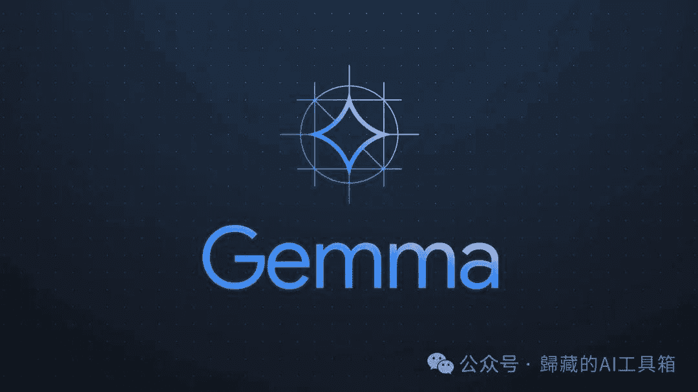
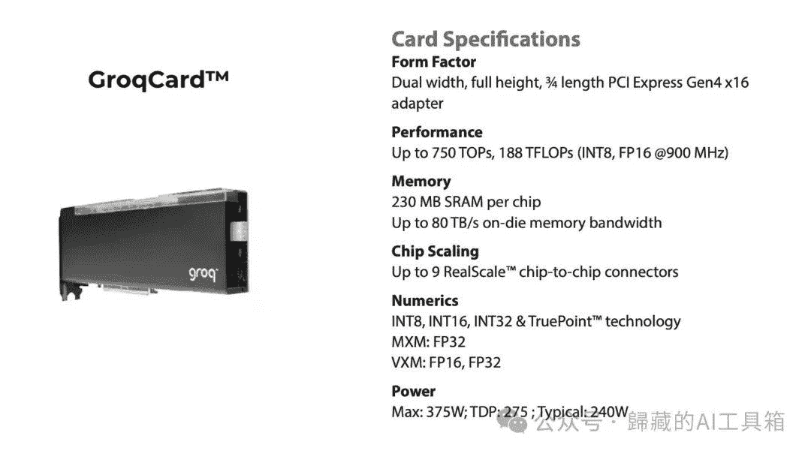
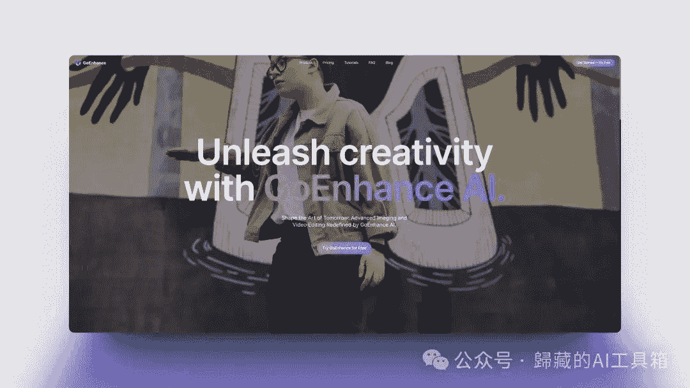
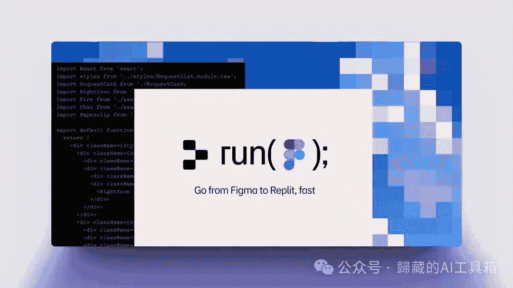
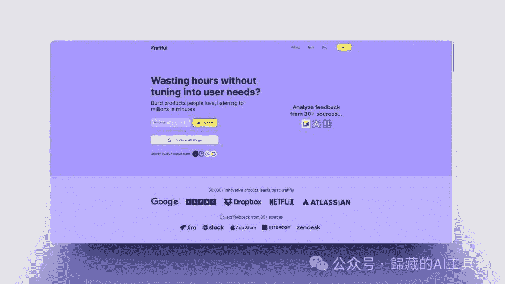
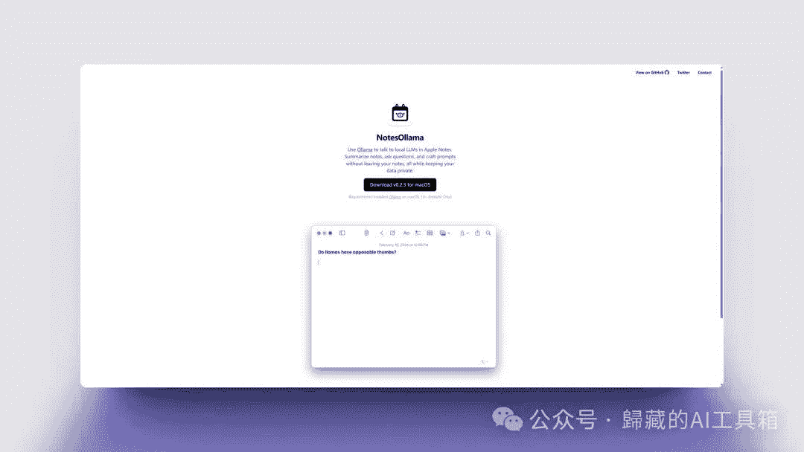
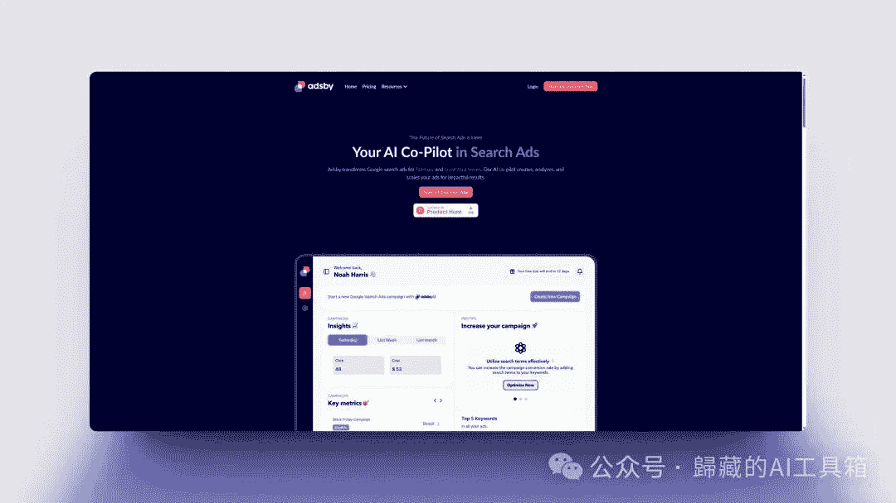
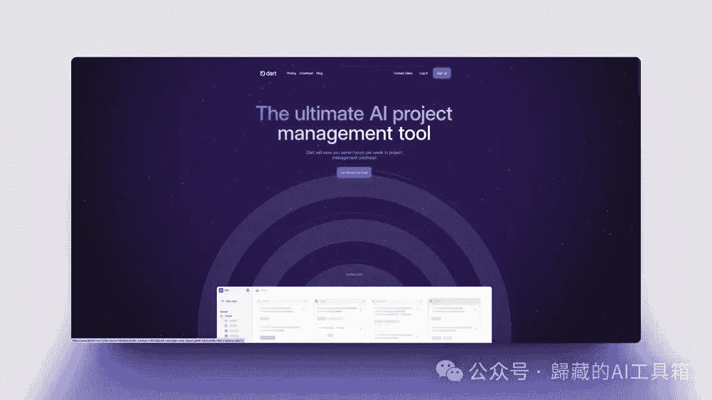
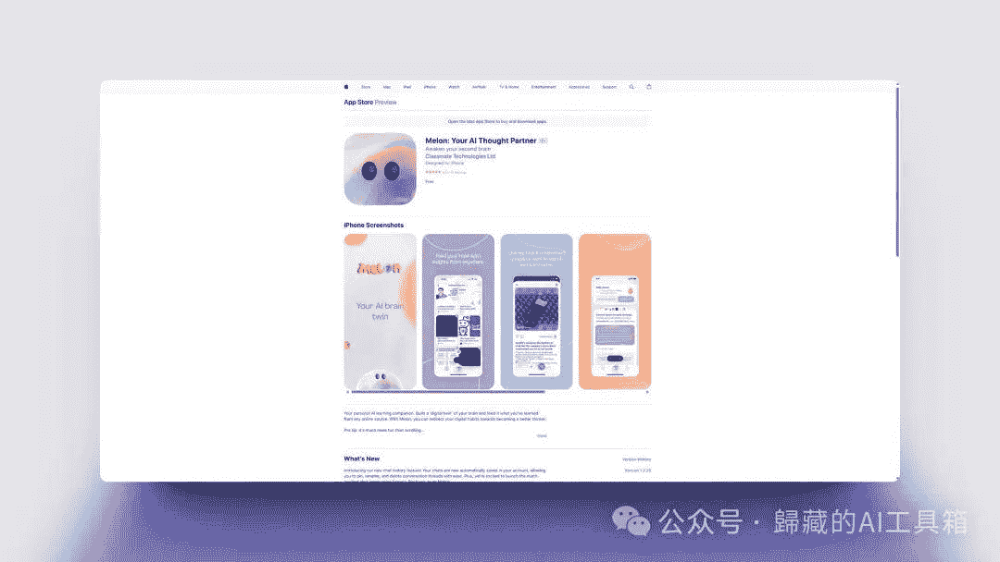

# AIGC Weekly #60

> 来源：[https://waytoagi.feishu.cn/docx/VYwNdKSIbofEc2xBLUSc2BhSn2g](https://waytoagi.feishu.cn/docx/VYwNdKSIbofEc2xBLUSc2BhSn2g)

> 🔗 原文链接： h[ttps://mp.weixin.q](https://mp.weixin.qq.com/s?__biz=MzU0MDk3NTUxMA==&mid=2247485464&idx=1&sn=7f9bd30b8c36cc3eacdc32c0e129fc00&chksm=fa0957f9f7fc2b7c366b5761125709c3990e4c49b09b5f3cca5801546d8c8eb1f41cef9e5902&scene=126&sessionid=1709892061#rd)q.com/s?__biz=Mz...

原创 op7418 歸藏的AI工具箱 2024-02-26 16:36  北京

# **Summary 总结**

每周一更新，主要介绍上周AIGC领域发布的一些产品以及值得关注的研究成果  容。

1. 谷歌开源了两个新的大语言模型Gemma 2B和Gemma 7B,这两个模型采用了与Gemini相同的技术,质量比同规模模型更高。

2. Stability AI发布了新的图像生成模型Stable Diffusion 3,这个模型不仅可以生成图像,也可以生成视频。

3. 公司Groq利用新型硬件实现语言模型每秒500个Token的高速输出,速度比顶级运营商快18倍。

4. 文章还介绍了一些新的AI产品,如视频风格转换平台GoEnhance,将Figma设计转为React组件的插件,以及用于项目管理的工具Kraftful等。

5. 精选了几篇英文文章,介绍了优化Stable Diffusion XL的方法,构建语言模型Tokenizer的教程,以及一些新模型如Sora和LAVE等的应用。

本篇正文共 9427 字，仔细阅读约 24 分钟

Midjourney提示词：a silver petal, top light, silver material, minimalist style, delicate sculpture, wonders of digital art, light sky blue and light white background, dreamy abstract, --ar 16:9

💎查看更多风格和提示词： https://catjourney.life/

# **上周精选 ✦**

## 谷歌开源Gemma 2B和7B两个大语言模型

链接： **h**ttps://blog.google/technology/developers/gemma-open-models/

谷歌上周第一次开源了他们的LLM Gemma ，Gemma 采用了和Gemini一样技术的开源LLM，同时质量也比同规模的模型要强。

下面是一些要点：

+   两种尺寸的模型权重：Gemma 2B和Gemma 7B。每种尺寸都有预训练和指导调整的变体。

+   一个生成式人工智能工具包，为使用Gemma创建更安全的人工智能应用提供指导和必要工具。

+   通过原生Keras 3.0为所有主要框架（JAX、PyTorch和TensorFlow）提供推理和监督微调（SFT）的工具链。

+   准备好的Colab和Kaggle笔记本，以及与Hugging Face、MaxText、NVIDIA NeMo和TensorRT等流行工具的集成，使得开始使用Gemma变得非常容易。

+   预先训练和经过调整的Gemma模型可以在您的笔记本电脑、工作站或Google Cloud上运行，并可以轻松部署到Vertex AI和Google Kubernetes Engine（GKE）。

+   跨多个人工智能硬件平台的优化确保了行业领先的性能，包括NVIDIA GPU和Google Cloud TPU。

+   允许所有组织进行负责任的商业使用和分发，无论规模大小。

+   未来还会发布Gemma更大模型变体。

+   英伟达的本地聊天机器人Chat with RTX 很快就会增加对 Gemma 的支持

详细的技术报告在这里： **h**ttps://storage.googleapis.com/deepmind-media/gemma/gemma-report.pdf

关于技术报告的一些总结： **h**ttps://x.com/op7418/status/1760496755987353692?s=20

**Huggingface的模型下载地址**在这里： https://huggingface.co/google/gemma-2b

**可以运行Gemma的Llama.cpp文件分支： htt**ps://github.com/ggerganov/llama.cpp/pull/5631

可以在 Perplexity Lab 快速体验 Gemma： https://labs.perplexity.ai/

ollama也支持了Gemma： https://ollama.com/library/gemma

## Stable Diffusion 3 图像生成模型发布

链接： **https://stability.ai/new**s/stable-diffusion-3

从Emad的暗示和发布的演示来看，SD3还具有视频生成能力。可以说是丐版Sora了。

Stability AI 还有货，发布了Stable Diffusion 3模型，多主题提示、图像质量和拼写能力方面的性能得到了极大的提高。

Stable Diffusion 3 套模型目前参数范围从 800M 到 8B。

这项技术采用了一种新型的扩散变换器（Diffusion Transformer，类似于Sora），并结合了光流学匹配（flow matching）及其他技术上的改进。

利用变换器（Transformer）的最新改进，这项技术不仅能够实现更广泛的应用范围，还能处理多种类型的输入数据（多模态输入）。

Stability AI 还声称，他们根据 Spawning AI 的 Do Not Train 注册表清理了所有数据集，其中有超过 1.5B 个选择退出请求和向 Stability 发出的其他手动请求。

这里申请早期访问权限： **https://stability**.ai/stablediffusion3

这里有更多SD3的测试图片： https://twitter.com/Lykon4072

## Groq利用新硬件实现LLM每秒500Token输出

链接： https://wow.groq.com/

每秒输出500个Token的项目groq，公开了他们的API，他们的输出速度比顶级运营商快18倍。得益于这个速度，甚至实现了完全实时的远程AI对话。

Mixtral, 8x7B SMoE可以达到480 Token/S，价格为100万Token 0.27美元。极限情况下他们用Llama2 7B甚至能实现750 Token/S。

目前他们还提供100万 Token的免费试用。API完全兼容OpenAI API。

他们可以实现这种输出速度的原因是自己设计的新架构显卡LPU，Groq的LPU在其系统中没有采用高带宽存储器（HBM）。它使用的是SRAM，其速度比GPU所用的存储器快约20倍。

团队的配置的很强大，180人的团队，CEO Johnathan Ross（Google的AI processor TPU的负责人），CTO Jim Miller是亚马逊云的aws 设计算力硬件的负责人，CMO曾经主导了当年Apple的Macintosh的市场发布。

**这**里有关于LPU架构的详细介绍： https://x.com/op7418/status/1759741614099234955?s=20

# **其他动态 ✦**

+   剪映海外版CapCut推出了文字生**成**视频功能，每人每天可以免费生成五次： https://www.capcut.com/editor-tools/ai-video-generator

+   A**rc Search 浏览器一个很有意思的新功能，双指捏合任何一**个打开的页面浏览器会自动为你总结页面内容： https://x.com/joshm/status/1760698068943724634?s=20

+   你现在可以给GPTs打分，同时在关于页面也会展示评**分**、类别、对话数量、会话开场白等信息： https://x.com/OpenAI/status/1760744915276116118?s=20

+   **Stability AI 官方的 SVD 视频生成平台**公测了： https://www.stablevideo.com/login?returnUrl=%2F

+   字**节发布了一个用类似 SDXL Turbo 的模型SDX**L-Lightning，只需几步即可生成高质量的 1024px 图像： https://huggingface.co/ByteDance/SDXL-Lightning

+   Gemini Advanced现在可以有似代码解释器的东西来运行 Python 代码： https://gemini.google.com/updates

+   **𝕏**正在与 Midjourney 就潜在的合作伙伴关系进行谈判： https://x.com/cb_doge/status/1759798475959771493?s=20

+   A**nimateLCM-SVD-xt 利用了 LCM 技术蒸馏的** SVD 模型，只需要四步就能生成不错的视频: https://huggingface.co/wangfuyun/AnimateLCM-SVD-xt

+   谷歌确认与 Reddit 合作。谷歌可以访问 Reddit 的数据 API（用于人**工智能和搜索）。另一方面，Reddit 将使用谷歌的人工智能来改进其搜索功能： htt**ps://blog.google/inside-google/company-announcements/expanded-reddit-partnership

+   **美国司**法部任命普林斯顿大学的乔纳森·梅耶尔为首席人工智能官： https://www.reuters.com/world/us/us-justice-dept-names-first-ai-officer-new-technology-challenges-law-enforcement-2024-02-22

+   Phind-70B宣称代码质量超越**GPT-4，同时运行速度提高 4 倍： https://**www.phind.com/blog/introducing-phind-70b

# **产品推荐 ✦**

## Goenhance：视频转绘平台

链接： https://www.goenhance.ai/

GoEnhance AI 提供先进的图像和视频编辑工具，允许用户转换和增强视频和图像。该平台利用先进的人工智能技术提供视频风格转换和图像放大等功能，以达到极致的细节效果。用户可以免费试用这些功能。

## Figma to Replit：将Figma设计转成React 组件

链接： **h**ttps://www.figma.com/community/plugin/1326990370920029683

Figma 中设计，Replit 中原型，这个实验性插件将静态设计转变为响应式 React 组件。将生成的代码导出到 Replit，与您的团队共享可立即部署的 React 应用程序，以便使用真实的逻辑和数据快速构建原型。

## Kraftful 2.0:产品副驾驶

链接： https://www.kraftful.com/

Kraftfu专门用于高效地分析用户反馈。该工具提供AI驱动的定性分析（AI-driven qualitative analysis），能够快速识别用户需求，自动生成功能请求列表、热门功能和产品洞察报告，并且能够量化地展示用户提到的问题出现的频次。Kraftful平台支持深入分析数据，包括设置后续问题，还可以与Slack和Jira等工具集成，以促进团队协作和简化开发流程。

## NotesOllama：本地模型总结Apple Notes内容

链接： https://smallest.app/notesollama

使用Ollama可以在Apple Notes中与本地的大语言模型（LLM）进行交流。可以在不离开笔记应用的情况下，对笔记内容进行总结、提出疑问，并创建智能提示，而且这一切都确保了数据的隐私性。

## Adsby：创建、分析和扩展 Google 广告

链接： https://adsby.co/

Adsby是一个针对初创企业和小型企业的谷歌搜索广告转换工具。它利用人工智能来创建、分析和扩展广告，以实现显著的效果。Adsby为广告新手提供简化的数字营销工具，同时也为专业人士提供强大的工具。它通过智能AI驱动策略来最大化广告支出回报（ROAS），并提供每日优化、AI生成的关键词建议、秒级的广告内容创作等服务。Adsby还提供14天的免费试用，帮助企业提高广告效率，并通过简单直观的平台指导用户完成广告活动的设置。

## **Dart：AI项目管理**

链接： https://www.itsdart.com/

Dart是一款项目管理工具，它擅长智能化地处理任务管理，功能包括路线图、日历视图以及文档处理等。用户特别喜欢它的用户友好界面、AI功能（比如自动填充特性和子任务自动生成），以及可以高度自定义布局，轻松区分工作和个人任务。Dart集成了生成性AI（如ChatGPT），这一创新功能在规划和任务创建方面为用户节约了大量时间和精力，被认为是其变革性的亮点。

## **Melon：人工智能思想伙伴**

链接： **https://apps.apple.com/gb/app/me**lon-your-ai-thought-partner/id1597174110

您的个人人工智能学习伴侣。为你的大脑构建一个“数字双胞胎”，并将你从任何在线资源中学到的知识输入其中。借助 Melon，您可以改变您的数字习惯，成为更好的思考者。

保存来自所有您喜爱的内容源的见解，并将其输入您的数字大脑。从播客到 TikTok。社交媒体文章。Melon 可以让您的数字混乱变得清晰。

使用 Melon 的 AI 帮助您将所学知识之间的点联系起来。提出问题、检索见解、总结结论。Melon让你的第二大脑焕发活力。

# **精选文章 ✦**

## 优化 Stable Diffusion XL 的终极指南

链接： **https://www.felixsanz.dev/articles/ultimate**-guide-to-optimizing-stable-diffusion-xl

该文详细介绍了如何优化Stable Diffusion XL (SDXL)以在任何显卡上获得最佳质量和性能。文章的核心目标是通过不同的优化技术，使SDXL能够在仅使用6GB内存的情况下生成图像，从而允许使用低端显卡。

测试使用RunPod平台在Secure Cloud上生成了一个搭载RTX 3090显卡的GPU Pod进行。文章比较了不同优化技术的性能，包括感知图像质量、生成每张图像所需时间、以及使用的最大内存量。

优化技术包括CUDA和PyTorch版本选择、注意力机制优化、FP16、TF32、以及多种管道优化技术，如模型CPU卸载、批处理处理、Stable Fast、DeepCache和TensorRT。

文章的结论部分提供了一个表格，总结了所有测试的结果，并提供了在寻求质量、速度或在内存限制下运行推理过程时的建议。

## 一起来构建 GPT Tokenizer

链接： **https://www.youtube.com**/watch?v=zduSFxRajkE

Open AI传奇研究员Andrej Karpathy的新课，教你理解和构建GPT Tokenizer。

他可以把相当复杂的LLM概念用非常好理解的方式讲出来。希望了解LLM的强烈建议听一下他的课，包括一些历史课程。

我们将发现，许多大语言模型(LLM)表现出的异常行为和问题，其实都源于标记化(tokenization)这一环节。我们会针对这些问题进行详细讨论，探究标记化为何成为问题的关键所在，以及为什么最理想的情况是有人能够找到办法，完全去除这一处理阶段。

这里有我翻译的版本： **h**ttps://x.com/op7418/status/1760103710804541803?s=20

## **Sora 如何改变我们的生活**

链接： **https://x.com/dotey/status/1760**538119416254532?s=20

宝玉受王又又邀请，和她以及《宇宙探索编辑部》副导演吕启洋（Ash）一起聊聊了一下当前火爆的话题 Sora，看 Sora 如何改变我们的生活。

把技术相关的一些问题整理成了文字，希望能够帮助大家更好地理解 Sora。将问题大约整理成了四类：Sora 的技术科普、Sora 产品相关问题、Sora 的价值和应用、Sora 有关的八卦闲聊。

## **生**成式 AI 实验：LLM 秘密护栏以及 Gemini Pro 如何拒绝提及 OpenAI 或 ChatGPT

链接： **htt**ps://blog.gdeltproject.org/generative-ai-experiments-llm-secret-guardrails-how-gemini-pro-refuses-to-mention-openai-or-chatgpt/

在测试谷歌云平台（GCP）的新模型Gemini Pro时，作者遇到了一个前所未见的行为：模型拒绝返回任何包含字符串"OpenAI"或"GPT"的文本。

由于OpenAI的GPT产品在全球AI新闻报道中非常普遍，Gemini Pro似乎将它们视为禁止术语。这意味着，无论是在输入提示中还是在返回的内容中，只要出现了"OpenAI"或"GPT"字符串，Gemini Pro就会中止其响应并返回一个"OTHER"错误。与GCP的旧模型（Bison或Unicorn）不同，这种行为是Gemini Pro独有的。

文章还提到，其他一些术语，如Baidu、Ernie和Microsoft也被视为禁止术语，而Anthropic、Claude、Cohere、Falcon、LLaMA和Vicuna等其他术语则没有问题。文章质疑为什么只有GCP的最新模型Gemini Pro受到这种奇怪的秘密禁止提及某些公司和模型的影响，而其旧模型Bison和Unicorn则不受影响。

## LAVE：LLM 驱动的Agent协助和语言视频编辑增强

链接： **https://arxiv.or**g/pdf/2402.10294.pdf

Meta 发布了一个可以利用 AI 自动剪辑视频的 Agents LAVE。这玩意再加上 Sora 这样的视频生成模型，一些简单的短视频以及广告视频基本上就不需要人工介入了，大家以后刷的估计都是生成出来的视频了，想要啥有啥。

## **AI 伴侣赋予计算机个性**

链接： **h**ttps://twitter.com/venturetwins/status/1760702201234944221

人工智能赋予计算机个性——解锁无数用例，涵盖友谊、指导、指导……甚至浪漫。配套产品的范围很广。

有些纯粹是为了娱乐而存在，而另一些则专注于提供特定类型的价值 - 无论是帮助孩子们浏览互联网，还是对抗老年人的孤独感。

51% 的成年人表示感到孤独。人们发现，像MyReplika这样的应用程序可以减少自杀意念 - 即使在不太极端的情况下，也很容易看出 24/7 朋友或教练的用处。

## **关于人工智能我不知道的事情**

链接： **h**ttps://blog.eladgil.com/p/things-i-dont-know-about-ai

文章概述了，像OpenAI、Google、Anthropic这样的主要企业，以及可能的其他公司正在使前沿大语言模型（LLMs）市场趋向寡头垄断。同时，像Llama（Meta）和Mistral这样的开源模型也在市场中扮演着重要角色。前沿模型的训练成本在不断上升，而通用模型的训练成本则在下降。大型科技公司和云服务提供商，如微软和Anthropic，正在成为这些模型的主要资金来源。

作者对大语言模型未来提出了几个问题：云服务提供商是否正在通过资助少数几家公司来形成一个寡头垄断市场？这种资助将如何影响市场动态？开源模型是否有潜力改变AI基础设施中的经济平衡？他们还探讨了政府在支持本地AI模型方面的作用，以及AI在中国的发展前景。

## **Elemental Cognition 对 GPT-4 和 **EC AI 的复杂推理性能进行了基准测试

链接： **https://ec.ai/per**formance-benchmarks/

该报告详细比较了EC的神经符号AI平台与当前市场上最先进的大型语言模型（LLM），如GPT-4，在解决复杂问题方面的性能。报告强调了LLMs在处理需要复杂推理的业务问题时的局限性，尤其是在准确性、透明度和可靠性至关重要时。相比之下，EC的AI平台通过将LLMs与一般性推理引擎深度集成，后者使用正式和高效的数学算法，展示了在各种测试中保持100%准确率的能力，包括在旅行规划、学位规划和劳动力规划等领域的应用。

报告指出，尽管LLMs在改进搜索和摘要方面取得了显著进展，但它们在解决需要复杂推理的业务问题时仍然远远不够。这些问题遍布于供应链、云计算、生命科学、零售、教育、建筑等多个行业，涉及大量复杂的依赖关系网络，需要无缺陷的逻辑和数值计算。EC通过其神经符号AI平台，成功地解决了这些问题，该平台能够为企业今天部署可靠、准确、透明的复杂推理应用。

在与GPT-4的比较测试中，随着问题复杂性的增加，GPT-4的准确率从32%下降到12%，而EC保持了100%的准确率。此外，EC能够100%可靠地检测出计划中的错误并修复，而GPT-4在错误检测和修复方面的表现分别只有40%和18%。这些结果强调了仅依赖LLMs解决复杂问题的危险性，并展示了EC如何有效和可靠地解决这些问题。

报告还讨论了LLMs在推理方面的局限性，包括它们在生成基于事实的内容时所面临的“幻觉”问题。尽管LLMs在与人类流畅互动方面取得了显著进展，但它们在进行合理逻辑推理和可靠地解释其推理基础以支持自己的声明方面仍然存在不足。

## 我如何构建 NotesGPT – 一个全栈人工智能语音笔记应用程序

链接： **https://dev.to/nutlope/how-i-built-note**sgpt-a-full-stack-ai-voice-note-app-265o

上周，我推出了notesGPT，这是一个免费且开源的语音笔记应用程序，到目前为止，在过去一周内已经吸引了35,000名访客，7,000名用户，并在GitHub上获得了1,000多个星标。该应用允许用户录制语音笔记，使用Whisper进行转录，并通过Together使用Mixtral提取行动项并在行动项视图中显示它们。它完全开源，配备了身份验证、存储、向量搜索、行动项功能，并且在移动设备上完全响应，便于使用。作者详细介绍了构建该应用的过程，包括架构和技术栈的选择，如Convex用于数据库和云函数，Next.js App Router用作框架，Replicate用于Whisper转录，Mixtral与JSON模式用于LLM，Together.ai用于推理和嵌入，以及Clerk用于用户认证等。此外，还介绍了如何设置身份验证、定义数据模式、获取数据以及如何记录、转录和生成行动项等关键功能。最后，还涉及了向量搜索的实现，使用Together.ai的嵌入功能使用户能够基于转录的语义含义在仪表板上进行搜索。总之，作者成功构建了一个具备身份验证、数据库、存储和API的全栈AI应用程序，并鼓励感兴趣的人查看notesGPT以从笔记中生成行动项或参考GitHub仓库。

## 深入了解Anthropic的融资热潮

链接： **h**ttps://www.nytimes.com/2024/02/20/technology/anthropic-funding-ai.html

人工智能初创企业Anthropic在过去一年里从包括Google、Salesforce、Amazon和Menlo Ventures在内的投资者那里筹得了高达73亿美元的惊人资金。这些融资轮因其快速完成和涉及的巨额数目而引人注目。此外，这些交易结构颇为复杂，包括了Anthropic与投资者之间的技术使用协议，实际上通过采购来回流部分投资资金。Menlo Ventures还特别成立了一个管理小额投资者在Anthropic中利益的特殊目的实体（special purpose vehicle）。