# AIGC Weekly #59

> 来源：[https://waytoagi.feishu.cn/docx/LGIAdLd1coVKVYxIr5Tci0YQnDe](https://waytoagi.feishu.cn/docx/LGIAdLd1coVKVYxIr5Tci0YQnDe)

> 🔗 原文链接： h[ttps://mp.weixin.q](https://mp.weixin.qq.com/s?__biz=MzU0MDk3NTUxMA==&mid=2247485440&idx=1&sn=c78efdcd7cd19505d0a75d8e696659d1&chksm=faef62186cbe88eaaadbccef8156c13d0e2ee6f213419f5250e979c4958ccd72e47adc2f6730&scene=126&sessionid=1709892061#rd)q.com/s?__biz=Mz...

> 作者：歸藏  公众号：歸藏的AI工具箱 2024-02-18 15:23  北京

# **Synopsis 简介**

汇总了春节期间人工智能领域的一些重要新闻和产品动态

1.  OpenAI发布了视频生成模型Sora,可以生成1分钟长的高质量视频。Sora支持从图像和文本生成视频,并且可以扩展和编辑视频内容。

1.  谷歌发布了语言模型Gemini 1.5 Pro和Ultra 1.0,支持长达100万字的上下文理解能力。同时推出了付费会员计划Gemini Advanced。

1.  Stability AI发布基于扩散模型的图片生成模型Stable Cascade,支持图像变化和生成。

1.  汇总了Midjourney图片生成模型的一些新功能,如默认版本升级和区域编辑能力增强。

1.  介绍了一些新的AI产品,如视频生成软件Deforum Studio,自动生成UI设计稿的工具Galileo AI,以及英伟达的本地语言模型软件Chat with RTX等。

1.  收录了一些AI领域的文章,如人工智能如何改变广告业,使用AI进行3D渲染以及Stable Diffusion潜在空间的解释等。

本篇正文共 18096 字，仔细阅读约 46 分钟

Midjourney提示词：subtle red chrome wave background --chaos 0 --ar 16:9 --style raw --weird 0

# **上周精选 ✦**

## Open AI 发布 Sora 视频生成模型

链接： https://alpha.midjourney.com/

春节唯一王炸，Open AI为狙击谷歌发布了他们的视频生成模型Sora，这个视频模型可以生成长达1分钟的视频，在时长、稳定性、一致性和运动幅度上全部碾压现在所有的视频生成模型。

Sora的视频生成能力：

+   Sora 能够生成提供图像和提示作为输入的视频。

+   Sora 还能够在时间上向前或向后扩展视频。比如多个视频都是从生成的视频片段开始向后延伸的。因此，几个视频的开头都不同，但所有视频的结局都是相同的。使用此方法向前和向后扩展视频以产生无缝的无限循环。

+   扩散模型启用了多种根据文本提示编辑图像和视频的方法。将其中一种方法 SDEdit, 应用于 Sora。这项技术使 Sora 能够零镜头地改变输入视频的风格和环境。

+   还可以使用 Sora 在两个输入视频之间逐渐进行插值，从而在具有完全不同主题和场景构成的视频之间创建无缝过渡。

+   Sora 还能够生成图像。通过在时间范围为一帧的空间网格中排列高斯噪声块来实现这一点。该模型可以生成各种尺寸的图像，分辨率高达 2048x2048。

Sora还有一些其他的特征：

+   3D 一致性：Sora 可以生成带有动态摄像机运动的视频。随着摄像机的移动和旋转，人和场景元素在三维空间中一致移动。

+   长期连贯性（Long-range coherence）和物体持久性（Object permanence）：是视频生成系统面临的重大挑战之一，特别是在采样长视频时维持时间上的连续性。Sora通常能够有效地处理短期和长期依赖关系，尽管并不总是如此。

+   与世界互动：Sora 有时可以用简单的方式模拟影响世界状况的行动。例如，画家可以在画布上留下新的笔触，并随着时间的推移而持续存在，或者一个人可以吃汉堡并留下咬痕。

+   模拟数字世界：Sora同样能够模拟人工过程，例如视频游戏。在Minecraft中，Sora可以同时控制玩家的基本策略，还能高保真度地渲染游戏世界及其动态变化。通过使用提及“Minecraft”的字幕提示Sora，可以实现零样本（Zero-shot）地激发这些能力。

Open AI 还透露了一些训练的大概过程：

+   将视觉数据转换为Patches：探讨了如何让生成视觉数据的模型继承LLM通过在互联网规模的数据上训练，来获得广泛的能力的优势。不同于LLMs使用文本标记，Sora模型使用了“视觉补丁”（Visual Patches）。之前的研究已经显示，对于视觉数据模型而言，补丁是一种有效的表现形式。我们发现，对于训练多种类型视频和图像的生成模型而言，补丁是一种高效且可大规模扩展的表现形式。

+   视频压缩网络：训练了一个可以降低视觉数据维度的网络。该网络以原始视频作为输入，并输出在时间和空间上都经过压缩的潜在表示。Sora在这个压缩的潜在空间中进行训练，并随后生成视频。还训练了一个相应的解码器模型，将生成的潜在表示映射回像素空间。

+   时空潜在Patches：在处理一个压缩后的输入视频时，会提取一系列的“时空补丁”（spacetime patches），这些补丁在这里起到了类似于变换器（Transformer）中的“标记”（tokens）的作用。这种方法同样适用于图像处理，因为从本质上讲，图像就是只有一帧的视频。采用的基于补丁的表示方法，使得Sora能够处理不同分辨率、时长和宽高比的视频和图像。

+   用于视频生成的Scaling transformers：Sora是一种扩散模型；它主要的作用是，给定输入的带有噪声的补丁（以及如文本提示这样的条件信息），Sora被训练来预测并还原出原始的“干净”补丁。更为关键的是，Sora实际上是一个“扩散变换器”（diffusion transformer）。扩散变换器在视频模型中也能有效扩展。随着训练计算量的增加，样本质量显著提高。

一些关于技术原理的补充阅读：

+   **O**pen AI官方发布的技术报告，演示视频基本都来自这里： https://openai.com/research/video-generation-models-as-world-simulators

+   这**是**构成Sora基础之一的Diffusion Transformer论文作者关于Sora的一些猜测和技术解释： https://x.com/op7418/status/1758822875707154838?s=20

+   **宝玉关于生成原理比较通俗的解释： https://x.com/**dotey/status/1758726880381862000?s=20

+   **Sora所有使用的相关技术对应的论文合集： https://hu**ggingface.co/collections/pxiaoer/sora-65d0e2db17e2b305e0fc572e

+   **SIY.Z的解读有一些世界模型的历史介绍**： https://www.zhihu.com/question/644473449

+   **J**imFan关于Sora训练素材来源的讨论： https://x.com/DrJimFan/status/1758210245799920123?s=20

## 谷歌发布Gemini 1.5 Pro和开放 Ultra 1.0模型

链接： **https://blog.google/technology/ai/google-ge**mini-next-generation-model-february-2024

谷歌在Sora之前几个小时发布的内容，也非常离谱了，100万上下文长度可以支持1小时的视频内容、11小时的音频内容、3万行代码、70万字的文字。RAG基本上不存在了，同时他们还测试了1000万的上下文，错误率也不是很高。目前公开模型上下文长度最长的是Claude 2.1的20万Token。

+   Gemini 1.5基于Transformer和MoE架构的研究和工程创新，提高了训练和服务的效率。

+   Gemini 1.5 Pro是一个中等规模的多模态模型，适用于多种任务，并引入了在长上下文理解方面的实验性特性。

+   Gemini 1.5 Pro在文本、代码、图像、音频和视频评估的综合面板上的性能超过了Gemini 1.0 Pro，并且与1.0 Ultra在同样的基准测试上表现相当。

+   此外，Gemini 1.5 Pro在进行长上下文窗口的测试中表现出色，在NIAH评估中，它在长达100万个Token的数据块中99%的时间内找到了嵌入的文本。

里面还举了一些可以提现上下文能力的例子：

+   它可以完整理解高达80 万 Token 的 Three.js 代码以及相关文档库。并根据提示找到对应的代码和示例完成教学和编码任务。

+   多模态演示，可以从一部有 60 万 Token 的电影中精确的找到截图的时间戳以及所描述的内容。

+   维克多·雨果的五卷本长篇小说《悲惨世界》（共1382页，含有大约732,000个Token）。它的多模态（multimodal）处理能力可以处理粗略地画出一个场景，然后询问“请看这幅图画中的情景。这个场景出现在书的哪一页？”

谷歌还像泄露的文件描述的一样将Bard更名为Gemini，同时推出了Gemini Advanced付费会员计划，可以使用Ultra 1.0模型。

Gemini Advanced 现已在 150 多个国家和地区提供英语版本。

可以在安卓的Gemini应用和iOS 的谷歌应用使用Gemini Advanced。

同时Google Assistant 语音功能将会由Gemini驱动，这个真是大招，直接吊打 siri 。

Gemini 开始在美国的 Android 和 iOS 手机上推出英语版本，并将在未来几周内全面推出。从下周开始，将能够在更多地点以英语、日语和韩语访问它，并且即将推出更多国家/地区和语言。

公告地址： **h**ttps://blog.google/products/gemini/bard-gemini-advanced-app/

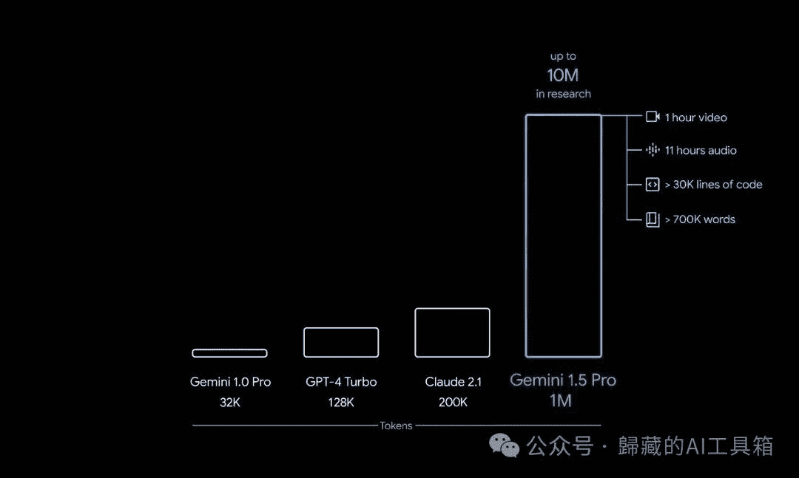

## **Stability AI发布新架构**图片生成模型Stable Cascade

链接： **h**ttps://stability.ai/news/introducing-stable-cascade

Stability AI同时进行着多条线还又开新坑，发布了一个基于Würstchen架构的新的图片生成模型Stable Cascade，这个模型由三部分构成使得训练和微调变得非常容易。

他们还提供了了微调、ControlNet 和 LoRA 训练脚本。

除了标准的文本到图像生成之外，Stable Cascade 还可以执行图像变化和图像到图像生成。

会跟随模型一起发布的 Controlnet：

+   局部重绘：输入与文本提示附带的蒙版配对的图像。该模型根据提供的文本提示填充图像的遮罩部分。

+   Canny Edge：通过跟踪输入到模型的现有图像的边缘来生成新图像。该测试也可以从草图进行扩展。

+   2x超分辨率：也可用于C阶段生成的潜在空间。

社**区**的支持也很快，ComfyUI已经官方支持了Stable Cascade的使用可以在这里查看工作流和对应的教程： https://gist.github.com/comfyanonymous/0f09119a342d0dd825bb2d99d19b781c

这里是可以在A1111 Web UI上使**用**Stable Cascade的插件： https://github.com/blue-pen5805/sdweb-easy-stablecascade-diffusers

还有人在第二天就实验了Stable Cascade的微调流程，发了第一个微调的模型： https://civitai.com/models/306144

## Midjourney的一些动态合集

链接： **h**ttps://x.com/op7418/status/1757926557820305458?s=20

+   将把V6设为默认版本（目的是对服务器进行压力测试）

+   Niji V6的平移、缩放及区域变更功能现已推出

+   对V6核心模型进行了更新，在细节表现、对比度和整体连贯性上都有所提升

+   Midjourney alpha测试版网站现在开放了1000张图片生成账号的使用权限，这里尝试： https://alpha.midjourney.com/

+   生成图像的速度可能提高一倍，v6 将配备涡轮模式

+   正在开发下一版本的风格调节器以及提升一致性

+   网站将引入社交群组功能！包括团队创建和实时社交互动，在向所有用户开放网站前，将制作入门视频和流程，三月全量开放新网站。

+   正在训练视频模型，进展比较慢尚不确定何时完成

+   V7 版本模型已经开始训练

+   ControlNet目前还未达到标准，将继续训练

+   正在研究如何实现角色的一致性

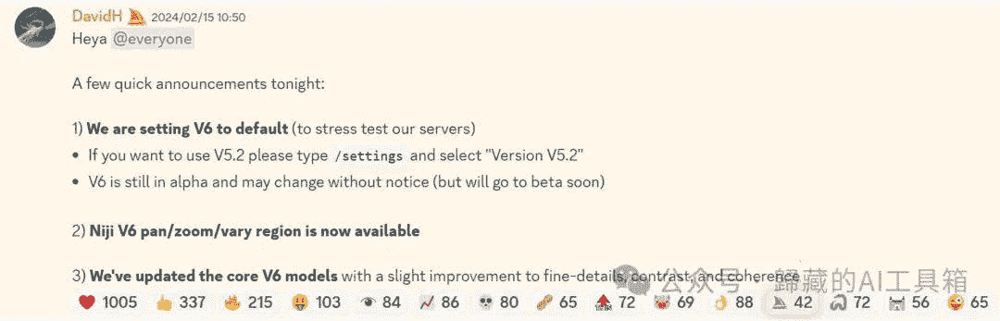

# **其他动态 ✦**

+   Runway GEN:48 AI 电影大赛公布了获胜者，这**个**视频巧妙的用游戏对话的形式展现剧情： https://x.com/iamneubert/status/1758493728925270022?s=20

+   Open AI 公布了一个 Open AI论坛，参与者可以参加 open AI 组织的线上和线下活动并且同 Open AI 员工深入交流，更有机会可以提前测试一些相关功能（Sora？） https://forum.openai.com/

+   Open AI 取消了 GPT-4 Turbo 的每**日**调用限制并将总的调用限制提高了一倍： https://platform.openai.com/docs/guides/rate-limits/usage-tiers

+   O**pe**n AI 公布了几个他们封禁的跟国家相关的恶意使用者，其中中国两个、俄罗斯一个、朝鲜一个、伊朗一个： https://openai.com/blog/disrupting-malicious-uses-of-ai-by-state-affiliated-threat-actors

+   Meta 发布了一个音频生成模型与传**统的逐字生成模型相比速度快了 7 倍： https://**pages.cs.huji.ac.il/adiyoss-lab/MAGNeT/ ?

+   MAGIC-ME 字节发布了一个针对视频生成中人物身份保持的项目。可以在视频生成中保持对应输入图像人物的身份特征： https://magic-me-webpage.github.io/

+   O**pe**nAI 一直在积极开发一款网络搜索引擎，这一动作预示着这家获得微软支持的创业公司将与 Google 展开更为直接的竞争： https://www.theinformation.com/articles/openai-develops-web-search-product-in-challenge-to-google

+   Open AI早期员工Andrej Karpat**h**y再次从Open AI离职自己创业： https://x.com/op7418/status/1757626444258435182?s=20

+   C**h**atGPT 增加了记忆功能及控制选项，可以记住你在对话中提到的内容，可以控制打开或者关闭，也可以有无记忆对话的临时聊天选项： https://openai.com/blog/memory-and-new-controls-for-chatgpt

+   ElevenLabs 现在可以在语音库中分享自己的声音模型，并获得收益： https://elevenlabs.io/payouts

+   苹**果发布了一个可以利用LLM 生成**动画的框架Keyframer。Keyframer允许用户通过自然语言提示来创建静态2D图像的动画： https://arxiv.org/pdf/2402.06071.pdf

+   Vercel集成了一堆AI服务包括Perplexity、Replicate、El**evenLabs等，现在利用Verce**l开发AI项目更加方便了，直接一步到位： https://vercel.com/blog/ai-integrations

+   ARC浏览器新增了一个功能，可以直**接**自动将你打开的一堆标签页按功能分组： https://x.com/browsercompany/status/1755252656078024976?s=20

+   **RMBG v1.4一个新的背景分割开**源模型，效果非常好： https://huggingface.co/briaai/RMBG-1.4

# **产品推荐 ✦**

## LangSmith：LLM应用开发平台

链接： https://www.langchain.com/langsmith

LangChain 的 LLM 应用开发平台LangSmith正式开放给了所有人使用，同时宣布获得了Sequoia 领投的 A 轮融资。LangSmith 是一个统一的 DevOps 平台，用于开发、协作、测试、部署和监控LLM应用程序。新的品牌形象和网站搞得也很不错。

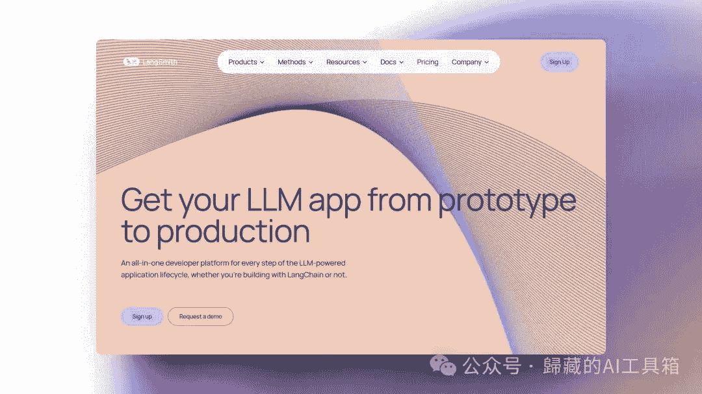

## Ollama Windows 预览版推出

链接： https://ollama.com/download/windows

本地LLM运行工具 Ollama 推出了 windows 版本。以下是如何开始：

+   下载+双击安装

+   打开最喜欢的终端并输入 ollama run llama2

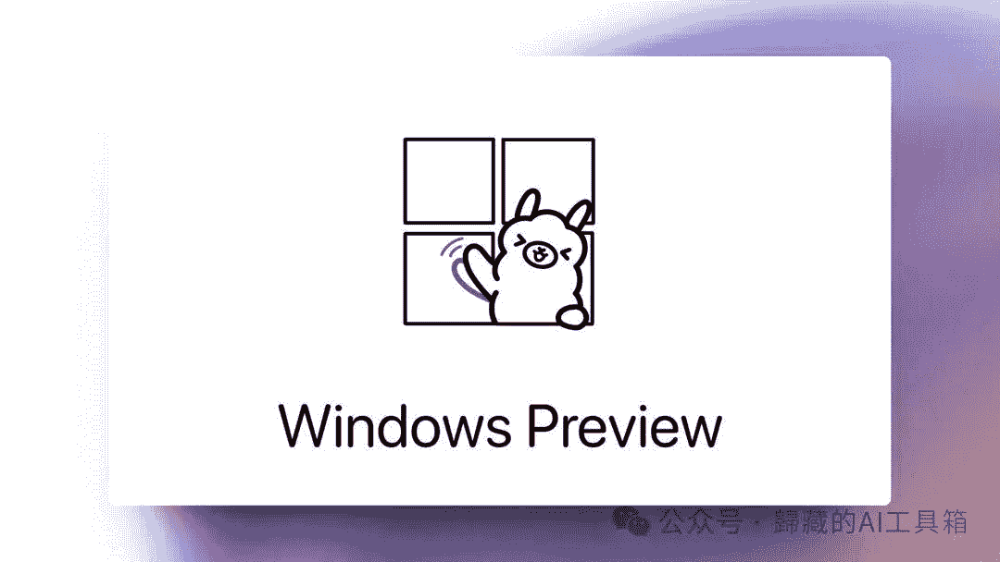

## Enchanted：与Ollama搭配使用的客户端

链接： **https://github.com**/AugustDev/enchanted

Enchanted是一款开源的、与Ollama兼容的、适用于macOS/iOS/iPad的优雅聊天应用程序。它专为私有部署的模型如Llama 2、Mistral、Vicuna、Starling等设计，本质上是一个连接到自己的Ollama模型的ChatGPT应用界面。

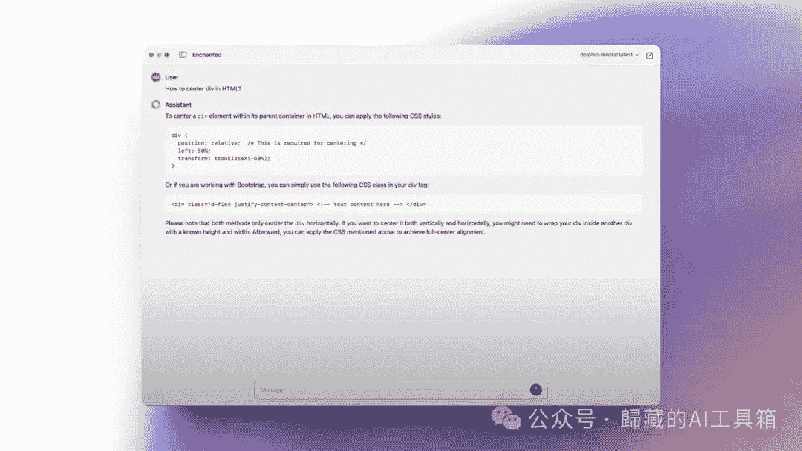

## Leiapix：上传图片生成运镜视频

链接： https://www.leiapix.com/

试了一下Leiapix 这个可以提取图片深度信息，然后生成运镜视频的产品。效果还挺好的，自定义选项也很丰富，一些简单的场景运镜视频不用视频生成工具用这个也挺好。直接上传图片然后再右侧调整选项就行。

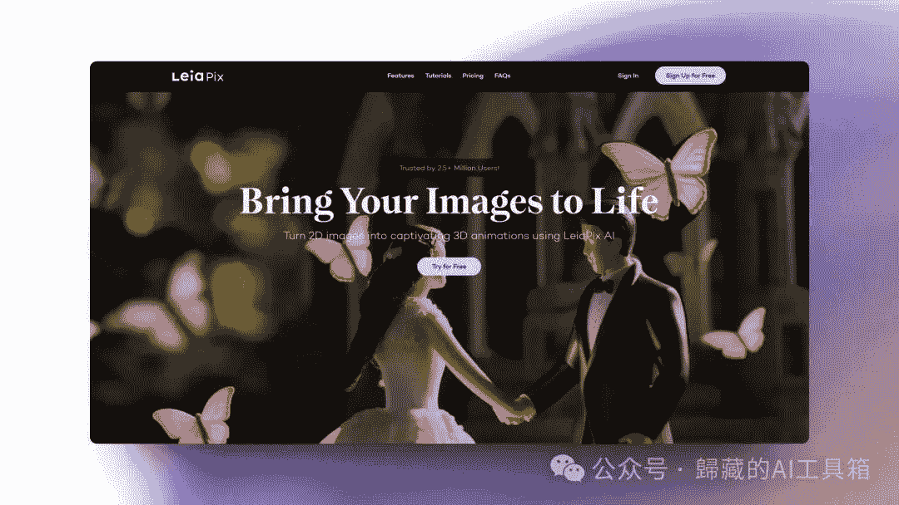

## Chat with RTX：英伟达的本地LLM聊天程序

链接： **ht**tps://www.nvidia.com/en-us/ai-on-rtx/chat-with-rtx-generative-ai/?=&linkId=100000241545943

英伟达发布了一个可以在 PC 使用的本地 AI 聊天软件Chat with RTX。

可以使用 Chat with RTX 连接到你的内容的自定义聊天机器人。使用 RAG 和 TensorRT-LLM 在 RTX 加速的 PC 上本地进行聊天。

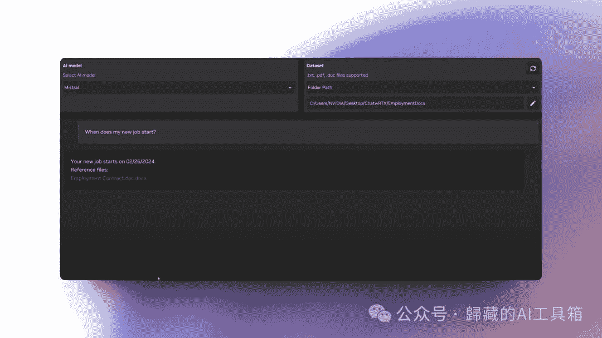

## **stable-diffusion-web**ui-forge：另一个Web UI界面

链接: **h**ttps://github.com/lllyasviel/stable-diffusion-webui-forge

Controlnet 的作者lllyasviel，他跟 UI 界面杠上了，除了之前他维护的Fooocus之外还新发布了一个 Web UI Forge。

这个新的 UI 跟原有的 Web UI 交互和样式完全一致，但是解决了两个 Web UI比较重要的问题：

首先是他大幅优化了低显存显卡的显存占用和推理速度，6G 显存的显卡推理速度会提高 60% 到 75%，显存占用会降低800MB 到 1.5GB。

另一个是降低了一些 SD 支持项目在 Web UI的实现成本，使用 Unet Patcher，Self-Attention Guidance、Kohya High Res Fix、FreeU、StyleAlign、Hypertile 等方法都可以在大约 100 行代码中实现。

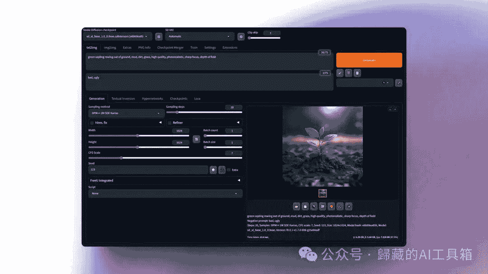

## Deforum Studio：Deforum 的Web版本应用

链接： https://deforum.studio/

早期 SD 视频生成项目Deforum现在推出了 Web 版本的视频生成服务，相较于 WebUI 的插件版本网页应用更加的易用和稳定。

同时内置了相当多的风格和运镜效果可以选择。虽然现在已经有很多视频生成模型可以生成连贯且一致的效果了Deforum生成的这种风格的视频依然很有视觉冲击力。

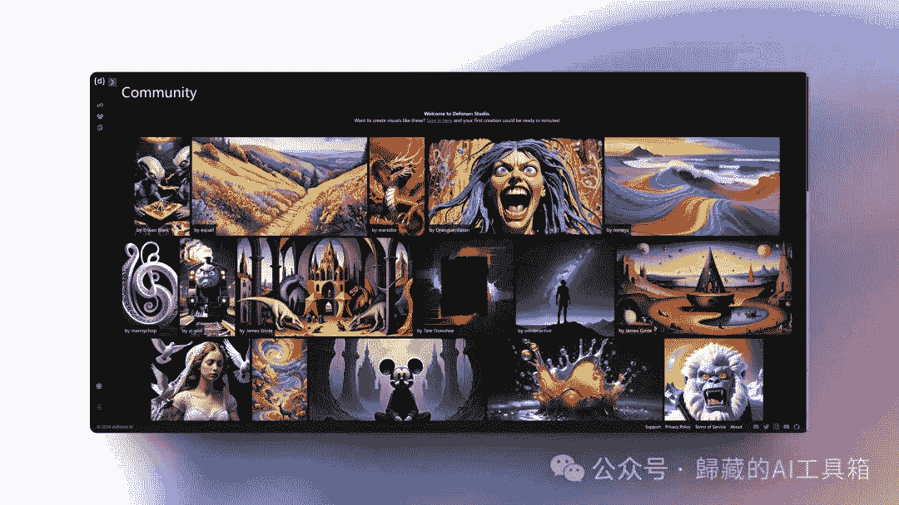

## Galileo AI：自动生成UI设计稿

链接： https://www.usegalileo.ai/explore

Chat GPT发布之初就放出Demo的UI设计稿自动生成应用，终于向所有用户开放了。支持文字图片以及线稿直接生成UI设计稿。

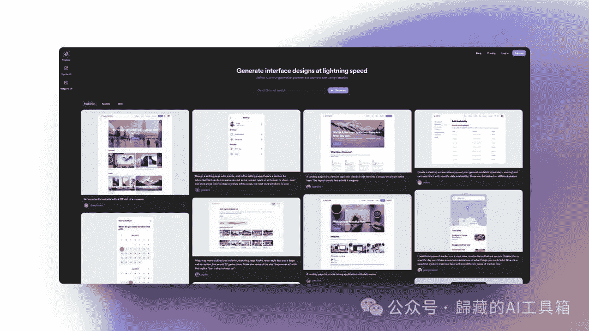

## Dittto：用AI修复落地页文案

链接： https://www.dittto.ai/

Dittto是一个利用人工智能技术帮助改善网站首页文案的服务平台。该平台指出，不良的文案会严重影响转化率，因为有35%的用户在未滚动页面前就离开，而57%的阅读时间发生在页面的上半部分，用户仅需50毫秒就能对网站形成初步判断。Dittto提供的解决方案包括复制成功品牌的文案以提高转化率、网站定位审核以清晰展示客户价值、自动发现适合产品的品牌声音，并从50多个顶级SaaS品牌中选择模仿对象。此外，Dittto还提供了一个英雄文案AI工具，该工具经过训练，能够在几次点击内生成准备就绪的文案，并设有保存变体库以便日后进行A/B测试。

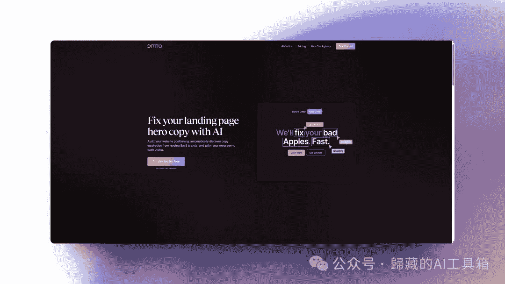

## Magicads：利用AI创建广告视频

链接： https://www.magicads.ai/

MagicAds是一个AI驱动的视频广告创作平台，它能够在几分钟内生成类似于网红的视频广告。用户只需输入产品的URL，进行可选的定制，即可接收到视频广告。该平台已经创作了超过10,000个AI视频广告，并且不需要信用卡即可开始使用。MagicAds简化了用户生成内容广告的创作过程，提供了一键式解决方案，适用于网站、iOS和Android应用程序的广告创作。

## Rizzle：从博客、播客内容创建视频

链接： https://rizzle.com/

Rizzle AI 是一个无需编辑的视频创作平台，它与 GettyImages 合作，为创作者提供了访问全球最大的无版税库存媒体库的能力。这个库存包含超过5亿张图片和视频，这些资源都是专为 Rizzle 平台的用户准备的，并且拥有版权保护。

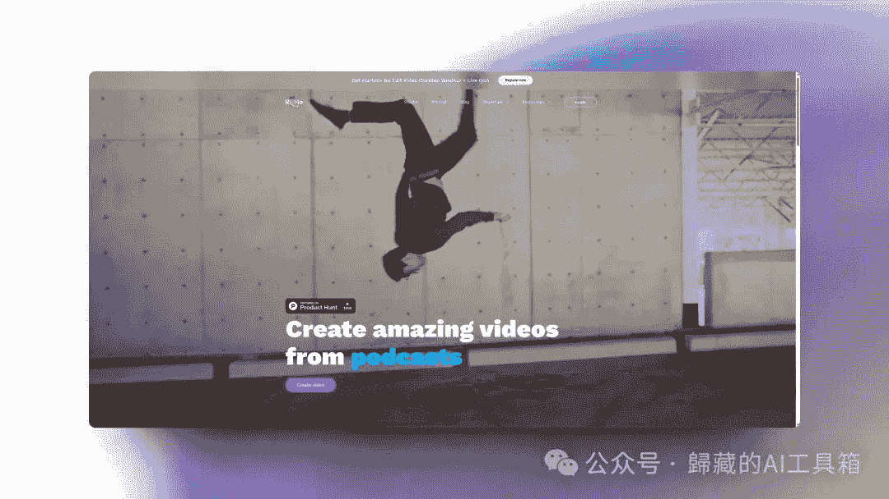

# **精选文章 ✦**

## 伟大的巫师经常独自行事，只要空气中的元素依然回应他的咒语和呼唤

链接： **h**ttps://quail.ink/lyric/p/great-wizards-usually-act-alone

“如果一个人的领域知识广度足以覆盖整个行业，而深度恰好多于「能够评价任务执行的好坏与否」的程度，就可以比较好地操纵 AI 去完成那些本来需要好几个不同职责的人去完成的事情。”

“知识就在那，但是需要你念出咒语才能让它显形。”

## Logan Kilpatrick Open AI 开发者关系主管的专访

链接： **https://www.youtube.com**/watch?v=XkMbkWG2ca4

Logan Kilpatrick Open AI 开发者关系主管的专访，几个关于他们的招聘理念和 Open AI 以及 ChatGPT 的发展的部分可以关注一下：

OpenAI之所以能迅速推进项目并交付高品质的产品，关键在于聘请那些具备强烈的自主驱动力和紧迫感的人才。这种做法让OpenAI能够超越常规流程，培养出一种文化氛围，员工在这里可以迅速洞察并主动解决问题，而无需长时间等待审批或达成共识。

要想从ChatGPT那里获得更精准的答案，关键是要提出具体问题，并为问题提供更多背景信息。不是简单地提问，而是像与人交谈一样提供详细信息。由于AI本身不具备背景知识，因此通过详细的问题指引它是非常关键的。这种做法不仅能提升即时的回答质量，也有助于随着时间推移逐渐培养出更智能的AI系统。

GPT的出现开启了一个“智能体未来”的可能性，在这个未来中，我们可以将复杂的任务交由AI工具来完成。目前，我们向GPT提出问题，得到快速回应后就结束互动。随着GPT技术的发展，我们将能够让它们承担更加复杂和细致的任务，并在任务完成后向我们汇报。例如，我们可能会让AI智能体花费数小时撰写一篇引用了众多参考文献和案例研究的详尽博客文章，并详细说明在撰写过程中所做的权衡选择。

## Josh Miller关于后 URL 时代（人工智能时代）的互联网畅想

链接： **h**ttps://x.com/op7418/status/1755266376229687806?s=20

这个东西可能很多人都想过，很早就有人提出来未来的 UI 会是一个对话页面加上各种匹配数据展示样式的组件来完成，Josh Miller这个更近一步解决了内容来源的问题，由网站自己暴露对应内容的元数据，然后在浏览器或者系统完成整合。

## **全面的LLM RAG教程和资料**

链接： **https://www.promptingg**uide.ai/research/rag

elvis写了一篇非常详细的文章来介绍 RAG 生态的所有部分，还会添加清晰易懂的参考文献列表以及技术性编程教程帮助提高 RAG 系统的性能。

主要内容来自《大语言模型的检索增强生成：一项调查》这篇论文，我简要总结了一下文章每个部分的内容，感兴趣可以去看原文：

检索增强生成（Retrieval Augmented Generation, RAG）技术，旨在通过结合外部知识源，如数据库，来提升大语言模型（LLMs）的能力。它主要用于解决领域知识的缺失、事实性问题和生成错误。RAG特别适用于那些需要最新知识、又不需针对每个特定任务重复训练LLM的应用场景，比如对话代理和知识密集型任务。

## 从软件范式到模型范式，什么是 AI-Native 时代的大产品

链接： [**https://mp.weixin.qq.com/s/av**](https://mp.weixin.qq.com/s?__biz=MzAxNjE1NTg2Ng==&mid=2247488578&idx=1&sn=b7b96f2cc72c258dda832570dfc4f523&scene=21#wechat_redirect)nK5hT6ro7jOw5WXENy6g

这篇文章讨论了从软件范式到模型范式的转变，探讨了AI-Native时代的大产品。作者以信息商品经济的视角对AI-Native产品进行了定义、分析和分类，提出了实现“GenAI大产品”和评估AI-Native程度的方法。文章指出AI-Native意味着产品范式向模型范式转移，强调了算法拟合度、可训练数据占比和功能prompt比率是判断产品是否AI-Native的关键维度。最终，文章提出了AI-Native产品的可能信仰——“产品智能主义”，探讨了连续性对AI-Native产品智慧的衡量标准。

## **评估LLM应用程序**

链接： **https://humanloop.com/blog**/evaluating-llm-apps

在人工智能领域，大型语言模型（LLM）正在彻底改变公司的产品体验和内部运营。这类基础模型代表了一种新型计算平台，并且引入了提示工程，取代了软件开发的部分方面，使软件能力的范围迅速扩展。在生产环境中有效利用LLM至关重要，但由于LLM的新颖性和复杂性，这对大多数公司来说是一个独特的挑战。与传统软件和非生成式机器学习模型不同，LLM的评估过程更主观、难以自动化，并且系统出错的风险更高。

LLM应用程序的基本构成包括以下几个组件：LLM模型（核心推理引擎）、提示模板（模型的样板指令）、数据源（提供模型所需上下文的来源，如检索增强生成）、内存（历史交互记录）、工具（允许模型与外部系统交互）和代理控制流（允许模型通过某些停止标准解决任务的多步骤生成）。

## **设计增强的genAI特性**

链接： **h**ttps://uxdesign.cc/designing-genai-enhanced-features-6ccf42260828

探讨了生成式人工智能（Generative AI，简称genAI）如何通过智能内容增强和个性化提升用户体验。文章首先指出，ChatGPT等聊天机器人作为接入生成式AI特性的便捷入口，其简单性允许它们无缝集成到各种数字平台中。然而，这些技术的应用范围远不止于对话界面。通过将这些先进模型的APIs融入到产品特性中，可以提供称为“AI增强特性”的重大价值增强。

文章强调，在设计涉及内容生成或展示的特性时，考虑生成式AI的潜在作用至关重要。GPT和Claude等模型的出现大幅降低了内容创作的成本，使得复杂的大型语言模型（LLM）变得触手可及。通过恰当的提示，文本可以轻松地被重塑、扩展或转换，激发创造性的可能性。

## **新市场地图提醒**

链接： **h**ttps://x.com/venturetwins/status/1757077455616332056?s=20

a16z文件讨论了人工智能的第一个杀手级用例，即制作创意内容。它重点介绍了致力于内容生成和编辑的各种公司，例如 Midjourney、DALL-E、Runway、Pika、ElevenLabs 等。该文件还提到了该领域未来的潜在发展，包括跨不同模式的获胜产品、使开源模型易于访问的应用程序以及用于创建和发布内容工作流程的平台。最后，它邀请该领域的相关人士伸出援手，并提供了文件中提到的公司名单。

## 对2024年人工智能就业市场的思考

链接： **h**ttps://newsletter.ruder.io/p/thoughts-on-the-2024-ai-job-market

2024年人工智能（AI）就业市场的发展趋势和个人加入Cohere公司的原因是本文的主要内容。文章从作者作为一名专注于自然语言处理（NLP）的欧洲研究员的角度出发，分享了他对AI就业市场的一些宏观趋势观察和个人职业选择的思考。

### **AI就业市场趋势**

1.  研究变得更加应用化 ：与过去相比，当前的ML和NLP问题更多地集中在应用研究上，基础研究与应用研究之间的界限逐渐模糊。例如，BERT模型的引入极大提高了Google搜索的质量，而大型语言模型（LLMs）的出现则开启了新应用的大门。

1.  创业公司成为PhD以外的选择 ：鉴于当前研究问题的应用性质，加入创业公司成为了接触前沿AI工作的另一条路径。创业公司特别是早期的创业公司，能够提供快速学习和实践的机会，尽管这可能需要个人对工作内容有一定的灵活性。

1.  机器学习变得更加封闭和两极分化 ：尽管机器学习社区过去以开放性著称，但最近的趋势显示，开源AI的先锋如OpenAI和Google开始减少关于其模型的信息发布。这种趋势可能会阻碍AI发展的进步。

1.  研究集中在大型项目上 ：随着LLMs的出现，参与一个项目的作者数量显著增加。大型项目不仅需要研究人员，还需要强大的软件工程师团队以及多方面的专业知识。

1.  更多公司，更多机会 ：LLMs的兴起带来了一波新公司的浪潮，这些公司利用这项技术或将其整合到产品中。这为AI领域的专业人士提供了更多的职业选择。

## **塑造设计的未来**

链接： **https://jarango.com/2024/02/04/s**haping-the-future-of-design/?ref=sidebar

探讨了设计领域面临的变革，特别是在虚拟现实（VR）、生成式人工智能（AI）和大型语言模型（LLMs）等技术的推动下，设计师如何适应这些变化以保持相关性。文章强调了三个核心观点：拥抱变化、在不变中寻找根基、以模型作为设计的对象。

首先，作者提倡拥抱技术和范式的变化，鼓励设计师通过实践新技术来学习其局限性和能力，而不是仅仅从理论上了解。这要求设计师持续学习和专业发展，不仅仅是在设计技艺上，也包括其目的和方向。通过比喻铁匠转变为汽车机械师的故事，文章强调了适应变化的重要性。

其次，文章指出尽管技术不断进步，但某些事物如人性和社会基础结构等仍将保持不变。设计师应该在这些永恒的事物上建立自己的工作，利用新技术和方法来改善这些不变的方面。作者建议阅读古典文学作品来深入理解人性和社会，因为这些作品揭示了跨越不同文化和时代的普遍真理。

最后，文章提出将模型作为设计的对象。模型是关于世界如何组织和运作的思想，描述了构成整体的部分、绑定它们的结构以及部分之间的行为方式。设计师应该定义系统模型，以确保用户能够通过系统以相对较少的努力完成他们需要做的事情。这要求设计师与抽象概念保持健康的关系，这些抽象概念指导UI层面的设计，并由其他人（可能是AI）执行。

## **大型语言模型评估 - 第二部分**

链接： **h**ttps://blog.premai.io/evaluation-of-llms-part-2/?ref=prem-newsletter

作者探讨了大型语言模型（LLMs）作为评估者的概念，即“LLM作为评判”。这篇文章是对之前介绍评估LLMs的早期基准和指标的博客的延续，并指出了这些评估方法的问题。文章进入了自然语言处理（NLP）的一个新研究领域，该领域专注于开发更准确地衡量LLMs生成能力的指标，并引入了LLMs作为评估者的角色，这种方法被称为基于LLM的自然语言生成（NLG）评估。

文章提到了使用静态基准来评估LLMs的问题，例如基准泄露，即评估基准中的数据无意中成为模型训练集的一部分，这可能会显著夸大模型的性能指标，提供对其实际能力的误导性表示。为了解决这个问题，文章探讨了使用最先进的LLMs（如GPT-4）作为人类评估的替代品，因为这些模型通常经过RLHF训练，已经表现出强烈的人类一致性。这种方法被称为LLM-as-a-judge，有三种类型的LLM-as-a-judge机制，每种都旨在增强评估过程。

1.  成对比较 ：LLM被提出一个问题和两个可能的答案，然后任务是确定哪个答案更优或两个答案是否同等优秀。

1.  单一答案评分 ：这种方法简化了过程，要求LLM为一个答案分配分数，而不进行直接比较。

1.  参考指导评分 ：在这种方法中，LLM被给予一个参考解决方案以及它需要评估的答案，这在需要客观正确性或精确性的情况下特别有用。

文章还指出了使用LLMs作为评估者的准确性问题和可能影响评估的固有偏见。为了解决这些问题，文章介绍了Prometheus，这是一个专门的开源评估语言模型，拥有130亿参数，能够根据用户提供的定制评分标准来评估任何给定的长文本。Prometheus在与人类评估者的评分相关性方面表现出色，其Pearson相关系数为0.897，与GPT-4（0.882）相当，并且大大优于ChatGPT（0.392）。

## 设计未来？使用AI增强人类认知和创造力

链接： **h**ttps://uxpsychology.substack.com/p/the-future-of-design-using-ai-to

最近的研究结合了生物反馈工具和人工智能（AI），旨在提高设计师的元认知技能。元认知是指对自己的思考过程进行思考，以批判性地评估设计，识别知识空白，并适应创造性方法。文章探讨了如何通过监测我们的元认知活动，比如评估情绪反应，来帮助导航设计不确定性并促进创新。文章重点介绍了康奈尔大学最近研发的“多重自我”工具，该工具通过神经数据提供设计师情绪状态的实时生物反馈。通过将这些通常是内部信息外化，“多重自我”旨在激发有价值的自我反思和扩展创造性探索。

设计中的元认知监控是一个迭代过程，涉及在探索不同选项（发散思维）和评估/综合这些想法（收敛思维）之间来回进行。在探索阶段，设计师可能会对他们的想法是否真的有效或成功感到不确定。元认知监控特别涉及评估自己的知识、思想和任务进展。对于设计师来说，元认知有助于他们调节不确定性，并将其保持在创造力的最佳区域。它可以帮助评估不同的方法，识别知识空白，管理不确定性并产生更多创造性的解决方案。

“多重自我”工具使用脑电图（EEG）传感器来检测与情绪反应相关的大脑活动。该工具应用机器学习到原始EEG数据，以预测用户的情绪价值（积极与消极的感觉）和唤醒（兴奋/参与）。该工具的目标是帮助设计师通过使用AI和生物传感器更好地感知他们当下的情绪。在虚拟设计会话期间，设计师看到一个在他们视野中的2D图表上移动的点，该点的位置表示他们预测的情绪，允许他们在操作虚拟设计时跟踪变化。

研究人员通过与24名参与者（包括10名拥有超过3年建筑设计实践的专家和14名经验较少的新手）测试“多重自我”的可行性。他们首先通过观看室内建筑空间的全景360度图像并记录EEG来评估参与者的基线情绪反应。然后，他们使用视觉量表自我报告他们的价值和唤醒感。这些数据被用来训练个性化的机器学习分类模型，以从后续的EEG信号中预测每个参与者的高、中或低水平的价值和唤醒。

尽管这种方法仍然是新颖和实验性的，但这项研究强调了我们可以如何将先进技术如AI和生物测量学整合到UX中，以增强我们的技能和能力。这项研究为人工智能增强的元认知支持在UX设计中的潜力奠定了有希望的基础，但要实现其全部潜力仍然是一个需要跨学科合作和进一步研究的广泛挑战。例如，这项研究只研究了界面的短期使用和非多样化样本。然而，随着人工智能和生理感应技术的应用，未来的设计已经到来，这为未来人机协作的现实提供了一个展望，并展示了如何用它来增强创造力。

## a16z：人工智能将如何改变消费技术

链接： **https://gamma.app/docs/a16z-Consumer-A**bundance-Agenda-ieotbnzbxj81biu?mode=doc

人工智能工具使普通消费者更容易创作艺术、音乐、视频和图形，而无需广泛的培训或复杂的软件。这些工具不仅缩小了创意与工艺之间的差距，而且还提高了现有和专业创意人员的工作水平。人工智能可以使编辑工作流程自动化，并引入新型的人工智能原生编辑，同时还可以让人工智能工具根据文本指令完成任务，从而提高工作效率。此外，人工智能内容正变得与人类内容无异，人工智能角色和内容有望在在线娱乐和社交互动中发挥重要作用。

## **解释 SDXL 潜在空间**

链接： **https://huggingface.co/blog/TimothyAle**xisVass/explaining-the-sdxl-latent-space

文章《解释SDXL潜在空间》详细介绍了SDXL潜在空间的特点和如何改进SDXL生成的图像。SDXL是一种基于扩散模型的图像生成架构，其输出的潜在表示包含四个通道，与传统的8位RGB像素空间的三个通道不同。这四个通道分别代表亮度、青/红色、黄绿色/中紫色和图案/结构。文章中提到，SDXL生成的图像往往存在噪点、过度平滑和颜色偏差问题，尤其是偏向黄色，这是因为模型在训练过程中对现实世界图像的学习导致的。

为了改进这些问题，作者进行了实验性探索，并开发了一系列校正工具和方法。这些方法包括直接将潜在表示转换为RGB的线性近似函数、中心化张量以调整颜色偏差、去除异常值以控制细节、颜色平衡和增加颜色范围、张量最大化以及回调实现示例。通过这些技术，可以在生成图像之前改善信息和颜色范围，而不是在图像生成后进行后处理。

## 设计师实用指南：使用 AI 进行 3D 渲染

链接： **ht**tps://uxdesign.cc/using-ai-for-3d-rendering-a-practical-guide-for-designers-a2a037ed1ad0

在数字产品设计中，早期概念化和设计阶段需要快速创新，但传统的高质量3D渲染过程通常与此不兼容。作为一个热爱3D的产品设计师，我发现了使用AI技术来加速3D渲染的方法，这对于不具有深入3D专业知识的设计师来说也更加可访问（大部分是开源的）[1]。

传统3D渲染流程包括建模、纹理和照明、渲染三个阶段，每个阶段都需要细致的注意力和对工具和艺术流程的深入理解，需要多年的经验才能掌握[1]。然而，这种详细控制的方法在快速概念化和迭代中不太适用，尤其是项目初期。

AI生成图像提供了近乎无限的视觉可能性，加快了迭代速度，但缺乏控制力是一个主要问题。AI渲染的关键挑战在于结合速度和细节的优势，同时保持对创意输出的决定性控制[1]。

AI增强的3D工作流程结合了传统3D建模的精确性和AI的灵活性和速度。设计师可以创建简单的3D模型，并使用AI快速探索不同的视觉风格，进行快速调整。这种方法产生了协作式的过程，结合了3D建模的精确性和AI的速度：

1.  建模：创建简单的3D模型，关注比例、布局和组合，而不是细节。

1.  生成：使用ControlNet等工具，将场景信息共享给扩散模型，生成图像，保持组合和主题不变。

1.  迭代：调整生成图像的控制。如果控制力很大，AI会确保渲染与模型的比例相匹配，但限制细节和“创造力”。

AI增强的3D工作流程有助于更有效地与创意团队和产品设计师共享早期概念，为项目设定一个明确的方向，节省宝贵的时间和资源。这种方法也支持创建一致的情感板，这些板在设计过程中起着至关重要的参考作用[1]。

AI技术在3D设计工作流程中生成快速插图和图像方面只是冰山一角。创新正以惊人的速度发展。AI将成为渲染的未来，将与3D软件和游戏引擎本身集成。AI已经被用于Blender中的降噪和超分辨率渲染，以及Pixar的Elements中的渲染时间优化，Unreal Engine中的帧率优化。

## 关于IP-adapter你需要了解的一切

链接： **https://stable-diffusion**-art.com/ip-adapter/

IP-adapter是Stable Diffusion的一个附加组件，用于使用图像作为提示，类似于Midjourney和DaLLE 3。它可以复制参考图像中的风格、构图或面孔。文章介绍了多种IP-Adapter模型，包括Plus、Face ID、Face ID v2、Face ID portrait等，并说明了如何在AUTOMATIC1111和ComfyUI中使用IP-adapters。IP-adapter模型的数量正在迅速增长，包括两种图像编码器：OpenClip ViT H 14（即SD 1.5版本，632M参数）和OpenClip ViT BigG 14（即SDXL版本，1845M参数）。

IP-adapter通过训练图像的单独交叉注意力层来提高图像生成过程的指导效果。文章还详细介绍了如何在AUTOMATIC1111和ComfyUI软件中设置和使用IP-Adapter，包括安装ControlNet扩展、下载IP-Adapter和LoRA模型以及在AUTOMATIC1111中使用IP-adapter模型的步骤。此外，还提供了在ComfyUI中使用IP-Adapter的指南，包括安装InsightFace、下载模型和LoRAs以及设置工作流程。

## Meta 聚焦人工智能投资如何为广告商带来回报

链接： **https://www.marketingdive.com/news/meta-ai-inv**estments-advertiser-lessons-2024/706973/

在2023年被称为“效率之年”之后，Meta将人工智能（AI）作为2024年的主题，大力投资于触及其业务的每一个方面的技术，从用户和创作者到企业和开发者。Meta首席执行官马克·扎克伯格在公司最近的财报电话会议上表示，尤其是生成式AI已经推动Meta的广告业务在第四季度同比增长24%，总额达到387亿美元。Meta的高管们进一步深入其AI计划，解释了广告商和代理商今年可以从技术中期待什么，并在2月7日的虚拟圆桌会议上分享了几个成功故事。Meta的全球商业集团副总裁阿尔文·鲍尔斯表示：“2023年对我们来说是一个明确的转折点，我们的第四季度收益显示，对于使用我们工具的广告商来说，Meta确实在发挥作用。我们在AI上的投资不仅为广告商的表现带来了回报，也为我们的社区带来了比以往任何时候都更相关的发现引擎。”随着广告收入的增长，Meta在最后一个季度也看到了用户和观看时间的增加，所有视频类型的日观看时间同比增长超过25%，用户每天重新分享Reels 35亿次。Meta将这种参与度增长归因于多年来一直是其业务核心的AI和发现引擎投资，这些投资现在正在得到回报。

Meta的这些AI投资不仅提高了其广告系统的性能，还改善了人们在所有应用中看到的个性化内容。此外，Meta还在其广告产品中进行了多年的机器学习、自动化和AI投资，以应对数字广告行业的变化，这些投资正在为广告商带来成功。Meta还开始在其广告套件中推出生成式AI功能，包括文本变化和图像扩展，并计划在本季度晚些时候扩大背景图像生成的可用性。例如，珠宝小企业Felicity在感恩节到网络星期一的Cyber Five期间大量使用Advantage套件，看到收入增长了24%，客户回头率提高了20%。瑞士运动服品牌On测试了Meta的Advantage+ Catalog广告和产品级视频解决方案，导致广告支出回报增加了41%，购买成本降低了45%。

这篇文章汇总了最近一周人工智能领域的一些重要新闻和产品动态:

1.  OpenAI发布了视频生成模型Sora,可以生成1分钟长的高质量视频。Sora支持从图像和文本生成视频,并且可以扩展和编辑视频内容。

1.  谷歌发布了语言模型Gemini 1.5 Pro和Ultra 1.0,支持长达100万字的上下文理解能力。同时推出了付费会员计划Gemini Advanced。

1.  Stability AI发布基于扩散模型的图片生成模型Stable Cascade,支持图像变化和生成。

1.  汇总了Midjourney图片生成模型的一些新功能,如默认版本升级和区域编辑能力增强。

1.  介绍了一些新的AI产品,如视频生成软件Deforum Studio,自动生成UI设计稿的工具Galileo AI,以及英伟达的本地语言模型软件Chat with RTX等。

1.  收录了一些AI领域的文章,如人工智能如何改变广告业,使用AI进行3D渲染以及Stable Diffusion潜在空间的解释等。