# AIGC Weekly #58

> 来源：[https://waytoagi.feishu.cn/docx/Nul7devm6oBMQHx1rG5cn8sMn8b](https://waytoagi.feishu.cn/docx/Nul7devm6oBMQHx1rG5cn8sMn8b)

> 🔗 原文链接： h[ttps://mp.weixin.q](https://mp.weixin.qq.com/s?__biz=MzU0MDk3NTUxMA==&mid=2247485412&idx=1&sn=67426a7ee5c23a588507499cfa8e691e&chksm=fa4f55f5995519e5b0241ab11b16980810d03cb1682274a0f943d67f1505c77eaae9ba085be7&scene=126&sessionid=1709892061#rd)q.com/s?__biz=Mz...

> 原创 op7418 公众号：歸藏的AI工具箱 2024-02-05 16:15  北京

Midjo**urney提示词：the lightest wave of color over the blue backgr****ound of a blur**red figure, in the style of jo ann callis, light black and violet, asymmetrical forms, ultrafine detail, mike winkelmann --ar 16:9 --sref https://s.mj.run/dNJWiwOa13g https://s.mj.run/R6MjCLEwHlc https://s.mj.run/xwMp3hHTWhI https://s.mj.run/76ap6oJ2Tdo --v 6.0 --style raw 查看更多风格和提示词 [1]

# **上周精选❤️**

## ARC 浏览器发布三个基于 AI 的能力

链接： **https://youtu.be/WIeJF3kL5ng**?si=pAlz4tRJHz7fWIa-

ARC浏览器上周发布了两个巨牛批的功能。彻底搞掉了搜索中间页，同时还发布了重构的手机版浏览器一搜索体验为主。

首先是正常的搜索，比如你要搜一个对应的视频，它会直接找到那个视频的播放页面帮你打开，你不需要打开好多搜索结果找到那个视频。

另一些复杂任务，它会直接搜索多个网页然后整合这些信息直接给你一个新的页面。

比如你要搜索一道菜的做法，它会浏览很多网页然后给你列出需要的食材，文字版本的制作过程以及多个视频。都在一个页面呈现，这才是AI时代的浏览器。

使用方式：在搜索栏输入 MAX 打开 MAX Preferences，然后开启，之后在搜索栏输入你的要求，按shift+Enter就可以。

他们还重构了 ARC 移动端的浏览器现在叫Arc Search，他们发现大部分人在移动场景使用浏览器的场景主要是搜索，新重构的浏览器会自动浏览搜索页的前六个结果为你整理所有的信息，不需要你打开网页。

## Google Bard 开始发力

链接： **https://blog.google/products/bard/**google-bard-gemini-pro-image-generation/

谷歌在上周给 Bard 发布了大量的更新，包括支持生成图片以及在更多的国家和语言开放Gemini Pro的使用：

+   Bard 中的 Gemini Pro 将以 40 多种语言和 230 多个国家和地区的版本提供。

+   现在可以在世界上大多数国家/地区免费使用 Bard 生成英语图像。这项新功能由更新的 Imagen 2 模型提供支持，该模型旨在平衡质量和速度，提供高质量、逼真的输出。

+   Bard 会使用 SynthID 将数字可识别水印嵌入到生成图像的像素中，使得可以很方便的检测 AI 生成的图像。

另外推特还有人泄露了 Bard 将会在 2月七号进行的更新，可以使用Gemini Ultra模型了：

+   Bard将会重命名为Gemini；

+   Gemini Advanced将会提供谷歌最强大的AI模型，Ultra 1.0的访问权限；

+   发布Gemini移动应用，可以通过文本、语音或图像与其互动；

+   Gemini会首先在加拿大地区开放，有需求的可以先把代理切到加拿大。

泄露的信息来自这里： **h**ttps://x.com/AiBreakfast/status/1754008072828158416?s=20

## 亚马逊推出 AI 购物助理Rufus

链接： **h**ttps://www.aboutamazon.com/news/retail/amazon-rufus

亚马逊上周最新发布了AI 购物助手 Rufus。Rufus经过了亚马逊产品目录以及网络上众多信息的培训，能够回答顾客关于购物需求、产品对比等问题，提供推荐，并帮助用户在他们常用的亚马逊购物平台上发现新产品。

首先推出的是测试版 Rufus，并开始分批向客户推出，首先是使用亚马逊移动应用程序的一小部分美国客户，然后在未来几周内逐步向其他美国客户推出。

借助 Rufus，客户可以：

+   了解购买产品类别时要寻找什么：客户可以在亚马逊上进行更一般的产品研究，提出诸如“购买耳机时要考虑什么？”等问题。是清洁美容产品吗？”并获得有用的信息来指导他们的购物任务。

+   按场合或目的购买：客户可以通过询问一系列问题（例如“寒冷天气打高尔夫球需要什么？”），根据活动、事件、目的和其他特定用例来搜索和发现产品。或“我想开办一个室内花园。

+   获得比较产品类别的帮助：客户现在可以询问“唇彩和唇油有什么区别？”或“比较滴滤式咖啡机和手冲式咖啡机”，以便他们找到最适合自己需求的产品类型，并做出更自信的购买决定。

+   找到最佳推荐：客户可以根据自己的需求提出建议，例如“情人节送什么礼物好？“。 Rufus 生成针对特定问题量身定制的结果，并使客户能够快速轻松地浏览更精确的结果。

+   在产品详细信息页面上询问有关特定产品的问题：客户在查看产品详细信息页面时，可以使用 Rufus 快速获得有关各个产品的特定问题的答案，例如“这款泡菜球拍适合初学者吗？”。 Rufus 将根据列表详细信息、客户评论和社区问答生成答案。

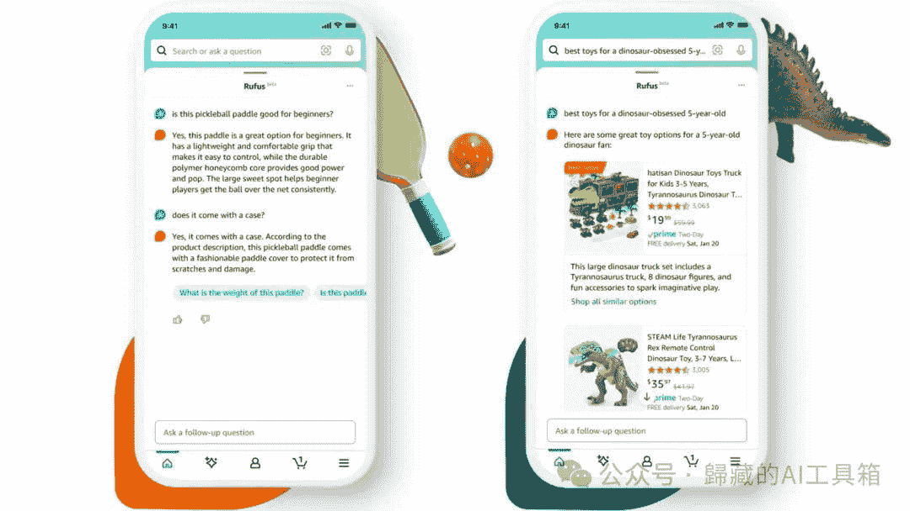

## Midjoureny 的一些动态

Midjoureny 上周的动作也比较多，发布了风格一致性的更新，还发布了 Niji6 模型。

Nijijourney V6模型上线：

+   现在输入/settings选择Nijijourney V6版本或者使用Niji的discord机器人就可以。

+   建议你编写更长的提示以充分利用 Niji V6。当你尝试绘制 Niji 6 尚不知道如何绘制的东西时，你可以解释你想要什么。

+   Niji 现在支持简单的文本书写！您可以通过将文本放在引号之间来将文字写入图片中。

+   如果你喜欢非动漫的画风，可以使用 --style raw。

+   Niji V6 的 3D 风格图像效果相较于 V5 有了大幅度的提升。

+   Midjourney alpha网站的图片生成功能已经支持了 Niji V6，如果你有权限可以不用 Dsicord 。

+   Niji V5 原来一些奇怪的但是可以出好效果的提示词不再可用，你需要更详细精确的描述画面内容和风格。

风格一致性工具的介绍和使用方法：

+   可以从多张图片学习对应的风格然后结合提示词生成图片,下面4张为输入图片。

+   “风格参照”。这项功能与图像提示类似，你可以提供一个或多个图像的链接，用以描述你想要的统一风格。

+   风格参照的使用方法在你的提示语后输入 --sref，然后加上一个或多个图像链接，例如 --sref urlA urlB urlC。

+   图像模型会将这些图像链接作为“风格参照”，尝试创作出与其美学风格相匹配的作品。

+   可以这样设置不同风格的权重 --sref urlA::2 urlB::3 urlC::5。

+   通过 --sw 100 来调整整体风格化的强度（默认值是 100，0 表示关闭，最大值是 1000）。

+   常规图像提示应放在 --sref 前面，例如 /imagine cat ninja ImagePrompt1 ImagePrompt2 --sref stylePrompt1 stylePrompt2。 该功能支持 V6 和 Niji V6 版本（不支持 V5 等旧版本）。

+   风格参照不会直接影响图像提示的效果，只会作用于包含至少一个文本提示的作业。 我们计划在未来增加一个“一致性角色”特性，其工作原理类似，将使用 --cref 参数。

还有一些未来功能的预告：

+   V6 的 Beta 版本模型将会在本周末推出，新的Describe 正在测试，可以帮助用户更好的书写提示词。

+   Alpha版本的网站将会开放给生成了 1000 张图片的用户。

+   Niji6 下周会更新局部修补和放大功能。

+   目前的重点是角色一致性功能。

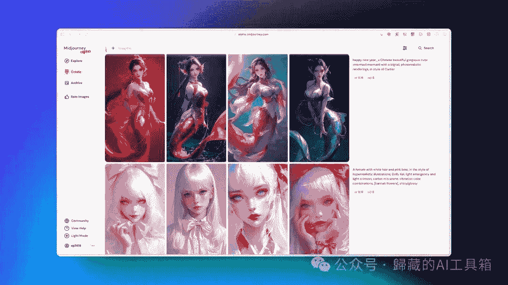

## **Stability AI 发布了 SV**D 模型的 1.1 版本和 Web 应用

链接： **https://huggingface.co/stability**ai/stable-video-diffusion-img2vid-xt-1-1

上周六 Stability AI 发布了 SVD 视频生成模型的 1.1 版本，新模型体积相较于上个版本大幅减少同时之前的一些问题也有了很大的改善，我测评了多种风格的内容，主要是图片生成视频，图片由MJ生成， 下面是发现的一些变化 ：

+   XT模型本体从9G多缩小到了4G多，显存要求降低了，同时推理速度加快许多，之前跑不了的电脑这下可以试试了。

+   整体运动幅度大幅增加，很多内容不再只是运镜了，也意味着模型真的理解了内容。

+   生物和人像的运动幅度和一致性大幅提升，人物不再是完全不动的图片了，会进行相应的运动和跟环境交互。

+   之前视频中的密集噪点得到了一定程度优化。

+   2D动漫图像现在也可以动了，不过效果依然不太好。

+   已往的强项流体运动效果依然很顶，没有负向优化。

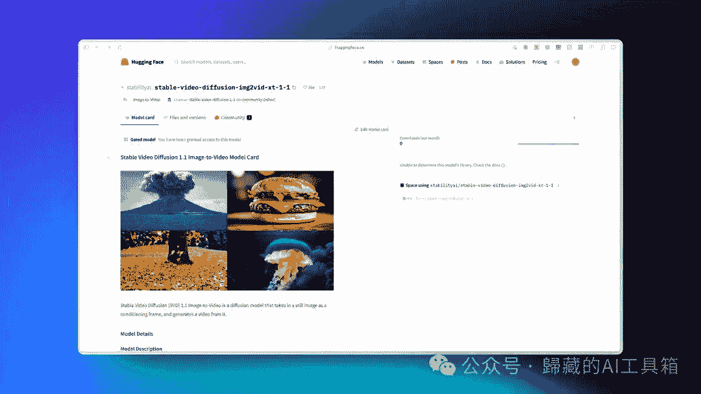

# **其他动态🧵**

+   **Mistral早起量化版本模型文件被泄露： https://news.slashdot.org/story/24**/01/31/2145205/mistral-confirms-new-open-source-ai-model-nearing-gpt-4-performance

+   L**L**aVA-1.6发布，具有改进的推理、OCR 和世界知识。 LLaVA-1.6 在多项基准测试中甚至超过了 Gemini Pro： https://llava-vl.github.io/blog/2024-01-30-llava-1-6

+   **Sh**opify 正在推出一款基于人工智能的产品图像编辑器： https://techcrunch.com/2024/01/31/shopify-is-rolling-out-an-ai-powered-image-editor-for-products/

+   M**e**ta 开源了 Code Llama 70B，在 HumanEval 基准测试中获得了 67.8 分，高于 GPT-4 的基本评级 67： https://x.com/AIatMeta/status/1752013879532782075?s=20

# **产品推荐⚒️**

## MLblocks：可视化构建构想处理流程

链接： https://www.mlblocks.com/

有类似的 Comfyui 界面的图像处理产品，不过图像处理的模块被高度抽象了，不需要 Comfyui 那么多的节点，操作门槛低了很多。

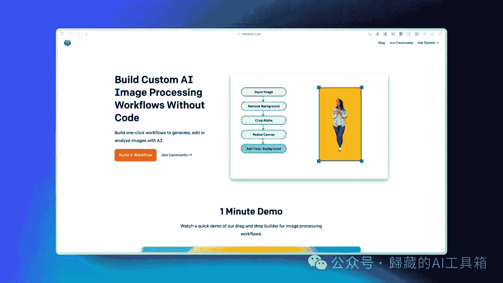

## Reducto AI：解析文档块优化向量数据库性能

链接： https://www.reducto.ai/

Reducto AI 公司，正在向大语言模型（LLMs）提供高效的数据摄取服务。该公司的技术专注于精准解读复杂文档，并高效组织内容，从而显著提升了与任何向量数据库结合使用的检索增强生成（Retrieval-Augmented Generation, RAG）技术的表现。

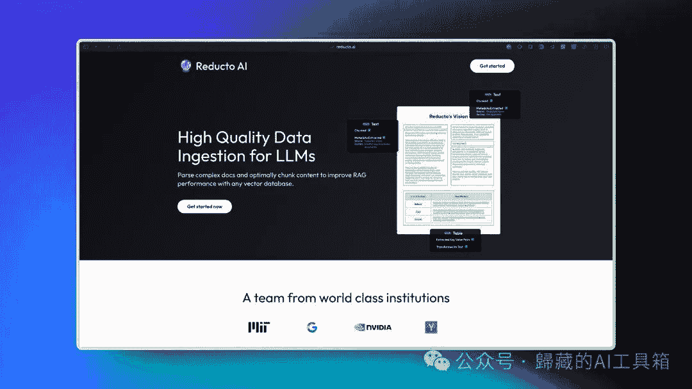

## ElevenLabs GPT：返回 GPT 输出内容的声音版本

链接： **h**ttps://x.com/ammaar/status/1752745588561740037?s=20

它可以通过逼真的声音让任何提示变得栩栩如生，只需一个提示即可生成一本有声读物，为你朗读在线文章，聆听你上传的任何文档。

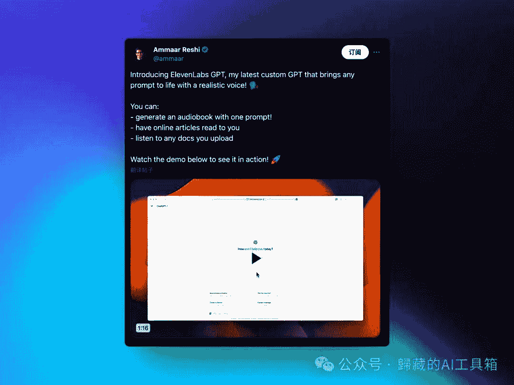

## Parent help：获取任何育儿技巧

链接： **https://chat.openai.com/g/g-f**nArJfBiK-parent-help

针对任何育儿“问题”的建议和技巧，这种不到用的时候不需要的冷门教育感觉也是个方向。

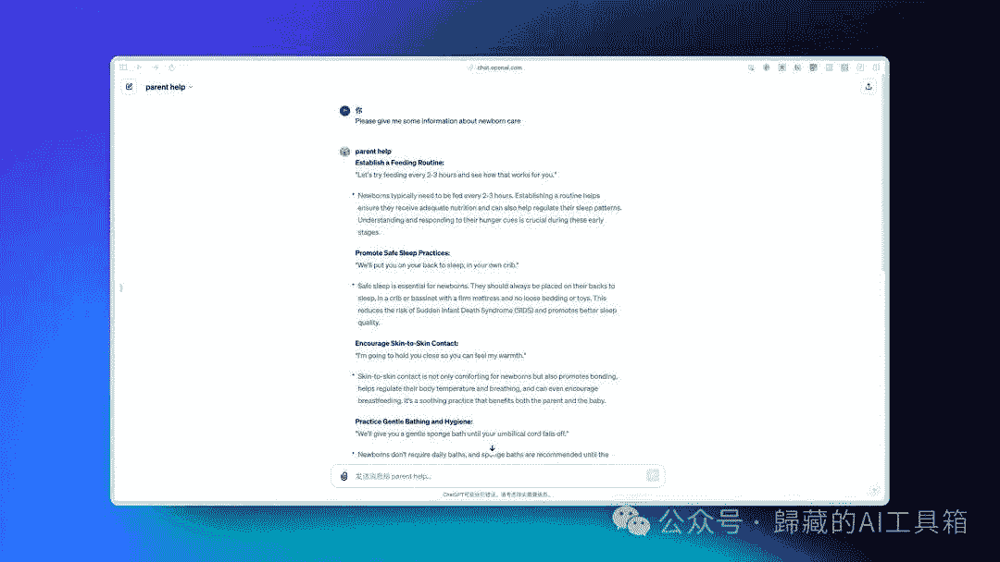

## ChatGPT Prompting：简单的提示词构建工具

链接： https://mitenmit.github.io/gpt/

一个非常简单的提示词构建工具，结构非常清晰和简单，但是确实有用，优化一下体验会是一个好产品。

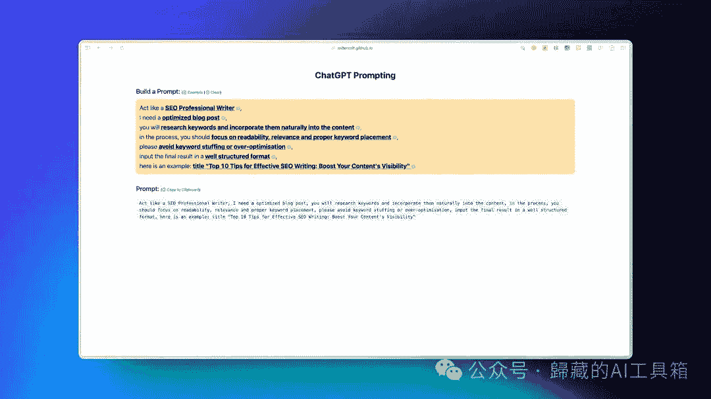

## FORA ERM：为公司高层管理者设计的人工智能

链接： https://fora.day/

FORA ERM，这是一款专为公司高层管理者（C-suite executives）定制的人工智能工具，目的在于提升他们的领导能力和组织管理水平。FORA ERM旨在通过智能化的方法解决组织挑战和培养更深层次的业务关系，从而优化高管的各项职能。

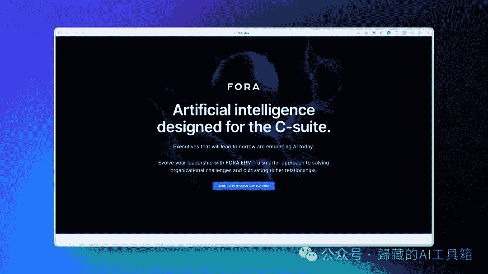

## Supadash：直接从数据库生成图表和看板

链接： https://www.supadash.co/

Supadash是一款创新性平台，它的设计宗旨是让数据分析仪表板的创建变得简单快捷。利用人工智能技术，Supadash能够在几秒钟内自动生成仪表板，用户无需编写任何代码或SQL查询。通过连接PostgreSQL数据库或REST APIs等数据源——未来还将支持更多数据源——用户可以轻松地将他们的数据转换成富有洞察力的、视觉上吸引人的图表，突出展示关键的数据指标。这大大简化了用户从复杂数据中获取有价值信息的过程。Supadash特别适合那些希望迅速将用户数据或其他类型的信息列表转化成具有实际操作价值的洞察力的用户，无需经历繁复的手动仪表板搭建过程。

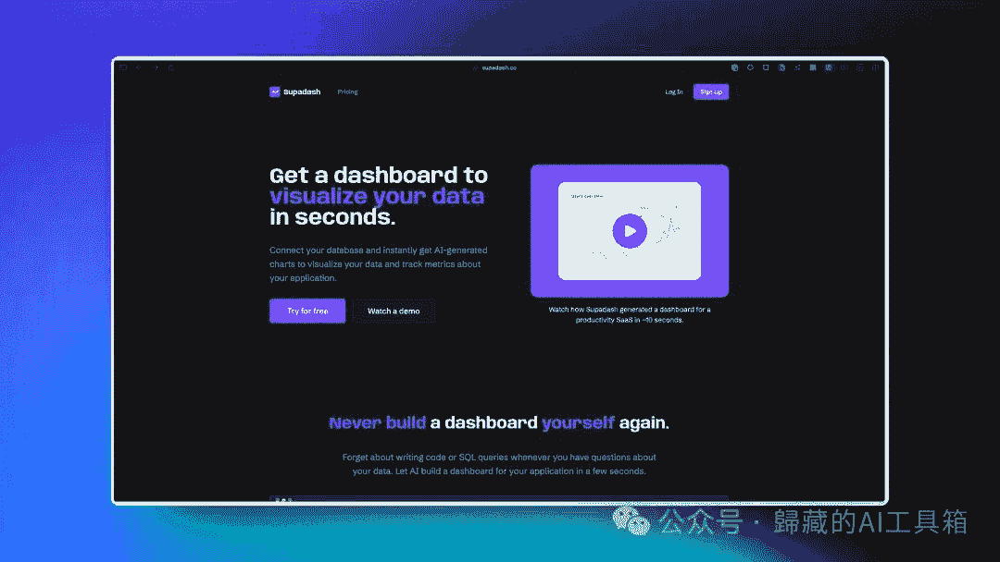

## Daydream：为管理者和高级财务做的 BI 工具

链接： https://daydream.co/

Daydream是一款创新的、基于人工智能的洞察和报告工具，它特别为C级高管、财务专业人员和运营团队设计。该工具旨在克服当前分析工具的局限，这些工具往往不适用于高层决策、运营效率提升或有效执行。Daydream的不同之处在于它将数据与书面背景和团队协作相结合，帮助用户更深入地理解数据背后的故事，从而促进更明智的决策、增强责任感和优化关键绩效指标（KPI）的报告。

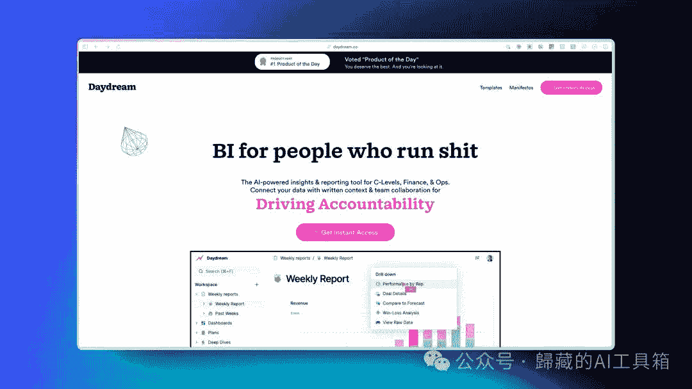

## **完全开源的 LLM OLMo**

链接： **https://blog.allenai.org/olmo-open-lan**guage-model-87ccfc95f580?gi=9adc94dc6400

Allen 人工智能研究所推出了完全开源的LLM OLMo，提供了模型的数据、训练代码、模型以及评估代码。

首次发布的内容包括四个参数规模达到 70 亿的语言模型，这些模型具有不同的架构、优化器和训练硬件，另外还有一个参数规模为 10 亿的模型。所有这些模型都在至少 2 万亿个词元（token）上接受了训练。

每个模型都包含完整的训练数据、模型权重、训练和推理代码、训练日志和性能指标。在多种任务中，OLMo 7B 模型显示出了强大的性能，可以与 Llama 2 等模型相媲美。

# **精选文章🔬**

## **生成式人工智能 150 强：全球最常**用的人工智能工具（2024 年 2 月）

链接： **https://www.flexos.work/learn/g**enerative-ai-top-150

FlexOS 发布的研究报告《生成式 AI 顶尖 150》深入分析了当前基于网站流量和搜索排名的生成式 AI 工具使用情况。报告主要发现包括：

+   主流 AI 平台占主导 ：ChatGPT 及其相关产品，包括 Bing AI、Bard、Claude 和 Microsoft Copilot，共占据了 66% 的生成式 AI 使用量，显示了少数大平台在市场上的巨大份额。

+   AI 工具种类丰富 ：虽然大平台占据优势，但仍有 50 多个 AI 平台每月估计拥有超过 100 万用户，涵盖了建筑、语言学习、视频制作、社交等多个领域。

+   各领域的佼佼者 ：在特定领域，一些工具表现突出，如 Grammarly AI 在写作与编辑方面，Character.AI 在社交与角色扮演方面引领潮流。这些领先者的存在预示着市场可能走向整合。

+   教育领域的 AI 工具 ：像 Brainly 和 CourseHero 这样的教育 AI 工具表现出色，标志着向教育支持应用的转变。

+   行业特定的 AI 应用 ：在营销和编程领域，AI 的使用尤为普遍，像 Simplified AI、Copy.AI、Scalenut、Huggingface、Github Copilot 和 Replit 等工具广受欢迎。而人力资源和财务等行业的 AI 应用则相对较少。

+   流行的 AI 工具类型 ：除了主流 AI 平台外，最受欢迎的生成式 AI 类别包括写作与编辑、教育、社交与角色扮演、图像生成。

+   研究型工具的兴起 ：如 Perplexity.ai 和 ChatPDF 等 AI 驱动的研究工具越来越受欢迎，它们提供对话式回答和链接到可靠来源。

报告还详细列出了按类别划分的最常用 AI 工具，并深入探讨了每个细分市场的领先平台。研究方法包括审查超过 200 个 AI 工具，并以网站和搜索流量作为使用量估计的依据。

FlexOS 强调，AI 正在塑造一个更美好的工作未来，减轻日常琐事，助力更有意义的工作。报告还邀请公司提交他们的数据，以便于未来的调查更准确地反映 AI 工具的使用情况。

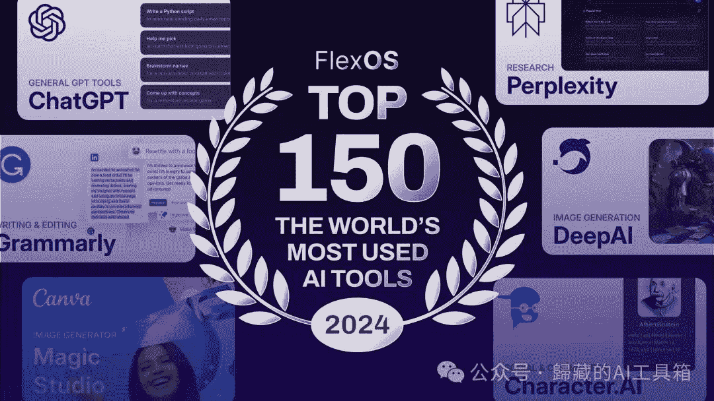

## 59 秒内可以完成什么：机遇（也是危机）

链接： **h**ttps://www.oneusefulthing.org/p/what-can-be-done-in-59-seconds-an

文章《59秒能做什么：机遇与挑战并存》探讨了人工智能（AI）提高工作效率的巨大潜力及其广泛应用的深远影响。作者介绍了一项实验，他们利用AI在不到一分钟的时间内完成了五项任务，包括推出一个新产品、撰写市场调研报告、设计时尚的厨房装饰、制作PowerPoint演示文稿以及编排课程大纲。实验结果令人瞩目，高质量的初稿在短短数十秒内完成，展现了AI在完成传统由人手工作的领域中的巨大潜力[1]。

作者指出，随着像Microsoft的Copilot for Office和OpenAI的GPTs等工具变得越来越易于获取和使用，AI的使用已经逐渐成为常态。这些工具并没有本质上改变AI的能力，但却让AI的使用变得更加简单、平常[1]。

然而，作者也提出了一个潜在的风险。在许多组织中，员工的主要工作产出是文字，如电子邮件、报告和演示文稿。AI能够制作高质量的文字内容，可能会削弱人类努力和技能的价值。作者认为，当面对AI创作的、复制他们工作成果但无法复制他们思考的内容时，可能会引发一场关于工作本质意义的危机[1]。

另一方面，作者也看到了一个机遇。AI可以接管那些人们不愿意做的工作，让他们有更多时间去做自己喜欢的事情，去做别人真正看重的工作。AI还有可能帮助人类扩展自己的能力，激发人们探索新兴趣的可能性[1]。

作者在文末总结道，AI的应用必将带来根本性的变化。如何利用这项技术，强调其积极的一面而非消极的一面，这需要领导者和员工共同来决定。

## 对话《三体》视觉导演陆贝珂:GenAl改变的影视特效业

链接： **https://www.xiaoyuzhoufm.com/episode/65bd8335d74**8f2331405d829?s=eyJ1IjogIjVlZDRiZjJlMjFhYzg1ODA0MWJhMmJjNSJ9

对技术的探索，影视特效行业一直走在最前列。本期我们邀请到了中国著名的视觉导演、影视制片人，也是《三体》的视觉导演陆贝珂来详细拆解《三体》的特效是如何做成的，以及生成式人工智能在影视特效行业中的作用。 正在生成式AI大范围提升行业效率的同时，苹果Vision Pro这种具有空间计算的3D硬件产品，也让特效行业重新经历一轮新的媒介的转化。传统二维拍摄的影像采集方式，正在被纯3D的影像方案替代。

## **将知识放在适当的位置**

链接： **h**ttps://wattenberger.com/thoughts/this-is-not-a-rant-about-chatbots

文章《定位知识：在AI界面中增加背景信息的重要性》探讨了在AI增强界面中加入上下文信息的重要性，特别强调这种做法如何通过提供更全面的信息理解，来提升用户体验。作者指出，虽然向大语言模型（LLMs）输入准确的信息非常关键，但向用户提供超越问题直接答案的上下文信息同样重要。文章通过聊天机器人解释物理现象冷凝的例子，以及使用Svelte框架进行网页开发的情景，展示了提供结构化数据、相关概念和可视化是如何帮助用户更深入地理解一个主题的。

作者提到，向聊天机器人连续提出问题可能感觉像在黑暗中用手电筒摸索，效率低下且缺乏连贯性。与此相反，结构化数据，如表格或文档，可以让用户迅速把握相关概念，深入研究某个主题，而无需为每一条信息单独提问。这种方式不仅使学习过程更加高效，也能让用户接触到他们之前未曾意识到缺失的信息，即所谓的“未知的未知”。

文章还特别指出，任务导向型AI应用中缺少上下文的问题，例如在订购比萨的场景中。作者建议，用户在做出更明智的选择时，会从额外的信息中受益，比如了解不同比萨店的选择范围和价格。这一思路被扩展到一个更广泛的观点：在LLM生成的回答中加入上下文，无论是通过结构化数据、相关概念还是可视化，以满足用户在AI主导的时代中日益增长的期望。

文章最后强调，需要提供能够立即让人理解的信息解决方案，同时要应对隐私和信息过载等挑战。作者提倡设计能够在用户明确提出需求之前就理解他们需求的界面，并建议在AI生成的回答中加入上下文信息，这将显著提升用户的理解和满意度。

## 超越聊天机器人：用上下文信息打造未来的应用内AI体验

链接： **https://blog.dopt.com/mor**e-than-just-chatbots

探讨了将AI助手融入应用内部，提供与用户体验无缝结合的上下文帮助的潜力。作者们认为，现有的以文本为中心、基于轮流对话的聊天机器人并不代表AI体验的未来。他们提出了一种新的AI助手模型，这种助手能够帮助用户学习、导航，以及更有效地使用他们日常工作中的界面。

作者们强调，应用内AI体验的未来在于有效利用上下文信息。他们设计了一个基于定制嵌入技术的检索架构，能够准确找到与用户查询和上下文最相关的信息，并通过一个多模态提示系统来生成有意义的回应。文章还特别指出，在构建应用内助手时，需要同时考虑静态和动态的上下文信息[1]。

静态上下文是指那些固定不变且可以在应用构建时就确定下来的信息，例如与应用相关的文档和其他帮助支持资源。而动态上下文则是在应用运行时根据不同用户和不同场景收集的信息，与用户正在看到和操作的内容紧密相关，如用户和公司背景、运行时的错误和视图状态、窗口信息、语义HTML信息及视觉UI信息。

作者们进一步讨论了在构建AI系统时利用多种上下文信息的重要性。他们提出了一种系统，该系统可以索引各种信息源和操作，根据用户的查询和应用内的动态上下文检索相关信息，并以此为基础，结合用户的查询和上下文信息，为多模态大语言模型（LLM）生成有意义的回应，从而增强应用内体验。

总的来说，作者们相信，通过解决现有嵌入式聊天体验中的问题，可以根本性地改变应用内助手的工作方式，使其更具上下文意识、更加用户友好，并更好地融入用户的体验。

## **AI 是如何工作的**

链接： https://every.to/p/how-ai-works

Nir Zicherman在他的文章中，用非技术性的语言解释了大型语言模型（LLMs）的工作原理，他采用了烹饪和菜单规划的类比来简化这些概念。Zicherman擅长将复杂的技术概念深入浅出地解释给非技术受众，他将这一过程分为两个主要步骤：构建食物模型和发现模式。

在“构建食物模型”的步骤中，目标是教会计算机如何将食物作为数据来处理，而不依赖于口味或食物搭配等定性细节。这一过程通过向计算机输入大量关于过去菜肴搭配的数据来完成，使计算机能够根据菜肴之间的共现频率对它们进行分类。这样就形成了一个“菜肴空间”，在这个空间里，根据共现模式，相似的菜肴被归为一组，而不同的菜肴则相隔较远。

第二步“发现模式”则涉及训练模型预测哪种菜肴最能补充一套特定的菜肴组合。模型依据其从数据中学习到的模式，使用这个“菜肴空间”来确定最适合完成一顿餐的菜肴类型。

将这个比喻应用到LLMs上，Zicherman建议把食物换成句子，把菜肴换成单词。训练过程包括理解单词之间基于上下文的关系，以及发现用于预测句子中下一个最可能出现的单词的模式。这实际上是文本AI工具的基本操作——“下一个单词预测”。

文章强调，尽管AI具有变革性潜力，但其基础原理并不复杂。它涉及简单的数学概念、大量的训练数据，以及找出数据中的模式以模拟机器的“思维”过程。Zicherman在文章最后指出，只要正确解释，AI技术其实是易于理解和简单的，这意味着它并不像许多人所想的那样难以接近。

## Microsoft 2023 年未来新工作报告

链接： **https://www.microsoft.com/en-us/research/u**ploads/prod/2023/12/NFWReport2023_v4.pdf

微软发布了年度《工作未来》报告，这次的主题不是远程工作，而是人工智能。该报告包含 2023 年进行的多项研究的统计数据，并得到了过去几年理论研究的支持。使用 ChatGPT 的知识工作者速度提高了 37%，质量提高了 40%，但准确性降低了约 20%。简单的用户体验解决方案可以解决这个问题。大多数早期研究发现，新工人或低技能工人从LLMs中受益最多。技术水平较低的工人提高了 43%，而技术水平较高的工人则提高了约 17%。人工智能可以帮助将简单的命令分解为微时刻和微任务，从而提高整体质量和效率。

## Motion-I2V：利用显式运动建模生成一致且可控的图像到视频

链接： **https://xiaoyushi97.g**ithub.io/Motion-I2V/

清华和商汤的这个视频生成项目可以 让开源视频模型也有类似 Runway 的运动笔刷能力 。 而且比 Runway 更进一步支持涂抹区域后在用画笔描绘运动方向，也可以分开使用。 希望可以跟现有的开源视频生成模型兼容，我看论文里没写这块。

相较于现有技术，Motion-I2V 即便面对大幅度的运动和视角变化，也能创造出更为一致的视频。通过为第一阶段配备一个专门的稀疏轨迹控制网络（ControlNet），Motion-I2V 允许用户通过少量的轨迹和区域标注来精确控制运动轨迹和运动区域，这比单纯依赖文本指令进行控制提供了更多的灵活性。

此外，Motion-I2V 的第二阶段还自然地支持了不需要样本训练的视频到视频转换（零样本转换）。通过定性和定量的比较，我们发现 Motion-I2V 在生成一致性和可控性强的视频方面，优于以往的方法。

## AnimateLCM：将 LCM 用在视频生成

链接： https://animatelcm.github.io/

这个项目好，将 LCM 用在视频生成， 只需要 4 步推理就可以生成视频 。期待放出代码和权重。 从演示来看视频效果也很不错，支持现有 SD 生态 Animatediff 的所有控制方式。我自己试了一下效果也比只使用 LCM 和 Animatediff 的效果好。

nimateLCM可以在极少的步骤中生成高质量的视频。与其在原始视频数据集上直接应用一致性学习，我们提出了一种解耦的一致性学习策略，这种策略分别对图像生成的基础知识和运动生成的基础知识进行提炼，从而提高了训练效率并提升了生成视频的视觉质量。

## 为什么说 2023 年是 AI 视频的突破年？以及 2024 年的展望

链接： **h**ttps://quail.ink/op7418/p/why-2023-ai-video-breakthrough-2024-outlook

a16z的一篇文章，详细盘点了现在人工智能视频生成领域的现状，看完就可以对这个领域有个大概的了解，感兴趣可以看看。

他们列出了 2023 视频生成产品的时间表以及对应产品的详细信息。同时对视频生成目前需要解决的问题以及视频生成领域的 ChatGPT 时刻到来需要具备的条件进行了探讨。

感谢大家看到这里，如果你也有想推荐的内容的话，可以私信我或者给我发邮件投稿。也可以分享给更多的朋友，让大家都有机会了解这些内容。

### **参考资料**

[1]查看更多风格和提示词: https://catjourney.life/