# AIGC Weekly #57

> 来源：[https://waytoagi.feishu.cn/docx/HGmrdH9ceozU4xxJTdpcyeMFnMe](https://waytoagi.feishu.cn/docx/HGmrdH9ceozU4xxJTdpcyeMFnMe)

> 🔗 原文链接： h[ttps://mp.weixin.q](https://mp.weixin.qq.com/s?__biz=MzU0MDk3NTUxMA==&mid=2247485358&idx=1&sn=c2907aa88e8294edcaedbb242365982f&chksm=fa255eb462b9162871f2cd37fb7c3d90fefdbc9dd0b8b5fa88c648d3fd93fcf2e7d902bbdfa4&scene=126&sessionid=1709892061#rd)q.com/s?__biz=Mz...

> ⏰ 2024-01-29 08:30

> 作者： op7418  公众号：歸藏的AI工具箱  北京

Midjou**rney提示词：extrem**e macro photo of clean polished glass, edges with light from four different colors, blurred, purple pink and dark navy and dark azure, grey background, natural colors, depth of field --ar 16:9 --style raw --stylize 0 --v 6 查看更多风格和提示词 [1]

# **上周精选**

## Open AI的一些动态：模型更新，ChatGPT能力更新

感觉上周开始Open AI的员工才从放假的状态里出来，一口气发布了一堆新内容，也有一些很有用的关于开发者的主要是模型的例行更新，还有ChatGPT的一大堆体验和功能更新。

### **API和新的嵌入模型**

链接： **h**ttps://openai.com/blog/new-embedding-models-and-api-updates

关于开发者的一系列更新：

+   引入了两种新的嵌入模型：更小且高效的 text-embedding-3-small 模型，以及更大且更强大的 text-embedding-3-large 模型。

+   text-embedding-3-small 是新的高效嵌入模型，性能更强。比较text-embedding-ada-002与text-embedding-3-small，在常用的多语言检索基准（MIRACL）上的平均得分从31.4％增加到44.0％，而在常用的多语言检索基准上的平均得分从31.4％增加到44.0％英语任务基准（MTEB）从 61.0% 提高到 62.3%。

+   减价。text-embedding-3-small 也比的上一代 text-embedding-ada-002 模型更加高效。因此，与 text-embedding-ada-002 相比，text-embedding-3-small 的定价降低了 5 倍，从每 1000 个Token的价格 0.0001 美元降至 0.00002 美元。

+   text-embedding-3-large 是新的下一代更大的嵌入模型，可创建高达 3072 维的嵌入。

+   性能更强。比较 text-embedding-ada-002 与 text-embedding-3-large：在 MIRACL 上，平均得分从 31.4% 提高到 54.9%，而在 MTEB 上，平均得分从 61.0% 提高到 64.6%。

+   text-embedding-3-large 的定价为 0.00013 美元/1k Token。

+   将推出新的 GPT-3.5 Turbo 型号 gpt-3.5-turbo-0125，并且在过去一年中我们将第三次降低 GPT-3.5 Turbo 的价格。新模型的输入价格降低 50% 至 0.0005 美元/1K 代币，输出价格降低 25% 至 0.0015 美元/1K 代币。

+   更新的 GPT-4 Turbo 预览模型，gpt-4-0125-preview。该模型比之前的预览模型更彻底地完成了代码生成等任务，旨在减少模型未完成任务的“懒惰”情况。新模型还修复了影响非英语 UTF-8 生成的错误。

+   更新了审核模型，发布了 text-moderation-007，这是Open AI迄今为止最强大的审核模型。

+   API权限和使用体验优化：

+   开发人员现在可以从 API 密钥页面向 API Key分配权限。例如，可以为密钥分配只读访问权限以支持内部跟踪仪表板，或限制为仅访问某些端点。

+   使用情况仪表板和使用情况导出功能现在在打开跟踪后公开 API 密钥级别的指标。

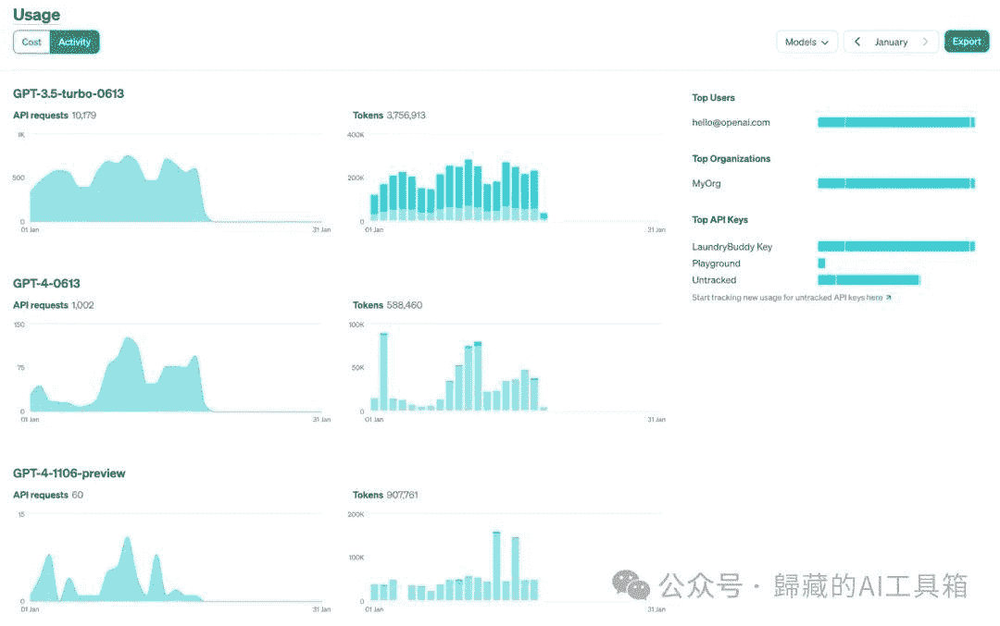

### **ChatGPT的能力和体验更新**

ChatGPT也进行很多的能力更新，现在越来越像一个正经产品了，当然很多地方依然很糙：

+   现在ChatGPT会根据你的浏览器语言弹出提示询问你是不是需要更换ChatGPT的语言，切换完看了一下，汉化的还是不错的。

+   在设置中增加了一个选项Always expand code output，开启后ChatGPT代码解释器的输出代码会自动展开。

+   支持将现在的所有聊天历史全部归档，这样你左边的侧边栏就干净了。

+   最后一个功能更新对GPTs的作用有很大的提升，你现在可以在输入框输入“@”来直接调用GPTs了，可以在一个聊天记录中使用多个GPTs来组合完成任务，极大的拓展了GPTs的使用场景。

+   比**如**这个演示 ，在一个聊天中先使用Grimoire构建一个网页。然后直接调用DesignerGPT对上面Grimoire生成的网页进行部署。 https://x.com/op7418/status/1751293373074510210?s=20

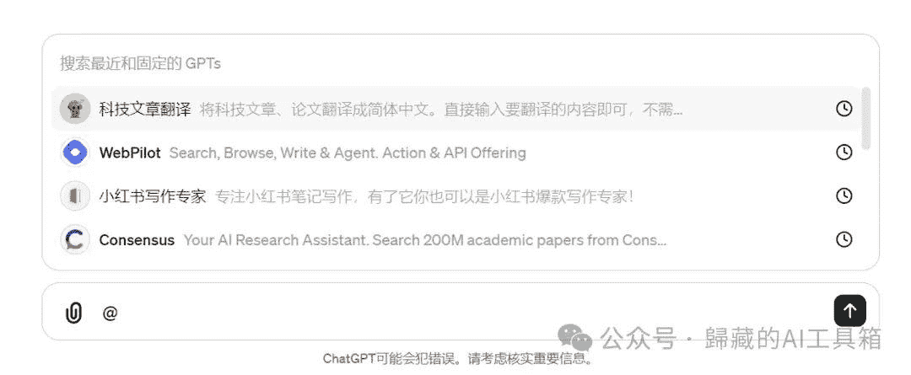

## Google发布LUMIERE视频生成和编辑模型

链接： https://lumiere-video.github.io/

LUMIERE 这是谷歌这段时间发布的第三个视频生成模型了，不过看起来是最重要的一个， 演示视频的质量非常高 ，运动幅度和一致性表现都很好。不过这个演示的视频都非常完美，不知道多少次才能生成一个这样质量的。

整个模型的 能力非常全面，除了视频生成之外支持各种视频编辑和生成控制能力 。

支持各种内容创建任务和视频编辑应用程序，包括图像到视频、视频修复和风格化生成。

详细介绍：

Lumiere —— 一款将文本转换为视频的先进模型，它专门用于制作展现真实、多样化及连贯动态的视频，这在视频合成领域是一大挑战。

为了实现这一目标，我们采用了一种创新的空间-时间 U-Net 架构（Space-Time U-Net architecture）。这种架构能够在模型中一次性完成整个视频时长的生成，这与传统视频模型不同。传统模型通常是先合成关键的远程帧，然后通过时间上的超级分辨率技术来处理，这种方法往往难以保持视频的全局时间连贯性。

Lumiere 通过在空间和关键的时间维度进行上下采样，并利用预先训练好的文本到图像扩散模型（text-to-image diffusion model），使我们的模型能够直接生成全帧率、低分辨率的视频，并且在多个空间-时间尺度上进行处理。

我们展现了该模型在将文本转换成视频方面的领先成果，并且证明了该设计能够轻松应用于各种内容创作和视频编辑任务，包括将图像转换为视频、视频修补和风格化视频创作。

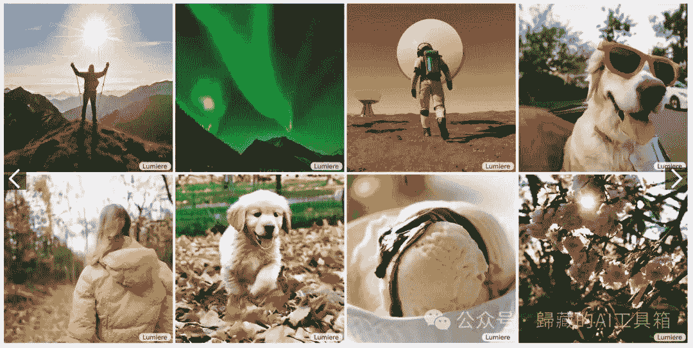

## Pika研究让SD具有跟DALL-E3相似的提示词理解能力

链接： https://arxiv.org/html/2401.11708v1

可以利用 LLM 让 SD复现 DALL-E3 对于复杂提示词描述的理解能力。

比如下面的几个例子，在增加了这个能力之后的SD对提示词的理解获得了巨大的提升，非常精准的还原出了提示词描述的空间关系和画面细节。而且项目还支持和 ComtrolNet 一起使用进一步增加对图像的控制能力。

项目介绍：

本文介绍了一种创新的无需额外训练的文本到图像生成与编辑框架——重述、规划和生成（RPG），它利用多模态大语言模型的链式思维推理能力，提升了文本到图像扩散模型的组合能力。

我们使用MLLM作为全局规划器，将复杂图像的生成过程拆分为子区域内的多个简单任务。我们还引入了互补区域扩散技术，以实现区域内的组合式生成。

此外，RPG框架通过闭环方式整合了文本引导的图像生成和编辑，进一步提升了模型的泛化能力。

大量实验证明，RPG在处理多类别对象组合和文本与图像语义对齐方面，表现优于当前顶尖的文本到图像扩散模型，如DALL-E 3和SDXL。

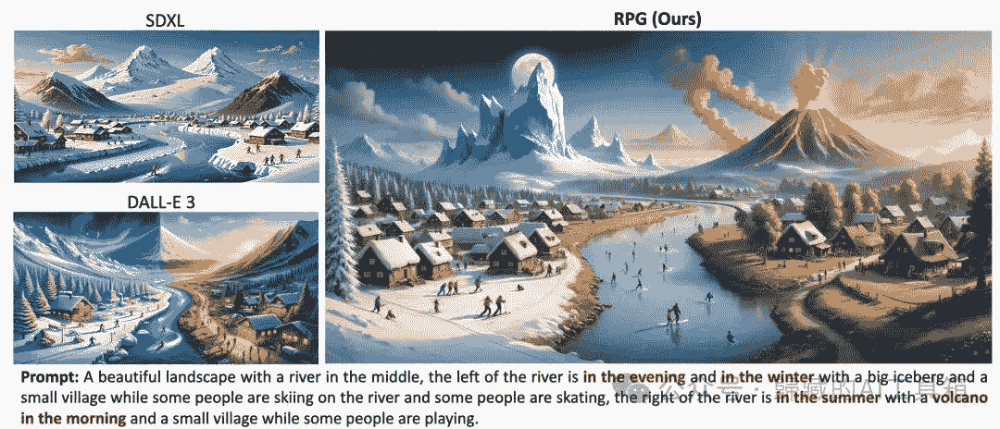

## 另一个ID保持项目InstantID

链接： **https://github.com**/InstantID/InstantID

这个项目与PhotoMaker和IP-Adapter-FaceID相比实现了更好的保真度并保留了良好的文本可编辑性（面孔和样式更好地融合）。

一种基于先进扩散模型的创新解决方案。我们的模块能够仅使用一张面部图片，在各种风格上进行高度个性化的图像处理，同时确保图像的高保真度。

为此，我们特别设计了 IdentityNet，它在处理图像时既考虑了强烈的语义信息，又考虑了空间信息的轻微调整，通过结合面部图像、地标图像以及文本提示来指导图像的生成。

InstantID 展示出了卓越的性能和高效率，在需要重点保留身份特征的实际应用场景中表现优异。此外，我们的工作能够与当前流行的预训练文本到图像扩散模型（如 SD1.5 和 SDXL）无缝集成，作为一个灵活的插件使用。

ComfyUI插件在这里： **https://github.com**/InstantID/InstantID

**W**eb UI的Controlnet插件也已经支持： https://github.com/Mikubill/sd-webui-controlnet/discussions/2589

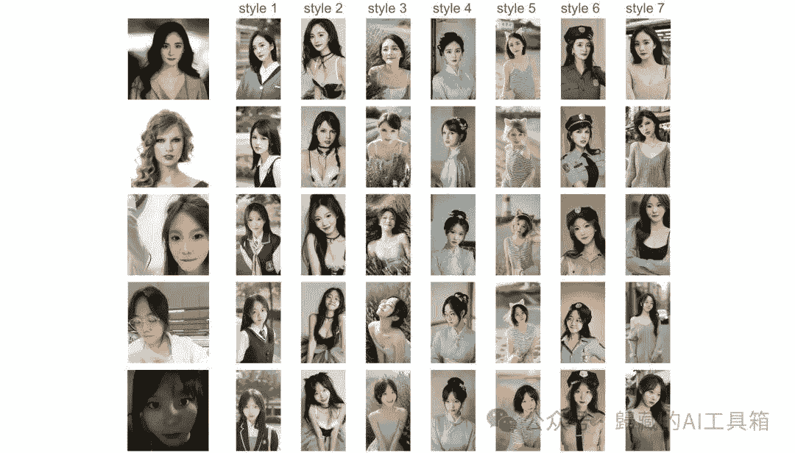

# **其他动态**

+   谷**歌在Chrome浏览器上推出了智能组织标签页、借助文本生成图像模型生成个性化壁纸图片和写作辅**助三个AI能力： https://blog.google/products/chrome/google-chrome-generative-ai-features-january-2024/

+   Hug**ging Face和Google Cloud **建立战略合作伙伴关系，将与谷歌在开放科学、开源、云和硬件方面进行合作，使公司能够利用 Hugging Face 的最新开放模型以及 Google Cloud 的最新云和硬件功能来构建自己的人工智能： https://huggingface.co/blog/gcp-partnership

+   Brave 的浏览器助手 Leo 现在使用 Mistral 模型驱动： https://brave.com/leo-mixtral/

+   谷歌还**发布了一种叫“仅权重量化”（weight-only quantizat**ion）的技术。这项技术使用了 8 位整数（S8）来表示权重，同时使用 16 位浮点数（F16）来表示输入数据，以此进行矩阵乘法运算。这种方法在保证一定精度的同时，提高了运算效率： https://blog.research.google/2024/01/mixed-input-matrix-multiplication.html

+   Pixverse视频生成应用发布网页**版本和新的视频生成模型，我也做了测试**： https://weibo.com/6182606334/NDvM89EEY

+   M**i**djourney V6更新了平移、缩放以及变换特定区域的能力，同时alpha版本的网站也做了很多体验优化基本追平了Discord的能力： https://x.com/op7418/status/1750423935584461121?s=20

+   百度发布多模态模型UNIMO-G，可以实现图片和提示词混合输入进行照片编辑： https://arxiv.org/abs/2401.13388

+   Dify更新了开源的 Agent+Tools 的能力首发版本内置了 12 款第一方工具（包括 DA**LL**·E 3），并能通过扩展方式去集成自己的 API 工具（它完全兼容 OpenAI 的 AI-Plugin 规矩）： https://dify.ai/blog/dify-ai-unveils-ai-agent-creating-gpts-and-assistants-with-various-llms

+   ElevenLabs发布Dubbing Studio和8000 万美元的 B 轮融资，Dubbing St**u**dio可以自动识别视频中的每一个发言者并且可以手动调整每一句话的语气和具体的翻译，直到修改完成，也可以全部自动完成： https://x.com/elevenlabsio/status/1749863738570690692?s=20

+   现在Poe的机器人创建者只要为Poe带来**一**个新用户就能获得高达50美元的收入： https://x.com/poe_platform/status/1749827431543050517?s=20

+   **H**ayGen发布可以实时对话的数字人产品： https://x.com/CoffeeVectors/status/1749308520636231824?s=20

+   字节发布Depth Anything深度估计模型，零样本相对深度估计，优于 MiDaS v3.1 (BEiTL-512)零样本度量深度估计，优于 ZoeDepth，Web UI COntrolnet插件已经支持： https://arxiv.org/abs/2401.10891

# **产品推荐**

## Maimo：从任何内容中提取要点

链接： https://maimo.ai/

Maimo是一种旨在简化从各种内容来源（如电话记录、财务报告和网页）中提取关键要点的工具。它消除了手动文本扫描和笔记结构化的需要，使用户能够提出问题并立即获得答案。Maimo还提供全球问答功能，使用户无需特定关键词即可检索信息，并与日常应用程序集成，以增强用户工作流程中其功能的生产力和易用性。

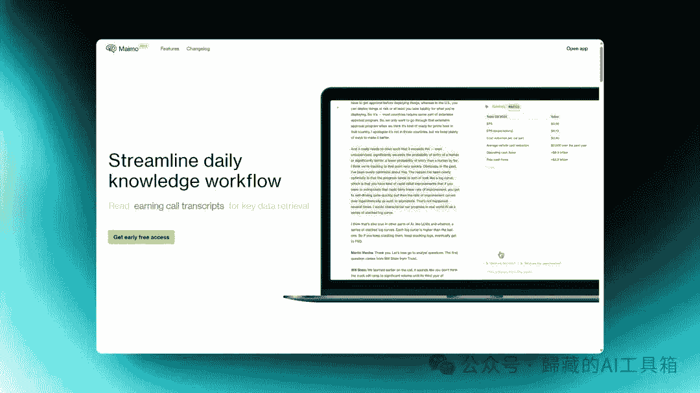

## Jellypod：将你的订阅内容变成播客

链接： https://jellypod.ai/

Jellypod AI将您的电子邮件订阅转换成个性化的每日播客，让您随时了解自己关心的新闻。用户可以从六种逼真的声音中选择，找到最适合自己的风格和语调。Jellypod允许用户自定义播客生成的时间表，如隔天生成等。Jellypod具备多种功能，如调整播放速度、内置电子邮件阅读器、离线收听和深色模式。

## **ARTU：汇总和总结内容**

链接： https://artu.app/

ARTU是一个旨在帮助组织混乱创意的人工智能助手。用户可以通过各种平台访问它，包括电子邮件、WhatsApp、Discord和Telegram。用户可以向ARTU发送各种内容，如想法、任务、视频、链接、社交媒体帖子和电子邮件，人工智能助手将对这些信息进行处理、总结、排序标记并整理到一个单一的面板上。除了这些功能外，ARTU还提供了名为ARTU Meetings的Chrome扩展程序。该扩展允许ARTU陪伴用户参加在线会议，并提供会议记录和识别下一步行动。

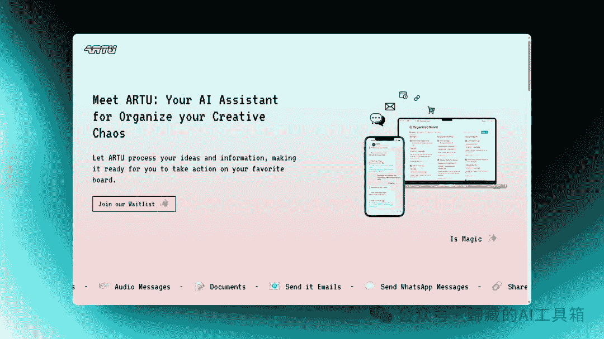

## Lepton Search：500行代码构建的AI搜索工具

链接： https://search.lepton.run/

一个500行Python代码构建的AI搜索工具，而且还会开源，试了一下麻雀虽小该有的都有。

后端是Mixtral-8x7b 模型，托管在 LeptonAI 上，输出速度能达到每秒大约200个 token，用的搜索引擎是 Bing 的搜索 API。作者还写了一下自己的经验：

(1) 搜索质量至关重要。优质的摘要片段是形成精准概括的关键。(2) 适当加入一些虚构内容实际上有助于补充摘要片段中缺失的“常识性信息”。(3) 在进行内容概括时，开源模型表现出了卓越的效果。

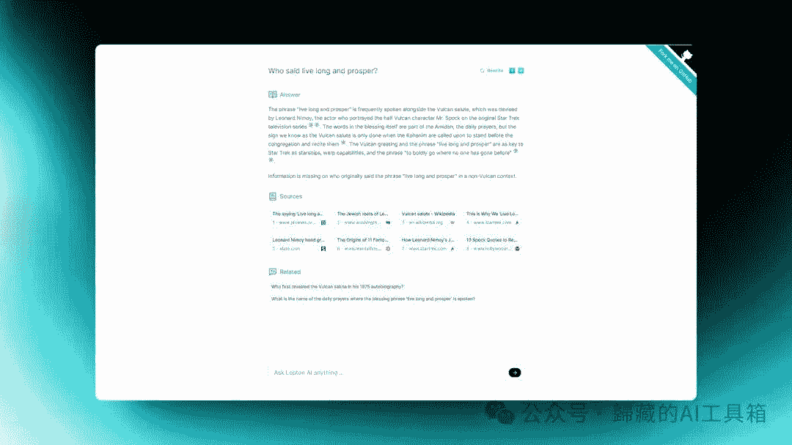

## VectorShift：AI自动化应用构建平台

链接： https://www.vectorshift.ai/

YC 投的这个公司也挺有意思，VectorShift 一个 AI 应用自动化构建平台。

利用人工智能来搜索知识库、生成文档并部署聊天机器人和助手，帮助任何组织构建企业级 AI 应用程序。他们支持通过拖放组件来完成：

1）连接不同的节点，如 LLMs、数据加载器、矢量数据库等。

2）创建数据知识库（例如 CRM、Notion 数据库、文件）或与数据源实时同步，以便在 AI 管道中利用。

3）创建触发管道运行的自动化（例如，Slack 消息/电子邮件）并允许管道执行操作（例如，编写Notion文档）。

4）只需点击几下，即可通过聊天界面部署您的管道。在内部共享聊天助手，或通过 URL、WhatsApp / SMS 或 API 导出给最终用户。

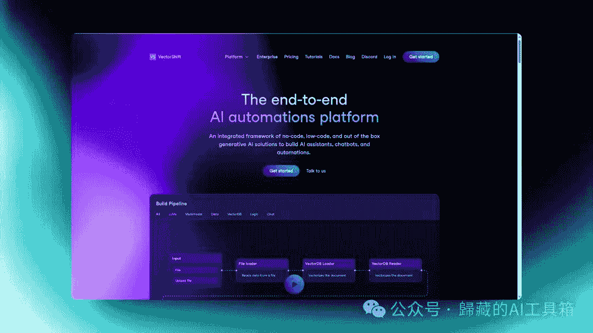

## Findr：AI搜索你所有软件中的内容

链接： https://www.usefindr.com/

名为 Findr 的人工智能（AI）辅助统一搜索工具。这款工具的目标是优化工作场所的搜索体验，从而避免了寻找链接或重复制作已有文档的需要。它使用户能够快速找到所需的任何文档或信息。

## Recraft：AI帮助创建平面内容和矢量标志

链接： https://www.recraft.ai/

Recraft 是一款创新的生成式 AI 设计工具，它让用户能够以一致的品牌风格创作和编辑数字插画、矢量艺术、图标及 3D 图形。用户可以上传一张图片，Recraft 便能以相似风格快速生成图像。

Recraft 还特别提供了精准的颜色控制功能，用户可以轻松地将一组颜色重新调色，以符合他们品牌的色彩方案。其 AI 工具箱功能强大，能够帮助用户从文本或视觉素材出发，仅需数分钟便可制作出精致的设计作品。利用套索工具，用户还可以对设计进行编辑和重绘，以实现细致调整和个性定制。

除此之外，Recraft 提供了一个无限画布，用户可以在上面自由创作多幅图像、添加文本，以及拖放各种元素。这个平台还汇集了众多艺术家和 AI 设计师，为用户提供灵感和创意的源泉。

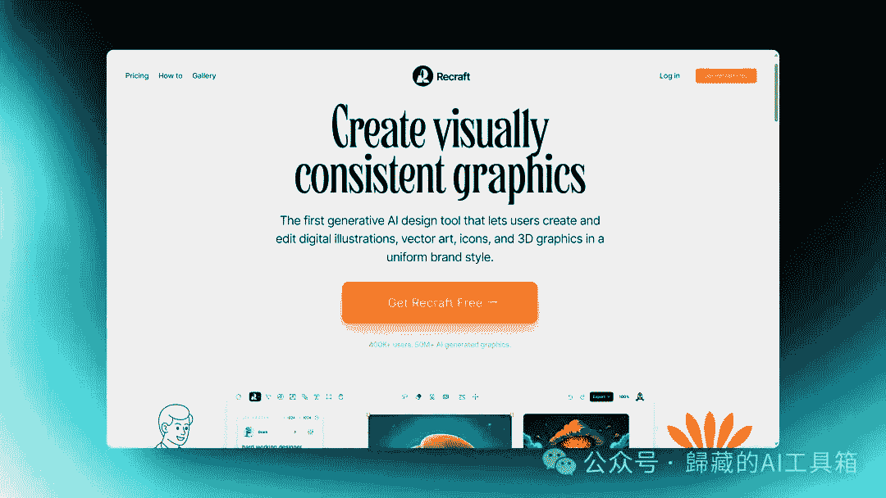

# **精选文章**

## **向量：AI 数据的基础元素**

链接： **h**ttps://www.pinecone.io/blog/vectors-as-ai-data-primitives/

探讨了自推出以来，ChatGPT 以及其他大型语言模型（LLMs），如 Claude、Falcon、Gemini，对企业对企业（B2B）和直接面向消费者（DTC）市场产生的深远影响。亚马逊网络服务（AWS）的首席执行官 Adam Selipsky 强调，针对不同场景选择合适的模型至关重要，因为这些模型在内容总结、逻辑推理、整合能力、语言支持、图像生成和搜索等方面各有所长。

随着人工智能（AI）技术的快速发展，出现了对能够适应不同场景并能互相协作的基础设施的需求，这些基础设施能够快速在不同的模型间切换。这种灵活性对于想要充分利用生成式 AI（GenAI）能力的组织来说至关重要。

文章强调，无结构数据的迅速增长，已经远远超过了结构化数据市场，这一趋势要求开发出新的数据库架构。从历史上看，新的数据类型常常催生出新的数据库类型，现在随着 AI 和机器学习（ML）成为新的焦点，这一现象再次出现。

类似的变革在 2010 年代初就已出现，那时神经网络和强化学习的兴起使得 AI 任务中开始广泛采用 GPU 进行并行处理。这一转变的标志性成就是 AlexNet——一种赢得了 ImageNet 比赛的神经网络，后来被谷歌收购。

现在，随着数据库、无结构数据、搜索技术及其规模的融合，专为处理向量嵌入设计的向量数据库应运而生。与传统数据库相比，这些数据库能让 AI 更加深入地理解和分析数据，赋予数据更多的上下文和特征。

文章指出，尽管像 MongoDB 这样的现代数据平台是为了应对当时的需求而构建的，但它们并不适合处理向量嵌入。在这些平台上简单地增加向量索引功能，会牺牲它们的性能和扩展能力。

## InstructGPT：调整语言模型以便更好地遵从指令

链接： **https://openai.com/research/i**nstruction-following

昨天是InstructGPT发布两周年的纪念日，它是现代大语言模型的开山鼻祖。

InstructGPT 开创了一个经典的模型训练方法：先进行预训练，然后是监督式微调，最后是基于强化学习的人类反馈（Reinforcement Learning from Human Feedback, RLHF）。这个策略至今仍被广泛采用，虽然有些许变化，比如 DPO 策略。

InstructGPT 可能是 OpenAI 最后一次详细介绍他们如何训练尖端模型的论文。回顾这两年，Jim Fan认为它标志着大语言模型从学术研究（GPT-3）走向实际应用（ChatGPT）的关键转折点。

建议复习一下这篇论文，可以对LLM底层有更加清晰的了解。

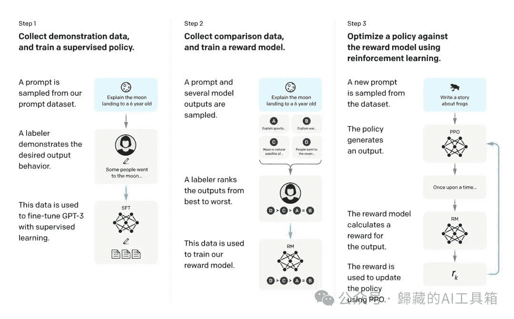

## 图像识别基础知识-视觉模型的门户

链接： **https://quail.ink/op7418/p/tuxiang-shi-bie**-ji-chu-zhi-shi-shi-ju-mo-xing-de-men-hu

就跟LLM训练的时候训练数据集很重要一样，图像模型的训练也需要高质量的图片素材，同时模型训练结束之后如何对模型产出的图片进行评价也是一个重要的内容，这些都需要一些图像识别的项目来完成比如图像标记、图像分割。这个篇文章就对图像识别的分类、历史和工作原理都做了详细的介绍，感兴趣可以看看。

## 底层科普-Stable Diffusion 采样器工作指南

链接： **ht**tps://quail.ink/op7418/p/science-popularization-stable-diffusion-sampler-operation-guide

发现了一篇介绍 SD 不同采样器区别的好文章，详细介绍和对比了不同采样器的区别和原理，同时还介绍了不同的采样器之间的继承关系。最后给出了一些采样器选择建议。所以就顺手翻译了一下。

如果你之前也不是很了解 SD 中每个采样器之间的区别，不知道如何选择的话可以看一下。

## Adept Fuyu-Heavy：一种新型多功能模型

链接： **https://www.adept.ai/b**log/adept-fuyu-heavy

关注LLM 操作现有软件的 UI 界面的，除了Rabbit 之外还有Adept，他们致力于一个机器学习模型，可以与计算机上的所有内容进行交互。

昨晚他们发布了一个专门为了识别 UI 界面内容的多模态模型 Adept Fuyu-Heavy，从演示来看非常强，可以准确识别复杂 B 端 UI 界面的信息并加工。

这款模型在全球多功能智能模型中排名第三，仅次于规模比它大10到20倍的 GPT4-V 和 Gemini Ultra。

Fuyu-Heavy 特别擅长于处理和理解不同类型的数据（如图像和文本），其中最引人注目的是它对用户界面的高效理解。

即便要处理图像数据，这款模型在常规的文本处理测试中也能媲美或超越同等级别的其他模型，例如在著名的 MMMU 测试中，它的表现甚至超过了 Gemini Pro。

## **Llama2 提示工程指南**

链接： **ht**tps://github.com/facebookresearch/llama-recipes/blob/main/examples/Prompt_Engineering_with_Llama_2.ipynb

Meta 推出了Llama2 提示工程指南，主要面向对象是 LLM 的开发人员和提示工程爱好者，感兴趣可以看看。详细介绍了如何使用和部署 Llama2，还有对应的高级提示工程技巧和代码。比如使用零样本和少样本学习进行提示的示例、角色提示、思想链和自我一致性等。

## MakeMoE：从头开始实现MoE语言模型

链接： **h**ttps://huggingface.co/blog/AviSoori1x/makemoe-from-scratch

详细介绍了如何从零开始构建一种特殊的语言模型。这个模型受到 Andrej Karpathy 的项目 'makemore' 的启发，采用了类似的自回归字符级语言模型，但结合了稀疏混合专家的结构。

文章不仅阐释了这种结构的关键组成部分及其实现方式，还提供了一个 GitHub 仓库链接，用于实现模型的整个过程。作者指出，这种模型结构引起了广泛关注，特别是在 Mixtral 发布和 Llama 3 有望成为一种混合专家大型语言模型的背景下。

尽管这类模型看似简单，但作者强调，训练稳定性是主要的挑战。不过，通过这种小规模的实现，可以快速尝试新的方法。

文章详细解释了模型的实施过程，包括采用稀疏混合专家取代传统的前馈神经网络，实现 top-k 门控和带噪声的 top-k 门控，以及采用 Kaiming He 初始化技术。作者还说明了从 makemore 架构保持不变的元素，比如数据集处理、分词预处理和语言建模任务。

此外，文章还深入讲解了自注意力机制，如何创建一个专家模块，以及如何实施 top-k 门控和带噪声的 top-k 门控来实现有效的负载平衡。作者通过提供代码片段和详细解释，帮助读者更容易地理解和应用这个模型。

## **AI 生成式人工智能领导力入门**

链接： https://www.ded.ai/p/primer

生成式人工智能是一种利用算法数据和模型来创建新颖内容的人工智能技术。在这篇入门指南中，作者讨论了领导者和企业在整合生成式人工智能时需要考虑的关键领域。这些领域包括商业战略、技术战略、数据战略、组织准备度以及道德考量。作者强调了理解生成式人工智能潜力并利用它为组织创造价值的重要性。

### **参考资料**

[1]查看更多风格和提示词: https://catjourney.life/