# AIGC Weekly #56

> 来源：[https://waytoagi.feishu.cn/docx/Xn2Ad2NtqoiEjrxDnMLcgviPn7e](https://waytoagi.feishu.cn/docx/Xn2Ad2NtqoiEjrxDnMLcgviPn7e)

> 🔗 原文链接：https://quail.ink/op7418/p/aigc-weekly-56

> 发表时间：22 Jan, 2024

Midjourne[y提示词： body, l](https://catjourney.life/)ow angle::1 Macro, 3d, glass floating flat organic forms, shapeless, close-up ribbed plastic object, depth of field, pastel, rainbow colored border, in the style of ethereal light effects, monochromatic white figures, minimalist, shimmering metallics, light tan grey olive background::2 --v 6.0 --style raw --s 50 --ar 16:9 💎 查看更多风格和提示词

上周扎克伯格在他的threads和Ins上发布了一段视频，宣布Meta将会致力于实现AGI，为了实现这一目标公司正将其两大 AI 研究团队 FAIR 和 GenAI 进行合并，同时将投入超过90亿美元向英伟达采购员超过34000张H100显卡，到24年底Meta的GPU算力将达到60万个H100.

今年英伟达总的H100出货量将有15万张，Meta一下就要拿走1/5真的狠。

对于通用人工智能究竟是什么，以及何时能实现，连扎克伯格自己也没有明确的答案。尽管如此，他依然全力以赴地研究智能的各个方面，从逻辑推理到直觉判断。Meta 正在开发名为 Llama 3 的大语言模型，目的是提升它在代码生成和逻辑推理方面的能力。

重要的是扎克伯格正在推动一种开源的通用人工智能开发方式，这也是大家这么关注他的进展和Llama3的原因。

三星上周发布了Galaxy S24系列手机，包括 Galaxy S24、Galaxy S24+ 和 Galaxy S24 Ultra。起售价分别为 800 美元、1,000 美元和 1,300 美元。值得注意的是三星的新手机上附加了比较多的AI功能，并且将其作为了重要卖点。

拍摄精彩镜头后，创新的 Galaxy AI 编辑工具可实现擦除、重组和重新制作等简单编辑。为了更轻松、更高效地进行优化，编辑建议使用 Galaxy AI 为每张照片提供完美合适的调整建议。为了给用户更多的创意控制和自由，生成编辑可以使用生成人工智能填充图像背景的部分内容。当图片弯曲时，AI 会填充边框。

S24 将配备 Circle for Search，其功能与包装上所说的差不多。用手指或 S-Pen 圈出一段文字，你就会触发谷歌搜索该词。

借助 Gemini Pro，可以以比以往更有用的方式与熟悉的三星应用程序进行交互。在新的 Galaxy S24 系列上，三星的笔记、录音机和键盘应用程序将使用 Gemini Pro 来提供更好的摘要功能。

Galaxy S24 Ultra 的四远摄系统配备全新 5 倍光学变焦镜头，与 50MP 传感器配合使用，借助自适应像素传感器，可在 2 倍、3 倍、5 倍到 10 倍放大倍率的变焦级别上实现光学质量性能。通过增强的数字变焦（图像生成），图像在 100 倍下也能显示出清晰的效果。

如何增强大语言模型的推理能力将时间转换为准确性一直是业内研究的重点，数学能力是比较好实现通过自动结果判断从而让语言模型自我进化的一个方向。

DeepMind 上周推出了 AlphaGeometry，这是一款能够解决复杂几何问题的人工智能系统，其表现水平可媲美人类奥林匹克数学竞赛的金牌得主。在一个包含 30 个奥林匹克级几何问题的基准测试中，AlphaGeometry 在规定的时间限制内成功解决了 25 个问题，超越了之前解决这些问题中 10 个的最先进系统。相比之下，人类金牌得主平均能解决 25.9 个问题。

AlphaGeometry 结合了神经语言模型的预测功能和基于规则的推理引擎来找出解决方案。它还采用了一种生成大量合成训练数据的方法——1亿个独特实例，使其能够在不依赖任何人类示范的情况下进行训练。这解决了人工智能系统在处理几何和数学等复杂问题时常遇到的数据短缺问题，这些问题由于缺乏推理能力和训练数据而难以解决。

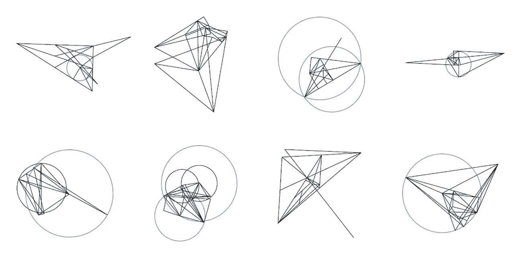

Sam上周在达沃斯论坛接受了彭博社的采访，透露了关于近期Open AI动向的一些解释：

Sam 表示，我们对即将到来的选举感到焦虑其实是件好事。

他认为，通用人工智能（AGI）的发展指日可待，但它对世界的影响可能比我们预期的要小。

OpenAI 正在与美国军方合作，开发开源网络安全软件，并努力预防退伍军人自杀。OpenAI 最近政策的改变，即删除“军事和战争”相关字眼，是为了明确这些用途。开发武器和有害工具仍然是不允许的。

他们通常不希望使用出版商的数据进行训练，有些出版商愿意与 OpenAI 合作，有些则不愿意。尽管他们愿意为此进行法律辩护，但更希望出版商直接拒绝合作，而不是诉诸法律。

Sam 还提到，他期待未来艺术家们能通过加入 DallE 生态系统获得经济利益，而不是删除或限制自己的风格。

他认为，大多数人对人工智能的治理和监管感兴趣，但他更激动的是看到政府利用这些系统为公民服务。

Sam 认为，未来世界中两种重要的货币是“智能”（计算能力）和“能源”。为了满足人工智能的能源需求，我们需要实现技术突破，这也将有助于解决与气候相关的问题。

关于与著名设计师 Johnny Ive 的合作，Sam 表示尚未听闻官方消息。他赞扬了 Johnny 让计算机多次变得更适合人类使用，但认为 OpenAI 和整个人工智能领域在这方面还有待提高。

Studio Photo这个有点意思，本质上还是妙鸭那套Lora方案，有想复刻的可以参考EasyPhoto这个开源项目。

不过他们很专注主打这种传记风格照片。非常适合在海外传播，收费也很离谱一个Lora 加上30张照片20美元。

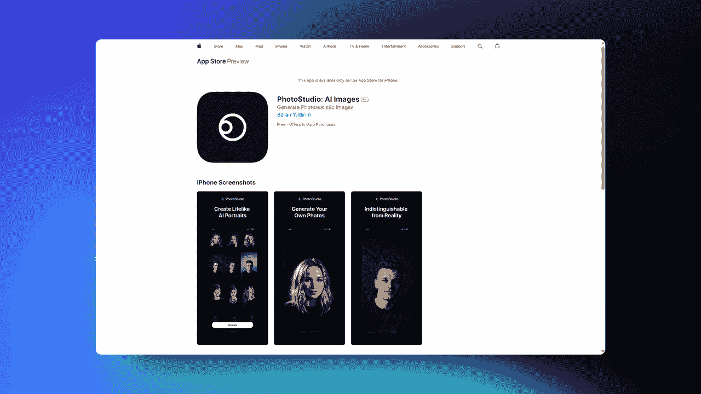

提供了AI 模型和托管提供商非常详尽的分析 - 帮助你为你的产品产品选择最佳模型和提供商。

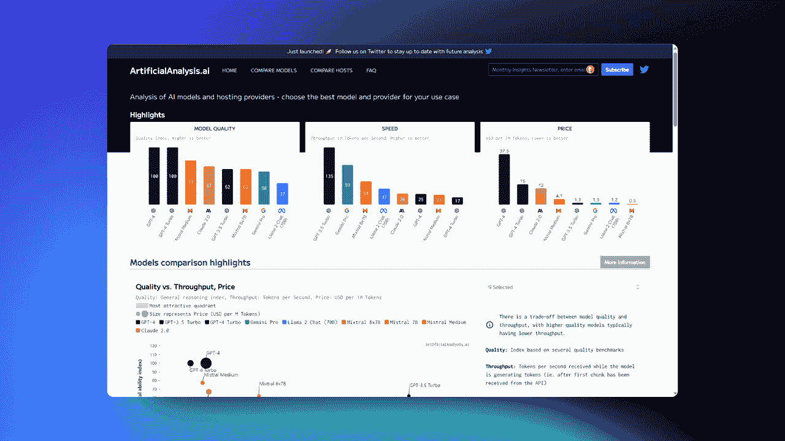

广播会记录会议笔记，跟踪决策，并创建行动项，以帮助你的工程团队更快地完成工作。

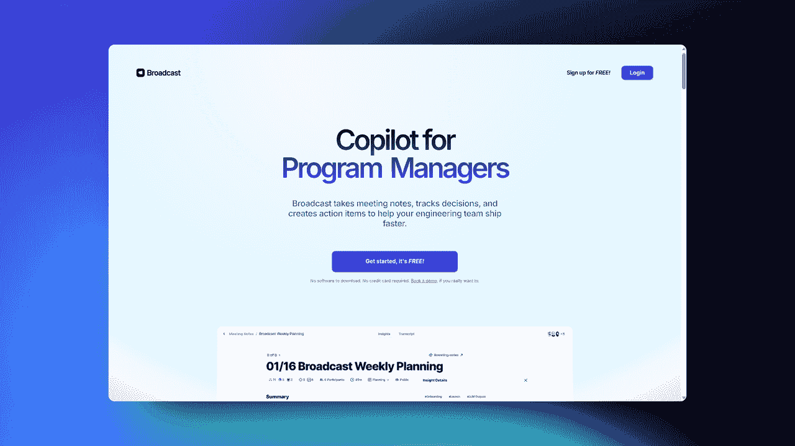

AI Lawyer 是一款旨在自动化法律研究和文书工作的个人法律 AI 助手，通过提高法律服务的可及性，让消费者、律师、律师事务所和法学生受益。它具备多项功能，能够自动处理文档、进行高级法律研究，以及进行 AI 文档管理，如总结合同、将图片转化为文本和文件翻译。这个平台支持网页、iOS 和 Android 平台，并可根据个人喜好定制。

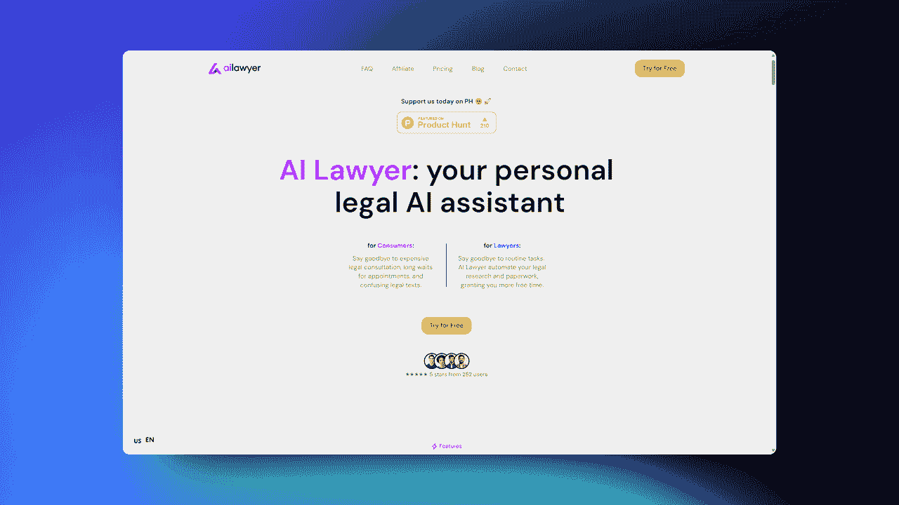

WittyWingMan 是一款利用人工智能技术提升在线约会体验的应用。该应用具备多项功能，包括自动生成对话开场白、个性化的回复建议、实时聊天分析以及支持多种语言。人工智能会根据用户匹配对象的个人资料定制独特的开场白，帮助用户引入有趣话题，促进更深层次的交流。应用还能适应用户的聊天风格和偏好，生成看似真实的回复。

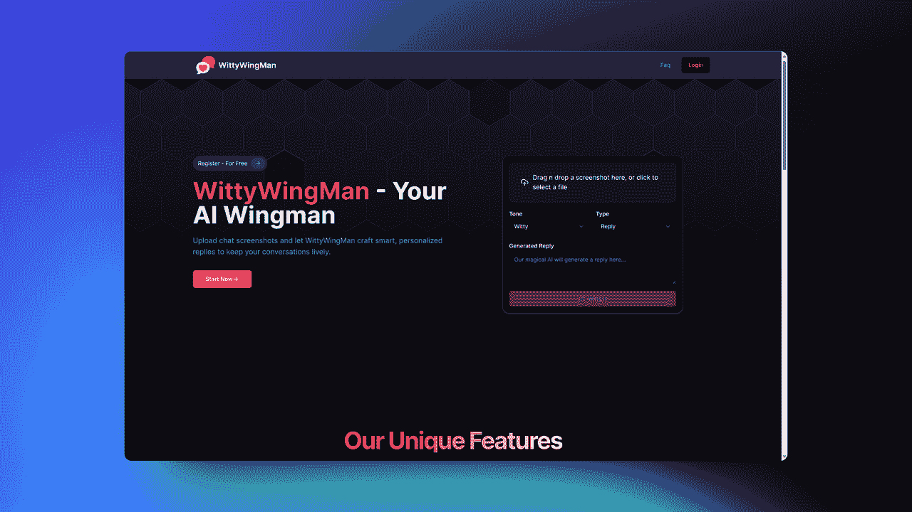

Pink Piko 是一款旨在将情绪反思日常化的互动心情跟踪应用。应用中的角色 Piko Cat 会提出深刻的问题，帮助用户了解自己的情绪及其背后的触发因素。它还能帮助用户识别日常活动如何影响情绪状态，了解什么能让他们振奋或沮丧。

这款应用运用人工智能技术，通过解读心情日志、标签和日记条目，提供清晰、个性化的情感洞察，超越了传统的图表和图形。它结合了积极心理学的原则，通过规律性的反思和练习，帮助增强情感韧性。

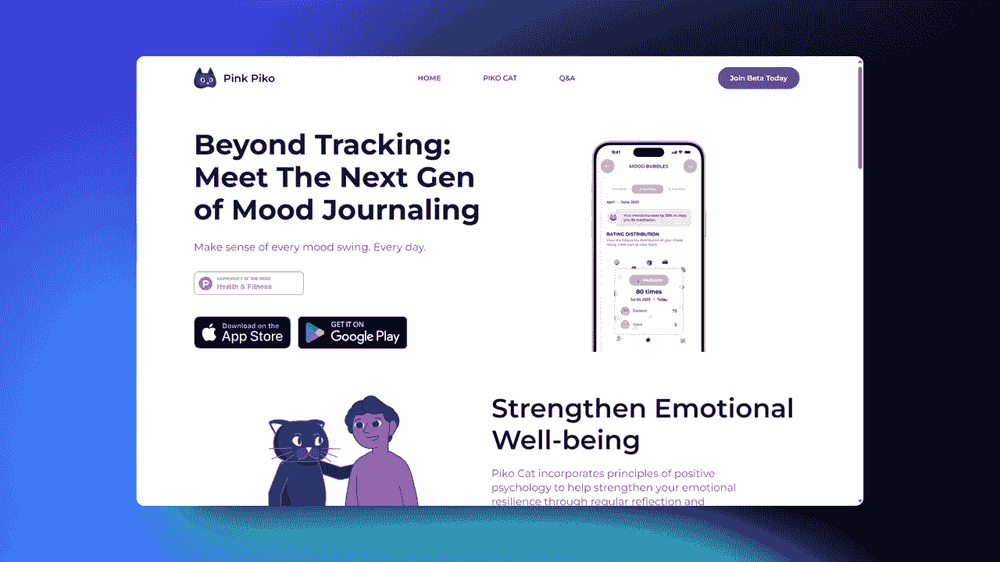

Marblism是由开发者Cyril和Ulric创建的平台，旨在简化启动React和Node.js应用程序的流程。他们开发了这个工具，以消除开发人员面临的繁琐的初始设置任务，比如选择框架、设计系统以及连接前端到后端服务。Marblism自动化创建数据库模式、API端点，甚至为前端提供可定制的设计系统和起始页面。

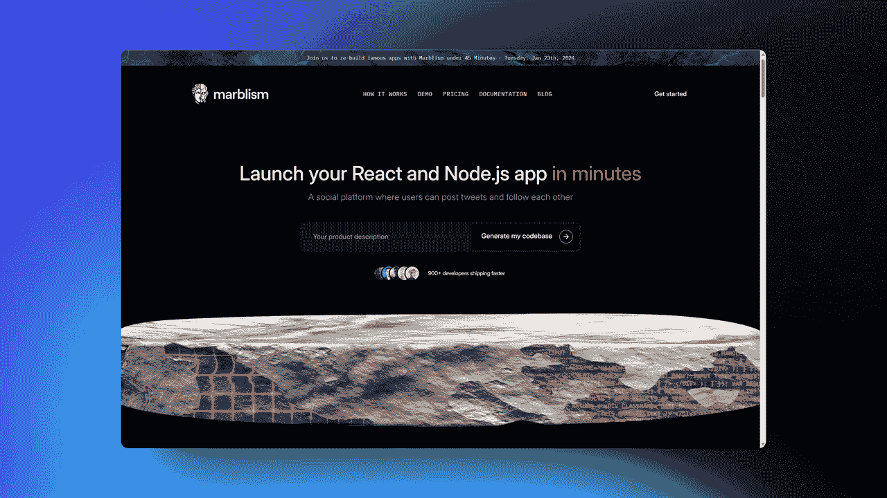

搜索结果提供了关于一种工具或服务的信息，该工具或服务可以通过单击将设计转换为代码。它提到了几位与各种风险投资公司和企业有关联的个人，他们似乎在支持或参与这个工具或服务。

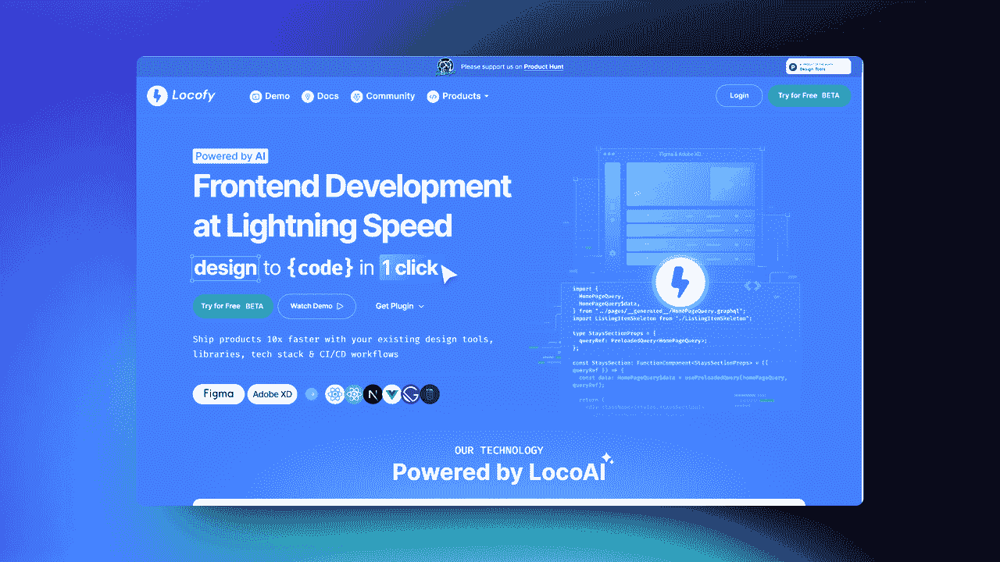

Menlo Ventures 在其文章《现代人工智能堆栈：企业人工智能架构未来的设计原则》中，对企业人工智能架构的发展和未来趋势进行了详细描述。他们强调了人工智能在推理、创造和创新能力方面的不断增强，这促使企业更新他们的技术堆栈。

现代人工智能堆栈主要由计算和基础模型层、数据层、部署层、可观测性层四个层面构成。

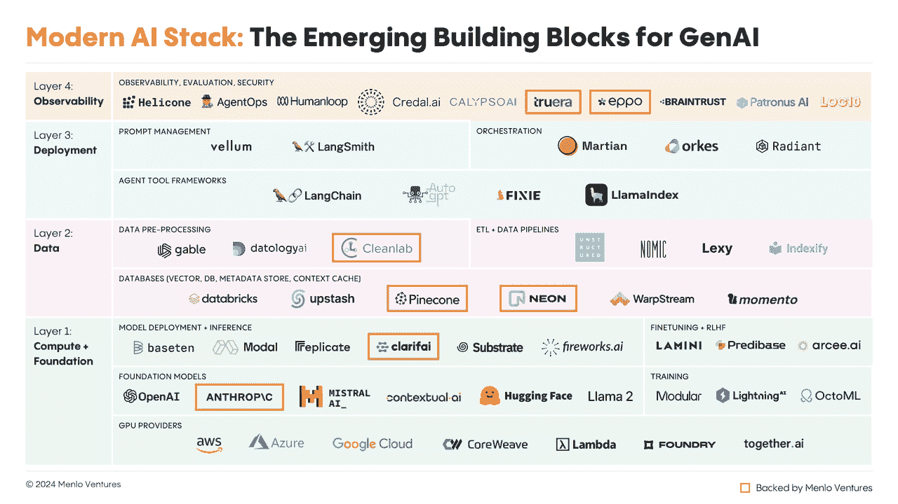

微软 Edge 和 Opera 正在领先于将人工智能（AI）整合到网页浏览器的趋势。Web 浏览器是互联网重要组成部分，广泛用于各种设备和操作系统上的消费者和商业目的。它们不仅可以连接到互联网服务器、检索 HTML 和 JavaScript 文件，并以视觉化方式呈现给用户互动，还能保护用户的个人数据不被盗窃或未经授权地与第三方共享。

人工智能为浏览器提供商带来了机遇和挑战。像 ChatGPT、Perplexity 和 Pi 这样的自然语言助手能够快速便捷地回答用户的问题，减少了用户在多个网站上的搜索需求。浏览器制造商可以通过将人工智能功能整合到用户界面和网络技术堆栈中来抓住这一机遇。微软、Opera 和 Mozilla 近期宣布了朝这一方向的新功能和投资。

小扎刚发言完，Meta 就发了一个比较重要的论文，推出了可以进行自我奖励的 LLM。

简单来说就是语言模型可以自我判断模型质量，从而实现一定程度上的自我进化 。 使用这个方法微调的 Llama 2 70B 模型，优于 AlpacaEval 2.0 排行榜上的Claude 2、Gemini Pro 和 GPT-4 0613等模型。

OpenAI 的首席执行官 Sam Altman 最近在达沃斯与 Axios 的一次采访中，探讨了人工智能的未来前景以及 OpenAI 新模型的发布，这个模型很可能会被命名为 GPT-5。他指出，人工智能正迅速发展，未来的 AI 产品将需要进行大量定制，这可能涉及到复杂的伦理决策。Altman 还提到，人工智能将很快改变我们处理知识性工作的方式，比如总结重要的电子邮件，并将大幅加速科学发现，尽管这可能不会在2024年立即实现。

详细的介绍了AI视频生成中所有的技术分类和对应技术的优劣势，还有对应的工具以及典型的案例。 基本上看完就能对AI视频生成有比较完整的了解，所以顺手翻译了一下，一起来看看《生成式 AI 动画技术概述》。 这篇文章旨在吸引任何对此好奇的人，特别是那些可能对动画领域飞速发展感到不知所措的其他动画师和创意工作者。 希望这篇文章能帮助你快速跟上潮流，并让你对这个领域有更深入的了解，而不仅仅是浏览 TikTok 上的简短内容。

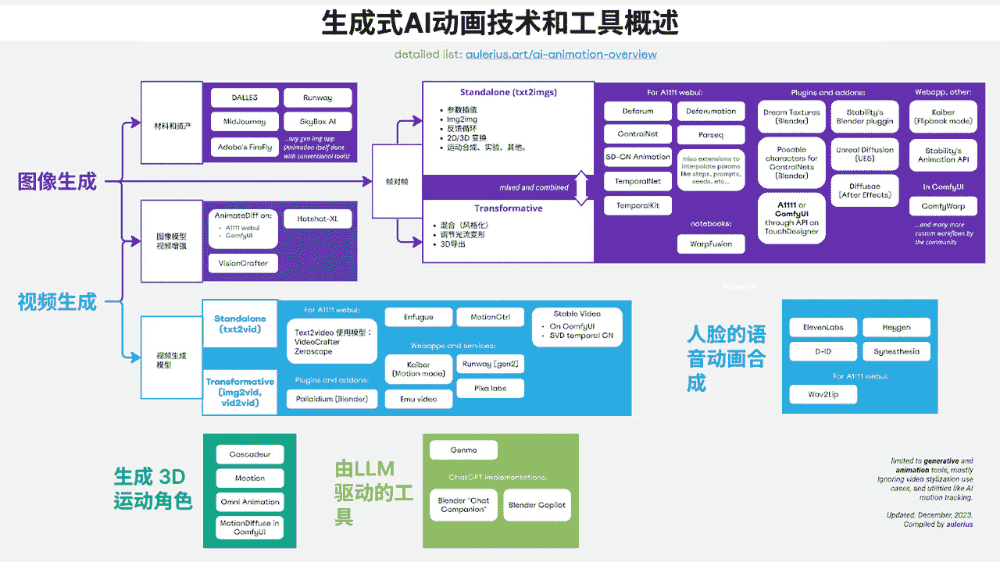

文章《人工智能是否预示着知识产权的消亡？》深入探讨了当今世界知识产权日益增长的重要性和复杂性。知识产权不仅占据了世界富豪财富的大部分，还构成了美国商品出口价值的 52%。知识产权种类繁多，包括版权、专利、设计权、名誉权和商标权，这些都在我们的日常生活中随处可见。例如，联合包裹服务公司对其快递车的棕色涂装拥有商标权，而可口可乐则拥有其瓶子的设计权。

文章探讨了“等待计算”这一概念，即在某些情况下，等待技术进步可能比立即采取行动更加有利。最初，这一概念是在星际旅行的背景下提出的，其中等待更先进的推进技术的发展能显著缩短旅行时间。作者将这一思想延伸到其他领域，包括人工智能（AI）。

鉴于 AI 正在快速发展并能够执行广泛的任务，作者认为对于某些项目，在 AI 技术进一步改进之前等待可能更加有利。这一点在那些耗时长且 AI 已有合理表现的任务中尤为显著，如写作小说或软件开发。

该文章讨论了在构建和维护生产级大型语言模型（LLM）应用程序（如GitHub Copilot）中，评估指标的重要性。这些指标对于质量控制和防止重复故障案例至关重要。LLM应用程序的评估可以分为端到端和步骤/组件式评估。前者提供了整体质量感知，而后者有助于识别和减轻可能影响LLM应用程序整体质量的故障模式。

该文章概述了适用于端到端和组件式评估的不同场景的评估指标。这些见解来自研究文献以及与其他LLM应用程序构建者进行的讨论。文章还提供了Python代码示例。

语言模型（LLMs）如GPT-4是无监督任务的强大工具，但可能会出现“幻觉”，即生成似是而非的信息。为了缓解这一问题，可以采用以下几种策略：

高级提示 ：这涉及在系统提示中提供清晰的指示，以避免传播错误或不可验证的信息。例如，使用一个提示来指导模型不要传播不正确的数据。

少样本提示 ：向LLM提供少量特定示例以引导其回应，有助于它专注于主题和上下文。示例的质量至关重要，因为糟糕的示例可能导致更多幻觉。

思维链式提示 ：鼓励LLM在最终答案之前生成推理步骤，可以通过逐步思考或提供推理示例来实现。然而，这可能会引入产生幻觉推理的风险。

数据增强 ：当上下文超出模型窗口时，数据增强可以通过添加专有数据或外部工具/知识来帮助。技术包括：

检索增强生成（RAG） ：将模型知识与检索系统结合起来，在实时中获取相关数据。

工具集成 ：使用函数调用、API调用和其他工具来提高准确性，尽管这需要进行广泛测试和实验。

微调 : 对于有足够数据量标准化任务有效果。它涉及收集高质量提示/完成对，并尝试不同模型和超参数以优化性能。

为确保这些方法有效, 评估至关重要。 这可以由人类注释者或另一个LLM完成 。 评估包括创建测试场景、选择适当度度量标准（如语义相似性、相关性、帮助程度和权威性），并使用最佳模型执行任务.