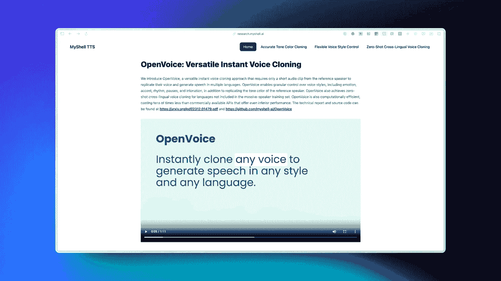
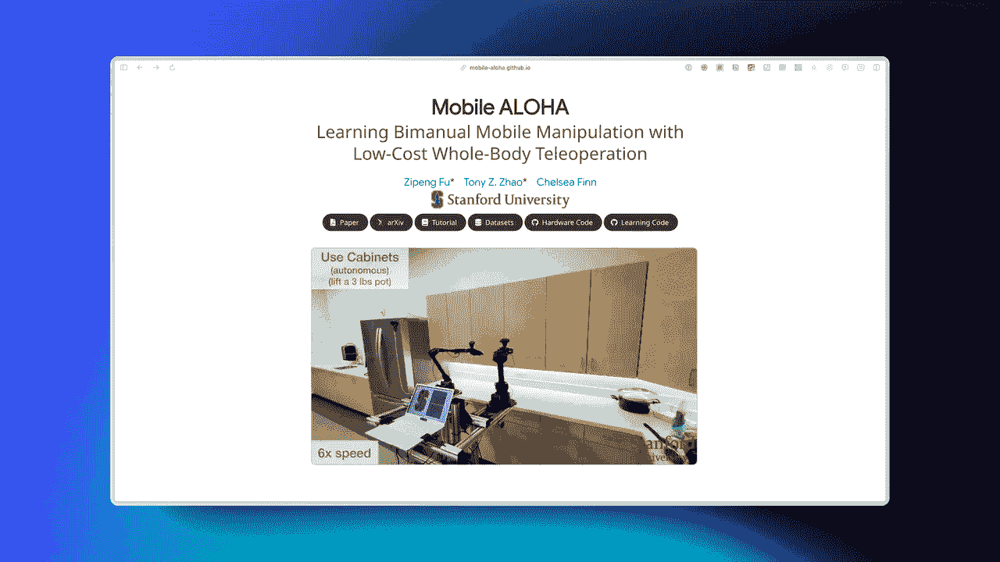
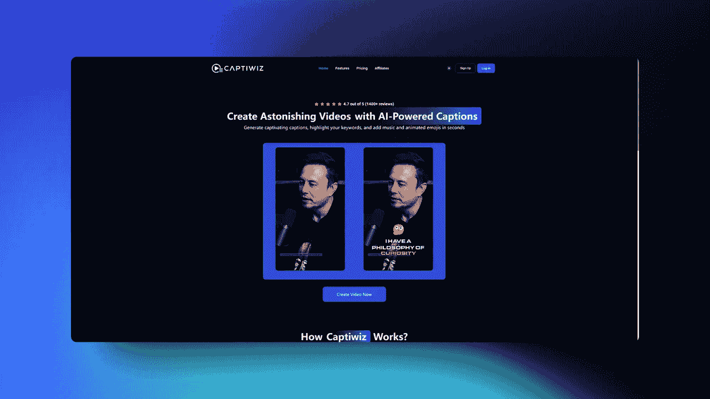
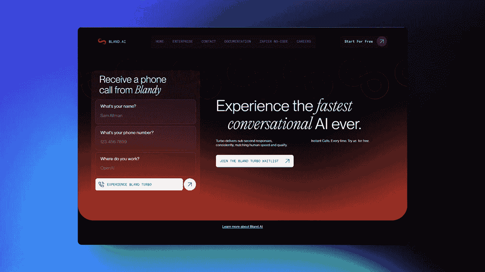
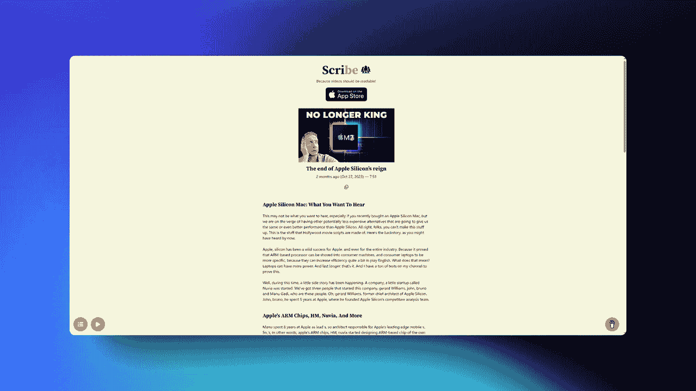
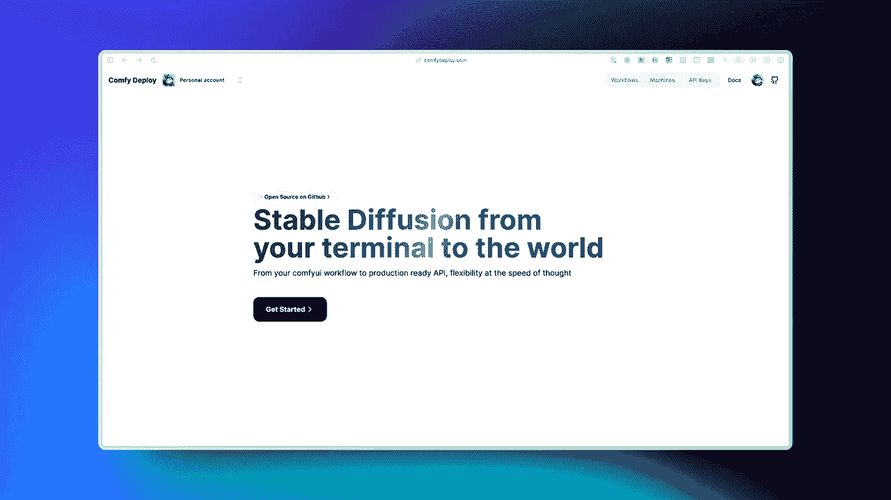
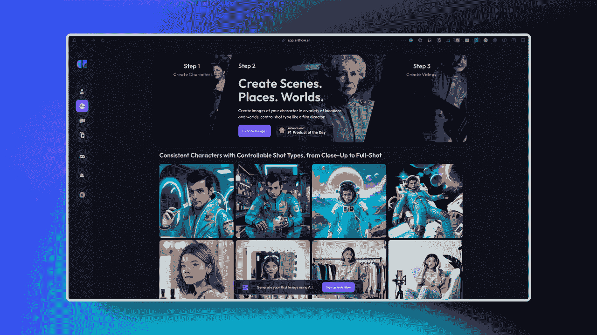
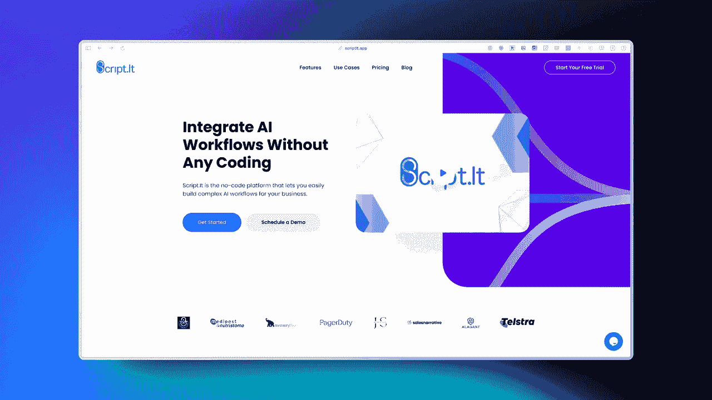

# AIGC Weekly #54

> 来源：[https://waytoagi.feishu.cn/docx/LDQvdDkrDolfgKxkY9QciFqXnnc](https://waytoagi.feishu.cn/docx/LDQvdDkrDolfgKxkY9QciFqXnnc)

> 🔗 原文链接： h[ttps://quail.ink/o](https://quail.ink/op7418/p/aigc-weekly-54-)p7418/p/aigc-wee...

> 发表时间：08 Jan, 2024

Mid[journey提示词：F](https://catjourney.life/)lat background gradient, ,minimalist holographic background, smooth forms, shapeless, glass --ar 16:9 --v 6.0 --style raw --s 0 💎查看更多风格和提示词

# 上周精选❤️

## OpenVoice：多功能实时语音克隆

My shell 的这个语音克隆技术上周爆了，只需要一小段说话内容就可以复制对应的声音并生成多种语言的声音。

除了复制参考说话者的音色之外，OpenVoice 还可以对语音风格进行精细控制，包括情感、口音、节奏、停顿和语调。

OpenVoice 的计算效率也很高，其成本比性能较差的商用 API 低数十倍。

论文：https://arxiv.org/pdf/2312.01479.pdf

Github：https://github.com/myshell-ai/OpenVoice

## Mobile ALOHA：斯坦福家政机械臂

上周斯坦福这个家政机器人的表现确实很亮眼，做菜干家务都做得很好，每个任务人工操作几十次机器人的学习成功率就可以打到 90%，感觉我们养老有希望能用上。整个机器人的成本大概 22 万人民币。

我们开发了一种用于模仿双手且需要全身控制的移动操纵任务的系统。我们首先推出 Mobile ALOHA，这是一种用于数据收集的低成本全身远程操作系统。它通过移动底座和全身遥控操作界面增强了 ALOHA 系统。

然后，我们使用 Mobile ALOHA 收集的数据执行监督行为克隆，并发现与现有静态 ALOHA 数据集的联合训练可以提高移动操作任务的性能。

每项任务进行 50 次演示，协同训练可将成功率提高高达 90%，让 Mobile ALOHA 能够自主完成复杂的移动操作任务，例如炒和上一块虾、打开两门壁柜存放重物等烹饪锅具、呼叫并进入电梯以及使用厨房水龙头轻轻冲洗用过的锅。

同时谷歌也宣布了自己用 LLM 来指导机器人做家务的项目AutoRT：https://deepmind.google/discover/blog/shaping-the-future-of-advanced-robotics/

AutoRT 结合大型基础模型（例如大型语言模型 (LLM) 或视觉语言模型 (VLM)）和机器人控制模型（RT-1 或 RT-2）来创建可以部署机器人的系统在新环境中收集训练数据。 AutoRT 可以同时指挥多个机器人，每个机器人都配备了摄像机和末端执行器，以在一系列设置中执行不同的任务。

## Midjourney V6 的版权问题

最近针对 AI 公司的版权起诉也越来越多，比如《纽约失败》起诉 OpenAI使用他们的数据训练 AI，但是这个取证比较困难，数据到模型里面基本没办法还原。

不过 Midjourney 就不一样了，最近很多人在测试 V6 的时候也发现了，如果提示词比较少的话很容易生成跟原始训练素材一模一样的素材，比如下面的这个灭霸，几乎一模一样了，其他文艺作品也是一样的。

之前 V5 的时候就有很多艺术家起诉 Midjourney 但是由于MJ 不开源，所以没有办法证明 MJ 使用他们的内容训练，但是 V6 这次可以直接生成训练素材的操作也确实离谱，可能确实要栽了。

另外 Midjourney 数据库里面用于训练风格的四千多个艺术家的列表，里面有很多当代艺术家，也被作为了起诉的证据。

# 其他动态🧵

+   谷歌可能正在准备Bard的付费版本，Bard Advanced可能会有类似GPTs的东西：https://x.com/evowizz/status/1742939258682552625?s=20

+   OpenAI GPTs 商店将于本周推出：https://openai.com/brand

+   你现在可以单独检测每一个Open AI API Key的使用量：https://x.com/OpenAIDevs/status/1743400828227002439?s=20

+   微软正在对 PC 键盘进行 30 年来的首次重大变革——为其 AI 助手 Windows Copilot 提供专用按键：https://www.axios.com/2024/01/04/microsoft-copilot-ai-button-windows

+   Perplexity 在 B 轮融资中筹集了 7360 万美元，目前估值为 5.2 亿美元：https://blog.perplexity.ai/blog/perplexity-raises-series-b-funding-round

+   三星将在自己的手机发布会上发布Galaxy AI：https://www.youtube.com/watch?v=lKoG2_zdoSA

+   微软高管 Dee Templeton 已经加入[ OpenAI 董事会，但没有投票权： https://www.reuters.com/technolog](https://www.reuters.com/technology/microsoft-executive-dee-templeton-joins-openai-board-bloomberg-news-2024-01-05/?taid=659892296860d50001e1362f&utm_campaign=trueAnthem:+Trending+Content&utm_medium=trueAnthem&utm_source=twitter)y/microsoft-executive-dee-templeton-joins-openai-board-bloomberg-news-2024-01-05

+   Pika上线了他们网页版本的付费计划 。有两个付费档10美元和60美元，跨度比较大：https://pika.art/pricing

+   英伟达发布了**RTX 6000 ADA[的阉](https://hothardware.com/news/nvidia-unveils-rtx-5880-graphics-card-with-14080-cuda-cores)割版RTX 5880 ADA：** https://hothardware.com/news/nvidia-unveils-rtx-5880-graphics-card-with-14080-cuda-cores

+   Midjoureny V6 进行了一次升级，图像放大的速度提高两倍，高风格化值的锐化问题也有改善：https://x.com/midjourney/status/1743525940217729110?s=20

# 产品推荐⚒️

## Captiwiz：AI给视频添加好玩的字幕

Captiwiz是一款工具，允许用户在几秒钟内生成引人注目的字幕，突出关键词，并为他们的视频添加音乐和动态表情符号。它旨在节省时间和金钱，同时提升视频创作。其关键功能之一是利用人工智能将音频转录成文本。它还提供时尚字体、动画和表情符号来增强视频效果。用户可以为他们的视频添加运动和情感以及声音效果来保持观众的参与度。此外，Captiwiz可以为包括Facebook、Instagram、YouTube、TikTok等各种社交媒体平台生成自动生成描述和标签。

## [Bland：AI通话服务](https://www.bland.ai/turbo)

Bland：一个AI通话服务，支持半秒响应，可以同时进行50万个通话，支持自定义通话主题和声音。

以后AI推销和电话客服会越来越真实了。

## [Scribe：将长视频变成文章](https://www.appblit.com/scribe)

这个产品有点意思，可以将Youtube视频变成长文，不是单纯的语音转字幕，而是重新用文章的形式组织语言重新排版。很适合没时间看视频的人。

## [C ](https://github.com/BennyKok/comfyui-deploy?tab=readme-ov-file)omfyui-deploy：将 ComfyUI 工作流变成后端服务

发现一个项目，可以 把你本地的 ComfyUI 工作流一键变成在线服务 。

你可以选择使用原始的 ComfyUI 界面，或者使用他们生成的 API，自己的前端界面。

很容易就可以吧 ComfyUI 的工作流变成产品，比如直接搞个 SVD 视频生成的服务。

## Artflow：设计和生成保证一致性的角色

Artflow是一个专门为了创建 AI 电影的工具，首先可以生成保证一致性的电影角色，然后利用这些角色生成在场景中的图片，最后生成角色说话的视频。

## Script：为企业简化 AI 能力构建流程

Script.It是一个无代码平台，旨在为企业简化复杂的人工智能工作流程的创建。用户可以使用简单的口头命令创建详细的工作流程，Script.It会解释并用于构建必要的步骤。该平台为每个步骤组织所需信息，使用户能够调整他们的工作流程、保持数据完整性，并在各种任务中实现准确输出。Script.It连接到一个强大的知识库，从多个来源获取信息，使用户能够快速从文档中提取数据，并通过简单操作或提示插入内容。该平台预先构建了代理程序，可充当研究和报告助手，自动化互联网研究等复杂任务。

# 精选文章🔬

## [**Open AI官方的G**](https://help.openai.com/en/articles/8770868-gpt-builder)PTs制作教程：我们如何创建 GPT Builder

GPT Builder是一个方便用户创建自定义GPT模型的工具。用户可以通过对话界面来配置GPT,而无需手动填写各种参数。

文章解释说,GPT Builder本身也是一个自定义的GPTs。它内置有指令,可以根据用户输入来更新正在构建的GPTs各项参数。

开发GPT Builder的目的是为了更好地了解用户在产品上需要什么,同时也验证了GPT在执行指令上的能力。

## 通过人工智能实现“企业利用率最大化”

“最大企业效益”（MEU）这个想法正在受到越来越多科技界领袖的青睐，他们通过AI技术来提升公司的产出效率。MEU就像“最大浮点运算利用率”（MFU）一样，是用来衡量GPU的处理能力的。在企业活动中，“待完成工作”指的是公司里等待处理的所有工作任务，而“总体产出”则是所有“工作者”，包括正式员工、合同工以及AI助手的工作总和。AI可以说是几十年来的新奇科技，它能在不增加人类工作时间的情况下提升总体产出。据估计，软件公司的MEU平均值大约在20-40%。

长期以来，提升MEU的数值颇为困难，因为额外的员工和合同工往往会导致生产效率下降，这是通信复杂性（Metcalfe定律）在哪里作祟，而且这样做的成本还不菲。当工作时间达到一定程度后，生产效率会出现瓶颈，尤其是在软件工程这类工作领域。然而，预测显示，未来企业产出的60-80%可能会由AI来承担。通过使用ChatGPT、Github Copilot、Harvey等同步工作的产品，每个员工都能更快、更精确地完成工作，从而实现生产力的10倍增长。

随着智能技术的成本不断降低，企业的整体生产力将变得更加灵活，因为公司可以根据自己的需要，随时添加AI助手到工作团队中。这些AI助手将与人类工作者同步工作，但它们是异步的，并且在关键环节会有人类的监督。在这个领域活跃的公司包括Dropzone AI、Sweep AI、AutoGPT等。

对于那些希望在AI领域为企业提供服务的创业者来说，他们应该思考自己的产品如何提升生产效率，产品中同步和异步工作方式的平衡，以及在追求准确性的用户反馈与追求最大生产效率的自主行动之间如何取舍，还有他们的产品是让现有的员工更加高效，还是为企业带来了全新的能力。

## [末日、黑暗计算和人工智能](https://petewarden.com/2024/01/05/doom-dark-compute-and-ai/)

Pete Warden在其文章《Doom, Dark Compute, and AI》中探讨了“暗计算”这一现象，它指的是日常嵌入式设备中大量未被利用的计算力。文章开头，作者回忆了2020年Foone Turing在孕妇试纸上运行视频游戏Doom的事件，这展示了即便是低成本的日常物品也具备了显著的计算能力。尽管如此，作者指出，由于缺乏能够充分利用这些计算资源的“杀手级应用”，大多数设备只是将处理器用于简单的控制逻辑，而大部分时间这些处理器都处于闲置状态。

Warden将这一现状与“暗光纤”相提并论，后者指的是互联网泡沫破灭后未被使用的光纤，这些光纤最终催生了流媒体服务、视频通话以及现代互联网的发展。他预测，一旦产品设计师意识到暗计算的潜力，类似的创新浪潮也可能在暗计算领域出现。据Arm公司的数据，全球大约有1000亿颗Arm Cortex M芯片，它们每秒能够执行大量的整数运算，这一数字是全球所有活跃GPU和TPU提供的浮点运算（FLOPs）数量的两倍多。

作者提出，这种未被利用的计算力，即暗计算，可以被用于AI应用，以创造全新的用户体验。例如，语音界面、本地字幕、电视上的人物感应、手势识别以及其他由机器学习技术支持的界面改进。这些AI功能可以在不改变硬件的情况下实现，因为许多系统已经具备了必要的空闲计算能力。

Warden强调，AI的性能随着计算能力的提高而提高，而且大多数AI应用只需要8位运算，这使得FLOPs和整数运算之间的比较变得有意义。他承认了电池使用和需要适当传感器及用户友好工具等挑战，但对利用暗计算进行AI创新的潜力保持乐观。文章最后，作者邀请感兴趣的各方合作利用这种闲置的计算能力，并提到了他与Useful Sensors的合作，以促进这些发展。

## DiffPortrait3D：从照片创建 3D 头像

字节跳动的DiffPortrait3D提供了一种突破性的方法，可以从单个肖像中创建逼真、三维一致的视图，保持面部特征和表情。

其核心是，我们利用在大规模图像数据集上预先训练的 2D 扩散模型的生成先验作为我们的渲染主干，而去噪则是通过对外观和相机姿势的解开的细心控制来引导。为了实现这一点，我们首先将参考图像中的外观上下文注入到冻结 UNet 的自注意力层中。然后使用新颖的条件控制模块来操纵渲染视图，该模块通过从同一视图观看交叉主体的条件图像来解释相机姿势。

## [SyncTalk： ](https://ziqiaopeng.github.io/synctalk/)[**合成同步头部的说话视频**](https://ziqiaopeng.github.io/synctalk/)

SyncTalk 可以创建逼真的头部说话视频，通过先进的 3D 面部建模完美同步嘴唇运动、面部表情和头部姿势。

这种基于 NeRF 的方法有效地保持了主体身份，增强了头部说话合成的同步性和真实感。 SyncTalk 采用面部同步控制器将嘴唇运动与语音保持一致，并创新性地使用 3D 面部混合形状模型来捕捉准确的面部表情。我们的头部同步稳定器可优化头部姿势，实现更自然的头部运动。

## [从头开始构建大型语言模型](https://github.com/rasbt/LLMs-from-scratch/tree/main)

这个老哥开源了一门课程《从头开始构建大型语言模型》，这门课程将一步步地指导你创建自己的LLM。每个阶段都有清晰的文本、图表和实例来解释相关概念。

课程内容包括：

1.  从基础理解注意力机制

1.  构建并预训练一个类似于GPT的模型

1.  学习如何加载预训练的权重

1.  对模型进行分类任务的微调

1.  使用直接偏好优化进行指令微调模型

## LLMs能够编写代码并不意味着它们具备推理和规划能力

比较详细的解释了为什么LLM都已经可以写代码了，还说他不具有推理和规划能力。 涉及到LLM代码生成的一些细节，感兴趣可以看一下 。

LLMs输出比英语更好的Python质量更多地反映了在GitHub与一般网络之间近似检索的差异，而不是任何潜在的推理能力。

## Instruct-Imagen：多模态指导下的图像生成

谷歌这个多模态图像生成模型Instruct-Imagen强啊**，真正的将 LLM 和现在的 SD 生态进行了整合。**

它可以通过自然语言和输入内容自动调用现在 SD 模型生态中的各种模型。相当于用 LLM 把 SD 生态的 Lora 和 Controlnet 等模型做了个 Agents。

## 减轻大语言模型幻觉的整体知识框架

作者构建了一个 **减轻大语言模型幻觉的整体知识框架，非**常详细和体系化，基本上该有的都涉及到了 。想要了解相关内容的话跟着这个目录搜索就可以。

主要内容包括：提示工程领域、模型开发领域两大部分。

## 在5分钟内创建自定义节点（ComfyUI自定义节点入门指南）

这里有一个非常简单的 ComfyUI 自定义节点开发指南 ，只需要 5 分钟，你甚至不需要会代码，跟着也能写一个自定义节点。

ComfyUI 之所以现在开始流行有一个很重要的原因是他的插件和节点开发成本比 WebUI 低很多。

但是他本身的开发文档写的很乱，导致入门看起来很困难。

Reddit 一个老哥写了一个自定义节点的开发指南，我跟着走了一遍发现真的简单，写的也很详细。

所以就翻译了一下由于比较长，就扔在周刊里面了。