# AIGC Weekly #53

> 来源：[https://waytoagi.feishu.cn/docx/RgUEdm9qdovHKJxqZE2cN0xfn8b](https://waytoagi.feishu.cn/docx/RgUEdm9qdovHKJxqZE2cN0xfn8b)

> 🔗 原文链接： h[ttps://quail.ink/o](https://quail.ink/op7418/p/aigc-weekly-53)p7418/p/aigc-wee...

> 发表时间：02 Jan, 2024

> 新年快乐啊各位，时间过的真的快，又要开始新的一年和新的计划了，如果说2023是AI领域开始爆发的一年的话，2024将会是AI研究全面渗透到C端用户和所有领域的一年，去年很多高深的研究我们没有办法参与，今年的产品化浪潮和大规模落地各位应该都能喝口汤了。

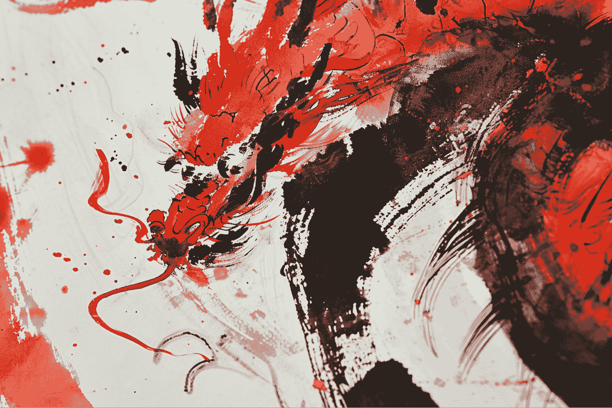

Midjo[urney提示词：Red](https://catjourney.life/) Chinese dragon, close-up, Wu Guanzhong style, ink artistic conception, abstract, complementary colors, simplicity, Chinese painting, white background, 18k, --ar 3:2 --v 6.0 --style raw 💎查看更多风格和提示词

# 上周精选❤️

## [Open AI将成为美国 ](https://fortune.com/2023/12/23/openai-valuation-100-billion-funding-round)二大最有价值的初创公司，仅次于SpaceX

上周有消息说OpenAI正在初步讨论以1000亿美元或以上的估值筹集新一轮资金，同时2023年的利润将会达到16亿美元，太离谱了，领域龙头真是赚钱啊。

SpaceX烧了十多年钱才开始盈利，Open AI这才几年。

下面是最近OpenAI在资本操作上的具体的信息：

+   可能参与本轮筹资的投资者已被纳入初步讨论。这些知情人士要求匿名，以便讨论私人事务。据称，本轮融资的条款、估值和时间等细节尚未最终确定，仍有可能发生变化。

+   该公司计划在一月初完成另一项要约收购，员工可以按860亿美元的估值出售股份，彭博此前报道。据知情人士透露，这项交易由Thrive Capital主导，投资者的需求超过了可用股份。

+   OpenAI还与总部位于阿布扎比的G42进行了筹集资金用于新芯片项目的讨论，这家初创公司已经讨论过从G42筹集80亿至100亿美元。

+   OpenAI首席执行官Sam Altman一直在寻求资金支持芯片制造项目代号Tigris。据彭博新闻报道，该项目的目标是生产能够与目前主导人工智能芯片市场的英伟达公司竞争的半导体产品。

## 过去一周的图像相关论文

圣诞加元旦假期，实在没什么重点内容，把过去一周国内大厂年底卷出来的视觉论文做个合集把。

AnyText: 多语言视觉文本生成和编辑

阿里的论文可以实现图生成中精准生成多种语言的文字。

AnyText包括两个主要元素构成的扩散流水线：辅助潜变量模块和文本嵌入模块。前者使用诸如文字字形、位置和遮罩图像等输入来生成用于文本生成或编辑的潜变量特征。后者利用OCR模型将笔画数据编码为嵌入，并与来自标记器的图片标题嵌入相融合以生成与背景无缝整合的文字。我们采用了文本控制扩散损失和文本感知损失进行训练以进一步提高书写准确性。

AnyText可以书写多种语言字符，在我们所知范围内，这是首次涉及多语言视觉文字生成工作。值得一提的是，AnyText可以插入社区现有扩散模型中以精确地渲染或编辑文字。

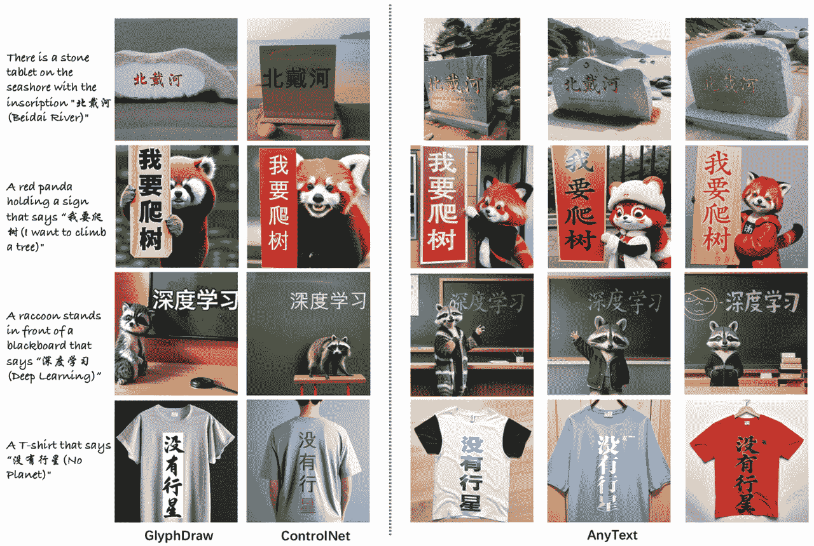

I2V-Adapter：直接从图片生成视频

快手也发布了一个视频生成模型 I2V-Adapter。主要用于从图片获取信息直接生成视频，这个项目可以与已有的 SD 生态比如ContorlNet等结合。又有可以玩的了。

提出了一种新的解决方案——I2V-Adapter，旨在解决这些限制。

保留了T2I模型的结构完整性和它们内在的运动模块。

I2V-Adapter通过并行处理带有噪声的视频帧和输入图像，使用了一个轻量级的适配器模块。这个模块就像一座桥梁，高效地将输入与模型的自注意力机制连接起来，从而在不需要对T2I模型进行结构性改动的情况下保持空间细节。

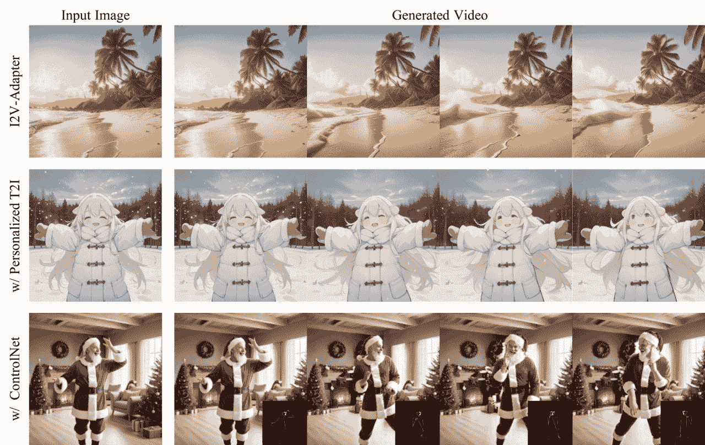

SSR-Encoder：从图像提取不同特征

小红书新发布的一个编码器SSR-Encoder，可以实现从一张图片种提取不同的主题（人物、物体等）特征生成图像。与 SD 现有的能力都能结合，Animatediff 也可以。

SSR-Encoder，这是一种新架构，旨在从单个或多个参考图像中选择性地捕获任何主题。它响应各种查询模式，包括文本和掩模，而无需在测试时进行微调。

SSR-Encoder结合了一个Token-to-Patch Aligner，用于将查询输入与图像块对齐，以及一个细节保留的主题编码器，用于提取和保留主题的精细特征，从而生成主题嵌入。

这些嵌入与原始文本嵌入结合使用，条件化生成过程。SSR-Encoder以其模型泛化性和效率为特点，适应于一系列自定义模型和控制模块。通过Embedding Consistency Regularization Loss进行增强，以改进训练。

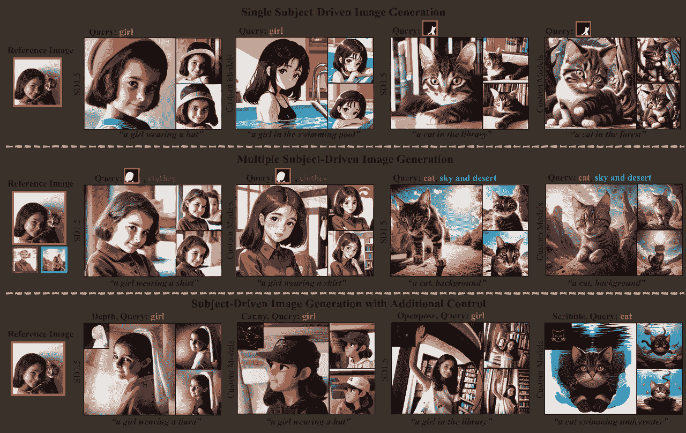

# 其他动态🧵

+   Anthropic 项目明年的年化收入至少为 8.5 亿美元：https://www.theinformation.com/articles/anthropic-projects-at-least-850-million-in-annualized-revenue-rate-next-year

+   Midjourney 将会开始训练视频模型：https://x.com/nickfloats/status/1740105219009130954?s=20

+   Perplexity 才宣布 Pro 用户有了图像生成功能：https://x.com/AravSrinivas/status/1739352904522219698?s=20

+   LeonardoAI的视频生成功能开始向所有人免费推出：https://leonardo.ai/

# 产品推荐⚒️

## Kimi Chat：月之暗面的AI聊天应用

国内没办法上 ChatGPT 的朋友我一般会推荐用月之暗面的 Kimi Chat。我最近也开始用的比较多了。

尤其在一些我的日常任务上面，它比 ChatGPT 还方便一些 ，尤其是不用担心网络问题打开就用，最重要的是目前所有功能都是免费的。

Kimi 的表现从侧面上说明一个 AI 产品模型本身能力是一方面，对整个 LLM 生态其他能力的打磨和探索也很重要。

下面从我日常用的最多的两件事情来举例子：

**首先是论文的总结和阅读：**

之前 PDF 格式的论文文件总结起来很费劲因为涉及到很多 OCR 的事情即使是 GPT-4 完成的也不太好，总结的不够详细总是忽略关键信息。

刚好最近arxiv默认支持了网页格式的论文，理论上应该更好总结了，直接丢网页版本链接就行，Kimi 在这件事情上做的非常好，比如昨天字节的这个很复杂的论文，非常详细而且结构很清晰，我没有特别优化提示词。

反观 GPT-4，直接告诉我没办法访问这个链接，太离谱了，之前 PDF 的时候虽然不输出关键信息，起码还会写，这下直接不访问了。

我日常最多用的第二个事情是翻译：

所以第二个测试是用宝玉的翻译提示词分别让 ChatGPT 和 Kimi 翻译同一段比较复杂的 LLM 论文的简介，首先翻译内容上两者没有出现幻觉和丢失的情况。

ChatGPT出现问题的方面主要是体验和行文，Code 组件无论多长的内容都不会换行不管输出的内容是不是代码，所以导致我根本无法在界面上完整预览，输出结果。 Kimi 则会在大段文本内容输出的时候正确的换行，起码我可以看全。

另外在意译结果上，我感觉 Kimi 更符合中文的书写和阅读直觉，看起来更加流畅，可能还是因为 ChatGPT 主要照顾的还是英文用户，所以中文语料相对较少，导致写的中文即使通过提示词优化过也还是有翻译腔。各位也可以对比一下。

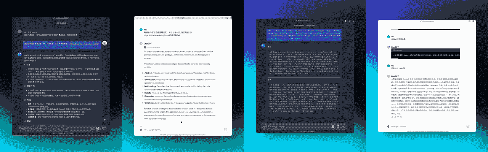

## Composer：使用AI进行量化交易

Composer Trading是一个旨在彻底改变个人创建和管理投资策略方式的平台。它提供了一款由人工智能驱动的策略创建工具，允许用户用自然语言解释他们的目标、策略和风险关注点，然后AI辅助编辑器会为他们创建策略。这种自动化延伸到交易策略的执行，Composer会自动处理交易和再平衡。

该平台提供了各种类别的预构建策略选择，如长期、技术重点和多样化等，用户可以立即进行投资。Composer强调数据驱动式交易方法，避免情绪或轰动影响。

Composer还作为经纪商，并提供全自动交易执行，并采用无佣金模式，并通过简单固定月度订阅透明定价。用户可以在承诺之前免费测试该平台。

定制是Composer的一个关键特性，因为每个策略都是完全可编辑的。用户可以使用无代码视觉编辑器修改策略、调整参数，并对其进行不同权重或条件应用。该平台还允许根据用户定义的标准从候选者池中进行动态选择。

回测可帮助用户学习并调整他们的战略，并且他们可以将其与基准或其他战略进行比较。 Composer还计算费用、滑点以及战术最终价值, 提供潜在结果全面视图。

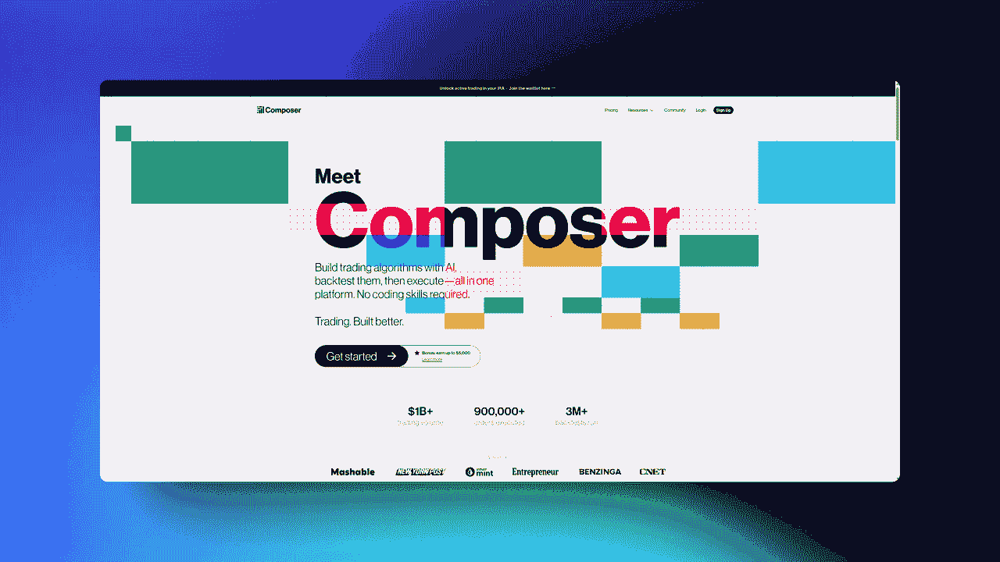

## Musicgen-remixer：将音乐重新混音

挺有意思的项目，可以将一段音乐通过提示词，重新混音，自己做视频或内容想改一下某段音乐的氛围的可以用一下。

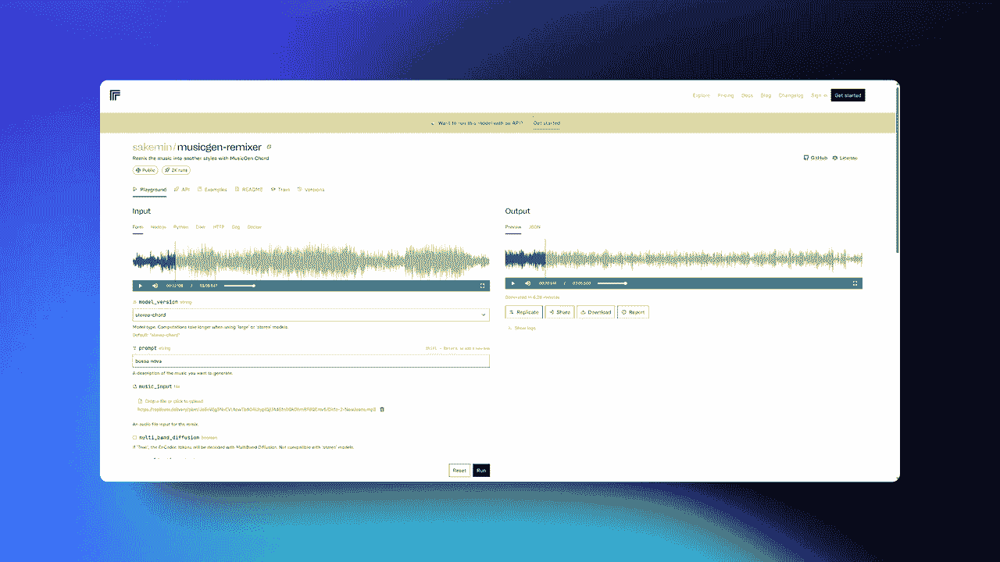

## Designbuddy：AI帮你分析你的设计

Design Buddy是一个Figma插件，作为协作伙伴发挥作用，提供对UI设计的深入反馈。它提供了涵盖布局、颜色、排版、可访问性的结构化评论，并为每个类别分配客观评分。该工具有助于识别UI设计中经常被忽视的缺陷，确保在向产品经理、团队或客户等利益相关者展示之前进行了精心打磨。这种预防性检查有助于最大程度地减少未来修订的需求。

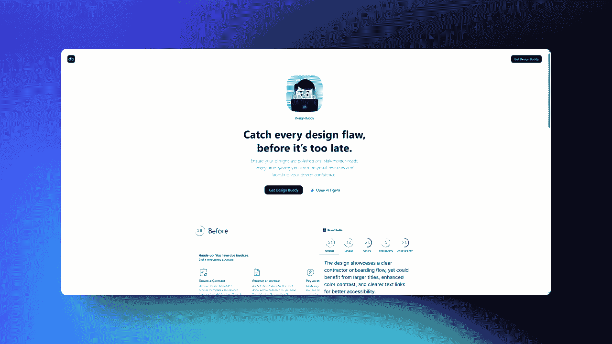

## AI Employe：GPT-4V驱动的浏览器自动化工具

AI Employe是一个开源、由GPT-4视觉驱动的工具，旨在自动化浏览器环境中的复杂任务。该工具可以自动执行需要类人智能的任务，如理解电子邮件、收据和发票，并将数据从电子邮件传输到CRM/ERP系统。

用户可以通过在浏览器中概述和演示他们的任务来创建工作流程，就像他们向人类展示一样[1]。AI Employe只记录浏览器更改而不捕获屏幕、麦克风或摄像头。

AI Employe可以执行包括需要类人智能的复杂任务在内的各种操作。它还可以从图表、复杂表格和基于图像的OCR提供独特见解。

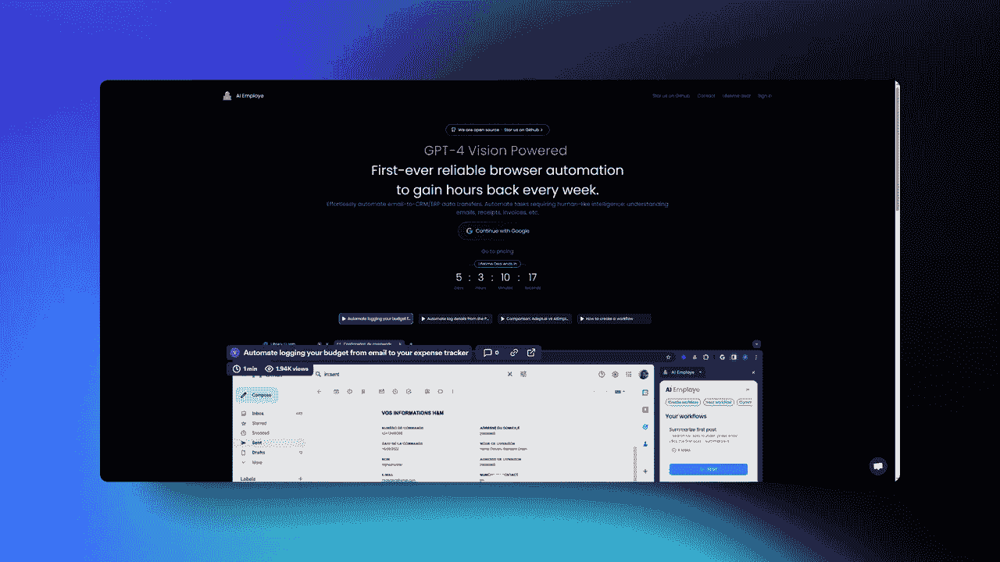

## Zocket：利用AI自动化创建广告和分析

Zocket是一个由人工智能驱动的平台，旨在简化社交媒体广告的创建和优化流程。它利用数据驱动的生成式神经网络帮助企业定位正确的受众群体，从而提高广告性能和效率。该平台拥有一些功能，可以减少创建广告所需的时间和精力，比如Ad Policy Checker可防止广告被拒绝，并且优化AI可改善营销结果。

来自各种创始人和高管的推荐证明了该平台的有效性，并指出了诸如ROAS（广告支出回报率）、留存率、加入购物车率以及购买价值等指标显著增长。Zocket基于人工智能进行定位和优化工具因其连接到正确受众并挽救企业免于广告账户被拒绝而备受赞誉。

Zocket特别适合那些经常运营活动的用户，提供基于订阅模式的服务以便使用其功能。该平台支持Meta平台上包括Facebook和Instagram在内的广告创建。用户需要一个活跃网站、一个Facebook商务页面以及一个Facebook Ad账户才能开始使用Zocket进行广告投放。如果需要，该平台团队可以协助设置Ad账户。在Zocket生成了广告内容后，会经过Meta公司审查并批准，在此期间可能需要最多24小时时间。虽然在Facebook上管理着广告支出，但是通过支付订阅费用即可使用Zocket 的人工智能功能进行生成与发布。

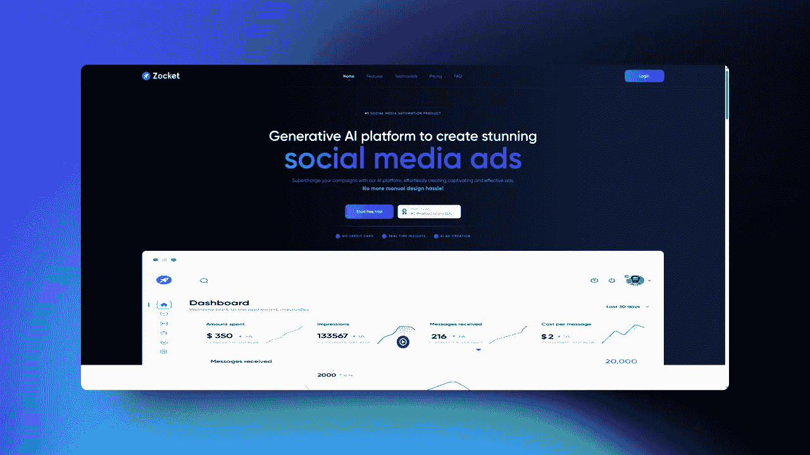

## Code GPT：强大的AI代码生成插件

这个VS Code的AI插件感觉比GitHub的Copilot强多了， 功能非常全面，而且支持GPT-4和PaLM 2等常见模型的API 。

主要功能有：

◆ 可以选中对应代码之后跟GPT进行聊天沟通。

◆ 通过注释生成对应要求的代码。

◆ Stackoverflow获取问题的答案，并且跟GPT的答案比较

◆ 跟AI聊天并且创建对应代码的单元测试。

◆ 打开Notebook（.ipynb文件）并使用Notebook扩展运行代码。

通过API修改代码不可避免涉及到代码泄露的问题，这个需要自行斟酌，公司代码谨慎使用。

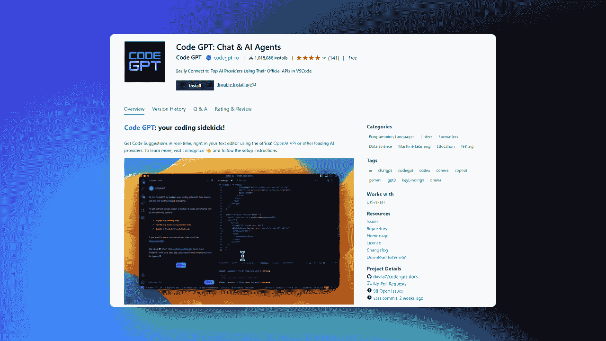

## Assistive：视频生成工具

**新的视频生成软件Ass**istive，支持 从文本和图像生成视频 ，从演示视频的流体内容和表现来看，我嗅到了SVD的熟悉味道。同时推出的还有DATA-一个视频创建助手，可以为社交媒体等制作故事板并生成完整的视频。

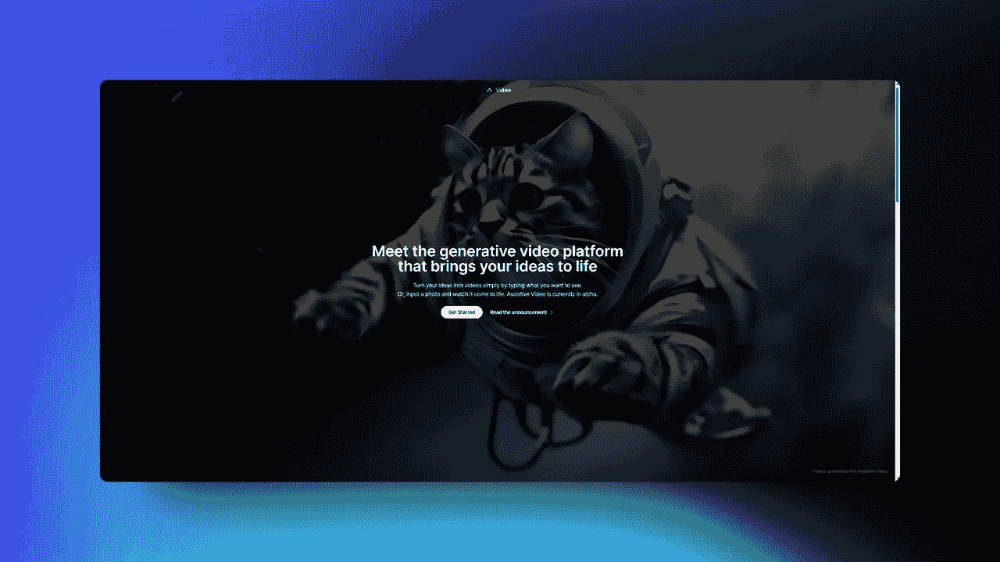

# 精选文章🔬

## 能否通过扩大LLM的规模实现AGI？

Dwarkesh播客的文章《扩展是否有效？》讨论了扩展大型语言模型（LLMs）以实现人工通用智能（AGI）的潜力和挑战。作者通过两个虚构角色——信徒和怀疑者之间的辩论，探讨了关于扩展作为通向AGI可行性的论点。

信徒认为，如果继续扩展LLMs可以产生更好、更普遍的表现，到2040年我们可能会看到强大的人工智能，可以自动化大部分认知劳动并加速AI进步。他们建议尽管当前存在数据效率低下和下一个标记预测训练的局限性，像GPT-4这样的模型取得了进展表明扩展可能导致变革性人工智能。信徒还指出合成数据和自我对弈有潜力克服数据瓶颈并提高模型能力。

另一方面，怀疑者则担心即将出现高质量语言数据短缺以及进行科学论文写作所需巨大计算需求（1e35 FLOPs）。怀疑者对当前技术提供指数级增长所需数据来匹配按比例定律要求计算机处理器指数级增长表示怀疑。他们也质疑LLMs 的泛化能力，并指出如果模型无法在20,000年内达到人类水平表现所需要看到的数据时，则即使再多数据也不足够。

文章还涉及目前基准测试方法存在的局限性、新架构潜力以及情报作为压缩形式等内容。最后作者给出了个人观点，在倾向于相信扩展可能导致变革性AI同时也意识到前方挑战与不确定因素。

## Nick的Midjoureny提示词书写教程

Midjourney--v 6 与提示--v 5 非常不同，-v 6 更好地理解语言，这意味着你的标点符号、句法和语法更重要，如果提示正确，可以控制图像中的几乎每个元素。

这套模板的主要目的是引导你将你脑海中的想法用提示词写出来，很多人的问题是脑子里面没东西。

我也翻译了中文：https://x.com/op7418/status/1741428436013560159?s=20

## [比尔盖茨： ](https://www.gatesnotes.com/The-Year-Ahead-2024)前方的道路在2024年达到转折点

文章《2024年前路迎来转折点》反映了2023年的情况，并展望未来，特别是与人工智能（AI）的角色有关。作者在2023年首次使用AI进行工作，认为AI将在很大程度上塑造未来，特别是在职业角色、教育和心理健康服务方面。作者还强调了确保AI技术减少而不是加剧全球不平等的重要性。

作者将早期的人工智能与互联网的开始进行了比较，指出虽然起初可能会感到困惑和压倒性，但最终它将变得司空见惯并成为日常生活中不可或缺的一部分。作者还提到了人工智能在总结大量信息方面的潜力，尽管他们承认老习惯难以改变，并且仍然按传统方式准备他们的工作。

作者还讨论了持续存在的全球挑战，如乌克兰战争、埃塞俄比亚战后局势、气候变化和经济困境。尽管存在这些挑战，但作者对未来保持乐观态度，并引用创新速度和解决阿尔茨海默病、肥胖症和镰状细胞性贫血等问题取得进展。

作者还强调了人工智能在加快医学领域新发现速度方面的潜力。他们提到盖茨基金会优先确保AI工具解决影响世界上最贫困地区人口更多地健康问题, 如艾滋病、结核病和疟疾。

此外, 该文讨论了教育领域中 AI 的潜力, 目前正在开展项目以开发 AI 导师 和 聊天机器人 来改善孕妇健康结果. 然而, 他们承认这些项目处于早期阶段, 可能直至本十年后期才被广泛使用.

文章最后讨论了 AI 在缩小富裕国家获得创新与穷国获得创新之间差距方面 的 潜力. 他们预测，在高收入国家内 , 普通民众对 AI 的显著使用水平可能需要18-24个月时间 ， 预计非洲国家相应水平 使用需时三年 。

## [**帮助你学习陌生领域知识的提示词**](https://x.com/MindBranches/status/1740843235923161226?s=20)

一个 帮助你学习陌生领域知识的提示词 ，主要是让AI成体系和有逻辑的输出相关领域的内容，包括历史背景、关键概念和原则、当前应用等内容。

试了一下，英文的提示词在ChatGPT里面输出结果比中文要详细和准确一些。但是在kimi里面中文提示词输出的结果感觉比英文的GPT4要更多和详细一些。

## [UniRef++：图像分割框架](https://arxiv.org/abs/2312.15715)

字节的一个图像分割项目UniRef++，将现在的即参考图像分割（RIS）、少镜头图像分割（FSS）、参考视频对象分割（RVOS）和视频对象分割（VOS） 四种分割方式放在一个架构下处理，自动判断应该使用哪种方式分割内容 。

同时这个架构的UniFusion 模块可合并到SAM模型之中一起使用。

## Radical Ventures：2024的十个AI预测

**Radical Vent**ures发布了他们 2024年的十个AI预测

+   Nvidia将大幅加大努力成为云服务提供商。

+   Stability AI将会倒闭。

+   “大型语言模型”和“LLM”这些术语将变得不那么常见。

+   最先进的封闭模型将继续以显著优势胜过最先进的开放模型。

+   一些《财富》500强公司将设立新的C级职位：首席人工智能官。

+   另一种替代transformer架构将得到有意义的采用。

+   云服务提供商对人工智能初创公司的战略投资，以及相关的会计影响，将受到监管机构的挑战

+   微软/Open AI的关系将开始破裂。

+   2023年从加密货币转移到人工智能的一些炒作和群体心态行为将在2024年转回加密货币。

+   至少有一家美国法院将裁定在互联网上训练的生成式人工智能模型构成侵犯版权。这一问题将开始上升至美国最高法院。