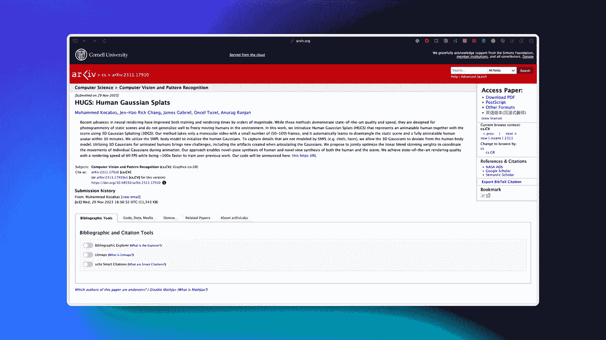
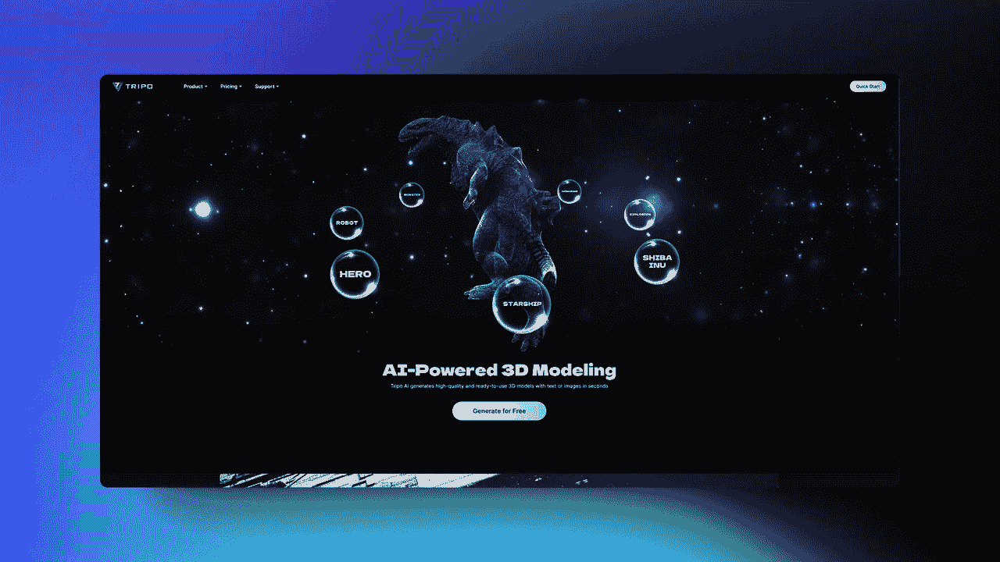
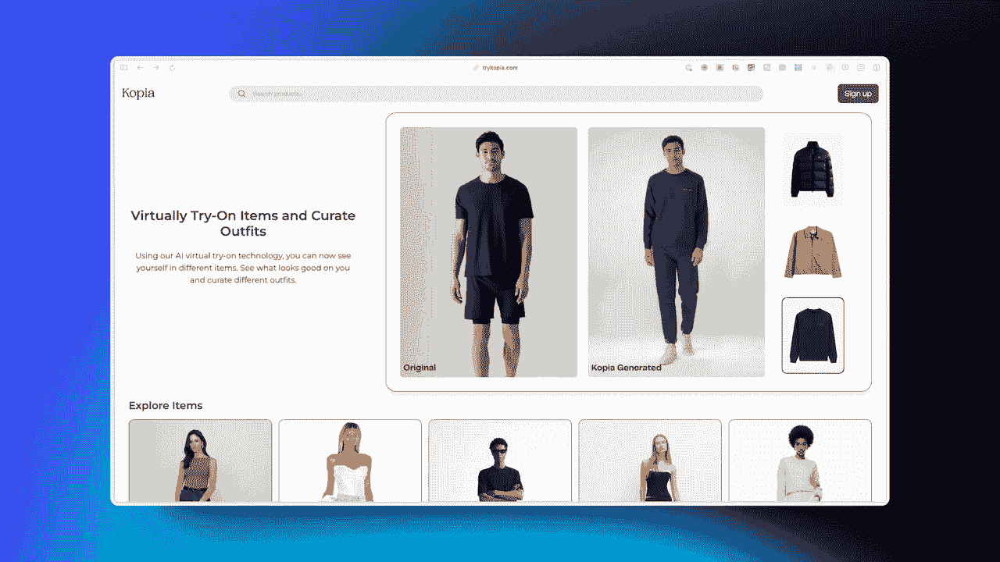
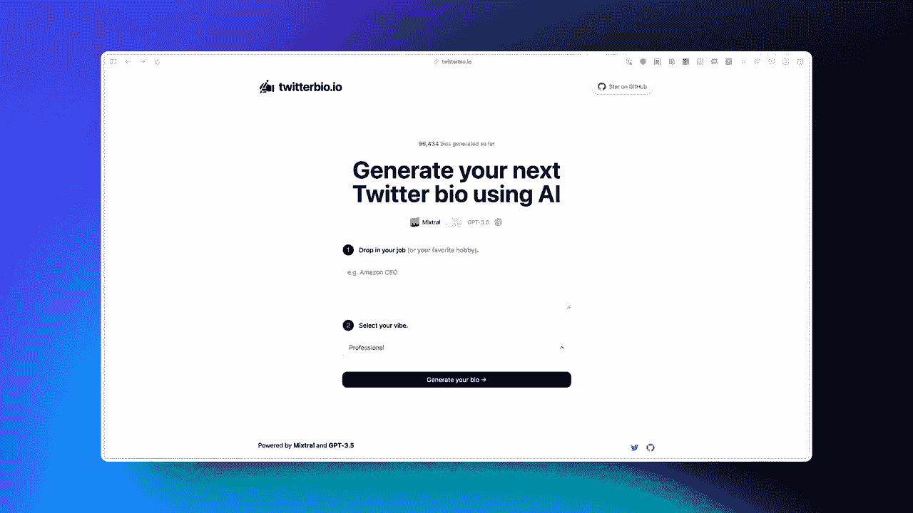

# AIGC Weekly #52

> 来源：[https://waytoagi.feishu.cn/docx/WJYHdz9fvo6E0exgCEXckZX2nCg](https://waytoagi.feishu.cn/docx/WJYHdz9fvo6E0exgCEXckZX2nCg)

> 🔗 原文链接： h[ttps://quail.ink/o](https://quail.ink/op7418/p/aigc-weekly-52)p7418/p/aigc-wee...

> 发表时间：25 Dec, 2023

> 圣诞快乐啊各位，23年过的真的快啊，很期待明年AI领域的发展了。另外，上周除了发一些消息之外，还重新梳理了和莱森做的提示词网站Catjourney的功能和发展规划。不再只是收集风格代码，变成主要收集提示词和提供图片下载。未来会增加更多的功能。感兴趣可以来看看：https://catjourney.life/

> [另外昨天还用M](https://x.com/op7418/status/1738926257906364519?s=20)idjourney和Runway做了 一段圣诞视频 ，不得不说V6模型确实很强，从细节、文字生成、还有风格广度上都有了很大的提升，上游图片生成效果的提升也很自然的带动了视频以及3D生成内容质量的大幅提升。

Midjourney提示词： christmas with trees and lights in the snow, in the style of captivating cityscapes, video montages, animated gifs, chicago imagists, soft, romantic scenes, dramatic use of lighting, romantic scenes, y2k aesthetic, villagecore, captivating, historical, xmaspunk --ar 16:9 --v 6.0

[**💎查看更多风格和提示词**](https://catjourney.life/)

# ❤️上周精选

## Midjourney 发布V6模型

上周六Midjourney终于卡着圣诞休假的前夕放出了V6模型的第一个版本，这个版本在写实和偏3D的方向强的离谱，再加上提升的提示词理解能力，使他再一次拿回了图像生成领域的王冠。

由于是模型第一个版本还是有些问题的，比如图片有点锐化过度的感觉，同时在偏艺术性的平面图像生成上表现不是很突出，期待Nijijourney V6版本的推出了。

**如何使用V6模型 **：

要启用它，请在 /settings 下的下拉菜单中选择 V6，或在提示后输入 --v 6。

**V6 基础模型的新特性有哪些？**

+   更准确的提示遵循以及更长的提示

+   改进的连贯性和模型知识

+   改进的图像提示和混合

+   轻微的文本绘制能力（你必须在 "引号" 中写下你的文本，并且 --style raw 或更低的 --stylize 值可能有帮助）/imagineA photo of "Hello World!" written on a post-it note in marker pen --ar 16:9 --v 6

+   改进的放大器，包括 'subtle' 和 'creative' 模式（分辨率提高 2 倍）（在点击 U1/U2/U3/U4 后，你会在图像下看到这些按钮）

以下功能/参数在启动时得到支持 ：

-ar, --chaos, --weird, --tile ,--stylize, --style raw , Vary (subtle), Vary (strong), Remix, /blend, /describe（仅 v5 版本）

这些功能尚未支持，但应在接下来的一个月内推出 ：

Pan, Zoom, Vary (region), /tune, /describe（一个新的 v6 版本）

**V6 的样式和提示 **：

与 V5 相比，V6 的提示方式有显著不同。你将需要“重新学习”如何进行提示。

V6 对你的提示更加敏感。避免使用像 "获奖的，逼真的，4k，8k" 这样的‘垃圾’词汇。

明确表达你想要的内容。可能不那么有趣，但如果你明确表达，现在它在理解你方面做得更好。

如果你想要更摄影风格/更少主观色彩/更字面意义的东西，你可能应该默认使用 --style raw

较低的 --stylize 值（默认 100）可能有更好的提示理解，而较高的值（最高 1000）可能有更好的美学效果。

## 苹果开始发力 AI，发布多篇论文

苹果最近在AI 开始发力了，发布了一系列 AI 相关的论文，主要集中在AI 硬件加速和 3D 内容生成。感觉还是为了在苹果生态钟创建 AI 训练和使用生态和 Vision Pro 做准备。

主要的是两篇，首先是《 HUGS: Human Gaussian Splats 》可以根据视频创建动画 3D 人类头像。

本文介绍一种名为“Human Gaussian Splats（HUGS）”的方法，使用三维高斯喷洒（3DGS）来表示可动画化人体及其所处场景。

我们只需一个单目视频（包含50-100帧），就能够在30分钟内自动学习将静态场景与完全可动画化的人体角色分离开来。我们利用SMPL身体模型初始化人类高斯函数，在捕捉SMPL未建模部分（如衣物、头发）等细节时允许三维高斯函数偏离人体模型。

对于可动画化人物而言，使用三维高斯函数也带来了新挑战，其中之一是调整高斯函数时产生伪影问题。因此，我们提出了联合优化线性混合蒙皮权重，以协调动画过程中每个高斯函数的运动。我们的方法实现了人物新姿势的合成以及人物和场景新视角的渲染。

相较于之前的工作，我们在训练速度上快了约100倍，并且达到了最先进的渲染质量，每秒能够渲染60帧。

论文地址：https://arxiv.org/abs/2311.17910

第二篇是《 **LLM in a flash: Efficient Large Langu**age Model Inference with Limited Memory 》帮助硬件在有限内存下高效的大型语言模型推理。

本文解决了超过可用DRAM容量的LLMs高效运行的问题，通过将模型参数存储在闪存上，并根据需要将其加载到DRAM中。

我们提出了一种推理成本模型构建方法，在与闪存行为相协调的基础上进行优化，主要集中在两个关键领域：

减少从闪存传输的数据量以及以更大、更连续的块读取数据。在这个基于闪存信息的框架下，我们引入了两种主要技术。

首先，“窗口化”策略通过重复使用之前激活过的神经元来减少数据传输；

其次，“行列捆绑”则利用闪存顺序访问数据时较强劲特性增加从闪存读取数据块的大小。

这些方法共同使得可以运行比可用DRAM容量多一倍大小的模型，在CPU和GPU上分别实现4-5倍和20-25倍速度提升相比朴素加载方法。

我们的整合了稀疏性感知、上下文适应加载和面向硬件设计等技术，为在内存有限设备上高效推理LLMs铺平了道路。

论文地址：https://arxiv.org/abs/2312.11514

# 🧵其他动态

+   换脸工具Rope发布了Ruby版本，性能获得了大幅提升：https://github.com/Hillobar/Rope?tab=readme-ov-file

+   用一张照片生成图片时完全还原面部信息的IP Adapter faceID模型，已经可以在Comfy UI中使用，插件作者的教程：https://www.youtube.com/watch?v=jSu_tKfg5rI&t=5s

+   Lightricks 发布了 LongAnimatediff ，包括两个模型一个可以最多一次生成64帧的视频，一个可以生成32帧的视频https://github.com/Lightricks/LongAnimateDiff/

+   Dify开放了自己产品的相关技术规格，有想做LLM相关产品的可以参考：https://docs.dify.ai/v/zh-hans/getting-started/readme/features-and-specifications

+   腾讯混元、阿里通义千问、360智脑和百度文心一言，通过了国内的那个国家大模型标准测试：https://www.ithome.com/0/741/089.htm

+   LCM和SDXL Turbo每秒生成110张图像的项目开源了：https://github.com/cumulo-autumn/StreamDiffusion

+   SVD 视频生成模型现在可以在Stability AI 中通过 API 使用：https://platform.stability.ai/

+   IPapapter 的团队推出IP-Adapter-FaceID模型，相较于旧模型大幅提高从图片还原人像的相似度，ComfyUI 已经支持：https://huggingface.co/h94/IP-Adapter-FaceID

+   用来生成 SVG 图片的多模态模型：https://huggingface.co/papers/2312.11556

# ⚒️产品推荐

## Tripo3d：AI生成3D模型

可以说是现在最强大的3D模型生成工具，一经发布就把几个老牌产品打趴了，支持从文字直接生成3D模型，也支持图片生成。

## Creatify：从一条链接生成视频广告

Creatify 这个产品，可以直接从你的产品页面获取内容，可以是官网可以是电商商品页，然后直接生成广告视频。

优质广告的广告语口播和内容其实优秀的投手是知道一些套路的，这样可以快速将这些经验复制给没有广告生产和投放经验的用户。

他们还支持 AI 生成广告视频分镜和文字转语音等功能。网生成了广告，节奏和利益点都好。

## Tonic：AI 视频编辑社交软件

视频的 AI 转换操作成本也非常低，效果也很好。 AI 会自动接入选择转换视频的一小段，同时跟原视频内容很好的结合起来。

它的视觉风格和交互非常契合愿意生产优质短视频的年轻人，比如首次进入时手机会跟着视频内容震动。

生成视频过程中像唱片机一样悬浮在图标上的进度条。还有与画面内容搭配的 emoji 点赞按钮 。

## AgentSearch：Agents 优先的搜索引擎

一个以Agents优先的搜索引擎，主要用来搜索高质量的知识。这个想法挺有意思的。

## Findly：使用 IA 和你的Analytics数据对话

Findly是一种工具，它使用AI驱动的自然语言生成技术，允许用户通过像Slack这样的通信工具以普通语言查询他们的数据库。它生成直观的可视化和报告，可以定制、导出和共享。该工具与Google Analytics和Slack都提供了简化的集成，使用户能够在与Slack环境内进行沟通和分享见解的同时轻松地与其Google Analytics数据进行交互。

## [Kopia：虚拟试衣工具](https://www.trykopia.com/)

使用我们的AI虚拟试穿技术，您现在可以看到自己穿上不同的物品。看看哪些款式适合您，并搭配出不同的服装组合。

## TwitterBio：使用 AI 帮你生成推特简介

使用 Mixtral 和 GPT-3.5生成你的Twitter 简介。项目已经开源，可以改一改生搞成国内的。

## Wysper：把播客变成内容引擎

帮助团队通过将音频转换为书面内容来自动化内容创作。该服务利用人工智能（AI）自动化80%的内容创作过程，可以每周节省团队超过20小时的时间。Wysper Write还提供一个专门的文案撰写人员，学习品牌的风格和声音，并从每一集中创建LinkedIn和博客内容。该服务包括与专门的文案撰写人员进行个性化入职培训、每月最多创建20篇内容，并帮助扩大品牌在所有平台上的影响力。

# 🔬精选文章

## [出色的LLM可解释性内容](https://github.com/JShollaj/awesome-llm-interpretability)

LLM的可解释性一直都是比较困难的内容，而且在对齐和安全上可解释性的研究也比较重要。

这个Github储存库非常全面的

精心收集了关于LLM可解释性的相关工具、论文、文章以及团体。

## TextDiffuser-2：为文本渲染释放语言模型的力量

可以稳定在扩散模型中生成指定位置和风格的英文文本，它是借助的微调后的大语言模型来规划文本布局，以及编码文本的位置。

## 面向大语言模型的检索增强生成技术

在这篇调查中，我们关注的是面向大语言模型的检索增强生成技术。这项技术通过结合检索机制，增强了大语言模型在处理复杂查询和生成更准确信息方面的能力。我们从同济大学和复旦大学的相关研究团队出发，综合分析了该领域的最新进展和未来趋势。

中文翻译：https://baoyu.io/translations/ai-paper/2312.10997-retrieval-augmented-generation-for-large-language-models-a-survey

## [DreamTuner： ](https://dreamtuner-diffusion.github.io/)[**解决图像生成中角色一致性的问题**](https://dreamtuner-diffusion.github.io/)

效果也太好了，可以将输入图片的角色在生成新图是完美保留，并且融合度非常好，这下小说、漫画和视频的人物一致性和商品一致性问题彻底解决了。

并且可以和ContorlNet联动确保动画的稳定，间接实现了前段时间的让单张图片动起来的功能。

主要的优势除了一致性和真实度之外，还有极高的生成效率。

只需要14秒就可以生成120帧512x384的视频（30 FPS，持续4秒）。比之前的同类项目快 44 倍。

## 像真实智能手机用户一样操作手机的多模态智能体

腾讯推出的 AppAgent，是一个多模态智能体，通过识别当前手机的界面和用户指令直接操作手机界面，能像真实用户一样操作手机！比如它可以操作图片编辑软件编辑图片、打开地图应用导航，购物等等操作。

中文翻译：https://baoyu.io/translations/ai-paper/2312.13771-appagent-multimodal-agents-as-smartphone-users

## 白鸦：从Adobe放弃收购figma开始说说

白鸦这篇从Adobe放弃收购Figma，说到AGI时代UX设计师这个工种的处境挺有意思的，我一定程度上认同他的说法。

UX设计将进入一个新的时代。一个图形用户界面和对话式界面混合使用的时代，一个软界面和现实空间融合交互的时代，更细微简单但也更讲究的人机交互，将让人们获得更好的使用体验。

一个UX设计能力被普及，人人都可以参与界面设计的时代。UX设计师还是需要，但确实不需要这么多UX设计师了。

## 在本地运行Mixtral 8x7，并使用LlamaIndex

LlamaIndex这篇实操内容挺好的，教你用Ollama 在自己的笔记本上运行Mixtral 8x7b。

重要的是会教一下如何使用Qdrant向量储存工具做一个完全本地化的 RAG 生成应用。

## Sam Altman：我希望有人告诉我的事

Sam Altman发了一篇我希望有人告诉我的事，基本上是去年他的总结。一共17 条建议，比如：每当遇到废话和官僚主义时，都要挑战它们，并鼓励他人也这样做。不要让组织架构阻碍人们有效地协同工作。

## [**复杂RAG的技术考虑**](https://medium.com/enterprise-rag/a-first-intro-to-complex-rag-retrieval-augmented-generation-a8624d70090f)

最近大家的关注点除了 LLM 开始更多的关注到 LLM 周边生态了，比如 RAG 这种 LLM 落地必须的东西。LlamaIndex的人写了一个《复杂RAG的技术考虑》主要介绍了一下 RAG 里面的分块策略、文档层次结构、知识图谱作为文档层次结构的扩展等内容。感觉挺适合入门的

## 一波预期中的人工智能专家岗位尚未到来

尽管人们预期生成式人工智能（AI）将显著改变营销领域，并导致AI特定角色的激增，但这一点尚未实现。2023年11月，提及AI的开放性营销职位数量比一年前下降了8%。与其他领域相比，AI对营销产生的影响似乎较小，销售岗位中提到AI的可能性几乎是营销岗位的三倍。

虽然一些企业间公司和广告集团已经任命了首席人工智能官和人工智能负责人等职务，但大型消费品牌在这方面并没有采取类似措施。一个例外是可口可乐公司，在加速其团队采用生成式 AI 工具方面设立了相关职务。预计其他大型品牌也会在接下来几个月效仿可口可乐公司。

然而，有些人认为在短期内可口可乐仍将是个例外情况。确定如何以风险规避方式最佳利用 AI 的过程仍处于早期阶段，这是为什么还没有出现专门针对 AI 的工作岗位的关键原因之一。其他挑战包括新兴技术历来是首席技术官而不是首席营销官的领域，法律团队通常需要解决有关 AI 可能未经许可就占用他人数据或知识产权的问题。

从文化角度来看，选择一个人来管理如此重要的转变可能会使其他人感到责任减轻，从而减缓进程。负责将AI工具整合到公司营销运营中的高级职位可能会被证明是临时性的，因为一旦这些工具完全采用后理论上就不再需要这些高管。

尽管对于AI特定岗位采纳较慢，但求职者之间对此越发感兴趣。2022年12月至2023年12月提及AI的营销岗位浏览量增长了60%，申请该类职位也增加了70%。提及AI的营销岗位总浏览量比没有提及AI的岗位增长速度快14%。

## Meta的CTO谈论了生成式人工智能热潮如何促使公司“改变策略”

Meta的首席技术官安德鲁·博斯沃思（Andrew Bosworth）讨论了公司对生成式人工智能的快速发展和影响感到惊讶，并说明这导致了公司战略的转变。尽管他在人工智能方面有背景，但博斯沃思承认生成式人工智能的最新进展使Meta措手不及，促使该公司调整其方法。

生成式人工智能已经影响了Meta的产品线，包括其混合现实努力，推动了新Quest头盔和Ray Ban智能眼镜的开发。博斯沃思强调说，人工智能一直是Meta战略中重要组成部分，但生成式人工智能的出现加速了该公司的进展。

博斯沃思还讨论了AI在Meta混合现实硬件中的作用。他指出虽然最初他们认为需要大量狭窄数据，但大型语言模型的发展改变了这种观点。这些模型具有更多通用性，减少了对精确、完美训练数据的需求。这种转变导致相信AI将成为Meta设备宝贵基石。

关于从眼镜和Quest头盔收集的数据，博斯沃思表示最有价值的数据是人们如何使用这些设备。他还提到了Quest中AI的潜力，指出虽然由于缺乏大量3D对象库而存在挑战，但混合现实和虚拟现实设备中的传感器也带来了重要机遇。

博斯沃思还谈到了开源AI模型的话题，并解释说Meta长期以来一直是开源项目领域的领导者。他提到了开源带来的好处，例如围绕项目创建社区并获得独立第三方对结果进行验证。然而，他也承认由于数据使用和安全问题，并非所有内容都可以开源。

在招聘方面，博斯沃思承认该领域竞争激烈，但强调Meta所提供的独特机会。他还否定了关于开源强大AI技术潜在危险性的担忧，并表示大型语言模型是重要工具，但没有代理能力或推理能力。

## 构建一个搜索引擎，而不是一个向量数据库

名为“构建搜索引擎，而非向量数据库”的博文讨论了最近向量数据库初创公司的蓬勃发展，并对向量数据库是什么以及如何使用它提出了一些常见误解的挑战。

作者认为，许多向量数据库被框定为解决语言模型缺乏长期记忆的问题。然而，作者建议，向量搜索本质上是一种类型的搜索，并且使语言模型能够访问一个可写入和跨越搜索的数据库更类似于提供对搜索引擎的访问，而不是“拥有更多内存”。

作者分享了他们在Stripe工作时开发AI文档产品的经验，在开始时他们将一个向量数据库用作语言模型扩展内存。然而，他们发现这种方法行不通。作者解释说，虽然在某些方面与传统搜索相比，向量搜索更好，但它并不是一个神奇的解决方案。像普通搜索一样，向量搜索可能导致结果中存在无关或缺失文件，在误导语言模型方面也可能存在问题。

作者建议如果你想创建一个使用你的文档来进行检索增强生成（RAG）工具，则应首先构建一个对人类来说足够好用的文档搜索引擎。作者指出，构建一个好的搜索引擎在传统上一直是一项重大任务，但最近人工智能的进展使得这变得更加容易和少费力。

作者推荐将高质量嵌入式搜索与传统方法相结合，以提高整体搜索性能。他们还建议使用语言模型以确保检索相关信息的方式来构造查询。作者指出，传统搜索流程中的最后阶段是重新排序，现在可以使用语言模型为查询：结果对提供相关性评分来完成。

然而，作者警告说，构建一个搜索引擎还涉及到对其进行评估，并需要构建评估和监控基础设施。这样你就可以迭代你的搜索流程，并确定所做的改变是否有所改善。