# AIGC Weekly #51

> 来源：[https://waytoagi.feishu.cn/docx/X0wHdJSGMogzy4xTqC6cEAVxnRe](https://waytoagi.feishu.cn/docx/X0wHdJSGMogzy4xTqC6cEAVxnRe)

> 🔗 原文链接： h[ttps://quail.ink/o](https://quail.ink/op7418/p/aigc-weekly-51)p7418/p/aigc-wee...

> 发表时间：18 Dec, 2023

Midjourn[ey提示词：a busy](https://catjourney.framer.website/) street at night, in the style of motion blur panorama, New York City Christmas Celebration, conceptual installation art, colourful, demonic photograph, lighthearted, selective focus --ar 16:9 --style 2vwP3IB8gi9nrUuY1wSj21v172mxjJU2G7cnlIFhZ-2mDRbzF04KYIVOlH9ge7cAKdUsLQ9vHqLZw676ENh-2dQJm1HKlgxV 💎查看更多风格和提示词

# ❤️上周精选

## Midjourney发布网页图片生成功能

Midjourney上周发布了Alpha版本的网页图片生成功能

写一下如何使用Alpha 版本和图片生成的一些变化，后面发现的小细节也会写在这个帖子上：

**如何使用 Alpha 版本：**

如果已经生成一万张图可以使用，在 Discord 里面输入/info 可以看到生成的图片数量，也可以直接访问这个链接看自己是不是有权限：

http://t.co/baP1MNIVTZ

**图片生成功能细节：**

✦点击页面上方的提示词输入框可以直接开始生成图片。

✦输入框右侧按钮点击可以调整图片生成的所有参数。

✦+号按钮可以上传图片或者使用已有的图片垫图。

✦鼠标 Hover 到每个参数上都可以看到具体的解释。

✦已经生成的图像设置参数直接点击就可以回填到提示词输入框里面。

✦已经生成的图片右下角包含了，可以对图片进行的所有操作，比如放大使用提示词，使用图片，放大重随等。

✦正在生成的图片和已经生成的图片是在一起的，今天的内容会放大显示，昨天的会变成小图。

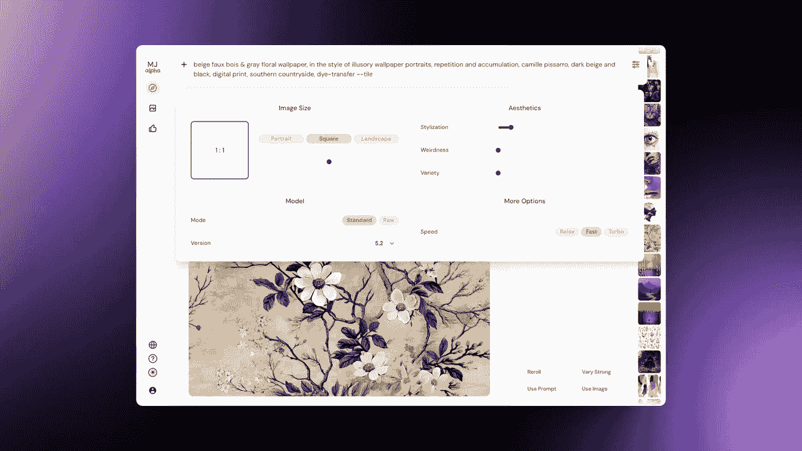

## 阿里开源视频生成模型2VGen-XL

阿里之前11月发布了论文要开源的I2VGen-XL图像生成视频模型，终于发布了具体的代码和模型。演示里面没有人物大幅动作的视频。

I2VGen-XL包括两个阶段：

i) 基础阶段通过使用两个分层编码器保证连贯的语义，并保留输入图像的内容，

ii) 优化阶段通过整合额外的简短文本来增强视频的细节，并将分辨率提高到1280x720。

收集了约3500万个单镜头文本视频对和60亿个文本图像对来优化模型。 通过这种方式，I2VGen-XL可以同时提高生成视频的语义准确性、细节的连续性和清晰度。

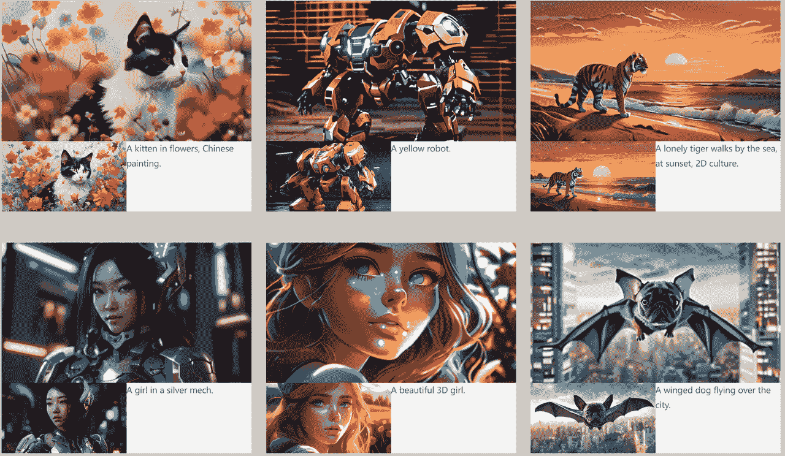

## [**Animatediff **](https://github.com/guoyww/AnimateDiff)V3 及 SparseCtrl发布

上周五Animatediff发布了 V3 模型我也做了一些测试，[总体来看效果](https://x.com/op7418/status/1735683910703722625?s=20)[是好了一些](https://x.com/op7418/status/1736045575819477295?s=20)，不过没有特别大的变化，感兴趣的可以看我这两个测试视频。 测试1️⃣ 测试2️⃣

这次除了V3 模型之外作者还更新了一个Domain Adapter Lora 模型，今天看作者增加了这个模型的介绍。Domain Adapter 是一个基于培训视频数据集中静态帧进行训练的 LoRA 模块。在推理时，通过调整 Domain Adapter 的 LoRA 尺度，可以消除一些培训视频中的视觉特征（例如水印）。

除了Domain Adapter Lora还有之前作者提的视频控制模型，可以理解为视频生成的 Comtorlnet SparseCtrl也发布了，这个模型可以实现输入图像生成视频，也可以只用输入图像中的某一个部分比如深度图或者线稿。

SparseCtrl具体支持的能力包括让单张图像动起来，或者讲两张图片当成关键帧插值，视频插帧功能，输入初始视频帧对视频后续内容进行预测，深度图转视频，草图转视频。

这次SparseCtrl发布了草图和深度的两个控制模型，不过使用需要 ComfyUI 和 Web UI 插件进行适配插件作者说已经在做了。

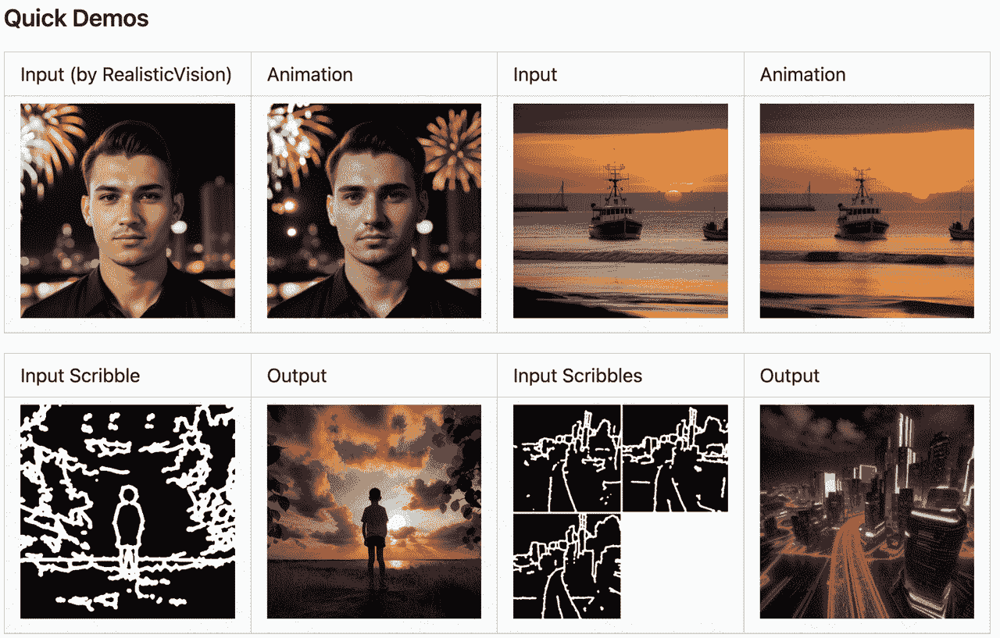

# 🧵其他动态

+   Midjourney憋了半年的大招V6模型将在下周发布，上周六开始了社区评价活动：https://www.midjourney.com/rank-v6

+   Perplexity上线了图片生成功能，搜索结果完成之后 Pro 用户可以点击右边按钮生成图片：https://www.perplexity.ai/

+   Stability AI 推出会员服务，基础会员 20 美元，非会员无法商用他们公司的模型了。
现在需要会员才能商用的模型包括SDXL Turbo、SVD、Stable LM Zephyr 3B：https://stability.ai/membership

+   谷歌Deepmind宣布了他们最先进的图像生成模型Imagen 2：https://x.com/op7418/status/1734962114513797468?s=20

+   Visual Electric发布了图像合成和风格创建功能：https://x.com/op7418/status/1734988753125658695?s=20

+   Chat GPT重新开启GPT plus订阅：https://x.com/sama/status/1734984269586457078?s=20

+   Gemini Pro API已经向企业和开发者开放：https://blog.google/technology/ai/gemini-api-developers-cloud

+   截图生成前端代码的v0.dev已经向所有用户开放：https://v0.dev/

+   Krea上周向所有人开放，不需要邀请了：https://x.com/krea_ai/status/1734866368489722035?s=20

+   Theverge报道字节使用Open AI训练模型被发现，导致无法获得OpenAI相关内容的使用权限：https://www.theverge.com/2023/12/15/24003151/bytedance-china-openai-microsoft-competitor-llm

+   Open AI官方推出了提示工程指南：https://platform.openai.com/docs/guides/prompt-engineering

# ⚒️产品推荐

## Midreal AI：AI生成小说

Midreal AI小说生成工具，与其他LLM直接生成的所谓根本没有逻辑和情节的“小说”不同。这个产品可以生成真正的小说，逻辑性和创造力都在线，而且还加入了互动能力，每到关键节点会让你选择剧情走向，还会生成一张配图。

他们这么厉害主要是强在两个能力：

**内存跨越技术 **：可以实现几乎无限的记忆保留，确保游戏体验长期无缝连接。

**长篇写作能力 **:长篇写作能力能够让叙事从头到尾保持连贯和引人入胜。

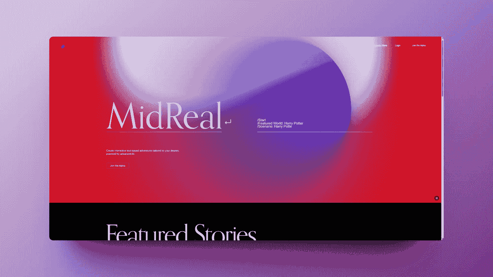

## Digi：3D 建模的陪伴型 AI 应用

Digi这个陪伴型AI应用的排行升的有点快啊，创始人的宣传推特已经1400万曝光了。

他们不再只是向Character这样通过文字和提示词构建非常浅显的的关系和表达媒介。而是选择仔细打磨相处过程中的每个阶段，用3D角色来表现你的AI伴侣，你可以一定程度自定义自己的伴侣，3D角色会根据对话做出对应的表情和动作。有好感度系统，好感度达到一定阶段就可以进入下一个阶段解锁更多场景，而且好感度增长是比较慢的。

语音也非常自然，目前有四个声音，后面他们会增加更多语音模型，一月底会到20个左右。同时还在研究增加口型同步的能力。中文对话也可以只是没有语音.

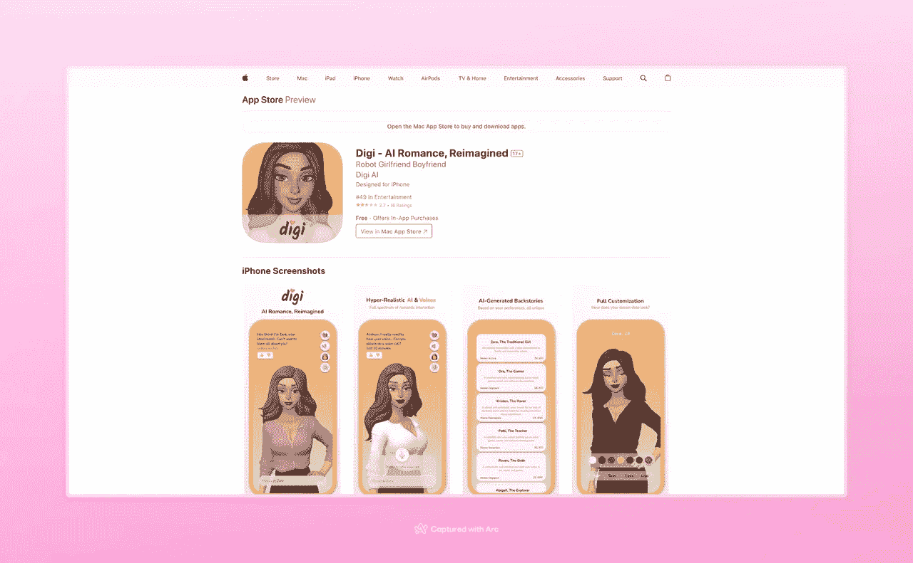

## [Domo AI：视频转视频产品](https://discord.gg/BtnuY6Zx)

前几天刚说完 Animatediff 视频转视频产品化会有很大的机会。DomoAI这就上了，而且效果还很好，相当稳定。第二个视频质量问题没识别全。我自己也测试了两条视频。背景的变化不太复杂感觉是做了蒙版的。免费额度大概可以生成 20 秒视频，付费可以去水印。

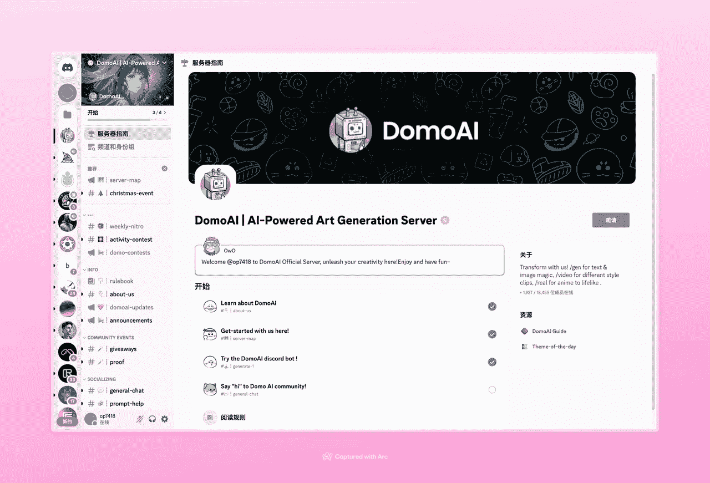

## Runway ：上线文字生成语音功能

尝试了一下英文的效果真的很好，感情很丰富自然。中文还是老问题，有外国人口音，这块可能不能指望外国公司了。这个功能可以选的语音模型非常多，可以都试试。目前是消耗右上角点数生成可以用好久.

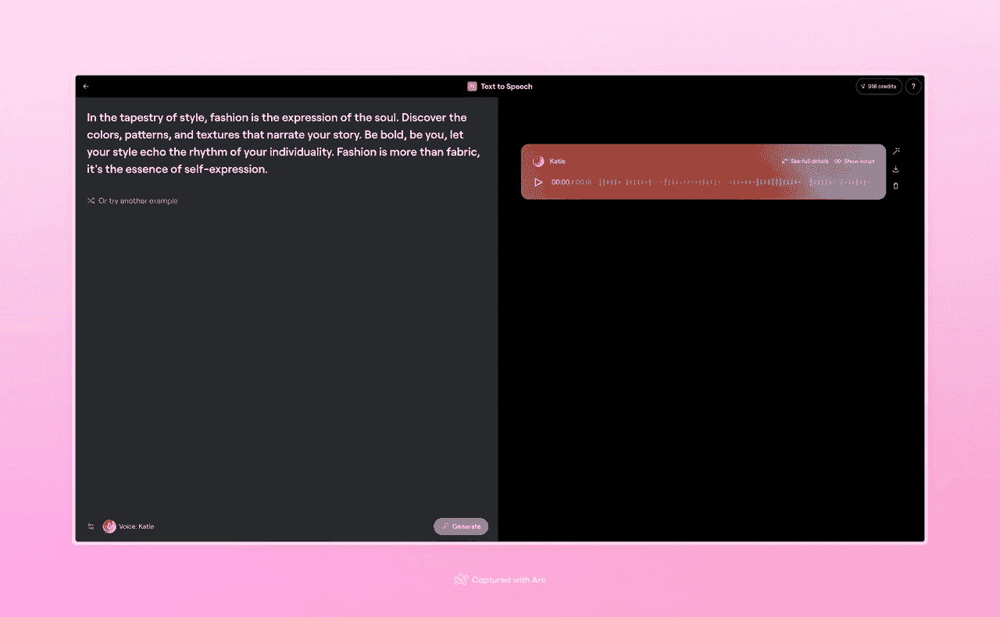

## Delphi：克隆自己的分身为用户提供服务

终于出现完全产品化的为个人炼制模型并提供服务的产品了。Delphi 这个应用可以将你所有的视频、播客、PDF、博客文章等信息训练为一个你的分身，并且你可以用你的分身对外提供咨询服务。

支持文字、语音甚至视频沟通。

你的分身会用你的语气和你上传内容的知识跟你的粉丝对话，同时还支持对话内容的数据分析帮你优化分身跟粉丝的交流。

看了一下价格最便宜的套餐每个月 25，不过需要跟他们 CEO 视频获得引导才能创建，感觉这个会议也不是真人只是他们 CEO 的分身，来炫耀技术的。

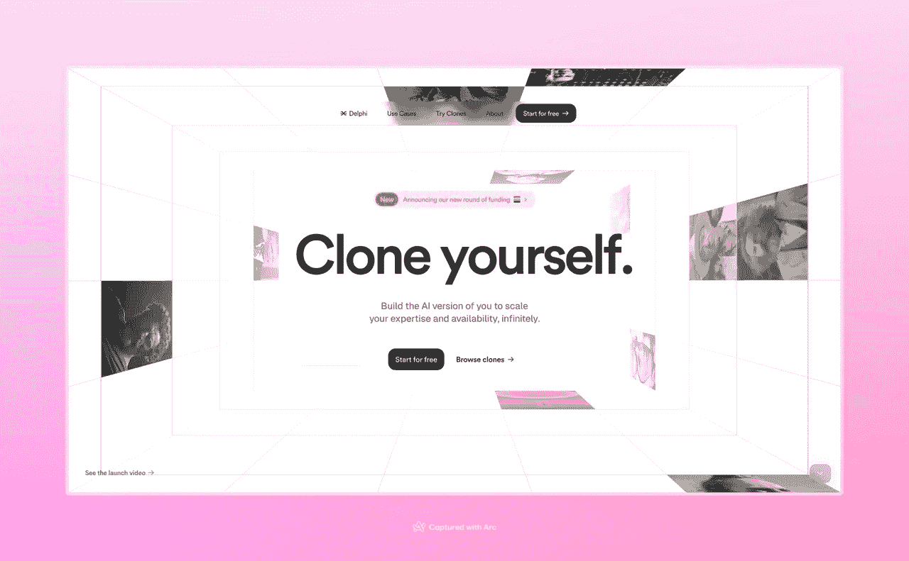

## [Osum：AI进行市场研究](https://osum.com/)

Osum是一款旨在简化研究流程并为企业提供有价值见解的人工智能市场研究工具。该工具可以通过按下按钮即可立即获取产品或企业的详细研究、SWOT分析、买家人物画像、增长机会等信息。

Osum还提供销售前景分析器(Sales Prospect Profiler)，它通过将人口统计数据与行为和心理特征洞察相结合来创建可操作档案用于销售前景 . 这符合Cintell观测结果：超额完成引导和收入目标的公司进行这类战略可能性是其他公司4倍

该工具还可以在几秒钟内为任何商务或产品提供完整SWOT分析，并作为知情战略规划推进者 。

这反映出Demand Metric认识到：基于SWOT信息内容营销策略导致平均ROI增加20％

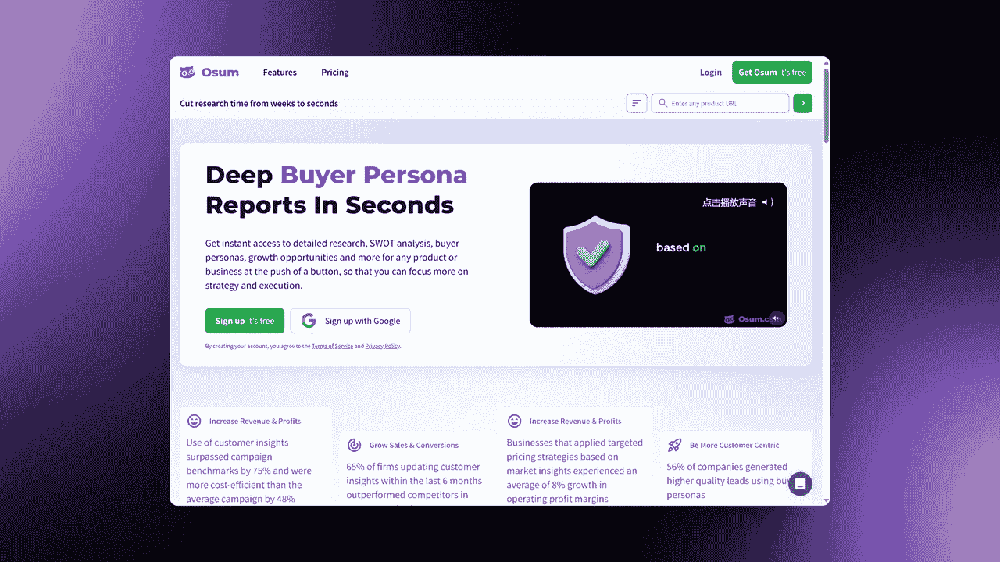

## Coffee：AI 生成前端组件

这个AI生成前端代码的项目“Coffee”有意思，可以生成干净可维护的前端组件代码。

交互也很有意思，你只需要在代码对应位置加一个标签在里面写上对组件的要求，他就可以生成对应的前端组件，你可以继续在标签里输入内容对生成的组件进行修改。

当你修改好之后加个属性，组件就会被创建。你也可以利用Coffee编辑现有的React组件。这个很有用。

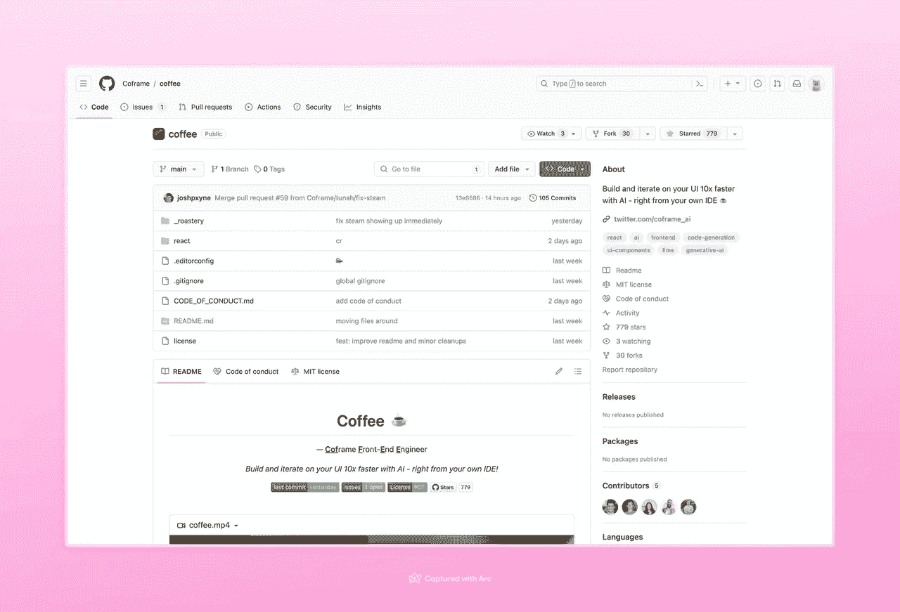

## Notdiamond-0001：自动选择LLM模型

Notdiamond-0001这个项目可以自动帮你选择将用户的问题发送给GPT-4还是GPT-3.5，从而大幅降低调用模型的成本提高回答的准确性。

以后还会推出Gemini、Mistral、Claude 和 Llama这几个模型的自动选择。

**下面是几个重点功能 **：

◇ 在用作路由器时，Notdiamond-0001的性能比GPT-4高出1.51倍。

◇ 确定要调用哪个模型在小于10毫秒内完成。

◇ 可通过API免费获得或者在HF上使用，还会全天候持续监控OpenAI是否中断，并重新路由到你选择的备用模型。

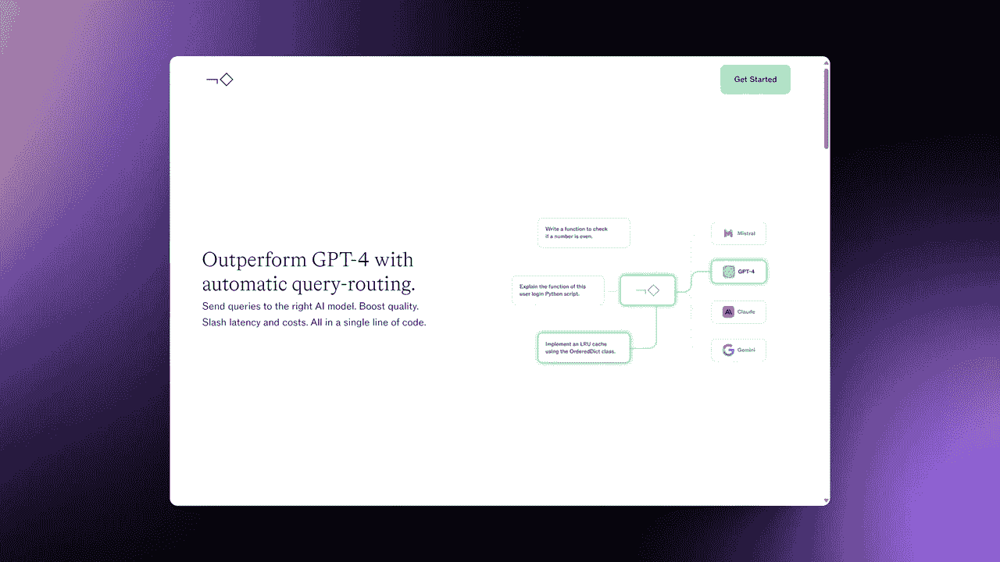

---

# 🔬精选文章

## LLM Visualization

这个 LLM 算法的可视化演示太强了，之前我们看到的都是 2D 的，这个是 3D 的。而且他完整的展示了整个 LLM不同模块内部的运作机制和各模块之间的联系。你还可以看 GPT-3 和 GPT-2 这种不同规模的 LLM 在架构和模块上的区别。

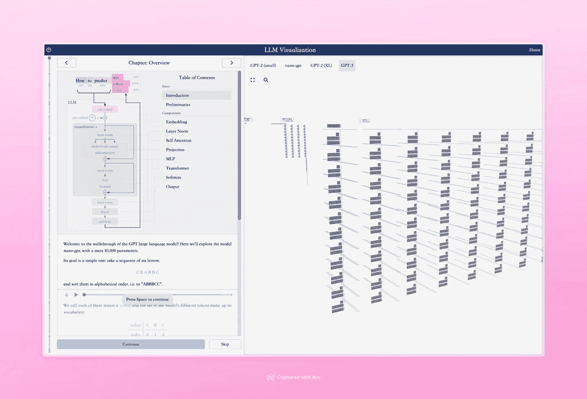

## [**VideoLCM: Video Late**](https://arxiv.org/abs/2312.09109)nt Consistency Model

视频 LCM 项目，通过四个采样步骤即可实现高保真、流畅的视频合成。

其实这个我没看懂，现有的 LCM 在采样器前接入加上视频生成模型也可以实现类似的事情。他们在论文里没有说明他们的研究比现在利用 LCM 生成视频的优势在哪里。

## FreeInit：大幅提高AI视频生成中内容一致性

南洋理工发布了一个可以大幅提高AI视频生成中内容一致性的方法FreeInit，演示看起来非常流畅。而且可以跟现有的SD生态结合。

他们还发了跟Animatediff结合的方法，等有大佬做插件就可以用了。视频是使用了FreeInit和未使用FreeInit的Animaetdiff的对比。

## [a16z 2024年展望](https://a16z.com/big-ideas-in-tech-2024/)

《Big Ideas in Tech for 2024》一文来自a16z，讨论了预计将推动2024年技术发展的几个关键趋势和创新。其中包括：

1.  **公共安全系统升级 **：文章建议技术可以显著改善公共安全系统，例如通过FaceTime或WhatsApp与911操作员进行连接，利用无人机加快应急响应，并使用摄像头和传感器进行犯罪预防和解决。

1.  **智能能源网络 **：美国需要振兴耗能行业。技术提供了通过分布式能源资源（如住宅太阳能、家庭储能以及小型模块化核反应堆）解决日益复杂的电网问题的方案。电网必须从单向功率流模型过渡到支持来自不同来源和地点的双向流动的“智能电网”。

1.  **儿童健康医疗AI工具 **：预计AI工具将彻底改变医疗保健和儿童教育。 AI可以减少行政负担并优化医生为患者提供最佳护理的能力。在教育领域，AI可以使创造更广泛地可及，民主化创意表达。

1.  **金融服务中的人工智能 **：预计AI在金融服务中扮演着越来越重要的角色，原生于AI产品会更多地嵌入到工作流程中去。开发者将成为购买金融服务基础设施中最重要影响因素之一。

1.  **生成式人工智能 **：生成式人工智能有潜力自动完成今天员工所花费时间很大一部分任务。它可以主动执行诸如留下评论、更新记录以及完成行动项目等任务。

1.  **海洋探索 **：人工智能、硬件和计算机视觉方面取得进步为城市、港口和贸易网络带来了机遇，实现自治现代化渡轮、集装箱船只以及捕鱼船队。

1.  **可编程药物 **：类似基因治疗这样可编程药物可以重复使用组件, 如用于靶向特定细胞的运输载体, 同时替换遗传货物, 这可能会彻底改变药物制备方式 .

1.  **视频情报中的人工智慧 **: 预期在现实世界中出现对计算机视觉与视频情报新应用程序 。企业正在通过利用硬件+软件模型解决这个问题, 向客户销售视频硬件摄像头以及软件 .

这些只是预计将推动2024年创新发展思想之众多想法之一 。所有这些想法之间 的共同线索是 AI 和科技 在驱动这些创新并改善生活各个方面 和商业上 扮演着核心角色.

## ConTorlNetXS：优化版Contorlnet

海德堡大学开源了一个优化版本的 ContorlNet 模型：ConTorlNetXS。这个架构的 ContorlNet 模型精简了原来的模型推理和训练的时间都提高了两倍，同时生成图片的质量更高，控制更加精准。

这个项目中，我们研究了用于控制基于稳定扩散模型的图像生成过程的ControlNet的大小和架构设计。我们展示了一个新的架构，其参数仅为基础模型的1%，实现了最先进的结果，并在FID分数方面表现出比ControlNet更好的性能。因此，我们称之为ControlNet-XS。

## W.A.L.T：谷歌视频生成模型

刚注意到李飞飞团队的这个视频生成模型W.A.L.T，这效果也太好了，感觉比 Pika 1.0 还要好的多。

清晰度和动作都非常好，特别是光剑打斗的那个视频。可惜不开源。

方法有两个关键的设计决策。首先，我们使用因果编码器在统一的潜在空间内联合压缩图像和视频，从而实现跨模态的训练和生成。其次，为了提高记忆和训练效率，我们使用专为联合空间和时空生成建模而定制的窗口注意架构。总而言之，这些设计决策使我们能够在已建立的视频（UCF-101 和 Kinetics-600）和图像（ImageNet）生成基准上实现最先进的性能，而无需使用无分类器指导。

## [医学大语言模型调研](https://arxiv.org/abs/2311.05112)

大型语言模型（LLMs），如ChatGPT，由于其令人印象深刻的人类语言理解和生成能力而受到了广泛关注。因此，在医学领域应用LLMs来辅助医生和患者护理成为了人工智能和临床医学中一个有前途的研究方向。为反映这一趋势，本调查提供了对LLMs在医学中原则、应用和面临挑战的全面概述。具体而言，我们旨在回答以下问题：1）如何构建医学LLMs？2）医学LLMs的下游表现是什么？3）如何将医学LLMs应用于真实世界的临床实践中？4）使用医学LLMs会出现哪些挑战？5）我们如何更好地构建和利用医学LLMs？因此，本调查旨在洞察LLMs在医学上的机遇与挑战，并作为构建实际有效的医学LLM资源之宝贵资料。

## Upscale-A-Video视频放大算法

Upscale-A-Video的文本引导潜在扩散框架，用于视频放大。该框架通过两个关键机制确保时间上的一致性：在局部上，它将时间层集成到U-Net和VAE-Decoder中，保持短序列的一致性；

在全局上，引入了一个基于流引导的经常性潜在传播模块，通过在整个序列中传播和融合潜在来增强整体视频的稳定性。

由于扩散范式，模型还通过允许文本提示来引导纹理创建和可调噪声水平来平衡恢复和生成，从而在保真度和质量之间实现权衡。

## Huggingface：混合专家模型解释

Hugging Face的博客文章《混合专家解释》深入探讨了在Transformer模型的背景下，混合专家（MoEs）概念，讨论了它们的架构、训练以及使用中涉及的权衡。 MoEs是一类能够通过使用稀疏MoE层而不是密集前馈网络（FFN）层来实现高效预训练和更快推断的模型。这些层包括一个门控网络，将标记路由到一定数量的神经网络“专家”。

博客文章中的要点包括：

+   MoEs可以比密集模型更快地进行预训练，并且在相同数量参数情况下提供更快速度推断。

+   它们需要大量VRAM，因为所有专家必须加载到内存中。

+   微调MoEs存在挑战，但最近对MoE指令微调工作显示出了希望。

+   MoEs由门控网络和专家组成，在变压器模型中替换每个FFN层。

+   训练MoEs更具计算效率性，但它们在微调过程中历史上很难泛化。

+   使用MoEs进行推断速度较快，因为只使用了部分参数，但由于需要加载所有参数而导致内存需求较高。

+   该博文追溯了MoEs的历史、发展以及它们在自然语言处理和计算机视觉领域应用方面。

+   它解释了稀疏性和负载平衡概念在MoEs中至关重要, 这对于有效地进行训练和推理非常重要.

+   文章还讨论了如何将MoE与变压器结合起来, 特别是像GShard 和 Switch Transformers这样规模庞大 的 模型.

+   完成有关利用router Z-loss稳定培养并学习专业知识等问题

+   分析增加专业人员数量对预先培养和微调产生影响

+   博客文章还涉及何时使用稀疏MOES与密集模式，并提供见解使MOES 在 预先培养和推理更有效

+   列出 MOES 的开源项目 和 已发布 模式 包括Switch Transformers, NLLB MoE, OpenMoe and Mixtral 8x7B

+   未来工作方向包括 将 稀疏 MOES 蒸馏成密集模式，模式合并技术和极端量子化技术

该博客文章总结了值得探索的MOES领域，并提供进一步阅读主题资源列表。

## 实现通用人工智能（AGI）可能比我们想象的更近

用户kenshin9000的Twitter帖子表明，我们离实现人工通用智能（AGI）比看起来更接近。该用户提供了初步证据，即当以命题逻辑上的“概念”提示GPT4时，这个基于transformer的自回归大型语言模型在被认为是AGI级别的ConceptARC基准测试中的性能从13%跃升至100%，而无需训练示例。这种性能改进延伸到所有文本基准。

该用户计划发布一系列帖子，讨论基于transformer的自回归大型语言模型的潜力、由AI模型Llama2-70B和GPT3.5下棋游戏结果以及基于GPT4开发并发布的完整国际象棋引擎。该用户声称GPT4 的“高效输出”将在任何规模比赛中击败目前存在的任何其他国际象棋引擎。

该用户还计划讨论他们开发出来新架构，声称可以通过建立数字连接创建“智能”，最终形成比单个或多个标记所暗示得复杂得多得“概念”。该用户相信，如果用于训练数据足够丰富，并且具有广泛分布在人类行动和交流中数值表示方面，则基于变压器的自回归大型语言模型将会持续改进。

最后，该用户指出一旦第一个AGI被建立起来, 人类将需要很短时间就会找到方法使其与其他同类进行对话。他们警告说，在引入"非人类概念"之后, 如果不确切理解 AGI "思考"方式，则验证方式增加显著风险。

## devv.ai 是如何构建高效的 RAG 系统的

J[iayuan (Forrest](https://t.co/AgfDhVEASK))慷慨的分享了devv.ai在开发过程中是如何搭建RAG系统的，这个系列的 thread 会分享 http://devv.ai 背后构建整个 Retrieval Augmented Generation System 的经验，包括在生产环境上的一些实践。这是第二部分如何评估一个 RAG 系统。

## [我如何使用 Google Forms、AI 和 Apps ](https://www.benlcollins.com/spreadsheets/google-forms-ai-apps-script)脚本自动化来分析 1,700 份调查回复

这篇文章介绍了如何使用Google表单、表格、Apps脚本和ChatGPT来设计和运行一项受众调查，包括创建调查、发送自动感谢邮件、在Google表格中分析数据和使用ChatGPT分析定性数据。作者使用Google表单创建了一个调查，并将调查结果导入到Google表格中进行进一步分析。作者还使用Apps脚本自动发送感谢邮件，并使用Google表格的数据进行数据透视表和公式分析。此外，作者还展示了如何使用ChatGPT将调查结果进行总结和分析，并将结果整理到Google文档中。

## [Figma、Midjourney、Databricks 和](https://www.designerfund.com/blog/how-figma-midjourney-and-databricks-harness-ai-in-design/?ref=sidebar) Modyfi 如何利用人工智能进行设计

本文讨论了行业专家在Figma、Midjourney、Databricks和Modyfi等公司的工作中AI和设计相交的见解。专家们认为，AI将提高设计师的能力，并使设计更易接触。AI可以取代基于组件的设计工作，让设计师专注于端到端流程。随着AI越来越多地融入产品中，AI设计的角色将变得至关重要，以建立基础和流程。需要针对UI/UX设计特别设计的ML模型，并且具有潜力进行直观互动的基于AI技术的聊天界面。文章还强调了AI帮助用户发现和理解其真正愿望的重要性，以及AI促进协作与社区合作的潜力。