# AIGC Weekly #50

> 来源：[https://waytoagi.feishu.cn/docx/GQmyd8FWBodgS9xBtudcAkf3ngh](https://waytoagi.feishu.cn/docx/GQmyd8FWBodgS9xBtudcAkf3ngh)

> 🔗 原文链接： h[ttps://quail.ink/o](https://quail.ink/op7418/p/aigc-weekly-50)p7418/p/aigc-wee...

> 时间：11 Dec, 2023

50期了，第一期也是这个时候发布的，也是刚过完生日，那个时候想的就是随便写写，反正平时也要看，没想到一个周刊会让我发生这样的改变，我是一个很没有长性的人，几乎没有规律性坚持任何事情，这是唯一坚持的事情，感觉最重要的就是各位的支持，持续不断的正反馈才让我坚持这么久。

最近也得想象怎么让这个周刊更加的长久和合理，对得起一周已更新的这个时间。

上周是这一年第一次鸽，不好意思了各位，被支原体击垮了，上周末根本下不了床。

[Nijijourney提](https://catjourney.framer.website/)示词：A woman with white hair on a white background, k-pop, in the style of glimmering light effects, anime art, energy-charged, comic art, angura kei, silver and blue, rob hefferan --niji --style ayhFkRsV05QZobkya9WTyOkc --ar 16:9

💎查看更多风格和提示词

---

# ❤️上周精选

## [谷歌终于发布了Gemini](https://blog.google/technology/ai/google-gemini-ai/)

谷歌天天泄露的Gemini终于发布了，感觉是迫不得已，没办法了应该是从Open AI开发者大会那天开始准备的，如果这时候不发布等到Gemini Ultra完全准备好了，估计那时候GPT-5都要出了，那股价就真完了，发布的时候爆火的鸭子图片多模态识别，也被挖出来是造假。

从测试结果来看Gemini Ultra确实很强大，但远没有到超过GPT-4很多的程度，不过也证明了除了Open AI其他公司也是可以训练出和GPT-4相当的LLM模型的。

你现在已经可以在和Bard用英语交谈的时候使用Gemini Pro模型了，同时Gemini Nano也在Pixel 8 Pro的Recorder总结功能和键盘联想上启用了。

来看一下具体的介绍：

+   Gemini 是多模态的，意味着它可以理解、操作和结合不同类型的信息，包括文本、代码、音频、图像和视频。

+   它还非常灵活，能够高效地运行在从数据中心到移动设备上的各种环境中。Gemini 的第一个版本，Gemini 1.0，针对三种不同的大小进行了优化：Gemini Ultra 用于高度复杂的任务，Gemini Pro 适用于广泛的任务，Gemini Nano 用于设备上的任务。

+   Gemini Ultra 在 32 个广泛使用的学术基准测试中的 30 个上超越了当前的最新成果，这些基准测试用于大型语言模型的研究和开发。它是第一个在 MMLU（大规模多任务语言理解）上超越人类专家的模型，MMLU 测试了世界知识和在 57 个科目（如数学、物理、历史、法律、医学和伦理）中的解决问题能力。

+   Gemini 1.0 被训练用于同时识别和理解文本、图像、音频等，使其在解释数学和物理等复杂科目的推理方面表现出色。它还可以理解、解释和生成流行编程语言（如 Python、Java、C++ 和 Go）中的高质量代码。

+   Google 使用其针对 AI 优化的基础设施和自家设计的 Tensor Processing Units (TPUs) v4 和 v5e 来训练 Gemini 1.0。公司还宣布了迄今为止最强大、最高效、最可扩展的 TPU 系统——Cloud TPU v5p，专为训练尖端 AI 模型而设计。

+   Gemini 1.0 现在正在逐步应用于各种产品和平台。它将用于 Google 的产品，如 Bard 和 Pixel，开发者和企业客户可以从 12 月 13 日起通过 Google AI Studio 或 Google Cloud Vertex AI 中的 Gemini API 访问 Gemini Pro。安卓开发者也将能够通过 AICore，在安卓 14 上使用 Gemini Nano 开发，该功能将从 Pixel 8 Pro 设备开始提供。

基于谷歌放出的技术报告 [Cameron分享了 ](https://x.com/cwolferesearch/status/1732890506177188095?s=20)他推测的谷歌在预训练阶段保证数据多样性对Gemini取得这么好的效果有至关重要的影响：

**(1) 数据来源多样化 **：我们应尽可能从各种不同来源（比如网络、书籍、代码等）获取预训练数据。不仅仅是文本，我们还需要考虑整合不同形式（如图像、音频、视频）、不同语言和不同领域（比如编程）的数据到预训练过程中。

(2) 注重 Tokenizer 选择 ：许多开发者习惯直接使用现成的预训练 Tokenizer，认为这样就够了。但实际情况并非如此！Tokenization 的问题可能会导致一系列后续问题，影响模型表现。为了获得最佳效果，我们应该在预训练数据集上定制我们自己的 Tokenizer，确保其适应模型将处理的数据类型。Gemini 正是采用了这种方法。

**(3) 数据清洁度至关重要 **：处理大型语言模型（LLM）预训练的数据管道非常复杂，包括启发式规则、基于模型的方案、安全性/有害内容过滤等。先前的研究（例如 Falcon LLMs）强调使用简单规则来筛选预训练数据，但 Gemini 在其预训练数据管道中采用了更多手段，力求构建尽可能纯净的预训练数据集。

(4) 来自 Chinchilla 的经验教训 ：2022 年 3 月 Chinchilla 的研究发现至今仍适用。优秀的预训练大型语言模型需要大量的参数和海量的数据。简而言之，许多大型语言模型实际上训练不足！我们应尽可能利用所有可用数据进行预训练，前提是不要因计算成本而使自己陷入困境。

**(5) 数据加权重要 **：除了数据混合外，我们从每个预训练数据源采样数据的频率（即数据权重）也十分关键。为了找到最佳数据权重，我们应该用较小的模型和数据集进行调优实验。有趣的是，Gemini 的研究者们还发现，在训练过程中调整数据权重（例如，在训练的后期增加特定领域数据的权重）也可能有益。

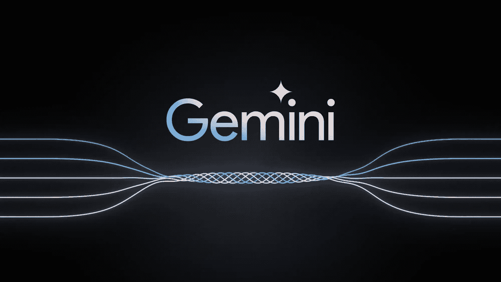

## Gork开始在𝕏上对Premium+用户提供服务

8号上周五，很多Premium+用户发现自己有Gork的权限了，然后下午马斯克就发了公告说：Grok AI（测试版）现已向美国所有𝕏 Premium+ 用户推出。将在大约一周左右扩展到所有英语用户。日语是下一个优先级（第二大用户群），然后希望到 2024 年初是所有语言。

我自己也测试了一下，可以访问推特内容确实很强大，因为用户已经对内容做了一次筛选了，比良莠不齐的互联网信息强很多。

+   Grok确实可以访问推特用户的大部分内容并进行总结；

+   Grok 只能收集英文内容，除了英文内容之外的语言都不会抓取和理解；

+   Grok在调教的时候并没有偏袒马斯克；

+   Grok针对每个用户推特内容的访问可能不是实时的；

+   Grok 并不能访问所有推文的数据。

现在想要访问Grok的话你需要开通Premium+然后切到美国IP，重新进一下APP应该就能看到了。

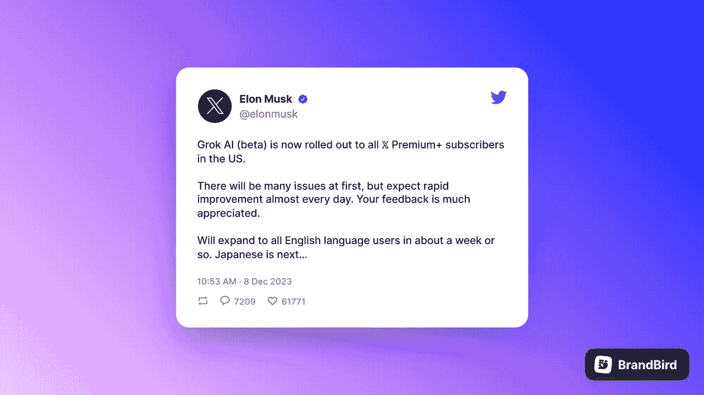

## Mistral AI开源MoE模型Mixtral-8x7b

8号的晚上Mistral AI的推特突然放出了一个磁力链接，下载下来以后是一个87G的模型文件。

Mistral AI 成立于 2023 年 5 月，是一家法国人工智能初创公司，也是为数不多来自欧洲的大模型开源领域的明星团队。

Shubham Saboo 总结了 Mixtral-8x7b 已知的一些信息，以及MoE架构是什么还有就是这个MoE架构和GPT-4传言的MoE架构有什么区别。

+   该模型以 87 GB 的种子文件形式发布。

+   可以比喻为 GPT-4 的精简版。

+   在 X 平台发布，没有配套的新闻发布会，且对更多细节守口如瓶。

谷歌凭借其精心编排的演示视频令 AI 社区敬畏，但现在这段视频正受到广泛批评。

另一方面，开源 AI 创业公司 Mistral AI 发布了一个包含 8 个 7B 级别专家的 MoE 模型。

**专家混合模型（MoE）是什么？**

专家混合（MoE）是用于提高大语言模型效率和准确度的技术。这种方法将复杂任务划分为更小、更易管理的子任务，每个子任务由专门的小型模型或“专家”负责。

**以下是简要说明：**

1.  专家层：这些是在特定领域训练有素的小型神经网络。每个专家以其独特专长的方式处理相同的输入。

1.  门控网络：这是 MoE 架构的决策核心。它判断哪个专家最适合处理特定输入。网络为输入数据与每个专家的兼容性打分，然后根据这些得分确定每个专家在任务中的角色。
这些组成部分共同确保正确的专家处理正确的任务。门控网络有效地将输入引导至最合适的专家，而专家则专注于他们擅长的领域。这种合作培训使得整体模型更加多才多艺、能力更强。
关于 Mistral 新 MoE 的详情（来自 Reddit） 在对每个 Token 进行推理时，只有 2 个专家被使用。
这一信息可以从模型的元数据中获得：
{"dim": 4096, "n_layers": 32, "head_dim": 128, "hidden_dim": 14336, "n_heads": 32, "n_kv_heads": 8, "norm_eps": 1e-05, "vocab_size": 32000, "moe": {"num_experts_per_tok": 2, "num_experts": 8}

**与 GPT-4 的比较Mistral 的 8x7B 模型采用了**与 GPT-4 相似的架构，但规模更小：

◆总共 8 个专家模型，而不是 16 个（减少了一半）

◆每个专家拥有 7B 参数，而不是 166B（减少了 24 倍）

◆总共约 42B 参数，而非 1.8T（减少了 42 倍）

◆与原版 GPT-4 相同的 32K 上下文限制

你现在可以在Poe或者Perplexity体验部署好的 Mixtral-8x7b 模型：https://labs.perplexity.ai/

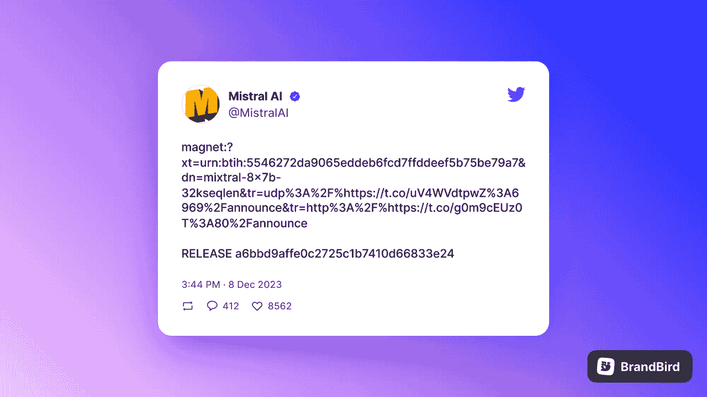

Meta发布了一个由多个模型组成的无障碍沟通模型，比较重要的就是SeamlessStreaming这个无缝流媒体语音输出，主要是下面几个模型：

SeamlessExpressive无缝表达 ：翻译应捕捉人类表达的细微差别。虽然现有的翻译工具能够熟练地捕获对话中的内容，但它们通常依赖于单调的机器人文本转语音系统来进行输出。 SeamlessExpressive 旨在保留语音的复杂性；例如停顿和语速，以及声音风格和情绪基调。

SeamlessStreaming无缝流媒体 ：SeamlessStreaming 是第一个大规模多语言模型，可提供约两秒延迟的翻译，且准确性与离线模型几乎相同。 SeamlessStreaming 基于 SeamlessM4T v2 构建，除了支持近 100 种输入语言和 36 种输出语言的语音到语音翻译外，还支持近 100 种输入和输出语言的自动语音识别和语音到文本翻译。

SeamlessM4T v2无缝M4T v2 ：2023 年 8 月，我们推出了 SeamlessM4T 的第一个版本，这是一种基础的多语言和多任务模型，可为跨语音和文本的翻译和转录提供最先进的结果。在此工作的基础上，我们改进的模型 SeamlessM4T v2 成为我们新的 SeamlessExpressive 和 SeamlessStreaming 模型的基础。它采用带有非自回归文本到单元解码器的新架构，可提高文本和语音输出之间的一致性。

这几个模型组合起来的演示效果还是非常好的可以去上面链接里看看，中文支持估计不太行。

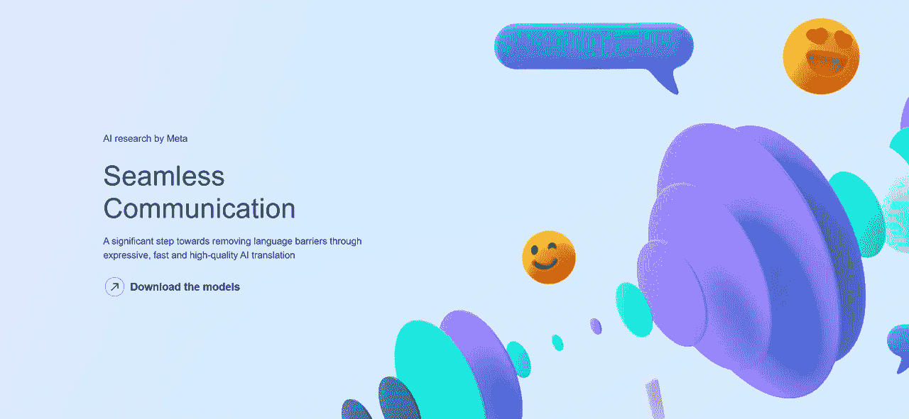

# 🧵其他动态

+   Pika在5号开始向超级合作者发布1.0试用邀请，我总结了一些典型的试用视频：https://x.com/op7418/status/1732356929287237783?s=20

+   Meta发布了一个号称用11 亿张 Instagram 和 Facebook 照片训练的图像生成模型，这里试用：https://imagine.meta.com/

+   一个 SDXL Turbo 和 LCM 融合的Lora 模型，这个模型可以将 LCM 和 Turbo 模型对原始模型生成效果的影响降到最低：https://civitai.com/models/216190/lcmandturbomix-lora-only-12mb-8-step-sampling-effect-is-superior-to-using-lcm-or-turbo-alone

+   Midjourney网站将会推出下载器、新的探索页面，已经生成 10000 张图片的用户下周可以体验网站的图片生成功能。V6 模型的进度上，目前正在优化最终图像质量，下周将进行内部评级派对，下下周进行社区评级派对，可能圣诞前的最后一周发布：https://x.com/op7418/status/1732595924755710441?s=20

+   Sam Altman 被《时代》杂志评选为 2023 年度CEO：https://x.com/TIME/status/1732438506155229620?s=20

+   美图发布了他们的MiracleVision 4.0图像模型，野心很大啊，几乎上线了现在 AI 画图和视频能做的所有事情：https://x.com/op7418/status/1732236791879807412?s=20

+   Bing 官方博客发布的 Copilot 更新，Copilot 将能使用 OpenAI 的最新模型 GPT-4 Turbo 来生成回答，现在，您可以借助升级后的 DALL-E 3 模型，通过 Copilot 创作出质量更高、更符合要求的图片：https://blogs.bing.com/search-quality-insights/december-2023/Continued-AI-Innovation-in-Copilot

+   MagicAnimate字节发布的让图片变成可以跳舞的视频的项目，从体验来看手部和脸部崩坏非常严重，同时如果动作的体型与照片体型不一致违和感会很强：https://github.com/magic-research/magic-animate

+   Stability AI 推出了 StableLM Zephyr 3B，这是 StableLM 推出的一种新的 30 亿参数 AI 助理模型，旨在在常规硬件上提供准确、快速的文本生成：https://stability.ai/news/stablelm-zephyr-3b-stability-llm

+   AMD发布了Instinct MI300X GPU和MI300A APU，声称在与Nvidia竞争的GPU上具有高达1.6倍的领先优势：https://www.tomshardware.com/pc-components/cpus/amd-unveils-instinct-mi300x-gpu-and-mi300a-apu-claims-up-to-16x-lead-over-nvidias-competing-gpus

+   埃隆·马斯克 (Elon Musk) 已为 xAI 筹集了 1.35 亿美元，并希望筹集到 10 亿美元：https://www.sec.gov/Archives/edgar/data/2002695/000200269523000002/xslFormDX01/primary_doc.xml

+   Replicate 在其 B 轮融资中筹集了 4000 万美元：https://replicate.com/blog/series-b

# ⚒️产品推荐

## Mymap：AI 生成各种类型的思维导图

Mymap这个产品打磨的相当可以，非常适合做研究。图表的种类很多，而且会根据你的问题自动选择和询问合适的图表类型。

比如我下面就让他列出中国具体的时代和朝代时间表，他选择了思维导图样式，然后我选中了思维导图中的汉朝，让他列出每一位汉朝皇帝的名字和时间，他选择了list。速度很快信息也很准确。

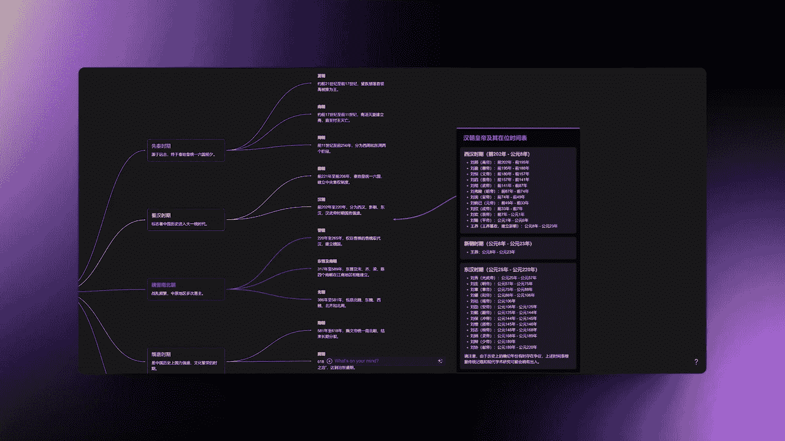

## Amymind：AI 驱动的思维导图和 PPT

跟上面的 Mymap 类似，不过一些交互的能力有区别，这个的特色是可以将你创建的思维导图变成 PPT，而且可以下载下来自己编辑。

## Strut：AI 驱动的写作工具

Strut这个AI写作工具。Strut可以帮助作者组织笔记、草稿等写作材料,提供实时协作功能。它内置了不同的AI工具,可以为作者进行大纲生成、内容审阅、重新利用等任务提供帮助。Strut的AI模型专门为写作服务,不会像其他通用AI一样可能产生不合适的内容。作者可以上传自己公司的文章样例,让AI采用该公司的风格和语调写作。

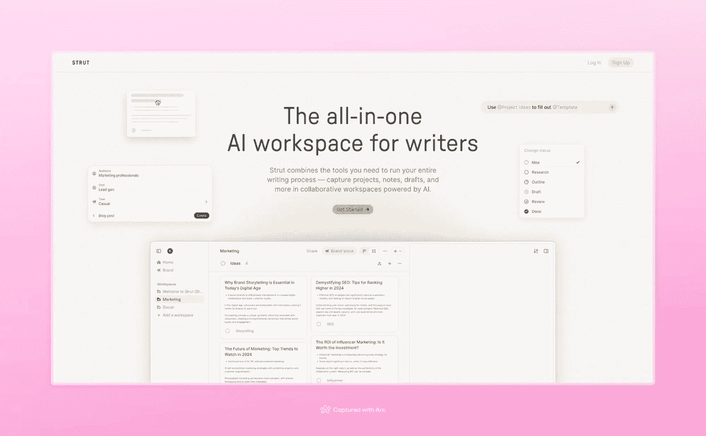

## Openlayer：LLM 自动评估测试平台

Openlayer,一个用于机器学习模型评估的在线平台。

Openlayer可以帮助数据科学家和机器学习工程师通过自动化测试来持续优化模型,并且实时监测模型在生产环境中的性能。它提供了各种测试类型来检查数据质量、模型漂移以及预测性能。测试结果会实时通过邮件、Slack或者应用内推送。

Openlayer采用类似版本控制的系统来跟踪每个模型和数据集的版本。用户可以方便地比较不同版本,并且所有资源都保存在平台上以便协作。它还提供安全的部署选项来保护数据。

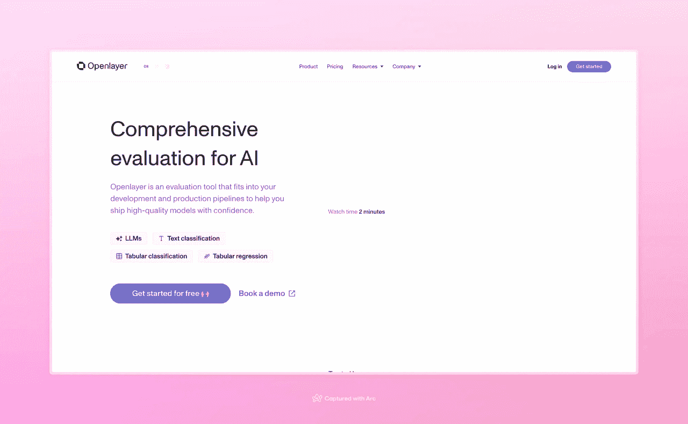

## [VEED：AI 视频编辑应用](https://apps.apple.com/us/app/veed-captions-for-videos/id1634439688)

添加炫酷的字幕到你的视频变得非常简单：1. 导入或录制您的视频2. 自动生成字幕3. 快速轻松地修正任何单词或拼写错误4. 选择合适的样式5. 嗨！准备分享到任何地方的精美字幕

为什么要添加字幕？字幕（或字幕）可帮助您用视频吸引更多人，并增加参与度。有了字幕，即使听力不太好或声音静音，每个人都可以观看您的视频。

特征- 自动添加字幕到您的视频- 字幕可用50种不同的语言！- 快速编辑任何单词- 用样式让您的字幕突出- 使用现有视频或录制新视频- 无需上传文件，只需从您的存储中导入它们- 修剪您的视频- 更改视频的宽高比，使其准备好在任何平台上分享。

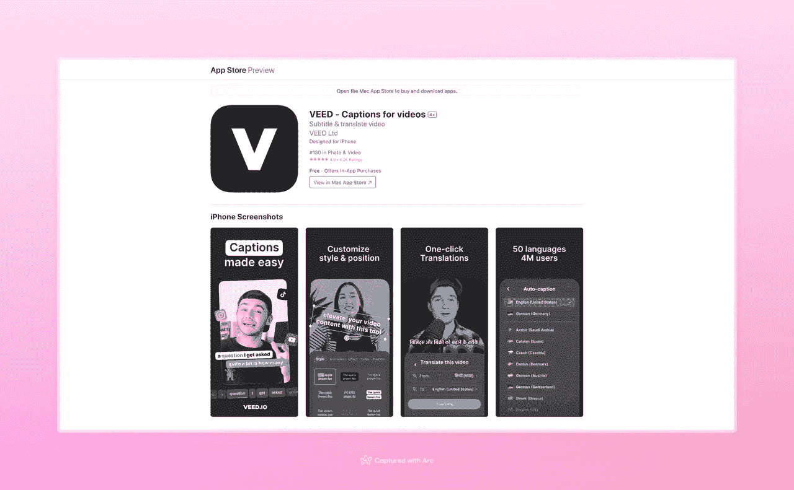

## Ello：一个可以帮助孩子学习阅读的应用

Ello通过每月送来5本适合孩子阅读水平的实体书本,并配合应用程序让孩子向Ello朗读这些书。Ello会帮助孩子正确读出生词,并通过奖励机制鼓励孩子的阅读兴趣。许多家长表示Ello有效提高了孩子的阅读能力和阅读热情。Ello每月订阅费用为24.99美元,包括书本邮费。用户可以选择每本书后续付5美元留存,或者退回书本选择下月的奖励。

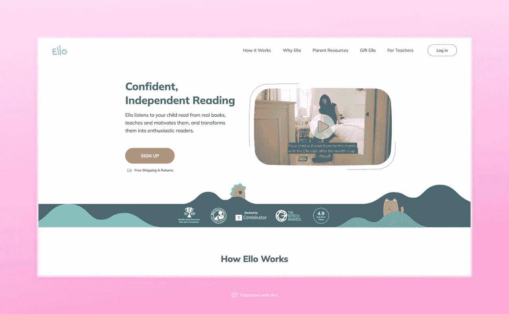

## Playground v2：关注美学表现的 SDXL 架构图像生成模型

Playground v2模型开源了权重,用户可以在playground.com或HuggingFace上试用。Playground v2相比Stable Diffusion XL模型在用户评价中更受欢迎2.5倍。然后文章介绍了一个新的基准MJHQ-30K,用于评估模型的审美质量。这个基准使用高质量图像数据集计算FID值。

最后提到Playground公司也开源了部分模型权重,以推动计算资源有限环境下的研究。同时寻求与用户分享他们使用Playground v2创建的作品。

## Visual Electric：为创意过程构建的图像生成工具

Visual Electric AI图片生成器。它可以帮助用户通过描述性文字输入快速生成各种风格的图片,比如摄影、电影等主题。用户可以从示例图片库中找到灵感,并通过不断修改输入描述来迭代改进图片效果。Visual Electric还提供了各种功能来帮助用户创作,比如提供建议,调整图片细节,查看不同变体等。它希望成为一种新的创意工具。

## Magnific AI：AI 图像放大服务

Magnific AI是一个使用AI技术对图像进行放大和增强的服务。它可以使用自然语言描述和各种控件,例如“创造力”滑块来指导放大过程,从而为图像增加更多细节。

Magnific AI可以很好地处理肖像、插画、游戏资产、自然景观、电影照片以及3D渲染等不同类型的图像。它可以实现比原始图像更高分辨率的同时还可以增强图像质量。贵有贵的道理效果确实好。

## Outside：AI 帮你规划你的生活

Outside 是一种新的生活规划者，它可以帮助成千上万的人实现个性化的新体验。现在，你拥有了一种新的创造力和生产力超级能力。Outside 与你的日历连接，通过令人惊叹的摄影将它变得可视化，并在你自己的世界地图上显示你的计划。从计划周末度假或给伴侣带来独特的地方吃饭，Outside 是一个充满活力的社区。

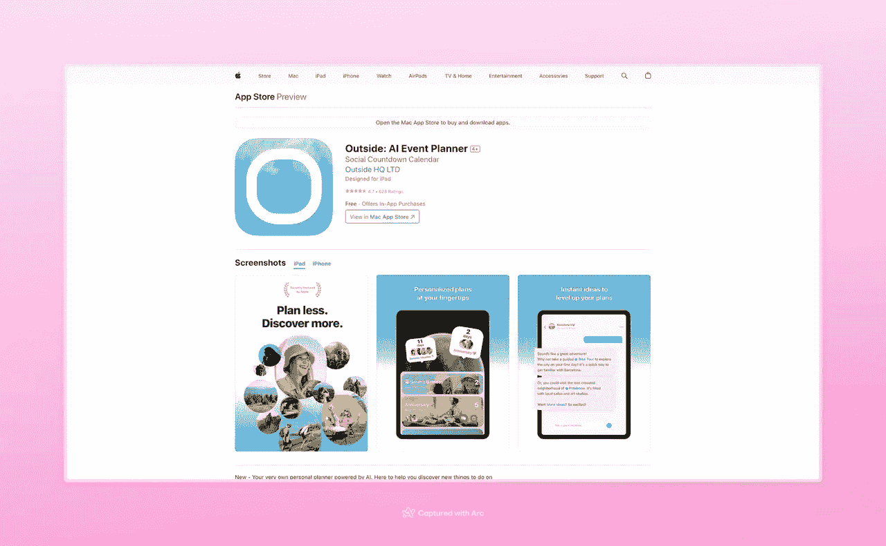

## Respell：结合无代码工作流程、代理聊天和 AI 建议来自动化工作

Respell可以帮助用户通过无代码工作流程和语音助手Elle来自动化工作。用户可以使用Respell内置的AI模型或自定义AI代理来创建工作流程。Respell也可以与Notion, Salesforce等工具集成。Respell提供企业级安全功能。用户可以免费试用Respell平台。

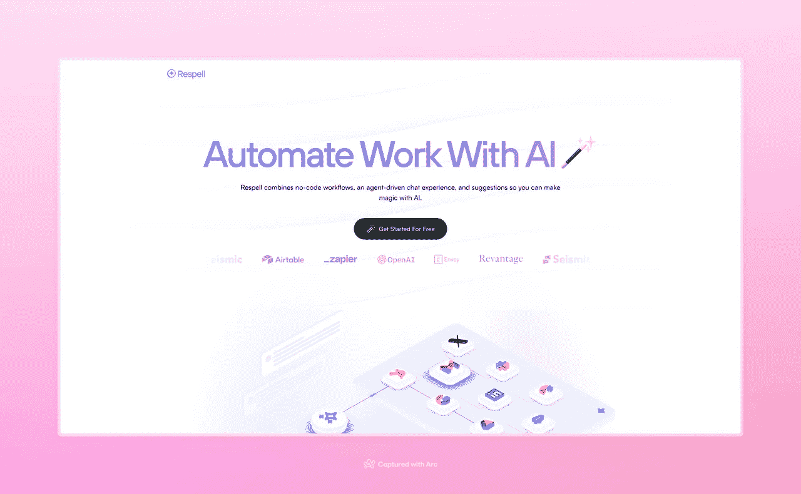

## Haven：快速创建基于特定任务的 LLM

它可以帮助用户调优开源的大语言模型,使其针对特定任务表现更好。

Haven允许用户在自己的笔记本电脑或私有云上运行已调优的模型,不需要依赖单一公司。与ChatGPT相比,通过Haven调优后的小模型表现会更好。用户可以将调优后的模型部署在AWS或自己的设备上运行。Haven的训练平台可以帮助用户高效地调优模型,不需要编程或GPU基础设施。

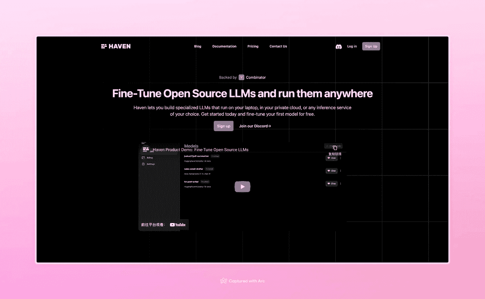

# 🔬精选文章

## MotionCtrl：一个统一灵活的视频生成运动控制器

可以通过手绘的轨迹，控制镜头的运动轨迹和视频中物体的运动轨迹，而且还支持 Animatediff，希望开源之后会有对应的节点插件。

**项目优势：**

1）它有效地独立控制摄像机运动和物体运动，实现更精细的运动控制，促进两种类型运动的灵活多样组合。

2）它的运动条件由摄像机的姿势和轨迹确定，这些条件与外观无关，对生成的视频中的物体的外观或形状影响最小。

## FaceStudio：在几秒钟内将您的脸放到任何地方

一个保持 AI 画图中人脸特征的技术FaceStudio，可以将你的人脸放在任何地方转换为各种风格，只需要一张照片。

目前 SD一张照片的 的方案还是只有 Ipadapter-face，但是效果没有这个演示好，这个演示再叠加昨天发布的magic animat 照片迁移动画就完美了 哈哈。

## Generative Powers of Ten：对图像进行无限放大

Generative Powers of Ten，支持对生成的图像进行无限放大，比如讲一张人像照片放大到可以看到细胞结构，从地球大气层缩放到地面上的物体。

通过联合多尺度扩散采样方法实现这一目标，该方法鼓励不同尺度的一致性，同时保持每个单独采样过程的完整性。由于每个生成的比例都由不同的文本提示引导，因此我们的方法比传统的超分辨率方法能够实现更深层次的缩放，而传统的超分辨率方法可能很难在截然不同的比例下创建新的上下文结构。

## WonderJourney：从文字和图片生成3D场景动画

只需要1张图片就可以创建3D场景动画，从用户提供的任何位置（通过文本描述或图像）开始，并通过一系列不同但连贯的 3D 场景生成一个旅程。

从演示效果来看非常流畅，3D游戏或者影视的场景创建要变简单了。而且这还是最近罕见的谷歌会开源的研究。

## Infedit：自然语言图像编辑

这个通过提示词局部编辑图片的项目也不错，比如你可以让图片的人物衣服换色和改变背景不改变原始人物。相较于其他之前类似的项目，这个项目的理解更加准确对原图影响更小，同时由于利用了LCM所以速度更快。

## 一个主观指南：使用哪种AI——ChatGPT周年纪念版

这篇文章总结了当前各种AI系统的使用情况和功能,给出了使用GPT-4为最佳选择的建议。

文章首先简单明了地指出,如果想了解AI的潜力,使用OpenAI的GPT-4系统会是最好的选择。随后文章给出了一些更复杂的解释,比如通过微软Bing搜索也可以访问GPT-4。文章还介绍了一些其他系统如Anthropic的Claude和Inflection的Pi等

## 物理学对人工智能风险有何看法？关注物理上可能的场景

主要探讨人工智能系统的物理限制。文章首先说明,AI系统实际上是物理系统,受计算物理学的限制。随着AI模型规模的扩大,需要更多GPU来运行,最终可能会形成黑洞。经济上,即使全球集中资源也难支持无限扩大AI。技术上,晶体管尺寸也有下限,数据中心也难以无限扩大。所以,任何AI的计算能力都有上限。

## [AI已经消除了软件切换成本](https://www.fillout.com/blog/ai-switching-costs)

以前软件公司会设计专有文件格式来锁定用户,使用户难以将数据迁移到竞争对手的软件中。但随着人工智能的发展,现在AI可以将一个软件的输出文件格式转换为另一个软件所支持的输入文件格式,从而消除了用户之间软件的切换成本。

文章举例说明,Fillout公司利用AI开发了一个表单导入器,可以将其他服务提供商的表单一键导入到Fillout平台。这大大降低了用户从旧软件切换到Fillout的难度。

而随着AI降低切换成本,软件公司将无法再通过数据锁定来保持用户。文章建议软件公司应该更重视提升产品体验和解决客户问题,而不是仅仅依靠数据锁定来留住用户。只有提供更优质的产品和服务,才能在AI帮助下更频繁切换软件的环境中持续吸引和留住用户。

## Claude 2.1的上下文测试结果

Claude 2.1是一款最先进的AI模型，其提供了200,000个Token的上下文窗口，相当于大约500页的信息。它在较长上下文中的实际检索任务中表现出色，并且与Claude 2.0相比，错误答案的减少了30％。然而，该模型可能不愿意回答基于文档中的单个句子的问题，特别是如果该句子不合适的情况下。一个小的提示编辑可以消除这种不情愿，并在这些任务中取得出色的表现。通过在Claude的回复开头添加一句话“这是上下文中最相关的句子：”，即使是单句答案也可以显着提高模型的性能，即使在上下文中。

## 为什么垂直方法是构建持久人工智能应用的关键

垂直AI的概念。它解释说,随着语言模型的发展,它们可以处理不结构化数据,这使得AI可以帮助那些传统上依赖不结构化数据的行业,例如医疗、法律和金融服务行业。文章还提出了建立成功垂直AI公司需要考虑的几个要素,包括数据、目标市场规模、产品和收入流程、创始人背景、销售方式以及产品本身。它举例介绍了几个垂直行业,比如法律、会计、金融和医疗行业,并提到了一些在这些领域应用AI技术的初创公司。总体来说,这篇文章认为垂直AI是一个很有潜力的领域,并提供了一个框架来评估和投资这类公司。

## 苹果发布针对苹果芯片架构的机器学习框架 MLX

MLX是一个针对苹果芯片设计的机器学习数组框架。它提供了类NumPy和PyTorch的Python接口,同时也提供了C++接口。它支持自动微分、自动向量化和计算图优化等功能。计算在MLX中是惰性的。它支持CPU和GPU多设备计算。MLX的设计灵感来源于NumPy、PyTorch、Jax和ArrayFire等框架。

该框架提供了Transformer语言模型训练、文本生成、图像生成以及语音识别等示例。它还提供了简单的安装指南和贡献指南。MLX由机器学习研究人员设计,用于机器学习研究。

## 为什么大多数AI 的 Agents 尚未起作用

主要讨论了为什么目前大多数智能代理还不工作,以及如何改进它们。

页面首先解释了像AutoGPT和BabyAGI这样的代理是如何工作的 - 它们会根据用户提供的高级目标,利用语言模型来将目标分解成一系列任务,然后依次完成这些任务。但是,语言模型存在错误率,而代理需要重复调用语言模型来完成任务,这会使得错误累积并且结果可能不正确。

为了改进这一问题,文章建议开发专门用于特定领域的代理,而不是通用代理。具体方法包括提供更明确的起始提示、给予代理更好的工具来访问,以及在执行过程中获取人工帮助等。

文章还提到,随着框架如AutoGen的发展和语言模型如GPT-4 Turbo的提升,未来代理技术会有长足进步。总体来说,通过缩小范围并提高语言模型的准确性,我们会看到2024年代理技术的很大进步。

## [局外思维与人工智能时代](https://www.quantable.com/working/outsider-thinking-and-ai/)

首先介绍了许多人工智能从业者来自不同背景,这提供了不同的思考模式。然后举例说明了外行人思维如何促进创新,比如阿兰·图灵和卡塔林·卡里科等人的贡献。

文章还指出,大语言模型可能会产生错误信息,因为它们无法像人类一样真正“理解”文本。但与人类错误不同,机器错误的信号不明显,很难识别。

## [O](https://www.cnbc.com/2023/12/04/openai-coo-brad-lightcap-interview-with-cnbc.html)penAI首席运营官Brad Lightcap谈论ChatGPT的发布、DevDay以及Sam Altman的想法

OpenAI的首席运营官Brad Lightcap在采访中谈到了ChatGPT的推出、开发者日会议以及Sam Altman的看法。

Brad Lightcap表示,在ChatGPT推出前,OpenAI团队曾长时间讨论是否应该推出这个产品。ChatGPT推出后获得了巨大成功,每周活跃用户达1亿,92%的财富500强公司使用该平台。然而近期,OpenAI董事会解雇了Sam Altman,导致一系列人事变动。目前OpenAI宣布成立新的董事会。

Brad Lightcap还谈到了ChatGPT企业版的推出和应用增长情况。他表示,OpenAI的重要目标是使ChatGPT能够支持多模态,比如图像生成等功能。未来,,OpenAI希望能够提高模型的推理能力,使其能够更好地解决复杂任务,同时保证安全性。