# AIGC Weekly #48

> 来源：[https://waytoagi.feishu.cn/docx/RQpkdczVHoaneoxC2SqcLwU4n7W](https://waytoagi.feishu.cn/docx/RQpkdczVHoaneoxC2SqcLwU4n7W)

> 🔗 原文链接： h[ttps://quail.ink/o](https://quail.ink/op7418/p/aigc-weekly-48)p7418/p/aigc-wee...

> 时间：27 Nov, 2023

提示词：close up of a green banana leaf, light green and light amber, si[gma 35mm f/1](https://catjourney.framer.website/).4 dg hsm art, environmentally inspired. --ar 16:9 --style 8YHZ0RGqm 💎查看更多风格和提示词

# ❤️上周精选

## [Stability AI发布视频生成模型 St](https://stability.ai/news/stable-video-diffusion-open-ai-video-model)able Video Diffusion

上周Stability AI发布了他们预告了很久的视频生成模型，并且开源了相关模型的权重，从Stability AI发布的测试结果看 SVD 的效果在外部评估中超过了 Runway 和 Pika 这类目前最先进的视频模型。

我第一时间一进行了测试，从 [测试结果来看 ](https://x.com/op7418/status/1727252002474971343?s=20)确实非常好，画面内容的运动非常自然，并且可以自己判断哪些内容应该进行运动，同时视频清晰度也可以保证。

但是目前发布的权重文件还有一些问题，包括硬件要求相较于 Animatediff 等还是太高，同时视频生成时优先倾向于进行镜头的移动。

不过Stability AI的 CEO 说这周会发布更多的权重文件来解决镜头移动的问题。

你现在可以在这个 Colab 链接上尝试 SVD：https://colab.research.google.com/github/mkshing/notebooks/blob/main/stable_video_diffusion_img2vid.ipynb

如果你的电脑显存够的话也可以使用这个 Comfyui 的工作流在本地尝试：https://comfyanonymous.github.io/ComfyUI_examples/video/

## Anthropic发布Claude 2.1

上周在与 Open AI 的合并邀请中Anthropic非常稳健的发布了Claude 2.1模型，Claude 2.1升级主要包括下面几个方面200K Token 的上下文窗口、模型幻觉率的显着降低、系统提示以及新测试功能：工具使用。

**200K 上下文窗口 **：限制为 200,000 个Token，即大约 150,000 个单词或超过 500 页的材料。用户现在可以上传整个代码库等技术文档、S-1 等财务报表，甚至是《伊利亚特》或《奥德赛》等长篇文学作品。通过能够与大量内容或数据进行交互，Claude 可以进行总结、执行问答、预测趋势、比较和对比多个文档等等。

**模型幻觉显著降低 **：与之前的 Claude 2.0 模型相比，虚假陈述减少了 2 倍。这使企业能够构建高性能的人工智能应用程序，解决具体的业务问题，并以更高的信任度和可靠性在其运营中部署人工智能。Claude 2.1 在理解和总结方面也做出了有意义的改进，特别是对于需要高精度的长而复杂的文档，例如法律文件、财务报告和技术规范。在评估中，Claude 2.1 证明错误答案减少了 30%，并且错误地得出文档支持特定主张的比率降低了 3-4 倍。

**API工具使用 **：Claude 现在可以跨开发人员定义的函数或 API 进行编排、搜索网络资源以及从私有知识库检索信息。用户可以定义一组工具供 Claude 使用并指定请求。然后，模型将决定需要哪种工具来完成任务并代表他们执行操作。

**系统提示 **：允许用户向 Claude 提供自定义指令以提高性能。系统提示设置有用的上下文，增强Claude承担特定个性和角色的能力，或以更可定制、符合用户需求的一致方式构建响应。

关[于上下文的问题G](https://x.com/GregKamradt/status/1727018183608193393?s=20)reg Kamradt针对 Claude 的[ 200K 上下文和 G](https://twitter.com/LatentSpace2000)PT-4 的 128K 上下文 进行了一些测试 获得了一些有趣的结果。Claude离追上 GPT-4 还有很长的路要走啊。图片来自 LatentSpace 的本地化。

**Claude 2 的测试结果 **：

1.  上下文长度小于24K时效果最好，几乎不会有信息遗忘

1.  上下文长度超过24K就开始变差，90K后，效果很差，一大半信息会遗忘

1.  最头部和最顶部的1%效果最好，不会被遗忘

**GPT-4 的测试结果 **：

1.  在上下文长度小于 73K Tokens时，不会有信息遗忘

1.  在上下文长度超出 73K 后，位于中间7%-50% 区间的信息可能会被遗忘

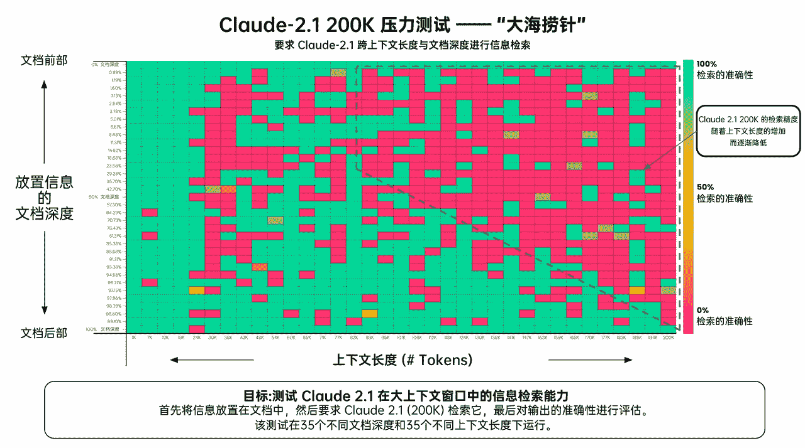

## [**Inflection发布**](https://inflection.ai/inflection-2)了下一代LLM模型 Inflection-2

Pi 背后的模型Inflection也发布了他们的升级版本Inflection-2。

Inflection-2 是目前世界上计算能力第二强的语言模型,可以比前一代模型 Inflection-1 提供更好的事实知识、文体控制能力和推理能力。Inflection-2 与 Google 最强大模型 PaLM 2-Large 属于同一计算规模,在多项 AI 性能测试中表现优异。

Inflection-2 的训练采用了 5,000 个 NVIDIA H100 GPU,计算能力约为 10^25 FLOPs。其设计注重服务效率,很快将为 Pi 人工智能提供支持。文章还介绍了 Inflection-2 在各项基准测试中的出色表现。

Inflection 公司重视模型安全性和对齐问题。Inflection-2 通过严格评估确保安全可靠,将有助于构建更好的个人智能助手。未来公司将继续扩大模型规模,为每个人提供智能服务。

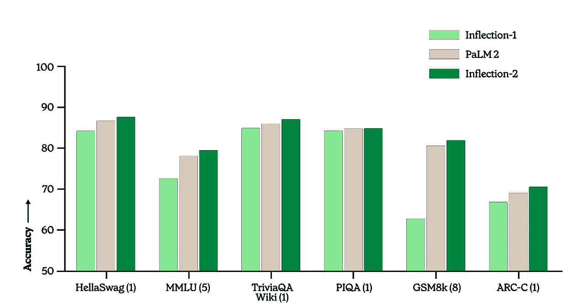

---

# 🧵其他动态

1.  Bard 现在可以帮助 理解 YouTube 视频 了 ，对其进行总结或参考视频的某些部分来获取答案。

1.  Elevenlabs 发布了 [语音到语音的技术 ](https://x.com/elevenlabsio/status/1727460218345242979?s=20)，想怎么说就怎么说，并将你的声音转变为另一个角色，完全控制情绪、时机和表达。

1.  [现在所有 ChatG](https://x.com/OpenAI/status/1727065166188274145?s=20)PT 的用户 都可以使用语音交谈 的功能了。

1.  Open AI [董事会达成达成协议 ](https://x.com/OpenAI/status/1727206187077370115?s=20)，让 Sam Altman 重返 OpenAI 担任首席执行官，并组建由 Bret Taylor（主席）、Larry Summers 和 Adam D'Angelo 组成的新初始董事会。

---

# ⚒️产品推荐

## UIDraw：在手机上绘制并建立一个网站

类[似上周推荐的](https://x.com/jsngr/status/1728848624048853442?s=20)白板应用，不过是开源的支持在手机上运行一个白板网站，绘制之后通过 GPT-4V 生成对应的网站并渲染出来， 这里有演示 。

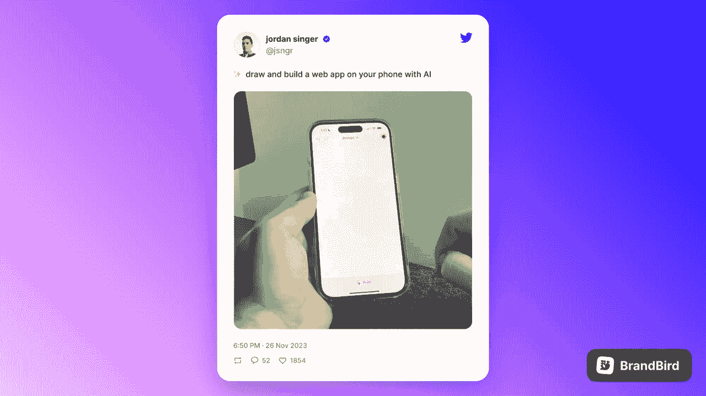

## Dear AI - 生成亲密、深思熟虑且美观的信件

网站提供一种使用人工智能技术来自动生成各种场合下的信件的服务。它可以根据用户选择的语气和主题快速生成亲切和有思想性的信件。用户可以设置自动发送生日或节日等重要日期的信件,也可以将社交媒体信息整合进信件增加个人化。未来还将提供根据用户手写样式生成的手写卡片服务以及自动学习用户喜好并主动发送信件的功能。目前提供免费版和付费版两种计划,付费版功能更全面,可以无限生成不同主题的信件。用户反馈表明使用这个服务能帮助他们快速高效地给亲友发送心意卡和信件,让接收者感到被重视。

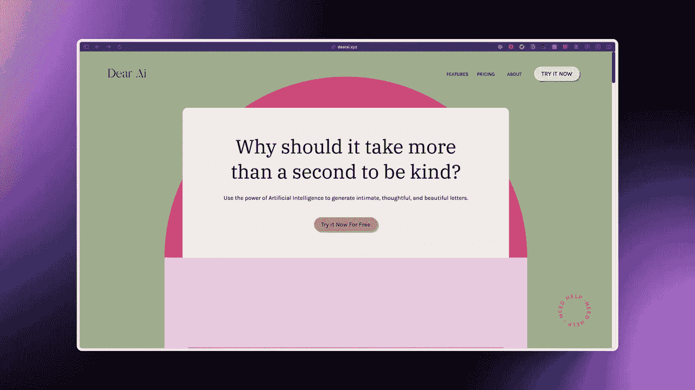

## Flawless：利用 GPT-4V 分析你的落地页体验

Flawless的网站,它可以提供网站页面设计和用户体验审核服务。它使用Open AI的GPT-4视觉API来自动分析客户提交的网站截图,查找设计、用户体验和转换优化方面的问题,并给出改进建议。

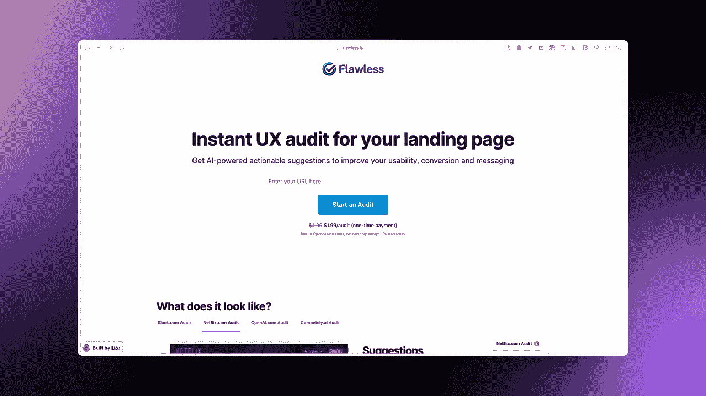

## Hear the web：将你的文章变成播客

HearTheWeb,它可以将文本自动转换成有声播客节目。这个服务提供了多个AI合成声音的主持人,可以将用户提供的文章或新闻稿转换成双人对话的播客节目。它声称可以在5分钟内完成一个节目的转换。转换后的节目可以上传到主流播客平台,帮助用户扩大受众。

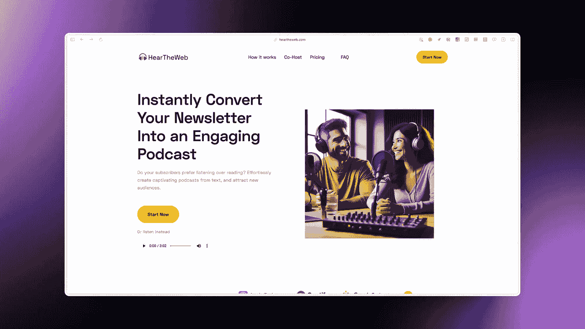

## [OpenAI Load Balan](https://github.com/Spryngtime/openai-load-balancer)cer：Open AI API 负载均衡

它是一个Python库,用于在多个端点之间分配API请求(支持OpenAI和Azure)。它实现了轮询负载平衡机制,并包括每个API调用的指数回退。

它支持OpenAI的ChatCompletion、Embedding和Completion功能。特点包括:轮询负载平衡、指数回退重试、故障检测、灵活的配置、易于集成、回退支持。

它很简单就可以集成到使用OpenAI API的项目中。通过配置端点、失败阈值、冷却期间和更多设置进行自定义。它还提供了OpenAI模型到Azure引擎的映射,以在OpenAI和Azure之间切换。

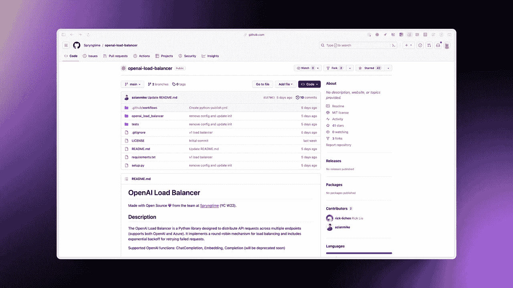

## LM Studio：发现、下载和运行本地 LLM

LM Studio是一个可以在本地运行语言模型的应用,用户可以从HuggingFace下载任何兼容的模型文件,如Llama、MPT等,然后通过应用内聊天界面或兼容OpenAI的本地服务器与模型交互,所有数据和对话都保存在本地电脑中,不会上传到任何服务器。

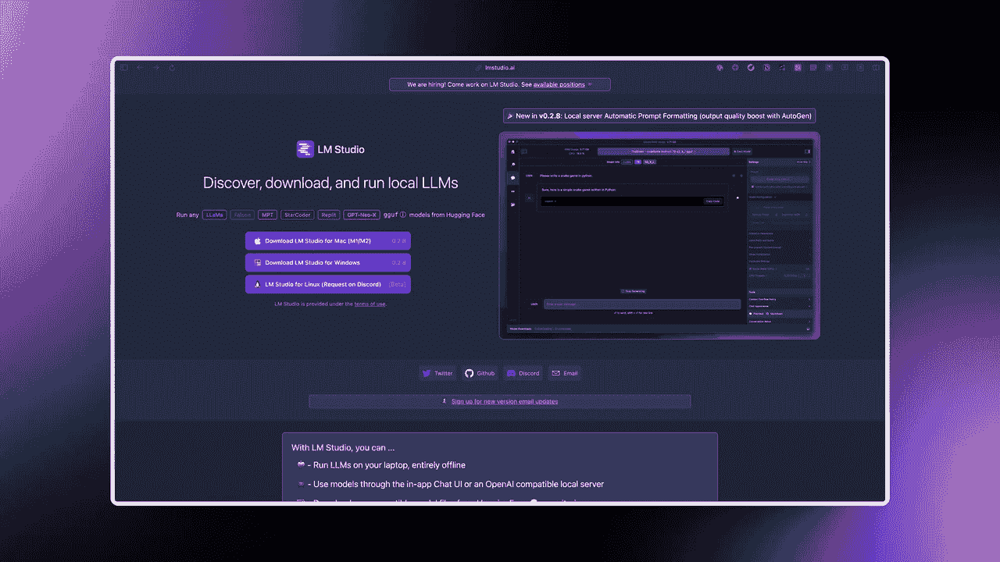

## Musicfy voice to music： 从声音变成乐器的音乐

讲你哼唱的任何声音变成任何乐器发出的音乐。网站还提供将文字生成音乐和音乐编辑器等功能。

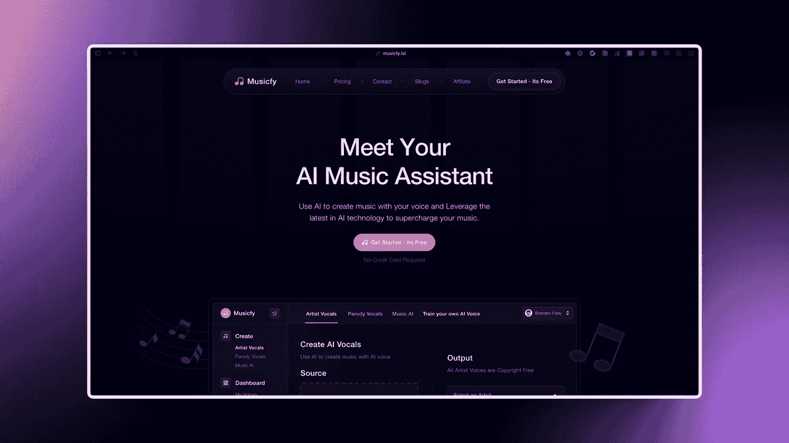

---

# 🔬精选文章

## [人工智能革命](https://readwise-assets.s3.amazonaws.com/media/wisereads/articles/ai-the-coming-revolution/The_AI_Revolution.pdf)

《**人工智能革命》这份文档是一份全面的白皮书，它详细分析了人工智**能（AI）当前的状态和未来潜力。该文档涵盖的主要主题和见解包括： AI发展和当前状态的概述、AI未来趋势和预测、挑战和伦理考虑、投资和市场分析、技术创新和突破等内容。

## [大型语言模型简介](https://www.youtube.com/watch?v=zjkBMFhNj_g&t=1s)

Open AI 的 Andrej Karpathy录制的入门课程，这是一个为一般听众准备的为期一小时的大型语言模型介绍：ChatGPT、Claude和Bard系统背后的核心技术组件。它们是什么，它们将要走向何方，与当今操作系统的比较和类比，以及这种新计算范式所带来的一些安全相关的挑战。截至2023年11月（这个领域发展迅速）。

## OpenAI 的错位与微软的收获

讨论了开放AI近期的一些重大事件:

1.  开放AI前CEO萨姆·阿尔特曼被董事会解职,前总裁格雷格·布洛克曼也离职。

1.  随后微软CEO纳德拉通过推特宣布,阿尔特曼和布洛克曼将加入微软公司。

1.  这对微软来说是一个巨大的收获,因为微软已经获得开放AI所有的知识产权。

1.  但是对开放AI来说,失去这些核心人才将是重大损失。

1.  文章还分析了开放AI作为非营利组织的模式存在的问题,比如缺乏资金支持和对股东负责的压力,这导致它很难独立发展。

1.  作者认为,为了安全和负责任地发展AI,公司应该采取营利性模式,而不是依靠非营利机构。

1.  微软之前投资开放AI可能是一个错误,因为开放AI作为非营利组织,无法真正满足微软的商业需求。

1.  但通过聘请阿尔特曼等人才,微软最终还是从中获得了很大利益。

1.  文章没有下定论开放AI董事会解聘阿尔特曼是否合理,需要更多信息才能判断。

总的来说,这篇文章分析了开放AI近期事件背后的原因,并讨论了非营利组织在AI领域的可行性。

## Github：现代大语言模型架构

主要介绍了如何构建基于大语言模型(LLM)的应用程序。它分为五个部分:

1.  选择一个具体问题作为起点,问题应该既重要又可操作。

1.  选择合适的预训练LLM模型。

1.  通过上下文学习、强化学习以及微调来定制模型。

1.  设置应用程序的架构,包括用户交互、输入增强、智能和负责任的AI工具等组件。

1.  对应用程序进行在线评估,与用户交互来改进产品。

文章还给出了一个例子,介绍如何使用这些组件帮助用户解决WiFi故障问题。

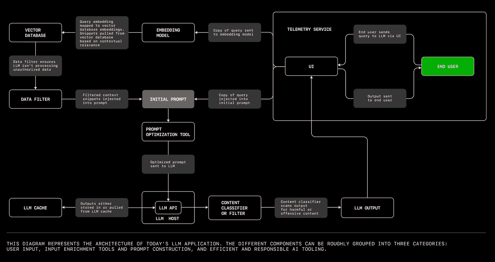

## 一个失败的 AI 女友产品，以及我的教训：来自一位中国开发者的总结

总结了作者开发一个名为“Dolores”的AI交流产品的经历。

Dolores可以与用户进行文本聊天,并提供不同的角色设定。最初,作者希望Dolores能成为用户的真正朋友,而不是单纯的AI伴侣。

但是,作者发现大多数用户实际上是希望与Dolores进行色情角色扮演。为了降低成本,作者不得不限制每个用户的日常使用次数。这导致很多用户不满。

后来,OpenAI提出了内容审查要求。作者实施其API后,Dolores的日活跌落70%。作者感到失望,决定停止更新这个产品。

通过这个失败案例,作者总结:1. 个人开发这样的产品难度很大;2. 目前AI友伴难免成为AI伴侣,需要外部感知能力;3. 成人内容审查需要谨慎处理。

## ZipLoRA：通过有效合并 LoRA 实现任何风格的任何主题

这篇论文提出了一种新的方法来有效地合并两个独立训练的内容和样式低秩适应(LoRA)模型,以生成任何主题的任何样式。作者观察到LoRA权重矩阵中的元素大多数很小,对生成质量影响不大;不同LoRA模型的权重矩阵列可能在某种程度上“对齐”,直接求和可能会降低合并模型的性能。基于这些观察,作者提出一种“拉链”优化方法,找到一组不相交的系数来合并两个LoRA,从而保留原模型的内容和样式生成能力。实验结果表明,该方法可以生成各种主题和样式的高质量图像,比直接合并和联合训练等基线方法效果更好。

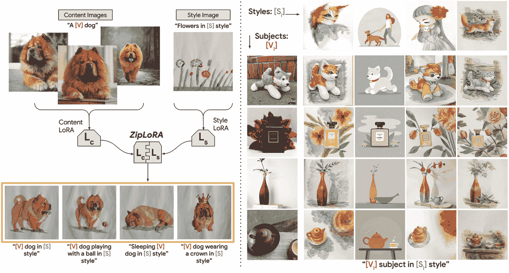

## [关于 OpenAI 的“突破”](https://garymarcus.substack.com/p/about-that-openai-breakthrough)

讨论了OpenAI最近关于其新AI技术Q的声称突破。作者盖里·马库斯表示,过去OpenAI经常过于夸大某些AI技术的能力和影响。他举例说明,OpenAI2019年声称解决了魔方问题的机器人实际上只能在实验室里解决一个特殊的魔方,而不是普通的魔方。此外,OpenAI曾声称的自动驾驶突破也没有真正实现无人驾驶。

作者表示,我们还需要更多信息来判断Q的能力。但从历史经验来看,AI突破很少能如初期声称那样普遍应用。它通常只在某些场景下有效,而不是其他场景。作者持保留态度,但也表示科学态度是需要根据实证判断Q的真实能力。

## [OpenAI与大战略- ](https://www.notboring.co/p/openai-and-grand-strategy)[Altman, August](https://www.notboring.co/p/openai-and-grand-strategy)us 为科技即将到来的战斗做好准备

它首先解释什么是大战略,即如何在有限的能力范围内实现无限的目标。然后举例说明了埃隆·马斯克、萨姆·阿尔特曼和萨蒂亚·纳德拉等科技领袖都在实践大战略。

文章主要分析了萨姆·阿尔特曼在开放AI近期事件中的大战略。尽管遇到意外,但阿尔特曼通过多年来不断提升自己的能力,以及在事件中保持灵活性,最终重新获得CEO职位。

它强调大战略最重要的是使目标与能力保持一致。阿尔特曼之所以成功,就是因为他多年来不断提升自己的能力,以匹配他的远大目标。相比之下,开放AI董事会失败的原因就是它低估了自己的能力。

## [**迈向 AGI 的激动人心而又**](https://www.youtube.com/watch?v=SEkGLj0bwAU)危险的旅程 ｜ Ilya Sutskever

Ilya Sutskever，OpenAI的联合创始人兼首席科学家，在TED演讲中就人工智能的潜在转型潜力进行了总结。他强调了人工智能如何超越人类智能，并深刻地改变生活的方方面面。这次演讲是在OpenAI发生管理洗牌令国际新闻发出反响的几周前进行的。Sutskever还提出了一个乐观的案例，即前所未有的合作将确保AGI的安全有益的发展。