# AIGC Weekly #47

> 来源：[https://waytoagi.feishu.cn/docx/W968d0rvxocUeKxQ6BUccZeUnxb](https://waytoagi.feishu.cn/docx/W968d0rvxocUeKxQ6BUccZeUnxb)

> 🔗 原文链接： h[ttps://quail.ink/o](https://quail.ink/op7418/p/aigc-weekly-47-ai)p7418/p/aigc-wee...

> 发布时间：20 Nov, 2023

提示词：abstract, simple, colorful, neon, flow, smooth, sharp, focused, glass layers, lines, rainbow neon, white scen[**e, colorful **](https://catjourney.framer.website/)background, rectangle cinema4d, 4K, canon EOS 5D MARK IV, mega realistic, ultra high --style 1GWx8ZOMggw52DjpNkqzUPm4y --ar 16:9 💎查看更多风格和提示词

## ❤️上周精选

## Open AI CEO被解雇

上周六发生的最大的事情应该就是Open AI CEO Sam Altman董事会解雇的事情了，从这几天发酵内容的还原来看主要原因是首席科学家llya为首的一部分人对Sam激进的公司运营和产品策略不满，认为不应该急于发布产品而应该好好打磨模型的安全性。于是说服董事会的另外三位独立董事罢免了Sam的CEO职位，Open AI的董事长兼总裁也在得到这一消息后提出了辞职。

之后这一事件不断发酵，经历了Open AI众多员工辞职支持Sam，微软要求董事会重新聘请Sam担任CEO，然后谈判破裂Sam拒绝担任CEO等一系列事件。

---

下面大致介绍一下这次事件中的几个主要角色和事件的时间线发展：

### 主要角色

**Sam Altman **：Open AI前CEO、前董事会成员，社交媒体链接：https://twitter.com/sama

**Greg Brockman **：Open AI前董事长兼总裁、前董事会成员，社交媒体链接：https://twitter.com/gdb

**llya Sutskever **：Open AI首席科学家、董事会成员，社交媒体链接：https://twitter.com/ilyasut

**Adam D'Angelo **：Open AI 董事会成员，POE CEO，Quora前CEO，FaceBook前首席技术官，社交媒体链接：https://twitter.com/adamdangelo

**Teasha Mcauley **：Open AI 董事会成员，Feelow Robots的联合创始人，演员Jouseph的妻子，社交媒体链接：https://twitter.com/TashaMcCauley

**Helen Toner **：Open AI 董事会成员，乔治城大学安全与新兴技术中心战略和基础基金主任，社交媒体链接：https://twitter.com/hlntnr

**Mira Murati **：Open AI CTO，Open AI 代理CEO，曾经在特斯拉担任高级产品经理，社交媒体链接：https://twitter.com/miramurati

**Emmett Shear **：Twitch前CEO，Open AI 现任 CEO，社交媒体链接：https://twitter.com/eshear

### 事件时间线

主要来自于推特用户 [**Ate-a-Pi **](https://twitter.com/8teAPi)整理的内容，有部分补充，以下时间都是太平洋时间，事件进度截至太平洋时间11.20 00:30.

+   11月2日：当团队展示下一个重大进步时，Sam在场。在OpenAI的历史上，之前已经有三次，最近一次是在GPT-4上，他们推开了无知的面纱，推进了发现的边界。当他观看最新的进展时，他已经在计划下一步动作：必须筹集的资金，必须计划的资源。

+   11月4日 - Ilya感到不安。他们已经达到了一个令人担忧的自主性阈值，而对齐团队仍然只是增加能力而不是情感，真正对人类的爱。他们需要更多时间来确定研究路径，而不是匆忙部署产品。

+   11月6日 - OpenAI的开发日进行得很顺利。收到了很多赞誉。在接下来的几天里，他们发布了宣布的产品。

> 开发日之后，Greg和Sam全力筹集资金。他们的目标是900亿美元的估值，比300亿美元提高了3倍。OpenAI的招聘人员已经开始打电话给谷歌的员工，提供1000万到2000万美元的4年合同，告诉他们如果现在加入，他们将在估值增加之前加入。

+   11月9日 ：Greg会见了Emanuel Macron进行拍照，之后在巴黎举行投资者会议。OpenAI现在处于主权财富基金，欧洲家族资金级别的投资。

+   11月13日 ：在伦敦接受《金融时报》采访时，Sam首次确认已经开始研发GPT5，并且他正在筹集资金。

+   11月14日 ：OpenAI暂停了ChatGPT的订阅，因为他们在推理方面完全没有能力了。开发日后使用量激增。

+   11月16日 ：APEC首席执行官峰会，Sam确认了11月4日的下一个步骤发现。

+   11月16日晚上 ：Ilya发信息给Sam，要求第二天中午见面。Mira已经被通知过，她将接任CEO... 这表明在信息发出之前，必须已经有一个秘密的董事会会议举行。董事会的3位独立成员被Ilya展示的某些东西说服了。

> 此时，Ilya感到愤怒和恐惧。筹款之旅让他感到意外。使用量激增，现在他们没有足够的服务器供研究团队使用，这意味着他们必须再次筹款以支持研究。事件开始超出他的控制。

+   11 月 17 日上午 10 时：董事会会议开始。Ilya带领两名 23 岁的员工工程师（谣传）向董事会描述进展和危险。当他说他们不应该筹集资金，不应该扩大规模，以及 Sam 在未经董事会同意的情况下外出旅游时，会议变成了一场争吵。Sam指出，作为首席执行官，他必须走在团队的前面，并根据团队的需求提前管理信息流。"我们需要更多的钱来建造更多的数据中心"
Ilya大发脾气。事情达到了高潮。进行了投票。Sam被解雇。董事会降级了Greg，Greg不在会议上，因为Sam被授权代表他投票。

+   11月17日中午：Ilya通知Sam他被解雇了。给Greg打电话并告诉他他被降职。

+   11月17日Sam被解雇3小时后：Greg辞职。

+   [**11月17**](https://x.com/gdb/status/1725736242137182594?s=20)日：Greg宣布辞职四小时后，他 发布声明 阐述了他们知道的事件经过。

+   11月18日：OpenAI 董事会正在与 Sam Altman 讨论重返公司担任CEO的事宜。董事会原则上同意辞职并允许 Altman 和 Brockman 回归。

+   11 月 19 日：在得知Sam有可能重新担任CEO后，OpenAI 员工在推特上用心形表情符号表达了对Sam的支持，其中包括现任CEO Mira。

+   11 月 19 日晚上：Sam Altman 回归的交易已经破裂，OpenAI 现在在一个周末内迎来了第三CEO，前 Twitch 老板 Emmett Shear 即将接任。

+   11 月 20 日凌晨：微软CEO Satya Nadella 突然宣布，Sam Altman和Greg Brockman将与同事一起加入微软，领导一个新的高级AI研究团队。微软将会迅速提供他们成功所需的资源。

---

微软的研究团队确实是世界上除了Open AI自己之外最熟悉GPT模型的团队了，可以快速投入研究工作。

同时由于GPT本身也是跑在Azure上的，所以在算力和工程架构方面也没有多大阻碍。

纳德拉可以快速做出这个决策真是有魄力，对于Sam来说这个选择也比他另起炉灶要更快，他不可能不接受。

我无法想象GPT-5有多么强大，会让Ilya采取这样激进的策略来阻止发布，妈的好想试一下啊。从未来来看这一段时间可能是除了ChatGPT发布之外人工智能时代的又一个关键转折点了，不管是GPT-5训练完成还是Open AI的战略转变。神奇的是刚好快到ChatGPT发布一周年了，我想Ilya和Sam在ChatGPT发布的时候他们也未必能够想到自己在一年后的关系会变成这样吧。

## Meta发布了Emu Video AI视频生成项目

Meta发布了一个比较强大的AI视频生成项目和编辑工具，Emu Video 和 Emu Edit。下面是演示视频和介绍：

Emu Video：可以响应各种输入：仅文本、仅图像以及文本和图像。将这个过程分为两个步骤：首先，根据文本提示生成图像，然后根据文本和生成的图像生成视频。这种“分解”或分割方法可以有效地训练视频生成模型。

Emu Edit：旨在简化各种图像处理任务，并为图像编辑带来增强的功能和精度。能够通过指令进行自由形式编辑，包括本地和全局编辑、移除和添加背景、颜色和几何变换、检测和分割等任务。比较强的是可以精确地遵循指令，确保输入图像中与指令无关的像素保持不变。

在大幅运动的场景稳定性非常好，目前的AI视频生成项目，良好的精细度和运动幅度几乎无法同时拥有。但是看起来Emu Video平衡的很好，唯一可能有问题的是所有演示视频都没有人物的大幅运动视频，手部运动可能效果还是不行。

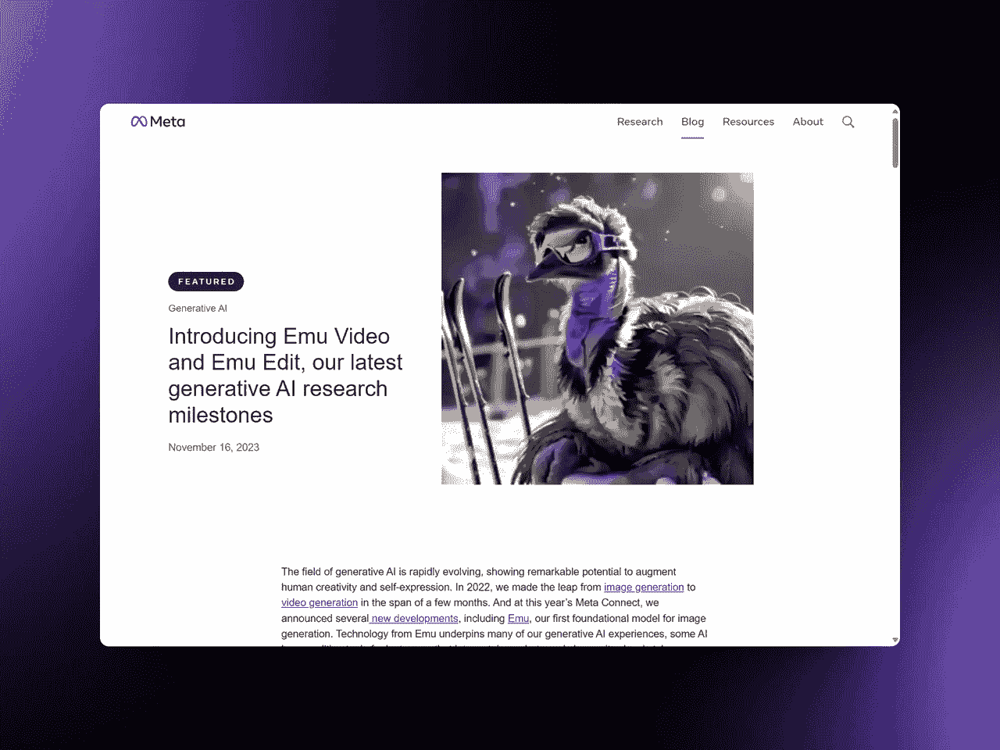

## [Google推出了一种在 StableDiffusi](https://arxiv.org/abs/2311.10093)on 图像生成中保证内容特征一致性的方式

这个其实是现在图像生成中一个非常重要的问题，故事可视化、游戏开发资产设计、广告等都需要在生成的时候具备角色或者内容的一致性。

从演示来看效果非常好人物角色和其他内容的特征都保持的非常好，他们有一个示例是一个男人的一生十几张不同年龄段的图片都很像，能看出来是一个人。

而且这个项目还可以跟 SD 已有的控制方式结合，比如局部重绘和 Controlnet 等。下面是具体的介绍：

实现方法：

身份聚类：这一步骤涉及首先生成一系列图像，然后将这些图像嵌入到一个语义空间中。接着，使用聚类算法将这些图像分组，每个组代表一种可能的角色身份。这个过程旨在识别出一组视觉上一致的图像，从而确定角色的主要视觉特征。

身份提取：在确定了一组具有高内聚性的图像之后，接下来的步骤是通过在这些图像上训练模型来提炼出一个更一致的角色身份。这意味着模型将学习到特定角色的关键视觉特征，以便在未来的生成中更准确地重现这些特征。

收敛性：方法的最后一个步骤是迭代过程，该过程在达到一定的收敛标准时停止。在每次迭代中，模型基于最新的训练数据生成新的图像，并重新进行聚类和身份提取。这个过程重复进行，直到模型能够可靠地生成具有一致视觉身份的角色为止。

效果验证：

定性和定量比较：在这一部分，作者将他们的方法与其他个性化文本到图像生成技术进行比较。这包括通过视觉和数值指标来评估生成图像的一致性和质量。

用户研究：作者还进行了一项用户研究，以评估他们的方法在实际使用中的效果。这包括让用户评价生成图像的一致性和吸引力。

消融研究：这部分是对方法中不同组件的效果进行评估。通过修改或移除方法的某些部分，作者能够理解每个组成部分对最终结果的贡献。

Failed to upload image image.png

## DeepMind 发布了一个音乐生成模型Lyria

DeepMind 发布了一个音乐生成模型Lyria，与其他模型不同的是这个模型不止可以生成音乐也可以生成搭配音乐的人声。同时支持对输出的音乐进行精细控制。

另外这个模型已经在 youtube Dream Track功能中落地，创作者将能够使用 Dream Track 制作多位艺术家的人工智能生成的声音和音乐风格。

Dream Track 可以按照所选参与艺术家的风格同时生成歌词、背景音乐和 AI 生成的声音。

为了确保负责任地部署，Lyria模型的输出使用SynthID进行水印标记。这项技术将AI生成的音频中嵌入一个水印，即使经过常见的修改，如MP3压缩或速度变化，该水印也能被检测到。

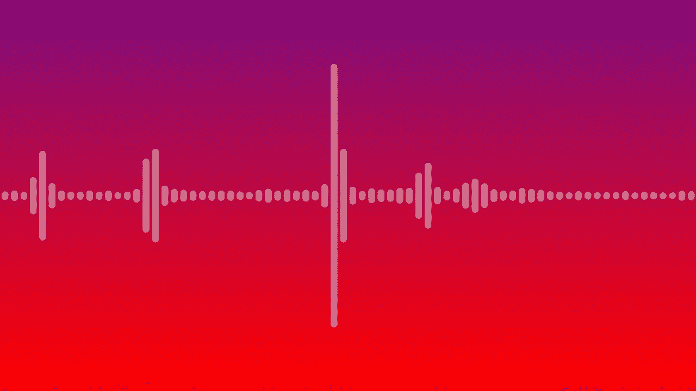

---

# 🧵其他动态

+   微软发布了 [Bing品牌升级 ](https://copilot.microsoft.com/)，Bing Chat 和 Bing Chat Enterprise 将成为 Copilot。

+   Fable也发布了利用 [LCM实时生成图片 ](https://x.com/fable_motion/status/1724808303400861981?s=20)的功能。

+   英伟达发布了一个叫 Nemotron-3 8B 的LLM ，同时还有一个 NVIDIA NeMo 端到端框架专门用于构建、定制和部署专为企业使用而定制的 LLM。

+   [Midjo](https://x.com/op7418/status/1724721195113971924?s=20)urney动漫微调模型Nijijourney跟进了 模型微调 的能力。

+   由于服务压力太大Open AI在15日 暂停了Chat GPT plus的购买 。

+   Stability AI 推出了一个 Stable Diffusion 1.6 的图像模型，从他们的演示来看这个模型在高于 512px 分辨率上的表现比 1.5 好很多。

+   Google在多个国家推出了 面向青少年的 Google Bard 。

+   Airbnb 以不到 2 亿美元的价格 收购了一家名为 Gameplanner AI 的人工智能初创公司，这是其作为上市公司的首次收购。

---

# ⚒️产品推荐

## Krea：根据涂鸦实时生成AI绘画

上周最火的应用就是两个白板应用结合新技术改造的应用，首先是Krea，你可以在应用左侧的画板上随意的涂抹你想要的画面和构图右侧会显示AI根据你的草图绘制的图像，这个工具强在基于LCM实现了实时的重绘，你每画一笔右侧的画面都会实时反应对应的改变。

你也可以将左侧画板替换为你的Blender、Figma或者你的摄像头甚至游戏画面，Krea都会根据你投屏的内容实时绘制图像。

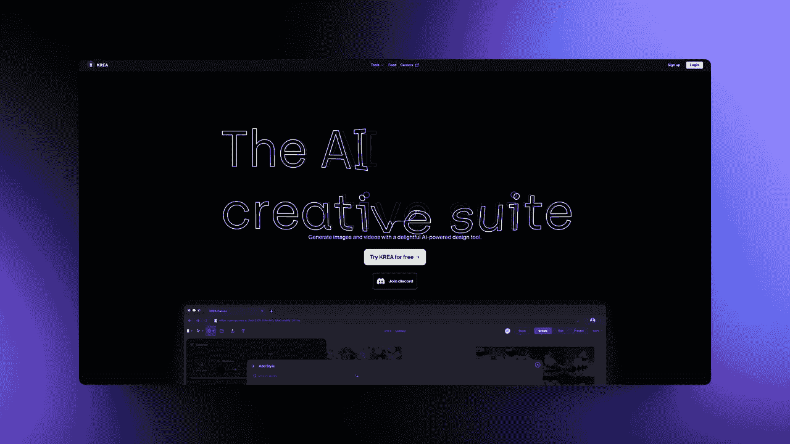

## [T ](https://www.tldraw.com/)ldraw：根据白板绘制内容生成网页

这个就是上周最火的第二个白板应用tldraw，由于接入了最新发布的GPT-4V和其他API能力，所以可以根据你在白板上绘制的内容生成对应的代码，白板会把GPT生成的代码渲染成网页，刚开始只是生成一些普通的网页样式，慢慢的就越来越离谱了，在白板上画逻辑图之后可以生成对应交互的网页应用，比如下面图片这个表格内容创建的网页。

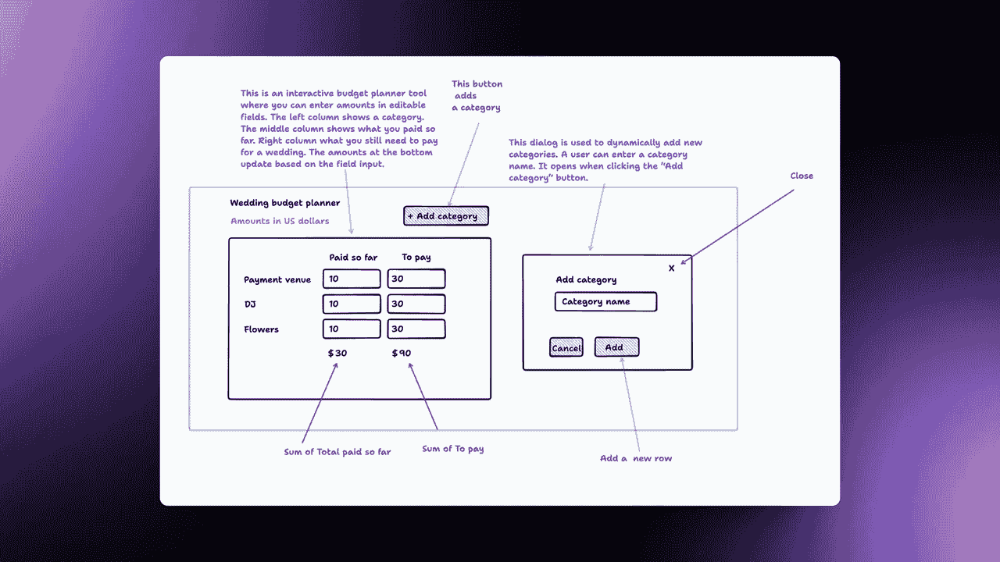

## Devv Search：面向开发者的AI搜索引擎

Devv Search 是一款面向开发者的 AI 搜索引擎，基于文档、代码、实时搜索数据从零到一构建了一套高效、准确的 RAG 系统，底层的模型基于微调后的 Code Llama 和 GPT-3.5。

这里有开发团队 Jiayuan (Forrest) 的开发心得。

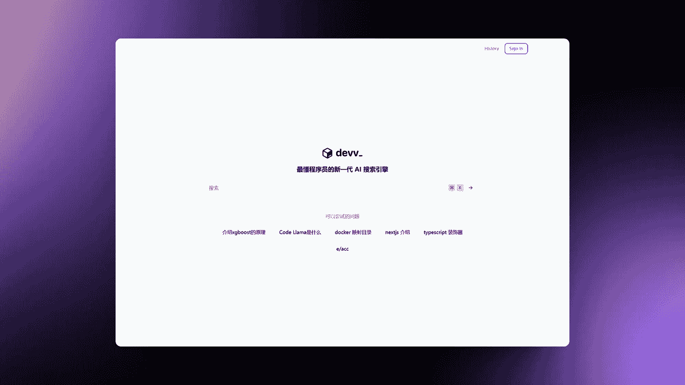

## Notion发布了Q&A AI能力

Notion发布Q&A AI能力。你现在可以跟你的工作区数据进行对话了解内容了。

如果你之前收集的文章和内容都在Notion里面，不需要再废力气查找了，直接询问就能得到答案，而且还会给出引用来源。

我自己试了一下，我这个文章库有1200篇内容，他确实可以根据问题给出具体的答案和内容位置。这下终于不用靠搜索找东西了。

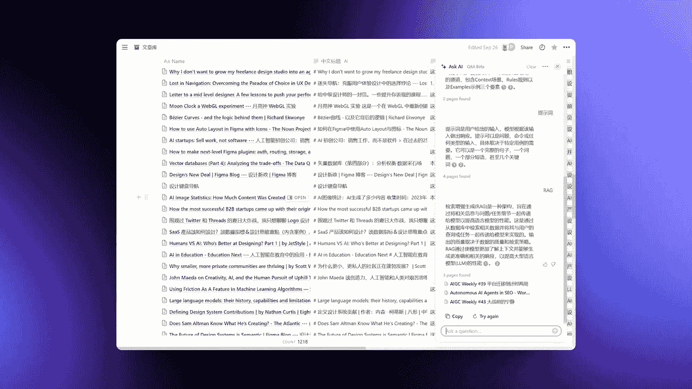

## Leap Workflows：Leap 发布自动化LLM工具

看起来是一个可视化Agents工具。主要有下面这些能力：

集成提供了更强大的工具套件，包括Leap SDK、GPT、Llama-2、Whisper等。

对于那些希望快速上手的人来说，Leap Workflows提供了一个从模板快速启动的功能。这使您能够在几分钟内构建端到端的文档摘要工作流程、SEO自动化、资产和媒体生成以及SDXL微调等功能。

即将推出的功能包括对顶级模型的进一步支持、新的数据抓取服务、管道版本控制以及额外的模型。

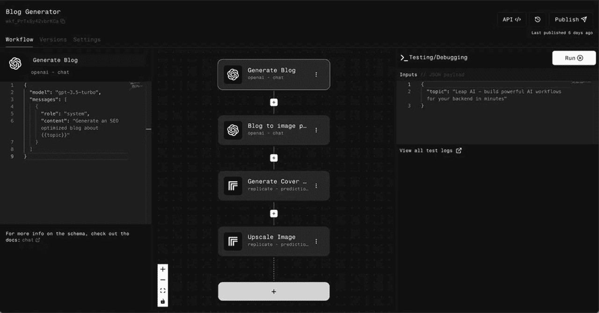

## Pitch 2.0：支持AI创建PPT

要在主页或应用程序内使用免费生成器，只需输入提示，选择调色板和字体，瞧，空白幻灯片在几秒钟内就会神奇地填充。您可以获得与我们人工制作的模板相同的设计质量和吸引力，但具有针对甲板结构、内容和布局的特定于主题的想法。生成任意数量的幻灯片，并快速可视化不同的幻灯片选项、字体和配色方案，然后再进行更自定义的编辑。

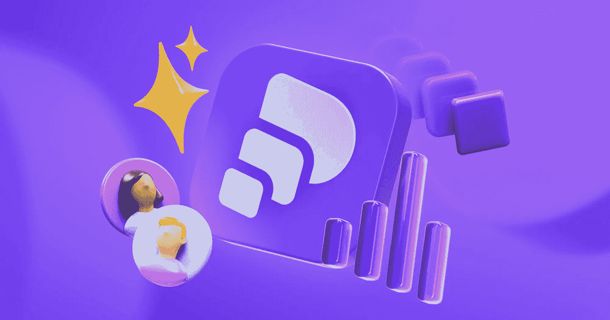

Dub支持将长的 GPTs 转成短链，也可以绑定自己域名；

同时自带分析功能你可以知道自己链接点击的来源数据；

你可以自定义自己链接的分享图片和附带的展示文案；

支持生成对应链接的二维码；

还支持开启位置定位，设备定位等数据的收集。

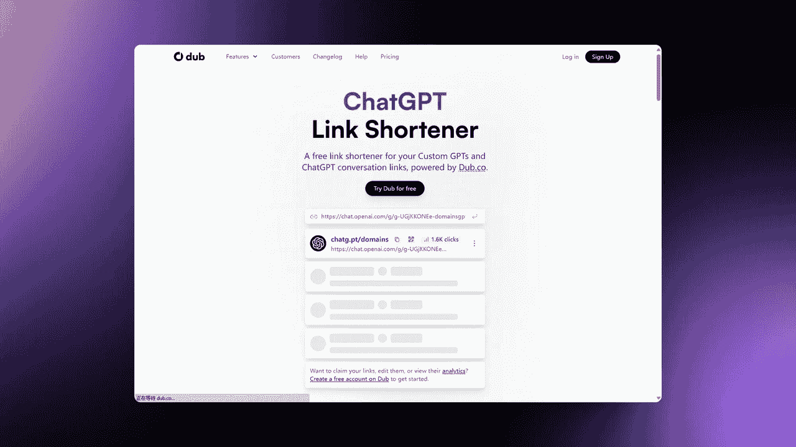

## EmotiVoice：有道开源的TTS引擎

EmotiVoice是一个强大的开源TTS引擎，支持中英文双语，包含2000多种不同的音色，以及特色的情感合成功能，支持合成包含快乐、兴奋、悲伤、愤怒等广泛情感的语音。

EmotiVoice提供一个易于使用的web界面，还有用于批量生成结果的脚本接口。

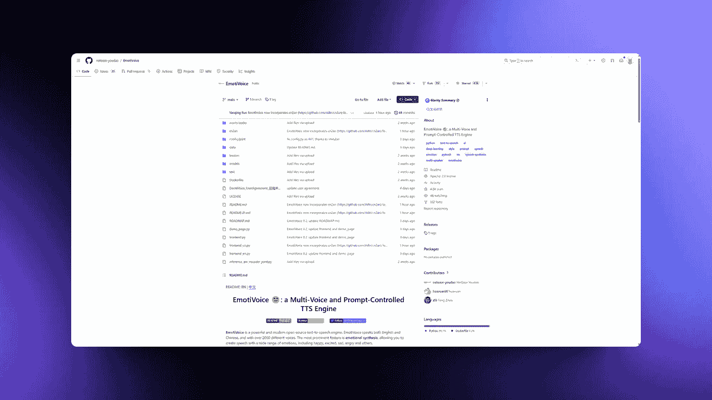

## Replit Core：AI产品开发基建打包方案

Replit 宣布推出 Replit Core，这是一项旨在为软件创作者提供端到端体验的综合计划。该计划包括访问高级 Replit AI 功能、拥有充足计算资源的升级版安全工作空间、宽裕的网络带宽和存储、额外的安全功能、按需扩展的一键式部署、分析、优先支持和社区活动。会员还可参加会员专享活动、早期功能、专属会员社区、合作伙伴优惠和高级人工智能模型。

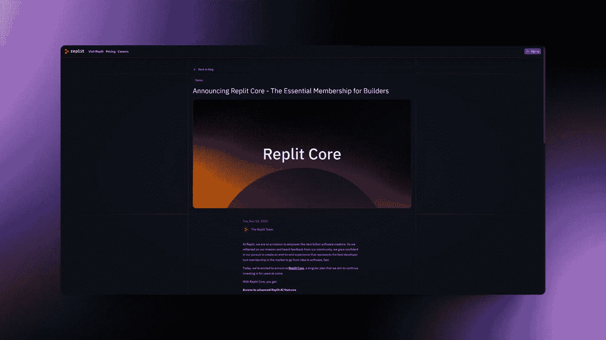

---

# 🔬精选文章

## [比尔盖茨： ](https://www.gatesnotes.com/AI-agents)人工智能即将彻底改变你使用计算机的方式

人工智能代理对医疗保健、教育、生产力和娱乐等生活各个方面的潜在影响。

文章强调，由人工智能驱动的人工智能代理将彻底改变人们与计算机的交互方式，并将带来自输入命令过渡到点击图标以来计算机领域最大的变革。文章解释说，人工智能代理将能够理解自然语言，并根据对用户的了解完成各种任务，它们还能在被询问之前提出建议。文章还强调，通过使用人工智能代理，心理保健和教育等服务有可能实现民主化。文章进一步讨论了对软件企业和社会的影响，指出代理将成为下一个平台，并将取代搜索网站、电子商务网站和生产力应用程序。文章还讨论了开发和使用人工智能代理所面临的挑战和问题，包括数据结构、交互方法、标准协议、可负担性、隐私、安全性和道德考量。

最后一个问题是人工智能代理对人类目的的潜在影响，在未来，由于人工智能代理的能力，人们可能不需要那么多工作。

## AGI 的水平： 实现 AGI 道路上的可操作性进展

本文提出了一个框架，用于根据AGI模型的能力、通用性和自主性进行分类。通过分析现有的AGI定义并提炼出六个原则，用于构建一个有用的AGI本体。这些原则包括关注能力而非机制，分别评估通用性和性能，以及定义通往AGI的阶段而不仅仅是终点。

作者们提出了基于能力深度（性能）和广度（通用性）的“AGI等级”。这一框架旨在为比较模型、评估风险和衡量AGI进展提供一个共同的语言，类似于用于自动驾驶等级的方法。文章反映了当前系统如何适应这一本体，并讨论了未来基准测试对于量化AGI模型行为和能力的要求。

论文还讨论了AGI等级与部署考虑因素（如自主性和风险）的互动。它强调为负责任和安全地部署高能力AI系统选择适当的人工智能互动范式的重要性。

这种方法旨在通过考虑通用性（狭窄或通用）与五个性能等级（新兴、能力、专家、大师和超人）的结合，为朝向AGI的进展提供一种细腻的方式。论文反思了当前AI系统和AGI定义如何适应这一框架。此外，它讨论了这些原则对于开发一个生态效度高的、动态的AGI基准测试的含义，认为这对AI社区至关重要。

最后，论文考虑了这些原则和本体如何重塑与AGI相关风险的讨论，指出AGI并不一定与自主性同义。作者们引入了AGI等级的进展解锁但不确定的自主性等级。这种观点允许对AI系统可能的风险进行更细腻的洞察，强调了在模型改进方面投资于人工智能互动研究的重要性。

Meta 发布了一种新的 3D 生成技术 D3GA，用高斯喷涂技术渲染的3D可控制人体模型。

之前的技术训练期间需要精确的3D标记，要么在测试期间需要密集的输入图像，或者两者都需要。

这个模型使用一种高效的技术来渲染人类形象，能够在实时帧率下工作，适合用于视频直播等场景。与现有技术相比，它在训练和测试时需要的数据更少，能够产生更高质量的结果。

## MM-Navigator，一种基于GPT-4V的智能代理

MM-Navigator，一种基于GPT-4V的智能代理，用于智能手机用户界面（GUI）导航任务。

MM-Navigator可以像人类用户一样与智能手机屏幕交互，并根据给定的指令确定后续操作。

该系统在生成合理的行动描述方面达到了91％的准确率，在iOS上执行单步指令的正确行动方面达到了75％的准确率，超越了以前的GUI导航器。

## Open AI开发者大会所有讨论视频汇总

Open AI开发者大会分组讨论的视频也放出来了，感兴趣可以看一下。包括最大化LLM表现、人工智能的新堆栈和操作、人工智能业务等内容。

## 如何建立一家具有防御能力的人工智能初创公司

讨论了建立一个可防御的人工智能初创公司的因素。文章强调了创造足够的客户价值以及做一些有帮助的事情来提高可防御性的重要性。文章还强调，在做有价值的事情的同时，还需要平衡各种困难，以限制试图做同样事情的竞争对手的数量。文章建议利用专有资产、有效的客户渠道和网络效应来创建可防御性。

## [以数据驱动审视人工智能的崛起](https://www.newcomer.co/p/a-data-driven-look-at-the-rise-of)

讨论了人工智能的现状，重点关注各种指标，例如 GitHub 星数、ChatGPT 使用情况以及每月用于跟踪 AI 活动的 AI 应用程序用户数。 Coatue Ventures 董事总经理 Sri Viswanath 认为，快速发展的现有科技公司在即将到来的人工智能浪潮中处于最佳位置。他还指出，在过去的技术浪潮中，新的初创公司都是在技术出现时成立的，而且在新技术成熟后很久才成立。文章强调，如果是对新技术的新颖运用，那么建立一家颠覆性技术公司的时机并没有错。它还提到人工智能项目的 GitHub 星级下降，表明人工智能炒作周期可能正在减弱，但人工智能项目的承诺正在强劲，表明人们仍在努力编码。此外，当新版本出现时，ChatGPT 的使用率可能会上升或下降，从而吸引用户回到聊天机器人来尝试新功能。

## 尼尔森诺曼：使用生成式人工智能的 6 种对话类型

详细分析了生成式人工智能机器人的六种对话类型，包括搜索查询、漏斗对话、探索对话、凿形对话、精确定位对话和扩展对话。每种对话类型都有详细描述，并为用户和生成式人工智能聊天机器人的界面设计师提供了提示。

## [红衫：下一个十亿开发者](https://www.sequoiacap.com/article/the-next-billion-developers-perspective/)

讨论了将十亿开发者带入软件经济的潜在影响，并将其与硅谷目前对人工通用智能（AGI）的痴迷进行了对比。作者认为，根据一些杰出人士的观点，实现 AGI 不仅是可能的，而且是不可避免的，但也有人持不同意见。文章提出的观点是，将 10 亿开发人员带入软件经济，其经济影响可与 AGI 相媲美。文章强调，成为开发人员越来越容易，市场力量吸引更多年轻人成为软件工程师，以及人工智能带来的意料之外的加速，这些都是我们相信开发人员数量将持续高速增长的理由。文章还讨论了人工智能对软件经济的影响，以及数字经济和实体经济自动化的潜力。文章最后强调了人工智能力量的增强和开发者革命的持续推进。

最后一个问题是："但 1B 开发人员的目标真的可以实现吗？向这么多人传授软件工程不是太难了吗？我们又该如何处理这些开发人员呢？

## 动手实战人工智能 Hands-on AI

动手实战人工智能系列教程，希望从监督学习开始，带你入门机器学习和深度学习。我尝试剖析和推导每一个基础算法的原理，将数学过程写出来，同时基于 Python 代码对公式进行实现，做到公式和代码的一一对应。与此同时，我也会利用主流的开源框架重复同样的过程，帮助读者看出手动实现和主流框架实现之间的区别。