# AIGC Weekly #46

> 来源：[https://waytoagi.feishu.cn/docx/U9lUdnZwMoGFGGxEoN9ckxlan5e](https://waytoagi.feishu.cn/docx/U9lUdnZwMoGFGGxEoN9ckxlan5e)

> 🔗 原文链接： h[ttps://quail.ink/o](https://quail.ink/op7418/p/aigc-weekly-46)p7418/p/aigc-wee...

> 发表时间：13 Nov, 2023

提示词：w[ater has a l](https://catjourney.framer.website/)ight rainbow glimmer,silver, in the style of glitch aesthetic, marbleized, iridescence/opalescence, unicorncore, lo-fi aesthetics, loose and fluid forms --style ijM6M4y951DizpghXWLQZn3I --ar 16:9 💎查看更多风格和提示词

---

# ❤️上周精选

## [Open AI 开发者大会](https://openai.com/blog/introducing-gpts)

上周最重要的事情就是 Open AI 的开发者大会了，之前泄露的内容基本属实，不过还是低估了 Open AI 的实力。他们一共开放了GPTs 和 GPT-4 Turbo 等一系列内容。同时由于DDos攻击和负载问题 Open AI 的所有服务断断续续挂了接近一天的时间，每次发版本都炸，太离谱了。

一起来大概看一下：

首先是 GPTs，GPTs是 ChatGPT 的自定义版本。 GPT 是一种新方式，任何人都可以创建 ChatGPT 的定制版本，以便在日常生活、特定任务、工作或家庭中更有帮助，然后与其他人分享该创作。 同时他们还会开放一个GPTs 的商店来供用户挑选和发布自己的 GPTs 。

现[**在所有 Plu**](https://x.com/op7418/status/1723405627668799952?s=20)s 用户已经都可以开始使用和创建 GPTs 了，经过这几天的发展和观察也暴露出来了一些问题，我也大概写了一下，你可以 去这里看🍿 。

由于目前 GPTs 的商店还没有上线所以出现了很多三方的 GPTs 汇[总网页，比](https://x.com/taranjeetio/status/1723437952905384336?s=20)如： https://www.gptshunter.com/ 和 https://allgpts.co/ ，同时也可以用🔗 这个方法 自己去搜索 GPTs 。

[宝玉也一直在](https://x.com/dotey/status/1722831122285932592?s=20)更新一个 GPTs 推荐和提示词破解的推，你🔗 可以在这里 看到很多 GPTs 和对应的提示词，可以给自己创建的时候一些参考。

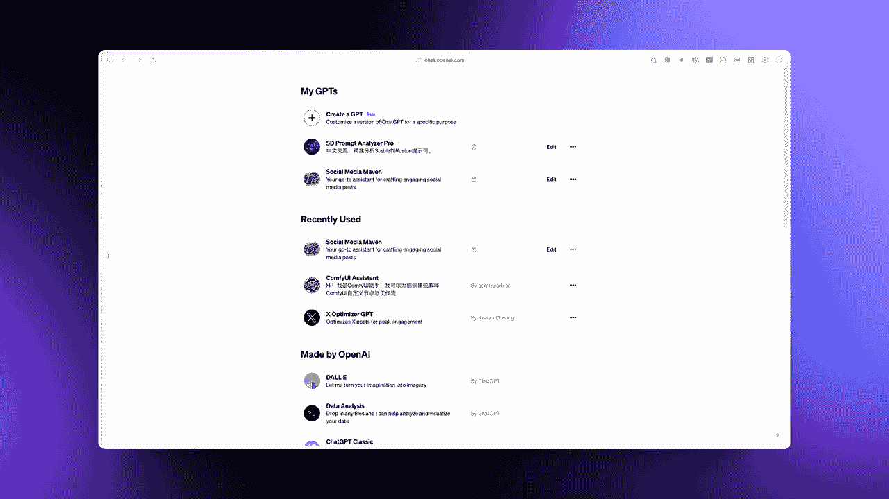

另外开发层面也发布了一堆对应的模型和能力升级，全新的GPT-4 Turbo型号更加强大、更便宜，并支持128K的上下文窗口。新的Assistants API使开发人员更容易构建自己的辅助AI应用程序，这些应用程序具有目标并可以调用模型和工具。平台中的新多模态功能，包括视觉、图像生成（DALL·E 3）和文本转语音（TTS）的 API 。

[你](https://platform.openai.com/docs/assistants/overview)可以在这里找到新的Assistants API的使用方法： https://platform.openai.com/docs/assistants/overview

在这里尝试Assistants API：https://platform.openai.com/playground

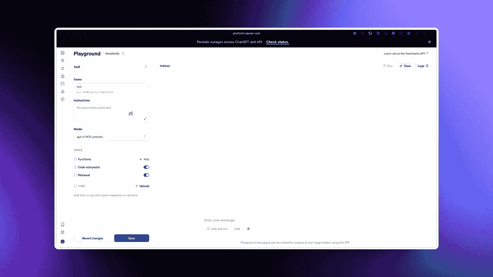

## LCM Lora 模型发布大幅提升 SD 图片生成速度

前段时间我一直在关注LCM（Latent Consistency Models）这个技术，它可以让SD的图片生成速度提高5倍左右，但是存在的一个问题就是模型需要单独训练，无法兼容现有模型，这就导致无法融入现有的生态。

今天这个状态改变了，他们把LCM变成了一个Lora模型，这个模型可以兼容现有的所有SD模型，不管是1.5的还是SDXL还是SSB-1B。

带来的后果就是大幅降低SD图片生成的硬件门槛，你现在甚至用CPU跑图的时间都可以接受了。

可以在更短的时间生成更多的图像，这在抽卡的时候很重要，大力出奇迹是能解决很多问题的。

SD图像生成服务的成本会大幅降低。

LCM Lora现在已经可以在Comfy UI上使用了，我自己测试了一下，1.5的模型使用LCM Lora大概比不使用快了4.7倍左右。下面几张图是对应的生成效果和时间。从生成质量上来看没有特别大的区别。

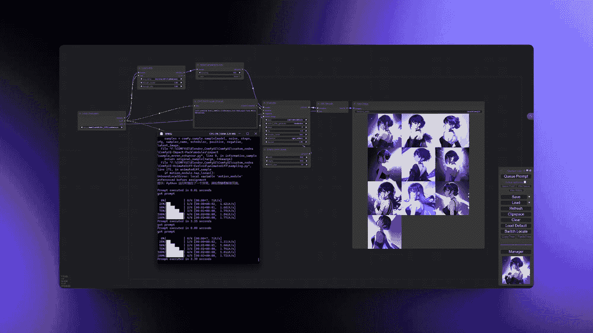

## Animatediff 开始支持 SDXL 模型

在测试LCM的时候突然发现Animatediff已经在前天开始支持SDXL了，尝试了一下效果确实比1.5好了非常多。就是太吃算力了。

SDXL版本的Animatediff需要下载新的Motion模型，同时貌似不支持镜头Lora，更需要4090了现在。

也尝试了试用LCM Lora搭配XL版本的Animatediff生成视频，可以生成但是效果很差，可能还需要优化。话说回来1.5的LCM Lora生成的视频也非常模糊经常只能突出人物主题背景完全是糊的，但是图片就没问题，希望可以优化一下吧。

如果想尝试Animatediff的话也可以看一下我这篇教程，完整的教了云端部署 SD Web UI 和 Animatediff 的内容：https://quail.ink/op7418/p/want-to-do-ai-paintings-and-videos-without-a-good-computer-mr-tibetan-master-teaches-you-cloud-based-deployment-of-sd-generative-ai-videos

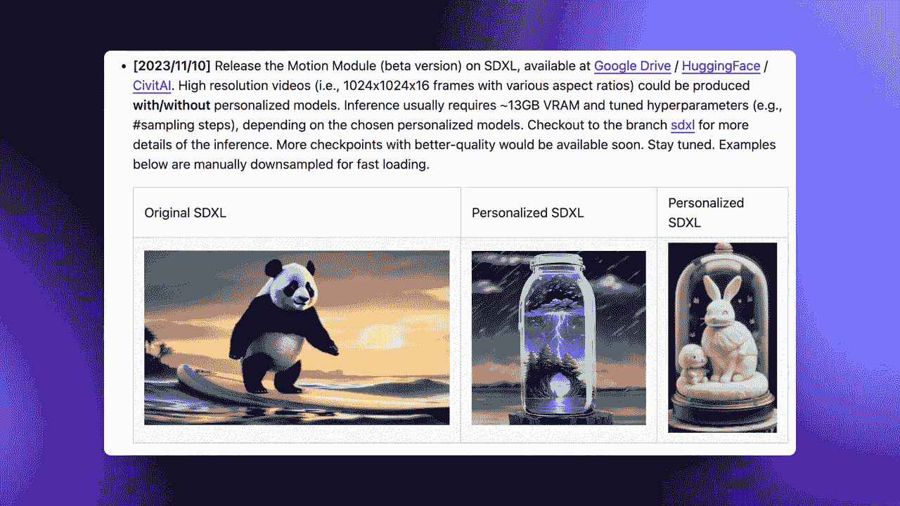

## [AI Pin 设备正式发布](https://hu.ma.ne/aipin)

之前说过的前苹果员工创业做的AI 驱动的设备 AI Pin 终于发布了，这个设备小到可以挂在身上，你可以通过跟他内容内置的 ChatGPT 沟通来控制设备，支持实时对话翻译，录音等。还可以用激光把界面投到手上操作设备。。所有的AI 能力都由 OpenAI 模型提供支持。

设备本身还是挺简陋的，给深圳时间复刻成本应该也不会太长，但是这是第一个尝试将 AI 与硬件结合打造下一代个人计算平台的尝试，欧某种意义来说也挺重要的。

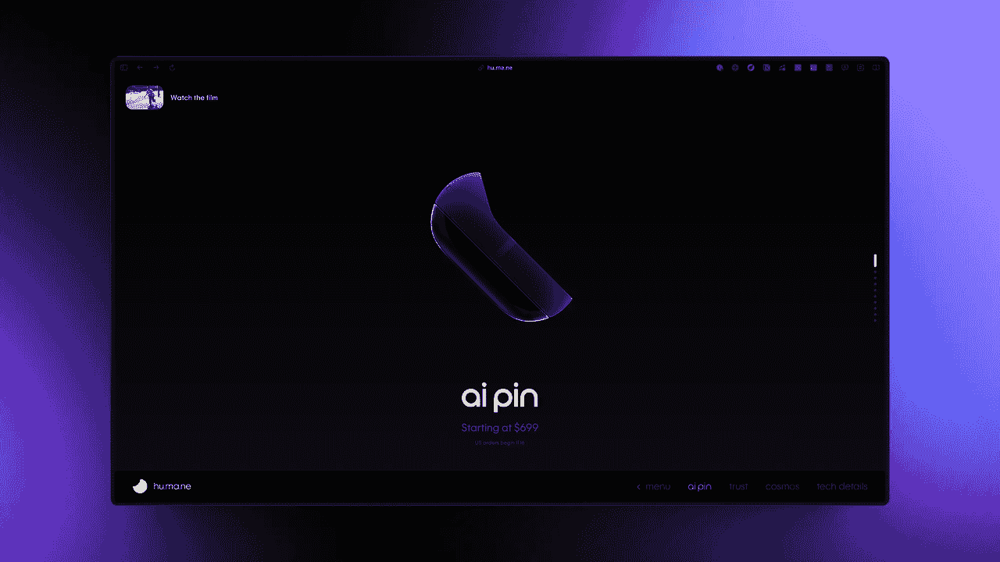

---

# 🧵其他动态

[Runway再发大更新 ](https://x.com/runwayml/status/1723033256067489937?s=20)，运动画笔，可以通过画笔涂抹自定义画面运动的区域。这下对于视频的控制又加强了。

Pika 即将更新 1.0 版本 ，动态表现和画面细节均有提升。

[Xbox 和人工智能初](https://inworld.ai/blog/xbox-partners-with-inworld-ai-to-build-generative-ai-tools-for-game-development)创公司 Inworld 正在联手为游戏制作者 打造一些人工智能工具 。

---

# ⚒️产品推荐

## The Halo：稳定诱导清明梦的设备

The Halo：一种非侵入性神经设备，用于稳定和诱导清明梦。

关于清明梦：是一种梦，做梦者意识到自己正在做梦。你可以在梦中做任何自己想做的事情，类似于赛博朋克2077的超梦。有的说古人的阴神出游也是清明梦的一种。

The Halo基于超声波和机器学习模型的结合，使The Halo能够检测做梦者何时处于快速眼动睡眠状态，以诱导和稳定清醒梦。

这个硬件还搭配一个The Prophetic App应用，运行专有的机器学习检测模型，支持追踪睡眠，上传清醒梦数据以改进模型。

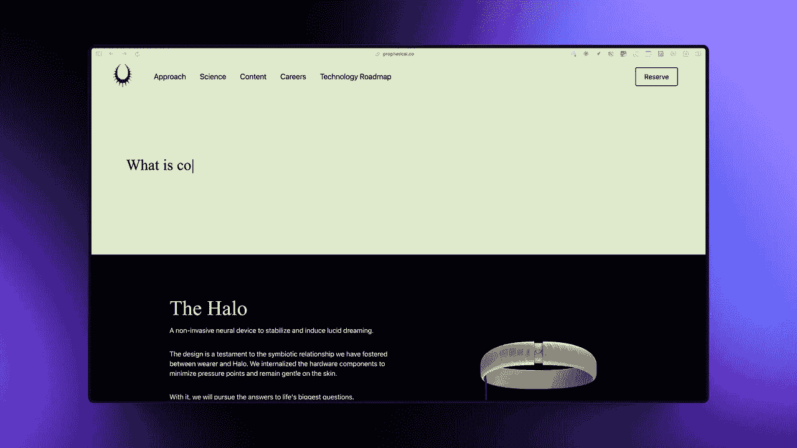

## [Ozone：AI 剪辑工具](https://www.ozone.pro/)

Ozone,一个可以使用AI技术快速制作视频的平台。

Ozone可以帮助用户通过AI自动完成许多编辑任务,如颜色校正、静音处理、B轴视频插入、过渡效果、字幕等,从而大大节省时间。它支持4K及更高分辦视频编辑和播放。

Ozone还提供实时多人协作功能,可以共同编辑视频、添加评论。它还可以自动识别视频画面内容,更快找到需要的片段。

此外,Ozone还支持不同平台自动调整视频尺寸,并提供工作区、团队及资源管理功能,方便多人协作开发内容。

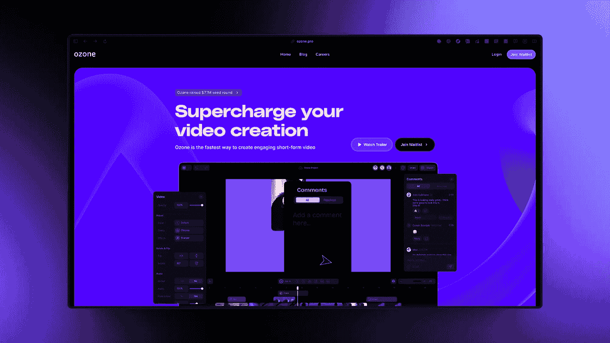

## [POPAI： 办公效率工具](https://www.popai.pro/)

**一个类似 Ch**atGPT 的聊天产品，但是集成了很多工作时可以用到的效率工具，比如 PPT 和流程图生成，提示生成等。

PopAi率先集成了 GPT-4V 的图像 API，而且调教的比较好，我用一个图像相关论文的图片试了一下，解释的很清楚。

同时他有个比较创新的交互是在回答内容之后你可以选择一些后续的叫 Enrich 的操作。比如将输出内容翻译为中文或者将输出内容经过 扩写重新排版和添加内容后变为一篇文章 。这种对于打工人来说太重要了。而且enrich的内容不是干巴巴的填充，配合很多相关图片，有必要的话他还会自己画流程图。

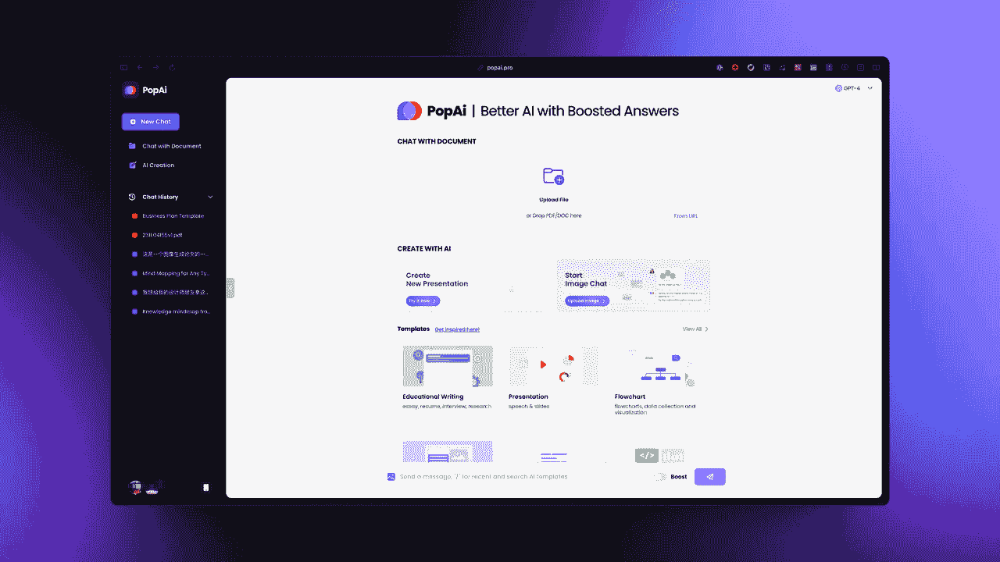

## Figjam 更新了一批 AI 能力

Figma 的白板软件Figjam 今天发布了他们的 AI 能力，这几个能力对于日常的工作和沟通帮助可太大了。我给视频加上了介绍文案。

首先它可以根据你输入的文本内容生成可视化的组件，组件里面还会加上小图标等，比干巴巴的文本清晰很多。

然后 AI 可以帮你把白板中的内容变成图表，比如很多人输入的排期时间可以一键变成很直观的甘特图。

它可以帮你分类便签里的内容，你只需要选择大家新建的几十个便签就可以自动分类相同观点的便签。

最后它可以帮你总结便签里的内容，选择对应的便签，他会生成一个总结卡片非常有条理的总结所有便签的观点。

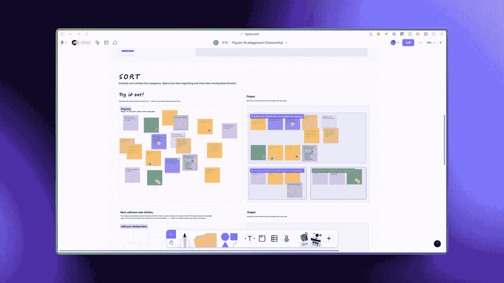

## Induced：AI 驱动的浏览器自动化工具

Induced可以运行多个浏览器工作流,帮助自动化重复性任务。它提供个性化的入门培训,为企业客户提供定制集成和支持。

Induced有强大的反机器人检测功能,可以平行运行大量任务而不被阻止。它还可以安全共享凭证和使用虚拟卡进行付款。

Induced的浏览器基础设施是模块化的,可以通过平台、电子邮件、Slack消息或电话调用工作流。它可以在运行过程中接受输入和从数据源实时获取数据。

Induced可以进行实时推理和判断任务,例如从网页提取和分析数据来决定下一步操作。它可以帮助自动写邮件、筛选简历、创建Jira票证等。

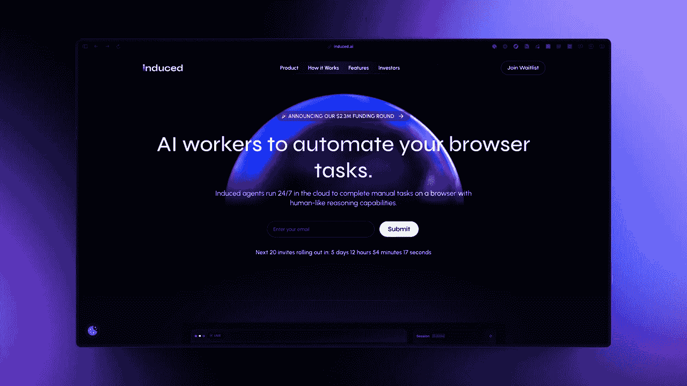

## GitHub Copilot：更新了很多新的能力

GitHub Copilot进行的一系列重大更新和新功能发布:

1.  GitHub Copilot Chat将于2023年12月正式推出,支持在代码编辑器、命令行和GitHub网站上通过自然语言与AI交互。

1.  GitHub Copilot Enterprise将于2024年2月正式推出,支持将Copilot个性化定制给组织,帮助开发者更快速地理解和开发组织内部代码。

1.  GitHub宣布成立Copilot合作伙伴计划,将Copilot连接到第三方开发工具和服务,扩展其功能。

1.  GitHub Advanced Security新增了基于AI的代码扫描自动修复和泄露密钥检测功能。

1.  GitHub Copilot Workspace预览了一个基于问题的开发流程助手,利用AI帮助开发者从问题到代码实现。

1.  通过不断更新Copilot,GitHub将其打造成一个全面性的AI辅助开发平台。

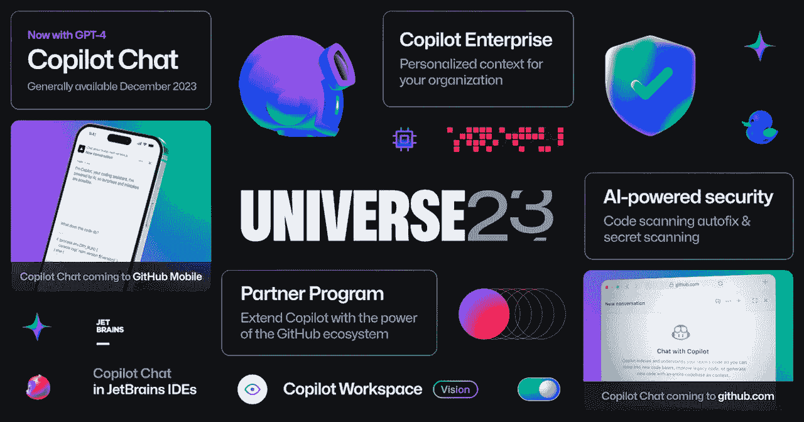

## Fabric：将你所有的信息整合起来

Fabric,一个可以整合各种数据源的智能工作空间。Fabric可以自动收集用户的云存储、笔记、链接和文件,将它们组织在一起。用户可以用自然语言快速搜索找到任何东西。Fabric支持协作,用户可以创建共享空间与其他人一起讨论和审阅文件。Fabric还可以连接各种应用程序和存储驱动器,同步用户的数据。总之,Fabric是一个可以整合网络内容和文件,支持协作工作的智能平台。

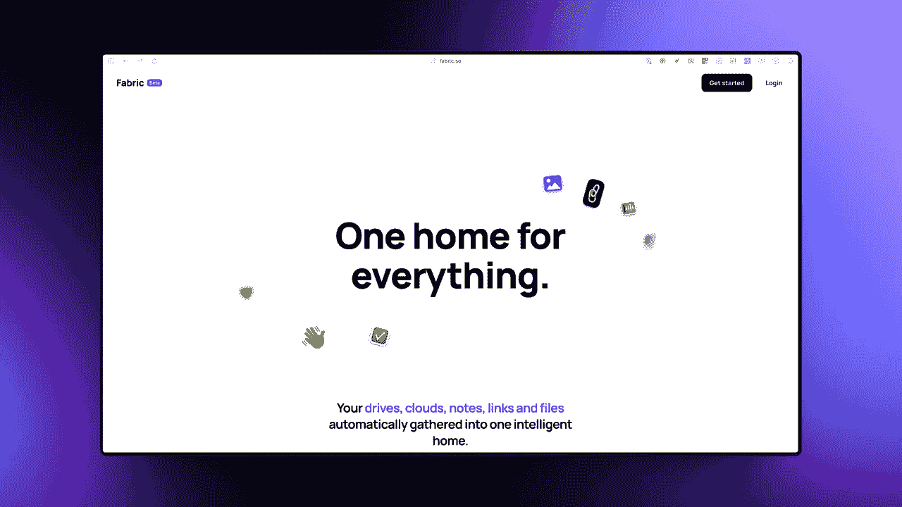

## Seek AI：AI 驱动数据库查询进行业务分析

Seek AI是一家开发生成式AI数据查询技术的公司。它为企业提供一个平台,可以通过自然语言快速查询和分析庞大的数据集,帮助企业更好地利用数据进行决策和优化业务。

Seek AI产品可以帮助数据团队和业务用户更高效地利用数据。它通过一些客户案例展示了Seek AI如何帮助客户节省时间和成本。

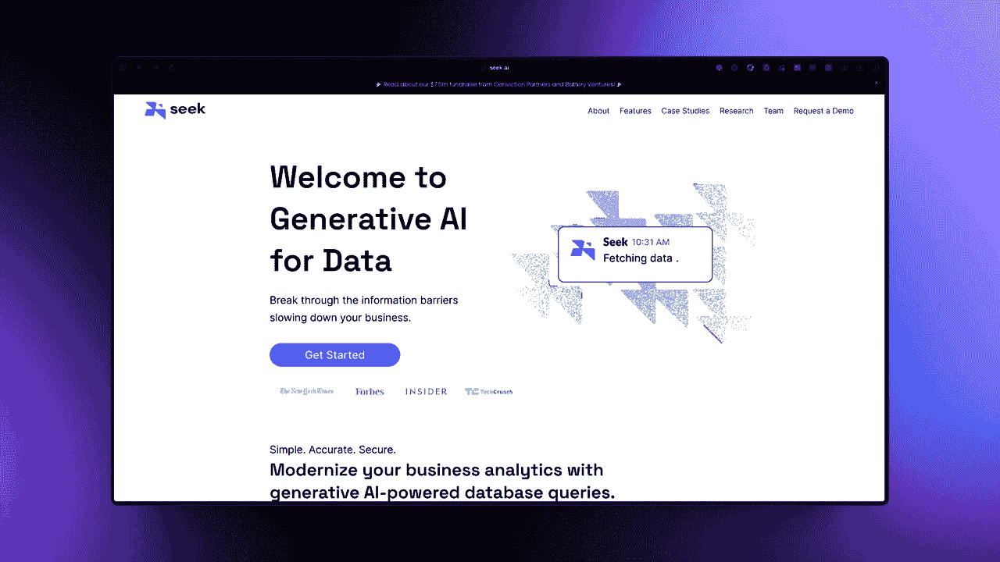

---

# 🔬精选文章

## [OpenAI 主题演讲](https://stratechery.com/2023/the-openai-keynote/)

这篇文章总结了OpenAI在2023年11月举办的首次开发者大会的主要内容。

大会上,OpenAI首席执行官Sam Altman做了一个很好的主题演讲。OpenAI推出了GPT-4 Turbo应用编程接口,提供更长的上下文长度、更好的控制能力、更新的知识库、新的模态如DALL-E 3和语音合成,以及更高的调用限额,但价格将下降3-2倍。

OpenAI还推出了“GPTs”,即定制化的ChatGPT,开发者可以为特定领域添加知识和功能来定制ChatGPT。未来,ChatGPT本身也将能够直接调用不同功能,比如生成图片或进行网络浏览,无需切换模式,这将带来更好的用户体验。

文章还分析了OpenAI与微软的合作关系。微软作为OpenAI的重要合作伙伴,利用其庞大的基础设施投入,有助于OpenAI降低价格。未来,ChatGPT可能不再依赖插件,而是直接调用不同工具来解决问题,这将是一种更好的统一界面方式。

## AI不是一个很好的软件，而是很棒的人

人工智能的行为与人类非常相似，因此您可以对它们进行经济和市场研究。他们很有创造力，而且看起来很有同理心。简而言之，在许多情况下，它们的行为似乎确实更像人类，而不是机器。

## 音乐的未来：生成式 AI 如何改变音乐行业

这篇文章总结了音乐产业中人工智能技术的应用现状和未来发展趋势。

文章分析了人工智能在五个主要应用场景中的应用:1. 实时音乐流媒体服务;2. 人工智能辅助翻唱;3. 免版税音乐曲库;4. 音乐创作工具;5. 专业音乐产品。

文章认为,随着人工智能模型和音乐技术的发展,将大大降低从灵感到实际创作的难度,让更多普通用户参与音乐创作。未来可能出现类似Midjourney的音乐创作工具,让用户只需提供主题就可以与AI助手一起完成整张专辑的创作。

文章还分析了这些技术在法律许可和商业模式等方面的挑战,并预测随着时间的推移这些问题将逐步得到解决。总体来说,文章认为人工智能将极大促进音乐产业的发展。

## [真正的个人（AI）电脑](https://om.co/2023/11/09/ai-pin-humane/)

AI Pin由Humane公司研发,它的核心创始人之一Imran Chaudhri曾在苹果公司工作。AI Pin采用语音和手势作为主要交互方式,它可以通过内置的相机和投影功能在用户手掌上显示信息。

文章认为,AI Pin代表着个人计算的新发展方向。随着AI技术的进步,我们将通过语音等无界面方式与机器交互,而不再依赖于App。但是,AI Pin也面临很多挑战,比如高价格,隐私保护问题,以及如何将产品转化为可持续发展的业务。

## 评估GPT-4 Turbo的警示故事

总结了Mentat公司对GPT-4和GPT-4 Turbo进行代码编辑任务的性能测试结果。

他们使用了122个Exercism练习题来测试这两个模型,GPT-4正确解决了86个练习题,占70%;GPT-4 Turbo正确解决了84个,占68.8%。初看结果差异不大。

但进一步分析发现,GPT-4第一轮正确解决76个,第二轮增加10个;而GPT-4 Turbo第一轮正确解决56个,第二轮增加28个。

作者分析认为,GPT-4可能在训练过程中记住了更多的Exercism练习内容,而GPT-4 Turbo在 distillation过程中失去了部分这种原始记忆能力。

为验证这个假设,他们再运行测试但不提供练习说明,只告诉模型练习名称。结果显示GPT-4第一轮正确23个,GPT-4 Turbo第一轮正确12个,证实了GPT-4记忆能力更强。

作者总结说,使用包含在训练数据中的内容来测试模型性能,可以比较模型之间,但不能准确比较使用不同训练数据的模型。未来需要使用更真实的开源代码作为测试标准。

Meta公司禁止使用它们新推出的基于生成式AI的广告创作工具来发布政治广告和来自其他受监管行业的广告。

Meta公司表示,这些新工具目前只允许非政治和非受监管行业的广告客户使用。政治广告和来自房地产、就业、信用、社会问题、选举、健康、药品和金融服务等受监管行业的广告目前不被允许使用这些基于生成式AI的广告创作功能。

Meta公司解释说,这一政策更新可以帮助他们更好地了解这些工具在涉及潜在敏感话题的受监管行业广告中的潜在风险,并为这方面的广告使用建立必要的安全保护措施。

文章还提到,谷歌公司也计划在其同类基于AI的广告创作工具中禁止使用政治关键词,以避免政治广告滥用这些工具。

## 几乎是Agents：GPTs 可以做什么

解释了GPTs 目前还不是真正的智能代理,但它可以通过结构化提示完成一些有用的任务。随后介绍了如何通过对话与AI交互来构建GPT模型,以及如何修改和完善结构化提示来提升GPT模型的功能。

文章还提到GPTs可以连接到其他系统中,比如邮箱或购物网站,从而让AI能够完成更广泛的任务,预示着下一代更智能的AI将要来临。同时也指出连接到更多系统会带来更高的安全风险。

文章重点介绍了如何利用GPTs为教育和工作创造有用的工具。比如通过GPT为写作指导创建一个交互式写作辅导工具。同时也提到如何为自己教授的课程创建定制化的GPT助教。

## 生成式人工智能圣经： genAI颠覆终极指南

这篇文章主要介绍了生成式人工智能(generative AI)领域的最新发展情况。

它分析了生成式AI技术的发展历程,当前这个领域的格局,以及需要关注的主要趋势和参与者。

文章提到,尽管这项技术研发已有多年历史,但OpenAI推出ChatGPT后,突然使生成式AI技术普及开来。许多大企业和传统行业纷纷加入这场竞赛,试图利用这项技术提升生产力和自动化水平,加速数字化转型。

文章还介绍了当前这个领域的主要参与者,比如微软、谷歌、NVIDIA、Meta以及苹果等大型科技公司的最新举措。同时也提到开源开发模式与封闭开发模式的竞争。

它还分析了生成式AI在医疗、金融、零售等行业的应用机会。并列出50家最具潜力的生成式AI初创公司。

## [AGI 正在实现](https://www.latent.space/p/devday)

这个播客讨论了Open AI开发者大会的内容。

大会上Open AI发布了许多新产品和功能,包括ChatGPT(面向普通用户的产品)、GPT-4(带有更长上下文和更快速响应的模型)、助手API(支持状态ful对话和多线程)、DALL-E 3、GPT-4 Vision、代码解释器等API。

文章还分析说,Open AI之所以采取渐进式部署策略,是为了确保AI安全发展的最佳路径。同时,它没有公布异步代理等功能,表明还在考虑某些技术的安全性。

## [测量在 RAG 系统中 的幻觉](https://vectara.com/measuring-hallucinations-in-rag-systems)

这篇文章讨论了如何衡量生成式语言模型(LLM)在检索增强生成(RAG)系统中的“幻觉”程度。

Vectara公司开源了一个名为Hallucination Evaluation Model(HEM)的模型,可以对不同LLM在RAG系统中总结检索结果时产生“幻觉”的程度给出分数,就像信用分数一样。文章还提供了当前几个流行LLM在HEM模型下的表现数据。

Vectara公司的目标是通过定量分析,帮助企业有信心采用生成式AI。他们会定期更新LLM的表现排名,并不断改进HEM模型本身。未来,他们还计划将这个模型集成到自己的平台中,为用户提供更可靠的答案。