# AIGC Weekly #45

> 来源：[https://waytoagi.feishu.cn/docx/Lz0RdTsG8ot2jtxXZTacEMOenff](https://waytoagi.feishu.cn/docx/Lz0RdTsG8ot2jtxXZTacEMOenff)

> 🔗 原文链接： h[ttps://quail.ink/o](https://quail.ink/op7418/p/aigc-weekly-45)p7418/p/aigc-wee...

> 发表时间：06 Nov, 2023

提示词：sand dunes desert, dark night, deep blues, aerial photography, 8k, dslr[**, wallpaper,**](https://catjourney.framer.website/) layers, distant horizon --style ik3Qph3VWBgpenNuIUbe1Idc --ar 16:9 💎查看更多风格和提示词

# ❤️上周精选

## [马斯克的 X.AI 正式发布](https://x.ai/)

为了狙击Open AI开发者大会的大招，马斯克的 xAI 提前发布了他们的LLM以及与之搭配的聊天产品Grok。

鉴于马斯克强烈的星际殖民和科幻爱好，他将Grok定位为一款模仿《银河系漫游指南》的人工智能，几乎可以回答任何问题，它也会向你提建议帮你决定你要问什么问题。

Grok 的设计目的是用一点智慧来回答问题，并且具有叛逆性。比如问他一些可能有害的问题的时候它不但会拒绝回答还会嘲讽你。

Grok 的一个独特且基本的优势是它可以通过𝕏（Twitter）平台实时了解世界。它还可以回答大多数其他人工智能系统拒绝的尖锐问题。

Grok目前还是一个早期测试产品，他会在准备好之后优先向美国的X平台的Premium Plus用户提供。

从已经曝光的Grok应用操作视频来看，他们在要用层面也有很多体验上的优化，比如可以多任务同时生成内容。单个任务会有分支功能，可以用来测试不同问题的回答效果。输出的代码也支持在 VS Code 网页版进行编辑。

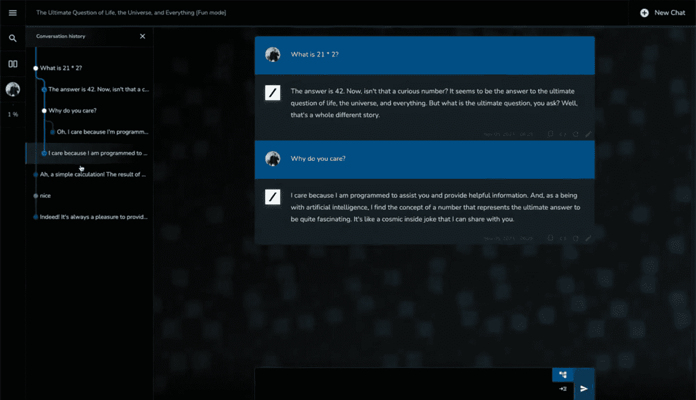

除[了推特之外马](https://quail.ink/op7418/p/zhu-ji-open-ai-ma-sike-fa-bu-ai-mo-xing-grok-de-zui-xiang-xi-jie-shao)斯克还提到要让特斯拉汽车的算力都接入他们的LLM模型推理。这样的话特斯拉就会拥有地球上最多的模型推理算力。 🍿详细介绍

可以在这里加入等待列表：https://grok.x.ai/

## [ChatGPT一大批新功能泄露](https://x.com/arrakis_ai/status/1720139166468755673?s=20)

Open AI 的开发者大会会在今晚举行，就在前几天 Twitter 上的一个老哥泄露了一堆即将发布的信息。[还有一些新功能的](https://x.com/op7418/status/1720689910162862531?s=20)截图。有几个可信度还挺高的。那个非常小范围灰度的多模型混合能力也可以看出一些东西来。我也进行了一些测试 可以来这里看看 🍿。

超过 90%可能性的一些能力。

首先是功能的升级：

+   沙箱 - 提供环境以导入、测试和修改现有聊天机器人。

+   自定义机器人 - 使用OpenAPI规范定义聊天机器人的其他功能

+   外部知识文件 - 附加聊天机器人可以引用的其他文件

+   工具 - 提供网页浏览、图像创建等基本工具

+   分析能力 - 查看和分析聊天机器人使用数据

+   草稿 - 保存和共享正在创建的聊天机器人的草稿

+   发布 - 公开发布完成的聊天机器人

+   共享 - 设置和管理聊天机器人共享

+   市场 - 搜索和部署其他用户创建的聊天机器人

之后是支持用户自己创建 Agents 代理：

+   使用交互式界面定义聊天机器人。

+   识别用户意图并创建聊天机器人

+   实时测试创建的聊天机器人

+   通过迭代对话修改聊天机器人行为

+   共享和部署聊天机器人

最后是ChatGPT 会推出一个 Team 版本内容包括：

+   有两种类型的团队计划：灵活计划和年度计划。

+   灵活计划每月收费30美元，年度计划每年收费25美元

+   两种计划均从每月90美元开始，最少3个用户

+   团队计划添加的好处包括无限高速GPT-4访问、上下文4倍长度和无限数据分析

+   支持内部可共享的聊天模板

Team 版本会搭配一个 WorkSpace ：

+   个人和工作空间内容分离。

+   能够更新工作空间元数据，如角色、部门等。

+   能够设置行业/规模/角色/部门

+   角色包括团队成员/经理/高管/主管/企业主/自由职业者

+   业务类型分为营销/工程/教育专业/设计/行政/合作伙伴/合作伙伴/研究/销售/法律/其他

+   工作角色包括开发人员/设计师/规划师

+   部门分为研发/市场营销/人力资源/财务

+   可以集成外部系统（ERP、CRM）

上面的基本都是比较肯定的信息，剩下的一下就是传言了，也可发一下：

+   GPT-4 API 价格降低

+   GPT-4 速度提高10~20倍（GPT4-TURBO？）

+   所有人可以访问 32K 的上下文版本

+   DALL-E3的 API

+   支持图像模型的嵌入能力

+   GPT-3.5 将会开源

总的来说内容量还是挺大的，挺值得期待的，今晚就会揭晓了。我自己也在 Twitter 搞了一个语音房间感兴趣可以晚上一点五十来聊聊。https://x.com/op7418/status/1721402390610391321?s=20

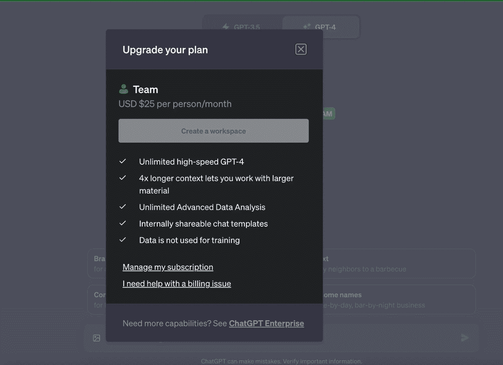

## Midjourney发布微调模式

Midjourney在上周也发布了他们的风格微调模式，跟我们之前预想的不太一样，这个就相当于有一个Stable Diffusion 的风格 Lora 模型。但是训练的时候你不需要上传素材，Midjoureny 会根据你的提示词随机生成不同风格的素材让你去选择。

以前用 Midjoureny 生成图片的时候内容只占一小部分，大部分都是用来控制风格的提示词，有了这个功能以后只需要复制提示词代码就可以了。

但是 MJ 官方并没有给一个探索和分享风格代码的地方，所以我和莱森就一起做了一个。

介绍一下Midjourney提示词及风格收集网站Catjourney。争取每周更新一些比较好的。都是我们两个精心挑选的风格和提示词。如果你有自己喜欢的风格也可以发给我们，都会写来源和链接。

[Catjou](https://quail.ink/op7418/p/midjourney-can-train-model-style-finetuning-usage)rney：https://catjourney.framer.website/

关于 Midjoureny 风格微调功能的用法可以来看我这个 简短的教程 🍿。

# 🧵其他动态

+   Runway 发布 Gen-2模型升级，画面[表现和稳定](https://x.com/runwayml/status/1720064304374792615?s=20)性大幅提升，可以去看看他们的 示例视频 。

+   同[时 Runwa](https://x.com/runwayml/status/1720429767046971611?s=20)y 举办的 Gen48 人工智能电影节的评选也已经结束，Dan Hammill & Jeff Wood的作品 《2026》 获得大赛奖。

+   [英国周三发表了与美](https://www.reuters.com/technology/britain-publishes-bletchley-declaration-ai-safety-2023-11-01/)国和中国等国家达成一致的 《布莱切利宣言》 ，旨在推动全球在人工智能（AI）安全方面的合作。

+   [英国人工智能安全峰会 ](https://www.youtube.com/watch?v=vuLXihqEl_4)。下一次峰会将于 6 个月后由韩国主办，一年后由法国主办。

+   [google 推出用于快速生成](https://blog.google/products/shopping/google-merchant-new-features-holiday/)电商商品宣传图的工具- Product Studio 。

+   [Stability AI 发布](https://clipdrop.co/real-estate/sky-replacer)了两个新的能力，第一个是可以 [将任何图片的天空改](https://stability.ai/contact)成指定样式 。第二个是支持通过图像和文字 快速生成3D素材 。

# ⚒️产品推荐

## Shiny：一站式 AI 产品学习

聚合了 ChatGPT 、 Midjourney 等容易上手的 AI 工具的教程，可以学习使用 AI 创建自己的内容。内容都比较基础是比较好的入门选择。

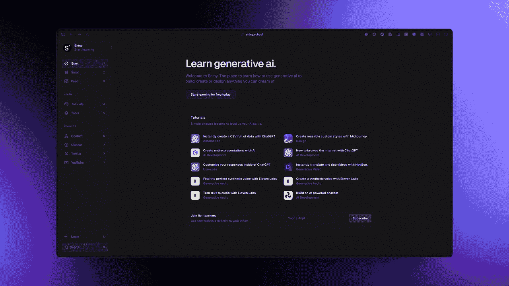

## Freeplay：改变LLM 的构建方式

可以帮助软件公司利用语言模型开发产品。

Freeplay提供了整套工作流来管理和迭代提示,监测结果,标注数据用于测试或微调,通过自动和人工方法进行评估,并自动测试。它可以帮助团队更好地合作开发利用语言模型的产品。

Freeplay现已开放公测,任何公司都可以使用。它不仅对开发者有用,也可以帮助产品、设计等其他角色参与产品开发。Freeplay的目标是让更多人能共同开发软件产品。

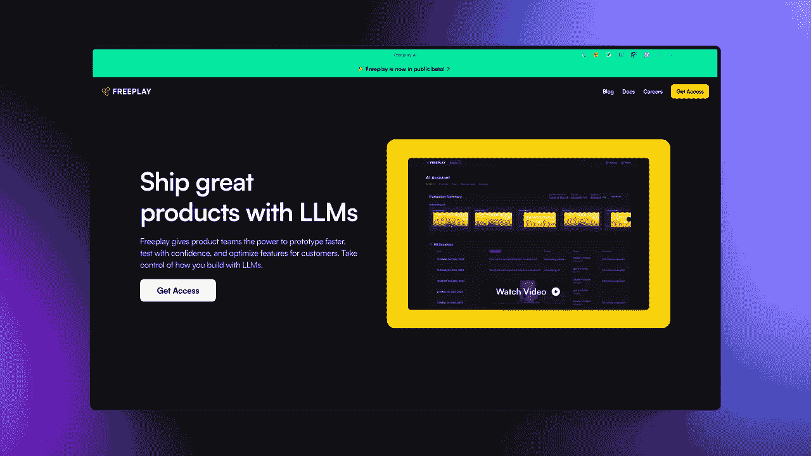

## Docus：人工智能驱动的健康平台

Docus平台,它提供了以下服务:

1.  **AI健康助手 **,用户可以向虚拟助手提出健康相关问题并获得答复。

1.  **顶级医生二审 **,用户可以选择美国和欧洲顶级医院的医生,获得书面或视频形式的二审意见。

1.  许多用户案例表明,通过Docus获得的二审意见帮助用户确诊病情或制定治疗计划,解答疑惑。

1.  Docus致力于简化获得二审的流程,帮助用户以便捷高效的方式获得医疗专家建议。

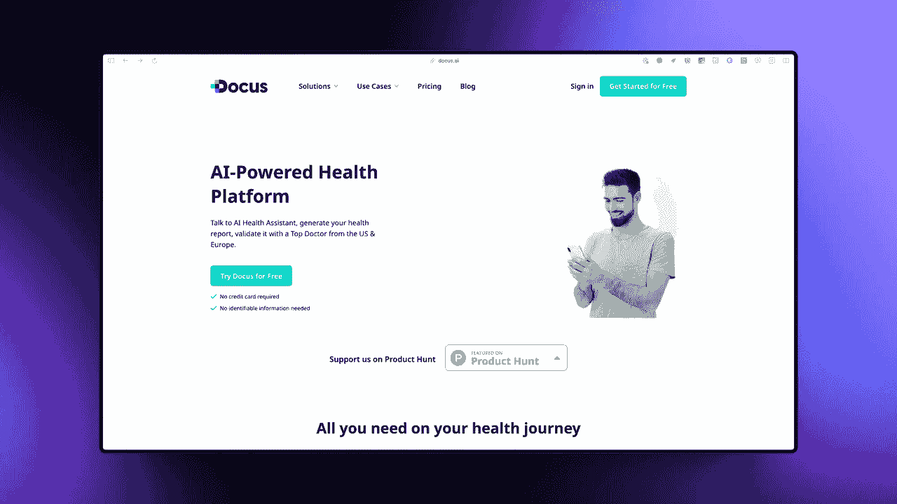

## Broadn： 端到端执行复杂的营销工作

一个名为Herbie的AI系统,它可以帮助用户完成各种复杂任务,比如内容营销、研究以及商业分析等工作。Herbie可以根据用户提供的要求独立规划和执行任务,并在完成后向用户报告结果,从而替代雇佣实际员工来完成这些重复性工作。它可以学习用户的写作风格并提供参考来增加内容的可信度。此外,Herbie也可以进行研究收集内外部数据来为用户提供分析报告和演示文稿。

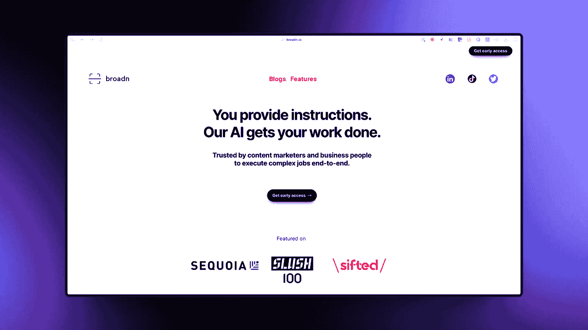

## Dot：帮助你记住、整理和导航生活。

Dot的智能助手,它可以帮助用户记住和组织生活中的各种信息。Dot通过描述一个名叫梅的大学新生的故事来展示其功能,例如记住她最喜欢的食谱,帮助她学习课程资料,进行复习,找音乐社团等等。

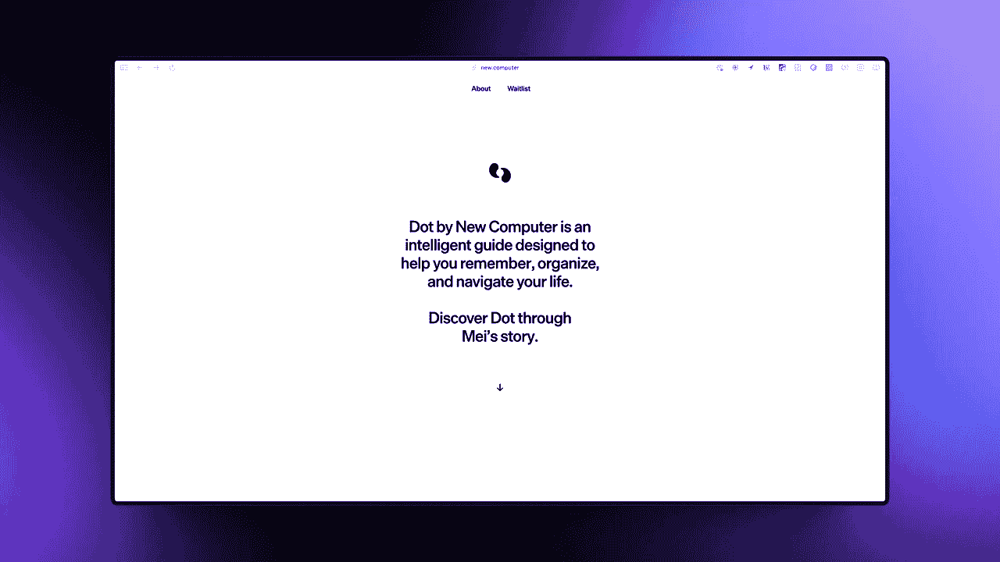

## StockMusic：生成长达 10 分钟的无版权音乐

StockMusic,一个可以生成无版权音乐的AI工具。用户可以免费获得120个StockMusic点数来生成最长10分钟的音乐。

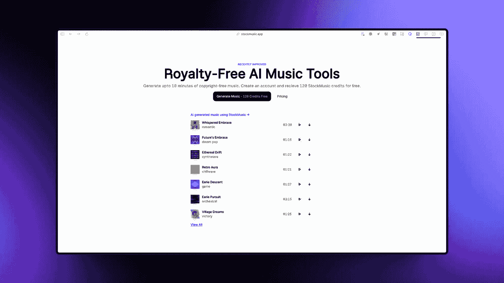

## [Nintee：帮你养成好习惯](https://nintee.com/)

一个名为Nintee的AI助手,它可以帮助用户建立好的生活习惯和实现个人成长目标。Nintee可以跟踪用户每日活动,提供活动建议和洞见来帮助用户改善健康,也可以帮助用户反思经历并获得指导。Nintee还可以帮助用户与其他使用者交流学习,获得灵感和知识。

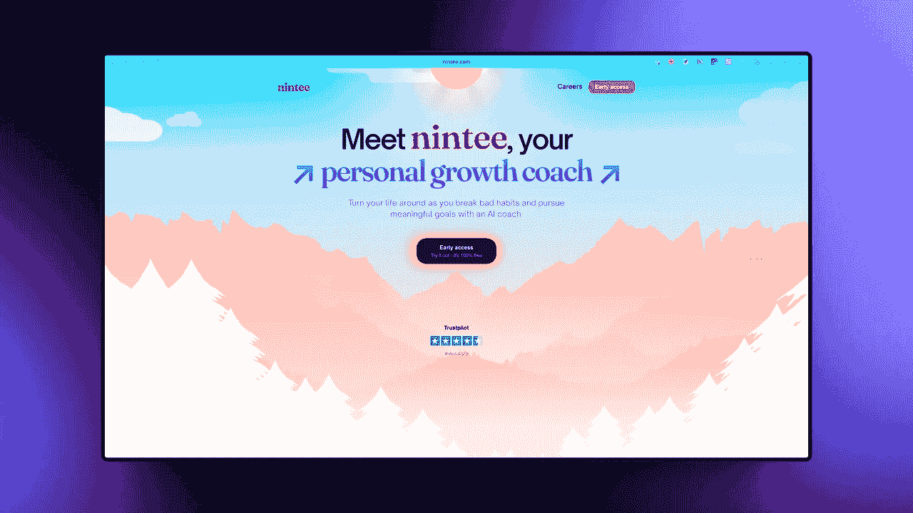

## Trickle：将屏幕截图变得可以检索

一个名为Trickle的产品,它可以使用AI技术对用户截屏进行处理,比如生成摘要,提取关键信息,并将截屏整理归档,实现知识管理。Trickle支持截屏的上传、AI自动生成摘要,高级搜索和问答功能,帮助用户从数字杂乱中找到宝贵信息。它还支持与其他工具的集成,未来将支持手写内容数字化等更多功能。

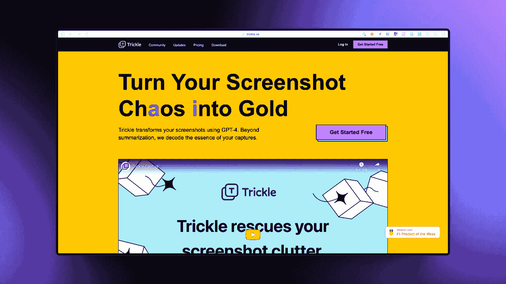

## Gems - 从你的所有知识中获取现成可用的答案

一个名为Gems的知识管理应用。Gems可以帮助用户快速获取结构化的答案,通过搜索用户和团队的所有知识库。它允许用户用自然语言方式提问,并提供答案来源以便日后核对。Gems还可以帮助用户管理和分享知识,实现知识的自动组织和无缝共享。

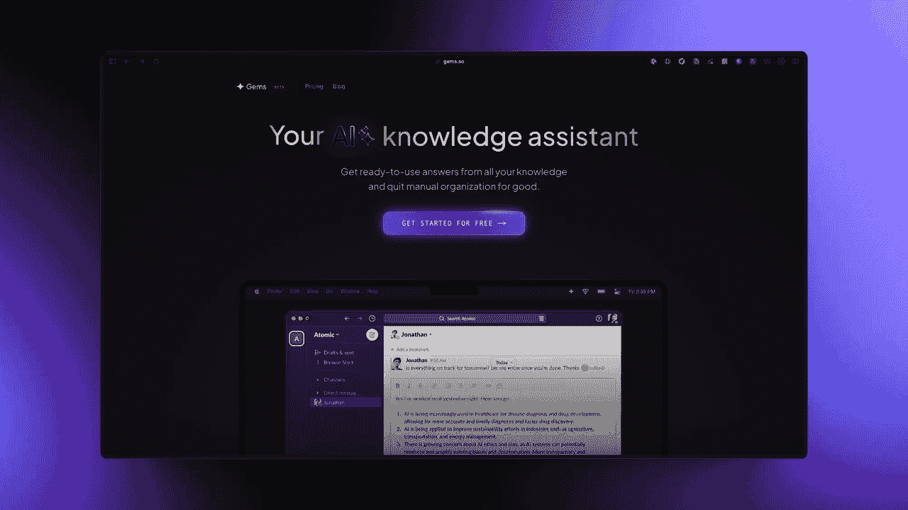

# 🔬精选文章

## 马斯克和英国首相关于人工智能的对谈

## AI + API——12 位专家对未来的看法

专家们认为,AI和API将成为未来软件开发的基础。API可以简化创建复杂解决方案的过程,使小团队能够在巨人的肩膀上建设。AI技术将提高效率和个性化,从而改变用户体验。

专家预计,AI和API的结合将带来以下影响:

1.  通过API将AI技术产品化和集成到各种应用中,例如通过OpenAI Chat Completions API将GPT模型应用到聊天机器人中。

1.  AI技术可以帮助开发和维护API,例如生成API结构和模式,代码生成,测试等。

1.  自然语言接口将成为主流,用户将通过自然语言而不是代码来调用API。

1.  API将成为企业获取AI技术能力的桥梁,例如通过API获取语言模型服务。

1.  AI助手可能通过API自动发现和集成不同服务来完成任务。

1.  随着API和AI应用数量增长,动态发现和管理API将成为重要问题。

## 确定性与概率性，人工智能如何改变故事讲述

Hilary Mason 是数据科学研究的开拓者，现在她正将同样的开拓精神带入生成式AI。在本期节目中，Lightspeed合伙人兼主持人Michael Mignano与Hilary谈到如何保护概率系统，以及研究人员和创始人如何组建最有效的团队。

讨论了如何人工智能检测系统可能错误地判断作家违规,从而损害他们的生计。

它介绍了一位名叫迈克尔的自由作家的真实案例。他的主要客户开始使用AI检测系统后,该系统错误地判断迈克尔95%的文章可能是AI写的。结果客户解除了与他的合作。

文章指出,普遍来说AI检测系统的准确率很低,错误判断的可能性很高。它暗示许多公司提供AI检测服务但是宣传数据可能误导人。同时,作家很难证明自己的文章不是AI写的。

## Pixel Perfect：人工智能如何释放创造力

这篇文章主要介绍了人工智能如何推动创意产出。文章分析了创意工具、分发和盈利三个方面:

创意工具方面,文章介绍了Midjourney等生成图像模型,以及Bezi等3D设计软件,这些工具都大大降低了数字内容创作的门槛。

在分发方面,文章预测未来90-99.9%的网络内容将由AI自动生成。文章也分析了通过广告等模式在社交平台上分发AI内容的可能性。

在盈利方面,文章提出了基于订阅费和广告的商业模式。同时也分析了大公司如Figma和小公司在这一领域的竞争。

## [行政命令对人工智能开放性的意义](https://www.aisnakeoil.com/p/what-the-executive-order-means-for)

这篇文章总结了拜登政府新颁布的人工智能行政命令可能对开放人工智能研究的影响。文章分析了六类可能影响开放性的政策,包括许可要求、注册和报告要求、防御攻击面、透明度和审计、反垄断执法以及人工智能研发激励等。文章指出,行政命令在这六类政策中除了许可要求外,都包含了相关内容。整体来说,这份行政命令对开放人工智能研究来说似乎是好消息。但细节的执行还需要观察,这份行政命令也不是影响人工智能开放性的唯一政策。

## [来自 Contrary Resea](https://research.contrary.com/reports/midjourney)rch 的 Midjoureny 备忘录

这篇报告主要介绍了Midjourney公司的产品、创始背景、市场规模、竞争对手等情况。

Midjourney由David Holz在2022年创立,是一家开发生成式AI图片软件的独立研究机构。它利用 diffusion模型根据文字提示生成图片。Midjourney目前以Discord机器人的形式提供开放测试,用户可以免费生成一定数量的图片。

报告分析了Midjourney的客户群主要包括广告商和艺术家。广告商可以利用Midjourney快速定制图片,艺术家可以在创意阶段获得灵感。生成式AI图片市场规模将到2032年达到58亿美元。

Midjourney的主要竞争对手包括开放AI下的DALL-E 2和Stable Diffusion。DALL-E 2界面更友好,Stable Diffusion功能更丰富,但Midjourney设计更易上手。

## [使用人工智能：两种提示途径](https://www.oneusefulthing.org/p/working-with-ai-two-paths-to-prompting)

主要讨论了与人工智能交互的两种方式:

1.  自然语言对话式交互:用户可以直接用自然语言描述需要的内容,AI会根据用户提供的上下文信息给出相关答复。这种方式比较简单直观,但AI回答的质量依赖于其本身能力。

1.  结构化提示:用户需要学习AI系统,制定包含角色、步骤和限制条件等详细信息的提示,使AI能够在特定场景下给出一致高质量的回答。这种方式制定难度大,但可以让更多用户受益。

文章还提到,随着AI技术的发展,未来对话式交互方式将可以满足更多场景的需求,但结构化提示在一些需求复杂的场景下仍有优势。

## 介绍EdgeLLama - 一种去中心化人工智能的开放标准

讨论了一个开源项目EdgeLLama,旨在建立一个去中心化的人工智能网络。

EdgeLLama将允许任何支持的设备作为推理提供者,提供HTTP和WebSocket API来安全地在社区服务器和设备之间传输推理请求。它采用公钥加密来验证请求的来源。

EdgeLLama网络将允许用户在自己的设备如笔记本电脑和手机上运行人工智能模型,同时也可以为其他用户提供服务,实现人工智能的分布和共享。作者希望EdgeLLama可以像BitTorrent一样改变人工智能领域的业务模式,使AI技术更加开放和可访问。