# AIGC Weekly #44

> 来源：[https://waytoagi.feishu.cn/docx/XLp5dxiNsokb56xux61c7mdTn1e](https://waytoagi.feishu.cn/docx/XLp5dxiNsokb56xux61c7mdTn1e)

> 🔗 原文链接： h[ttps://quail.ink/o](https://quail.ink/op7418/p/aigc-weekly-44)p7418/p/aigc-wee...

> 发表时间：30 Oct, 2023

工具：Midjoureny

提示词：blue light lines with different types of rainbow colors, in the style of dark pink and navy, Blink-and-you'll-miss-it details,dramatic diagonals, light black and red, smooth and shiny, light red and light purple, maximilian pirner, 8k resolution --ar 16:9 --v 5.2

# ❤️上周精选

## ChatGPT 更新文档总结以及模型自动选择功能

Open AI今天给一些人悄咪咪开放了两个新功能，现在他可以上传PDF等文档进行分析和提问了，GPT-4加持下想必能有更好的结果。另一个是现在代码解释器，图片交谈和图片生成还有联网能力不需要你自己选择了，你发出要求后他可以自行选择需要的能力完成任务。

我们都以为两个主要的是文档交谈能力的时候，一些开放了模型自动选择的人发现了一一些不得了的东西。

这个Chat GPT自动选择模型的功能是非常强大的。不只是自动调用模型那么简单，这个新模式可以将信息在多个功能之间传递从而完成类似代理的工作。

可[能这才是](https://quail.ink/op7418/p/chatgpt-releases-new-feature-multimodal-fully)GPT-4多模态模式的完全体，从一些测试上来看他已经有了非常大的潜力，比如下面这个查询当地天气用 DALL-E3 画出来。🍿 更多案例

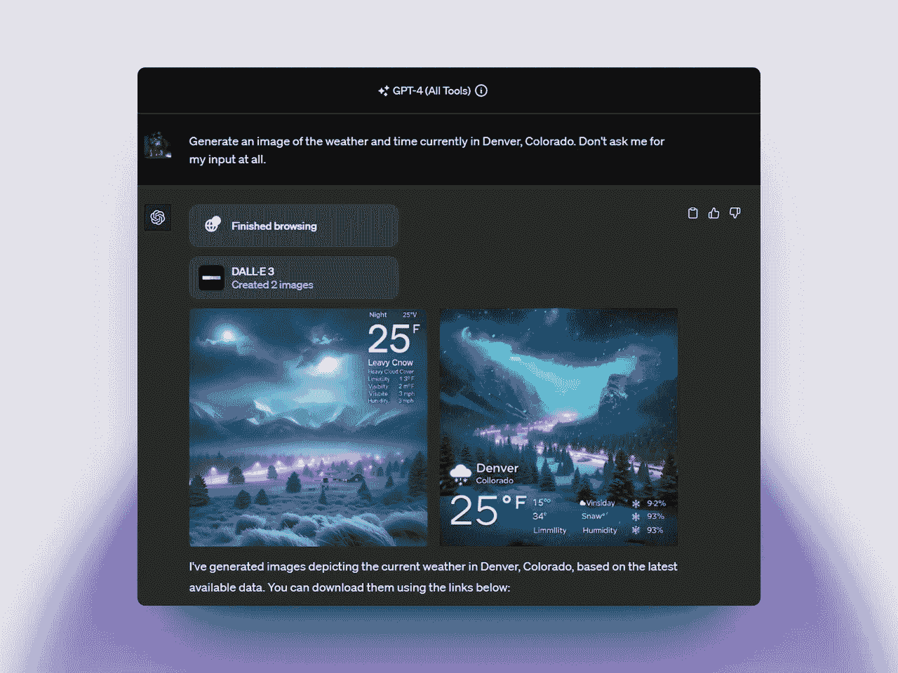

## Perplexity发布自己训练的模型

Perplexity还是开始自己训练模型了，公布了自己训练的两个pplx-7b-chat 和 pplx-70b-chat模型。

主要的特点是优先保证一系列任务的智力、有用性和多功能性，而不强加道德判断或限制。

与llama-2-70b-chat相比较完全拒绝”的情况减少了22.7%，而“没有拒绝”的情况增加了31.9%。

估计是被 Open AI 和 Claude 2的各种拒绝回答搞麻了，他们做搜索和一些 Agents 功能确实比较烦这种。

同时上周Perplexity 新获得 5000 万美元融资，目前估值为 5 亿美元。风险投资公司IVP领投。

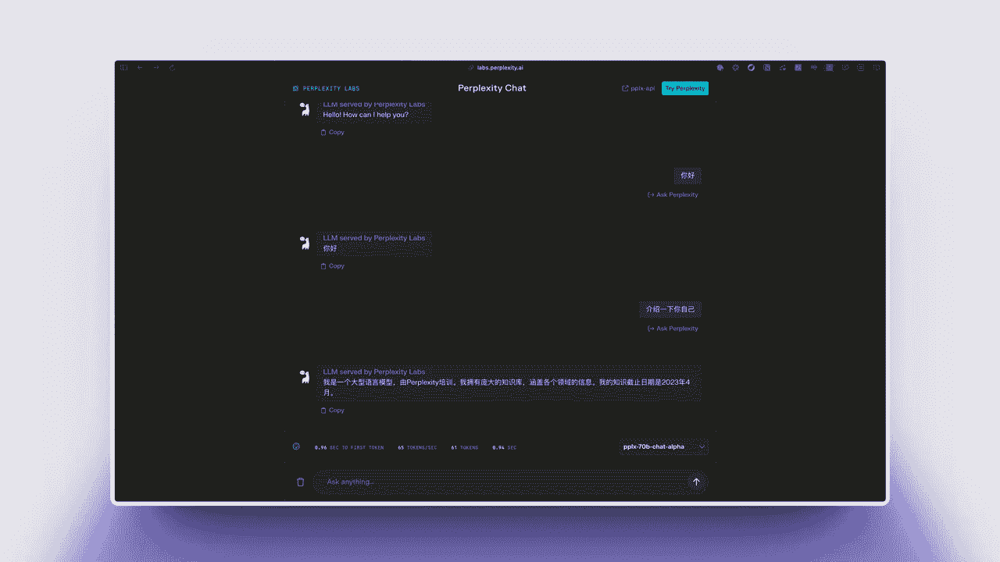

## 时代杂志发布的 2023 影响生活方式的产品- AI 部分

时代杂志发布了 2023 改变生活方式的 200 项最佳创新，其中专门增加了一个 AI 分类，有几个居然没见过，这里整理一下 AI 分类评选出的产品：

+   首先居然是 adobe在 Photoshop 中开箱即用创成式填充图片编辑功能。

+   然后是改变游戏规则的 openai 的GPT-4。

+   动画生成工具 runwayml和 Gen-2 模型 。

+   Alitheon的FeaturePrint技术，这个之前没有了解过，详细看了一下是种光学 AI 防伪标识，用户只需要普通的相机拍摄照片就可以验证。

+   Dedrone的城市无人机监测解决方案，不需要安装硬件就可以对一定范围内的无人机进行监测，并记录违反关键警报区域、违反禁飞区域、越境侵入等的飞行。

+   Meta 的基础多模态 AI 翻译模型 SeamlessM4T，支持近100 种语言的自动语音识别、语音到文本翻译、语音到语音翻译、文本到文本翻译和文本到语音翻译。

+   今年四五月份 AI 孙燕姿的相关技术，so-vits-svc对这个感兴趣的话可以复习一下我的教程： http://mp.weixin.qq.com

+   AlertCalifornia 和加州消防人工智能的野火探测器，当系统发现异常时，它会通过短信向当地消防部门发出警报。在头两个月里，系统已经在收到任何911电话之前正确检测到77起火灾。

+   Stability AI开发的 AI 音乐生成工具Stable Audio，可以通过几个简单的文本提示生成几乎任何声音或歌曲。

+   TrailGuard AI系统，该系统使用Intel提供的小型摄像头来监控濒危物种并发现偷猎者。该系统使用无线电或长距离无线电信号将图像传输到最短30秒内的当局手机上。

+   DALL-E3：之前的图像生成器需要学习一种新的技术语言，包括用减号和数字附加字符串，才能获得最佳结果。但DALL-E 3与ChatGPT结合在一起，用户可以输入会话命令，获得与其描述相匹配的图像。

+   Project Gutenberg是最古老的数字图书馆，微软和麻省理工学院联手推出了开放式有声读物集合，使用文本转语音技术将5000本书转换为免费的合成朗读有声读物，现已在Spotify上提供。

+   AudioShake，他们的AI程序可以隔离预先录制的音频的元素，将其分解成各个组成部分。解决一些老音乐无法分离特定音轨的问题。

+   Ai Pin：一旦轻便的Humane Ai Pin磁性连接到你的衣服上，它就成为你的AI助手。它使用专有软件和OpenAI的GPT，可以让你用只用你的声音做任何事，从提出复杂问题到打电话发短信。

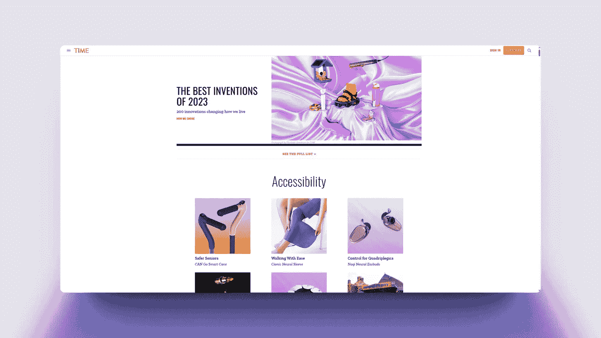

---

# 🧵其他动态

+   百川智能 推出 Baichuan2-192K 模型 ，上下文长度达到了 192k，大约 35 万汉字的长度。

+   [Runway举办的AI视频](https://gen48.runwayml.com/vote)大赛 GEN 48已经开放投票 ，各位可以去看看有哪些值得投。还有就是在专业人士手里AI视频可以做到什么程度。

+   [AI 视频生成应用Gen](https://x.com/genmoai/status/1717526239353983197?s=20)moai 升级到了 0.2 版本 ，支持使用图片生成视频，视频生成的长度变味原来的 3 倍，分辨率提高了 2.7 倍。

+   Poe开启了用户 [创建机器人的货币化计划 ](https://quorablog.quora.com/Introducing-creator-monetization-for-Poe)，用户可以从自己创建的机器人中获得收入。

+   Shutterstock 将创意 AI 集成到 7 亿张图片库中 ，提供首个完全可定制图片的素材市场。

+   谷歌推出了 3 种 [在线检查图像和来源 ](https://blog.google/products/search/google-search-new-fact-checking-features/)的新方法。

+   微软首席执行官纳德拉： 微软拥有超过 100 万付费 Github Copilot 用户 。

---

# ⚒️产品推荐

## [AudioSep：音轨分离模型](https://pinokio.computer/item?uri=https://github.com/cocktailpeanut/AudioSep.pinokio)

AudioSep 是一种 AI 模型，可以从音频剪辑中仅分离出所需的声音。 比如想从一个嘈杂咖啡馆录制的音频中分离出对应的人声。支持本地部署和对应的UI界面。

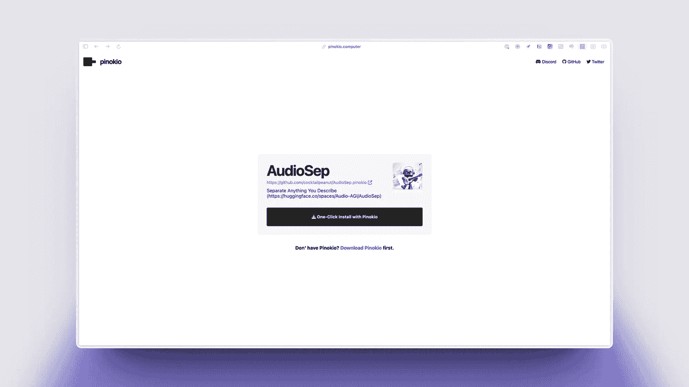

## Audioflare：Cloudflare的音频处理工具

Cloudflare的音频处理工具，支持在一个地方对录音进行转录翻译和分析。

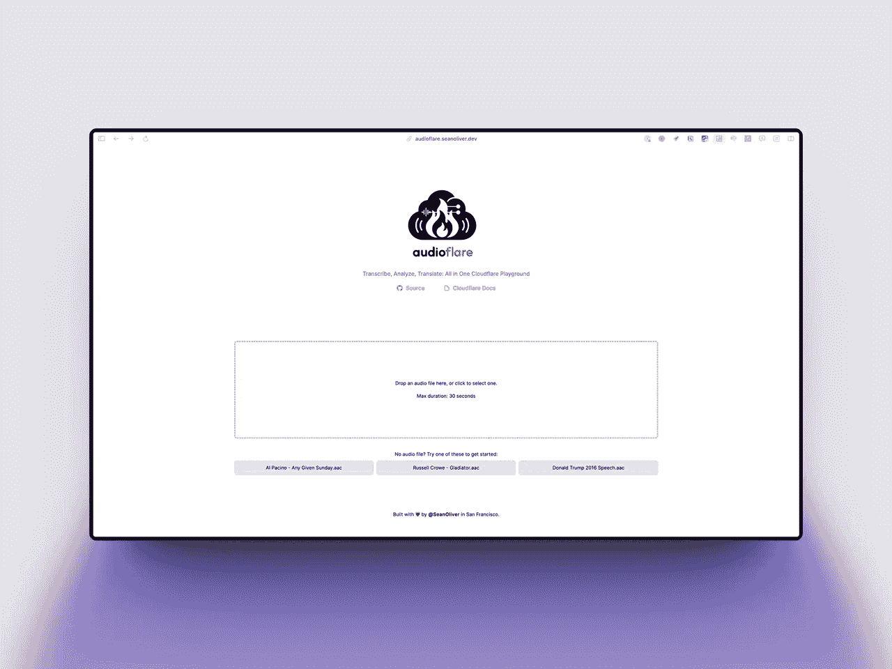

## Genie AI：法律 AI 助手

Genie AI是一个法律文档助手,它提供4700多个法律模板,可以帮助用户快速制作不同类型的法律文件,如创始人协议、保密协议等。它使用AI技术,可以识别文档中的风险点,解释条款含义,提供修改建议。

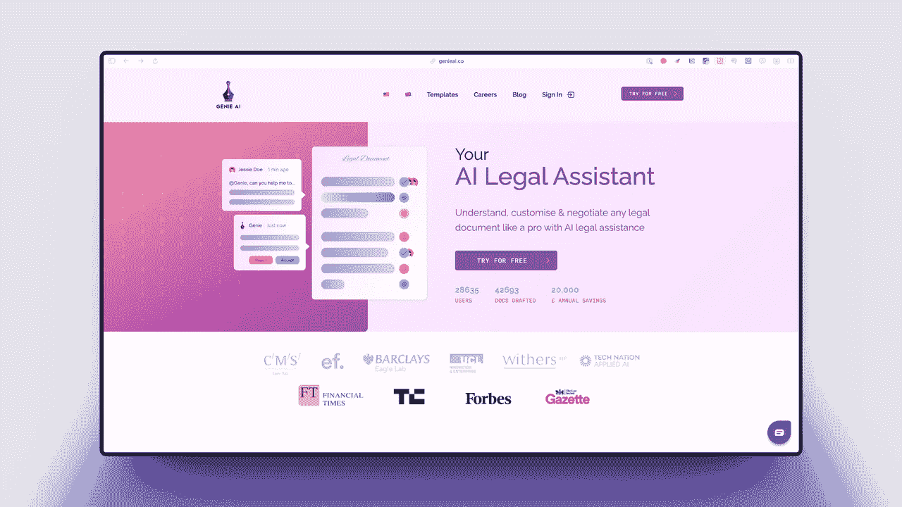

## Helpbar：SaaS 搜索和 AI 帮助方案

Helpbar产品,它是一个为SaaS产品提供搜索、导航和AI答案的帮助中心解决方案。

Helpbar可以快速设置,只需连接帮助中心并设置品牌样式。它提供一个触发小部件或快捷键,可以选择常驻项和上线。

通过一个快捷键,Helpbar可以提供许多使用案例。它可以通过AI答案从所有内容中快速搜索答案,帮助用户找到需要的内容,不需要切换标签页,从而提高产品学习速度和工作效率。同时,它也可以减轻支持团队的工作量,让用户通过快捷键自助解决问题。

Helpbar还可以整合其他工具,例如Loom视频、Figma原型等,帮助用户在应用内完成工作而无需切换应用。

## Writers brew：AI 写作工具

Writers brew AI写作助手应用程序。这个应用可以在所有浏览器、本地应用和电子应用中工作,可以帮助用户更好更快地写作。它可以将文本编辑器转变成一个AI文本编辑器。它内置了OCR功能可以从图像中提取和转换文本。与其他服务相比,它的价格更低廉。

这个应用有3种使用方式:魔法笔写作模式可以将文本编辑器转变成AI助力编辑器;智能邮件回复可以直接在邮件客户端生成回复草稿;OCR到AI可以从图像中提取文本然后使用AI进行处理。

它提供50多个社区预设模式和60多个写作工具,也可以自行构建预设。它的价格低廉是因为使用者需要自行提供OpenAI密钥来调用AI服务。

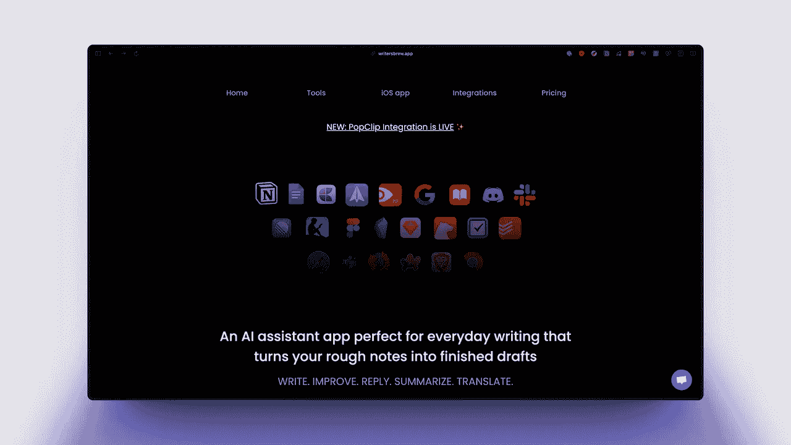

## Sync：可以实时进行口型同步的 API

Sync Labs的公司,它提供了一个实时唇形同步API产品。这个产品可以将任何视频与任何语音同步,无需训练,可以同步任何语言。

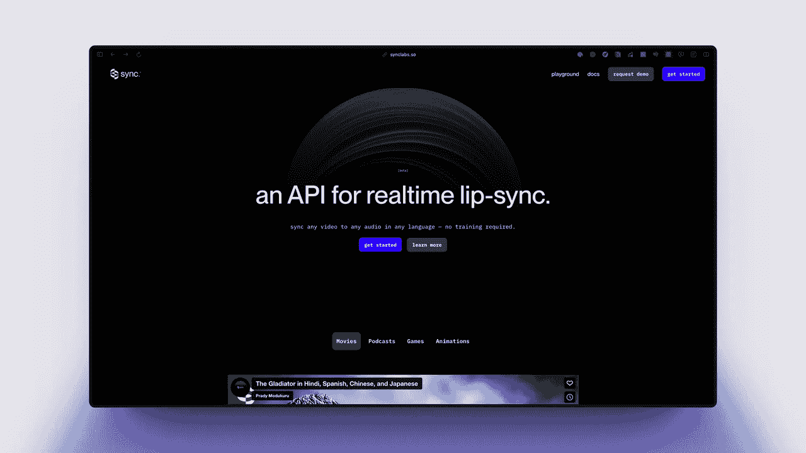

## Audio Writer：将语音转变为笔记

Audio Writer可以将用户的语音录音转成文字,并且可以对文字进行修订,重写不同风格,翻译成15多种语言,输出成不同格式如邮件、社交媒体帖子等。

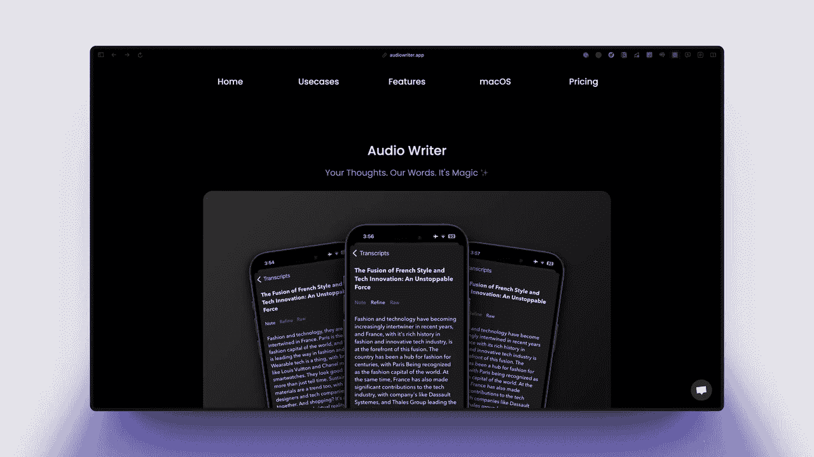

## [Compass：风投机构副驾驶](https://www.landscape.vc/compass)

Compass,一个为风险投资机构提供数据驱动的筛选和分析工具的产品。它可以帮助投资人更快地发现有潜力的初创公司,识别竞争对手,挖掘新兴趋势。Compass通过AI技术来丰富数据,帮助投资人更高效地处理投资流程。文章中还提到,Compass已经收录超过50万家公司的数据,并且每周都在不断更新。一些风险投资机构已经开始使用Compass,表示它可以帮助他们更早发现机会。

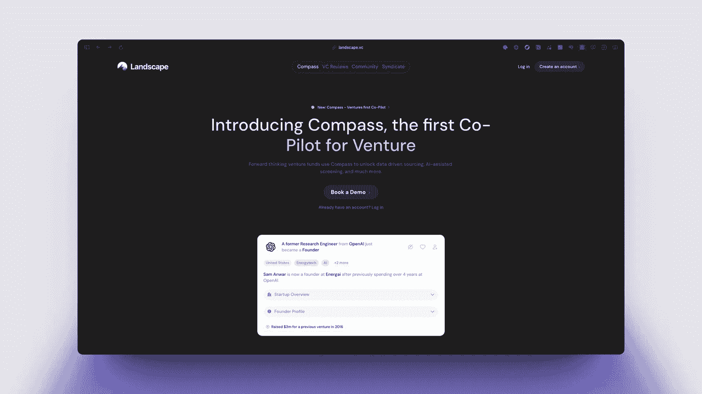

## Equals：将表格信息变成后台界面

Equals可以将电子表格转换成动态报告和仪表板,并自动分发最新的报告。它可以直接连接数据库和其他数据源,将数据导入电子表格中进行分析。用户可以在Equals中创建各种类型的图表进行可视化,报告和仪表板也可以自动更新。Equals支持自动化报告分发到Slack、邮件和幻灯片等渠道。它集成了数据连接、电子表格和报告功能于一体。Equals可以帮助企业更容易和直观地进行商业智能分析。

---

# 🔬精选文章

## Matryoshka Diffusion Models

提出了一种端到端的高分辨率图像和视频合成框架。所提出的框架使用扩散过程，可联合对多个分辨率的输入进行去噪，并使用嵌套的UNet架构，其中小规模输入的特征和参数嵌入在大规模中。该框架允许从较低分辨率到较高分辨率的逐步训练计划，从而显着改善高分辨率生成的优化。作者在各种基准测试中证明了他们的方法的有效性，包括类条件图像生成，高分辨率文本到图像和文本到视频应用。他们能够在最高1024x1024像素的分辨率下训练单个像素空间模型，证明了使用仅包含1200万个图像的CC12M数据集的强零射击泛化能力。

## 使用基于谱图的大型语言模型进行口头问答和语音续话

一种经过端到端训练以直接处理声谱图的口语模型；可以对其进行微调以生成高质量的准确口语；在说话者保留和语义连贯性方面超越了现有的口语模型。

## Zephyr 7B：直接蒸馏语言模型对齐

如何创建一个更小的语言模型，以满足用户需求。他们提到了之前的研究表明，在较大的模型上应用蒸馏监督微调（dSFT）可以显著提高任务准确性。为了改进模型的意图对齐性，他们使用了来自AI反馈（AIF）的偏好数据，并应用了蒸馏直接偏好优化（dDPO）来学习一个更好对齐用户意图的聊天模型。最终的结果是Zephyr-7B，在7B参数模型上的聊天基准中达到了最新水平，而且无需人工标注。

Meta 发布的关于 Llama 入门指南也是个好东西啊，里面包括了想要使用和训练Llama的所有内容，包括模型的微调、量化、提示工程、推理和测试一整个链路。

并且在一些深入内容上也介绍了应该看的其他详细教程，如果有一些基础想要微调Llama的可以看一下这个教程。

## [生成式人工智能会改变商业吗？](https://www.ft.com/content/647fdf88-d757-45e4-a640-9654673b7ece)

主要介绍了生成式AI的应用领域和商业潜力。它分析了生成式AI在消费者交互、内部工作等多个领域的使用案例,并预测它将极大推动创意产业和数据分析领域的发展。

文章指出,随着模型规模的扩大和自然语言理解能力的提高,生成式AI已经开始渗透商业领域,并可能带来高达每年2.6万到4.4万亿美元的经济效益。它还可能取代25%的美国和欧洲工作任务。

不过,文章也指出生成式AI目前还存在一定局限性,如无法区分事实与虚构,且输出结果需要人工审核。总体来说,这篇文章认为生成式AI已经成为一项重要技术,但其商业应用仍处在起步阶段,需要进一步研究与实践来发挥其潜力。

## 26 号英国首相关于人工智能的演讲

英国首相里希·萨纳克（Rishi Sunak）于2023年10月26日就人工智能（AI）的利弊发表演讲。他强调了理解和应对AI所带来的风险的必要性，以实现其对未来几代人的好处和机遇。萨纳克讨论了AI可能如何改变社会并解决曾经被认为无法解决的问题，但也承认它带来了新的危险和恐惧。他宣布在英国建立世界上第一个AI安全研究所，该研究所将推进世界AI安全知识的发展，并评估新型AI的安全性。萨纳克还提议建立一个全球专家小组，发布《AI科学状况报告》，并宣布举办世界上第一次全球AI安全峰会。首相强调了保护人民安全的必要性，确保每个人都能从AI的机遇中受益，并将科学努力针对AI用于良好的目的。

## Pegasus-1 (80B)：视频转文本模型

Pegasus-1是一个拥有大约80亿参数的视频语言基础模型,它由视频编码器、视频语言对齐模型和语言解码器三个组成部分组成。它被训练在Twelve Labs收集的3亿多视频-文本对中,这可能是目前为止训练视频语言模型规模最大的语料库。

与其他方法不同,Twelve Labs采用“视频优先”策略,其核心原则是:高效处理长视频、多模态理解、基于视频的嵌入表示、视频和语言深度对齐。

Pegasus-1在多个视频到文本任务上都表现出色,比状态量级模型提升了大约60%的性能。它可以生成视频概要、章节、亮点等文本,并且理解视频中的视觉和语音信息。

Twelve Labs提供了几个视频到文本API,用户可以获得视频概要、亮点等自动文本,也可以通过Generate API定制生成样式。未来 Twelve Labs还将继续完善其模型和评估框架。

## [Jina AI 推出全球首个开源 ](https://jina.ai/news/jina-ai-launches-worlds-first-open-source-8k-text-embedding-rivaling-openai/)8K 文本嵌入，与 OpenAI 相媲美

介绍了Jina AI推出的第二代文本嵌入模型“jina-embeddings-v2”,该模型支持8192个词汇的上下文长度,是第一个开源的8K文本嵌入模型,并与OpenAI的专有模型“text-embedding-ada-002”在功能和性能上相当。

文章对两个模型在不同数据集上的性能进行了对比,结果显示“jina-embeddings-v2”在分类、重排、检索和总结平均表现方面优于OpenAI模型。

## 这款新的数据投毒工具让艺术家们反击生成式AI

这篇文章介绍了一种名为Nightshade的新工具,可以让艺术家在上传作品到网络前对图片进行隐形修改,如果这些作品被AI公司用于训练模型,就可以破坏模型。

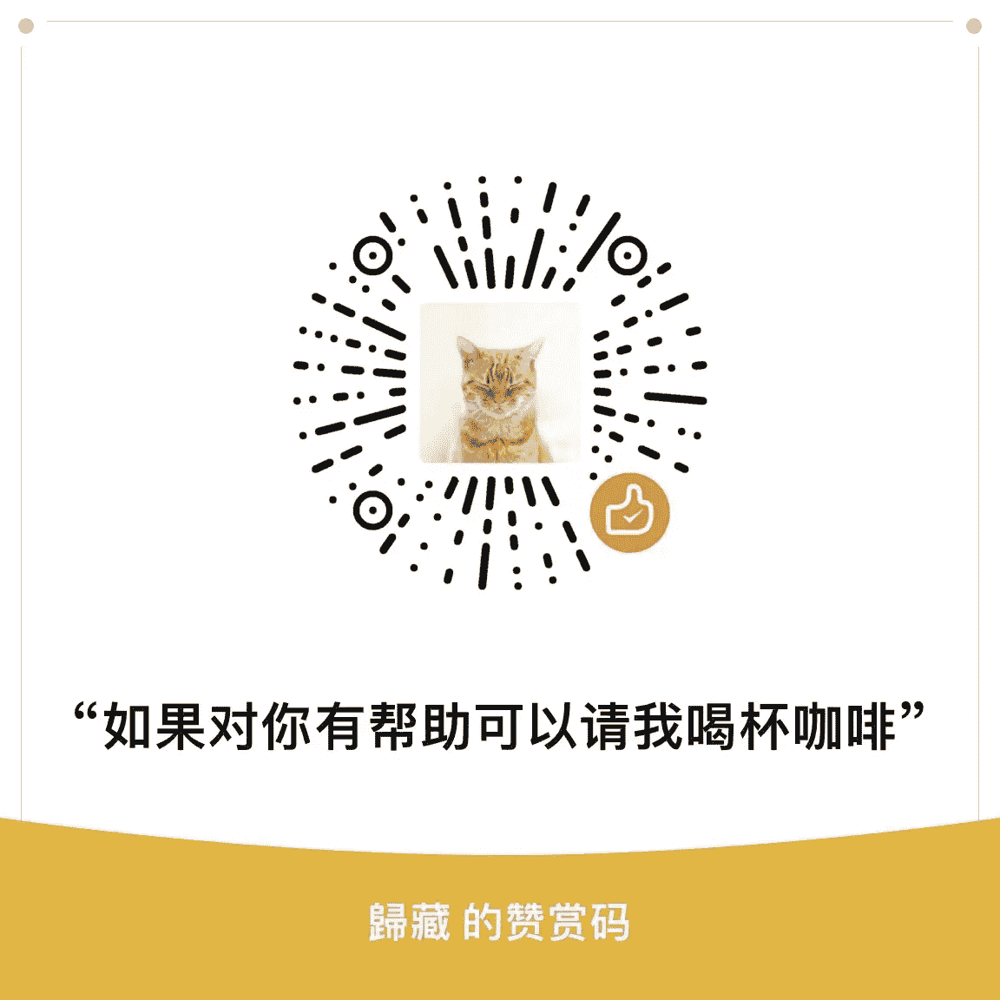