# AIGC Weekly #43

> 来源：[https://waytoagi.feishu.cn/docx/CJ3pdN0CDojljFx4vT5c5RTXnc9](https://waytoagi.feishu.cn/docx/CJ3pdN0CDojljFx4vT5c5RTXnc9)

> 🔗 原文链接： h[ttps://quail.ink/o](https://quail.ink/op7418/p/aigc-weekly-43)p7418/p/aigc-wee...

> 发表时间：23 Oct, 2023

> 上周写了一篇《想玩 AI 画图和视频却没好电脑？藏师傅手把手教你云端部署 SD 生成 AI 视频》 帮一些没有硬件条件又想学习SD的朋友找一些低成本方案，同时还有基础的通过Web UI Animetadiff插件生成视频的教程，感兴趣可以点上面的的链接看看。

工具：Midjoureny

提示词：Realistic photo, close up view, Blink-and-you'll-miss-it details, extreme high tech, abstract, reflective, shades of Klein blues and very little yellow, geometry v5. 1 --ar 16:9

---

# ❤️上周精选

## DALL-E3向所有Plus用户开放，公布了训练论文

上周Open AI向所有ChatGPT Plus 和 Enterprise 用户开放了DALL-E3的使用权限，同时还公布了两篇论文，一篇《通过更好的提示改进图像生成》大致介绍了DALL-E3的训练方法，另一篇《DALL·E 3 System Card》大致介绍了他们是如何保证DALL-E3的安全的。

《通过更好的提示改进图像生成》基本上 阐述了他们DALL-E3主要解决的问题是Diffusion模型中由于训练数据集中图像标题的噪声和不准确性导致的图像生成可控性不够强的问题，解决方式是训练了一个定制的图像提示生成器，并使用它重新为训练数据集生成提示。

同时还和DALL-E2和SDXL进行了对比测试，可以看到几乎所有的指标都比SDXL要高一些。

Open AI对DALL-E3的评估方式也可以参考一下包括：

自动评估：首先使用公共的ViT-B/32模型计算CLIP分数，然后基于GPT-4V评估模型生成的提示和图像的对应关系，最后在Huang等人（2023年）开发的T2I-CompBench评估套件的一个子集上进行T2I-CompBench评估（包括颜色绑定、形状绑定和纹理绑定三部分）。

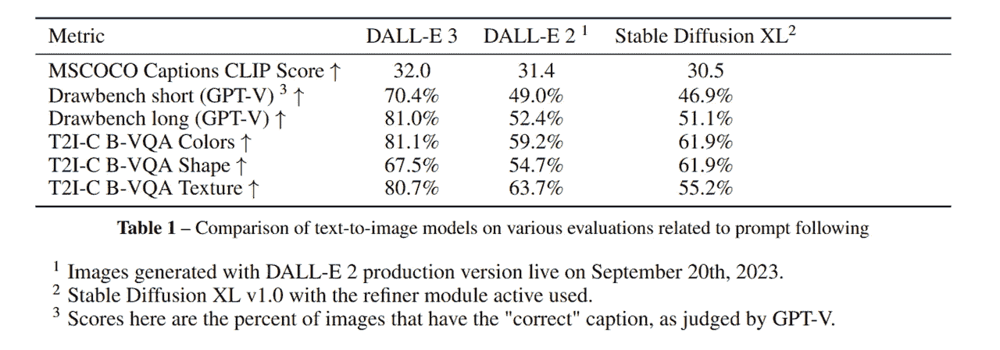

人工评估：评分者被呈现出给予文本到图像模型的完整上采样标题，并被要求“选择哪个图像更符合标题”。想象一下，你正在使用一款电脑工具，根据一些文字生成图像。选择你在使用这个工具时更喜欢看到的图像。连贯性：选择哪个图像包含更连贯的物体。所谓“连贯”的物体是指可能存在的物体。

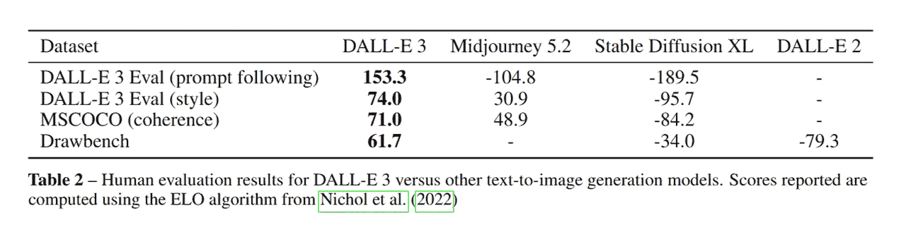

同时Open AI也承认 DALL-E3再测试中也发现了一些问题：

+   虽然DALL-E 3在根据提示进行生成方面取得了重大进展，但在物体摆放和空间意识方面仍存在困难。（已经比其他模型强太多了）

+   在进行文本生成的时候，单词可能会缺少或多出字符。

+   合成提示很容易在图像中产生重要细节的幻觉。例如，给定一幅植物的绘画，提示生成器经常会幻想出植物的属和种，并将其放入提示中。

## Midjourney发布了图像放大功能

Midjourney 终于发布了他们的图像放大功能，你现在最多可以将生成的图像放大4倍，重点是可以连续放大，效果太好了，买了 Topaz 照片放大的要亏了。

+   在生成完成的图像上，你可以看到对应的放大按钮，有2 倍和 4 倍两个选项。

+   在之前的旧图上也可以使用放大功能。

+   4 倍放大能力要比 2 倍多消耗 3 倍的GPU 时间。

+   目前只有 Fast 模式可以使用放大功能，部分 4 倍放大任务会出现黑色图像正在解决，有时候放大的图像会被变暗。

我也进行了一些测试，一张图的大小达到了20M。可以看到画面跟原图很像，但是多了非常多的细节。原图我传到了网盘上： https://pan.quark.cn/s/78fd6a72280a

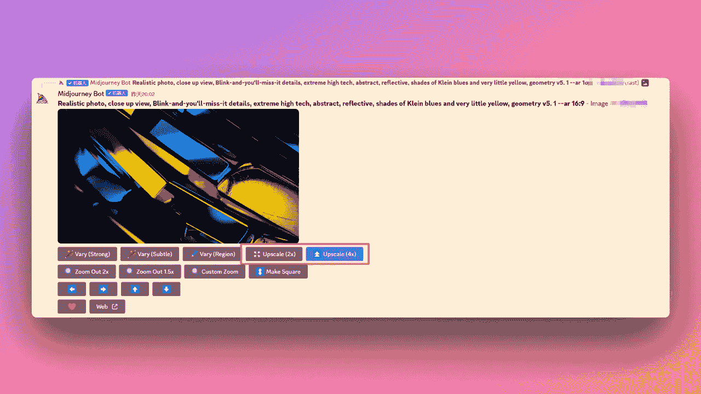

## Open AI 更新了他们的核心价值观

上周 Open AI 更新了他们的信息价值观一如既往的关注 AGI 其他的也挺好的，非常有借鉴意义，Sam 确实厉害。他将AGI描述为“可雇用的中等水平人类同事的等效物”。

**聚焦于 AGI**

我们致力于构建安全、有益的AGI（人工通用智能），希望对人类未来产生巨大的积极影响。

与此目标无关的事情我们不会考虑。

**全力以赴、迅速行动**

要创造出杰出的东西需要努力工作（即使是那些看起来不起眼的部分），而且要有紧迫感；我们决定去做的每一件事都很重要。

不要矫饰，做有效的事；最好的想法可能来自任何地方。

**规模化**

我们相信规模化——无论是在我们的模型、系统、我们自己、流程还是抱负中——都具有魔力。有疑惑时，就放大规模。

**做人们喜欢的东西**

我们的技术和产品应对人们的生活产生积极的变革效果。

**团队精神**

我们最大的进步和特点来自于团队内部和跨团队的有效合作。尽管我们的团队可能有各种各样的特点和优先事项，但整体的目的和目标必须保持完美的一致。

没有什么是别人的问题，每个问题都是我们的问题。

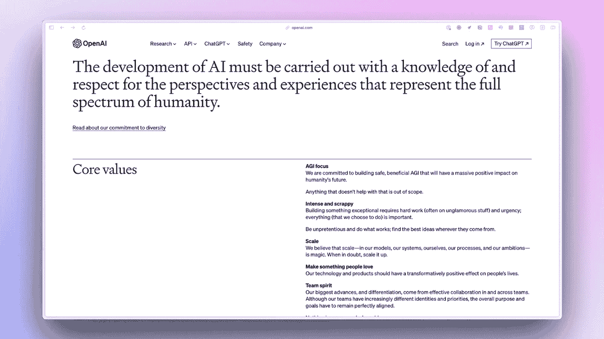

---

# 🧵其他动态

+   Pi现在 [可以访问互联网了 ](https://x.com/inflectionAI/status/1714018923916534226?s=20)，你现在可以向它询问最新的新闻、活动等内容。

+   [亚马逊的钱管用了，95 个国](https://www.anthropic.com/claude-ai-locations)家/地区的用户 可以与 Claude 交谈 。

+   Patronus AI 推出 [EnterprisePII ](https://www.patronus.ai/announcements/patronus-ai-launches-enterprisepii-the-industrys-first-llm-dataset-for-detecting-business-sensitive-information)，这是业界第一个用于检测业务敏感信息的 LLM 数据集。

+   Adept发布了Fuyu-8B ，一多模态且开源的模型。

+   Stability AI开源了他们的音频生成模型的训练和推理代码， Stable Audio Tools 。

---

# ⚒️产品推荐

## Kimi Chat：月之暗面的大模型聊天产品

Kimi Chat是月之暗面大模型的聊天产品，这个模型主打的也是超长的上下文他们声称超过20万字，是Claude 2的2.5倍。这个不好测试不过我试了一下内容总结起码是跟Cluade2不想上下的有时候还比Cluade2强一些。而且还原生支持联网，我尝试的搜索结果还行。其他的就不太好测试了，毕竟一些测试题都在里面了。

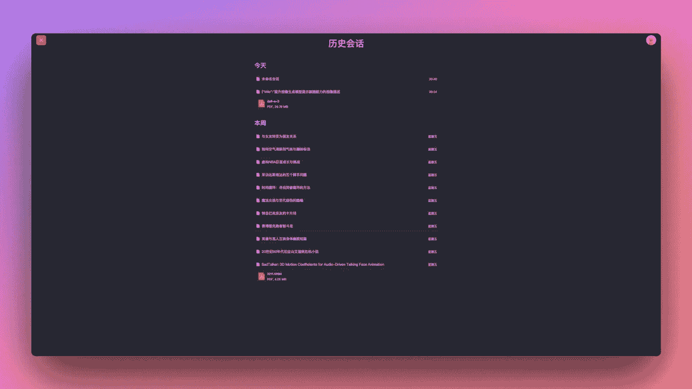

## HyperWrite：在浏览器完成任务的AI助理

HyperWrite 个人助理是一款人工智能工具，可帮助实现任务自动化、优化计划、简化任务并为决策提供信息。它能无缝集成到你的工作流程中，了解你的偏好，并随着时间的推移向你学习，提供个性化建议。它可以处理电子邮件管理、日常任务和研究等任务。

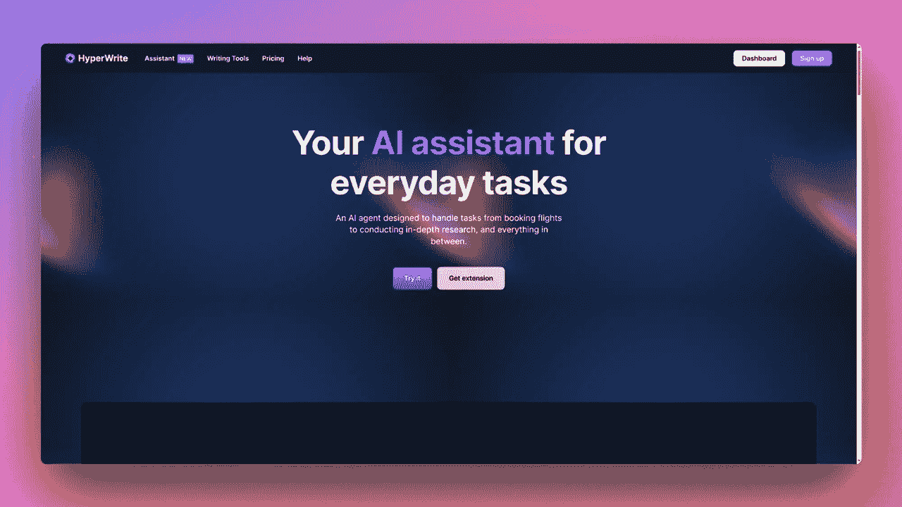

## Impaction：AI对话数据分析平台

Impaction.ai 是一个会话数据分析平台，可帮助产品团队分析以会话界面为核心的人工智能原生产品所产生的会话数据。该平台利用副驾驶体验来分析传统基于 NLP 的情感分析无法捕捉的主观会话数据。Impaction.ai 可与几乎所有存储对话数据的数据源协同工作，包括 AWS S3、GCP Bigquery、PostgreSQL 和 MySQL。该平台提供量身定制的建议、一般分析、深度挖掘和可操作的见解，帮助产品团队了解如何分析会话数据。

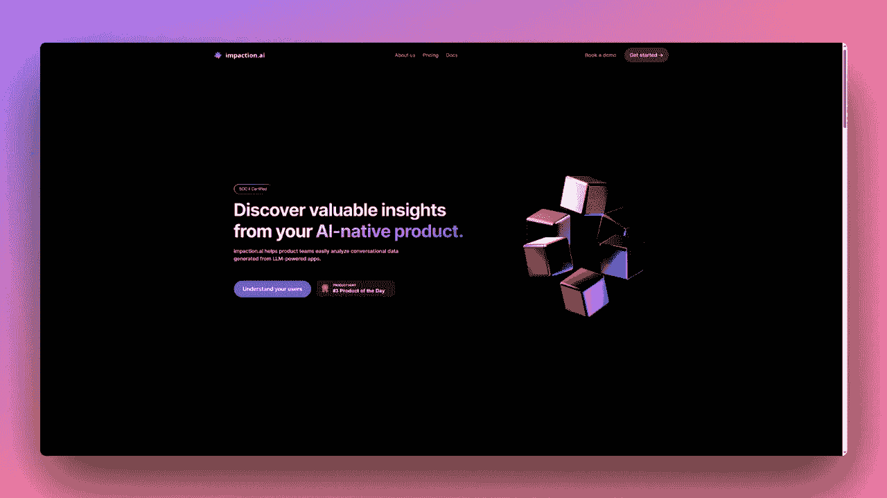

## Memora：具有多级重新排名的矢量数据库

与简单的语义搜索相比，Memora 可以将 LLM 应用程序的性能提高 4 倍。它使用定制的 Ultraviolet-1 嵌入模型和强大的检索引擎来查找与查询最相关的数据。Memora 可以很好地处理各种类型的数据，并有不同的版本以满足不同的需求。

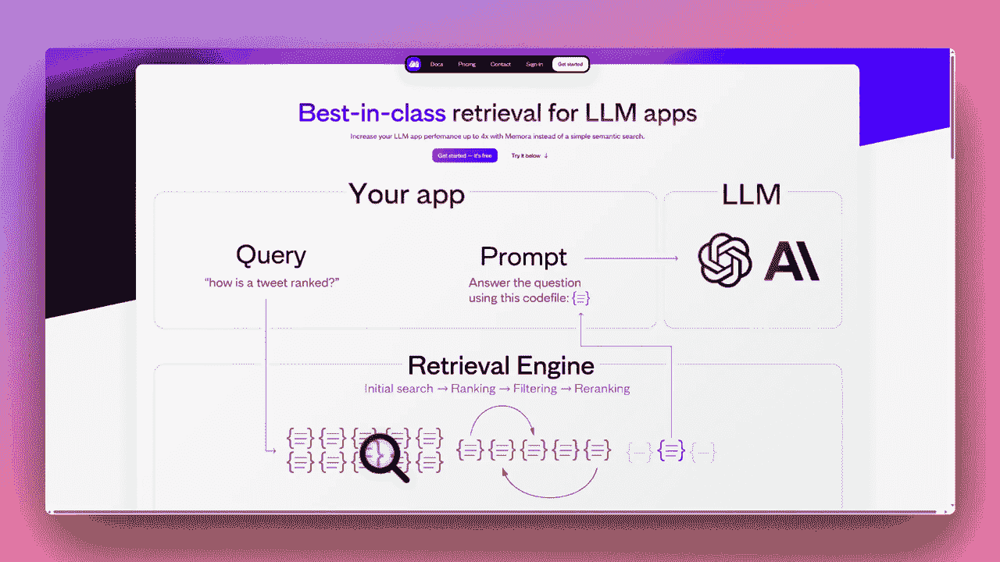

## Riffusion：通过图像生成音乐

顾名思义，上传图像之后它会根据你的图像生成音乐，应该是从图像里面提取提示词来生成音乐，可以当一个出彩的小功能集成一下。

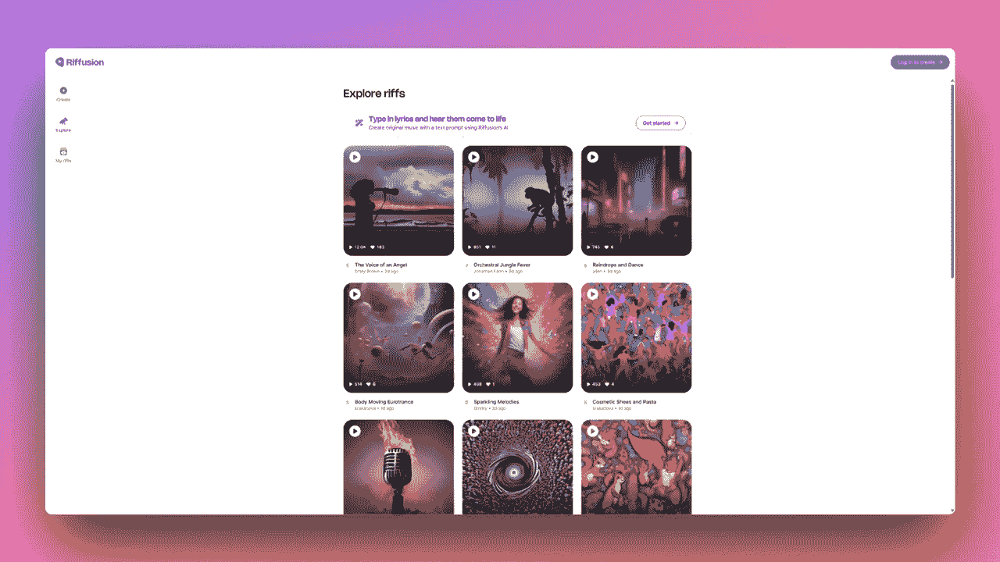

## LastMile：AI开发者平台

LastMile AI 是一个面向工程团队的人工智能开发者平台，其增长级提供 30 天免费试用。该平台旨在帮助工程师制作生成式人工智能应用程序的原型和生产，并提供一系列生成式人工智能模型，包括 GPT4、GPT3.5 Turbo、PaLM 2、Whisper、Bark、Stable Diffusion 等。该平台还提供了一个类似笔记本的环境，用于构建、测试和迭代人工智能应用程序，以及参数化的人工智能工作簿，这些工作簿可简化为可重复使用的模板。用户可以与团队协作和构建，共享和组织人工智能应用程序，并为自己、团队或更广泛的开发者社区开发模板。

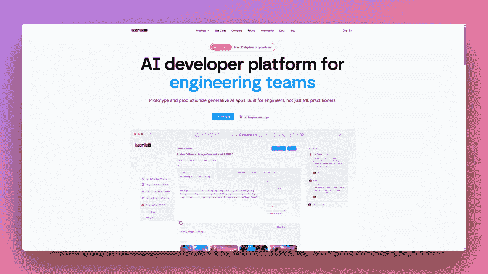

## Thiggle Revision AI：AI生成React 组件

Thiggle Revision AI 。给定自然语言提示，它会生成一个 React 组件，可以将其直接复制并粘贴到您的应用程序中。更好的是，可以使用自然语言迭代组件 - 增大文本、添加渐变、调整部分大小。它保留历史记录，以便可以分支、分叉和恢复。

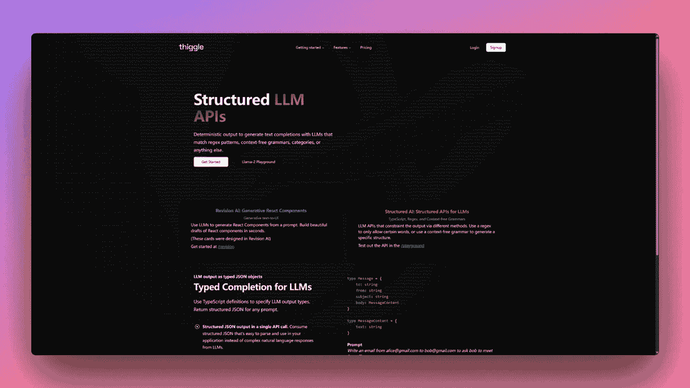

## CapCut for Business：AI生成广告脚本和内容

CapCut for Business 是专为各种规模企业设计的一体化视频制作平台。它简化了从构思、制作到交付的内容制作流程，让企业比以往任何时候都更容易创建和发布具有影响力的广告和品牌内容。用几句话描述想要推广的产品和业务。广告脚本功能会立即生成不同的脚本版本，可以根据业务需求对其进行修改。智能广告工具都能让您在几分钟内生成视频广告。只需使用产品URL到广告功能，它就会立即将您的产品URL的URL转换为迷人的广告视频。

## [Visual Copilot by Bui](https://www.builder.io/m/design-to-code)lder：将 Figma 设计稿转成代码

Visual Copilot是一款基于AI的工具，可以将Figma设计转换为干净、语义化的开发者友好且响应式的代码。该工具可以将代码转换为多种框架，包括React、Vue、Svelte、Qwik、Angular、Solid和HTML，并且可以将Figma组件映射到设计系统中的可重用组件。该工具还允许用户聊天以改进代码，并与Builder API集成，以生成JavaScript组件和页面。该工具在beta版本中是免费的。

---

# 🔬精选文章

## 你（可能）不需要 RAG - ChatGPT 微调技术

文章讨论了在不使用 RAG 的情况下训练模型学习语料库数据的技术。作者认为，虽然 RAG 是一个有用的工具，但它也有局限性，在某些使用情况下，模型最好能简单地知道信息，而不是查找信息。该技术包括对信息进行格式化，使用户输入的部分是希望模型学习的数据，而强制性的助手响应则是罕见的单个标记。然后根据这些数据对模型进行训练，并应用对数偏置来禁止预测单一标记。虽然该技术不如真正的自回归微调技术，但在 RAG 并不理想的某些情况下，它还是很有用的。

## [我们都是随机鹦鹉](https://hyperstellar.substack.com/p/let-me-finish-your-sentences)

文章讨论了能够完成人类句子的机器的出现，以及这项技术对我们理解智能和创造力的影响。作者认为，有些人认为这些机器是缺乏真正理解力的 "随机鹦鹉"，而另一些人则认为它们代表了通往人工通用智能（AGI）甚至人工超级智能（ASI）的道路。作者认为，真相介于两者之间，我们可以通过研究这些机器了解我们自己和我们自己的智能。文章还探讨了定义智能和理解的难度，以及这些概念的多维性。

## 革命性的LLM微调方法 QLoRA 的工作原理

QLoRA 是一种微调方法，它结合了量化和低秩适配器 (LoRA)，能够在相对较小的高可用 GPU 上对拥有数十亿参数的庞大模型进行微调。量化降低了模型张量的数值精度，使模型更加紧凑，操作执行速度更快。LoRA 是一种旨在通过减少可训练参数数量来更有效地微调大型预训练语言模型的方法。LoRA 通过创建和更新原始权重矩阵的低秩近似值（称为更新矩阵）来提高这一过程的效率。微调时只更新这些矩阵，因此 LoRA 的可训练参数总数等于低阶更新矩阵的大小。LoRA 的优点包括高效、专业化和保护。QLoRA 结合了量化和 LoRA，为微调大型预训练模型提供了一种开创性的方法。通过量化，它能有效压缩原始模型，而通过 LoRA，它能大幅减少可训练参数的数量。这种协同组合使微调过程民主化，使其可以在更小、更易访问的 GPU 上执行。

## [在生产中构建人工智能代理](https://www.parcha.ai/blog/building-ai-agents-in-production)

文章讨论了 Parcha 在生产中构建人工智能代理的过程，包括为确保这些代理的无缝部署和性能而面临的挑战和实施的解决方案。代理在设计时考虑到了某些组件，包括代理的配置文件、工具和命令、抓取板、标准操作程序 (SOP) 和输出。文章还讨论了 Parcha 最初构建代理方法的挫折，以及随着时间的推移所做的改进，例如将代理作为长期运行的进程异步运行、将指令解耦为多个 SOP、将提取过程与判断分离、利用内存存储共享信息，以及将代理视为具有多种故障转移机制的异步服务。最后，文章强调了构建模块对于可重用性和构建速度的重要性。

## [利用RAG开放邮件助手的实践](https://www.shortwave.com/blog/deep-dive-into-worlds-smartest-email-ai/)

这篇文章介绍了利用检索增强生成（RAG）技术为一款电子邮件应用程序开发人工智能助理的过程。该团队的目标是建立一个能回答几乎所有问题的人工智能执行助理，并帮助用户将其电子邮件历史记录转化为可操作的知识库。人工智能助手分四个步骤回答问题：工具选择、工具数据检索、问题解答和后处理。最复杂的工具是人工智能搜索，它能让助手全面了解用户的电子邮件历史记录。文章详细解释了人工智能搜索的工作原理，包括查询重构、传统的全文查询或基于元数据的查询、向量嵌入搜索和重新排序。尽管该系统非常复杂，但团队对其进行了优化，使其能够在 3-5 秒内回答几乎所有问题。

## [如何用语音和LLM交谈](https://www.daily.co/blog/how-to-talk-to-an-llm-with-your-voice/)

文章讨论了使用大型语言模型（LLM）构建语音驱动的人工智能应用。作者解释了构建 LLM 应用程序所需的三个基本组件：语音到文本、文本到语音和 LLM 本身。他们还介绍了构建 LLM 应用程序时的一些注意事项，例如是在本地还是在云中运行语音到文本，以及是使用 web sockets 还是 WebRTC 进行音频传输。作者还提供了优化数据流和减少延迟的技巧。最后，他们讨论了 LLM 提示 API 和流式响应数据、自然语音合成和音频缓冲区管理。

## [将 LLM 当做操作系统](https://memgpt.ai/)

大型语言模型（LLM）在扩展对话和文档分析等任务中存在上下文窗口有限的局限性。为了解决这个问题，作者提出了虚拟上下文管理，这是一种受传统操作系统的分层存储系统启发的技术。他们引入了MemGPT系统，该系统管理不同的存储层次，在LLM有限的上下文窗口中提供扩展的上下文，并利用中断来管理其与用户之间的控制流。作者在两个领域评估了他们基于操作系统的设计，其中现代LLM的有限上下文窗口严重限制了其性能：文档分析和多会话聊天。

## [Llemma： 数学 LLM](https://arxiv.org/abs/2310.10631)

开源 LLM，用于在最多 200B 个数学文本标记上进行训练的数学LLM。Llemma 34B 的性能接近 Google 的 Minerva 62B，尽管其参数只有一半。使用Proof-Pile-2，一种混合科学论文、包含数学内容的网络数据和数学代码，从而产生Llemma。在MATH基准测试中，Llemma在等参数基础上优于所有已知的开放基模型，以及未发布的Minerva模型套件。此外，Llemma能够在无需进一步微调的情况下进行工具使用和形式定理证明。

## 关于软件工程中的 LLM 和开放性问题调查

本文提供了一项关于软件工程（SE）领域新兴的大型语言模型（LLMs）的调查。它还提出了将LLMs应用于软件工程师面临的技术问题的开放研究挑战。LLMs的新兴属性带来了新颖性和创造性，可应用于软件工程活动的各个领域，包括编码、设计、要求、修复、重构、性能改进、文档和分析。但是，这些新兴属性也带来了重大技术挑战；我们需要可靠地淘汰不正确的解决方案，例如幻觉。我们的调查揭示了混合技术（传统SE加LLMs）在开发和部署可靠、高效和有效的基于LLM的SE方面所起的关键作用。