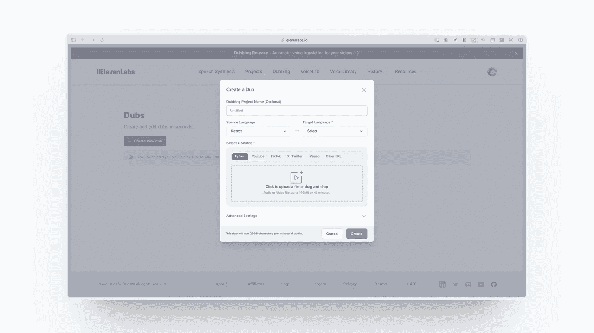
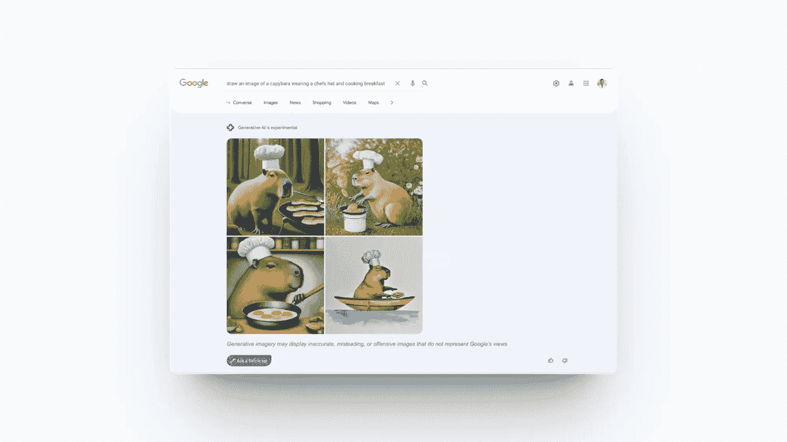
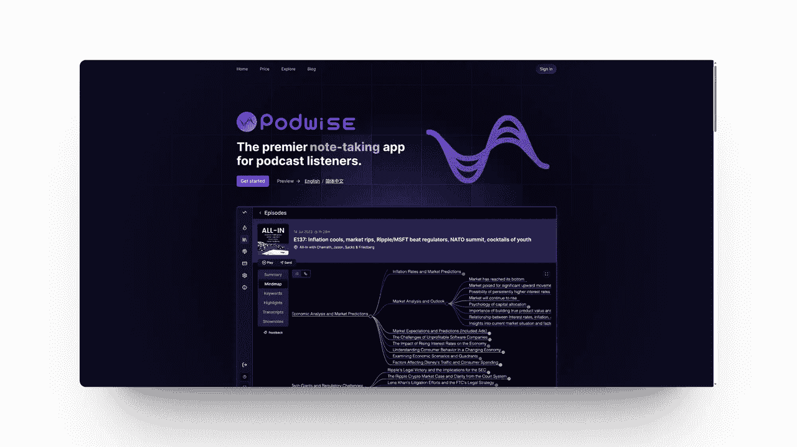
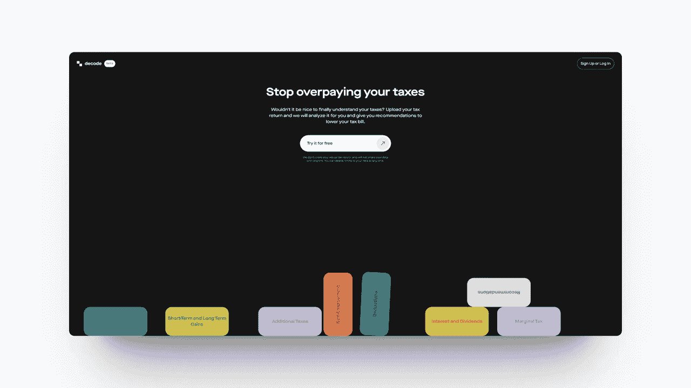
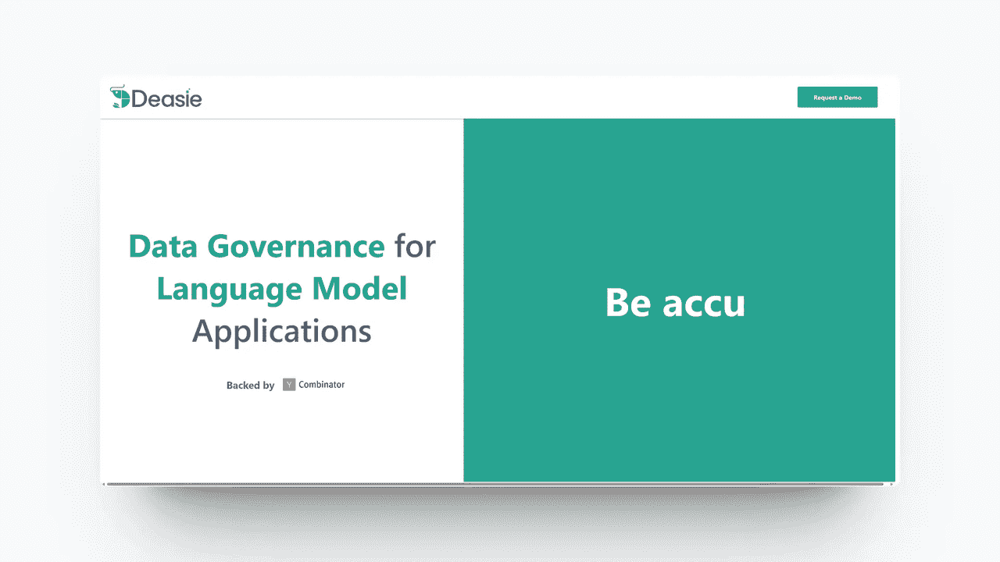
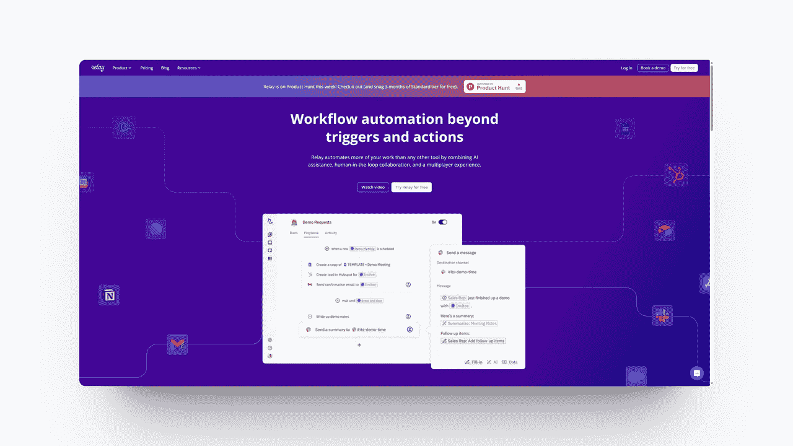
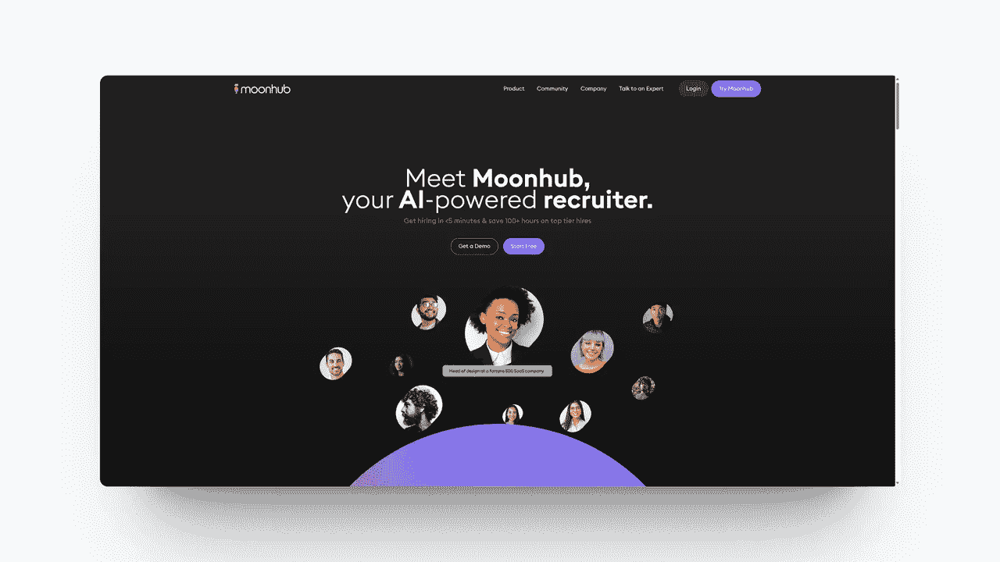
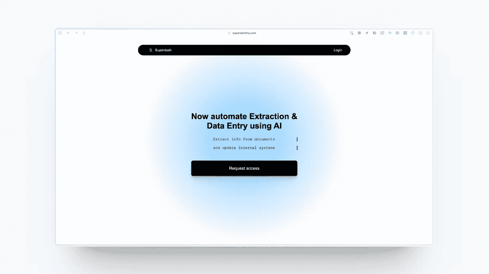
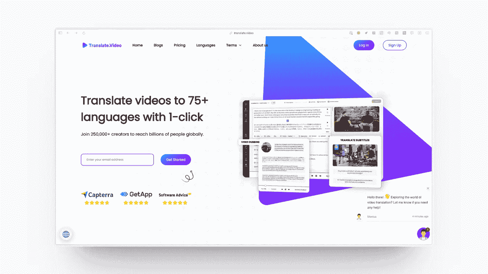
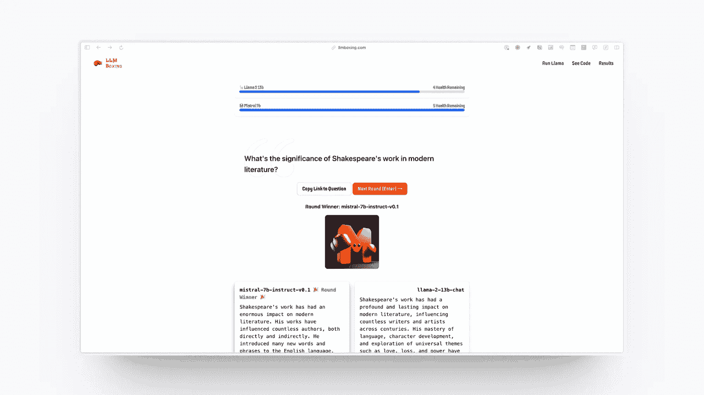

# AIGC Weekly #42

> 来源：[https://waytoagi.feishu.cn/docx/IBUsdH47OoS0QSxCrs0cVsCsnYc](https://waytoagi.feishu.cn/docx/IBUsdH47OoS0QSxCrs0cVsCsnYc)

> 🔗 原文链接： h[ttps://quail.ink/o](https://quail.ink/op7418/p/aigc-weekly-42)p7418/p/aigc-wee...

> 时间：16 Oct, 2023

> lyric给 Quail 增加了评论功能，AIGC Weekly也已经开启了，已经订阅的用户如果有什么想讨论的可以在页面最下方发表自己的见解。

工具：Midjoureny

提示词：Flower in the style of minimalist figures, light white and red, mote kei, realist-portraits, ethereal photography, ghostly figures, close up, pictorial dram, 50mm

---

# ❤️上周精选

## Adobe Firefly获得重大更新

Adobe上周发布了Firefly image 2 Beta测试版本，增加了非常多的功能，模型质量也强了好多，卷起来了。我试了一下发现image 2模型的图片分辨率默认居然是2048*2048的，太强了。

而且对图片的控制能力增强许多，这再搭配上Photo shop的蒙版之类的拉满了。

Firefly image 2 模型 ：具有更高质量的图像和插图生成，以及自定义选项和改进的动态范围。

**生成匹配 **：就是img2img，应用预先选择的图像集中的风格或上传你自己的风格参考图像，可以快速创建相似图像。

**照片设置 **：应用和调整照片设置，类似于手动相机控制，以实现更逼真的图像质量，具有更高保真度的细节（包括皮肤毛孔和树叶）以及运动模糊和景深等效果。

**提示建议 **：输入提示词的时候，输入框上方会给出一些提示词书写建议选择就可以使用。

**提示链接共享 **：其他人点开你分享的提示的时候，可以快速应用提示词及相关设置。

**反向提示词 **：通过输入你不想生成内容的提示词，可以排除对应内容。

[我也做了一](https://mp.weixin.qq.com/s?__biz=MzU0MDk3NTUxMA==&mid=2247484980&idx=1&sn=7197b694d040dc6625b66de9a7d3799f&chksm=fb304ecdcc47c7dbfb25ba2361645bcd206e6a1b946077709faa01dc973e087fd6bff5b46cb4#rd)些跟 Midjourney 和 DALL-E3 的🍿 对比测试 ，从结果来看image 2的图像质量确实有大幅提升，提示词理解虽然比不上DALL-E 3但是比之前好很多了，再加上垫图、光圈控制还有风格选择等一系列图像控制方式，已经很强了。但是在写实照片类型上Midjourney还是当之无愧的王者。

## Eleven Labs推出语音翻译工具Dubbing

ElevenLabs 推出 Dubbing，一种语音翻译工具，可以将视频/音频翻译成不同的语言，同时保持原始的声音。

AI 配音功能支持十一种语言， v2 模型目前支持的 20 多种语言的语音翻译，包括印地语、葡萄牙语、西班牙语、日语、乌克兰语、波兰语或阿拉伯语。

还可以检测多个说话人的声音，支持背景音分离和环境音降噪。国内优秀视频创作者的受众可以极大的拓展了。

## 谷歌在图片搜索中加入图片生成功能

谷歌上周在搜索实验室中增加了一个功能，有两个触发方式首先是你可以直接在搜索框输入“画一张戴着厨师帽和烹饪早餐的水豚的图片”之类的内容生成图像。

另一种方式可以直接在 Google 图片中创建 AI 生成的图像，作为此实验的一部分。此功能旨在当你寻找灵感时出现，例如“极简万圣节餐桌设置”或“幽灵狗屋创意”。

除此之外还有一个即将推出的工具，名为“关于此图像”，它将帮助人们轻松评估图像的背景和可信度。例如，它可能会向你显示 Google 首次看到此图像的类似版本的时间；或向你显示网络上使用类似图像的其他页面，包括新闻或事实核查网站。

图像生成和图像搜索这个场景结合还是挺好的，从图像质量来看也还行，在及格线以上。

---

# 🧵其他动态

+   关于 Open AI 开发者大会的一些小道消息 ，包括在其开发工具中添加内存存储以使用人工智能模型，增加机器人和自主代理可以在无需人工干预的情况下执行任务的功能。

+   [Anysphere从Ope](https://anysphere.co/blog/openai-fund?utm_source=bensbites)n AI 获得了800万美元的融资 ，这个公司是我们是 Anysphere，Cursor AIdiamagnetic编辑器背后的团队。

+   [Sam Altman 在公司](https://www.theinformation.com/articles/openais-revenue-crossed-1-3-billion-annualized-rate-ceo-tells-staff)内宣布 OpenAI 的 年收入突破了 13 亿美元 。比夏季上涨了30%。

+   Character.ai推出了角[色群聊功能，现在用户](https://blog.character.ai/new-feature-announcement-character-group-chat/)可以在一个房间里里 跟多个AI角色聊天 。

+   下个月微软可能将 推出自己的AI芯片Athena ，可能降低使用Nvidia GPU成本，他们已经和 Open AI 测试了一段时间。

+   Open AI 最近更新的语言交谈、图像交谈以及 DALL-E3 这些功能应该已经对所有 Plus 用户全量开放了，现在看 Plus 这 20 美元就有点值了。

---

# ⚒️产品推荐

## [Podwise：AI播客工具](https://podwise.xyz/)

Podwise 是一款面向播客听众的知识管理应用程序，提供多种功能，帮助用户快速提取和理解播客剧集的主要内容。其中一些主要功能包括

人工智能驱动的摘要： 用户可以通过 AI 驱动的摘要在一分钟内掌握任何一集的主要内容。

思维导图： 以思维导图的形式呈现剧集内容，帮助用户更轻松地理解内容。

大纲： 将剧集内容浓缩为 3 分钟的大纲，提取要点并提供当前时长的摘要。

值得引用： 从剧集中提取值得注意的引文，让用户更好地了解每集内容。

转录： 准确转录的文本可帮助用户搜索关键信息并重播感兴趣的部分。

## [Decode：AI进行税务服务](https://www.decode.tax/)

网站提供分析报税表并提供降低税费建议的服务。该服务涵盖的领域包括收入、短期和长期收益、附加税、自营职业扣除、利息和股息，以及边际税建议。

## [Deasie：LLM数据服务](https://deasie.com/)

这是一家为LLM应用提供数据治理的公司。他们的服务包括检测敏感信息、确定数据的上下文和含义、为文档分配质量分数以及创建认证数据目录。

## [Relay：AI自动化代理工具](https://www.relay.app/)

一个工作流程自动化工具（如 Zapier），超越了触发器和操作。通过将一键式人工智能辅助、人机交互协作和强大的多人游戏体验相结合，Relay 可以比任何其他工具自动化更多的工作。只需一键点击即可直接在你的剧本中利用人工智能的力量，还支持在协作中加入人工介入的环节。

## [Moonhub：AI招聘助手](https://www.moonhub.ai/)

Moonhub是一个专为未来团队打造的人性化AI招聘合作伙伴。他们提供了一种新的招聘方式，通过对市场数据的分析和设计最佳策略，以最大化招聘质量和速度。他们的AI技术可以实时迭代搜索，并使用自然语言进行交流，无需复杂的过滤条件。

## [Dashtoon：AI漫画创作](https://www.dashtoon.ai/)

Dashtoon Studio 提供的人工智能漫画创作器简化了漫画创作过程。用户可以从 Dashtoon 的角色库中选择角色或创建自己的角色，选择与故事相匹配的独特风格，并将故事板转换为漫画。用户还可以使用该工具移除背景、修整脸部和提升图像等级。

## [Aampe：AI信息平台](https://www.aampe.com/)

Aampe 是一个人工智能驱动的信息平台，可帮助企业个性化信息，更有效地吸引用户。该平台在强化学习引擎之上使用人工智能模型和结构化机器学习，为信息的各个方面生成用户级偏好。Aampe 利用企业信息库中的信息进行成千上万次受控并行实验，以创建独特的吸引人的内容，并按用户自己的节奏向他们发送。

Superdash,一个可以使用人工智能自动化数据提取和输入的服务。它可以从网站上复制值,然后粘贴到其他系统中。Superdash提供API访问,Webhooks集成,Zapier集成和自定义工作流等功能,帮助客户高效地执行数据处理任务。

## Translate：AI 视频内容翻译

Translate.Video网站,它可以将视频自动生成字幕和翻译成75多种语言。网站声称可以帮助内容创作者扩大全球触达范围,简化字幕、副标题和配音工作。它提供自动字幕生成、翻译字幕、AI配音以及编辑等一站式视频服务。

## Runway：AI 视频工具的教程库

Runway 推出了的教程、AMA（问答）和深度探索库，以帮助你充分利用Runway的全套创意AI工具。从基础知识到高级工作流程。对 AI 视频感兴趣可以去看看。

## Hotshot：通过 AI 快速创建 gif

HotshotSupport这个和其他主打高清视频的不同，它就只生成几秒的GIF非常轻量速度非常快，而且会发给你一个预览这个gif的链接用来分享。

感觉是一个非常好的营销传播方式，其他正在关注或者制作类似应用的可以学习一下。

## [LLM 拳击赛：开源模型竞赛](https://llmboxing.com/)

这个提高的，将两个开源模型对同一个问题的生成结果展示给你，你自己选择哪个更好，失败的那个扣血，最后应该会公布总体的胜者，现在对决的是Mistral 7B 和 Llama 2 13B。

---

# 🔬精选文章

## 马丁的Character.AI 赛道说明书

这篇内容主要讨论了百C大战赛道的潜力和机会，以及如何成为该领域的头部玩家。作者指出，百C大战赛道具有很大的发展潜力，特别是在IP消费和IP创造方面。作者还提到了内容社区的重要性，并探讨了商业利益的引入和陪伴形态的观察。对于参与该赛道的玩家来说，需要具备一定的能力和准备，并逐步推进来打好这场游戏。

## 大型语言模型入门：需要了解的关键事项

大型语言模型（LLM）是在大型数据集上训练的模型，用于理解和生成内容。LLM利用transformer模型，具有位置编码和自注意力的重要特性。LLM可以用于创建AI助手、聊天机器人、生成文本、翻译、摘要、搜索等多种应用。对于与LLM交互，可以使用不同的提示格式，如零样本提示、少样本提示、CoT提示等。此外，可以通过微调、优化技术和运行在本地机器上等方式来提高LLM的性能和效率。

## 研究人员发现 LLM 如何表征真理的新兴线性结构

文章讨论了最近关于大型语言模型（LLMs）等人工智能系统如何表示真值的研究。研究人员发现，有证据表明 LLMs 包含表示事实真值的特定 "真值方向"，可用于在输出之前过滤掉虚假说法。文章介绍了研究人员如何策划简单的真/假事实语句数据集，测试在一个数据集上训练的线性 "探针 "是否能准确地对完全不同的数据集进行真假分类，以及如何直接操纵 LLM 的内部表征，使其翻转语句的评估真值。文章最后讨论了研究的意义和局限性。

## Air Street Capital 发布了第六份年度人工智能现状报告

这份 160 多页的报告涵盖了人工智能的研究趋势、硬件、政治和安全。它还对明年会发生[什么进行预测](https://mp.weixin.qq.com/s?__biz=MzU0MDk3NTUxMA==&mid=2247485003&idx=1&sn=81622cfeb7601d3093517f7e781f868e&chksm=fb304eb2cc47c7a43d69974183eac4ad981e51524a9f5ac362468320f593f38b7c170ecf9e6f#rd)（在去年的预测中得分为 5/9）。预测的大多是已经有些端倪的事情。 🍿我的总结

## [需要了解的人工智能常见问题解答](https://www.oneusefulthing.org/p/what-people-ask-me-most-also-some)

沃顿商学院教授 Ethan Mollick 回答了人们向他提出的许多与人工智能相关的问题。如人工智能写作检测器是否有效、如何更好地使用人工智能以及随着人工智能数据充斥互联网，人工智能的发展是否会放缓。作者强调，虽然人工智能有可能极大地造福于社会，但它也伴随着风险和不确定性，在如何更好地使用这项技术方面仍有许多东西需要学习。

## [GPT-4 有推理能力吗？](https://lajili.com/posts/post-3/)

文章讨论了语言模型 GPT-4 的推理能力及其在解决问题方面的局限性。作者认为，虽然 GPT-4 可以预测单词并具有概念表征，但这还不足以认为它具有推理能力。推理涉及将概念组合在一起以解决问题，而当要求 GPT-4 解决谜语或逻辑谜题时，GPT-4 却很难做到这一点。不过，作者认为，在适当的系统级提示下，GPT-4 可以在其回答中表现出一定程度的推理能力。

文章还谈到了 GPT-4 输出中的偏差和幻觉问题，承认这些都是实际问题，但不一定能说明其推理能力。作者将 GPT-4 的推理潜力比作地球持平论者，后者可以推理，但可能得出错误的结论。

关于意识问题，作者认为 GPT-4 没有意识，因为它缺乏长期记忆和情感中心。不过，他们乐观地认为，这些问题在未来都能得到解决，GPT-4 是理解和开发人工智能的重要拼图。

## 使用 Pgvector 构建视觉搜索

文章讨论了作者在亚马逊上搜索一款新手表的经历，以及由于该平台以规格为中心的界面而导致的寻找合适款式的挑战。受 same.energy 和 lexica.art 的启发，作者创建了一个名为 same.style 的人工智能用户体验实验，利用图像相似性搜索为产品提供更好的搜索体验。

Same.style 允许用户在不受各种规格限制的情况下首先探索风格，然后根据用户的喜好推荐新产品。作者解释说，该实验利用了 OpenAI 于 2021 年创建的对比语言-图像预训练（CLIP）模型，该模型将文本和图像带入同一向量空间，从而计算出它们之间的距离。

为了在不丢失选定手表的情况下进一步定制手表，作者采用了一种同时搜索选定手表和文本的方法。具体做法是在潜空间中将图像向量向文本向量的方向移动，然后根据这些新向量构建一个查询来查找类似产品。

作者还讨论了使用距离度量，特别是内积来计算向量之间的相似性。矢量数据库 Pgvector 用于支持这些操作，作者选择了 HNSW 索引以获得更好的性能。

总之，文章强调了人工智能和基于向量的搜索方法在改善在线购物平台用户体验方面的潜力。

## LLMs for Dummies + 4 个 LLM 应用框架

这篇文章用通俗易懂的语言讨论了大型语言模型（LLM）的内部运作。近年来，大型语言模型发展迅速，GPT-3 拥有 1,750 亿个参数，而 GPT-4 据说会更多。要了解 LLM 的工作原理，首先要了解它们是如何表示语言的：

人类用字母来表示单词，而 LLM 则用称为单词向量的数字来表示单词。

单词被存储在 "单词空间 "中，这个平面的维度比人类大脑所能想象的要多，相似的单词被放在更近的词簇中。

语言模型的神经网络在大量语言数据（如书籍、文章和维基百科）的基础上进行训练，以学习词与词之间的关系，提高对语言的理解能力。

语言模型面临着理解语言细微差别的挑战，例如一词多义和上下文相关的解释。为了克服这一难题，该模型需要理解每个单词的上下文，并使用词簇来捕捉单词之间关系的微妙而重要的信息。

根据人类内容训练 LLM 的一个缺点是，它们可能会继承人类的偏见。例如，词向量模型可能会在某些词之间产生带有性别偏见的关联。研究人员正在努力减少人工智能系统中的这些偏差。

## 将语言模型分解为可理解的组件-Anthropic

讨论了理解人工神经网络及其工作原理的挑战。作者认为，尽管神经网络中的每个神经元都执行简单的算术运算，但很难理解这些数学运算为何会产生我们所看到的行为。他们提出，除了个体神经元，还有更好的分析单元，他们已经构建了机器，可以在小变压器模型中找到这些单元。这些称为特征的单元对应于神经元激活的模式，为将复杂的神经网络分解成可以理解的部分提供了路径。作者还尝试调整他们学习的特征数量，这为他们以不同的分辨率观察模型提供了一个“旋钮”。他们希望这种方法最终能够从内部监控和引导模型行为，从而提高企业和社会采用的安全性和可靠性。

## Poe和SurgeAI合作，对主流LLM的四个属性进行了系统评估

Poe和SurgeAI合作，对主流LLM的四个属性进行了系统评估：包括推理、写作、创造力和非英语流利程度。下面是一些结果：

GPT4 在所有维度上都赢得了比赛（不计算速度和价格），但有一些值得注意的地方排在第二位。

Google 的 PaLM 在非英语语言能力方面击败了所有其他竞争者，有效支持了最广泛的在线人群语言。这以前好像没有报道过。

Claude 2 在推理方面排名第二，涵盖解决数学问题和编程挑战等任务。

Llama 2 70b 在与SurgeAI 共同进行的人工智能专家评估中，在写作和创造力方面获得第三名。

## Ring Attention - 一种内存高效的方法

利用自注意力的分块计算将长序列分布到多个设备上，以克服 Transformer 架构固有的内存限制，从而能够在训练和推理过程中处理较长的序列；能够在保持性能的同时根据设备数 量缩放上下文长度，在没有注意力近似 的情况下超过 1 亿上下文长度。