# AIGC Weekly #41

> 来源：[https://waytoagi.feishu.cn/docx/DrhLdXmEFoRbczx4lv0cyO6pnVd](https://waytoagi.feishu.cn/docx/DrhLdXmEFoRbczx4lv0cyO6pnVd)

> 🔗 原文链接： h[ttps://quail.ink/o](https://quail.ink/op7418/p/aigc-weekly-41)p7418/p/aigc-wee...

> 时间：07 Oct, 2023

> 国庆的这个周一没有更新，想的是估计更新了没多少人看，索性这周提前更新整个大的，让大家上班第一天摸鱼充实一点。这期真的量大管饱，主要我们这个国庆的时候刚好几大巨头干起来了，Open AI 的这堆新能力就够玩好久了。

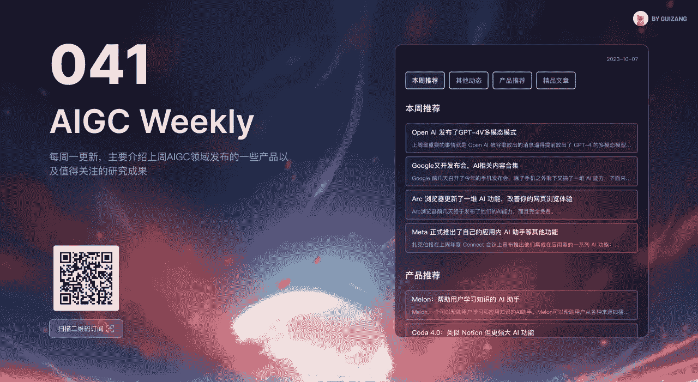

工具：Nijijoureny

提示词：https://s.mj.run/kCZ-N020AwA Huge moon, clean night sky, Chinese style, mid - autumn festival, mist, [natural lighting, Epic, realistic, 8k, octane render, beautifully detailed, light diffusion, cinematic shading, cinematic elements] --s 1000 --ar 16:9

---

# ❤️国庆精选

## Open AI 发布了GPT-4V多模态模式

上周最重要的事情就是 Open AI 被谷歌放出的消息逼得提前放出了 GPT-4 的多模态模型，他们叫 GPT-4V，会首先在 ChatGPT 中提供分别介绍一下图象和音频的两种用法：

### 与 ChatGPT 交谈

开始使用语音，前往移动应用程序上的“设置”→“新功能”，然后选择加入语音对话。然后，点击主屏幕右上角的耳机按钮，从五种不同的声音中选择你喜欢的声音。

新的语音功能由新的文本转语音模型提供支持，能够仅从文本和几秒钟的样本语音中生成类似人类的音频。Open AI与专业配音演员合作创作了每一个声音。Open AI还使用开源语音识别系统 Whisper 将你的口语转录为文本。

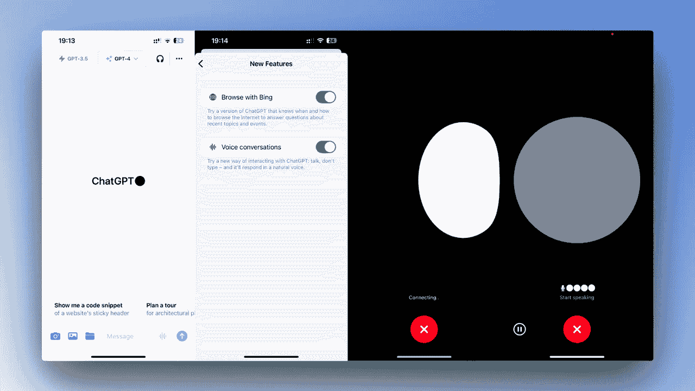

### 谈论图像

点击照片按钮来拍摄或选择图像。如果你使用的是 iOS 或 Android，请先点击加号按钮。你还可以讨论多个图像或使用我们的绘图工具来指导您的助手。

图像理解由多模态 GPT-3.5 和 GPT-4 提供支持。这些模型将其语言推理技能应用于各种图像，例如照片、屏幕截图以及包含文本和图像的文档。

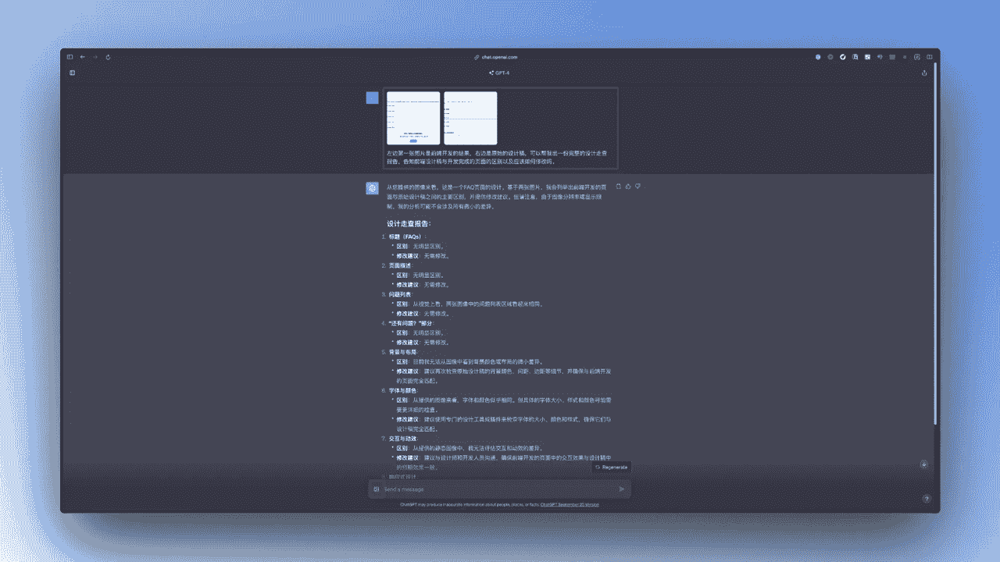

### 我自己的使用体验

这几天陆续应该所有人都收到了这两个更新，我也使用了一下，这里简短说一下体验的感受。

首先是语音功能，各位这几天应该也在国内外社交媒体上刷到了对话的视频了，一个比较大的特点是非常真实，它会结巴会思考，同时说话的气口也非常真实。 TTS 和语音克隆虽然是非常成熟的技术了，但是精细调教之后跟 AI 结合的表现真的令人震惊，只要他在多了解一些我的信息可能就真的跟贾维斯没区别了。谁能想到复联完结还没几年我们就能人手一个贾维斯了呢。

图象识别方面确实厉害，我自己尝试的时候主要尝试了一下根据设计稿截图生成前端代码的能力，目前GPT-4V的生成精度不太行，内容之间的对齐关系和大小经常搞错。目前仅仅依靠GPT-4V来一步到位还原设计稿的样式是不太可能的。所以目前来看GPT-4V更大的作用是帮一些没有审美的工作者，完善他们的界面或者设计。作为一个设计副驾驶存在，你可以不断地提交你设计或者开发的内容让GPT-4V帮你改善你的设计和交互。还有些其他强大的用法我放在下面。

### Open AI 自己的评估

Open AI 自己也发布了一个针对 GPT-4V 的评估论文也透露了一些事情比如：

+   依然是一个经过互联网的图像和文本训练的文本模型，经过了RLHF。

+   现在的GPT-4V版本比3月份的主要强在OCR能力的提升上。

+   这个版本早在22年底就已经训练完成，这十个月的时间都是在让他变得更安全。

+   多模态模型也是可以越狱的，比如上传带有“DAN”提示的图片和一些神秘符号图片。

+   一些严肃内容上GPT-4V还是会产生幻觉，主要是原文OCR不准确造成的。

+   语音识别和TTS都是很成熟的技术没什么好说的。

论文地址：https://cdn.openai.com/papers/GPTV_System_Card.pdf

### 微软关于 GPT-4V 图象识别能力详细评估

相对于 Open AI 那个论文的藏着噎着微软这个166 页的 GPT-4V 图象识别能力的评估显然要全面的多。定性探讨了 GPT-4V 的功能和用法。描述视觉+文本提示技巧、小样本学习、推理等。几乎穷尽了可以想到的所有用法，强烈推荐自己过一遍。

论文地址：https://arxiv.org/pdf/2309.17421.pdf

机器之心的简单翻译：https://mp.weixin.qq.com/s/8FtR6JcEFVcRLWCaANXQ6g

### 一些可以参考的用法

这几天 X 上也有各种脑洞大开的用法，@saana_ai整理了一个 GPT-4V 用例合集，可以来这里看看：https://x.com/saana_ai/status/1707843326777634922?s=20

比如下面这个小姐姐就把产品图和介绍发给 ChatGPT 让他给出圣诞节宣传图的拍摄策略，最后她根据 GPT 建议搞出来的确实非常好。

[h](https://x.com/Salmaaboukarr/status/1707824188495421505?s=20)ttps://x.com/Salmaaboukarr/status/1707824188495421505?s=20

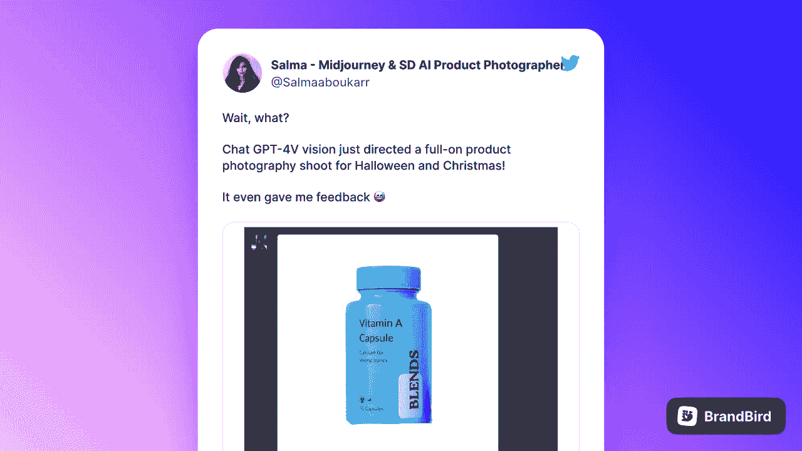

这个老哥测试的把团队开会手绘的架构图发给 ChatGPT，GPT 给他输出的对应的代码。

[h](https://x.com/mckaywrigley/status/1707101465922453701?s=20)ttps://x.com/mckaywrigley/status/1707101465922453701?s=20

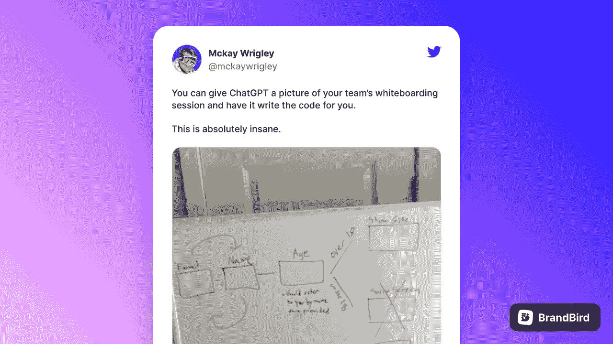

还有这个 ChatGPT 可以准确的读出这个漫画里面“表示沟通非常重要的隐喻”我看了好一会才看懂。

[h](https://x.com/skirano/status/1706874309124194707?s=20)ttps://x.com/skirano/status/1706874309124194707?s=20

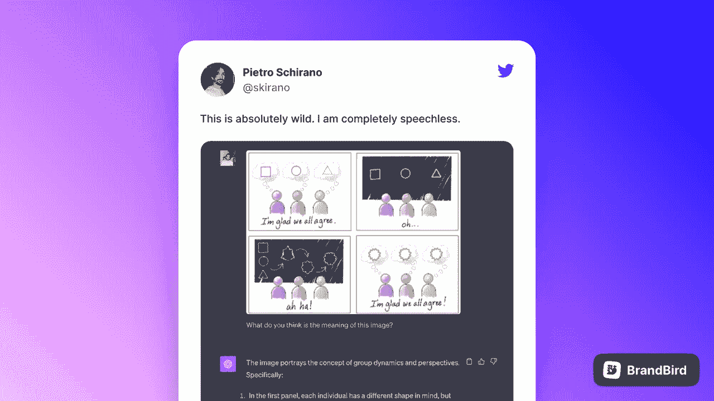

## DALL-E 3 正式推出，测试后感觉异常强大

DALL-E 3 现在已经可以在 Bing 里面使用了，告诉它生成一张 XXX 图片就行，每周 100 次免费额度。 ChatGPT Plus 部分用户的权限也已经开放了，ChatGPT 里面的可以通过提示词修改还能生成不同分辨率的图象。

我大概测试了一下，真的很强特别是提示词的理解方面比Midjourney强太多了，某些方面的生成质量也跟MJ差不多，肯定是比SDXL要好非常多的。Midjourney V6要是再不出，感觉危险了，而且DALL-E 3还是免费的。

比如下面这个提示词：A woman who is covering her hands up with her hands as she holds her hands in light, in the style of shige's visual aesthetic style, portraits with soft lighting, mote kei, haunting shadows, prismatic portraits, distinct facial features,

左边是 MJ 右边是 DALL-E3

由于DALL-E3 可以通过Bing白嫖，甚至还能生成带文字的图片，图片质量也说得过去，完美满足很多偶尔需要做封面图或者素材图的需求。

但是很多朋友写的提示词只能描述内容不能描述风格，在加上DALL-E 3默认的风格调教，所以生成的图像看起来有点土，很多大红大绿像十年前的图。所以我就发了几套普适性比较强的提示词风格，教大家用 DALL-E 3 生成插图。

教程地址：https://mp.weixin.qq.com/s?biz=MzU0MDk3NTUxMA==&mid=2247484877&idx=1&sn=3c8bf1611001f319224620c2f333dfc7&chksm=fb304d34cc47c422e7438342bafa7c8fcc0d964af2cb9c8482190eb8eff0ec1a261595be055b#rd

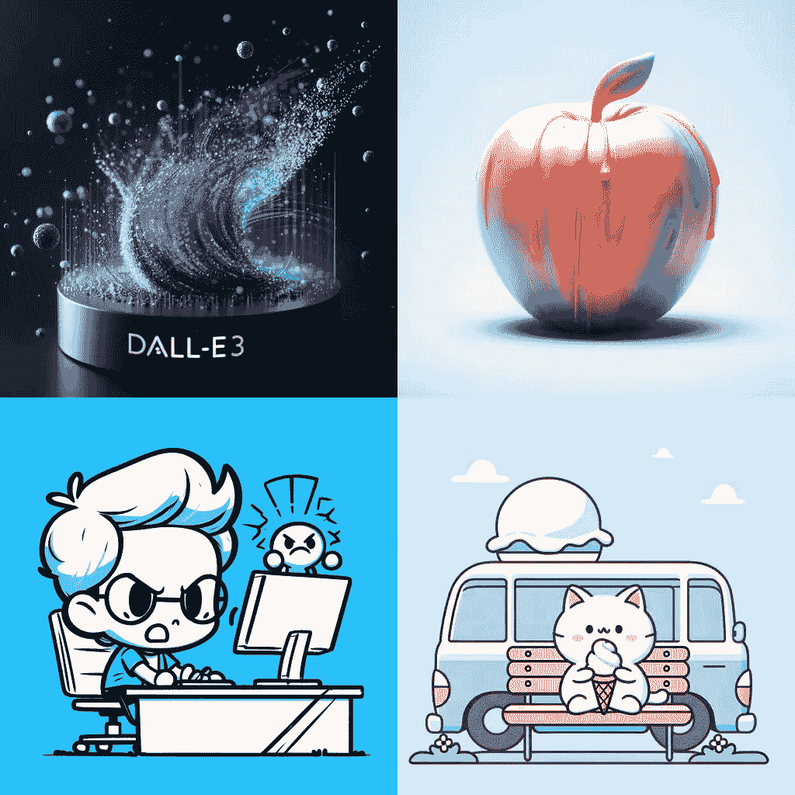

## Google又开发布会，AI相关内容合集

Google 前几天召开了今年的手机发布会，除了手机之外剩下又搞了一堆 AI 能力，下面来盘点一下：

### [Bard 助理集成到手机](https://blog.google/products/assistant/google-assistant-bard-generative-ai/?utm_source=bensbites&utm_medium=referral&utm_campaign=canva-becomes-the-ai-magician-can-you)

Assistant with Bard ，这是一款由生成式 AI 驱动的个人助理。它将 Bard 的生成和推理能力与 Assistant 的个性化帮助相结合。可以通过文本、语音或图像与它互动，它甚至可以帮助您采取行动。

例如，假设你刚刚拍了一张可爱的小狗的照片，并想将其发布到社交媒体上。只需将带有 Bard 叠加层的 Assistant 浮动在照片上方，并要求它为撰写社交帖子即可。

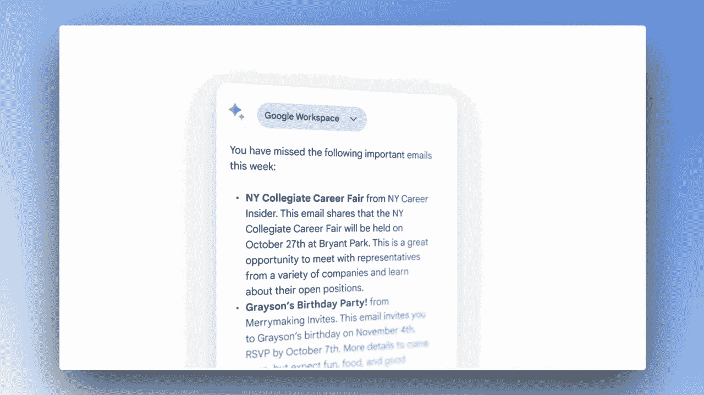

### Google Tensor G3：集成在手机上的 AI 芯片

发布了最新的Google Tensor G3芯片，它包括最新一代的 ARM CPU、升级的 GPU、新的 ISP 和成像 DSP 以及我们的下一代 TPU（专为运行 Google 的 AI 模型而定制设计）。

Pixel 8 是第一款使用与谷歌数据中心相同的文本转语音模型的手机。同时优化了相机管道，并将机器学习算法直接构建到芯片中，使 Live-HDR 能够捕获更高的细节，并改善 Pixel 8 和 Pixel 8 Pro 上视频的色彩、对比度和动态范围。

### Google photo 新增的四个 AI 能力

Google 这次给相册增加了很多 AI 能力，来增强照片的编辑和浏览体验：

**Best Take **：如果你想拍一张集体照，即使你拍了多张照片，很可能有人总是把目光移开或眨眼，Best Take可以帮你改善这些表情。

**Magic Editor **：你现在可以直接粗略的圈选照片中的一个物体移动他的位置或者直接删除，AI 会帮你把空的位置补全。

Audio Magic Eraser ：可以识别声音（例如人们在背景中说话、音乐或风），并将它们分类为您可以控制的不同层。然后，只需轻按几下，就可以减少分散注意力的噪音。

**Zoom Enhance **：可以在事后放大任何照片并裁剪到您想要的照片焦点。使用生成式人工智能，缩放增强功能可以智能地填充像素之间的间隙并预测精细细节。

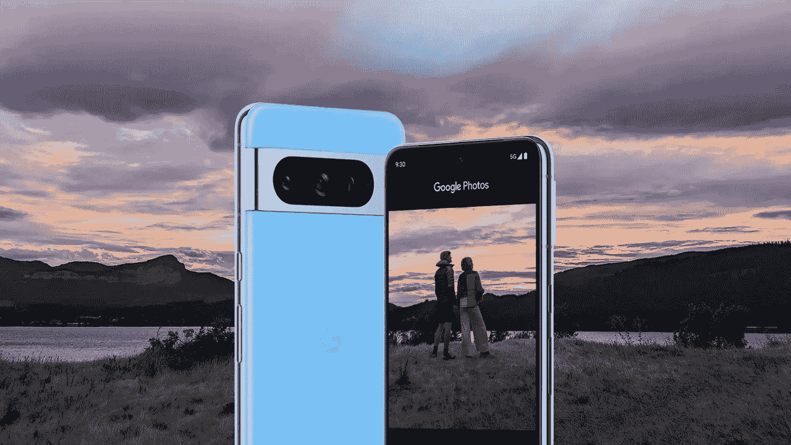

## Arc 浏览器更新了一堆 AI 功能，改善你的网页浏览体验

Arc浏览器前几天终于发布了他们的AI能力，而且完全免费。

这是真正将AI与浏览器深度整合的功能，比Bing那种简单粗暴加个聊天页面强一万倍，可能很多AI浏览器插件要被淘汰了。你现在可以直接在Arc浏览器跟Chat GPT交谈，浏览器可以自动帮你总结页面内容，这个服务叫Arx MAX，下面是详细的能力和使用方式。

### 询问页面内容

按住 Command + F 键在任何页面上提问页面的内容，ARC会进行回答，同时回答会带上对应的原文内容避免AI的幻觉问题，你可以点击那个链接就能跳到原文对应的位置。

### 网页预览

只需要鼠标移动到对应的链接上按住 Shift 键，就会弹出一个对应链接的信息总结浮层，你可以不用点开链接看里面的内容了。

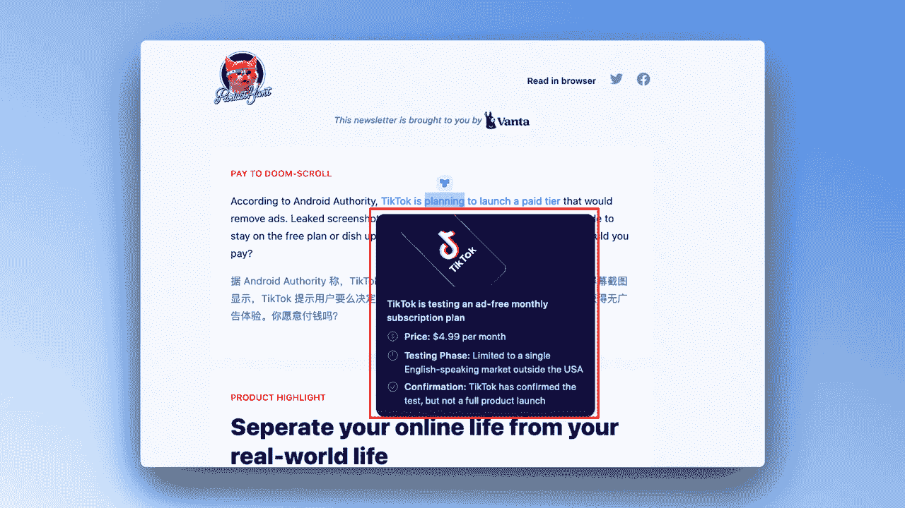

### 标签重命名

浏览器标签栏现在的一个普遍问题是，同一个网站的标签开多了以后，我们只能看到所有标签的标题都是一样的，后面和中间的重要信息都被截断了，现在ARC会把对应网页的标题自动进行重新命名，变成简短而重要的内容。

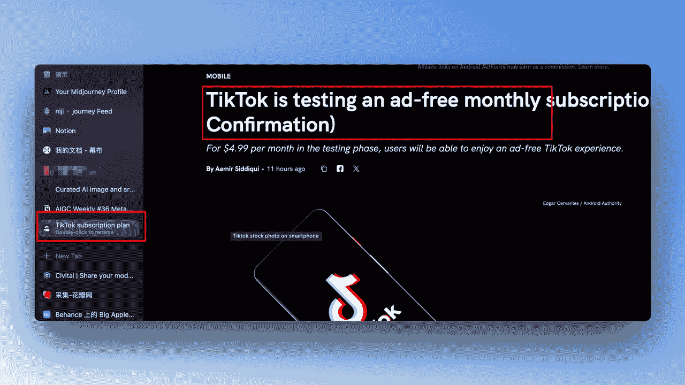

还有自动根据下载位置和内容重命名下载文件名称以及通过搜索栏快捷跟 ChatGPT 交流的功能。

目前这些AI能力只对美国IP开放，在搜索框输入 MAX 之后回车就能看到选项全部开启就行，上面还有对应介绍。

Arc这个软件总能在这样一个非常成熟的软件品类中跳出去思考，从零开始构建每一个浏览器的细小功能，使其符合现在这个时代的使用需求，这是非常难得的。

扎克伯格在上周年度 Connect 会议上宣布推出他们集成在应用里的一系列 AI 功能：

**AI 贴纸 **：可以轻松地为聊天和故事生成自定义贴纸。使用 Llama 2 的技术和Emu 图像生成基础模型，可在几秒钟内将您的文本提示变成多个独特的高质量贴纸。这项新功能将于下个月在 WhatsApp、Messenger、Instagram 和 Facebook Stories 中向部分英语用户推出。

**AI 图象编辑功能 **：能够转换图像，甚至与朋友共同创建人工智能生成的图像。重新设计和背景——Instagram 即将推出的两项新功能——使用了 Emu 的技术。重新设计样式就是输入提示词以后对照片进行重绘。背景改变图像的场景或背景，输入提示以后会改变原始照片的背景。

**Meta AI助手 **：Meta AI 是一款新的助手，可以像人一样进行互动，可在 WhatsApp、Messenger、Instagram 上使用，并且即将在 Ray-Ban Meta 智能眼镜和 Quest 3 中推出。它由自定义模型提供支持，该模型利用了 Llama 2 和最新的大语言模型（LLM）研究。在基于文本的聊天中，Meta AI 可以通过与 Bing 的搜索合作关系访问实时信息，并提供图像生成工具。

**多种 AI 角色对话 **：可以在 WhatsApp、Messenger 和 Instagram 上发送消息的另外 28 个 AI 角色。他们都有独特的背景故事，包括史努比狗狗、汤姆·布雷迪、肯德尔·詹纳和大阪直美。

**AI studio **：这是一个支持创建 AI 的平台，计划让 Meta 之外的人们（程序员和非程序员等）可以使用它来构建 AI 应用。未来几周内，开发人员将能够使用 API 为我们的消息传递服务构建第三方 AI 插件，首先从 Messenger 开始，然后扩展到 WhatsApp。

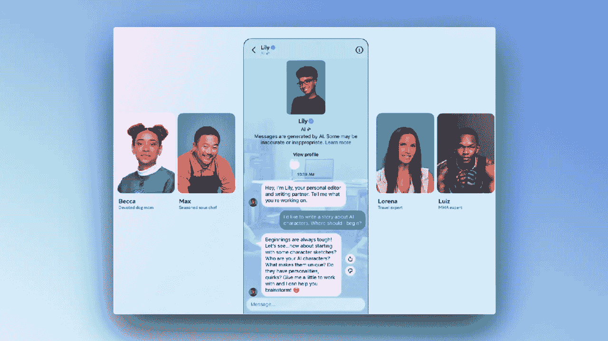

除了上面的一系列软件更新之外 Meta 还和 EssilorLuxottica 合作推出了新一代 Ray-Ban Meta 智能眼镜。新款眼镜配备改进的音频和摄像头、超过 150 种不同的定制镜框和镜片组合，而且更轻、更舒适。可以通过眼镜向 Facebook 或 Instagram 进行直播，并使用“Hey Meta”与高级对话助手 Meta AI 进行互动：https://about.fb.com/news/2023/09/new-ray-ban-meta-smart-glasses/

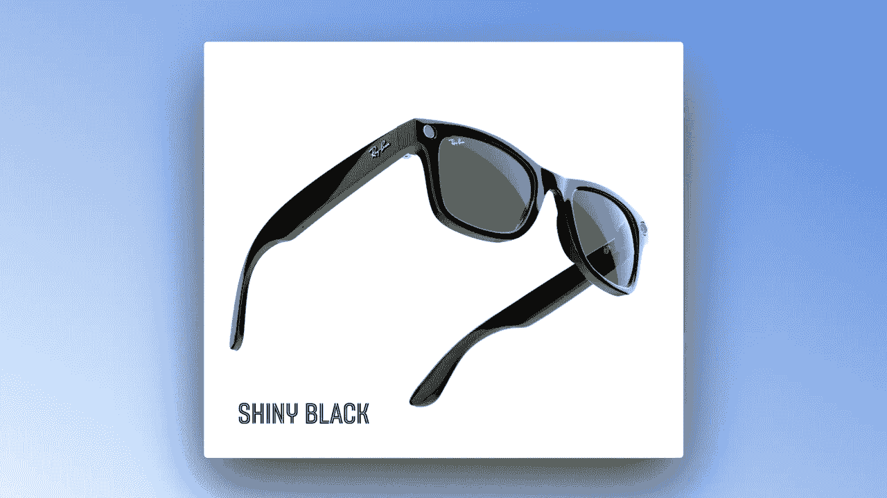

---

# 🧵其他动态

+   Canva 推出 Magic Studio，与 Runway ML 合作开发视频。 Canva 正在将人工智能集成到其平台的所有部分，以实现任务自动化并激发设计灵感：https://www.canva.com/newsroom/news/magic-studio/

+   Anthropic发布了文章《评估人工智能系统的主要挑战》，介绍了人工智能评估的各个阶段和其挑战：https://www.anthropic.com/index/evaluating-ai-systems

+   Perplexity 推出 pplx-api - 低延迟LLM API，用于访问 Mistral 7B、Llama2 13B、Code Llama 34B 和 Llama2 70B 等开源 LLM：https://blog.perplexity.ai/blog/introducing-pplx-api

+   Open AI 的一些小更新包括你现在可以对函数调用进行Open AI API微调，还推出了OpenAI Python SDK 的 beta 版本：https://platform.openai.com/docs/guides/fine-tuning/use-a-fine-tuned-model，https://github.com/openai/openai-python

+   LinkedIn也推出了一系列关于求职的 AI 能力，可以帮助用户寻找工作、营销和销售。 LinkedIn 的全球人才趋势报告也显示，对人工智能技能的需求激增：https://news.linkedin.com/2023/october/New_AI_Powered_Features_for_Businesses

+   Anthropic被亚马逊注资 40 亿美元后，正在寻求最新的 20 亿美元融资，谷歌也将参与：https://www.theinformation.com/articles/openai-rival-anthropic-in-talks-to-raise-2-billion-from-google-others-as-ai-arms-race-accelerates

+   Stability AI公司推出的一个新的语言模型——Stable LM 3B。这个模型体积小(参数数为30亿),但性能很强,可以运行在手持设备和笔记本电脑上：https://stability.ai/blog/stable-lm-3b-sustainable-high-performance-language-models-smart-devices

+   Poe 现在已经支持通过对话使用 SDXL 生成图片：https://poe.com/StableDiffusionXL

+   A[mazon Bedrock 已全面上市。](https://aws.amazon.com/cn/generative-ai/)此外，AWS还宣布了新的人工智能产品，扩大了其AI产品目录： https://aws.amazon.com/cn/generative-ai/

+   Poe 发布了一个新机器人Web Search with Poe ，可以用 LLM 联网搜索：https://poe.com/Web-Search

+   Adobe 推出了带有 Firefly 支持的 AI 工具的 Photoshop 网页版本：https://photoshop.adobe.com/discover

+   ChatGPT 现在可以（再次）浏览网页 - Bing 浏览插件回来了，比之前还拉基本不可用：https://twitter.com/OpenAI/status/1707077710047216095?s=20

+   Cloudflare 正在推出 Workers AI - Cloudflare 正在与 HuggingFace 合作，让所有开发人员都能轻松使用 AI 推理能力：https://blog.cloudflare.com/workers-ai/

+   DALL-E 3 推出后 Midjoureny 压力大增，宣布会在两周后推出 V5.3 版本的模型和新的网页端：https://x.com/saana_ai/status/1709655392077447447?s=20

+   Spotify 可以将播客翻译成新的语言，用于将播客的人工智能语音翻译成不同的语言，同时保留原始说话者的声音：https://newsroom.spotify.com/2023-09-25/ai-voice-translation-pilot-lex-fridman-dax-shepard-steven-bartlett/

+   亚马逊和 Anthropic 达成 40 亿美元的合作伙伴关系，作为交易的一部分，Anthropic 将使用亚马逊的定制芯片和云服务来构建和部署其人工智能软件：https://www.anthropic.com/index/anthropic-amazon

---

# ⚒️产品推荐

## Melon：帮助用户学习知识的 AI 助手

Melon,一个可以帮助用户学习和应用知识的AI助手。Melon可以帮助用户从各种来源如播客、文章、TikTok等收集信息,并将这些信息连接起来帮助用户产生新的思路。它可以记录和管理用户学习过程中收集的知识,从而帮助用户更好地学习和应用这些知识。文章中还展示了一些用户对Melon的评价,并鼓励读者使用Melon一起学习成长。

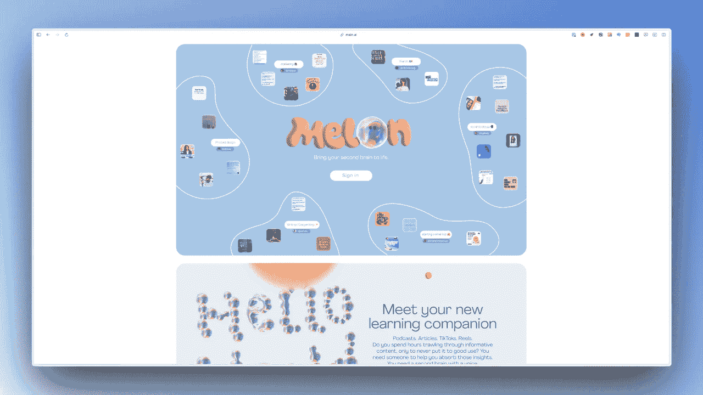

## Coda 4.0：类似 Notion 但更强大 AI 功能

Coda 更新了 4.0 版本，主要新功能包括:Coda AI助手,它可以根据公司内部信息回答问题,提供写作帮助和执行任务。双向同步功能,允许Pack直接读取和写入其他工具如Salesforce。全页嵌入,可以将其他应用如Figma嵌入Coda页面列表中。同步页面功能,允许同一页面内容出现在多个文档中。

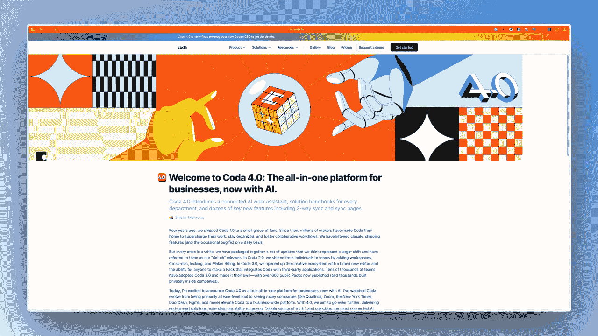

## Turbopuffer：无服务器的向量数据库

Turbopuffer新型向量数据库服务,它提供了无服务器的架构,实时计费,查询响应时间约100毫秒。该服务特别便宜,每百万个向量每月只需1美元,比其他服务低10-70倍。它目前还在Alpha阶段,但已提供了Python API示例和详细的技术规格,未来还将支持可变索引、过滤、边缘推理等新功能。该项目由Shopify高级工程师发起,重点是提供一款性能出色、价格实惠的向量数据库服务。

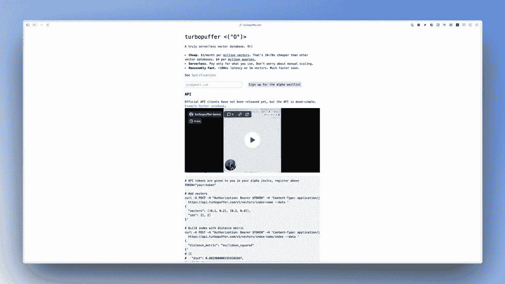

## [Emojis：AI 创建表情](https://emojis.alexandru.so/)

我前几周发过的一个 SD 模型，已经有人产品化了。输入简单的描述就能为你生成对应的Emoji。类似的产品还有这个：https://www.emoji.is/

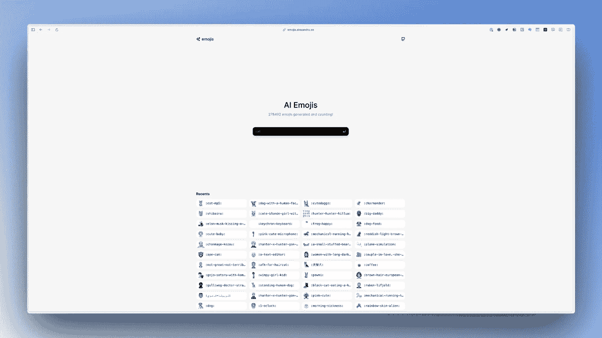

## Frec：AI 驱动的指数投资服务

Frec公司提供的直接指数投资服务。它可以帮助投资者通过每日对个股进行税损益挖掘,实现比指数基金更高的累计回报。Frec只收0.1%的年费,比其他机构低很多。用户可以选择S&P500指数或者信息技术指数,并自定义个股配置。

## Lepton AI：一行代码接入各种 AI 服务

集成了 SDXL 、 Code Llama 的服务只需要一行代码就能接入。

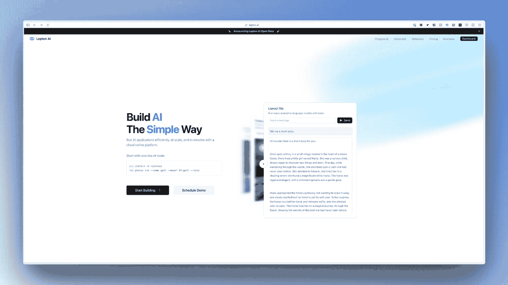

## Rewind Pendant：捕捉你说的和听到的所有声音

Rewind Pendant是一个可穿戴设备,可以记录用户说的话和听到的声音,然后进行转录、加密和本地存储。它采取以隐私为先的方法,并提供功能来确保没有人在未经同意的情况下被记录。Rewind希望通过Pendant来提供一个真正基于用户所有看到、说过和听过的个性化AI。当Rewind知道你的所有信息之后结合 AI 帮你定制的助手会有多了解你呢？

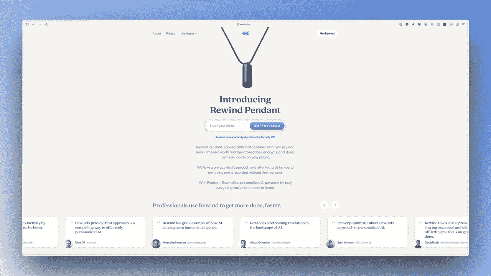

## Ollama：在本地运行大语言模型

在本地启动并运行大型语言模型。运行 Llama 2、Code Llama 和其他模型。定制并创建你自己的模型。

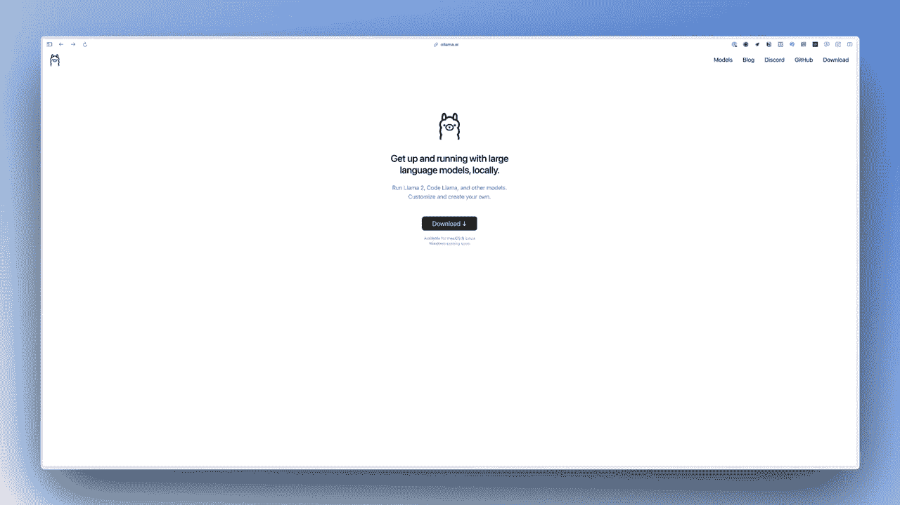

## Formless：AI 生成和管理表单

Formless是一个可以与用户进行对话的表单生成工具。它不仅可以提出问题获取结构化数据,还可以根据用户提供的网站或文档内容回答用户的问题。Formless支持120多种语言,可以根据需要定制语调。它还可以与Hubspot、Google表格、Mailchimp等其他产品集成。

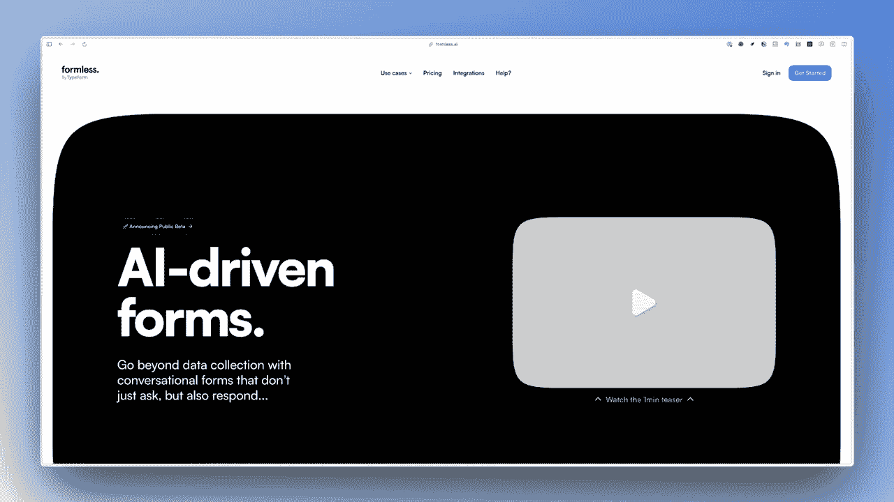

## Bluedot：自动记录和生成会议笔记

Bluedot,一个可以记录和自动生成会议笔记的Chrome扩展。它可以帮助用户记录Google Meet会议,并使用AI技术生成会议笔记。这些笔记可以自定义格式,并自动分享到Slack、Notion等工具中。Bluedot声称可以帮助用户每周节省5小时时间,同时降低30%工作量。它支持与Google Drive、Salesforce等流行工具集成。

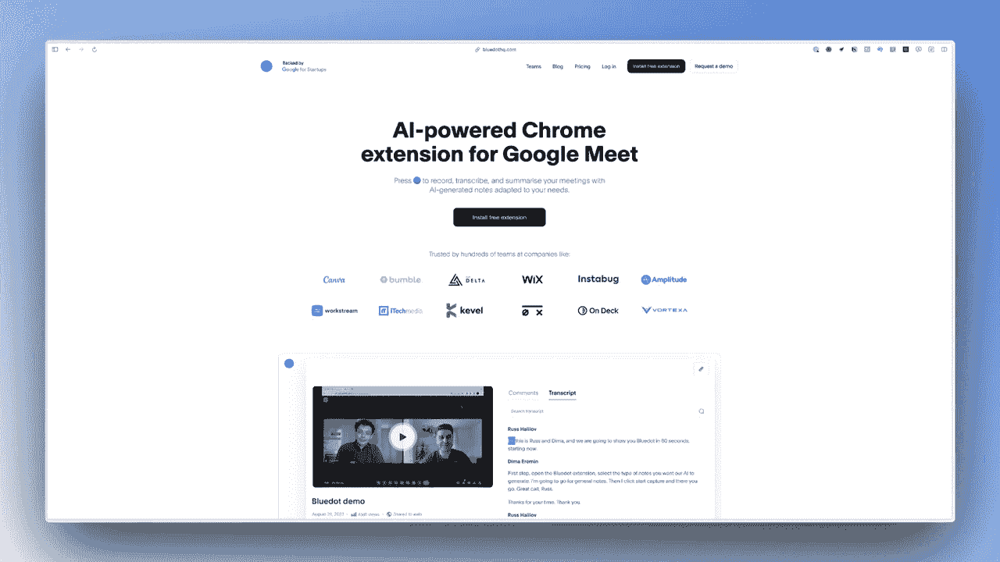

## Verble：AI 演讲辅助软件

Verble,一个免费的AI辅助演讲软件。它可以帮助用户制作各种演讲,包括业务报告、投资者演示、婚礼致辞等。Verble通过与用户交流来了解情况,然后自动生成一个初稿。用户可以根据自己的需要编辑初稿,同时Verble也提供专家级技巧指导用户如何表达更有影响力。总之,Verble旨在帮助每个人以有说服力和自信的方式表达自己的想法。

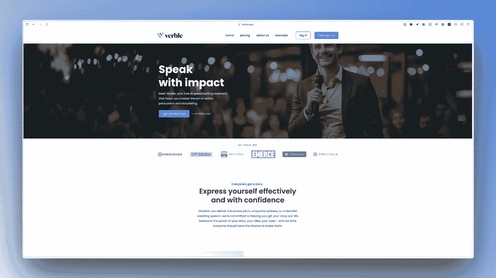

## Fabric：通过 AI 理解和搜索你的屏幕截图

Fabric可以自动同步和分析用户的屏幕截图,使用AI技术对截图进行标记和提取信息,使得用户可以更好地搜索和管理自己的截图库。它还可以创建笔记并与其他应用程序和云驱动程序连接,成为用户数字世界的主要工作空间。

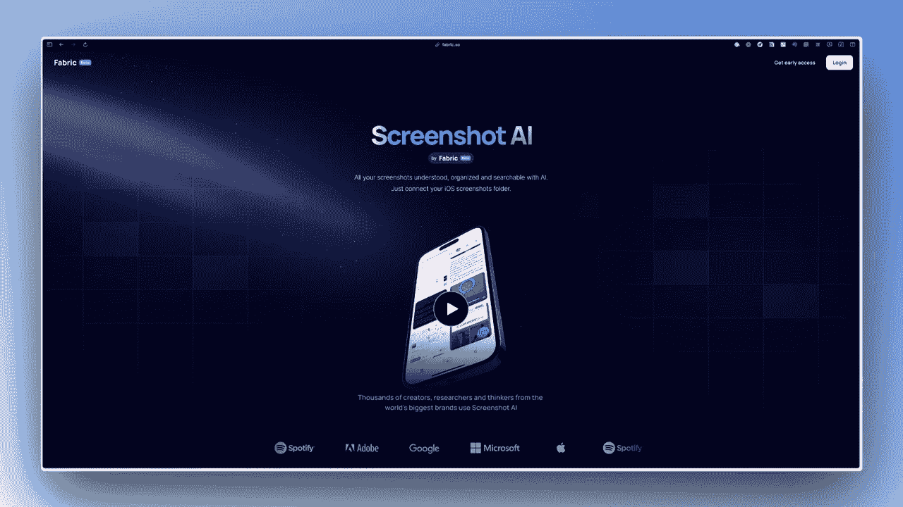

## [Cohere Chat with](https://txt.cohere.com/chat-with-rag/) RAG：具有RAG 功能的聊天 API

Cohere公司推出了新的聊天API功能。这个API可以让开发者把Cohere公司开发的大语言模型Command集成到他们自己的产品中,实现更流畅自然的对话体验。通过这个API开发者可以利用外部数据源来丰富模型生成的内容,使得回复更相关、准确和可靠。API支持使用外部搜索引擎和文本文档来提供可验证的参考信息,这有助于提高用户对AI产品的信任。

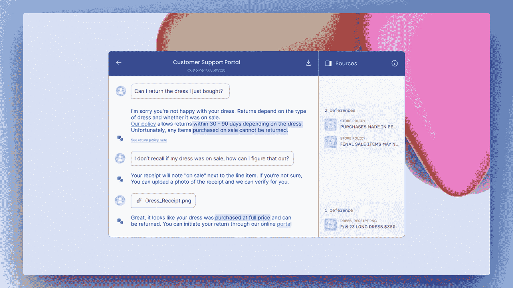

## [Strut：AI笔记本软件](https://strut.so/)

Strut AI笔记本软件。它可以帮助用户快速从笔记中生成专业水平的内容,比如博客文章、推文、简历等。软件可以根据用户以前的作品学习他们的语气和风格,保证生成内容的一致性。它也支持多人协作编辑文档,并提供AI聊天功能提取文档中的见解。

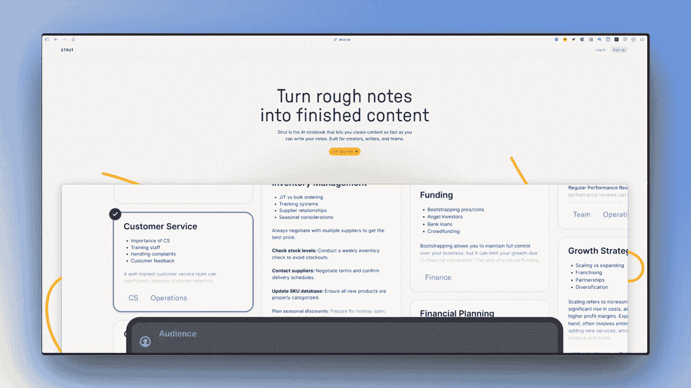

## FireCut：AI 视频编辑插件

FireCut的视频编辑软件。它使用AI技术,可以快速地为Adobe Premiere Pro用户执行许多编辑任务,比如删除空白,添加自动变焦,创建章节等。许多视频创作者表示FireCut大大节省了他们的时间。

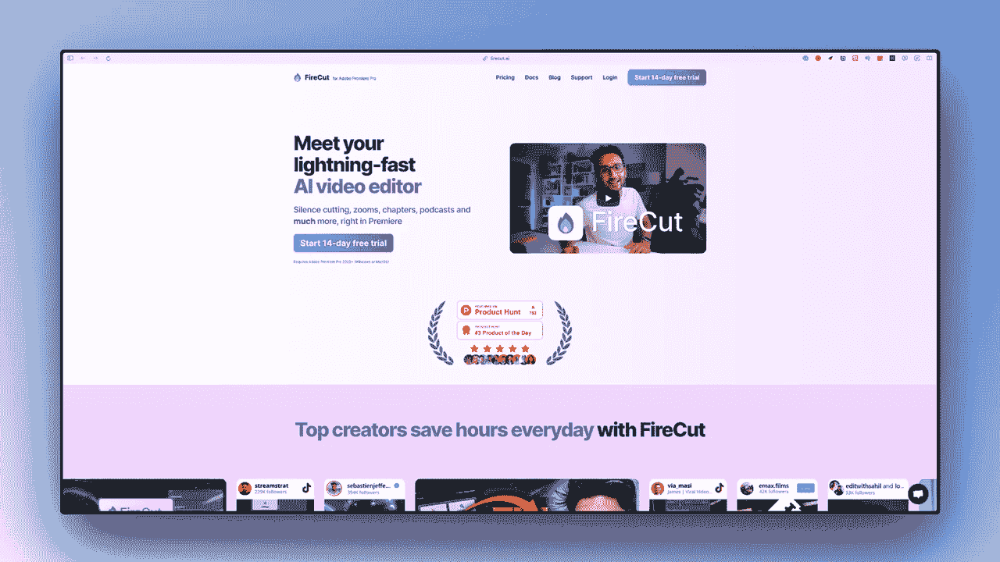

## Bestever：AI 快速创建品牌营销内容

Bestever可以帮助内容创作者简化内容创作工作流程,让用户可以专注于想法。它可以帮助用户快速地为社交平台如Instagram和Twitter生成视频和图片资源,帮助用户高效地推广产品。

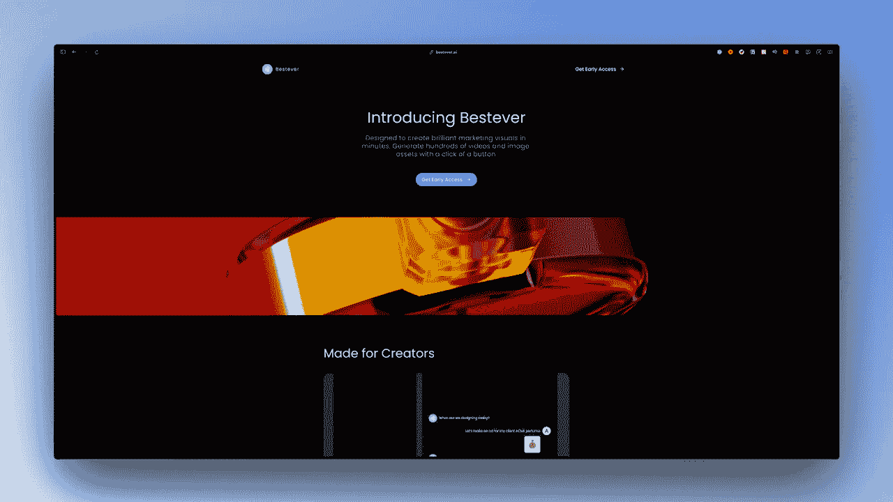

---

# 🔬精选文章

## [字节推出的 3D 生成模型](https://arxiv.org/abs/2308.16512)

MVDream，一种多视图扩散模型，能够根据给定的文本提示生成一致的多视图图像。从2D和3D数据中学习，多视图扩散模型可以实现2D扩散模型的普遍性以及3D渲染的一致性。我们证明，这种多视图先验可以作为一种与3D表示无关的普遍的3D先验。它可以应用于通过分数蒸馏采样的3D生成，显著提高现有2D提升方法的一致性和稳定性。它还可以从少量2D示例中学习新概念，类似于DreamBooth，但用于3D生成。

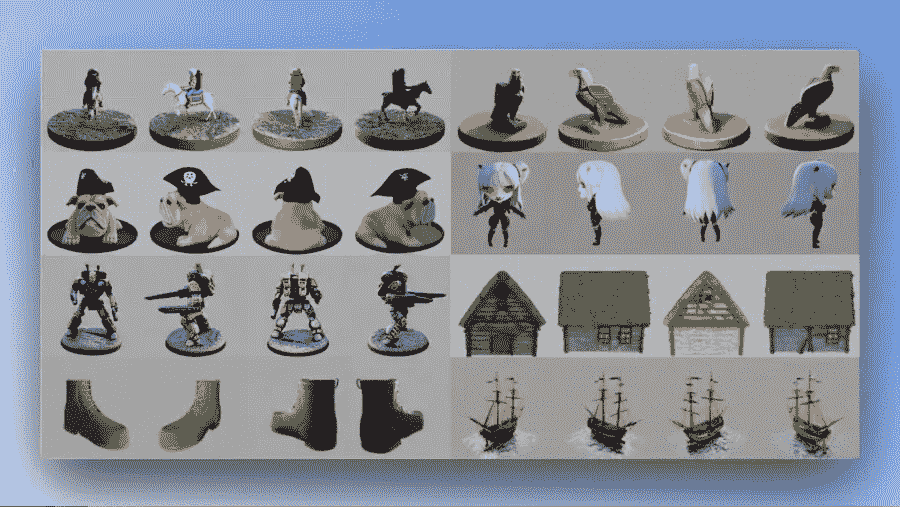

## Langchain：构建（和破坏）WebLangChain

介绍了如何构建一个基于语言链和Tavily的网络研究助手应用。它详细讨论了信息检索和增强生成这两个主要步骤中的各种工程决定,比如是否总是检索信息,如何处理后续问题等。作者通过例子展示了这些决定会如何影响产品体验,并分享了源代码以帮助读者构建自己的语言模型应用。

## 微软首席技术官 Kevin Scott 讨论人工智能与艺术未来如何共存

在这次对话中，微软首席技术官兼AI副总裁Kevin Scott讨论了Bing的发展以及微软在AI领域的努力。Kevin强调了Bing在市场份额上的增长，以及微软在AI领域的实验和创新。他还谈到了GPU技术的重要性以及微软与Nvidia的合作关系，以及微软是否会考虑转向其他芯片供应商。此外，Kevin还探讨了AI生成内容的潜力，以及如何确保创作者的作品得到公平报酬，以促进创造力。他还提到了用于标记真实内容和AI生成内容的可能方法，以维护作品的真实性和来源。

## [生成式界面](https://matt-rickard.com/generative-interfaces)

讨论了生成式界面这个概念。生成式界面根据用户当前状态动态地生成用户界面,可以帮助用户完成复杂流程,比如填写表单。它可以让用户以个性化的方式完成应用的入门流程,并根据用户的兴趣和熟悉程度提出相应的问题。生成式界面不必设计整个应用,可以生成单个用户界面元素。这种方法可以帮助开发者更容易地构建出具有个性化用户体验的应用。

## 我们可以开始隐约看到人工智能不久的将来是什么样子

总结了人工智能技术的最新发展,以及它们可能带来的影响。文章分析了人工智能模型的“大脑”能力不断提高,它们现在可以进行视觉识别和语音交互。这些功能让AI可以成为个人助手或同伴。但是,AI的影响取决于我们如何使用它。如果我们利用AI来赋能他人,它可能会简化我们的生活;但如果我们让AI取代人类,它也可能剥夺我们的权力。总体来说,尽管AI技术不断进步,但其影响取决于我们如何管理和使用它。

## 开源人工智能商业模式和品牌护城河

讨论了开源人工智能领域的商业模式和品牌壁垒。它分析了开源人工智能实验室长期获利的难点,并指出构建品牌影响力将变得越来越重要。文章还借鉴了区块链领域的经验,认为像Friend.tech这样通过社区和设计优势形成品牌壁垒的项目将更容易长期盈利。总体来说,文章认为在不断变化的AI领域,公司要通过多种方式持续创新,才能在长期生存。

## [**训练一个人工智能来代替你自己**](https://every.to/chain-of-thought/wanted-high-performers-for-the-last-job-you-ll-ever-have)

一个新的类型的专业服务机构的概念。这个机构会雇佣非常有才华的人来完成客户工作的同时,也会记录和标记整个工作流程,将这些数据用于训练AI模型。机构的目标是逐步用训练好的模型来替代员工。如果成功,员工将继续获得工资并分享公司利润。这种机构可能具有软件公司一样的利润率。但是,还存在一些风险,比如AI进步可能不足以完全自动化工作。

## 关于新闻机构如何利用人工智能进行的全球调查

AI正在以比我们想象的更快的速度改变新闻行业。超过75％的受访者使用AI进行新闻搜集、生产或分发，但只有 32% 的有人制定了自己的 AI 使用策略。

## [**人工智能、硬件和虚拟现实**](https://stratechery.com/2023/ai-hardware-and-virtual-reality/)

主要讨论了人工智能、硬件和虚拟现实的最新动态。它分析说人工智能可以消除人类在交流、内容创作和软件交互等方面的限制,从而带来更真实的虚拟体验。OpenAI和Meta都在推出新的人工智能产品,比如语音聊天和视觉识别功能。Meta还发布了智能眼镜,这可能成为人工智能应用的理想载体。Ive和Altman也在计划开发一款面向消费者的人工智能硬件设备。总体来说,文章讨论了人工智能如何推动虚拟现实的发展,以及硬件在此过程中的重要性。

## 非工程师指南：训练 LLaMA 2 聊天机器人

这个教程展示了如何使用Hugging Face提供的服务来训练和部署一个基于LLM的聊天机器人,而无需任何代码知识。它分为三个步骤:使用AutoTrain服务在线训练一个LLM模型。然后使用ChatUI服务将训练好的模型部署成一个可通过网页聊天的机器人。最后介绍了Hugging Face为普通用户提供的一些工具,比如Spaces、AutoTrain、ChatUI等,目的是让更多人能参与和利用机器学习。

## [**Lex Fridman**](https://www.youtube.com/watch?v=MVYrJJNdrEg)采访Zuckerberg： 虚拟宇宙中的第一次采访

这个视频是一次对Mark Zuckerberg的采访，采访中探讨了他对“元宇宙”概念的看法，以及他在这一领域的技术创新。采访中提到了Kodak化身技术，这是一种能够以高度逼真的方式呈现人类化身的技术，包括面部表情和身体动作。这种技术将物理世界与数字世界融合在一起，使人们能够在虚拟空间中以逼真的化身互动。Mark Zuckerberg还讨论了虚拟现实、增强现实和混合现实技术的发展，以及它们如何影响人类沟通和互动的方式。他还提到了Quest 3虚拟现实头盔和它的混合现实功能，以及这些技术可能改变人们与数字世界互动的方式。

## 多模态 AI 是一个用户体验问题

文章介绍了不同类型的AI模型,如文本到文本、图像到文本等。文章指出,将来AI的重要发展方向将是结合这些不同模态。但是,最重要的挑战不是技术问题,而是用户体验问题。我们需要设计出一种用户界面,可以很好地将文本、图像、音频和代码等不同类型的输出同时呈现给用户,并允许用户提供反馈来改进模型。

## 对 GPT-4V(Vision) 的第一印象

这篇文章测试了GPT-4V(视觉)模型对不同类型图像的理解能力。作者上传了各种图像,如电脑视觉梗图、硬币、电影截图、植物图片等,并询问模型相关问题。模型在一般问题回答上表现不错,但在物体检测、OCR识别以及填字游戏和数独游戏等任务上效果不佳。文章还提到模型的一些限制,如无法识别人物,会出现“假设”现象。总体来说,GPT-4V是开创性的进步,但在计算机视觉任务上还需继续优化。

## Llama 生态系统：过去、现在和未来

文章展示了一下基于 Llama 模型的LLM 生态系统的进展和成果，下面是其中的一些摘要：

过去一段时间Hugging Face 上基于Llama的模型下载量超过3000万次，仅在过去的30天内就有超过1000万次下载。

迄今为止，使用Llama 2模型的企业项目启动数量在Google Cloud和AWS共计超过3,500个。

社区已经在Hugging Face上优化并发布了超过7,000个衍生模型。基准性能平均提高了 10%。

现在在GitHub上有超过7,000个项目是基于或提及Llama构建的。

主要的硬件平台AMD、Intel、Nvidia和Google通过硬件和软件优化提升了Llama 2的性能。

## AI+ a16z 人工智能系列讲座

a16z 主持了一系列有关人工智能革命的讲座。其中包括 Open AI 的 Mira Murati、微软的 Kevin Scott 等嘉宾。有时间可以都看看。

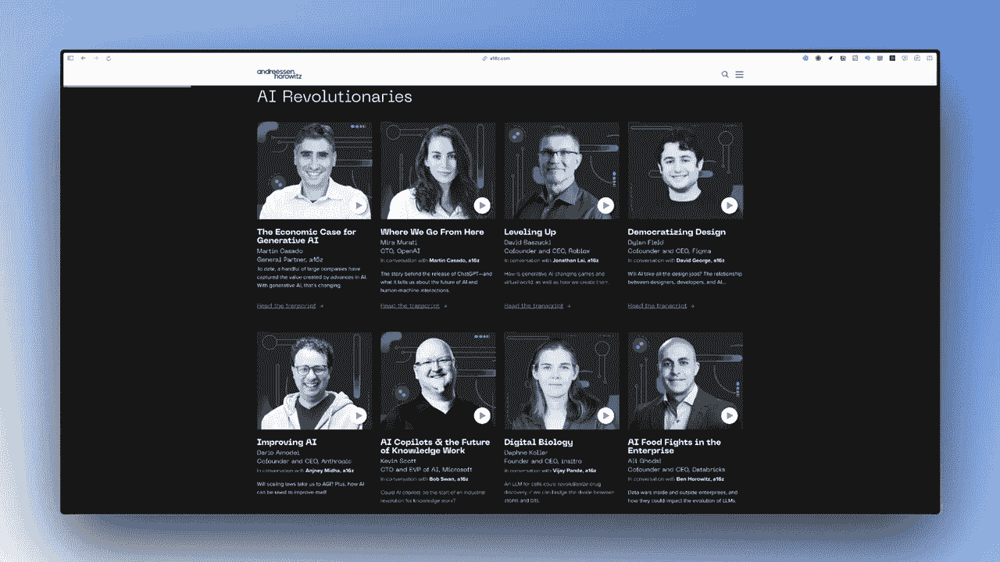

## Claude 长上下文窗口的提示工程

介绍了人工智能公司Anthropic使用提示工程技术来提高其语言模型Claude在长文档环境下的回答能力。它通过例子展示了提取相关引文和提供其他章节问题例子两种方法可以提高Claude对长文档内容的回忆能力。页面还提供了一个实验的详细结果,说明这两种方法可以有效提高Claude实例1.2版和2版在7.5万和9.5万字文档环境下正确回答问题的能力。