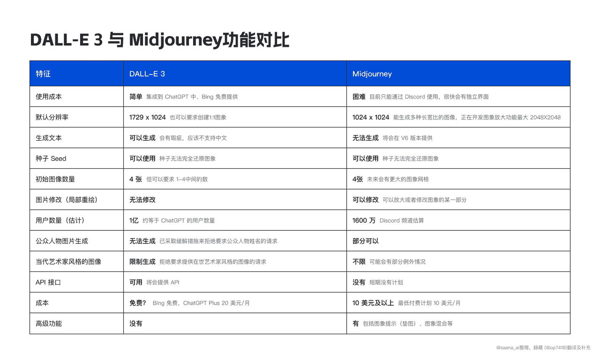
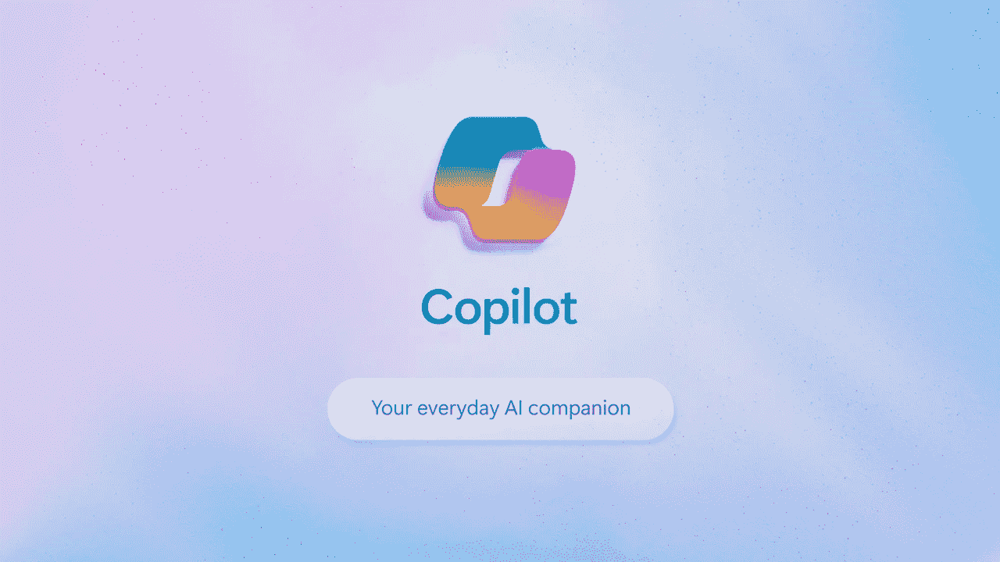
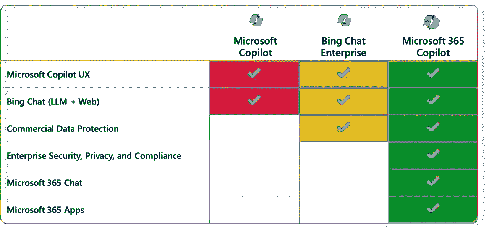
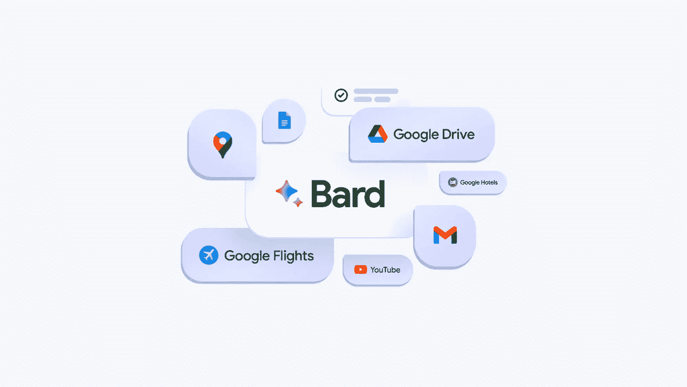
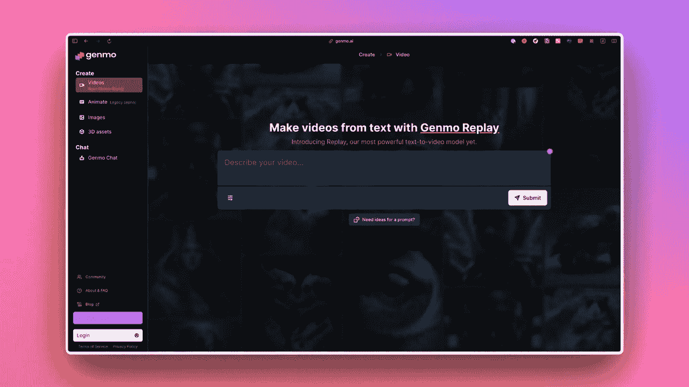
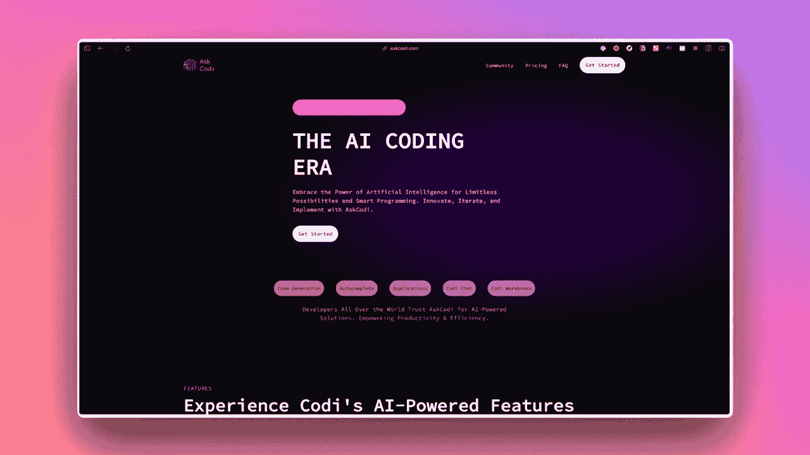
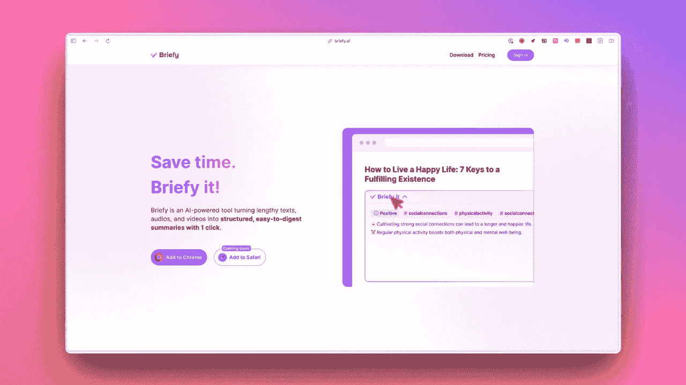
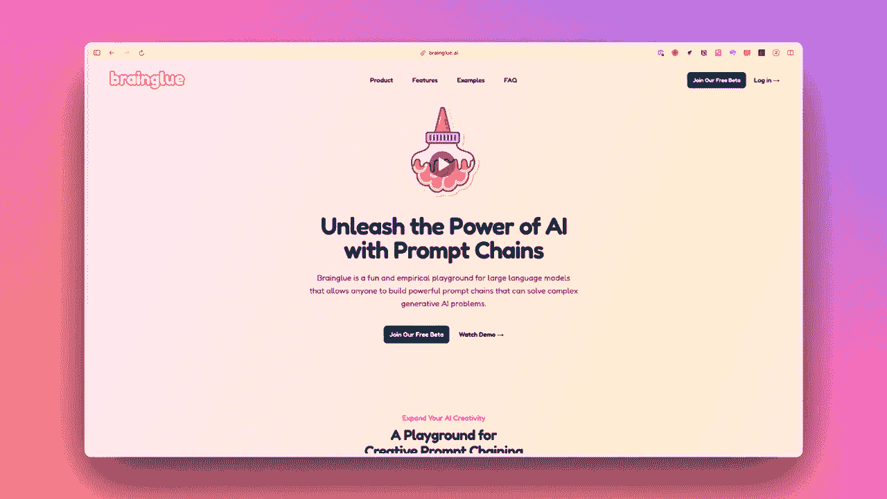
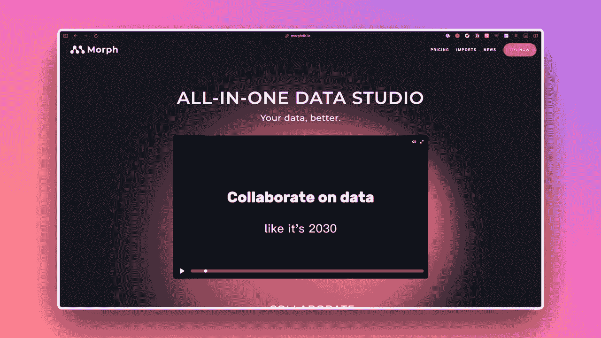
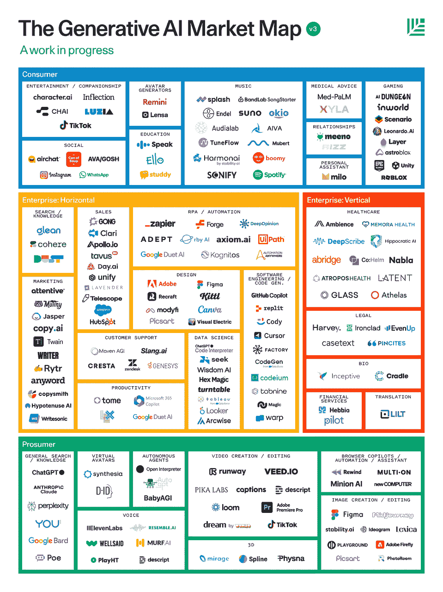

# AIGC Weekly #40

> 来源：[https://waytoagi.feishu.cn/docx/G1EBdssI1oTNG0xBxOYcqE0knZd](https://waytoagi.feishu.cn/docx/G1EBdssI1oTNG0xBxOYcqE0knZd)

> 🔗 原文链接： h[ttps://quail.ink/o](https://quail.ink/op7418/p/aigc-weekly-40)p7418/p/aigc-wee...

> 发表时间：25 Sep, 2023

工具：Nijijoureny

提示词： s.mj.run/ZhzEstrpc2U a purple and blue abstract art print on black, in the style of colorful gradients, delicate chromatics, blink-and-you-miss-it detail, multi-coloured minimalism, realistic depiction of light, flowing draperies --ar 16:9

---

# ❤️上周精选

## Open AI 发布了 DALL-E 3

Open AI悄咪咪整了个大的，DALL·E 3发布了！相较于2代它有这些提升：

+   图像的生成质量有了非常大的提高，风格与Adobe Firefly类似。

+   DALL·E 3可以准确地表示具有特定对象的场景以及它们之间的关系。

+   在图像内以及手等人体细节中生成文本时，DALL·E 3 比 DALL·E 2 有了显着改进。

+   DALL·E 3 是构建在GPT-3.5之上的，你不会写提示词不要紧，GPT-3.5会帮你优化你的提示，也可以通过对话来修改生成的图像。

+   最后DALL·E 3将会在10月初向Plus用户和企业版用户提供，也会提供对应的API。

从图象质量和侧重点宣传点来看确实不像是要跟 Midjourney 或者 SDXL 进行竞争，更像是为了跟即将到来的谷歌多模态模型 DeepMind Gemini 做的准备，可以看作是 GPT4 即将开放多模态的前兆。

如果想要看更多DALL-E 3 生成的图象的话可以来这里：https://x.com/OfficialLoganK/status/1704850313889595399?s=20

Alie Jules整理了一个 DALL-E 3 和 Mdijourney的各项内容对比，内容挺全面的。我翻译了一下加了一些补充的信息。

## 微软宣布了旗下产品一大波 AI 更新

Windows 11将会加入系统级别的AI助手Windows Copilot。Windows 11将于9月26日发布。

Windows 中的很多应用都经过了AI的增强并且所有这些都集合到了Windows Copilot中，Windows Copilot 是 Windows 11 23H2 更新的主要功能，将相同的 Bing 聊天功能直接带到 Windows 11 桌面。它在 Windows 11 中显示为侧边栏，允许你控制 PC 上的设置、启动应用程序或只是回答查询。它也集成在整个操作系统中。

同时系统的绘图与照片工具等也会与Windows Copilot深度结合加入AI功能。可以说渗透到了整个系统的方方面面，各位可以看视频了解。

Bing 和 Edge的一些更新：

微软购物的副驾驶。现在，可以通过 Bing 或 Edge 更快地找到你要在线购物的商品。

Bing Image Creator 中将会提供 DALL-E 3的画图模型使用。

AI水印：该凭证使用加密方法向 Bing 中所有人工智能生成的图像添加不可见的数字水印

同时借助 Designer 等创意工具，加上 Bing Image Creator、Clipchamp 和 Paint，你现在可以通过一些简单的提示立即获得几乎所有内容的视觉草稿。

**Microsoft 365 Copilot**也在同一天的微软发布会上发布了一堆更新 ，同样9月26日发布：

首先推出 Copilot Lab，以帮助每个人学习如何使用 AI 进行迭代工作，并充分利用 Microsoft 365 Copilot。通过 Copilot Lab，你可以学习将良好的提示变成出色的提示，与同事分享您最喜欢的提示。

接下来是各个office软件的更新：

Outlook 中的 Copilot 可帮助你总结邮件内容并且起草书写邮件内容。

Word 中的 Copilot 可以帮你书写你要求格式的内容和生成对应的表格等。

Excel 中的 Copilot 可以帮你写复杂的公式，创建可视化图表以及书写 Python 代码完成复杂任务。

Loop 现在可以要求他生成对应内容的表格和其他office软件链接，帮你在代码块中生成代码。

Stream 中的 Copilot 可以帮助你理解视频内容，询问并跳转到对应时间点。

首先是 Bard，推出了英语版 Bard Extensions，这是一种与 Bard 互动和协作的全新方式。借助扩展程序，Bard可以从你每天使用的 Google 工具（例如 Gmail、文档、云端硬盘、Google 地图、YouTube 以及 Google 航班和酒店）中查找并向你显示相关信息，即使你需要的信息跨多个应用程序和服务。

使用英语回复，现在可以使用 Bard的“Google it”按钮更轻松地仔细检查其答案。当你单击“G”图标时， Bard将读取响应并评估网络上是否有内容来证实它是否回答正确。

当有人通过公共链接给你分享Bard聊天时，可以继续对话并向Bard询问有关该主题的其他问题。

PaLM 2 模型也进行了更新。根据用户的反馈，应用了最先进的强化学习技术来训练模型，使其更加直观和富有想象力。

Youtube 也更新了五款针对创作者的 AI 工具，帮助他们降低创作成本，感觉有几个还挺实用的：

+   **Dream Screen **：将 AI 生成的图像或视频背景添加到 YouTube Shorts 中。

+   **YouTube Create **：使用新的编辑和制作应用程序编辑手机中的视频。

+   **AI Insights **：根据观众已在 YouTube 上观看的内容获取视频创意和大纲建议。

+   **Aloud **：使用自动配音工具轻松创建更多语言的内容。

+   **创作者音乐中的辅助搜索 **：使用这款人工智能辅助搜索工具为您的视频找到完美的配乐。

详细介绍：https://blog.google/products/youtube/youtube-new-creator-tools-2023/

---

# 🧵其他动态

Stripe的产品负责人，Twitter的平台，Jolicloud的联合创始人兼CTO Romain Huet 入职 Open AI 负责负责开发者体验：https://x.com/romainhuet/status/1704921257651875854?s=20

亚马逊为 Alexa 增加了人工智能功能：https://techcrunch.com/2023/09/20/amazon-brings-generative-ai-to-alexa/

Lexica 推出了他们新的图像生成模型 Aperture v3.5，质量看起来不错：https://x.com/sharifshameem/status/1704496886499909963?s=20

Open AI 推出了用于模型微调的 UI 界面，现在可以在 UI 上查看模型微调进度了：https://x.com/OfficialLoganK/status/1704181284036300970?s=20

---

# ⚒️产品推荐

## Genmo：使用文本创建 AI 视频

前几天发布的文字生成视频的应用@genmoai，相较于Pika和Runway它生成视频的清晰度确实大幅提高，而且人像的稳定性和美观度比其他两个强非常多，上来就支持镜头控制而且控制粒度更细。唯一不太好的就是还没开放图片生成视频，都只能用文字提示词。

## AskCodi：AI 驱动的代码助手

AskCodi 是一款 AI 代码助手，提供各种应用程序用于代码生成、单元测试创建、文档化、代码转换等。它由 OpenAI GPT 提供支持，可以作为 Visual Studio Code、Sublime Text 和 JetBrains 的 IDE 的扩展/插件使用。AskCodi 旨在帮助开发人员更快更轻松地编写代码，降低人们探索软件开发职业的门槛。

## ODIN：Obsidian AI 插件

ODIN（Obsidian驱动信息网络）是一个插件，可以在Obsidian中使用。它提供了一些功能，包括通过图形提示栏进行LLM查询、图形可视化、下拉菜单功能等。安装ODIN需要先安装Obsidian并按照指示进行插件的安装和启用。安装完成后，可以在Obsidian界面上使用ODIN的功能。

## Cardinal：包含客户反馈和收入数据的智能产品待办事项列表

Cardinal是一款基于AI的产品待办事项工具，可以通过客户反馈和收入数据丰富特性，帮助团队优先考虑下一步要建立什么。它可以从CRM和CS工具同步客户数据，将反馈映射到实际功能，提取客户想要什么以及对他们有多重要。该工具还可以将GTM、产品和工程团队进行对齐，以保持想法和功能与其美元价值、业务影响和进展保持同步。Cardinal可以查看收入机会，并为每个功能计算和预测收入价值。它还有一个清晰的产品战略，将功能分组到倡议中，并在关键影响领域下优先考虑功能的上下文。该工具由AI支撑，可以识别客户反馈电话和消息中的需求和特性。

## [Briefy：AI 总结工具](https://briefy.ai/)

Briefy是一款基于AI的工具，可以将冗长的文本、音频和视频转换为结构化的、易于理解的摘要，只需一键即可。

## Klu：将各个平台的数据集成在一起

Klu是一款生产力工具，它将各种工作应用程序集成在一起，帮助用户更快更智能地工作。它允许用户连接他们最喜欢的应用程序，搜索，提出问题，并与数据聊天。Klu的AI驱动智能搜索可以立即获得所有应用程序的结果，其AI聊天功能可以与数据进行动态对话。Klu优先考虑数据安全，提供统一，高效的体验。它与各种应用程序集成，包括Notion，Gmail，Trello和GitHub，并允许用户直接与内容进行聊天。

## Screenwriter：AI 自动创建自动化测试

Screenwriter是一款工具，可以让用户在不编写任何代码的情况下创建UI自动化测试。用户可以用普通英语描述用户流程，Screenwriter的AI将创建自主代理，就像真实用户一样与应用程序交互。测试存储在Screenwriter的基础架构上，用户可以在应用程序中编辑和管理其测试套件。Screenwriter的AI旨在适应应用程序，只表面真实问题，使其比其他UI自动化测试工具更不容易出错，更易于维护。

## Brainglue：构建强大的提示链来解决复杂问题

Brainglue 是一个 AI 游乐场和工作流 API，它允许用户为大型语言模型构建提示链以解决复杂的生成 AI 问题。它提供了一个直观且易于使用的界面，用于探索各种配置和链接多个提示以增强 AI 推理。Brainglue 还提供一个模板库，其中包含增强 AI 推理的提示链接技术的示例，以及一个强大的 API，用于无缝集成和从实验到生产的 AI 解决方案的扩展。网站还挺可爱的。

## Morph：利用 AI 分析整理数据

Morph 是一款一体化的数据工作室，可以让用户实时协作处理数据任务，并提供 AI 辅助来收集、排序和分析数据。它设计用来处理数百万条记录，并且为开发者提供强大的 API 支持。Morph 旨在让每个人都能够通过一个简单的界面轻松地收集、存储和理解数据。

---

# 🔬精选文章

## 字幕翻译、书籍翻译的福音，如何借助ChatGPT得到高质量的翻译结果？

宝玉过去几个月用 ChatGPT翻译整理内容总结出来的结晶，主要包括如何写好提示词，提供足够多的上下文，如何追问提高准确性，以及如何避免超出上下文限制导致失忆等内容。非常值得一读其他地方也能用的到。

## [**使用富文本生成富有表现力的图像**](https://rich-text-to-image.github.io/)

这个研究有点强的，我们可能获得了另外一种增强Stable Diffusion控制的方法，它允许你使用富文本书写提示词影响画面。比如指定某个提示词的颜色，例如提示词中有长发这个单词，然后你把长发的文字颜色改成了粉色，那么生成图像的头发颜色就会变成粉色。

## Open AI 的 Cookbook 页面

Open AI重构了他们的 cookbook 页面里面的内容简直是LLM的宝藏，都是Open AI的开发人员精心挑选的工具和相关论文，还有非常多的教程。毕竟这帮人可能是这个星球上最懂LLM的人了，可以去发掘一下。

## 红杉资本：生成式 AI 进入了第二阶段

这篇文章主要讲述了生成式人工智能（Generative AI）在技术和市场上的发展。文章提到了生成式人工智能的起源、成功的应用案例以及市场地图。其中，文章指出生成式人工智能已经取得了一些成功，但也存在一些问题和挑战。现在市场正在进入“第二幕”，即从以技术为驱动转变为以客户需求为导向的阶段。文章还介绍了几个进入“第二幕”的公司和应用案例，并提供了更新的生成式人工智能市场地图。此外，文章还包括了一个反映公司在生成式人工智能应用开发中所使用的计算和工具供应商的LLM开发者堆栈。

中文翻译的可以看这里：https://mp.weixin.qq.com/s/e2bOOnRfuV36WylWLidLxw

## LLM 提示中的思考要点：结构化 LLM 推理概述

1.  介绍了链式思维（CoT）、树状思维（ToT）和图状思维（GoT）等不同的思维框架，这些框架可以增强大型语言模型（LLM）的推理能力。

1.  讲解了Prompt Engineering（提示工程）的重要性，即如何优化LLM的文本输入以获得期望的输出结果。

1.  详细介绍了链式思维（CoT）、链式思维自洽性（CoT-SC）、树状思维（ToT）、图状思维（GoT）等不同的思维框架，以及这些框架在增强LLM推理能力方面的应用。

## [Y Combinator： ](https://youtu.be/TNgjY5twBIg?si=DvwTGju5TwhXvuUk)40 位 AI 公司创始人讨论当前人工智能技术

视频中的讨论涉及到了人工智能在日常生活中的意想不到的应用方式，包括为婚礼写演讲、帮助编写代码、生成创意故事等。AI工具在创造性方面的应用也取得了一定的突破，可以帮助人们制作South Park动画、合成照片等。此外，AI声音合成、语义搜索、文本阅读等方面也取得了一定的进展。然而，AI的可靠性和可信度仍存在一定的挑战，需要不断进行迭代和调试。

## [红杉： ](https://www.sequoiacap.com/article/follow-the-gpus-perspective/)[**GPU 容量正在变得过剩。从长远来看**](https://www.sequoiacap.com/article/follow-the-gpus-perspective/)，这是好事。短期来看，事情可能会变得混乱

文章讨论了AI行业的当前状态，特别是生成AI的快速增长以及对GPU和AI模型训练的日益增加的需求。作者提出了这些GPU都用于什么以及需要生成多少价值才能抵消快速投资的问题。文章提出，初创公司有很大的机会来填补当前AI收入与支付前期资本投资所需金额之间的差距。作者强调需要从基础设施转向最终客户价值，以使AI技术对人们的生活产生积极影响。

## [**选择矢量数据库的（主观）清单**](https://www.pinecone.io/learn/an-opinionated-checklist-to-choose-a-vector-database/)

文章讨论了如何为生成式AI应用程序选择向量数据库。作者提供了一个评估向量数据库的标准清单，包括技术、开发人员体验和企业准备。在技术方面，作者建议评估性能、可扩展性和成本效率。在开发人员体验方面，作者建议评估易用性、上手时间、文档、集成和用户教育。在企业准备方面，作者建议评估安全性和合规性、专业知识、可用性、技术支持和监控。作者强调可扩展性对AI应用可持续成功的重要性，并鼓励公司在评估向量数据库时要有远见。

## [**验证链减少大型语言模型中的幻觉**](https://huggingface.co/papers/2309.11495)

生成不正确的事实信息（称为幻觉）是大型语言模型中尚未解决的问题。我们研究语言模型对其回答进行思考以纠正其错误的能力。我们开发了验证链（CoVe）方法，即模型首先（i）起草初步回复；然后（ii）计划验证问题以核实其草稿；（iii）独立回答这些问题，以免答案受其他响应的影响；（iv）生成最终验证的响应。在实验中，我们表明CoVe在各种任务上减少了幻觉，从Wikidata的基于列表的问题，到封闭的MultiSpanQA和长格式文本生成。

## 使用 RAG 的聊天机器人：LangChain 完整练习

在本视频中，我们从头开始走过构建使用检索增强生成（RAG）的聊天机器人的过程。我们使用OpenAI的gpt-3.5-turbo大语言模型（LLM）作为“引擎”，使用LangChain的ChatOpenAI类实现它，使用OpenAI的text-embedding-ada-002进行嵌入，以及Pinecone矢量数据库作为我们的知识库。

## [**RAG 不仅仅是嵌入搜索**](https://jxnl.github.io/instructor/blog/2023/09/17/rag-is-more-than-just-embedding-search/)

文章讨论了“Dumb”RAG模型的局限性，其中包括嵌入用户查询并直接搜索向量存储。作者认为，这种方法受限于查询文档不匹配、单一搜索后端以及将复杂查询限制为单个字符串。然后，文章提出了一种改进的RAG模型，它利用查询理解来重写查询以获得更好的性能。文章提供了两个案例研究，一个涉及搜索引擎，另一个涉及个人助理，以说明这种方法的好处。文章最后强调了领域专家和AI工程师之间的协作对于创建具有结构化输出的强大工具的重要性。