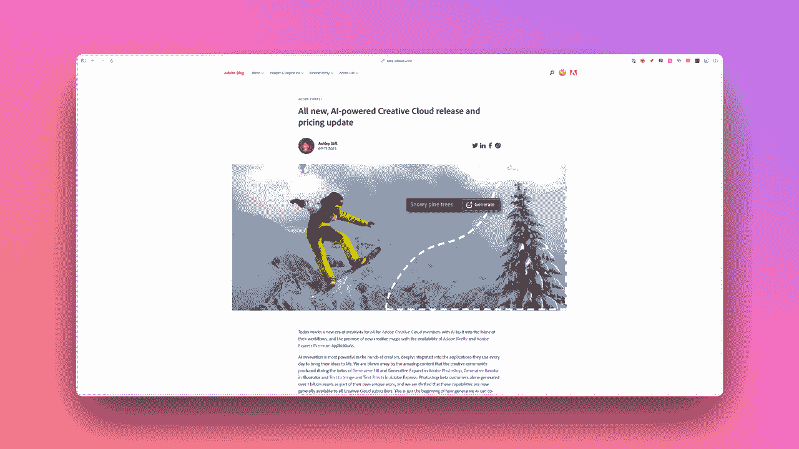
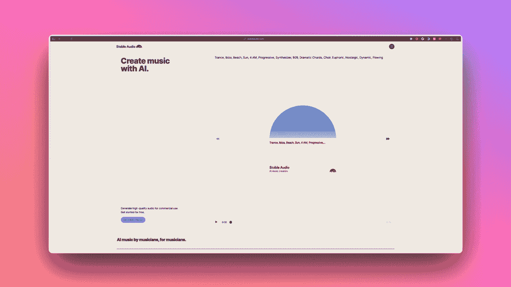
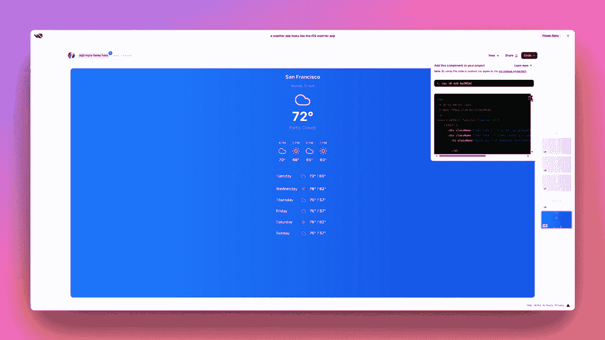
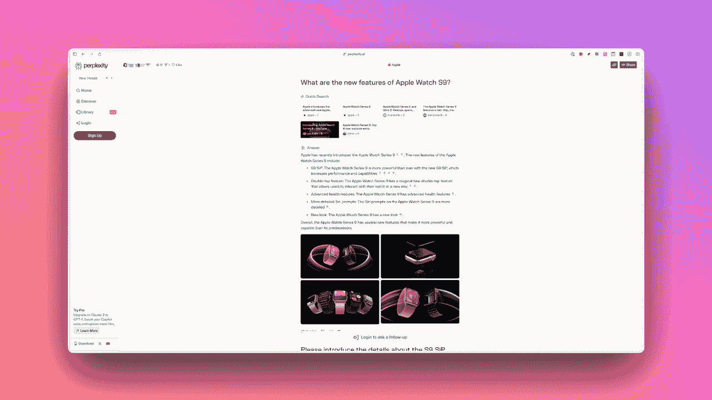
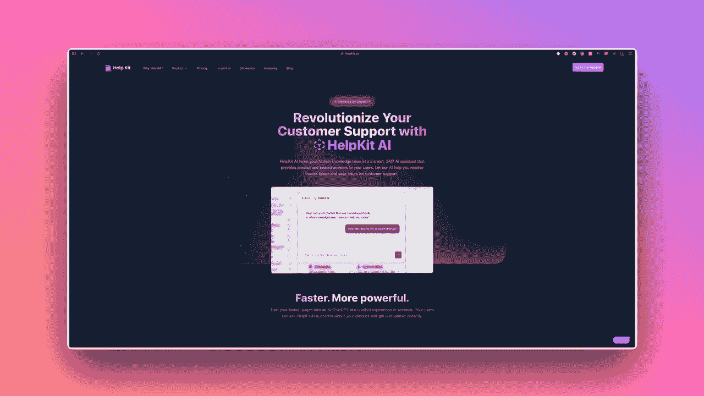
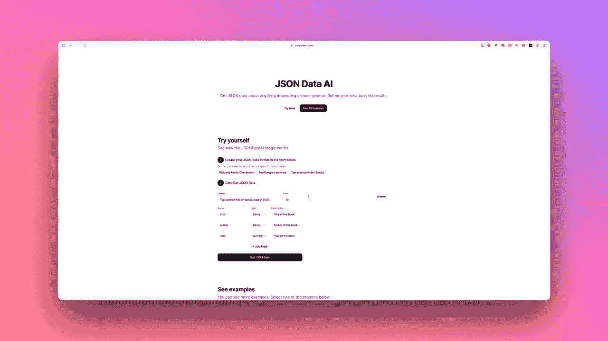
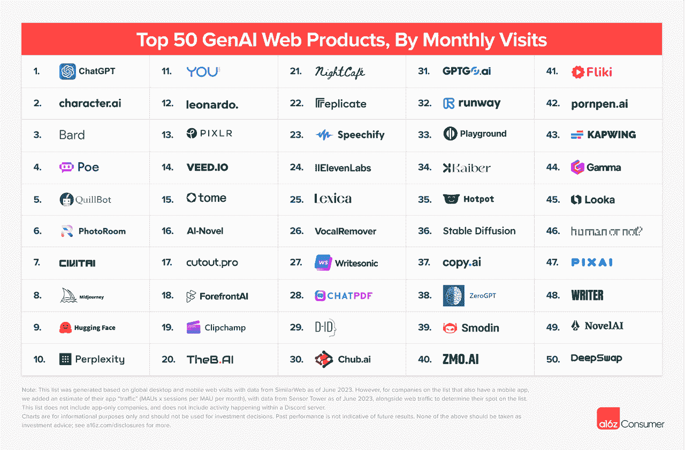

# AIGC Weekly #39

> 来源：[https://waytoagi.feishu.cn/docx/AaDmd0tOcoPcMWxRunNcd10Ynge](https://waytoagi.feishu.cn/docx/AaDmd0tOcoPcMWxRunNcd10Ynge)

> 🔗 原文链接： h[ttps://op7418.zhub](https://op7418.zhubai.love/posts/2315364354432307200)ai.love/posts/23...

> 发表时间：2023-09-18

工具：Nijijoureny

提示词：Blue planet surrounded by light spots and fog, starry sky in the background --style scenic --ar 16:9

# ❤️上周精选

## Adobe Firefly和PS AI正式版已经推出

Adobe的Firefly经过160天的测试，现已正式推出。Adobe将根据“生成信用”来收费，限制用户生成图像的速度。付费Creative Cloud计划将获得1,000个积分，免费用户可在Adobe的应用程序中获得25个积分来使用Firefly（例如，在Photoshop中创成式填充）。此外，Adobe还将向使用其内容训练Firefly的Stock图像贡献者支付奖金。同时Adobe将继续将Firefly功能带入Creative Cloud，以支持摄影、设计、视频、3D等多种功能。同时本月10号开始大陆地区无法正常使用PS中的AI能力。

## [Stability AI 发布 AI](https://www.stableaudio.com/) 音乐生成工具 Stable Audio

Stabl[e Audio 是 Stability AI 推出的用于音乐和音效生成的AI工具，输入你对音乐的要求之后就会生成一段音乐给你预览也可以下载，免费用户45秒，Pro用户可以生成90秒的音](https://mp.weixin.qq.com/s?__biz=MzU0MDk3NTUxMA==&mid=2247484771&idx=1&sn=5a1e92423170284e4b2dffd675972f60&chksm=fb304d9acc47c48cedb93276032b511303b0ff8258789ed4f2c9cfd958c90515a3cdc62a8b3c#rd)乐同时内容可以商用，每个月11.99美元，最多500次生成。可以商用是因为模型是用AudioSparx音乐库的正版音乐训练的。趁着体验机会我也调研了一下市面上主流的AI音乐生成平台，里面有6个平台生成音乐的对比视频，感兴趣可以去看看： https://mp.weixin.qq.com/s?__biz=MzU0MDk3NTUxMA==&mid=2247484771&idx=1&sn=5a1e92423170284e4b2dffd675972f60&chksm=fb304d9acc47c48cedb93276032b511303b0ff8258789ed4f2c9cfd958c90515a3cdc62a8b3c#rd

## Vercel发布前端代码生成平台

Vercel发布前端代码生成平台v0.dev，通过语言描述生成界面代码，你直接预览和调整生成的代码，完成后可以复制或者在Vercel上面部署。 比如下图这个界面就是由提示词“a weather app looks like the iOS weather app”生成的。看起来美观度是在线的，看了下生成的代码结构也还好。以后可能简单的界面或者模块确实没必要直接设计再开发了。

[目前只能生成Re](https://twitter.com/shadcn)act和HTML，由 @shadcn UI 和 Tailwind CSS 提供支持。

[http://v0.dev ](http://v0.dev/)构建所需要的内容全是由 [@vercel ](https://twitter.com/vercel)和 [@nextjs ](https://twitter.com/nextjs)的能力组成的，没有用其他的库。目前需要加入等待列表。Vercel招这么多明星开发者和设计的好处体现出来了，这几天几乎被相关内容刷屏。

# 🧵其他动态

尽管后期前景黯淡，Databricks 仍筹集了 5 亿[美元资金，将估值提升至 43B 美元： https://techcrunch.com/2023/09/14](https://techcrunch.com/2023/09/14/databricks-raises-500m-more-boosting-valuation-to-43b-despite-late-stage-gloom/)/databricks-raises-500m-more-boosting-valuation-to-43b-despite-late-stage-gloom/

[AI](https://techcrunch.com/2023/09/14/pixis-an-ai-powered-full-stack-marketing-platform-raises-85m/) 驱动的全栈营销平台 Pixis 融资 8500 万美元： https://techcrunch.com/2023/09/14/pixis-an-ai-powered-full-stack-marketing-platform-raises-85m/

马斯克扎克伯格等美国科技领袖在参议院人工智能[洞察论](https://www.wsj.com/tech/musk-warns-senators-about-ai-threat-while-gates-says-the-technology-could-target-world-hunger-121a5890)坛上讨论人工智能的危险和可能性： https://www.wsj.com/tech/musk-warns-senators-about-ai-threat-while-gates-says-the-technology-could-target-world-hunger-121a5890

[Databricks 的逆向策略揭秘：烧钱 15 亿美元获得增长： https://www.theinf](https://www.theinformation.com/articles/inside-databricks-contrarian-playbook-burn-1-5-billion-to-buy-big-growth)ormation.com/articles/inside-databricks-contrarian-playbook-burn-1-5-billion-to-buy-big-growth

Enfabrica 致力于构建网络硬件来驱动人工智[能工作负载，筹集了 1.25 亿美元： https://techcrunch.com/2023/09](https://techcrunch.com/2023/09/12/enfabrica-which-builds-networking-hardware-to-drive-ai-workloads-raises-125m)/12/enfabrica-which-builds-networking-hardware-to-drive-ai-workloads-raises-125m

# ⚒️产品推荐

## Contra：独立开发者和设计师AI作品集建站平台

一个服务独立开发者和设计师AI作品集建站平台@contra。输入你想要展示的模块之后可以直接生成一个作品集网站，而且还带有数据分析和内容售卖的功能，自由职业者一步到位，感觉定位很精准，比那些老牌建站平台简单，模板的美观度也在线。

## Perplexity Collections：搜索结果合集

Perplexity发布了Collections，你现在可以将你的搜索结果保存为不同主题的合集，当作笔记或者展示来使用，也可以邀请其他人来协作一起编辑一个Collection从而让一个主题相关的信息丰富起来。标题是莱森做的一个关于apple的合集，可以参观一下。

## FastFacts：及时追踪上市公司关键变动

[@henuwangkai ](https://twitter.com/henuwangkai)开发的上市公司公告跟踪平台，可以在两分钟内让用户访问2300家上市公司的最新公告。该平台提供AI精心挑选的非常易读的简报，以警示用户可能产生市场动态的新闻。FastFacts监控一个市值超过20亿美元的2000多只股票的投资组合，并利用最先进的AI技术来分析和简化复杂的公告。该平台提供3天的免费试用，之后需要支付订阅费用。

## Civitai：支持了图片生成功能

Civi[t](https://x.com/op7418/status/1701487412499898625?s=20)ai终于上了免费的图片生成的功能，你现在可以直接在Civitai上使用站内的CKPT模型和Lora模型，C站应该是现在SD模型最多的地方了一些简单的图可以直接去试试了。 目前应该是不支持SDXL的模型，也不支持ControlNet，图像分辨率是固定的三个，重点是可以生成色图的。我也写了一个大致的使用方法介绍： https://x.com/op7418/status/1701487412499898625?s=20

## Move one：通过手机摄像头进行动作捕捉

[@MoveAI_ ](https://twitter.com/MoveAI_)新发布了一个Move one，只通过一个手机录制的视频就可以实现动作捕捉。可以直接输出视频也可以导入3D软件进行处理。可以到网站申请等待列表。

## HelpKit AI：将你的Notion知识库变为智能机器人

HelpKit AI是一种可以添加到任何订阅计划的附加功能。它将Notion知识库转换为智能的24/7 AI助手，可以提供精确而立即的答案给用户。AI使用OpenAI索引Notion内容，并结合知识库中的信息，在秒内提供语义答案。AI聊天机器人可以定制，可以按照品牌进行训练。AI驱动的聊天机器人比客户支持便宜100倍，每月只需49美元。AI提供洞察仪表板，用户可以了解客户所提出的问题，提出问题的方式以及对答案的满意程度。

## [Wave：AI语音笔记应用](https://waveapp.ai/)

Wave 是一款 AI 笔记应用，可以在 iOS 设备上录制、转录和汇总音频录音。它提供无限录音时间，利用 AI 技术确保转录的高准确性。Wave 的亮点在于它可以生成具有洞察力的 AI 驱动摘要，且可完全按照用户的需求进行自定义。该应用可用于各种用途，如捕捉头脑风暴会议、录制讲座和记录病人就诊。

## JSON Data AI：AI生成指定结构的JSON虚假数据

根据你的提示获取有关任何内容的 JSON 数据。定义你的结构，列出结果。

# 🔬精选文章

## 基于大型语言模型的代理的兴起和潜力的调查

复旦大学自然语言处理团队（FudanNLP）推出 LLM-based Agents 综述论文，这篇论文全面系统地介绍了基于大型语言模型(LLM)的智能代理的相关研究,从代理的哲学起源到概念框架,再到应用场景和代理社会,最后讨论关键话题和开放问题,为这个蓬勃发展的领域的研究者和实践者提供了重要的启发和指导。

## 检索增强生成（RAG）：是什么，为什么和如何操作？

检索增强生成（RAG）是一种架构，旨在通过将相关信息与问题/任务细节一起传递给模型来提高语言模型的性能。这是通过从数据库中检索相关数据并将其与用户的查询或任务一起传递给模型来实现的。输出的质量取决于数据的质量和检索策略。提高生产中RAG性能的技术包括混合搜索，摘要，重叠块，微调嵌入模型，元数据和重新排序。

## 一份全面的基于RAG的LLM应用构建指南

在本指南中，我们将构建一个基于RAG的LLM应用程序，其中我们将结合外部数据源来增强我们的LLM的能力。具体而言，我们将构建一个可以回答有关Ray的问题的助手 - 一个用于生产化和扩展ML工作负载的Python框架。这里的目标是使开发人员更容易采用Ray，但是，正如我们将在本指南中看到的，还要帮助改进我们的Ray文档本身，为其他LLM应用程序提供基础。我们还将分享我们在此过程中遇到的挑战以及如何克服这些挑战。

## IncarnaMind：LLM与文档交互的解决方案

IncarnaMind是一个可以使用大型语言模型（如GPT）与个人文档（PDF、TXT）进行聊天的工具。它通过滑动窗口分块机制和检索器，可以高效地查询细粒度和粗粒度信息。它支持多文档查询和稳定的解析，还具有自适应分块、多文档对话问答、文件兼容性和模型兼容性等特点。

## Medusa：用于加速多解码头LLM生成的简单框架

介绍了一个名为Medusa的新框架，可以将LLM生成的效率提高约2倍。 Medusa引入了多个解码头到原始LLM，而不是像投机解码一样使用额外的草案模型。文章解释了LLM生成的基本瓶颈以及投机解码的一些局限性，然后展示了Medusa如何解决它们并实现加速。 Medusa头被添加到LLM的最后一个隐藏状态，使得可以并行预测多个后续令牌。文章还解释了Medusa中使用的基于树的注意机制和典型的接受方案。

## a16z 报告 - 消费者如何使用生成式人工智能？

消费者使用生成式AI（GenAI）产品的文章，按月浏览量排名前50的GenAI网络产品。榜单上的大多数产品都是新的，表明许多最引人注目的消费者体验完全是新奇的。在榜单上的50家公司中，只有5家是现有大型科技公司的产品或收购。前50名榜单几乎是三分之二的公司训练自己的专有模型，微调现有模型，并在现有模型的基础上构建消费者UI。ChatGPT占整个前50名榜单的月浏览量的60％，估计每月有16亿次访问量和2亿用户。榜单上的大多数公司没有付费市场营销，90％的公司已经实现营收，几乎都是通过订阅模式。到目前为止，消费者AI产品主要是基于浏览器的，而不是基于应用程序的，但有些公司在移动应用程序上看到了超出常规的参与度。

## 教程：微调你自己的 Llama 2

本目录将为您概述如何从头开始微调 Llama 2 模型。我们要训练的示例模型将从网络上爬取的大型数据集中对食谱进行分类。我们将使用 GPT-4 为我们的训练和测试集生成标签，然后使用 axolotl 库微调 Llama 2 模型。

## 2023 年如何进行有竞争力的人工智能初创公司融资

文章为AI创业公司的创始人提供了如何进行早期融资过程的建议。作者强调了将融资视为一个花费大量时间的项目的重要性，以及系统性地投资这个过程。他们还建议在一开始就决定要筹集多少资金，准备筹集略多于计划的资金，并考虑跳过加速器。作者还提供了撰写演示文稿和进行融资的技巧，包括通过热门介绍向投资者推销，构建目标基金和个人的名单，以及从投资者那里收集报价而不立即做出承诺。最后，作者提醒创始人，融资只是建立一款为客户提供价值的伟大产品的一个步骤。

## 少即是多：研究大规模预训练LLM的数据修剪

近年来,大量文本数据对大型语言模型的发展起到了重要作用。但是这些数据通常是通过网络爬取获得的,质量参差不齐。到目前为止,提高数据质量的努力依赖于手工设计的过滤规则。本研究探索了可扩展的数据质量评估方法,以系统地评估预训练数据的质量。通过对多个质量评估指标进行比较,发现简单的困惑度技术优于更复杂的方法。使用这些指标对数据进行修剪,可以在只保留30%数据的情况下改进模型性能。这为自动构建高质量语料库奠定了基础,可以在保持模型性能的同时删除大部分训练数据。