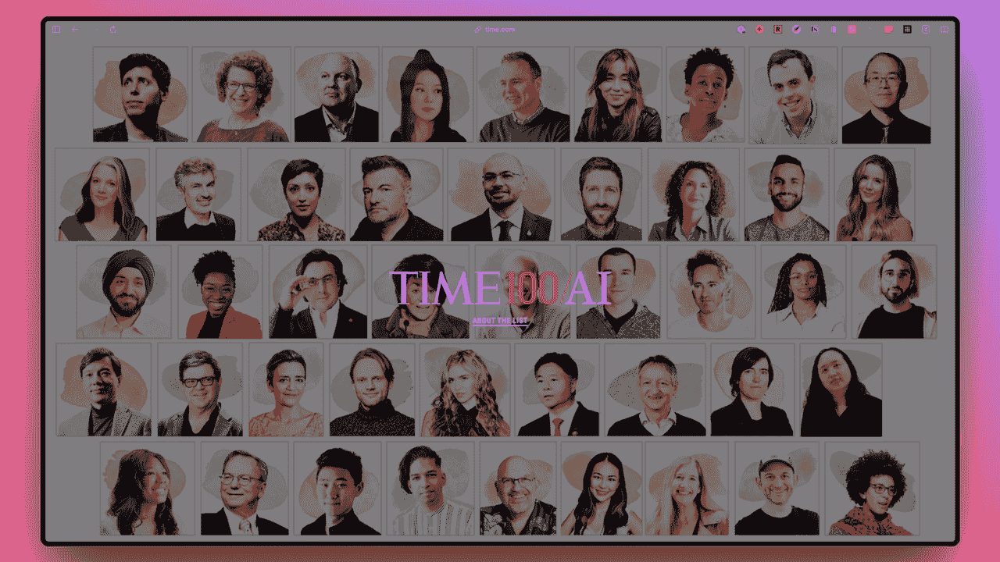
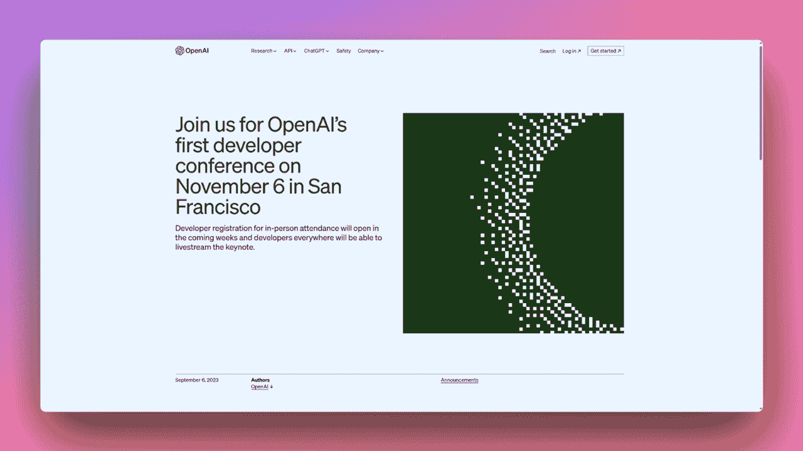
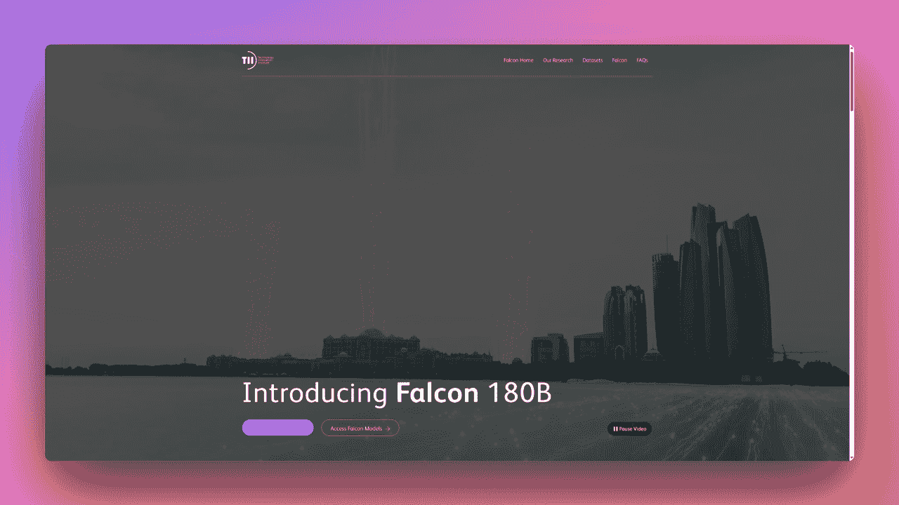
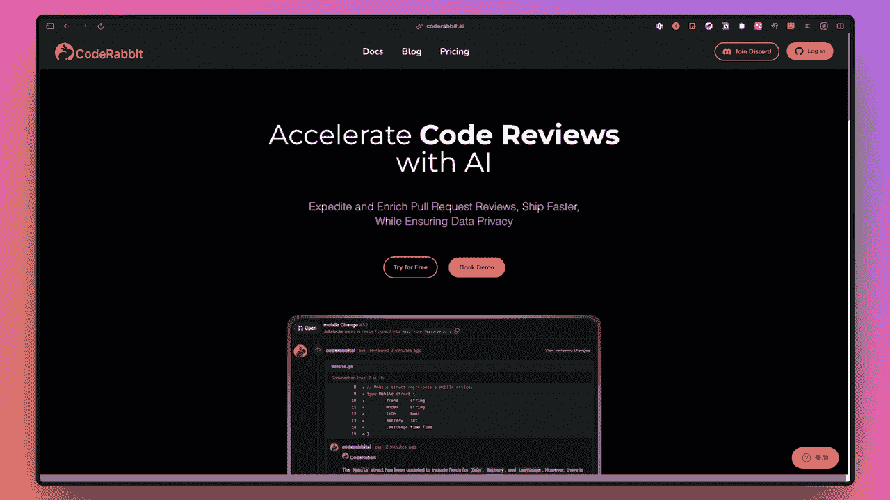
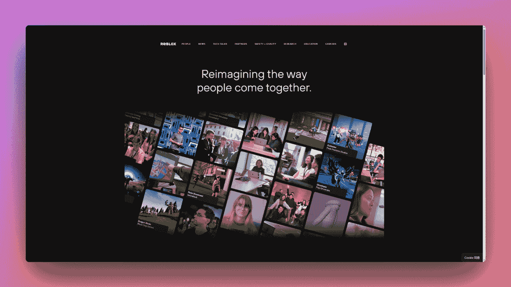
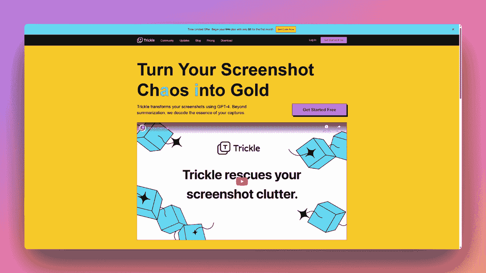
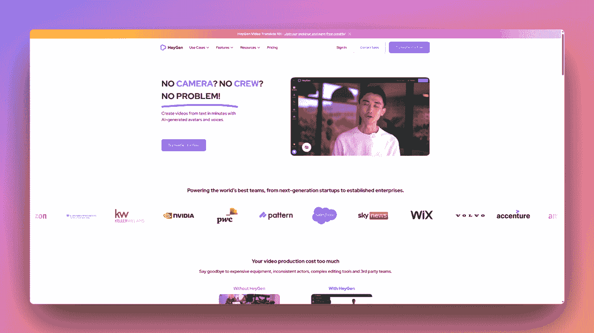
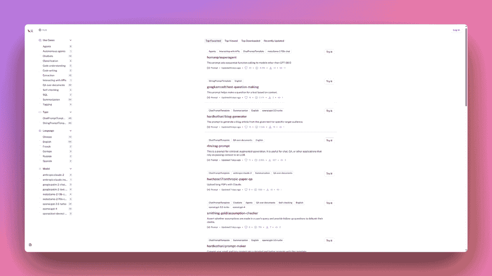

# AIGC Weekly #38

> 来源：[https://waytoagi.feishu.cn/docx/EW8cdcq4soI6j7xQ7dWcI5G7nig](https://waytoagi.feishu.cn/docx/EW8cdcq4soI6j7xQ7dWcI5G7nig)

> 🔗 原文链接： h[ttps://op7418.zhub](https://op7418.zhubai.love/posts/2313067691604824064)ai.love/posts/23...

> 发表时间：2023-09-12

工具：Midjoureny

提示词：Microscopic particles moving at high speed, Footage of glowing blue sequins flying, macro photography, C4d rendering, 3D rendering, black background --ar 16:9

# ❤️上周精选

## 时代杂志公布了AI领域最优影响力的100个人物名单

《时代》杂志公布了人工智能领域 100 名有影响力的人物名单。这个名单包括来自顶级人工智能公司的 领导者、政策制定者 、 艺术家 和 研究人员。

「领导者」部分包括 OpenAI 联合创始人 Sam Altman，百度 CEO 李彦宏，谷歌 DeepMind CEO 兼联合创始人 Demis Hassabis，还有马斯克、李开复、吴恩达、黄仁勋等。

在「研究人员」部分，中国科学院教授曾毅、斯坦福大学教授李飞飞、OpenAI 联合创始人兼首席科学家 Ilya Sutskever，以及深度学习三巨头 Geoffrey Hinton、Yann LeCun、Yoshua Bengio 均入选。

但是很多人都反映这个名单居然没有 Andrej Karpathy 有点离谱，他是Open AI的早期创始成员师从李飞飞后来去特斯拉研究自动驾驶也作出了非常大的贡献，在今年也回到了Open AI。

## Open AI 将在11月6日举办开发者大会

OpenAI 首届开发者大会将于 11 月 6 日在旧金山举行。这将是一个为期一天的活动，现场注册将在几周后开放。现场与会者将能够参加由 OpenAI 技术人员举办的分组会议。主题演讲将为所有人现场直播。奥特曼说了不会发布GPT-4.5或者GPT-5。GPT-4的微调总该有吧？

## 阿布扎比技术创新研究院发布了Falcon 180B语言模型

阿布扎比技术创新研究院上周发布了Falcon 180B语言模型，他们声称模型质量超过了LLaMA 2并且与PaLM 2相当，仅次于GPT-4。模型是开源的，可以用于商业用途，Falcon 180B在3.5 万亿Token上进行训练，规模是 Llama 2 的 2.5 倍，所需计算量是 Llama 2的4 倍。Falcon 180B在 MMLU上的表现超过了 Llama 2 70B 和 OpenAI 的 GPT-3.5。训练数据集主要来自RefinedWeb 数据集 (大约占 85%)，这个数据集中文占比很少。数据集的代码只占5%左右，所以如果他说的超过GPT-3.5应该不包括代码能力。

模型官网： falconllm.tii.ae

试用模型： [huggingface.co](https://huggingface.co/spaces/tiiuae/falcon-180b-demo)

[Huggingface上的介](https://huggingface.co/blog/zh/falcon-180b)绍文章： huggingface.co

模型下载： [huggingface.co](https://huggingface.co/tiiuae/falcon-180B)

# 🧵其他动态

A[nthropic 推出 Claude Pro](https://www.anthropic.com/index/claude-pro) 每个月20美元，可以有免费账户5倍的使用量，目前来看大概每八小时500k token用量： https://www.anthropic.com/index/claude-pro

Meta 计划于 2024 年第一[季度开始与GPT-4相当的大语言模型： https://www.wsj.com/tech/ai/meta-i](https://www.wsj.com/tech/ai/meta-is-developing-a-new-more-powerful-ai-system-as-technology-race-escalates-decf9451)s-developing-a-new-more-powerful-ai-system-as-technology-race-escalates-decf9451

[R](https://twitter.com/runwayml/status/1699046745089479082?s=20)unway在前几天发布了自定义运镜的功能： https://twitter.com/runwayml/status/1699046745089479082?s=20

S[D](https://github.com/Mikubill/sd-webui-controlnet/discussions/2039) webui 的 ControlNet 刚更新了版本，适用于 SD webui1.6 版本，支持了非常多的新模型： https://github.com/Mikubill/sd-webui-controlnet/discussions/2039

# ⚒️产品推荐

## Coderabbit：AI 帮助 Code Reviews

CodeRabbit是一款基于AI的工具，可以通过将拉取请求中的差异转换为清晰的摘要，创建自动发布说明，以及提供更快的审查反馈和代码更改建议，来帮助进行代码审查。

## [Boolv：AI视频制作工具](https://boolv.video/)

Boolv 是一款使用 AI 技术制作高品质视频的视频制作工具，可用于时尚、服饰、家居、珠宝、食品和杂货等多种产品。该工具提供了产品信息提取、AI 图像识别、独特视频定制、无限视频生成、AI 驱动视频编辑器、设计师挑选的模板库以及云存储等功能。

## Roblox：AI自动制作游戏内容

Roblox 推出了 Roblox Assistant，这是一款对话式人工智能助手，在一个演示中，有人输入“我想制作一个以古代废墟为背景的游戏”， Roblox 掉进了一些石头，苔藓覆盖的柱子和破碎的建筑。“让玩家在废墟中的篝火旁生成”增加了篝火和凳子。“添加一些树木供玩家砍伐”添加附近的树木。Roblox将从其市场或您自己的视觉资产库中获取资产。

## Trickle：用GPT-4理解你的截图内容

Trickle是一个AI工具,它通过使用GPT-4解码屏幕截图的本质,将零散的信息转化为可访问和深刻的记忆。它为屏幕截图提供了一个存储空间,清理照相机胶卷,并为快照(尤其是非结构化的快照)生成深刻的摘要。Trickle还允许用户从深埋的文件夹中检索已保存的屏幕截图,并要求AI不仅寻找,还要服务。该工具旨在帮助用户毫不费力地记住和回忆一切,免受组织的巨大时间损失。

## M1-project：AI创建用户画像

M1-project是一个由AI驱动的工具,可以在仅5分钟内为企业创建详细准确的理想客户画像(ICP)。通过快速有效地了解目标受众,该解决方案可以确保更好的目标营销工作,节省资源并提高决策速度。M1项目生成的ICP非常全面,包括公司规模、收入、位置、行业等相关特征。该AI通过采集和分析来自可信来源的数据,以确保最高的准确性。ICP可以以各种格式下载,包括PDF、演示文稿或Miro板。M1项目还提供详细的购买人群画像,概述了人口统计、目标、挑战、价值观、爱好、购买习惯、职业信息等。使用ICP的益处包括定制的营销和销售战略、仅针对合格线索、进行有效互动的洞察力、优化资源效率和ROI、以及与销售的无缝对齐。

## [HeyGen：AI翻译语音](https://www.heygen.com/)

前几天很火的数字人工具@HeyGen_Official又开发了一项新功能，可以把你的视频中的语音变成其他语言，最重要的是嘴型完全是和新翻译的语言对应的，我看不出来有什么不协调的地方，这个太强了。国内的视频作者出海最重要的障碍被扫除了。

## LangChain Hub：提示词管理工具

LangChain推出了LangChain Hub，一个提示词上传、浏览、拉取和管理的工具。很快也会添加代理功能。 这个工具目前需要邀请码才能使用，没有的话可以浏览别人提交的提示词，筛选项还是比较丰富的不止支持问题类型，也支持筛选提示词生效的模型。 页面内不只有提示词，也有对应的向量数据检索或者搭配的 json 格式之类的。还可以进行版本管理。

# 🔬精选文章

## ChatGPT 每 5 到 50 次提示大约使用 500 毫升的水

构建 ChatGPT 等人工智能产品的高昂成本，包括用于冷却强大的超级计算机所需的大量耗水，而这些超级计算机是用来教人工智能系统如何模仿人类输出内容。文章指出，建立大型语言模型需要对大量人类撰写的文本进行模式分析，而所有这些计算都需要耗费大量电力并产生大量热量。为了在炎热的天气保持凉爽，数据中心需要抽水，通常是抽到仓库大小的建筑外的冷却塔。微软在其最新的环境报告中披露，从 2021 年到 2022 年，其全球耗水量激增了 34%，与前几年相比大幅增加，外部研究人员认为这与微软的人工智能研究有关。

## [向60个LLM提出20个问题](https://benchmarks.llmonitor.com/)

作者编写了一个脚本来向60多个语言模型提出20个问题,以测试它们的基本推理、指令遵循能力和创造力。问题包括类似让语言模型用俳句的形式论证和反对在Kubernetes中使用这个技术,以及用简洁的要点形式提出反对Münchhausen三难困境的论点，还有一些问题需要从文本中提取信息,比如从发票中提取供应商名称,和判断客户评论是积极还是消极。此外还有一些创造性的提示,例如提供一个笑脸的SVG代码,以及用E大调写一串12小节布鲁斯和弦进程。最后,作者指出这个脚本还不完善,他计划在未来进一步改进。

## LLM 训练：RLHF 及其替代方案

这篇文章讨论了人类反馈强化学习(RLHF)以及它在现代大语言模型训练流水线中的重要性。训练流水线包括三个步骤:预训练、监督微调和对齐。RLHF用于对齐步骤,以将语言模型与人类偏好对齐。RLHF流水线包括三个步骤:对预训练模型进行监督微调,创建奖励模型,并通过近端策略优化进行微调。RLHF允许将人类偏好纳入优化目标中,这可以提高模型的有用性和安全性。本文还比较了ChatGPT和Llama 2进行RLHF的方式,并强调了RLHF的最新替代方案。

## [YC S23：批量构建](https://basecase.vc/blog/building-with-the-batch-s23)

一个名为Rebase的开源电子邮件平台的推出,它是使用YC S23批次的各种开发者工具构建的。作者分享了一些对其他正在开发AI产品和开发者工具的创始人的观察和建议,包括满足用户的需求,利用现有的习惯,避免不必要的抽象,用示例来设定预期,以及在产品中建立反馈循环。作者还对YC的创始人表示了赞赏,并提到了一些与Rebase项目无关的该批次中的有趣公司。

## [LLMs实用指南：Falcon](https://medium.com/georgian-impact-blog/the-practical-guide-to-llms-falcon-d2d43ecf6d2d)

这篇文章主要介绍了Hugging Face的Falcon模型，该模型是一种基于大规模语言模型（LLMs）的开源模型。文章通过对Falcon-7B模型进行测试和评估，比较了它在分类和摘要任务上的性能，并与其他流行的语言模型进行了比较。结果显示，Falcon-7B在低数据情况下表现出色，并且训练成本较低。此外，文章还介绍了Falcon-7B的部署和推理性能，并提供了相关的代码和细节。

## Discord 中 Midjourney 的交易将为其收入带来巨大增长

我还发现，2021 年估值达 150 亿美元的游戏聊天工具 Discord 与这家初创公司建立了有利可图的合作关系。Midjourney 建立在 Discord 的基础上，这意味着用户在 Discord 服务器或聊天群组中输入提示，然后等待图像出现。通过 Discord，他们可以讨论自己的艺术作品，并与其他人工智能爱好者建立联系。作为交换，Discord 为 Midjourney 提供了这些社交工具和额外的资源来帮助它扩展业务，并从 Midjourney 的收入中分一杯羹。

## [LLMs不是你的全部](https://www.pinecone.io/learn/llm-ecosystem)

大语言模型(LLMs)是驱动技术创新新浪潮的强大工具。它们被用于支持生成式AI,这有望改变我们社会的结构。然而,LLM本身并不完美。它们不可预测,容易出现幻觉,而且无法提供最新信息。为了发挥LLM的最大效用,我们需要在它们周围建立一个工具生态系统。这个生态系统包括提示工程、检索增强生成、会话记忆以及代理。通过使用这些组件,我们可以提高LLM的性能,使其更加可靠。

## Perplexity.ai 如何开创搜索的未来

Aravind Srinivas和他在Perplexity.ai的联合创始人正在打造一种[替代方案。用户不需要输入关键](http://perplexity.ai/)字，也不需要在纷繁复杂的链接中进行排序，而是直接向 Perplexity.ai 提出问题，然后就能得到由经过整理的信息来源提供支持的简明、准确的答案。这个 "答案引擎 "由大型语言模型（LLMs）提供支持，以用户而非广告商为中心。这种转变有望改变我们发现、获取和消费在线知识的方式，从而改变我们今天所了解的互联网结构。

## [在 70% 的情况下，人类评估者更喜欢使用 RLAIF 和 R](https://arxiv.org/abs/2309.00267)LHF 的模型，而不是基线 SFT 模型

当比较基线监督微调模型(SFT)、RLHF和来自AI反馈的RL(RLAIF)时,获得了有趣的结果。主要发现是,在摘要任务上,与基线的监督微调模型相比,人类评估者在约70%的情况下更喜欢RLAIF和RLHF的生成。此外,当要求对RLAIF与RLHF摘要进行评级时,人类以相同的频率更喜欢两者。这里不应感到惊讶,因为RLHF LLM经过了人类偏好调优,但看到RLAIF获得非常有竞争力的结果是非常有趣的。请记住,RLAIF使用AI偏好而不是人类偏好来训练用于RL微调的奖励模型。这篇论文的目标是通过比较人类反馈与AI反馈的有效性来测试RLAIF是否是RLHF的合适替代方案。他们还使用不同的技术来生成AI标签,并进行扩展研究以报告生成对齐偏好的最佳设置。

## GPT无需计算器就能解决数学问题

通过在大规模算术运算数据集上微调,一个20亿参数的语言模型可以在没有数据泄露的情况下,准确地执行多位数字的算术运算,准确率接近100%,明显超过GPT-4(其多位数乘法准确率仅为4.3%)。研究者还通过在包含多步骤算术运算和文本描述数学问题的数据集上微调GLM-10B,使得到的MathGLM在一个包含5000个样本的中文数学问题测试集上,取得了与GPT-4相当的表现。这表明足够的数据和微调,大模型确实可以无需计算器准确执行数学运算和解决数学问题。这一发现挑战了此前大模型无法精确执行乘法等算术运算的假设。