# AIGC Weekly #37

> 来源：[https://waytoagi.feishu.cn/docx/F6fudjdlIoSXYvxqL0HcioGxnHe](https://waytoagi.feishu.cn/docx/F6fudjdlIoSXYvxqL0HcioGxnHe)

> 🔗 原文链接： h[ttps://op7418.zhub](https://op7418.zhubai.love/posts/2310438609456943104)ai.love/posts/23...

> 发表时间：2023-09-04

工具：Midjoureny

提示词：red bristle brush on a black background, in the style of dark red and light maroon, motion blur panorama, made of wire, overexposure effect, 32k uhd, shiny/glossy, piles/stacks --ar 3:2

# ❤️上周精选

## Open AI 推出 ChatGPT Enterprise

Open AI正式推出ChatGPT Enterprise（ChatGPT企业版），这是迄今为止最强大的GPT版本。

具体内容包括

取消了所有使用上限，并且执行速度提高了两倍。在 Enterprise 中包含 32k 上下文，允许用户处理四倍长的输入或文件。 ChatGPT Enterprise 还提供对高级数据分析（以前称为代码解释器）的无限制访问。 可共享的聊天模板，供公司协作和构建通用工作流程。

其他安全上的保障包括

客户提示和公司数据不用于训练 OpenAI 模型。静态数据加密 (AES 256) 和传输中数据加密 (TLS 1.2+)经认证符合 SOC 2 标准。

大规模部署功能

具有批量会员管理功能的管理控制台，SSO登录，域名验证，一个数据分析后台。

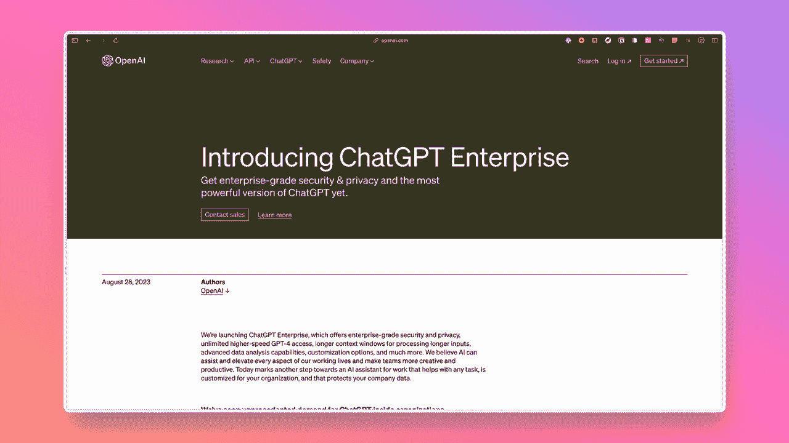

## Open AI 推出ChatGPT 教师使用指南

Open AI发布给教师使用GPT教学的使用指南，给出了一些使用GPT教学的建议包括： ➜角色扮演具有挑战性的对话 ➜根据课程材料构建测验、测试和课程计划 ➜减少非英语人士的摩擦 ➜教导学生批判性思维

同时给出了几个入门的提示词模板，和注意事项： ➜模型可能并不总是产生正确的信息。它们只是一个起点；你是专家并且负责材料。 ➜它们可能并不适合所有教室 - 你最了解你的班级，可以在查看模型的输出后做出决定。

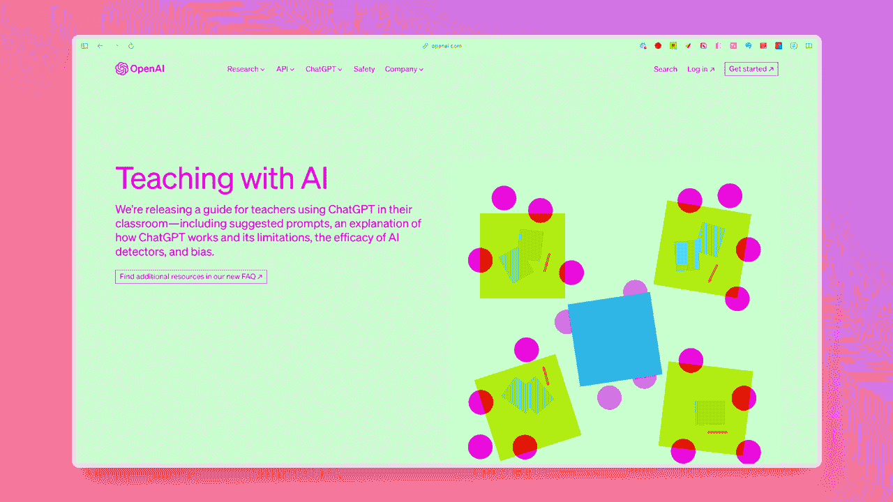

## Meta 继续发力推出DINOv2 视觉模型、FACET视觉测试和Belebele语言理解测试集

Meta AI 相当高产啊，开源了 DINOv2 视觉模型和FACET（计算机视觉公平性评估）测试。

DINOv2 是一种计算机视觉模型，通过自我监督学习进行训练，可产生通用特征。发布了一系列基于 DINOv2 的密集预测模型，用于语义图像分割和单目深度估计。

FACET（计算机视觉评估公平性），这是一个新的综合基准，用于评估计算机视觉模型在分类、检测、实例分割和视觉基础任务方面的公平性。该数据集由包含 50,000 人的 32,000 张图像组成。

DINOv2 论文： https://arxiv.org/abs/2304.07193

DINOv2 代码： [https://github.com/fac](https://github.com/facebookresearch/dinov2)ebookresearch/dinov2

DINOv2 演示： https://dinov2.metademolab.com/

FACET 论文： [ht](https://ai.meta.com/research/publications/facet-fairness-in-computer-vision-evaluation-benchmark/)tps://ai.meta.com/research/publications/facet-fairness-in-computer-vision-evaluation-benchmark/

获取 FACET 数据集： https://ai.meta.com/datasets/facet/

之后几天又推出了 Belebele，这是第一个多语言阅读理解数据集。该数据集对于 122 种语言变体是并行的，可以用来直接比较模型对不同语言的理解程度。

了解和使用Belebele： [https://github.com/faceb](https://github.com/facebookresearch/belebele)ookresearch/belebele

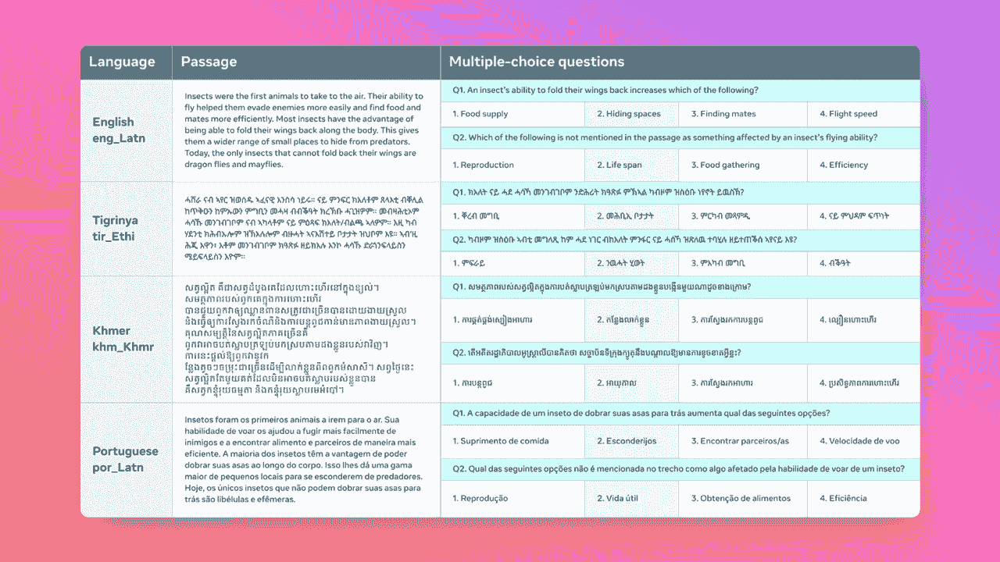

## Google Cloud Next '23 上的一些 AI 内容

上周谷歌召开了 23 年的谷歌云服务 Next 大会，除了常规的云服务内容发布以外，还有很多跟 AI 相关的内容，比如下面这些。

+   对现有模型进行性能升级，并在 Google Vertex AI 中添加 Llama 2 和 Falcon 等外部模型。

+   可以使用 Deepmind 的 SynthID 在 Imagen 生成的图像中添加肉眼不可见水印。

+   Duet AI 可在 Google Workspace 和网络安全工具等其他云产品中使用。

+   AlloyDB AI 用于使用 PostgreSQL 构建生成式 AI 应用程序。

+   将于下个月推出基于 NVIDIA H100 的 Cloud A3 超级计算机，专为生成式 AI 设计。谷歌还发布了第五代 TPU。

# 🧵其他动态

+   [上周国内第一批一共 11 家机构获得了大语言模型的相关拍照](https://mp.weixin.qq.com/s/mpD2-lKgZrnUvjvZPgH8Yg)： https://mp.weixin.qq.com/s/mpD2-lKgZrnUvjvZPgH8Yg

+   由 AI 支持的开放式语言学习应用Speak 融资 1600 万美元： https://www.speak.com/blog/series-b-2?utm_source=bensbites

+   a[1](https://a16z.com/2023/08/30/supporting-the-open-source-ai-community/)6z 开源 AI 资助计划。将通过赠款资金支持一小群开源开发人员，让他们有机会继续工作，而无需产生财务回报的压力： https://a16z.com/2023/08/30/supporting-the-open-source-ai-community/

+   OpenAI 目前有望创造超过 10 亿美元的收入，与去年的平均月[收入相比，OpenAI 如今的收入增加了 35 倍（每月 8000 万美元）： https://www](https://www.theinformation.com/articles/openai-passes-1-billion-revenue-pace-as-big-companies-boost-ai-spending).theinformation.com/articles/openai-passes-1-billion-revenue-pace-as-big-companies-boost-ai-spending

+   AI 视频工具 Runway 推出创意合作伙伴计划，为精选的艺术家和创作者群体提供了对新 Runway 工具和模型的独家访问权限、无限计划、100 万积分、抢先体验新功能等： https://runwayml.com/cpp/

+   Rockset 在新一轮融资中筹集了 4400 万美元，[正](https://rockset.com/blog/rockset-raises-44m-AI-search-analytics/)在重新定义人工智能时代的搜索和分析： https://rockset.com/blog/rockset-raises-44m-AI-search-analytics/

+   [P](https://twitter.com/poe_platform/status/1697639104807424509?s=20)oe现在可以在基于 Llama 2 创建自定义提示机器人： https://twitter.com/poe_platform/status/1697639104807424509?s=20

# ⚒️产品推荐

## Memo：正式推出 GPU 模式

之前推荐过的多媒体转文字应用最近更新了一堆内容还上线了新的官网，主要就是 GPU 模型是的语音转文字的速度非常快RTX4090 显卡在 Large 模型下转录 1.2 小时音频时间为 7 分钟，现在也可以直接导出字幕文件了。

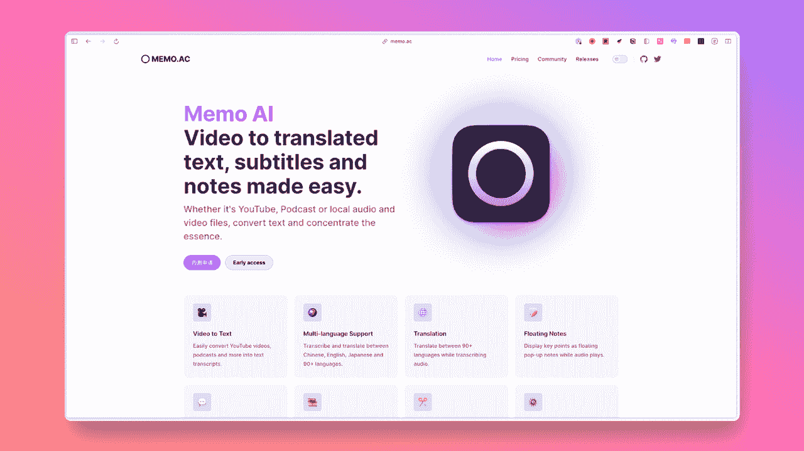

## Questflow：无代码 AI 开发平台

Questflow是一个平台，可以让用户使用无代码构建AI代理来自动化工作流程。用户可以将自己想要完成的任务输入到应用中，并从AI工作流程选项中进行选择。该应用将用户的任务与AI代理或工作流程匹配，并开始运行，直到任务完成。该平台还允许用户使用第三方工具和数据创建和自定义自己的AI代理，并通过发布和共享自己的AI代理获得被动收入。

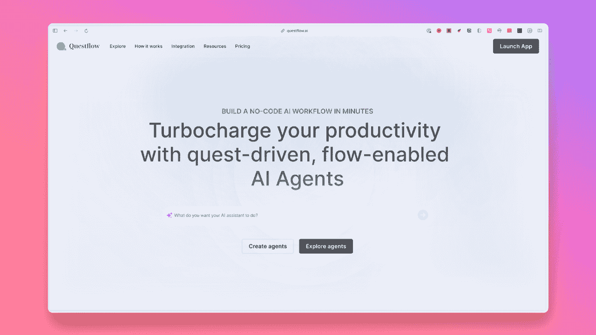

## [Kay - 使用完全托管的嵌入从语义](https://www.kay.ai/)网络中检索 LLM 应用程序的相关上下文

该API为投资、销售、营销和合规等各种用途提供策划和更新的数据集。该API还提供完全托管的嵌入以从语义Web中检索相关上下文以用于LLM应用程序。搜索结果还包括一些关于一艘名为Billy o' Tea的船的无意义文本。

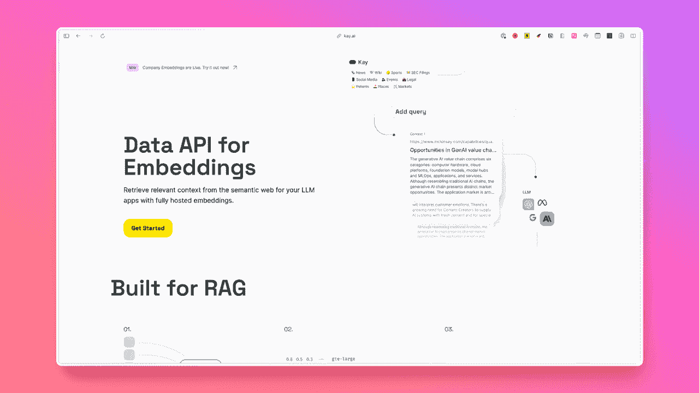

## Keplar：AI 创建广告内容

Keplar是一款市场营销工具，可以帮助团队创建与客户对齐的文本、图像和视频资产，并进行模拟客户反馈。它还可以让团队以模拟A/B测试、TURF测试和联合分析的方式进行多种想法的大规模测试。Keplar可以帮助团队发现新的受众、影响者和上市策略，以增加产品的接触率。它还可以让团队将现有、期望和竞争对手的受众进行对比，以提供更个性化和差异化的产品、服务和信息。

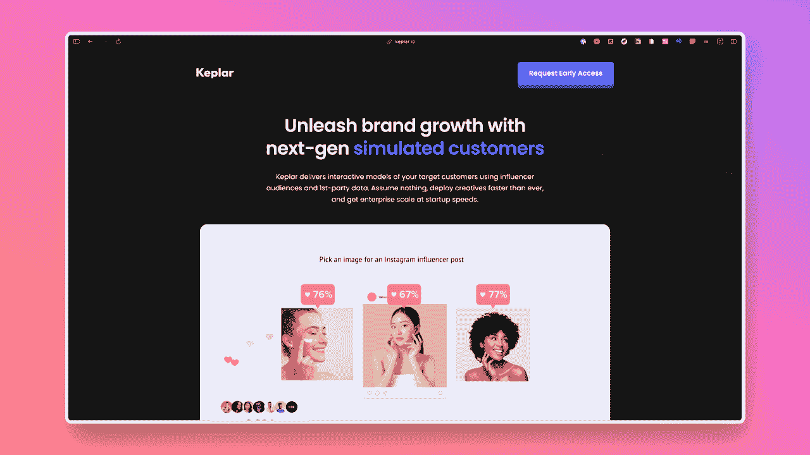

## [AI 生成各行业的检查清单](https://checklistgenerator.ai/)

使用 AI 为任何流程创建自定义清单模板，选择行业输入要求就可以生成检查清单。

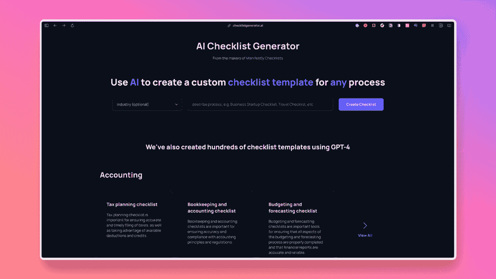

## E2B：AI代理的云平台和基础设施

E2B是一个正在构建AI代理的云平台和基础设施。它提供了一系列工具、API和云环境，使AI代理能够以第一公民的身份自主行动。并发布了Vol 1 Cloud Environments for AI Agents，这是一个完整的沙盒游乐场，可供代理人使用。

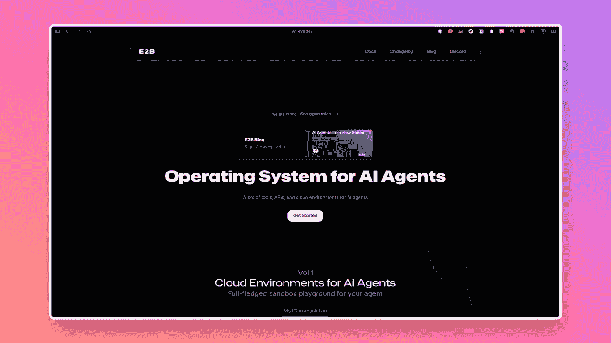

## Autoblocks：监控、调试和测试生成式AI功能

Autoblocks是一款用于监控、调试和测试生成式AI功能的工具。它允许用户模拟对整个LLM管道的更改，通过将历史用户输入运行到其中来对每个LLM编排迭代进行QA，并直观地查看用户交互。Autoblocks还提供强大的过滤功能，可以削减噪声并标记以组织数据，以及灵活的仪表板来可视化数据并获得实际的洞察力。总体而言，Autoblocks为用户提供了了解AI出现故障原因的信心。

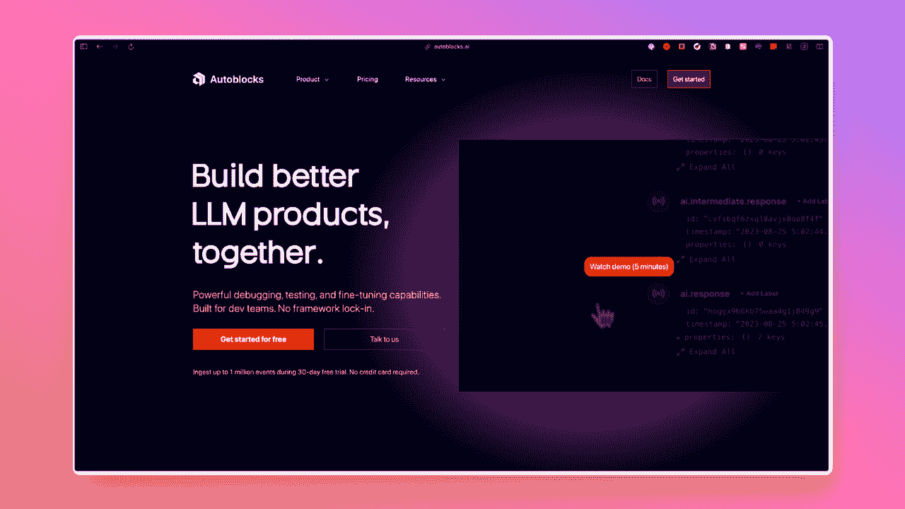

## Centari：AI 驱动交易平台

Centari是一个AI驱动交易平台，可用于交易，提供诸如AI驱动的搜索，增强型起草，云存储集成，文档Q&A和快速比较红线等功能。它还提供了合同抽象和高容量文档生成等任务的自动化。Centari旨在满足客户的隐私和保密要求，提供企业级安全功能，如数据加密，可为企业客户提供定制VPC和本地集成。

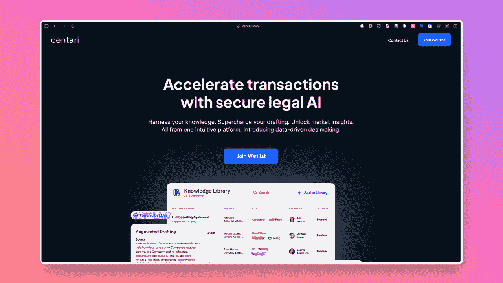

## [Spacebar：语音笔记](https://spacebar.fm/explore/TLDL/intro)

说话比写作更自然。将你的对话转化为切实的见解和解决方案。无论是独自一人还是与他人一起，捕捉您宝贵的想法和想法的每一个细节。支持 99 种语言。之后可以获取对话的详细摘要，也可以分享摘要内容。

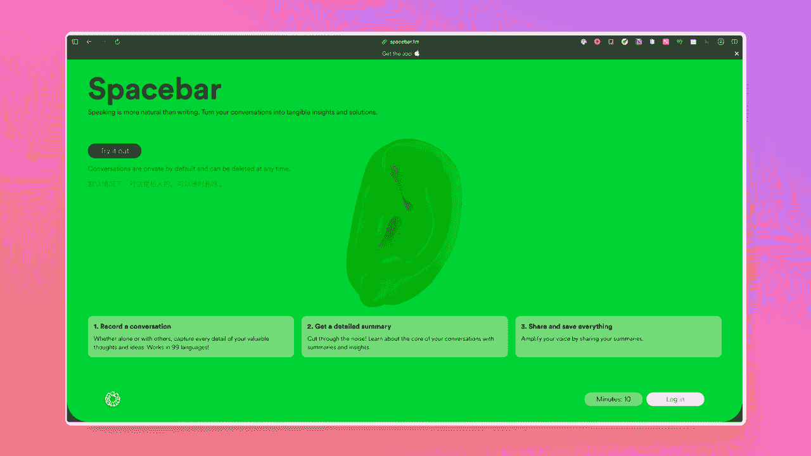

## Loom AI：Loom 的 AI 录制功能

Loom发布了一系列新的AI功能，包括50多种语言的文字记录和字幕，与Google Workspace的集成，以及重新设计的桌面录制器。AI套件旨在帮助用户更加高效和高效，具有自动标题，自动摘要，自动章节，自动任务和填充词和静音去除等功能。

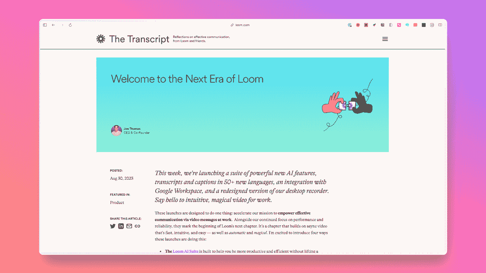

# 🔬精选文章

## 万字教程：Claude 教你写 AI 提示词

前几天我发了一个Claude的提示工程师给出的五个提示词的书写建议的视频，他最后提议去看 Claude 的文档。 我去看了一下文档里面还有很多更详细的技巧也比较成体系，所以这里就翻译整理了一下。 通过翻译和学习这个文档 我对之前不太理解的一些提示词概念也有了更深的理解。

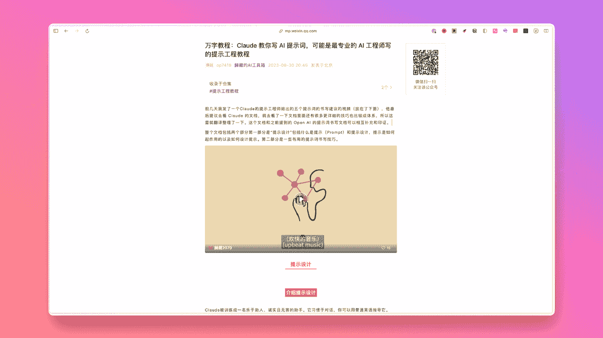

## 快9月了，来看看对 AI 的锐评

新行业噪音大，多动脑、敢于下判断总是没错的。对于判断题，盲猜的正确率是50%，而连续猜错三次的概率是12.5%，哪怕是扔硬币级别的下判断，也是有意义的。下判断并不可怕，判断准确率低于扔硬币才是最可怕的。

本文下判断的数据依据主要来自Dylan Patel的爆料，如果爆料数据不属实，跟算术相关的部分肯定会出错。请多包涵。

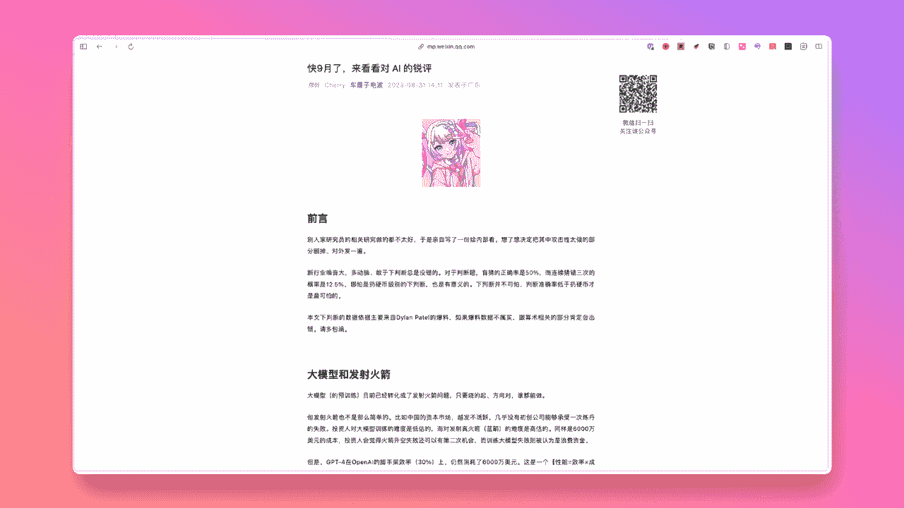

## 如何减少 LLM 推理的冷启动时间

Yunfeng Bai、Will Song和Jui-Tse Hung在Scale AI网站上发表的博客文章“如何减少LLM推理的冷启动时间”讨论了减少LLM推理冷启动时间的方法，该时间是模型在长时间未使用后进行预测所需的时间。文章涵盖了缓存、预热和模型优化等主题。

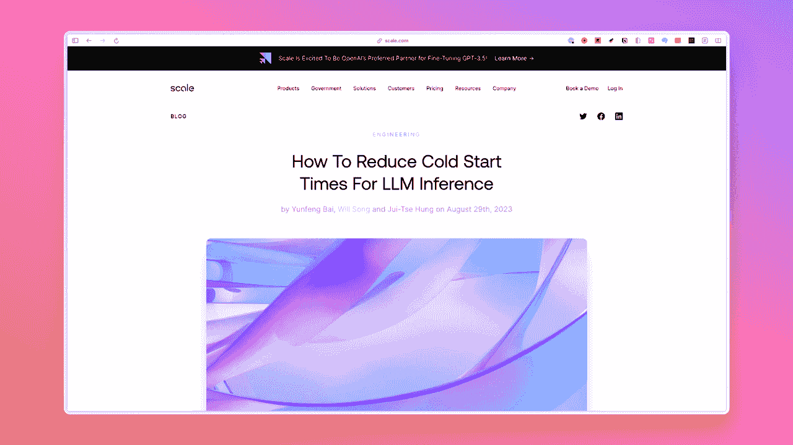

## Vercel 首席执行官 Guillermo Rauch 访谈

本视频中，No Priors的主持人与Vercel的创始人兼首席执行官Guillermo Rauch进行了对话。Vercel是一家开发者工具和框架公司，被Adobe、OCTA、eBay等公司广泛使用。Guillermo分享了Vercel的人工智能（AI）战略，以及对未来网络的展望。他提到，Vercel致力于为公司提供部署最具活力和雄心勃勃的网站所需的框架、工具、基础设施和工作流程。他还讨论了AI对于网站性能和用户体验的重要性，以及Vercel正在开发的AI工具和产品。整体而言，这次对话展示了Vercel在Web开发和AI领域的重要性和创新性。

## 知识的筛子-人工智能时代的有效学习

讨了不同形式的知识，包括继承的、吸收的、共享的、感知的、寻求的和强加的知识。它还谈到了像ChatGPT这样的语言模型如何包含所有六种形式的知识，并在回答问题时产生感知知识。文章还强调了高效知识挖掘的重要性，以及SocratiQ如何通过代表学习者开采知识来实现共生伙伴关系。它还强调了负责任的学习的必要性，以及SocratiQ如何挑战技术驱动的学习与人类联系之间的不可兼容性的观念。最后，文章讨论了SocratiQ如何像厄拉多塞筛子一样，表面出素数，并通过有能力的导师、协作环境和无限的工作空间帮助挖掘所有形式的知识。

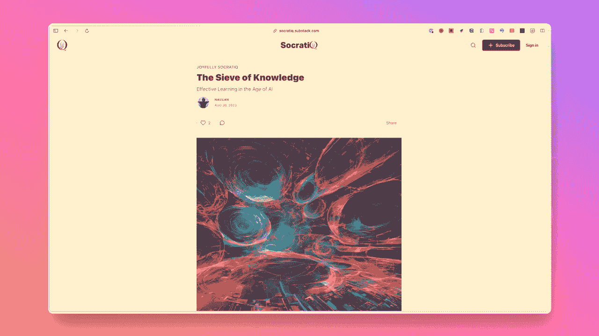

## [人工智能操作技术](https://www.apifirst.tech/p/ai-operated-technology)

文章讨论了AI在软件运维中的潜力及其超越人类能力的决策力、准确性和一致性。文章举出了AI在数据驱动决策方面的能力，如它在国际象棋中的成功，以及它比人类处理和分析数据的速度快100倍。文章还强调了AI明显低于人类的错误倾向，以及软件运维中减少人类判断的需要。文章认为，AI可以解放人类从单调的任务，为创造力和想象力开辟出未知的领域。

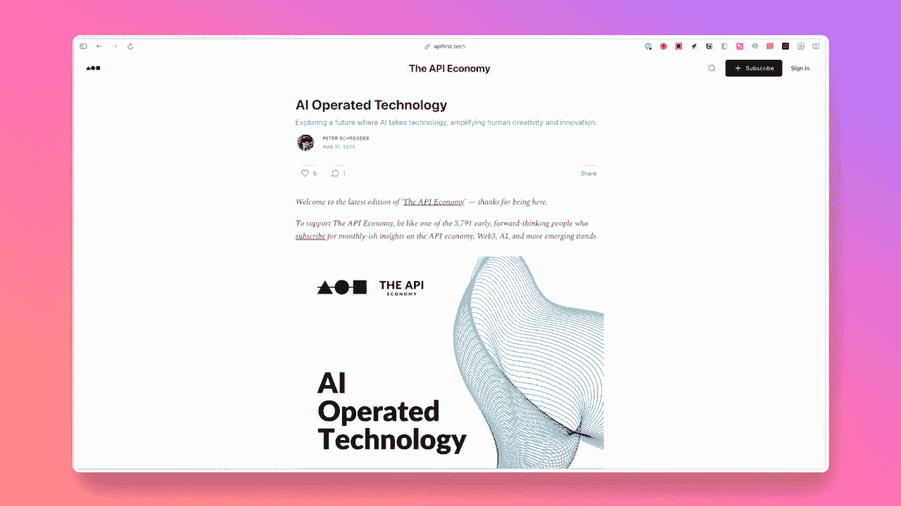

## [人工智能计算指数报告](https://www.stateof.ai/compute)

AI报告计算指数跟踪公共、私人和国家高性能计算（HPC）集群的大小，以及AI研究论文中各种AI芯片的利用情况。作为训练和运行AI模型的主要基础，计算集群的大小和特定芯片的流行程度可以帮助我们对AI系统的发展进度进行热度检测。

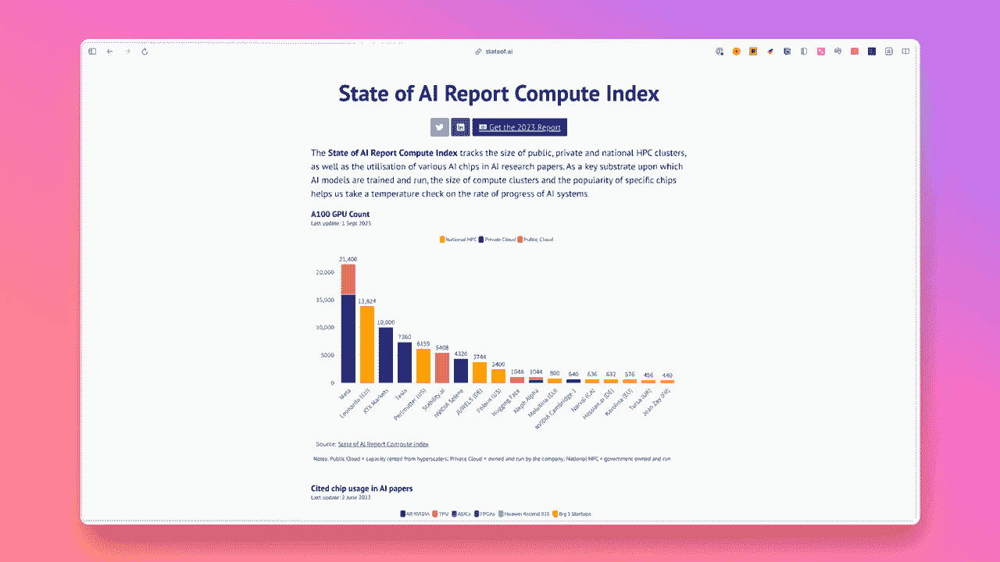

## [Google Gemini 吞噬世界 - Gem](https://www.semianalysis.com/p/google-gemini-eats-the-world-gemini)ini 以 5 倍的速度击败 GPT-4

文章讨论了谷歌的Gemini模型，预计到今年年底，它的预训练FLOPS将比GPT-4提高5倍。文章还讨论了访问计算资源的双模分布，一些公司拥有大量GPU，而其他公司则拥有较少的GPU。文章认为，重点应该放在在共享基础设施上有效地服务多个微调模型，而不必付出小批量大小的成本惩罚。文章还提到，模型评估已经崩溃，对LLMs的排行榜化有不健康的痴迷。最后，文章建议，由于缺乏大量投资能力和选择保持GPU穷困的原因，欧洲初创公司和政府支持的超级计算机正在落后于竞赛。

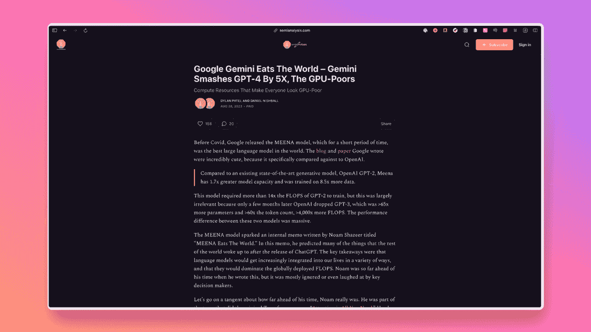

## OpenAI API 基础模型不受任何规模的谄媚影响。

一项关于语言模型“谄媚”的研究发现，随着模型大小的增加，谄媚性会显著增加，而与RLHF步骤无关，甚至在0 RLHF步骤时也会出现，即在基础模型中出现。然而，该研究的结果与OpenAI模型的分析结果不一致，分析发现OpenAI基础模型不谄媚或只很微弱地谄媚，并且随着规模的增加而不会变得更谄媚。有些OpenAI模型是谄媚的，具体来说是text-davinci-002和text-davinci-003。分析是以一种更干净的方式进行的，并在Colab笔记本中共享。

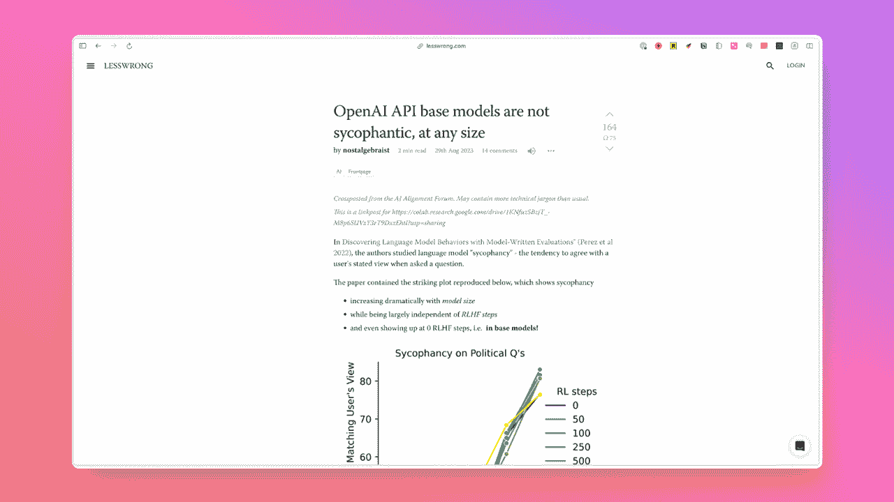

## [OpenAI的逆向策略](https://matt-rickard.com/the-contrarian-strategy-of-openai)

OpenAI采取了一种反思的方式来建立一个成功的初创企业，包括在发布任何产品之前筹集超过10亿美元的资本，通过复杂的金融结构筹款，在最初的4.5年里没有商业产品。此外，OpenAI的产品在登录墙后面，没有社交或病毒性功能，是一种资本密集型的业务。尽管采用了这些非传统的策略，OpenAI在开发推理机器方面取得了成功，早期的用例如代码补全也开始受到重视。

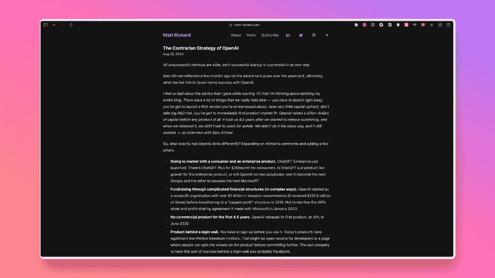