# AIGC Weekly #36

> 来源：[https://waytoagi.feishu.cn/docx/HPhade5Cpov58HxZER6chi2vnxd](https://waytoagi.feishu.cn/docx/HPhade5Cpov58HxZER6chi2vnxd)

> 🔗 原文链接： h[ttps://op7418.zhub](https://op7418.zhubai.love/posts/2307879226491224064)ai.love/posts/23...

> 发表时间：2023-08-28

工具：Midjourney v5

texture shapes, in the style of colorful biomorphic forms, clean lines, photobashing, dark background, neon colors, bulbous, uhd image, realistic anatomies, low depth of field --ar 16:9 --style raw --s 700

# ❤️上周精选

## Meta 开源代码 LLM Code Llama

Meta今天正式发布了上周预告的 Code Llama，这是一个基于 Llama 2 构建的开源LLM，针对编码进行了微调。 Meta说经过他们的测试 Code Llama 在代码任务上的表现优于最先进的公开可用的LLM。

Code Llama 一共有三种型号，Code Llama，基础代码模型；Codel Llama - 专门针对 Python 的 模型；Code Llama - Instruct，它针对理解自然语言指令进行了微调。

一共发布了发布三种大小的 Code Llama，分别具有 7B、13B 和 34B 参数。Code Llama 模型提供了具有 100K 个上下文的稳定生成。

Code Llama 的表现优于开源、特定代码的 Llama，并且优于 Llama 2。例如，Code Llama 34B 在 HumanEval 上得分为 53.7%，在 MBPP 上得分为 56.2%，与其他状态相比最高。最先进的开放解决方案，与 ChatGPT 相当。

基于 Code Llama 微调的其他代码模型也都取得了不错的成绩，比如Phind-CodeLlama-34B-v1的评分超过了 GPT-4，在 HumanEval 上分别达到了 67.6% 和 69.5% pass@1。根据 3 月份的官方技术报告，GPT-4 达到了 67%。

Github代码： [https://github.com/facebo](https://github.com/facebookresearch/codellama)okresearch/codellama

模型下载： [h](https://ai.meta.com/resources/models-and-libraries/llama-downloads/)ttps://ai.meta.com/resources/models-and-libraries/llama-downloads/

论文： [https://ai.meta.com/research/publications/cod](https://ai.meta.com/research/publications/code-llama-open-foundation-models-for-code/)e-llama-open-foundation-models-for-code/

[Phind-CodeLlama-34B-v1介绍： ht](https://www.phind.com/blog/code-llama-beats-gpt4)tps://www.phind.com/blog/code-llama-beats-gpt4

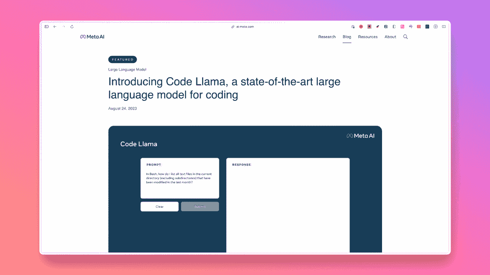

## Midjourney 发布了局部重绘功能

Midjourney 在上周发布了局部重绘「Vary(Region)」的更新，这次的功能比较复杂他们还让discord专门开发了一个界面来处理。上面链接是我翻译的一份的 NIji 官方教程，详细介绍了局部重绘的用法包括如何使用功能，增加、删除内容，利用图片重绘指定位置等高级用法。

这里是 Midjourney 局[部](https://twitter.com/ciguleva/status/1694204732934627832?s=20)重绘和 PS 的相同功能的对比视频： https://twitter.com/ciguleva/status/1694204732934627832?s=20

这是用 Midjourney 局[部](https://twitter.com/ProperPrompter/status/1694426784010301663?s=20)重绘完全改变一张图片内容的视频步骤： https://twitter.com/ProperPrompter/status/1694426784010301663?s=20

## Meta 发布 SeamlessM4T AI 翻译模型

Meta 上上周还开源了SeamlessM4T，支持近100种语言的自动语音识别、语音到文本翻译、语音到语音翻译、文本到文本翻译和文本到语音翻译的多任务支持。

Meta 还发布了 SeamlessAlign 的元数据，这是迄今为止最大的开放式多模态翻译数据集之一，共挖掘了 27 万小时的语音和文本。

与当前最先进的模型相比，SeamlessM4T 系统在语音转文本任务中针对背景噪声和说话人变化的表现更好（平均分别提高了 37% 和 48%）。

论文： [h](https://ai.meta.com/research/publications/seamless-m4t/)ttps://ai.meta.com/research/publications/seamless-m4t/

演示： https://seamless.metademolab.com/

模型和数据下载： [h](https://github.com/facebookresearch/seamless_communication)ttps://github.com/facebookresearch/seamless_communication

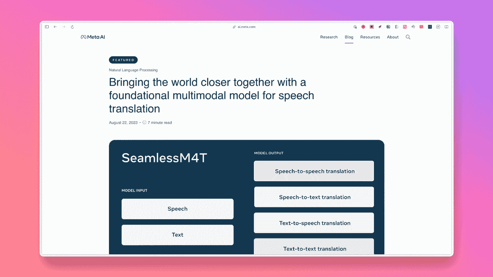

# 🧵其他动态

Open AI 开始和 [@scale_AI ](https://twitter.com/scale_AI)[合](https://scale.com/blog/open-ai-scale-partnership-gpt-3-5-fine-tuning)作为企业提供GPT-3.5的微调服务： https://scale.com/blog/open-ai-scale-partnership-gpt-3-5-fine-tuning

Hugging Face 从 Salesforce 筹[集了新资金，总估值超过 40 亿美元： https://www.theinformation.com/ar](https://www.theinformation.com/articles/salesforce-leads-financing-of-ai-startup-at-more-than-4-billion-valuation)ticles/salesforce-leads-financing-of-ai-startup-at-more-than-4-billion-valuation

a16z投资的AI视频生成器Irreveren[t Labs获得了三星Next的投资： https://techcrunch.com/2023/08/24/](https://techcrunch.com/2023/08/24/a16z-backed-ai-video-generator-irreverent-labs-raises-funding-from-samsung-next/)a16z-backed-ai-video-generator-irreverent-labs-raises-funding-from-samsung-next/

Ikigai 获得 2500 万美[元投](https://techcrunch.com/2023/08/24/ikigai-lands-25m-investment-to-bring-generative-ai-to-tabular-data/)资，将生成式人工智能引入表格数据： https://techcrunch.com/2023/08/24/ikigai-lands-25m-investment-to-bring-generative-ai-to-tabular-data/

Modular 获得 1 亿美元资金[用](https://techcrunch.com/2023/08/24/modular-raises-100m-for-ai-dev-tools/)于构建优化和创建 AI 模型的工具： https://techcrunch.com/2023/08/24/modular-raises-100m-for-ai-dev-tools/

之[前推荐过的Modyfi 推出 AI 设计平台全面公开测试版，并宣布获得由 NEA 牵头的 700 万美元种子资金： https://www.p](https://www.prnewswire.com/news-releases/modyfi-launches-full-public-beta-for-ai-design-platform-announces-7m-in-seed-funding-led-by-nea-301907141.html)rnewswire.com/news-releases/modyfi-launches-full-public-beta-for-ai-design-platform-announces-7m-in-seed-funding-led-by-nea-301907141.html

# ⚒️产品推荐

## Kombai：可以理解并将 UI 界面转换成代码的模型

一个AI模型Kombai，可以理解Figma的界面设计并生成对应的前端代码，从演示来看生成的代码还是不错的，它的优势在于他不要求设计稿的格式、层级和是否使用组件，无论你怎么嵌套和画出的界面它都能理解。这比之前通过传统工程化思路从设计稿生成代码要强多了。之前的一些工具要不是处理不了复杂样式，要不就是对设计师的设计稿格式有非常严格的要求。

这里有我试用的一些体验： [h](https://twitter.com/op7418/status/1694638313305768433?s=20)ttps://twitter.com/op7418/status/1694638313305768433?s=20

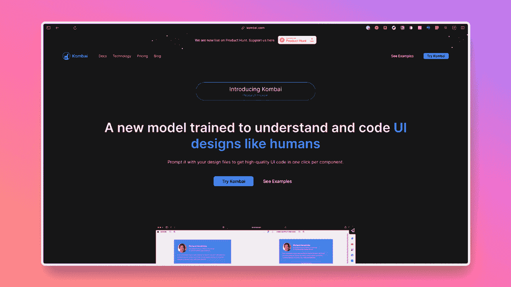

## [书生·万卷：2TB多模态语料库](https://opendatalab.org.cn/home)

上海人工智能实验室联合中央广播电视总台、人民网、国家气象中心、中国科学技术信息研究所、上海报业集团、上海文广集团等语料数据联盟成员，共同开源发布 “书生・万卷” 1.0 多模态预训练语料。“书生・万卷” 1.0 目前包含文本数据集、图文数据集、视频数据集三部分，本次开源的数据总量超过 2TB。

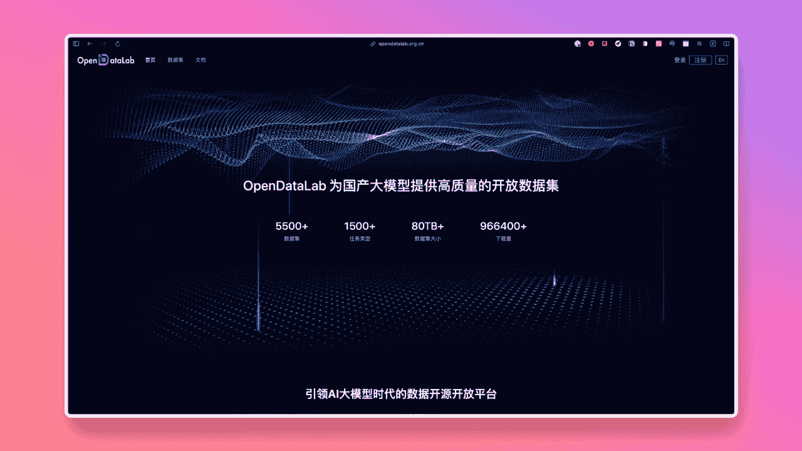

## Fabric：AI 内容收集及摘录

立即保存网页上的任何内容，保持流畅。保存的所有内容都会记住其来源，并链接回原始网页。甚至可以在网页顶部留下持久的注释，供自己或他人使用。你的想法和创意，有上下文。

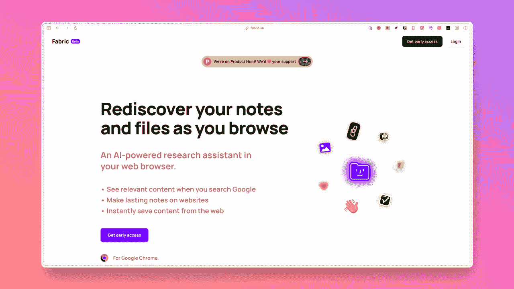

## [Lilac：查看和量化数据集](https://lilacml.com/blog/introducing-lilac.html)

Lilac是一个开源工具 ， 可以帮助AI从业者查看和量化数据集 。 它允许用户浏览非结构化数据集 、 使用Lilac Signals对非结构化字段进行结构化元数据的丰富 ， 创建和优化Lilac Concepts ， 下载丰富结果用于下游应用 。 Lilac的目标是使非结构化数据可见 、 可量化和可塑性 ， 以提高AI模型的质量 、 改善AI模型失败时的可操作性 ， 以及更好地控制和可见模型偏差 。

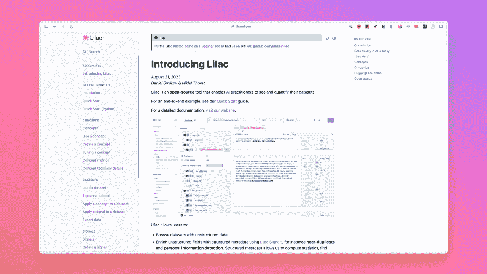

## [Tweeets：AI 撰写推文](https://tweeets.app/)

输入你的推文主要内容选择情绪、写作风格、语气和目标受众之后，这个工具会帮助你生成指定风格的推文，可以选择 GPT-3.5 或者 GPT-4 生成。

## Dicer：AI 优化广告创意和营销活动

通过细致的逐帧检查，深入了解视频内容，对每个元素进行彻底分析，从引子到场景、对象、文本，甚至音频细微差别，确保您能够停下滚动并有效地推动转化。探索图像的每个方面，检测和分析对象、场景和文本元素，打造最佳的视觉叙事。无论是短篇还是长篇的复制品，都会对每个词语和表情符号进行审查，以确保清晰、参与和信息传达的功效。通过深入的定位洞察力，精确定位您的受众，包括自定义和相似受众，以及人口统计、兴趣和地理定位分析。通过了解预算效率来最大化投资回报率，全面的检查包括目标、人口统计和投放位置。

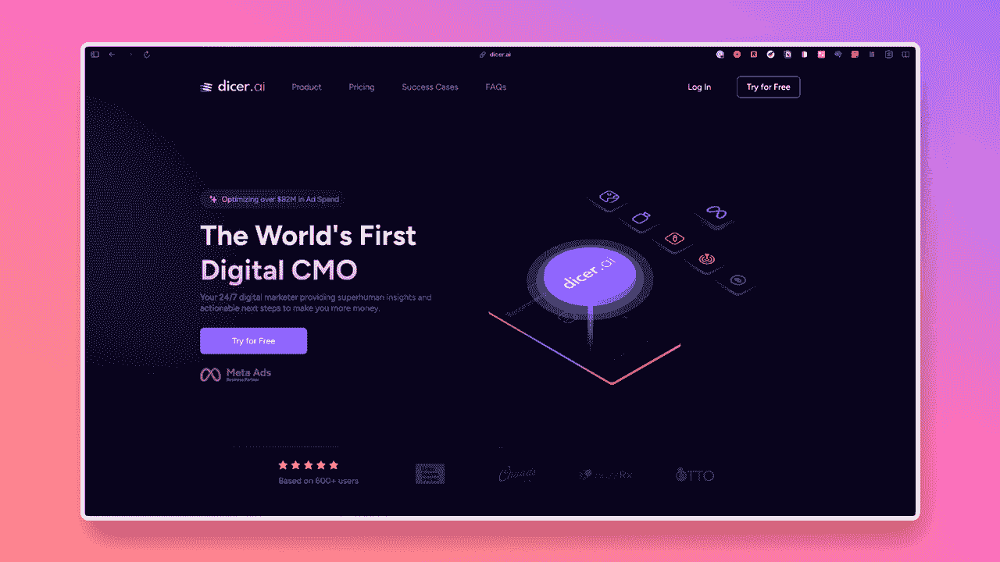

## Katch：通过分析邮件自动创建日程

Katch 是一款 AI 助手，可以通过寻找每个人都满意的时间并发出日历邀请，帮助安排会议。它可以包含在任何电子邮件对话中，并检查您的 Google 日历以与其他参与者安排和预订会议。Katch 还可以被要求代表您安排会议、重新安排即将到来的会议，或者向您提供您的可用性更新。

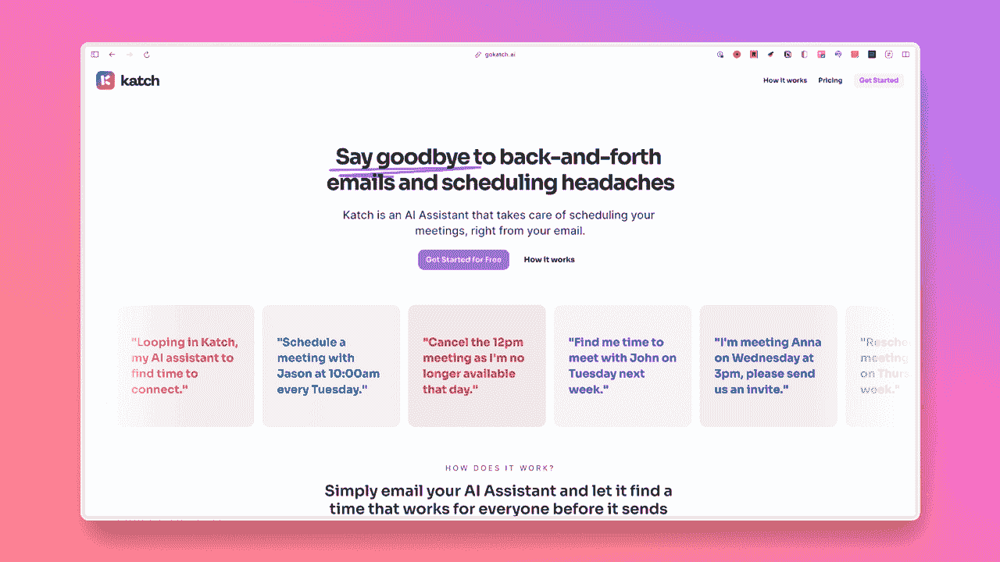

## Altero ai：AI 收集和整理的公司市场研究报告

此网站提供AI生成的关于各种公司的市场研究报告。 AI代理搜索网络并从多个来源合成数据以生成这些报告。该网站目前专注于公司研究报告，但行业研究和更多内容即将推出。

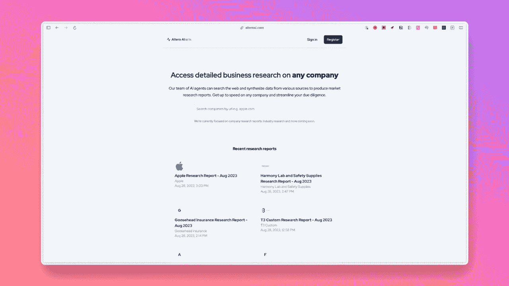

## Ideogram：AI生成带有文字的图象

AI 生成的图象中的文字是一个比较困难的事情，用这个工具可以生成带有清晰的文字的图片，用来生logo 和带文字的海报还不错，图片生成的质量是不如 MJ 和 SD 的，同时他们也刚获得了 1650万美元的融资。

# 🔬精选文章

## StableVideo：新发布的稳定 AI 视频转换

基于 Diffusion 的视频生成模型 StableVideo，通过向现有的基于文本的Diffusion模型引入时间依赖性，为编辑的对象生成一致的外观,从而解决闪烁问题。利用层次表示的概念将外观信息从一帧传播到下一帧。基于此机制构建了一个基于文本的视频编辑框架，它可以实现一致性感知的视频编辑。

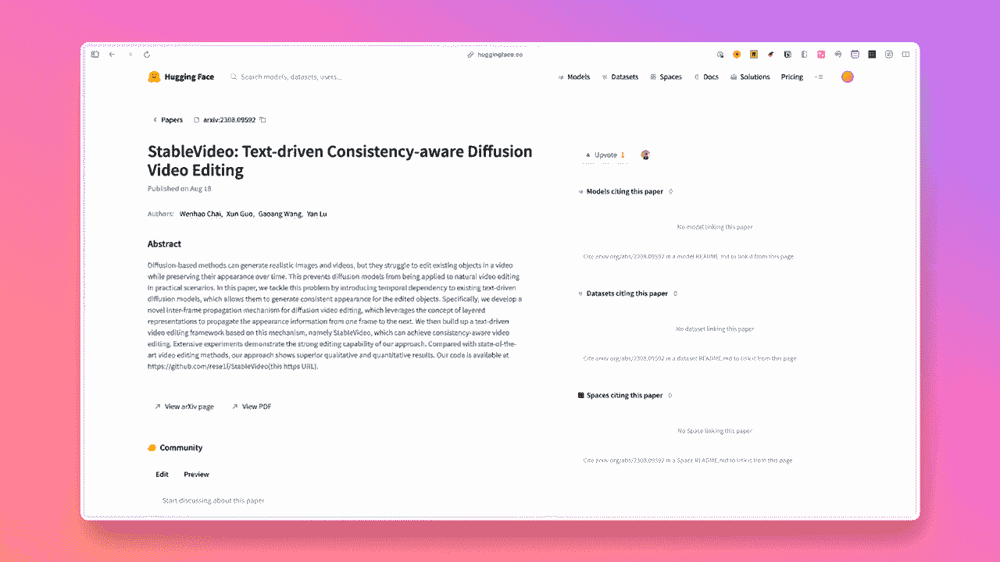

## 面向企业的AI模型会“赢家通吃”吗？

主要AI 模型生态系统的发展趋势和分类 。 作者认为AI模型的发展将呈现出“大脑”模型 、 “挑战者”模型和“长尾”模型三个主要分类 。 同时 ， 文章还提到了企业在选择模型时需要考虑的因素 ， 以及AI基础设施的发展机遇 ， 包括评估框架 、 模型运行与维护 、 增强系统 、 运维工具 、 数据利用等方面 。

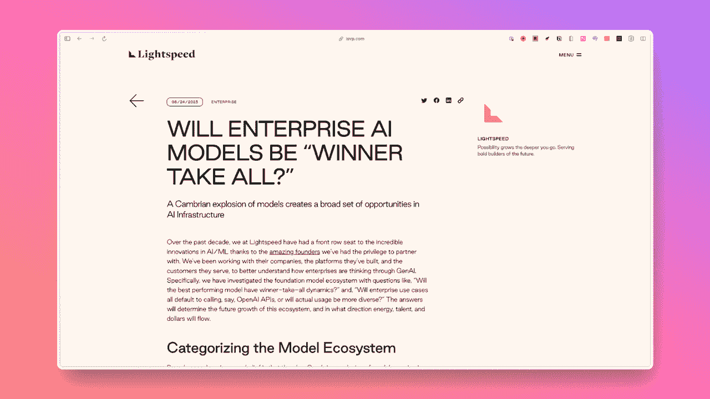

## ChatGPT 如何将生成式人工智能变成“任何工具”

AI模型，特别是像GPT3这样的大型语言模型，如何从专用工具发展为更通用的“任何工具”。过去，使用AI进行特定领域的应用需要为这些领域创建专用模型。然而，随着ChatGPT等模型的发展，人们发现可以使用现成的模型进行各种应用，而无需专门为它们进行训练。这种转变使AI更具多样性和适应性，可以作为强大的信息处理工具。文章强调，尽管AI可以成为提高人类生产力的有价值的工具，但应该负责任地使用它，并制定适当的流程和程序。文章还涉及了生成AI模型的基本原理，例如它们的概率性质以及使用梯度下降等技术进行训练。

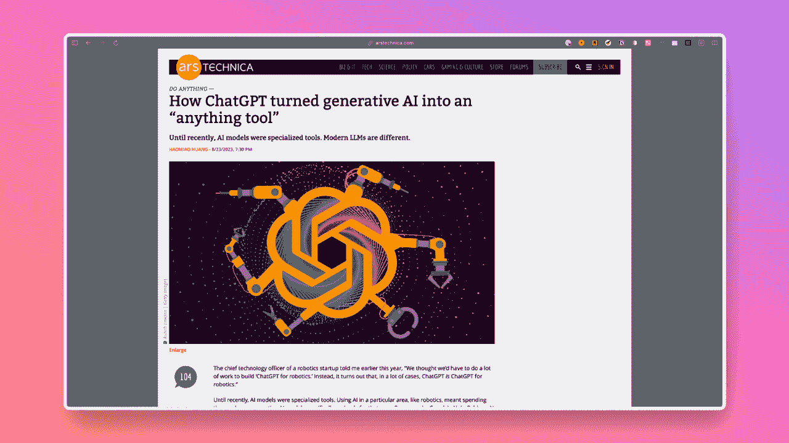

## 人工智能初创公司：销售作品，而不是软件

文章讨论了应用软件初创企业的做法的转变。传统上，这些初创企业专注于开发软件来提高员工水平的生产力。然而，随着大型语言模型（LLM）的出现，有机会出售工作本身而不仅仅是软件。出售工作可以开辟以前软件公司无法到达的新的垂直机会。文章给出了一个EvenUp的例子，该公司出售工作成果本身，例如个人伤害律师的需求包，而不是出售提高生产力的软件。出售工作有不同的销售周期和定价模型，可以利用AI提供比外包更优质、更经济有效的解决方案。文章还讨论了AI取代人类的担忧，并强调了解放人力资源以完成更有价值的任务的好处

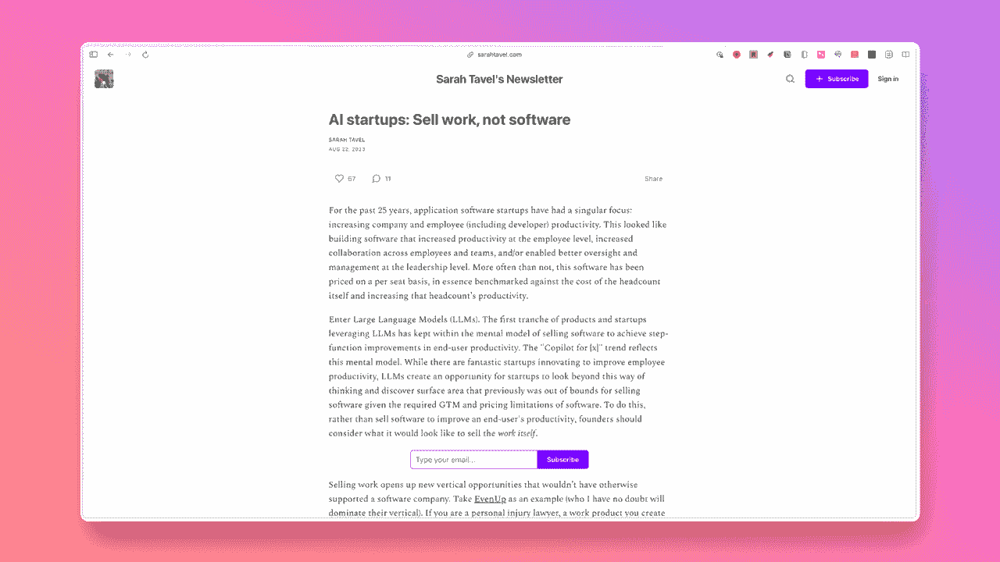

## 语言模型的强化自训练 (ReST)

基于人类反馈的强化学习 (RLHF) 可以通过使大型语言模型 (LLM) 的输出与人类偏好保持一致来提高其输出的质量。我们提出了一种简单的算法，使法学硕士与人类偏好保持一致，其灵感来自不断增长的批量强化学习（RL），我们称之为强化自我训练（ReST）。给定初始 LLM 策略，ReST 通过从策略生成样本来生成数据集，然后使用离线 RL 算法改进 LLM 策略。 ReST 比典型的在线 RLHF 方法更有效，因为训练数据集是离线生成的，这允许数据重用。虽然 ReST 是适用于所有生成学习设置的通用方法，但我们重点关注其在机器翻译中的应用。我们的结果表明，ReST 可以显着提高翻译质量，这是通过以计算和样本高效的方式对机器翻译基准进行自动指标和人工评估来衡量的。

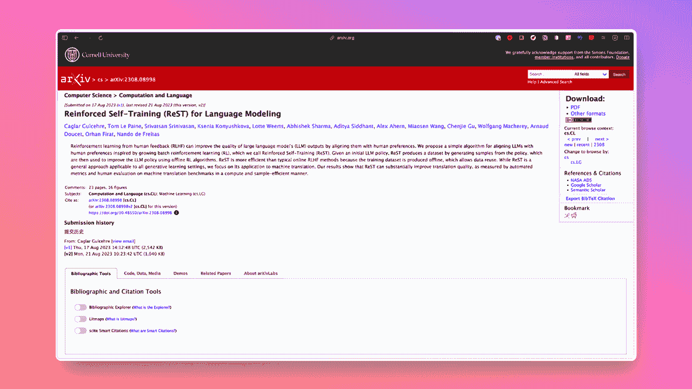

## 人工智能的早期（和人工智能技术成熟度曲线）

文章讨论了早期AI的情况以及当前AI热潮周期。作者认为，以Transformer和Diffusion模型为基础的新时代AI是一个新能力和产品的跃迁，标志着新技术时代的开端。文章还概述了AI采用的四个浪潮，从GenAI本地公司到第一批大型企业采用者，并强调这一新一轮技术对人类的巨大潜力，特别是在教育、医疗、企业和消费者软件以及其他生活方面。

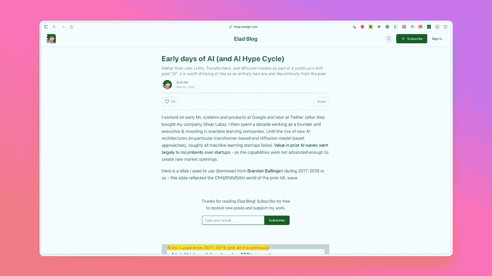

## 向量 数据库（第 4 部分）：分析权衡

这篇文章讨论了在为特定用例选择向量数据库解决方案时所涉及的权衡。作者将向量数据库的不同组件（包括应用层、数据层、索引策略、存储层设计以及可伸缩性和成本考虑）进行了分解。然后，他们探讨了在选择本地部署和云部署、专用和现有供应商、插入速度和查询速度以及召回和延迟之间进行权衡时所涉及的不同权衡。文章强调了认真考虑这些权衡的重要性，以便为特定用例选择正确的向量数据库解决方案。

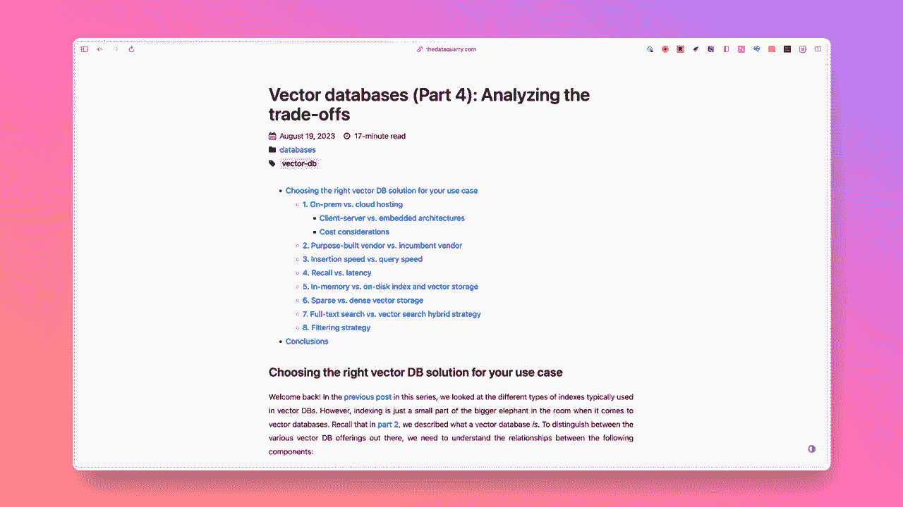

## [大型语言模型的指令调优：调查](https://arxiv.org/abs/2308.10792)

本文对快速发展的指令调整（IT）领域的研究工作进行了调查，这是一种提高大型语言模型（LLMs）能力和可控性的关键技术。指令调整是指以监督方式在由\textsc{（指令，输出）}对组成的数据集上进一步训练LLMs的过程，它弥合了LLMs的下一个词预测目标与用户的目标之间的差距，即使LLMs遵守人类指令。在这项工作中，我们对文献进行了系统的回顾，包括IT的一般方法，IT数据集的构建，IT模型的训练以及不同模式，领域和应用的应用，以及对影响IT结果的因素（例如，指令输出的生成，指令数据集的大小等）的分析。我们还回顾了IT的潜在缺陷以及对它的批评，以及指出现有策略存在的缺陷的努力，并提出了一些有利可图的研究方向。

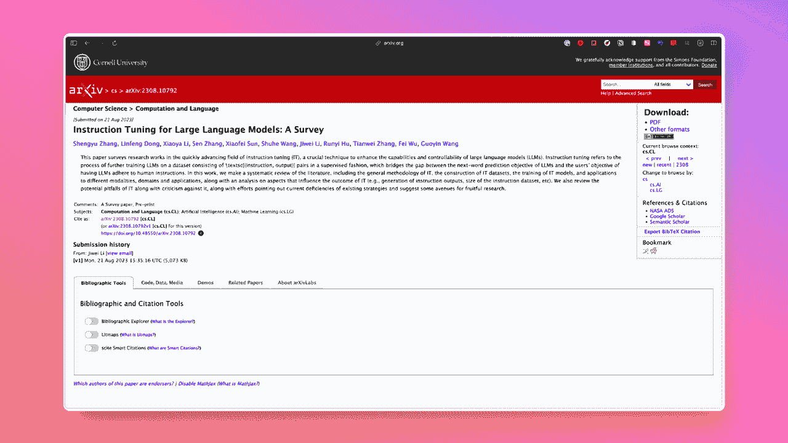

## 将LLM用于非法目的：威胁、预防措施和漏洞

在本文中，我们提供了一个概述，概述了现有的主要是科学的努力，以识别和减轻由LLMs引起的威胁和漏洞。我们提出了一个分类，描述LLMs的生成能力引起的威胁、旨在解决这些威胁的预防措施以及由不完善的预防措施引起的漏洞之间的关系。通过我们的工作，我们希望在经验丰富的开发人员和使用这些技术的新用户中提高对LLMs在安全方面的局限性的意识。

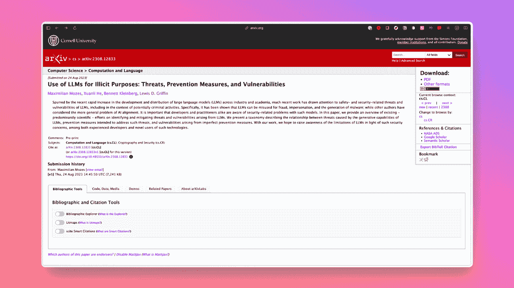