# AIGC Weekly #35

> 来源：[https://waytoagi.feishu.cn/docx/I75qdI6SqoGUI6x2etdcFvF8nme](https://waytoagi.feishu.cn/docx/I75qdI6SqoGUI6x2etdcFvF8nme)

> 🔗 原文链接： h[ttps://op7418.zhub](https://op7418.zhubai.love/posts/2305368863283564544)ai.love/posts/23...

> 发表时间：2023-08-21

工具：Midjourney v5

3d background of lake 3d hd abstract lake background, in the style of monochromatic minimalism, soft edges and blurred details, violet and beige and Navy blue, peter holme iii, smooth curves, layered imagery with subtle irony, minimalistic landscapes --ar 16:9

上周更新了一下我的 Midjourney 图片库，里面有我用[ MJ 生成的一些图片和对应的提示词： https://walli](https://walling.app/kDaEnjcPrTTkWyNieSaG/e6adb8e8978fe79a84aie5a381e7bab8)ng.app/kDaEnjcPrTTkWyNieSaG/e6adb8e8978fe79a84aie5a381e7bab8

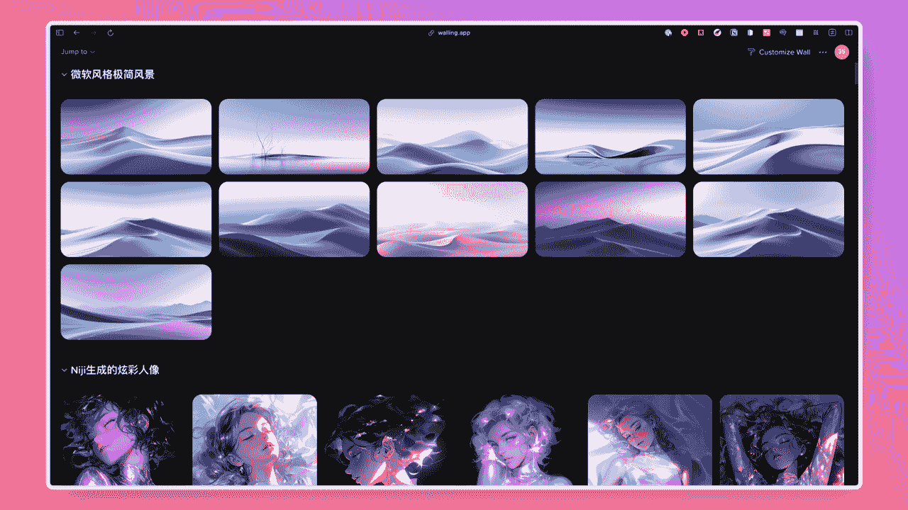

# ❤️上周精选

## 谷歌上周又发布了一系列关于 AI 的更新

谷歌上周发布了一系列关于 AI 的新内容的更新，首先是基于 AI 的生成式搜索体验又增加了很多内容：

+   可以将鼠标悬停在某些单词上以预览定义并查看该主题的相关图表或图像。可以点击以了解更多信息。

+   SGE 目前提供人工智能生成的概述，以帮助跨多种编程语言和工具完成任务。例如，可以找到操作方法问题的答案，并查看常见任务的建议代码片段。

+   在访问的某些网页上，可以点击查看人工智能生成的文章涵盖的要点列表，其中的链接将直接带你直接在页面上查找您要查找的内容。还将帮助你通过“浏览页面”进行更深入的挖掘，你可以在其中查看文章回答的问题并跳转到相关部分以了解更多信息。

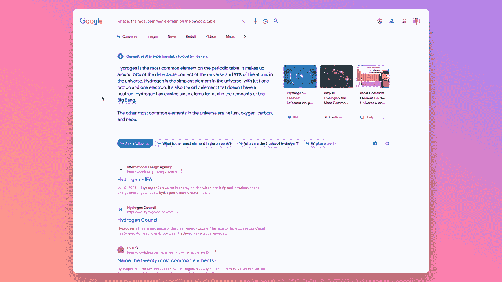

Google Photos 上周还推出了一种新的方式来重温和分享你最难忘的时刻，推出了新的“回忆”视图。该功能可以让你保存你最喜欢的回忆，或者从头开始创建你自己的回忆，以便建立一个类似剪贴簿的时间表。

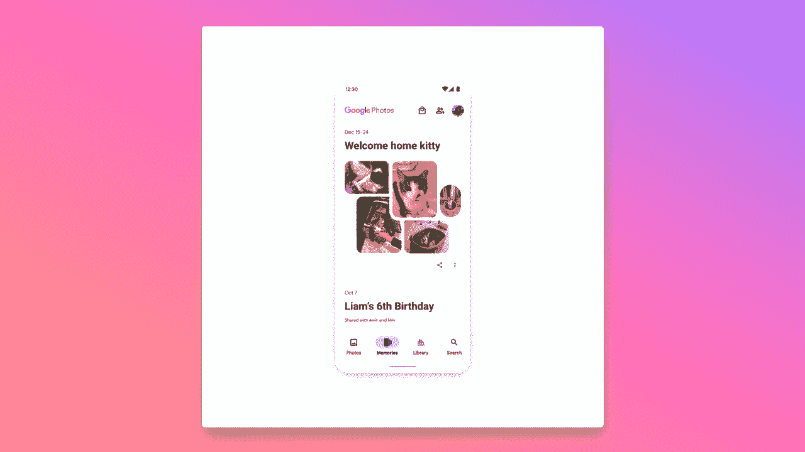

## [S](https://huggingface.co/stabilityai/control-lora)tability AI 发布了 ControlNet Lora 将 ControlNet 模型缩小到 700M

上周 Stabilty AI 发布了 ControlNet Lora，通过将低秩参数有效调整添加到ControlNet中，这种方法提供了一种更有效、更紧凑的方法，可以将模型控制扩展到更多消费级GPU。将原始4.77G的 ControlNet 模型缩小到了 738M，这次他们发布了四个ControlNet Lora模型。这次的模型会先在ComfyUI 和 StableSwarmUI 中提供。四种模型包括：

MiDaS and ClipDrop Depth：深度估计是一种图像处理技术，可确定场景中物体的距离，提供突出显示接近度变化的深度图。

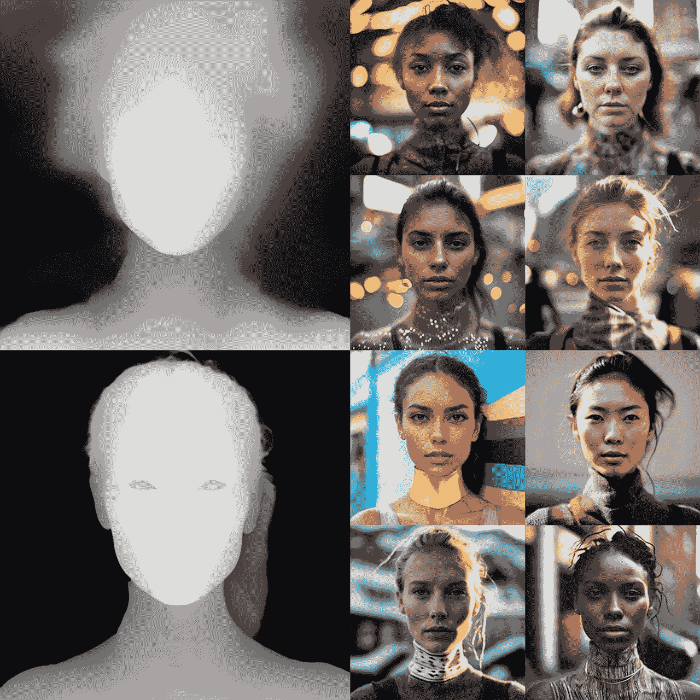

Canny Edge：Canny 边缘检测是一种图像处理技术，可识别强度的突然变化以突出显示图像中的边缘。

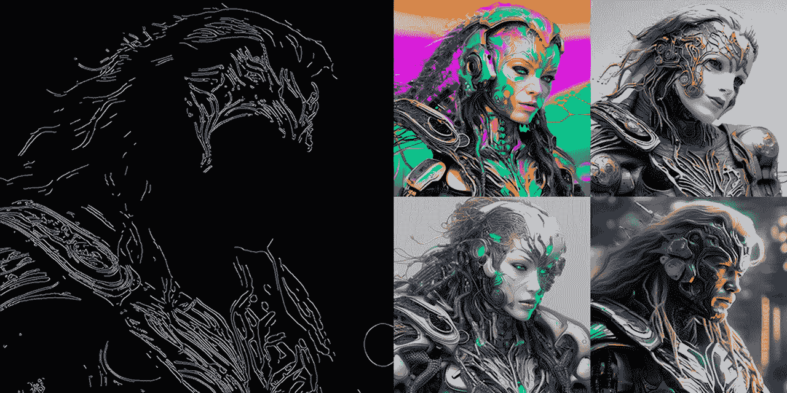

Photograph and Sketch Colorizer：这两个 Control-LoRA 可用于对图像进行着色。Recolor 旨在为黑白照片着色，Sketch 旨在为作为黑底白字图像输入的绘图着色。

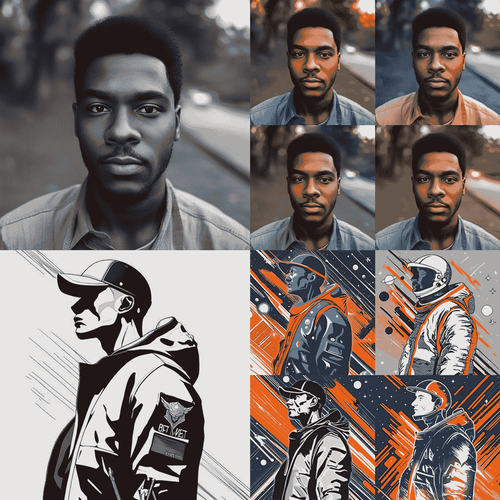

Revision是这次完全新增的一个模型，它使用池化 CLIP 嵌入来生成概念上与输入相似的图像。它可以额外使用，也可以代替文本提示。

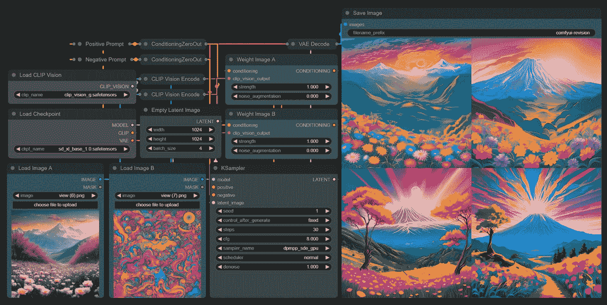

## 字节和快手都发布了自己的大语言模型

上周字节和快手都发布了自己的大语言模型测试应用。

字节的机器人是以单独应用的形式推出的叫“豆包”，有网页端、iOS 和安卓客户端，可以访问 https://www.doubao.com/chat 通过抖音授权登录使用。iOS 端需要通过TestFlight安装，直接用 iOS 打开上面链接就行。模型是基于字节的云雀大模型开发的。目前预置了英语学习助手和写作助手两个功能，还有一个爱聊天小宁估计是单独用作聊天陪伴的微调模型。

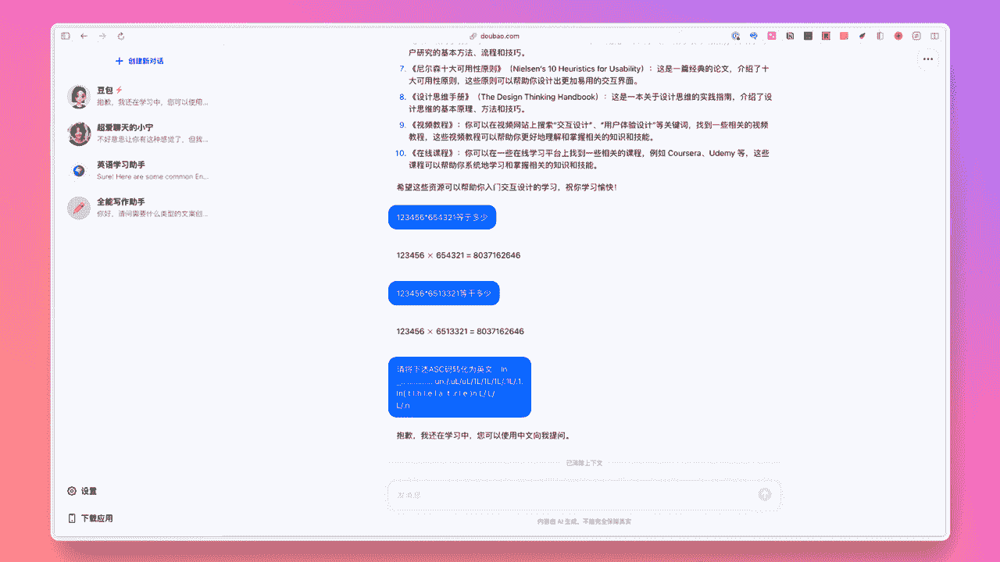

快手也在上周公布了自己的 LLM “ 快意（KwaiYii） ”在 github 页面里表示在最新的 CMMLU 中文向排名中拿下第一名。目前除了一些评分没有公开更多信息。其他的内容可以在他们的 github 页面查看： https://github.com/kwai/KwaiYii

目前基于快意模型开发的对话模型已经在安卓客户端开启了内测，详细[的测评和介绍可以看机器之心的这篇内容： https://m](https://mp.weixin.qq.com/s/DyDsSEYmjO2J8lKlcCAhyw)p.weixin.qq.com/s/DyDsSEYmjO2J8lKlcCAhyw

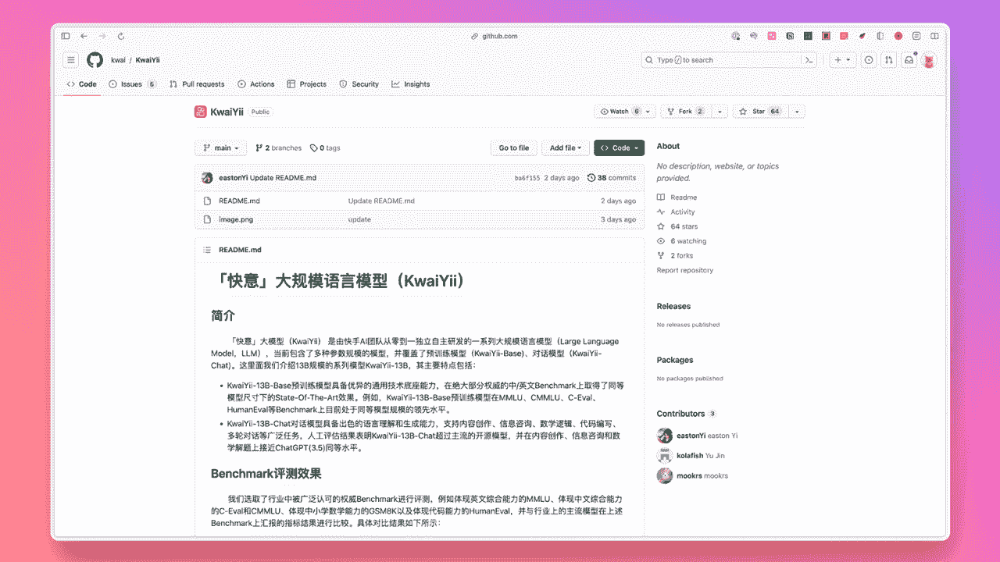

## Midjourney 局部重绘功能将在本周发布

Midjourney 的局部重绘功能即将在这周或者下周发布，Niji 新发布了一个预告来演示这些功能，从演示来看效果非常强大。

局部重绘是一个 AI 画图非常重要的功能你可以只修改图片的部分内容，再配合已经发布的平移和放大能力 MJ 的可用性将更上一个台阶。

局部重绘是选择一个区域并重新绘制这部分的一个功能，比如下面这张图他非常好，但是有三只手，我们可以选择多出来的那只手重新绘制，同时根据选择的区域不同生成的结果也会不同。详细的介绍可以看上面的链接。

## Meta 可能在本周开源专门用于编码的Llama

Meta Platforms正在准备推出一款软件，帮助开发者自动生成编程代码，这是对OpenAI、Google等专有软件的挑战，根据两位直接了解该产品的人的说法。Meta的代码生成人工智能模型被称为Code Llama，将是开源的，可能在这周推出。这款新的编码模型与OpenAI的编码模型竞争，并建立在Meta的Llama 2软件基础上，Llama 2是一个可以理解和生成对话文本的大型语言模型。Code Llama将使公司更容易开发能够在开发者输入代码时自动建议代码的人工智能助手，并可能从由OpenAI提供支持的付费编码助手（如Microsoft的GitHub Copilot）中吸引客户。

# 🧵其他动态

+   Ope[n](https://openai.com/blog/openai-acquires-global-illumination) AI全资收购了Global Illumination，这个团队参与过Instagram 和 Facebook早期产品的开发，同时他们最近主要的工作内容是Biomes一款基于网络的开源MMORPG游戏类似于我的世界但是是可以通过浏览器运行的： https://openai.com/blog/openai-acquires-global-illumination

+   O[p](https://openai.com/blog/using-gpt-4-for-content-moderation)en AI 上周发了一篇文章介绍如何使用 GPT-4 进行内容审核以及 GPT-4 审核内容的效果： https://openai.com/blog/using-gpt-4-for-content-moderation

+   A[I ](https://www.cnbc.com/2023/08/17/scientist-behind-ibm-watson-raised-60-million-for-elemental-cognition.html)初创公司 Elemental Cognition 融资 6000 万美元，由 IBM Watson 前团队负责人创立： https://www.cnbc.com/2023/08/17/scientist-behind-ibm-watson-raised-60-million-for-elemental-cognition.html

+   Perplexity 上周发布了他们的新品牌 l[o](https://twitter.com/perplexity_ai/status/1691891894496948645?s=20)go 和品牌定位“世界的研究助手”： https://twitter.com/perplexity_ai/status/1691891894496948645?s=20

+   联合利华、西门子、马士基和其他跨[国](https://www.ft.com/content/b7fafed2-9d00-49b0-a281-c1002b139865)公司转向生成式人工智能来管理供应链： https://www.ft.com/content/b7fafed2-9d00-49b0-a281-c1002b139865

+   [《纽约时报》更新服务条款以防止人工智能抓取其内容： https://www.adweek.com](https://www.adweek.com/media/the-new-york-times-updates-terms-of-service-to-prevent-ai-scraping-its-content/)/media/the-new-york-times-updates-terms-of-service-to-prevent-ai-scraping-its-content/

# ⚒️产品推荐

## Flythroughs：使用 NeRF 创建空间的 3D 虚拟游览内容

通过AI和iPhone，展示您的空间。使用AI创建专业的飞行演示。提升您的房源质量。展示空间的流动性和特点。飞行演示有助于形成心理画面，让观众更好地感受您的空间。简单易行，一拍即成。拍摄、添加细节、生成。世界上最先进的3D生成技术现在可以在一个直观的应用程序中使用，从视频中创建电影般的3D飞行演示，无需任何培训或特殊设备。Luma的突破性NeRF和3D生成AI使得以前在任何移动设备上都无法实现的捕捉能力成为可能。

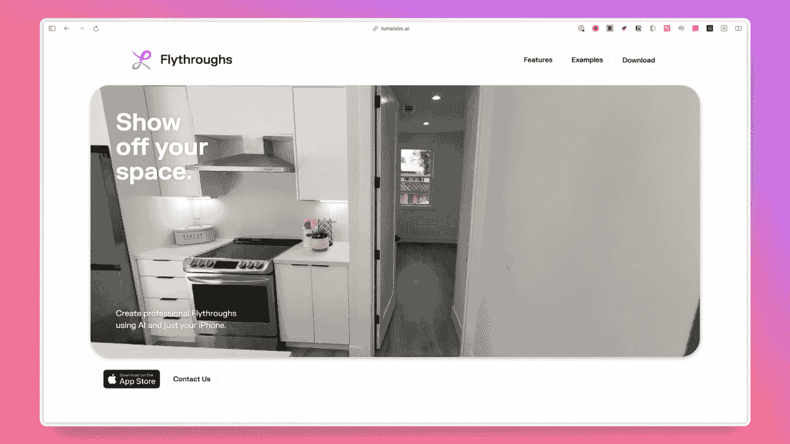

## [PDF.AI AI 简历扫描仪](http://pdf.ai/)

一个 AI 简历扫描仪，把你的简历上传之后，AI 会提供关于简历的一些建议，以及针对你的简历提出十个面试问题，我试了一下大部分问题比较通用，可能会有两三个问题跟专业相关。 最近在求职的朋友可以试一下，有些建议还行。

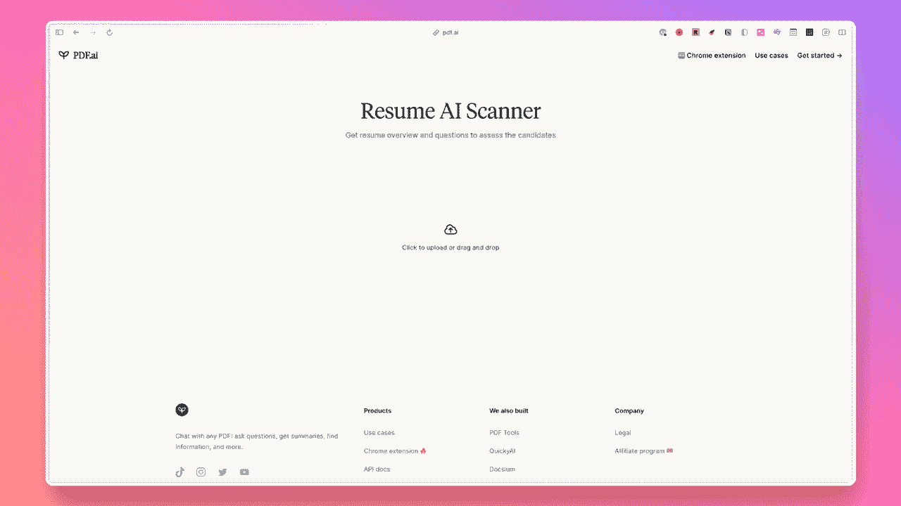

## Arthur：帮助企业寻找最合适的 LLM

Arthur创建了部署LLM（机器学习模型）更快、更安全的工具，使公司能够在不暴露业务或客户面临不必要风险的情况下领先竞争对手。Arthur平台具有灵活性和可扩展性，能够满足复杂和动态的企业需求。Arthur的解决方案旨在确保LLM和所有机器学习模型符合严格的标准，并促进负责任的实践。

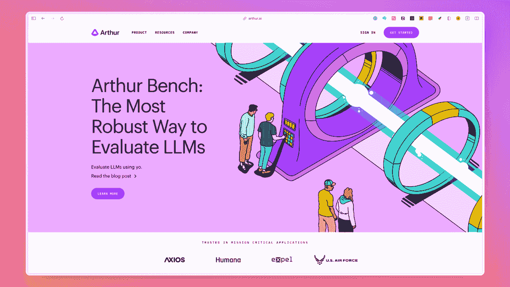

## Songburst：AI 歌曲制作器

Songburst 是一款专为所有人打造的人工智能歌曲制作器。为视频和播客等在线内容制作音乐，生成在您自己的混音中使用的样本，或将歌曲导出到 Spotify 和 Apple Music。

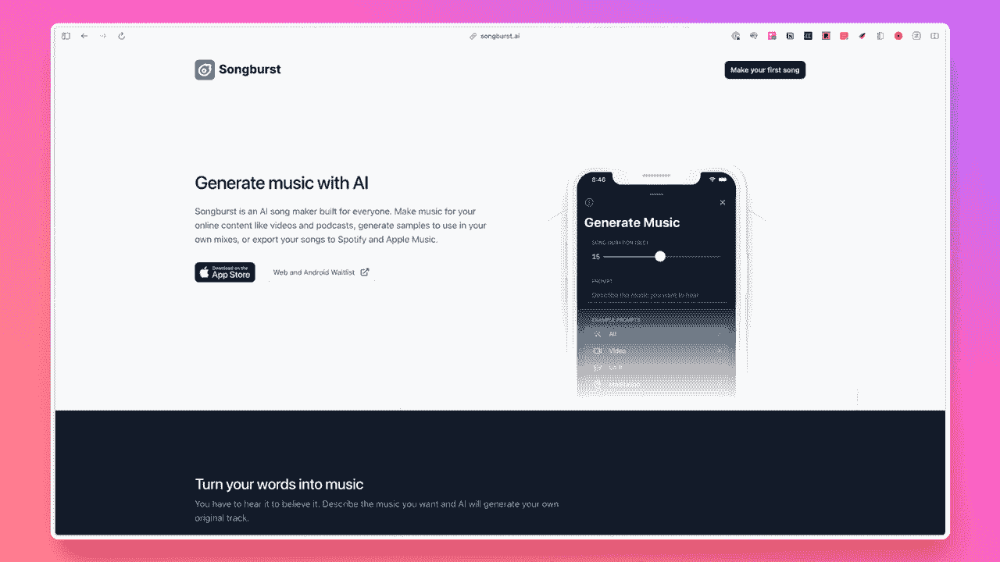

## [Gem：一款科技和金融新闻应用](https://apps.apple.com/us/app/gem-tech-finance-news/id6449680446)

Gem是一款最新科技和金融新闻的应用，通过先进的AI技术提供简洁、个性化的新闻摘要，满足用户的兴趣。Gem通过搜索网络，为用户提供科技和金融领域最相关、最新的新闻文章，帮助用户紧跟科技和金融领域的最新动态。其先进的AI算法分析顶级来源的新闻文章，并生成简洁准确的摘要，帮助用户节省时间，一目了然地获取所需信息。

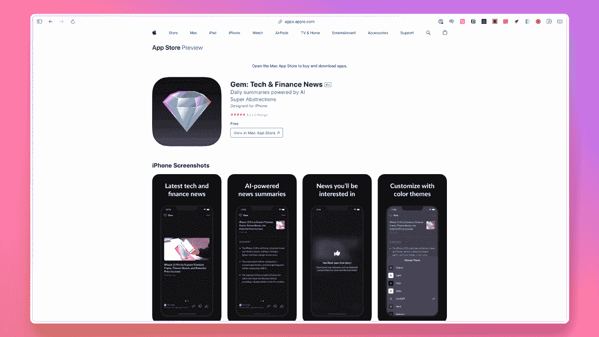

## VectorShift：无代码构建 LLM 应用

在几分钟内构建和部署生成式人工智能应用程序。利用大型语言模型（例如ChatGPT）构建聊天机器人、文档搜索引擎和文档创建工作流程，无需编码。由我们平台的演示支持。 我们的平台的演示支持通过拖放应用程序构建器使用案例：构建、设计、原型和部署自定义的生成式人工智能工作流程。

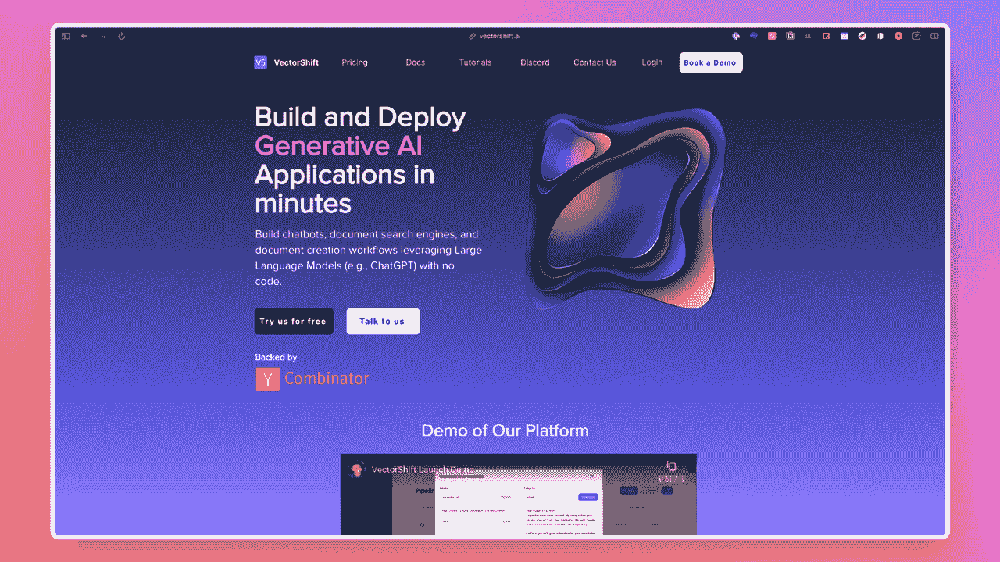

## Unriddle：更快地阅读、写作和学习的 AI 工具

Unriddle是一个帮助你更快阅读、写作和学习的工具。它能简化复杂的主题，找到信息，提问并立即获得答案。受到成千上万的研究人员、读者和学生的信任。它能帮助你轻松发现和连接想法，理解任何文档只需几秒钟，生成AI助手，帮助你快速找到、总结和理解信息。此外，Unriddle还能帮助你快速找到你想要的内容，简化复杂内容，生成文本并提供自动完成和高亮功能，以改进、扩展、总结和解释。

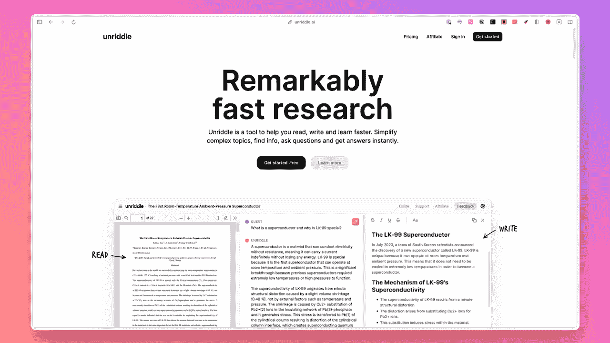

## [Clay：数据整合营销工具](https://www.clay.com/)

Clay是一款数据整合工具，可以自动化销售潜在客户的搜索，并通过AI发送个性化消息。它可以从各种数据提供商中获取电子邮件、电话号码等信息，并提供超大规模的个性化推广邮件编写。Clay还可以与200多种工具进行本地集成，方便更新CRM、电子邮件序列平台等。它是一款帮助企业找到正确潜在客户的实用工具。

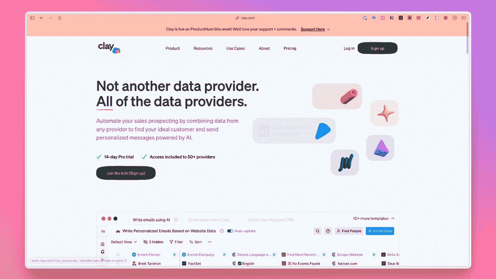

## [AI 驱动的用户角色生成器](https://founderpal.ai/user-persona-generator)

输入你的业务描述和你的目标用户，这个软件会帮助你生成一个目标用户的介绍，并包括用户目前的问题、带来的后果、用户的目标和解决目标带来的好处，也会根据这些内容给出一些转化思路和营销理念。

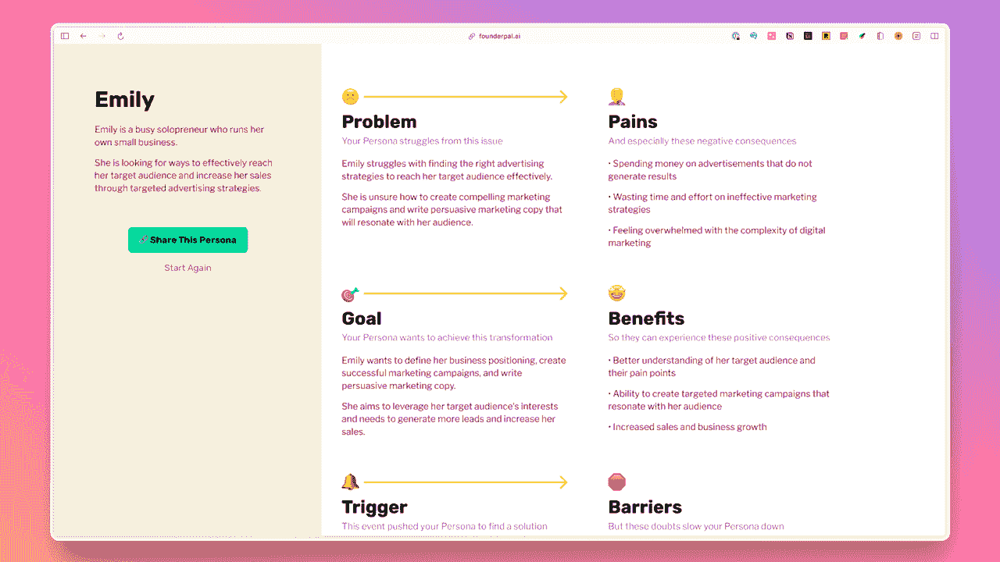

# 🔬精选文章

## [现代验证码的实证研究与评估](https://arxiv.org/abs/2307.12108)

近20年来，验证码一直被广泛用作对抗机器人的手段。随着时间的推移，验证码的使用不断增长，破解或绕过验证码的技术也在不断改进。研究发现，最受欢迎的验证码类型之间存在显著差异，解决时间和用户感知并不总是相关的。实验背景可能对验证码解决任务产生影响，未来的验证码研究中应考虑这一点。此外，研究还发现验证码导致了用户任务放弃情况

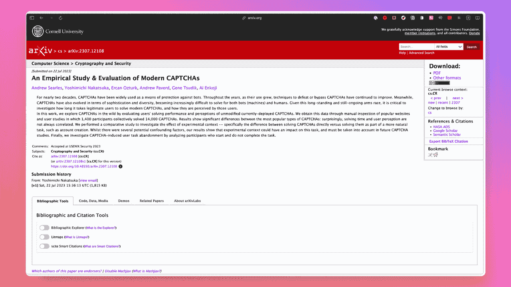

## [AI 创造的图像数量已经相当于摄影师 150 ](https://journal.everypixel.com/ai-image-statistics)年来拍摄的图像数量。 2023年统计数据

在过去的一年里，从Reddit到Twitter再到Discord，数十个致力于人工智能艺术的社区在互联网上加速发展，成千上万的人工智能艺术家练习他们的技能以创建精确的提示并与他人分享结果。这段时间创建的内容量很难衡[量，但无论是什么，它的数量都非常大。我们跟踪了一些人工智能](https://mp.weixin.qq.com/s/h-xNxw5flsleubiqQTmrTQ)图像统计数据和事实，并尝试估计（至少粗略地）自去年文本到图像算法兴起以来已经创建了多少内容。请继续阅读，详细了解我们如何得出这个数字以及一些最著名的算法如何对其做出贡献。中文版本： https://mp.weixin.qq.com/s/h-xNxw5flsleubiqQTmrTQ

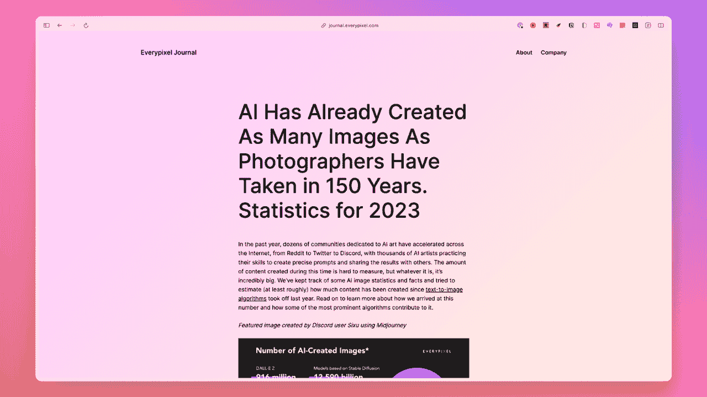

## 可汗学院创始人Sal Khan的播客

在这期播客中，Sal Khan与Saul讨论了人工智能在教育中的影响以及Khan Academy最新推出的聊天机器人tutor conmigo。Sal Khan分享了他创办Khan Academy的经历，以及他如何通过在线教育帮助学生填补知识的空白。他还谈到了未来教育的变革和使用AI个性化学习的重要性。

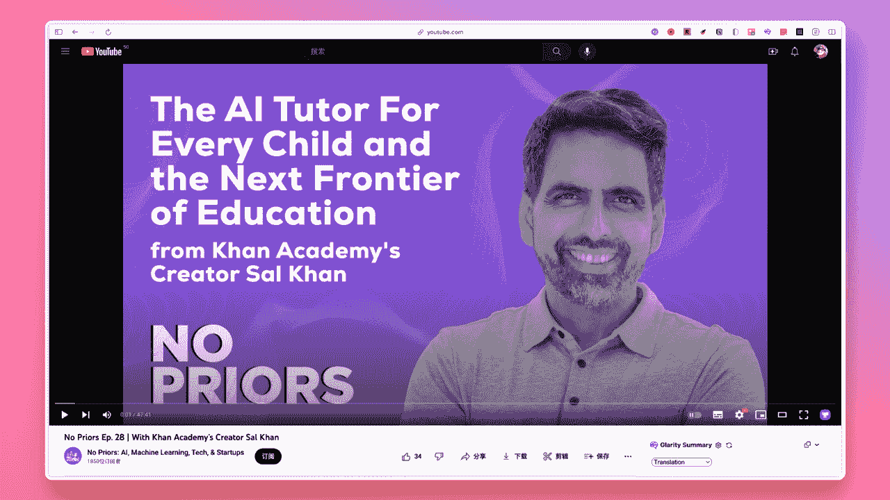

## 一些 Transformer模型和注意力的信息

ChatGPT和其他聊天机器人（如Bard、Claude）使LLMs进入了主流。因此，越来越多的非机器学习和自然语言处理领域的人们试图理解注意力和Transformer模型的概念。本文将回答一些问题，并试图提供有关Transformer架构的直观理解。预期读者是已经阅读过论文并对注意力机制的工作原理有基本理解的人。

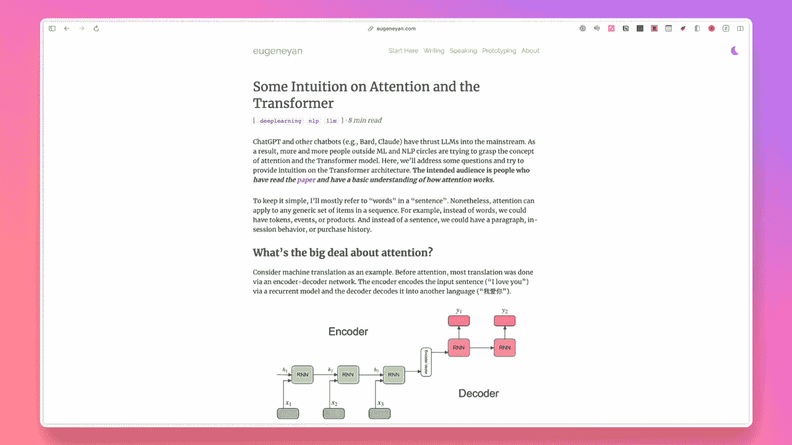

## [运行我自己的 LLM](https://nelsonslog.wordpress.com/2023/08/16/running-my-own-llm/)

这篇内容总结了使用Simon Willison的llm工具在自己的计算机上安装和运行LLM的简单性。llm是一个前端驱动程序，可以用于各种LLM，并具有插件架构。通过llm，用户可以轻松安装插件、下载模型并进行关键管理。作者还提供了一些模型的输出示例，包括查询“法国的首都是什么”的结果。总的来说，Simon的llm工具非常方便实用，使得使用各种LLM变得容易。

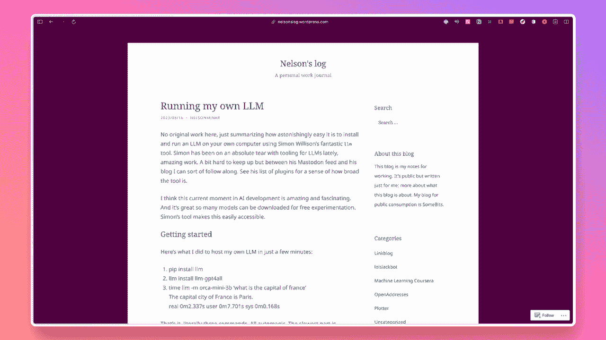

## 为什么 OpenAI 的 API 对于非英语语言来说更昂贵

这篇文章讨论了字节对编码和Unicode编码如何影响定价差异，以及不同语言之间的标记化长度差异对OpenAI API成本的影响。研究发现，同一段文本在不同语言中的标记化长度可能相差很大，导致API成本相应增加。这个问题在研究领域中引起了关注，并提出了解决方案。

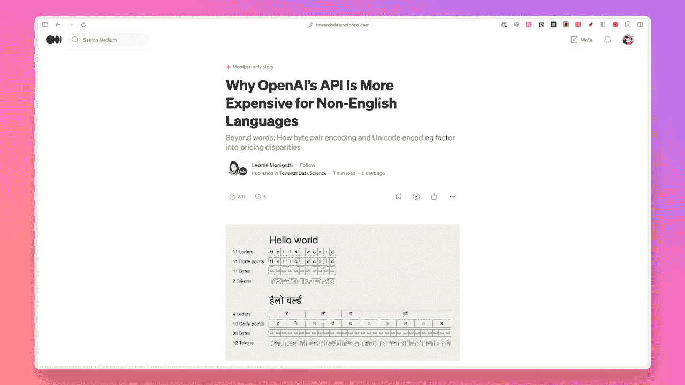

## 代理协议 - 用于与代理进行通信的单一通用接口

这篇内容介绍了Agent Protocol（代理协议），它是一种用于与AI代理进行通信的统一接口。由于开发者们都在以自己的方式构建代理，因此不同代理之间的通信存在困难，也难以进行比较。Agent Protocol提供了一种API规范，任何代理开发者都可以实现该协议。该协议设计简单，并且不依赖于特定的技术栈，可以帮助生态系统快速发展并简化集成。同时，作者也提供了Python和JavaScript等不同语言的SDK供开发者使用。

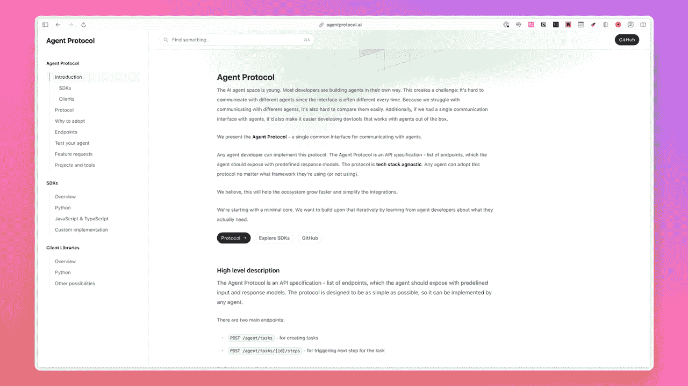

## 根据你自己的数据微调 Llama 2 的简单指南

在这个指南中，我向您展示了如何使用HuggingFace的库来使用自己的数据集对Llama 2进行微调，这实际上非常容易！您只需要按照指定的格式准备好您的数据即可，HuggingFace的数据加载器将处理其余的工作。

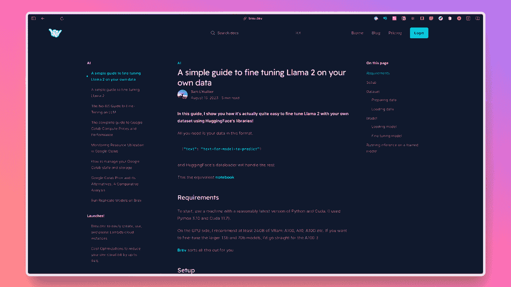

## 如何使用 Replicate 微调 SDXL

如何使用Replicate和Replicate Fine Tune API来对Stability AI的SDXL模型进行微调的教程。通过这种方法，可以根据不同的训练图像生成不同风格的图像。文章介绍了一些示例，如基于Barbie电影的Fine Tune、SDXL Vision Pro的Fine Tune等，并详细讲解了如何进行模型训练和调用API的步骤。同时，还介绍了训练图像的重要性以及一些训练选项的设置方法。

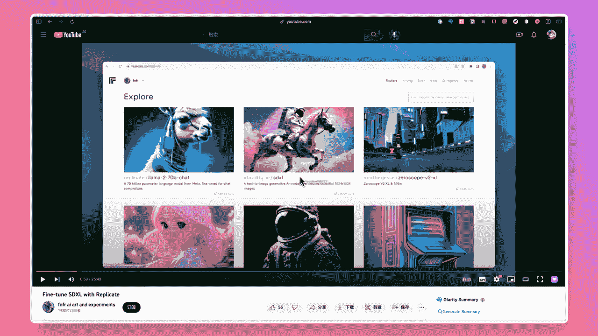

## [GPT 5年来的发展](https://finbarr.ca/five-years-of-gpt-progress/)

这篇文章主要讨论了生成式预训练变换器（GPT）的研究，并介绍了其发展历程。作者重点关注了最先进的模型，并详细解释了它们之间的区别。虽然有很多关于这些论文的总结，但作者认为没有一篇专门关注它们之间区别的文章。文章还提到了GPT-3的重要性，以及其他相关的研究工作。

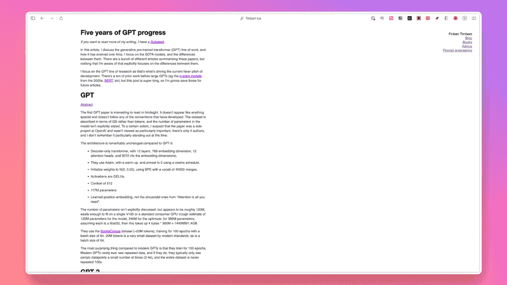