# AIGC Weekly #34

> 来源：[https://waytoagi.feishu.cn/docx/KOcPde6AsoVut7xuxbNcrxfWnqL](https://waytoagi.feishu.cn/docx/KOcPde6AsoVut7xuxbNcrxfWnqL)

> 🔗 原文链接： h[ttps://op7418.zhub](https://op7418.zhubai.love/posts/2302829878615429120)ai.love/posts/23...

> 发表时间：2023-08-14

工具：Midjourney v5

neon colors parallel vertical smooth tender shiny lines --ar 16:9

# ❤️上周精选

## 黄仁勋 SIGGRAPH 2023 主题演讲发布的一些信息

NVIDIA创始人兼首席执行官黄仁勋在SIGGRAPH会议上宣布了一系列重要公告。其中包括下一代GH200 Grace Hopper超级芯片平台、NVIDIA AI Workbench工具包以及NVIDIA Omniverse的升级。这些公告旨在将过去十年的创新汇集到一起，推动生成式人工智能的发展。

+   Grace Hopper超级芯片NVIDIA GH200已于5月份全面投入生产，GH200将具备连接多个GPU的能力。

+   Nvidia 正在与 HuggingFace 合作，帮助开发人员在任何云上创建、测试和微调生成式 AI 模型。因此，开发人员现在可以在 HF 上训练模型并使用 Nvidia 的 AI 工作台进行部署。

+   现在，可以使用Nvidia的Omniverse以USD格式生成AI内容，以创建虚拟世界。它包括与Adobe、Wonder Dynamics和Luma AI等多种AI相关的集成。

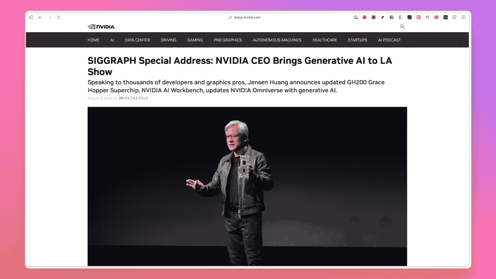

## [上周爆火的非常逼真的数字人工具](https://twitter.com/joshua_xu_/status/1689019874667024384?s=20)

上周这个HeyGen工具创始人的演示视频刷屏了，这个数字人视频看起来非常逼真不像我们之前看到的数字人有一些恐怖谷效应和僵硬的肢体动作、面部表情，同时在你申请等待列表之后会收到一个他们创始人针对你的申请内容生成的回复视频，效果也很好。

我理解还是在现有的技术路线上做的优化，只是效果确实好，如果想要了解数字人的创建过程和效果还有局限性的话可以去看LKS前几天的这视频。

演示的还是比较全面的，手势和动作都是预先录制好的比较通用的动作，如果需要新增新的动作就需要重新录制，同时数字人也不能进行较大幅度的动作。

[LKS 制作的数字人介绍视频： https://www.bilibili.com/video/BV](https://www.bilibili.com/video/BV1vm4y1x7nm/?share_source=copy_web&vd_source=6c09aa7f53b69992e1cd572bbd2dbf94)1vm4y1x7nm/?share_source=copy_web&vd_source=6c09aa7f53b69992e1cd572bbd2dbf94

## [斯坦福 AI 小镇上周正式开源](https://github.com/joonspk-research/generative_agents)

25 个角色居住在一个类似西部世界中，却没有意识到自己生活在模拟中。他们去工作、闲聊、组织社交活动、结交新朋友，甚至坠入爱河。每个人都有独特的个性和背景故事。

这个能力要用在游戏里的话感觉有无限的可能，可能真的会出现自己发展的游戏世界。

论文链接： https://arxiv.org/abs/2304.03442

## Anthropic 发布了 Claude Instant 1.2

有 Claude API 权限的公司现在可以使用Claude Instant 1.2了，Claude Instant 1.2 融合了Claude 2 在实际用例中的优势，并在数学、编码、推理和安全等关键领域显示出显著的进步。它会生成更长、更结构化的响应，并更好地遵循格式说明。

Claude Instant 1.2 在数学和编码方面优于 Claude Instant 1.1，在 Codex 评估中达到 58.7%，而我们之前的模型为 52.8%。它还在 GSM8K 基准测试中得分为 86.7%，而 Claude Instant 1.1 的得分为 80.9%。

Claude Instant 1.2的收费规则为 Prompt $1.63/million tokens、Completion $5.51/million tokens。

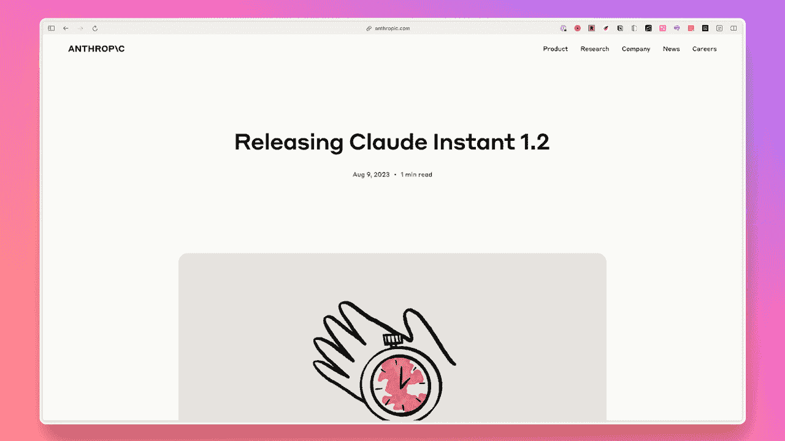

# 🧵其他动态

+   Zoom 更新了服务条款允许他们使用某些客户数据来训练他们的AI 模型： https://explore.zoom.us/en/terms/

+   为[了保证](https://www.firstpost.com/tech/news-analysis/openai-may-go-bankrupt-by-2024-chatgpt-costs-company-700000-dollars-every-day-12986012.html) ChatGPT 的稳定运行，Open AI 每天要花费超过 70 万美元，不包括其他 API 及服务： https://www.firstpost.com/tech/news-analysis/openai-may-go-bankrupt-by-2024-chatgpt-costs-company-700000-dollars-every-day-12986012.html

+   Google和环球音乐正在就如何为人工智能生成[的歌曲](https://www.theguardian.com/technology/2023/aug/09/google-and-universal-music-working-on-licensing-voices-for-ai-generated-songs)授权艺术家的声音和旋律进行谈判： https://www.theguardian.com/technology/2023/aug/09/google-and-universal-music-working-on-licensing-voices-for-ai-generated-songs

+   数据可视化初创公司 Virtuali[ti](https://techcrunch.com/2023/08/10/data-visualization-startup-virtualitics-lands-37m-investment/)cs 获得 3700 万美元融资： https://techcrunch.com/2023/08/10/data-visualization-startup-virtualitics-lands-37m-investment/

+   使用真人视频拍摄通过AI画图生成动漫的作品《剪刀、石头、布》上周更新了第二集： https://youtu.be/tWZOEFvczzA

+   Midjourney上周部署了新的GPU集群，pro用户[的](https://twitter.com/midjourney/status/1689784750926602240?s=20)图片生成速度应该会加快1.5倍左右： https://twitter.com/midjourney/status/1689784750926602240?s=20

+   Runway 的 Gen-2 视频生成已经可以延长到了 [1](https://twitter.com/runwayml/status/1689630007746764803?s=20)8 秒了，首先会在 web 端推出： https://twitter.com/runwayml/status/1689630007746764803?s=20

+   [S](https://twitter.com/StabilityAI/status/1689607772529369088?s=20)tability AI发布了一个他们训练的日语 AI 模型： https://twitter.com/StabilityAI/status/1689607772529369088?s=20

+   Stability AI 推出了 StableCod[e](https://stability.ai/blog/stablecode-llm-generative-ai-coding)，一个专门用于编码的生成式 LLM： https://stability.ai/blog/stablecode-llm-generative-ai-coding

+   ChatGPT 的自定义命令已经向所有免费用户开放了，这里有[一](https://twitter.com/op7418/status/1689472019253923845?s=20)个可以提高 GPT-4 效果的命令： https://twitter.com/op7418/status/1689472019253923845?s=20

+   [O](https://twitter.com/stats_feed/status/1688261211584880640?s=20)pen AI 进入全球独角兽估值前 10 的企业： https://twitter.com/stats_feed/status/1688261211584880640?s=20

+   [OpenAI 推出 GPTBot 爬虫](https://platform.openai.com/docs/gptbot)，并提供如何限制访问的方法： https://platform.openai.com/docs/gptbot

+   Bing Chat 现在可以在任何浏览器中使用，[而不](https://blogs.bing.com/search/august-2023/Celebrating-6-months-of-the-new-AI-powered-Bing)仅仅是 Edge，包括移动浏览器： https://blogs.bing.com/search/august-2023/Celebrating-6-months-of-the-new-AI-powered-Bing

# ⚒️产品推荐

## Height Copilot：项目管理 AI 功能

著名的项目管理工具 Height 发布了他们的 AI 功能 Height Copilot 项目管理 AI 功能，这个感觉确实很厉害，相当于一个智能项目经理，同样的官网也做的很好看：

+   自动主持站会比如总结每个人的上周进度和这周需要对齐的内容

+   将对应的反馈创建为待执行的任务

+   总结历史上错过的对话内容

+   提醒并防止重复创建的任务

+   起草版本发布说明

+   一键生成针对任务的建议和利用 AI 进行头脑风暴等

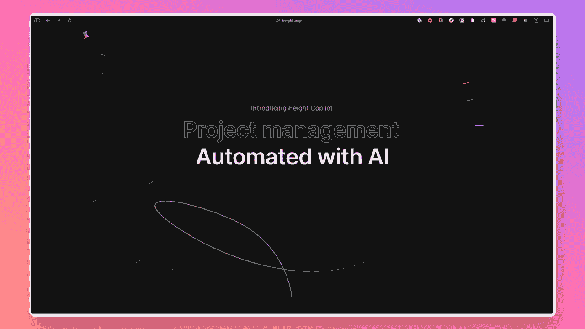

## Type Chat：AI驱动的协作助手

这个软件的交互非常有意思，双屏操作AI的流程不会影响你已有的写作内容和思路 。Type Chat是由OpenAI的GPT-4驱动的文档写作助手。它可以帮助您进行头脑风暴、写作和重写。它特别适用于找到好的创意、写草稿和重写已写的内容。你可以向Type Chat寻求策略，比如销售策略和定价策略。当你准备好开始写作时，只需向Type Chat要求第一稿。您可以要求它写任何东西，从个别推文到完整的博客文章。您可以通过突出显示文档中的任何文本，并要求Type Chat更清楚地表达它。

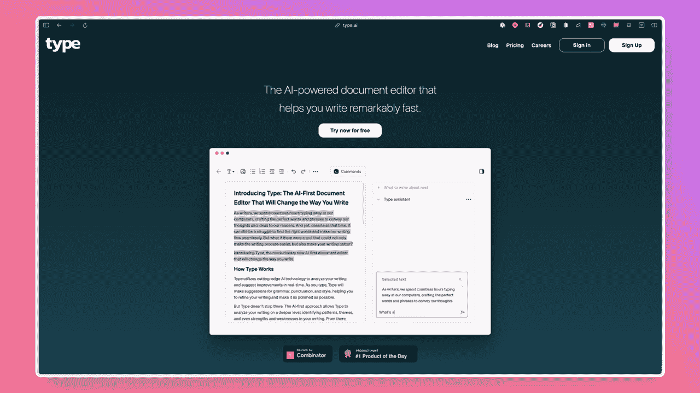

## Shortwave：AI驱动的电子邮件软件

AI驱动的 Gmail 客户端，AI 会自动总结邮件内容生成摘要，可以自动用 AI 翻译邮件内容，同时会根据邮件内容自动打上标签并分组可以用自然语言进行日期等筛选。

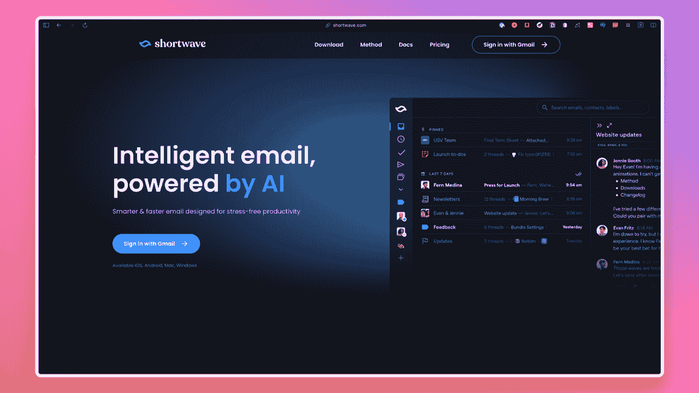

## Soundful：AI 生成免版税的背景音乐

Soundful是一种利用人工智能生成免版税背景音乐的工具，可以为视频、直播、播客等提供独特的免版税音轨。它适用于个人项目、社交媒体创作者、艺术家和制片人，并提供不同的订阅计划供用户选择。

## ChatBTC 通过同 AI 对话了解 BTC 的技术和历史

ChatBTC 旨在帮助您了解比特币技术及其构建历史。所有数据均来自 bitcoin-dev 邮件列表、Lightning dev 邮件列表、Bitcoin StackExchange、Bitcoin Optech 和 BTC Transcripts。

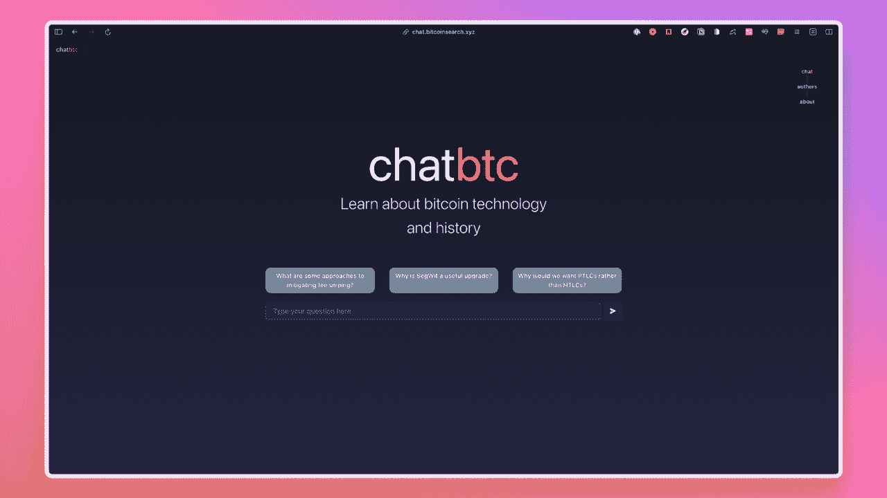

## Project IDX：将全栈、多平台的应用程序开发流程带到云端

Google 发布了实验性质的开发平台 Project IDX，这是一个 Web 工作区，为了将全栈、多平台的应用程序开发流程带到云端。支持一系列便利的开发功能和 AI 功能，网页也设计的非常好看，不像是现在 google 的风格。内置了 AI 功能包括代码生成，在不同编程语言之间翻译代码，解释代码等功能。这个代码模型是基于 PaLM 2构建的。

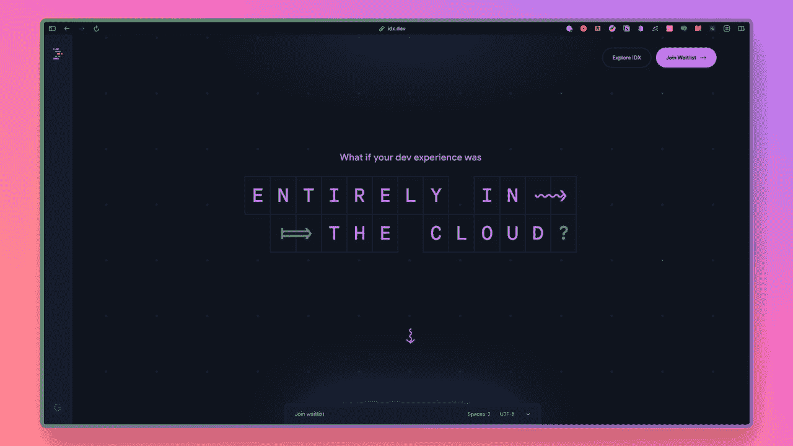

## Cambrian：AI 研究的副驾驶

这个平台可以搜索超过24万篇机器学习论文，获取当天的论文，生成研究见解，并自动化文献综述。用户可以与网络中的人分享论文、书签和文件夹，或者公开个人资料展示自己的想法。

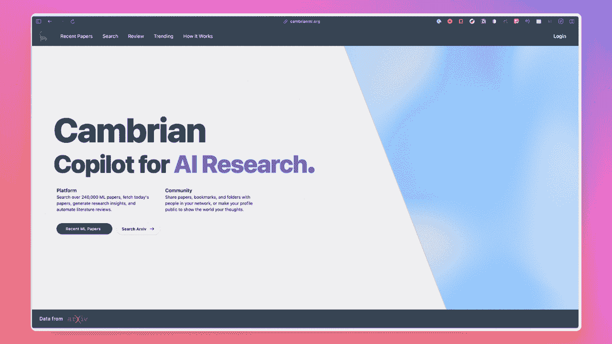

## MediSearch：医疗 AI 搜索引擎

MediSearch是一个可信赖的医学信息搜索引擎，可以直接提供基于科学的医学问题答案。

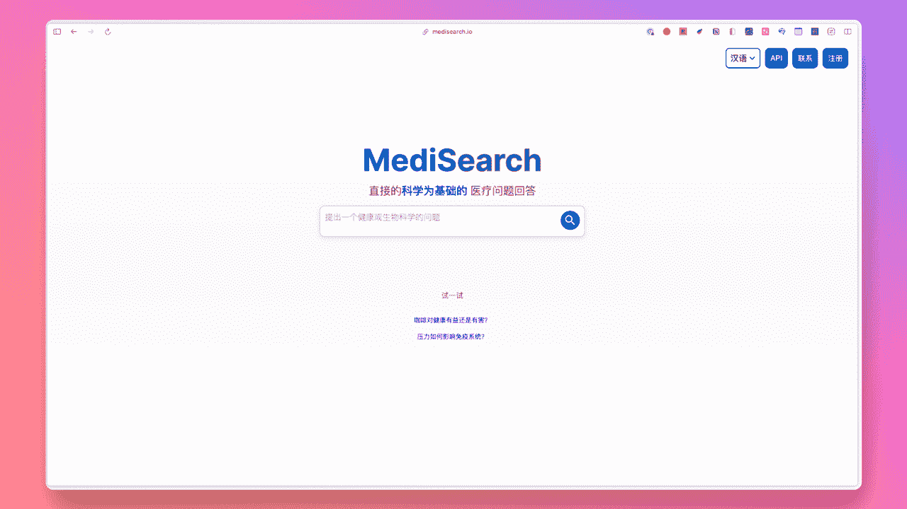

## Fynt AI：提供财务洞察、对账、报告的 AI 工具

企业财务部门的人工智能自动化工具。它可以连接所有的业务银行账户、ERP系统、会计软件和电子表格，自动化决策制定、对账等工作。它还提供了对企业财务团队有帮助的人工智能助手，可以加速决策制定过程，减少手动任务。该技术可以总结财务文件、解析和理解电子表格，自动化发票和银行对账等工作。

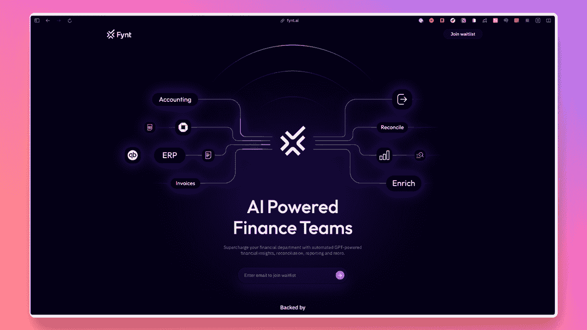

# 🔬精选文章

## AudioLDM 2：利用自我监督预训练学习整体音频生成

前段时间AI生成音乐和音效效果非常好的模型AudioLDM 2正式放出了论文，感兴趣的可以看一下。这个模型支持文本到音乐、语音和各种音效非常全面了。

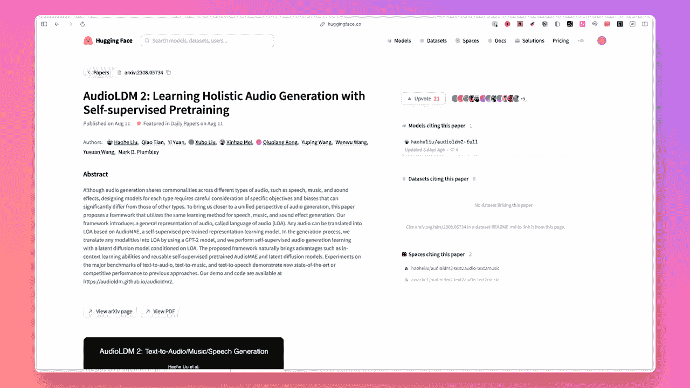

## [创造性地使用嵌入式技术](https://wattenberger.com/thoughts/yay-embeddings-math)

旨在通过嵌入技术帮助用户成为更好的作家。作者通过研究优秀写作导师的方法，提出了让隐含的显性化的概念，即通过放大镜观察他人的写作来提升自己的写作水平。作者还介绍了一种基于嵌入模型的方法，可以将句子的“抽象性”可视化，用户可以根据自己的需要创建自定义的秤。虽然这种方法并不完美，但对于某些类型的秤效果很好。作者鼓励读者在Twitter上分享自己的想法。

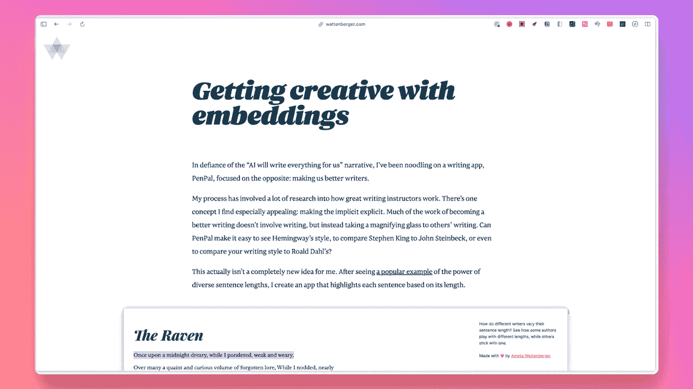

## 一个 VC 分享他的秘密，如何挑选投资

本文介绍了VeryVisual作为按需设计公司的服务，以及Chris Paik关于评估企业和商业模式的一些框架和思考方式。他强调了“为什么现在”这个问题的重要性，以及供应作为商品与供应作为独特策略的区别。他还提到了用户信任、市场风险和执行风险等概念。

## [A Bicycle for the (AI)](https://www.infoq.com/presentations/bicycle-ai-gpt-4-tools/) Mind: GPT-4 + Tools

Sherwin Wu和Atty Eleti讨论如何使用OpenAI API将大型语言模型集成到应用程序中，并通过API将GPT的功能扩展到外部世界。他们介绍了如何使用OpenAI API将这些大型语言模型集成到应用程序中，并通过API和工具使用将GPT的功能扩展到外部世界。

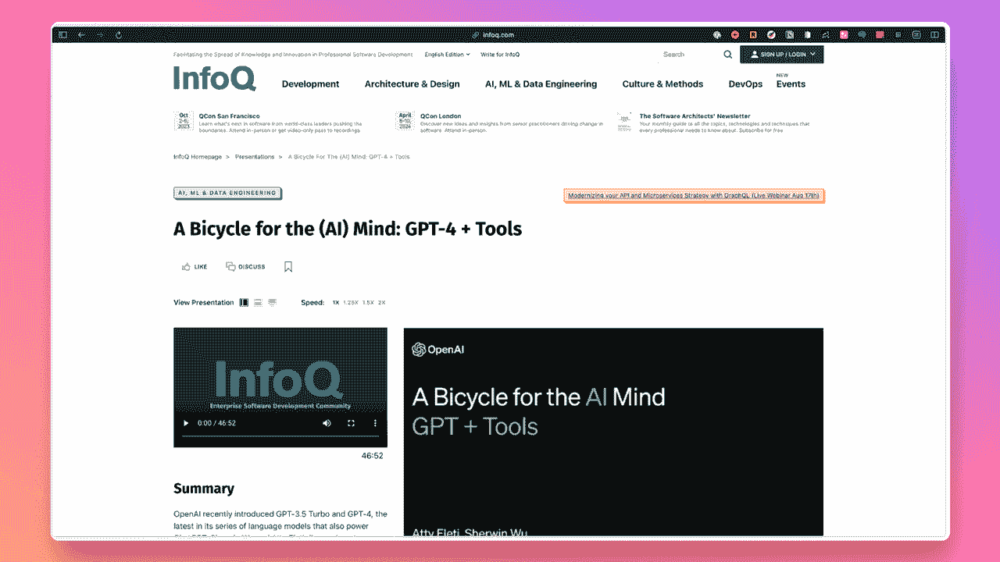

## [达里奥·阿莫代专访（Anthropic CEO）- 10亿美](https://youtu.be/Nlkk3glap_U)元模型，OpenAI扩展和2年内的AGI

Dario Amodei，Anthropic的首席执行官，讨论了人工智能（AI）的扩展概念及其所面临的挑战。他强调，虽然人工智能的扩展已经在实证中观察到，但其有效性的根本原因仍不完全了解。 Amodei还强调，难以预测随着规模扩大而出现的特定能力，以及AI系统中的对齐和价值的潜在风险和局限性。他认为，数据可用性不太可能成为AI扩展的约束，但承认机械可解释性等领域需要进一步的研究和理解。 Amodei还提到，解决安全问题的重要性，以及AGI（人工智能总体智能）对政府和安全等各个方面的潜在影响。

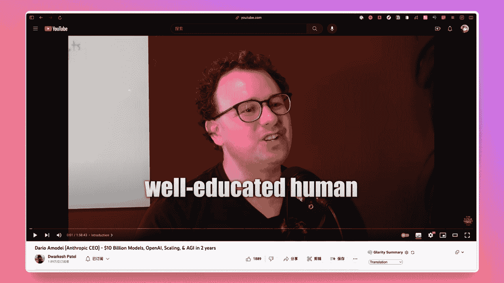

## 无人的未来？生成式人工智能如何塑造人类众包的未来

这项研究调查了人工智能（AI）和人类众包在创新商业解决方案方面的能力。研究组发起了一个关注可持续循环经济商业机会的众包挑战，吸引了来自不同国家和行业的众包者。使用GPT-4生成了三个不同提示水平的AI解决方案，并与人类解决方案进行了评估。结果显示，人类和AI解决方案在质量上相当，但在创新性和价值方面存在差异。分析了解决方案文本后发现，人类解决方案展现出更大的语义多样性，这与创新性有关。这项研究揭示了人类和AI在解决复杂组织问题方面的潜力和局限，并为综合应用人工智能解决问题的方法奠定了基础。

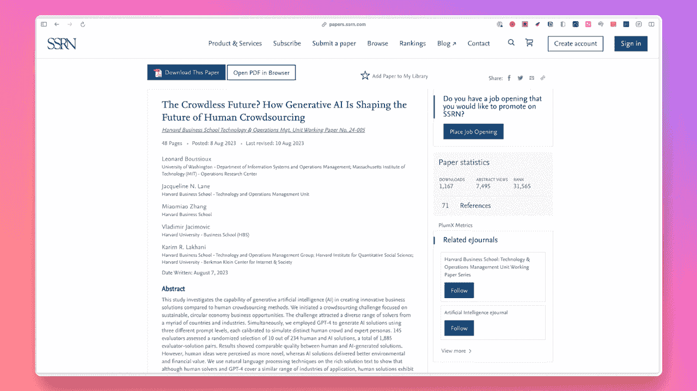

## 为后 ChatGPT 世界构建搜索

我们的信息生态系统有问题，修复方法是将LLM与互联网上的高质量内容结合。我们开始Metaphor，希望恢复搜索的神奇感。经过一年多的尝试，我们找到了一种全新的搜索互联网方式，将人们对链接的讨论视为内容和质量的指标。LLM的存在带来了信息生态系统的巨大变革，但也存在问题，如产生错误信息、知识过时和容量有限。因此，LLM需要查询外部世界，通过互联网搜索和消费内容。我们认为LLM将会比人类进行更多的搜索，建议将高质量的搜索引擎与LLM结合使用，以满足用户需求。我们发布了Metaphor API，用于将LLM连接到互联网。

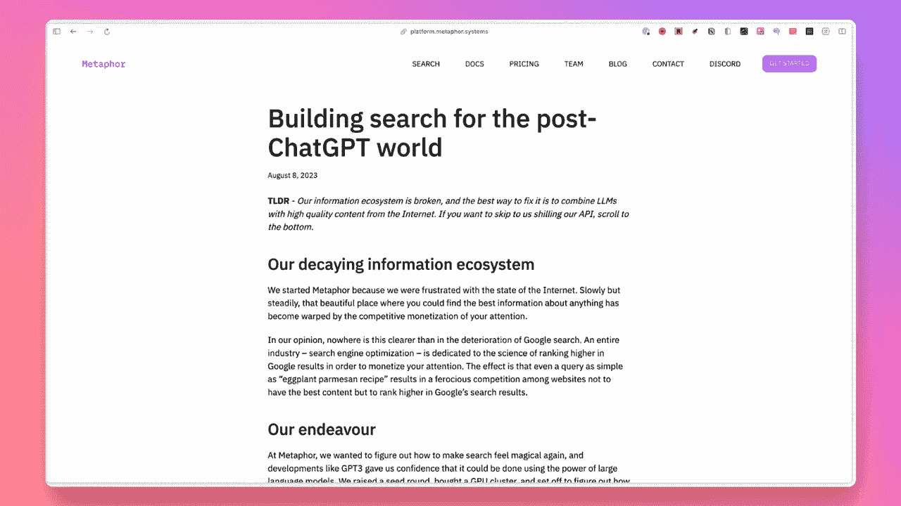

## AlphaStar Unplugged：大规模离线强化学习

这篇论文介绍了StarCraft II作为一个具有挑战性的强化学习环境，并且提出了一个名为AlphaStar Unplugged的基准测试，为离线强化学习算法带来了前所未有的挑战。作者利用Blizzard发布的大规模数据集，建立了一个数据集、标准化机器学习方法的API以及评估协议。通过使用离线数据，他们改进了现有的代理算法，在与之前发布的AlphaStar行为克隆代理的对战中获得了90%的胜率。

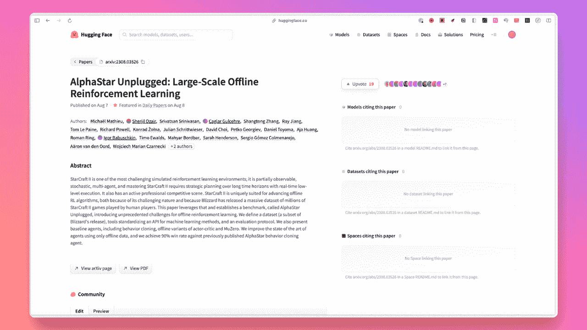

## [人工智能人格模拟](https://every.to/chain-of-thought/llms-can-simulate-personality-that-s-a-big-deal)

这篇文章介绍了一个名为Glean的AI搜索工具，它能帮助用户在工作场景中进行搜索和优化。作者谈到了自己过于好说话的性格特点，以及AI Dan能够预测他在邮件中的回复，从而改变他的性格特点。文章还讨论了人格特质的概念和大五人格模型，并介绍了语言模型如何模拟和改变人格。作者认为，通过模拟人格，可以提高合作效率、准备重要互动、增强自我理解和改变能力。

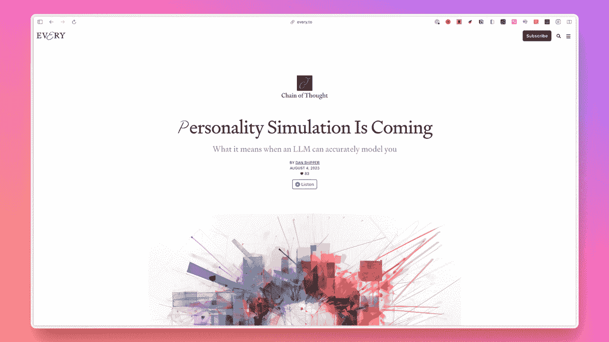

## 时代杂志-4 张图表说明为什么人工智能的发展不可能放缓

人们通常认为科学技术进步是不可预测的，是由事后才能清晰看到的灵光一现所推动的。但人工智能系统能力的进展是可预测的，它受到计算、数据和算法这三个因素的推动。过去70年的进展很大程度上是研究人员利用更强大的计算处理能力训练人工智能系统，提供更多数据，或者提出算法技巧来有效减少获得相同结果所需的计算或数据量。了解这三个因素如何推动过去的人工智能进展是理解为什么大多数从事人工智能工作的人不认为进展会很快放缓的关键。

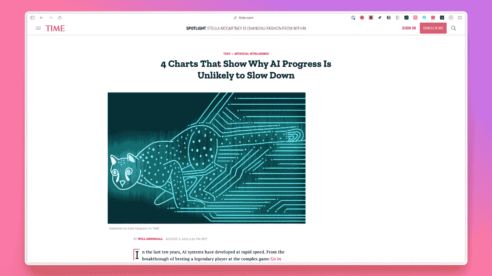