# AIGC Weekly #33

> 来源：[https://waytoagi.feishu.cn/docx/SGQCdO5ILoXIySxitZXc2A4Hn5f](https://waytoagi.feishu.cn/docx/SGQCdO5ILoXIySxitZXc2A4Hn5f)

> 🔗 原文链接： h[ttps://op7418.zhub](https://op7418.zhubai.love/posts/2300325281892196352)ai.love/posts/23...

> 发表时间：2023-08-07

工具：Midjourney v5

Material closeup, geometric Hydrogen, melted, flowing shapes --ar 16:9 --style raw

# ❤️上周精选

## Meta 开源了 AudioCraft 音乐生成工具

Meta 上周开源了 AudioCraft，这是一组音乐 AI模型，可以根据文本描述生成高质量的声音和音乐。它由三个模型组成：MusicGen 创建音乐，AudioGen 产生音效，EnCodec 压缩声音以获得更好的质量。

+   通过 AudioGen，证明了可以训练 AI 模型来执行文本到音频生成的任务。给定声学场景的文本描述，该模型可以生成与具有真实录音条件和复杂场景上下文的描述相对应的环境声音。

+   MusicGen 是专门为音乐生成量身定制的音频生成模型。音乐曲目比环境声音更复杂，在创建新颖的音乐作品时，在长期结构上生成连贯的样本尤其重要。

+   EnCodec 是一种有损神经编解码器，经过专门训练，可以压缩任何类型的音频并以高保真度重建原始信号。它由一个带有残差矢量量化瓶颈的自动编码器组成，该瓶颈可生成多个具有固定词汇的并行音频标记流。不同的流捕获不同级别的音频波形信息，使我们能够从所有流中重建高保真度的音频。

代码地址： [https://github.com/faceboo](https://github.com/facebookresearch/audiocraft)kresearch/audiocraft

AudioGen论文地址： https://arxiv.org/abs/2209.15352

MusicGen论文地址： https://arxiv.org/abs/2306.05284

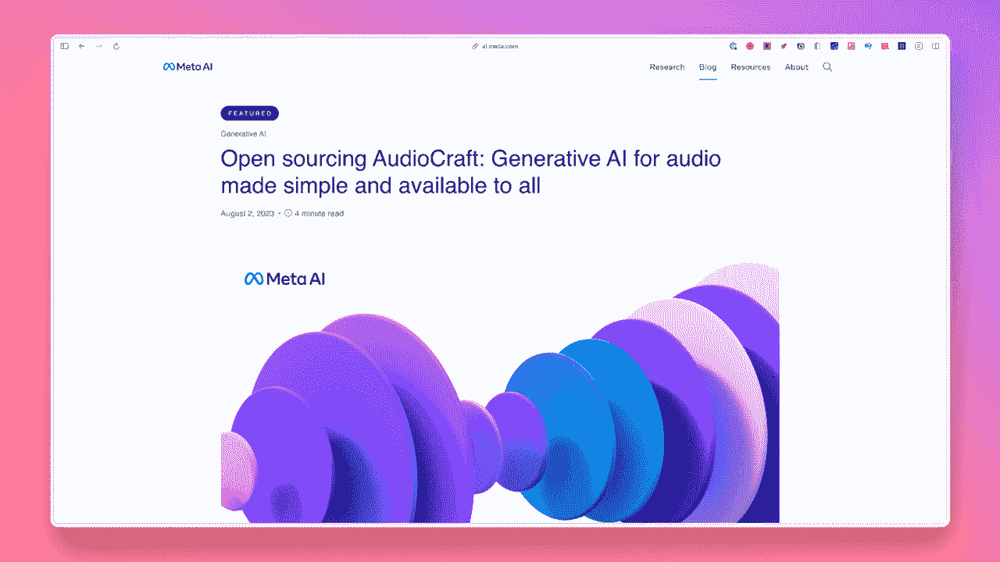

## ChatGPT 推出一系列体验优化

Chat GPT将于下周推出大量体验优化更新，解决了很多早就该解决的问题：

1.  聊天空页面将会出现一些示例提示词，你可以选择或者参考这些提示。

1.  建议回复：ChatGPT 将会自动弹出一些后续的推荐问题，你可以快速选择。

1.  默认GPT-4：当作为Plus用户开始新的聊天时，ChatGPT将记住之前选择的模型。

1.  所有 Plus 用户的代码解释器测试版均支持上传多个文件。

1.  保持登录状态：更新了登录页面，同时不会再两周踢下线一次了。

1.  键盘快捷键：增加了一些键盘快捷键你可以尝试⌘ (Ctrl) + /查看完整列表。

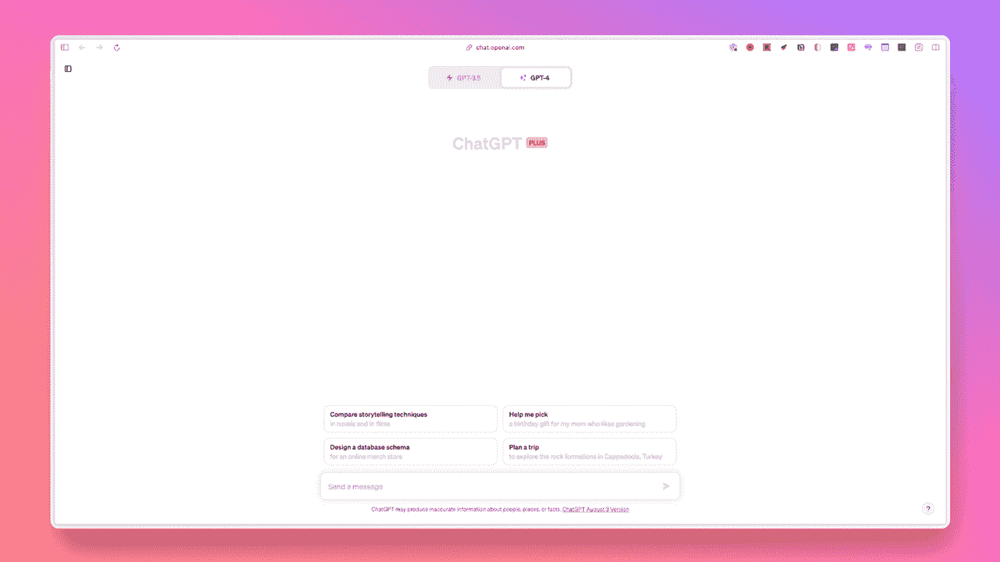

## 其他一句话动态

Midjourney 工作时间的一些信息，V5[.](https://twitter.com/op7418/status/1686934254016757760?s=20)3 会在两周内发布，V6 还要几周： https://twitter.com/op7418/status/1686934254016757760?s=20

[Tinder 测试 AI 照片选择功能，帮助用户建立个人资料： https:](https://techcrunch.com/2023/08/02/tinder-tests-new-ai-photo-selection-feature/)//techcrunch.com/2023/08/02/tinder-tests-new-ai-photo-selection-feature/

Uber CEO 透露他们将会在Uber 中接入 AI 智能机器人： https://mobilesyrup.com/2023/08/01/uber-ai-chatbot-app-integration/

[阿里开源了通义千问- 7B 的模型： https://mp](https://mp.weixin.qq.com/s/c4qvn0xTChq9xxvdrNa4pQ).weixin.qq.com/s/c4qvn0xTChq9xxvdrNa4pQ

谷歌上周推出了 TextFX，旨在帮[助艺术家和作家使用 LLM 进行创作： https:/](https://blog.google/technology/ai/lab-sessions/)/blog.google/technology/ai/lab-sessions/

[A](https://twitter.com/LiuHaohe/status/1686782804518973440?s=20)udioLDM 2 文本生成音效、音乐和语音： https://twitter.com/LiuHaohe/status/1686782804518973440?s=20

[Yo](https://techcrunch.com/2023/08/01/youtube-experiments-with-ai-auto-generated-video-summaries/)uTube正在测试自己的 AI 视频摘要工具： https://techcrunch.com/2023/08/01/youtube-experiments-with-ai-auto-generated-video-summaries/

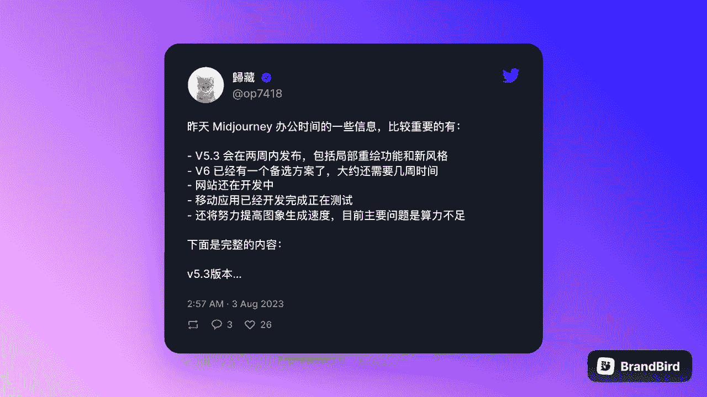

# ⚒️产品推荐

## PMAI- 产品经理的 AI 助手

一个专门为 PM 开发的 AI 助手，用户可以使用这个工具生成产品需求文档（PRD）的原型图、解决方案流程图、时序图、页面结构图、测试用例等。还可以通过AI帮助生成数据字段、优化PRD文档、评估功能的价值、生成SQL代码和周报思路等。

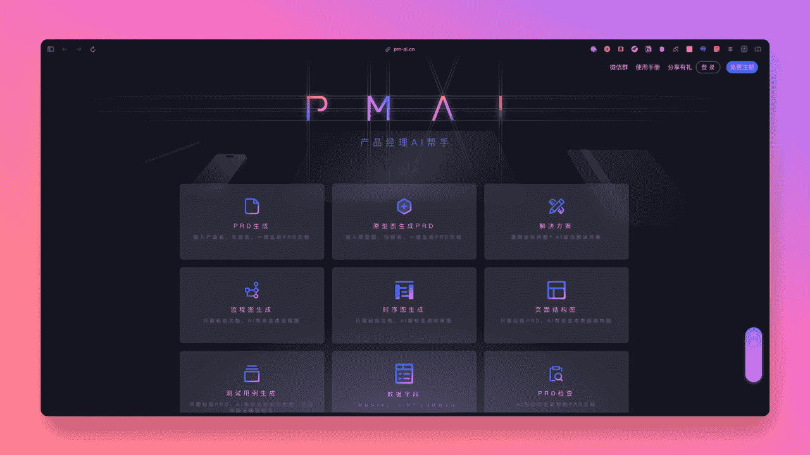

## [Khroma-AI 调色板生成](https://www.khroma.co/)

个性化算法 → 通过选择一组颜色，您将训练一个由神经网络驱动的算法，在浏览器中生成您喜欢的颜色并屏蔽您不喜欢的颜色。创建无限组合 → Khroma从互联网上最受欢迎的数千个人工调色板中学习，以生成您可以以字体、渐变、调色板或自定义图像的形式查看的出色组合。

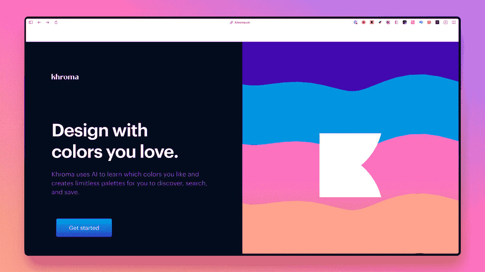

## BlogtoPod：将文章转为播客

一个使用人工智能将博客文章转化为播客的工具。用户只需将博客文章复制粘贴到该工具中，几分钟内就能生成一个有声播客。该工具还提供了免费试用和多个价格层级选择。用户无需具备技术知识，可以轻松地将播客发布到Spotify等平台，吸引更多的听众。

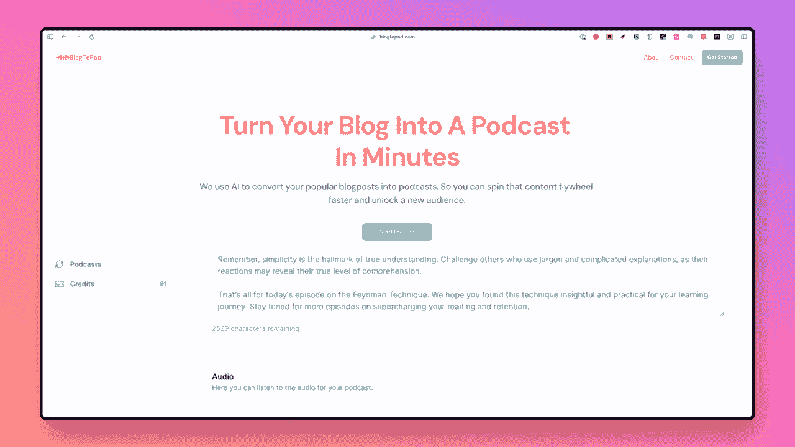

## NeuralBox AI 图片收藏和检索

只需拍下一切吸引你的眼球或似乎有用的东西的照片。将从收据和截屏到文件、衣服和产品包装等一切都放入NeuralBox中。借助NeuralBox高效的存储和先进的人工智能搜索功能，你可以随心所欲地捕捉任何你想要的东西，并在需要时轻松找到它们。

## [LLM 的开发工具](https://hegel-ai.com/)

该工具用于大型语言模型评估提示、LLM和向量数据库。使用PromptTools在不同模型上运行实验，确定最适合您用例的提示，并记录反馈以进行微调。示例GitHub。通过实验和CI/CD测试您的LLM应用程序，将评估函数转化为可重用的测试套件，并与GitHub Actions集成。

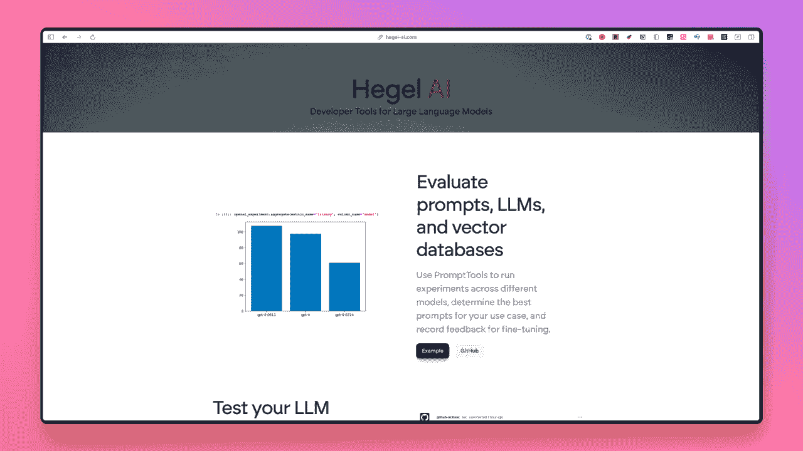

## ToolBench：开源模型训练和评估平台

名为ToolBench的开放平台，用于训练、服务和评估大规模语言模型进行工具学习。该项目旨在构建开源、大规模、高质量的指令调整SFT数据，以促进构建具有通用工具使用能力的强大LLMs。通过收集高质量的指令调整数据集，使用最新的ChatGPT进行自动构建，该数据集可用于训练和评估模型。文章还提供了数据集、训练和评估脚本以及经过精调的模型ToolLLaMA。

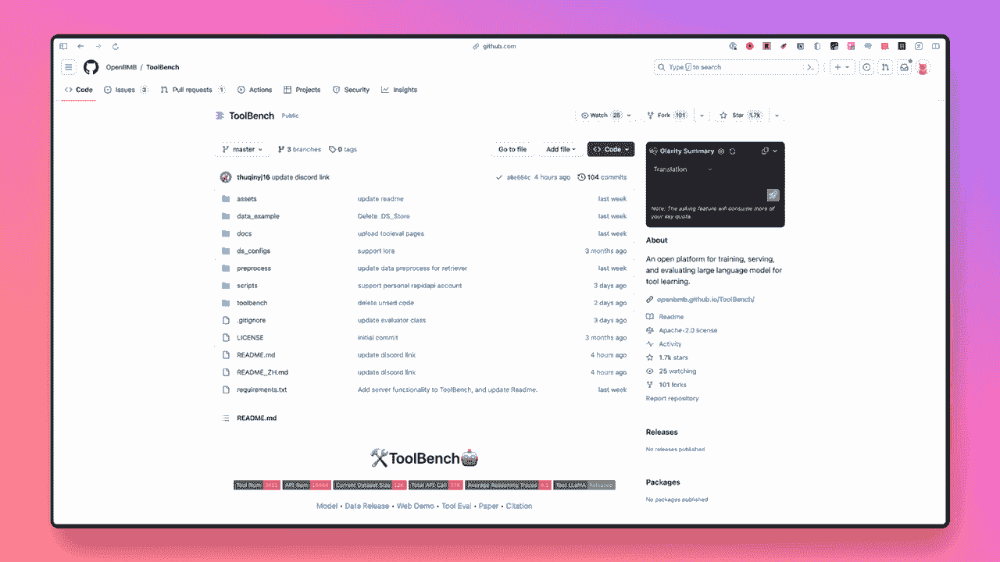

## Lolo — AI 食物和卡路里追踪器

Lolo 是一款简单的食物追踪器。只需以纯文本形式告诉 Lolo 你吃了什么，它就会跟踪你的食物并控制你的卡路里。不再需要复杂的下拉列表和食物数据库。只需简单的聊天即可帮助您保持身材。Lolo 很灵活，它可以遵循您的特殊饮食：健身、糖尿病、怀孕或其他情况。只需在设置个人资料时告知 Lolo 您的特殊要求即可。

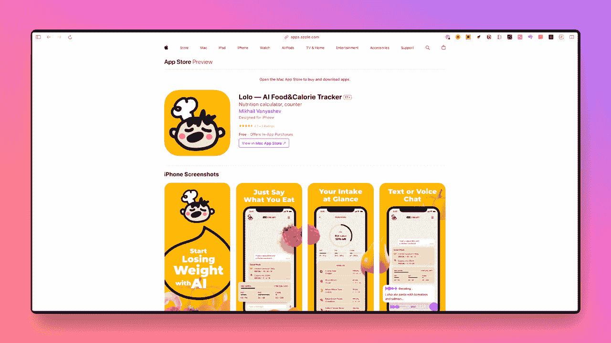

## AI image generator：Figma 图片生成插件

免费AI图像生成器。使用这个文本到图像插件，您可以直接在Figma中生成独特的AI图像。无论您是每天使用AI还是刚开始尝试，都没有关系。这个AI图像生成器插件对任何人来说都很有趣和易于使用。您只需选择一个风格并用提示进行设计。

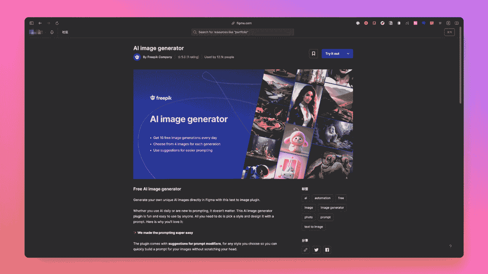

# 🔬精选文章

## [ASML： 垄断魔法](https://www.generalist.com/briefing/asml)

这篇文章讨论了荷兰科技公司ASML的极紫外(EUV)光刻机技术，以及该技术对半导体芯片制造的重要性。ASML的EUV光刻机是世界上最复杂的机器之一，它通过操纵极紫外光来制造芯片上的晶体管。文章介绍了ASML是如何成功掌控EUV技术的，包括如何生成和引导EUV光。此外，文章还探讨了ASML的成功因素，包括地理位置、战略合作关系和供应链管理。最后，文章提到了ASML面临的挑战，如人才招聘限制和美中科技竞争。

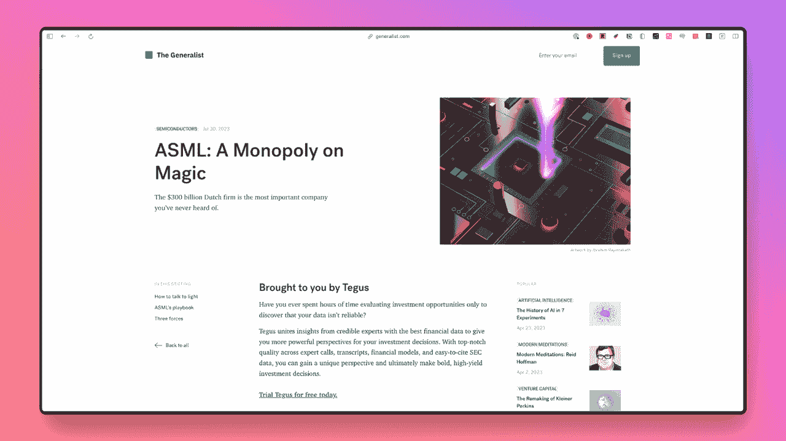

## [使用 LLM 和 Homebrew ](https://simonwillison.net/2023/Aug/1/llama-2-mac/)在自己的 Mac 上运行 Llama 2

Meta AI最新发布了商业可用的开放许可的大型语言模型Llama 2；可以使用LLM命令行工具与语言模型交互；在Mac上安装Llama 2需要安装LLM和llm-llama-cpp插件，并下载模型。

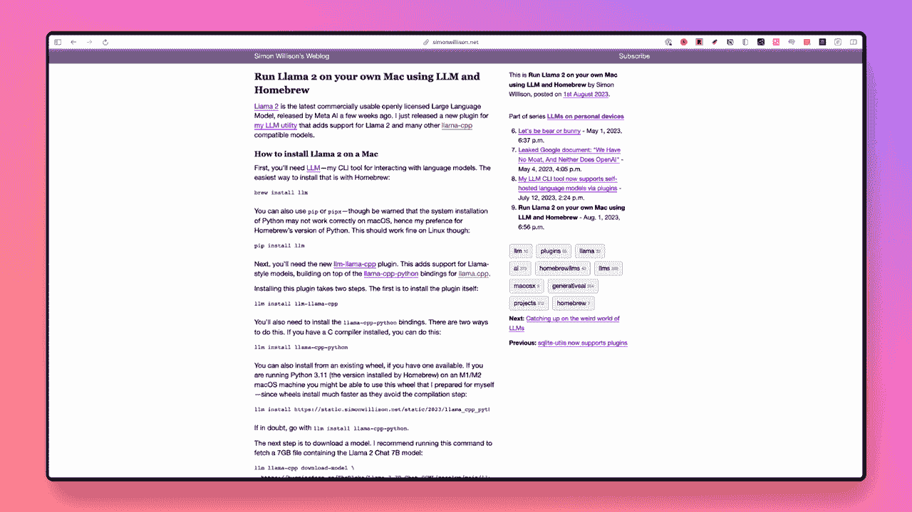

## 沃顿商学院：面向教师和学生的人工智能简介

这篇文章介绍了人工智能在教育领域的应用。作者提到，人工智能已经成为一种通用技术，影响着我们的学习、工作和教学方式。在教育中，人工智能可以用于预测学生的行为和提供个性化的教学内容。然而，人工智能也存在一些问题，比如学生可能利用人工智能作弊，人工智能模型中存在的偏见和道德问题等。作者希望通过这个视频系列向大家展示人工智能在教育中的应用，并提供一些实用的建议。

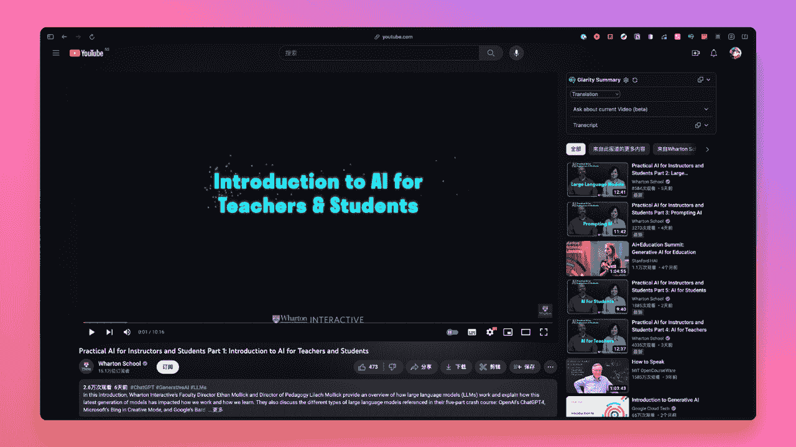

## LLM-Rec：通过提示大语言模型进行个性化推荐

这篇文章研究了通过输入增强来提高大型语言模型（LLMs）在个性化内容推荐中的性能的各种提示策略。作者提出了一种名为LLM-Rec的方法，包括四种不同的提示策略：基本提示、推荐驱动提示、参与引导提示和推荐驱动+参与引导提示。实验证明，将原始内容描述与LLM生成的增强输入文本结合起来，使用这些提示策略可以提高推荐性能。

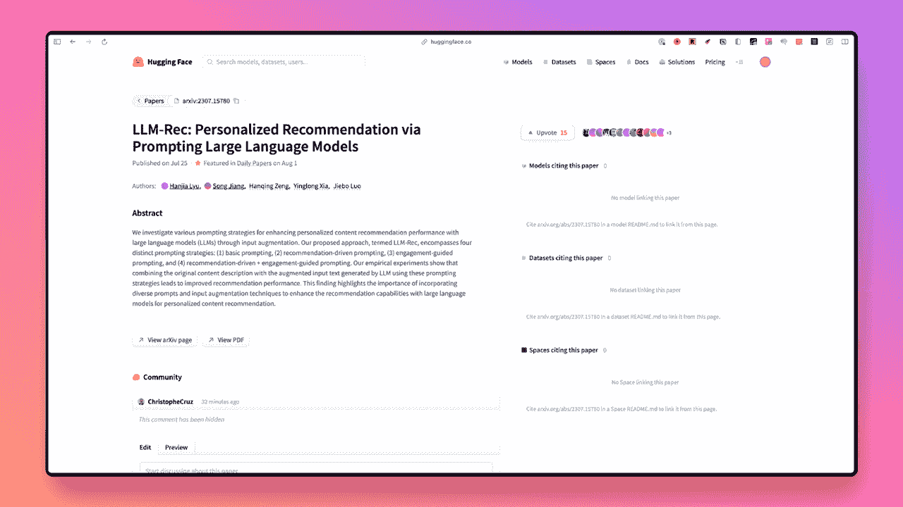

## [RLHF 的开放问题和限制](https://arxiv.org/abs/2307.15217)

从人类反馈中强化学习（RLHF）是一种训练人工智能系统使其符合人类目标的技术。RLHF 已成为对最先进的大型语言模型（LLM）进行微调的核心方法。尽管这种方法很受欢迎，但将其缺陷系统化的公开工作却相对较少。在本文中，我们（1）调查了 RLHF 和相关方法的公开问题和基本限制；（2）概述了在实践中理解、改进和补充 RLHF 的技术；（3）提出了审计和披露标准，以改善社会对 RLHF 系统的监督。我们的工作强调了 RLHF 的局限性，并突出了开发更安全的人工智能系统的多层面方法的重要性。

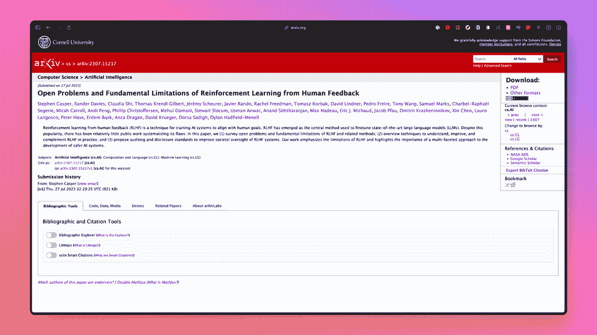

## 九头蛇效应：语言模型计算中的紧急自我修复

本文研究了语言模型计算的内部结构，并通过因果分析展示了两种模式：(1) 自适应计算的形式，其中对语言模型的一个注意力层进行消融会导致另一个层进行补偿（称为Hydra效应）；(2) 晚期MLP层的抵消功能，用于降低最大似然标记。我们的消融研究表明，语言模型的层之间通常相对松散耦合（对一个层的消融只会影响少数下游层）。令人惊讶的是，即使在没有任何形式的dropout训练的语言模型中，这些效应仍然存在。我们在事实回忆的背景下分析了这些效应，并考虑了它们对语言模型的电路级归因的影响。

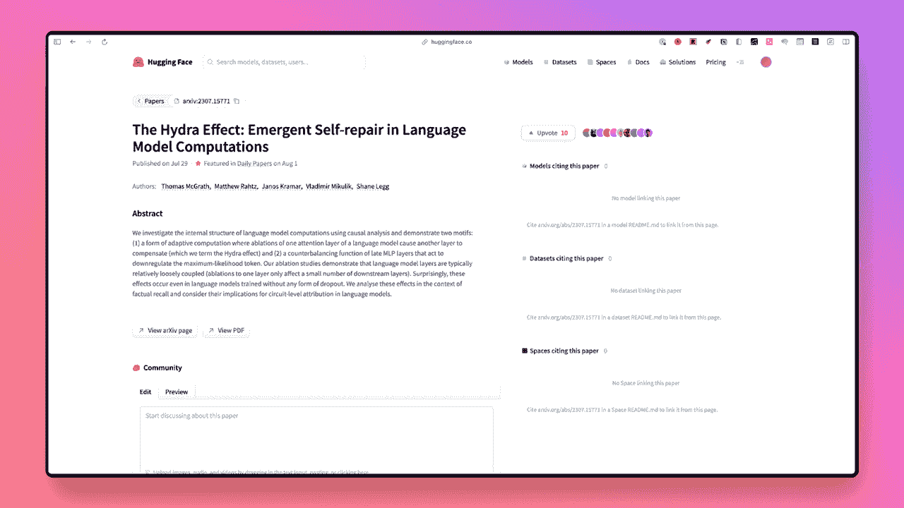

## 彭博社：投资者愿意为科技支付溢价，但不愿意为人工智能支付

根据最新的“市场直击”调查，514名受访者中有77%计划在未来六个月要么增加对科技股的投资，要么保持稳定。与此同时，不到10%的人认为科技股目前存在泡沫，即将破裂。这种乐观情绪推动了纳斯达克100指数创下历史上最好的上半年表现，提高了市场估值，使华尔街的专业人士有些措手不及。然而，尽管调查参与者可能因为人工智能推动的市场繁荣而获利，但他们还没有完全投入到科技领域。有一半的人不愿意自掏腰包购买AI工具来帮助个人或商业生活，而大多数公司也没有计划在交易或投资中使用这些工具。

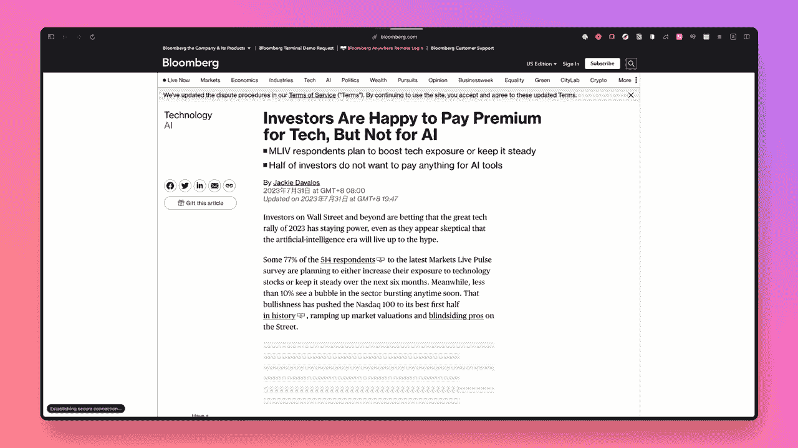

## 使用 AudioLDM 合成音效、音乐和对话的构建者指南

在文本转音频的AI模型领域，创造更真实、沉浸式体验的竞争日益激烈。在这场竞争中，一个有希望的选手是AudioLDM，它使用一些新颖的技术从文本或音频提示中生成语音、音效或音乐。那么AudioLDM究竟是如何实现这一点的呢？更重要的是，这种技术的工作方式告诉我们可以用它构建哪些产品？本文将研究AudioLDM，了解它的特点，并利用这些独特的能力构建有趣的新创业产品。

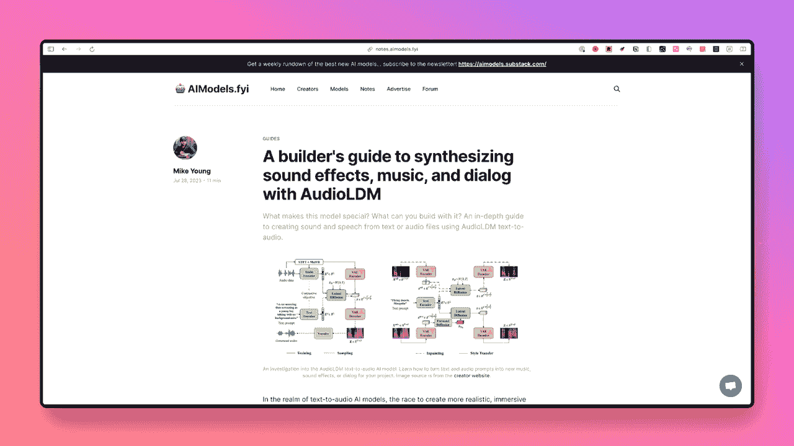

## 为32K时代做好准备：早期学习与探索

今天，我们发布了LLaMA-2-7B-32K，这是一个使用位置插值和Together AI的数据配方和系统优化构建的32K上下文模型，包括FlashAttention-2。对模型进行微调，以进行目标化的长上下文任务，如多文档理解、摘要和问答，并在32K上下文上进行推理和微调，速度提高了3倍。LLaMA-2-7B-32K在Together Playground上完成了一本书。您可以在api.together.ai上自行尝试。

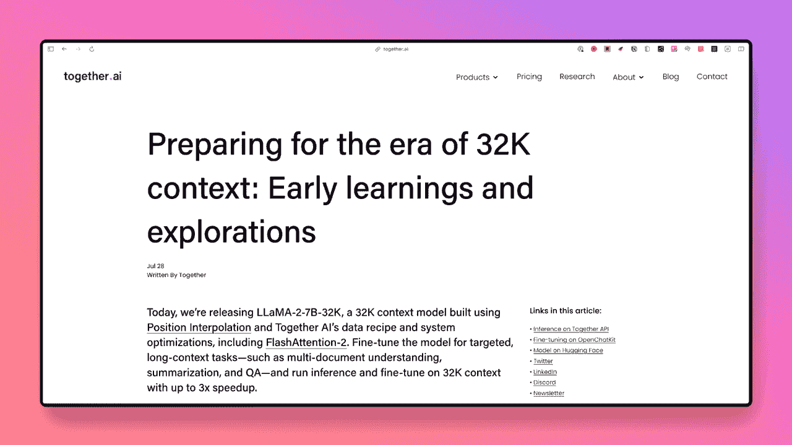

## 自动理财:人工智能x个人理财的未来（a16z）

个人财务是一个复杂且情感充沛的话题，通常是以消极的方式出现。几项研究发现，大多数人宁愿谈论任何其他话题，包括性或死亡，也不愿谈论自己的财务状况！消费者不想花更多时间思考他们的财务状况。他们希望有人来帮他们解决问题，更好的是，能够长期跟踪他们。多亏了生成式人工智能（AI），备受瞩目的“自动驾驶金融”终于有机会实现其潜力。想象一个可以优化您的资产负债表的平台。

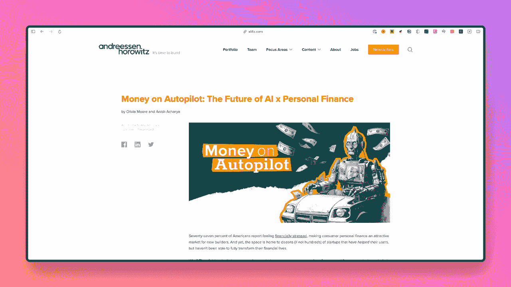

## [Transformer 蓝图：Tra](https://deeprevision.github.io/posts/001-transformer/)nsformer 神经网络架构的整体指南

深入探讨了Transformer神经网络架构，该架构在2017年的一篇名为“Attention is All You Need”的著名论文中首次提出，讨论了它的应用、影响、挑战和未来发展方向。Transformer模型作为一种神经网络架构，最初用于神经机器翻译，但后来证明它具有更广泛的适用性，扩展到自然语言处理以外的领域，并确立其作为一种通用的神经网络架构。本文将深入解析Transformer模型的核心，从注意力机制到编码器-解码器结构，全面探索每个关键组成部分。除了基础层面的讨论，我们还将探索利用Transformer模型的大型语言模型的设计特点和功能。

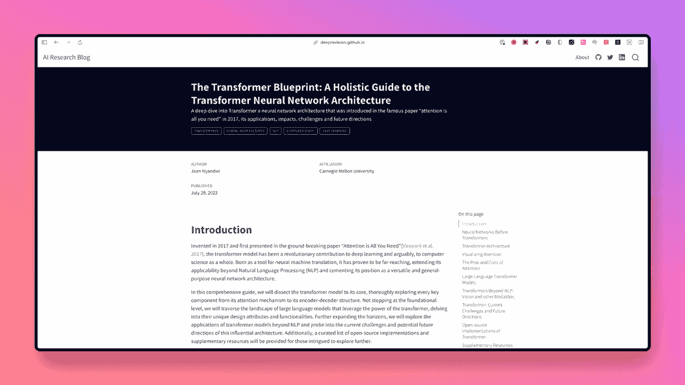

最[后为了感谢王凯大佬的帮忙推广，这里介绍一下他的小报童 AI项目商业](https://xiaobot.net/p/aiyanjiu?refer=a99b14af-e977-43a8-9c7b-2ca3808386b9)解[析](https://xiaobot.net/p/MJ2023?refer=a99b14af-e977-43a8-9c7b-2ca3808386b9)主要研究可以变现的AI项目，群里也有很多大佬。https://xiaobot.net/p/aiyanjiu?refer=a99b14af-e977-43a8-9c7b-2ca3808386b9同时刘飞的Midjourney进阶创意库的内容也非常值得推荐，如果想系统的学习Midjoureny不容错过，我和莱森也会在里面发布一些教程。https://xiaobot.net/p/MJ2023?refer=a99b14af-e977-43a8-9c7b-2ca3808386b9

感谢大家看到这里，如果有觉得有意思的相关内容也可以私信我或者[给我](https://okjk.co/V8F4dO)发邮件[投稿。](https://twitter.com/op7418)你可[以在这里找](https://op7418.zhubai.love/)到我：| 即刻 | 推特 | 竹白订阅 | 微信公众号：歸藏的AI工具箱 |邮箱：guohao631@gmail.com

感谢大家看到这里，如果你也有想推荐的内容的话，可以私信我或者给我发邮件投稿。也可以分享给更多的朋友，让大家都有机会了解这些内容。

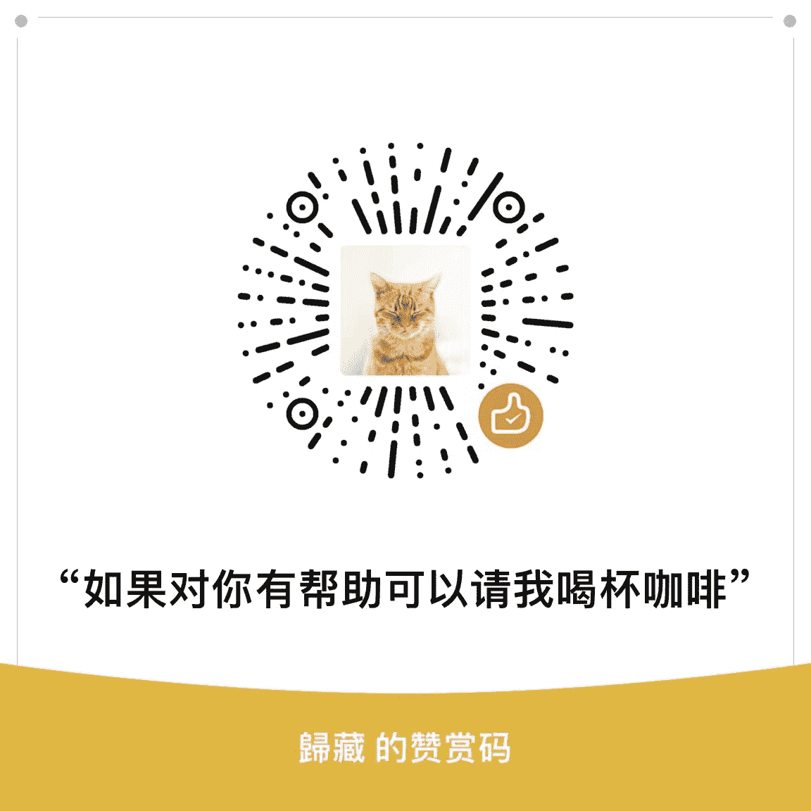