# AIGC Weekly #32

> 来源：[https://waytoagi.feishu.cn/docx/GMDhdkeSfoJn40xg0QFc3WaWnue](https://waytoagi.feishu.cn/docx/GMDhdkeSfoJn40xg0QFc3WaWnue)

> 🔗 原文链接： h[ttps://op7418.zhub](https://op7418.zhubai.love/posts/2297844136235560960)ai.love/posts/22...

> 发表时间：2023-08-01

图片加载中

工具：Midjourney v5

Frontal shot, a dark colors abstract background, mosaic corner glass tiles, an ethereal glow and fog, Soft Light and Gaussian Blur, in the style of blue , light sky --ar 3:2 --s 500

> 由于竹白已经很长时间没有更新了，该有的很多营销和统计工具也基本处于缺失状态，最近将会计划将邮件组迁移到其他平台上，如果你是邮箱订阅的可以不用管我会直接导入，但是微信订阅的朋友们可以用邮箱订阅一下或者关注一下我最后的推特或者即刻，防止失联。迁移以后也会并行更新几期方便大家切换。

上周精选加了一个上周的简讯项目，很多一句话新闻放里面了，最后有一个AI赛道公司招全栈感兴趣可以看一下。

# ❤️上周精选

## SDXL 1.0 发布了，这里有一些信息汇总

Stability AI正式发布了我们期待已久的SDXL 1.0。下面是模型的介绍、使用方式和相关的资源链接：

SDXL的特点：

SDXL有两个模型组成第二个模型可以生成更鲜艳、更准确的颜色，并且比其前身具有更好的对比

度、光照和阴影。

SDXL 1.0 是所有开放获取图像模型中参数数量最多的模型之一，拥有 3.5B 参数基础模型和 6.6B 参数模型集成管道。

如何 在 Web UI 中使用 SDXL：

1.  [在这个地址下载SDXL的模型和vae： https://huggi](https://huggingface.co/stabilityai/stable-diffusion-xl-base-1.0/tree/main)ngface.co/stabilityai/stable-diffusion-xl-base-1.0/tree/main

1.  将下载到的模型文件放到\models\Stable-diffusion这个文件夹中

1.  启动Web UI后将左上角Stable Diffusion checkpoint位置的模型切换为sd_xl_base_1.0.safetensors

1.  其他设置正常就行，生成图像建议1024分辨率起步SDXL是在1024的基础上训练的

1.  图片生成以后可以将图片发送到img2img，然后切换Stable Diffusion checkpoint位置的模型为sd_xl_refiner_1.0.safetensors如果你不想原图变太多的话可以把Denoising strength权重调整为0.2-0.3再次点击生成就可以。

需要[注](https://huggingface.co/bdsqlsz/stable-diffusion-xl-base-1.0_fixvae_fp16)意的是SDXL 1.0 的 vea 由于数字水印的问题生成的图象会有彩色条纹的伪影存在，可以使用 0.9 的 vae 文件解决这个问题，青龙也做了一个修复的模型和 vae 整合版本： https://huggingface.co/bdsqlsz/stable-diffusion-xl-base-1.0_fixvae_fp16

相关资源链接：

你可以在Huggingface上下载开源的模型文件，前几[天Web UI已经支持了SDXL模型： https://huggi](https://huggingface.co/stabilityai/stable-diffusion-xl-base-1.0/tree/main)ngface.co/stabilityai/stable-diffusion-xl-base-1.0/tree/main

如果有有 Colab 的会员的话也可以用这个[链接](https://colab.research.google.com/github/camenduru/sdxl-colab/blob/main/sdxl_v1.0_webui_colab.ipynb)体验 web ui 版本一键部署： https://colab.research.google.com/github/camenduru/sdxl-colab/blob/main/sdxl_v1.0_webui_colab.ipynb

[如果你想要立即体验的话可以在cl](https://clipdrop.co/stable-diffusion)ipdrop线上尝试： https://clipdrop.co/stable-diffusion

[也可以在stability API调用相关接口： htt](https://platform.stability.ai/docs/release-notes)ps://platform.stability.ai/docs/release-notes

最后在dream studio也可以在线体验SDXL： https://dreamstudio.ai/

[也可以尝试一下这个基于 SDXL 训练的模型： https:](https://civitai.com/models/112902/dreamshaper-xl10)//civitai.com/models/112902/dreamshaper-xl10

下面是一些我用 SDXL 生成的图象，用的全是 Midjourney 的提示词，没有使用反向提示词：

图片加载中

图片加载中

图片加载中

图片加载中

## Stack Overflow推出他们的AI 工具包

自从 ChatGPT 等 AI 工具发布以来被称为程序员的知乎的Stack Overflow的流量一落千丈，上周他们也推出了自己的 AI 工具OverflowAI，它包括下面这些功能：

搜索 ：目标是创建一个对话式的、以人为本的搜索。我们希望公共平台用户能够使用 GenAI 支持的对话式搜索获得即时、值得信赖且准确的问题解决方案。我们正在研究如何使用来自 Stack Overflow 中超过 5800 万个问题和答案的高度可信的知识来对生成的回复进行归因和引用，并能够查询知识库以获得更个性化的结果。

企业知识摄取 ：在创建新实例或引入新团队成员时，用户可以利用现有的准确且可信的内容在几分钟内整理和构建知识库。 AI/ML 将创建标签结构的初稿，并通过确定您的团队最常要求良好文档或解决方案的领域来推荐问题和答案。

Slack集成 ：收集针对最具技术挑战的生成解决方案，并直接响应 Slack 中的查询。这种新的 GenAI 集成不仅使用来自 Teams 实例的数据，还使用所有经过 Stack Overflow 社区验证的来源（例如我们公共平台上的数百万个问题和答案）来提供问题的答案。

VS Code 插件 ：此扩展从公共平台和您的私有 Stack Overflow for Teams 实例中提取经过验证的内容，为您的开发人员提供有关如何高效地解决问题的个性化摘要，使他们能够在需要时进行更深入的挖掘，然后记录新的学习内容和解决方案。

AI 讨论社区 ：GenAI Stack Exchange 将成为一个以知识共享为中心的社区场所：发布有关快速工程、充分利用 AI 以及保持快速发展的 GenAI 工具生态系统等问题和答案。

图片加载中

## 最近的一些简讯

每周都有很多还挺重要但是又不需要深入分析的 AI 资讯，都会放在这里。

Netflix 列出了一个年薪 90 万美元的机器学[习平台产品经理的 AI 产品工作岗位：](https://jobs.netflix.com/jobs/278437235) https://jobs.netflix.com/jobs/278437235

Shopify 的 AI 助手现已上线。 Sidekick 是一个帮助机器人，它知道如[何在](https://techcrunch.com/2023/07/26/shopify-sidekick-is-like-chatgpt-but-for-ecommerce-merchants/) Shopify 中执行任何操作 - 提取相关数据、操作新功能或创建报告： https://techcrunch.com/2023/07/26/shopify-sidekick-is-like-chatgpt-but-for-ecommerce-merchants/

Artifact（Ins 创始人做的 AI 新闻浏览[软](https://twitter.com/Artifact_News/status/1684631632374902784?s=20)件）推出了自定义内容阅读语音的功能： https://twitter.com/Artifact_News/status/1684631632374902784?s=20

O[penAI、谷歌、微软和 Anthropic 组](https://openai.com/blog/frontier-model-forum)建了前沿模型论坛，主要目的是确保 AI 模型的安全发展： https://openai.com/blog/frontier-model-forum

[Op](https://techcrunch.com/2023/07/25/openai-scuttles-ai-written-text-detector-over-low-rate-of-accuracy/)en AI 悄咪咪下线了他们的 ChatGPT生成内容的检测器： https://techcrunch.com/2023/07/25/openai-scuttles-ai-written-text-detector-over-low-rate-of-accuracy/

Anjney Midha作为普通合伙人加入了a16[z，曾在 Midjourney 工作： h](https://a16z.com/2023/07/25/anjney-midha/)ttps://a16z.com/2023/07/25/anjney-midha/

# ⚒️产品推荐

## Rewind：AI 检索你的设备使用历史

Rewind是一款能够提高生产力的应用程序，可以浏览、搜索并询问关于手机上任何你看到的内容。它是一款真正个性化的AI应用，通过捕捉你在Safari中阅读的内容和导入你的截屏来工作。这样，你就可以利用人工智能的力量向Rewind提问关于你看到的任何问题，包括为你进行总结。通过简单的点击，Rewind让你可以立即查找过去的内容，更轻松地找到特定的截屏、挖掘几天前的有用推文或者重新访问重要的网页。通过基于人工智能的摘要，你可以快速而轻松地理解你所涉及的复杂研究的关键信息。关键特点包括：即时搜索、复制和粘贴功能、摘要功能、可视化浏览和隐私保护等。

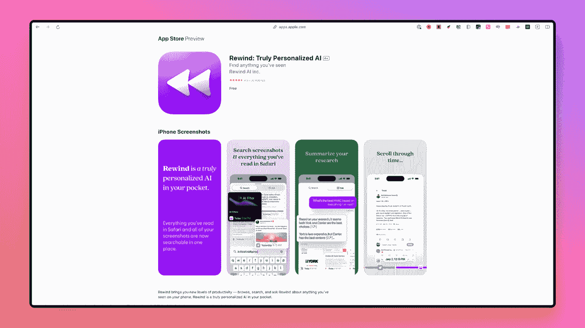

图片加载中

## [Lazy：内容收集工具](https://lazy.so/)

上下文切换的结束再也不要中断您的工作流程。无需切换应用程序进行记录。加载体验。随时裁剪任何内容。从文章到Twitter线程，视频等等。保存文章并在长期运行中产生复利效应。保存链接保存作者详细信息为将来的自己添加注释将文章标记为稍后阅读文章一个快捷方式：捕获文章，链接，作者。保存以便以后阅读。音频和视频内容还会利用 AI 主要内容并展示。

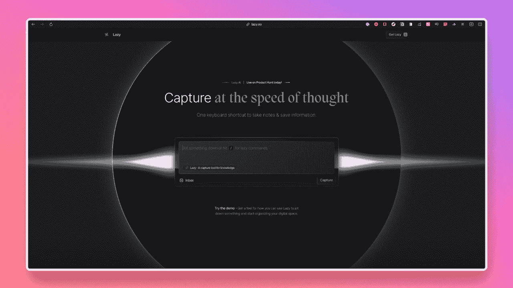

图片加载中

## AutogenAI：用于投标和标书编写的 AI 工具

伦敦初创公司AutogenAI开发了一款基于生成型人工智能的工具，声称可以帮助企业撰写更强的提案，提高中标率。该公司获得了来自Blossom Capital的2230万美元投资，用于招聘更多人才、扩展平台和增加客户群。AutogenAI自成立不到一年以来已经获得了28个客户，并且这些客户对于他们使用的胜出秘诀非常保密，因此AutogenAI没有透露任何客户的实际名称。AutogenAI的目标是解决提案撰写的经验和预算问题，他们的软件可以将撰写强大提案的过程加快800%，同时降低10%的采购成本。

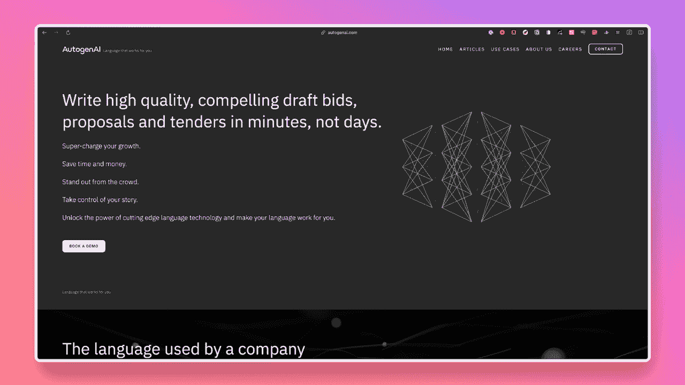

图片加载中

## Deepen：AI 心理健康治疗和护理工具

这是一款名为Deepen的AI疗愈应用程序，它是你心理健康旅程中的终极自我关爱伴侣。它提供一个空间让你探索和了解自己。你可以与AI伴侣畅所欲言，聊天分享你的日常时刻、想法、感受和心中所想。应用程序还提供洞察力面板，可以帮助你了解自己的心理状态，包括快乐程度、疗愈效果和让你感到精力充沛的活动等。

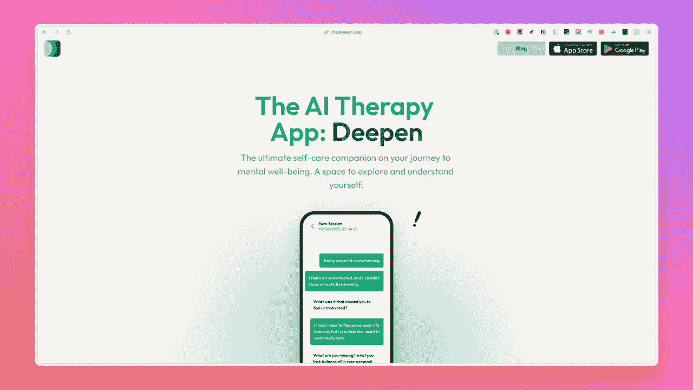

图片加载中

## [Dezee：AI 大杂烩工具](https://www.dezee.ai/)

Dezee 是一款尖端的人工智能工具，它重新定义了我们与技术的交互方式。作为您的终极创意合作伙伴，它通过无缝生成图像、文本、语音、文本和摘要，为您带来无限可能。比较独特的是支持文字转语音，整体的交互体验很好。

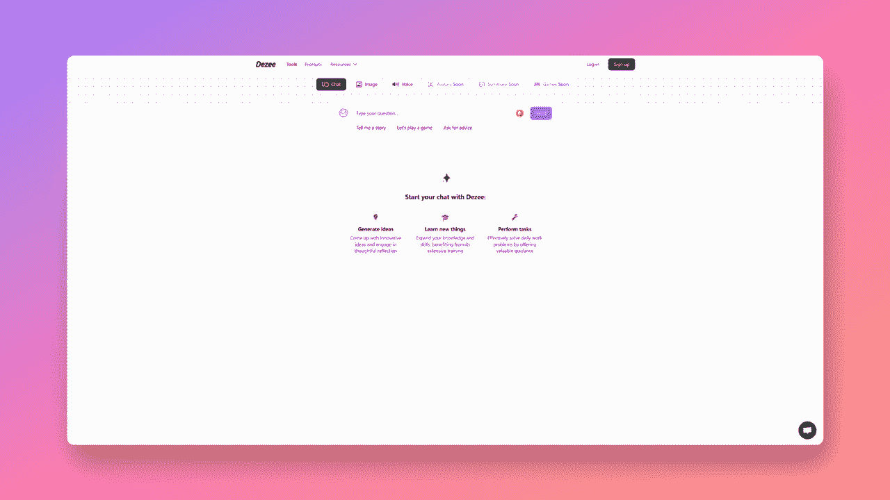

图片加载中

## GluAI：应用内的游戏化营销组件

客户Glu人工智能At CustomerGlu，我们相信软件应该是有趣、简单、赋能的。这就是为什么我们创建了一个即插即用的游戏化平台，让您可以在应用程序中尝试不需要开发人员参与的旅程。

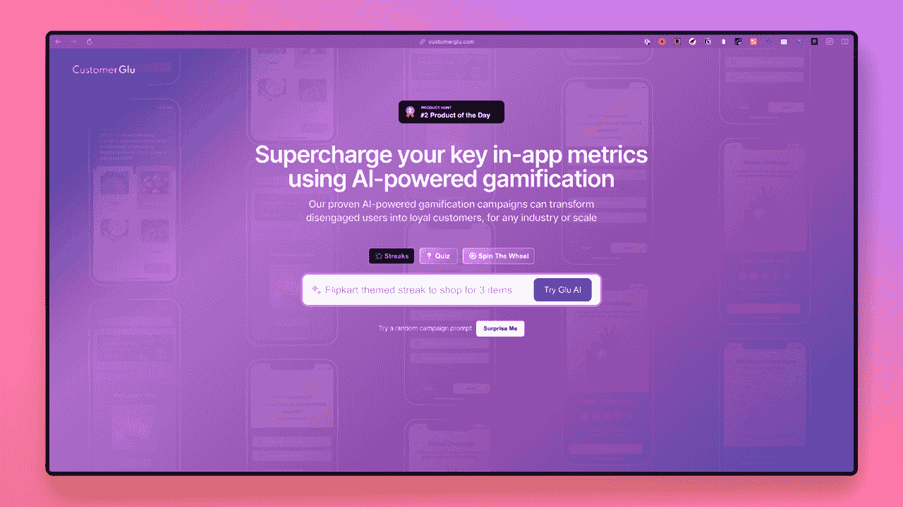

图片加载中

## AiLogoArt：将你的 Logo 融入 AI 生成的图象中

前几天上周刚发的教程就有人产品化了，效果看起来还不错，用了多种 ControlNet 模型。“ 在几分钟内即可获得专业品牌图片 。上传您的标志，选择风格，获得由人工智能创造的令人惊叹的视觉效果，让您的 广告 和 社交媒体 闪耀光芒。”

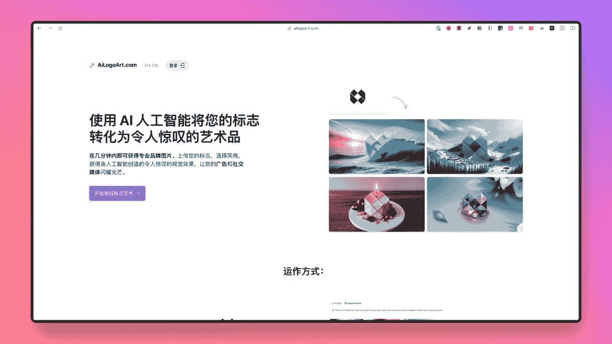

图片加载中

## PlainScribe：将大文件转录为完美的文本

上传您的文件让我们接手处理。一旦处理完成，可以轻松搜索文本。或者下载CSV文件。适用于各种大文件。上传音频和视频文件，最大可达100MB，无需担心任何限制。我们会处理它并在完成后发送电子邮件通知您。灵活的按需付费模式，根据音频/视频转录或翻译的小时数付费。

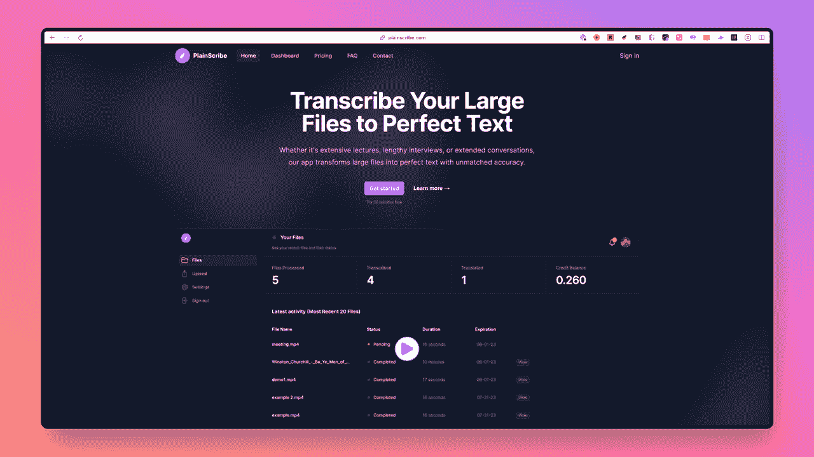

图片加载中

## RIX：为开发人员优化的人工智能搜索

Rix是一款由人工智能驱动的面向开发者的搜索引擎。你可以使用Web搜索模式来查找最新的信息，或者切换到GPT-knowledge模式以获得预先训练的知识的即时答案。通过使用流行网站快捷方式来简化搜索。

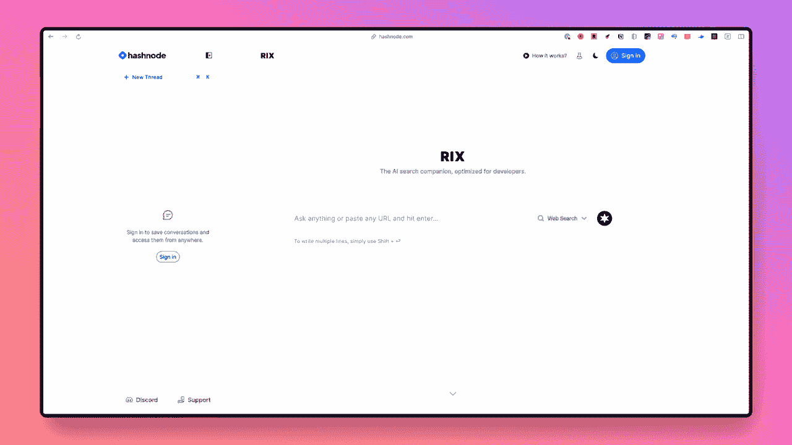

图片加载中

## Magic Clips：快速剪辑长内容的高光时刻

让人工智能挑选出你录制的最佳时刻，然后将它们转化为适合媒体的短视频片段。让魔法时刻成为社交短视频，仅需一眨眼的时间。录制视频和音频，上传到云端，分别保存每个嘉宾的音轨，保持录制质量。通过单击，人工智能可以识别出录制的亮点，并将其转化为独立的媒体片段，用于互动。再次点击添加字幕，使你的片段无论在何时何地都可访问和观看。

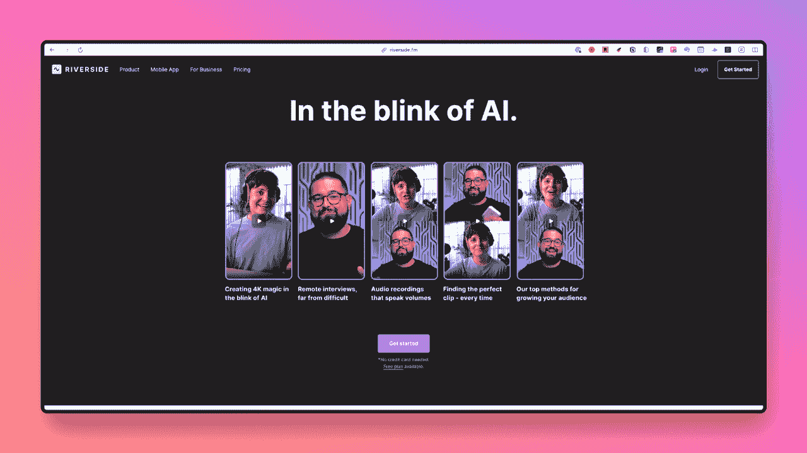

图片加载中

# 🔬精选文章

## [写作是一种思考形式](https://lopespm.com/notes/2023/07/02/writing-as-a-form-of-thinking.html)

写作过程不仅仅是文本的产生。很多时候，它需要探索不同的观点，深入思考并认识到我们对一个主题了解不足，需要进一步学习。例如，对我来说，在会议和正式讨论期间随手拿着一个笔记本做笔记是很重要的。

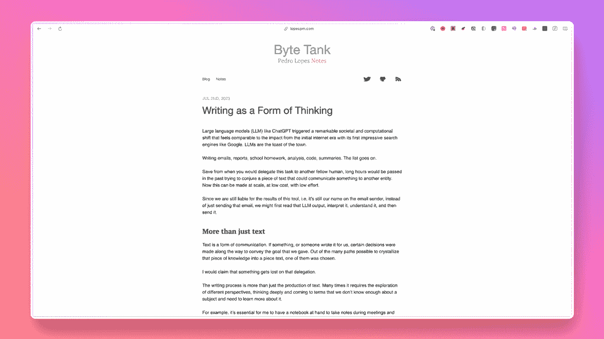

图片加载中

## 如何使用 LLM Engine 微调 Llama 2

本文介绍了Meta公司发布的Llama 2，并提供了使用LLM Engine API进行细调的步骤和示例。文章还介绍了使用ScienceQA数据集进行细调的方法，并展示了细调后的Llama-2-7B模型在ScienceQA上的表现。最后，文章还提到了LLM Engine在GLUE数据集上的表现，并强调了细调对于提高基础预训练模型性能的重要性。

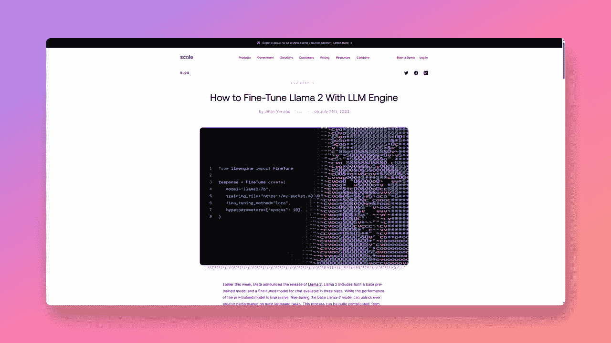

图片加载中

## [Llama 2 微调简单指南](https://brev.dev/blog/fine-tuning-llama-2)

在这个指南中，我展示了如何将Llama 2调整为对话摘要器。上个周末，我想要在自己的数据集上对Llama 2进行微调（它现在在Open LLM排行榜上占据主导地位）。在这个指南中，我展示了如何将Llama 2调整为对话摘要器。上个周末，我想要在自己的Google Keep笔记集合上对Llama进行训练，我的每个笔记都有标题和内容，所以我想训练Llama根据给定的标题生成内容。

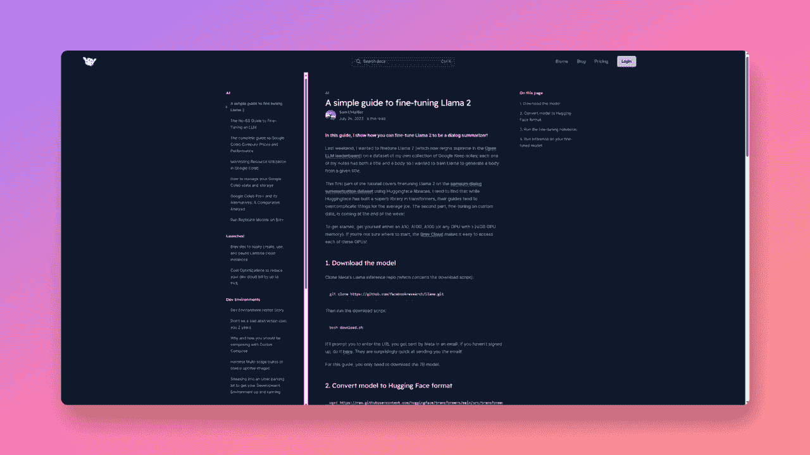

图片加载中

## 教你的LLM总是用事实而不是虚构的东西来回答

支持结构化查询语言的向量数据库可以存储多种类型的数据，提高向量搜索查询的准确性和效率。幻觉是大型语言模型在陌生主题上不准确的现象。通过添加事实和外部知识，可以减少幻觉的出现。使用向量SQL可以进行精细的向量搜索，提高LLM系统的性能。

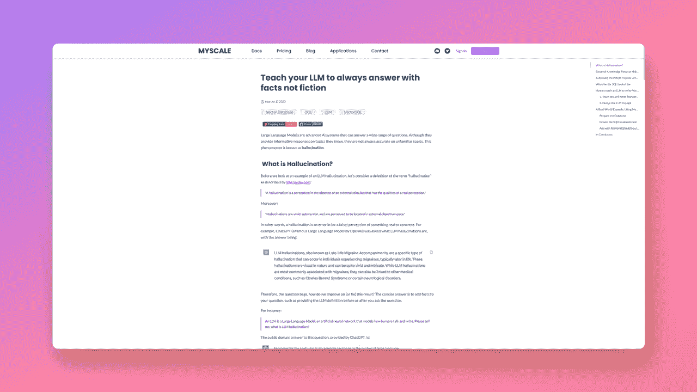

图片加载中

## 使用 Whisper 和 GPT-4 创建自动会议记录生成器

Open AI 推出了新的教程，使用GPT-4和Whisper创建自动生成会议既要的工具。对这类工具开发感兴趣的可以关注一下。这个工具会提供转录会议音频，提供讨论摘要，提取关键点和行动项目，并执行情绪分析功能。教程需要阅读者有对Python和Open AI API的基本了解。

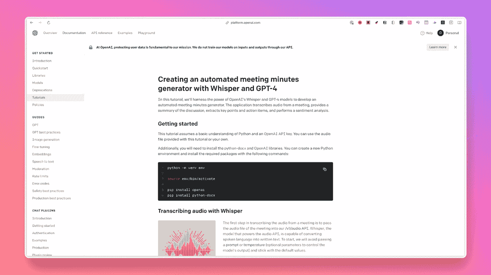

图片加载中

## 游戏 x AI 市场地图： 游戏的无穷力量

本文概述了人工智能和程序生成在互动媒体中的新兴领域，并探讨了人工智能在游戏开发中的应用前景。文章提到了游戏产业的历史发展和技术革新，以及人工智能和程序生成对游戏开发的影响。同时，作者指出了人工智能在游戏体验中的潜力和创新，包括智能非玩家角色、动态社交体验和超真实沉浸式图形等。

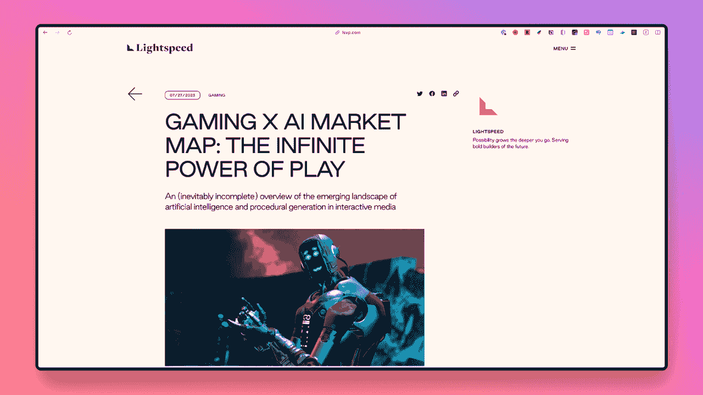

图片加载中

## 创建 ChatGPT 插件所需了解的一切

本文深入探讨了ChatGPT插件开发的入门指南和插件的核心概念。通过插件，开发人员可以扩展ChatGPT的核心功能，使其能够与第三方应用程序进行交互并执行各种操作。插件商店提供了700多个插件，为用户提供了丰富的使用场景。开发插件的好处包括增加产品知名度、获取新用户和实现新的体验。文章还提供了一个构建TODO列表插件的示例，帮助开发人员入门。

图片加载中

## 使用 Gradio 构建生成式 AI 应用程序-Huggingface

这个短期课程是吴恩达工作室与Hugging Face合作的，旨在教授如何快速创建和演示机器学习应用程序。学员将学习构建图像生成、图像字幕和文本摘要应用程序，并与团队成员、测试人员等分享自己的应用程序。课程内容包括使用少量代码创建用户友好的应用程序，使用开源大型语言模型对输入文本进行摘要，并显示摘要；

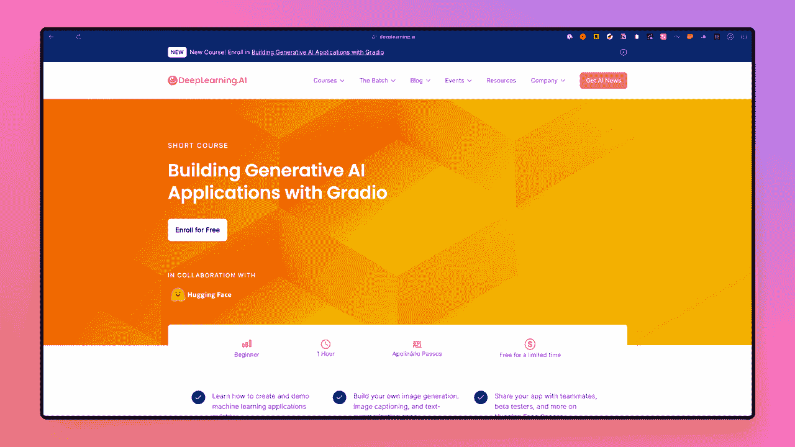

图片加载中

## 自动化网络研究-LangChain

本文介绍了一个名为LangChain的新的检索器，它可以用于网页研究。作者最初计划构建一个自主的网页研究代理程序，但最终发现一个相对简单且高效的检索器更加有效。该检索器可以并行执行多个搜索并从多个页面中提取信息，然后将这些信息加载到一个LLM模型中进行综合。文章还提到了该检索器的应用和下一步的改进方向。

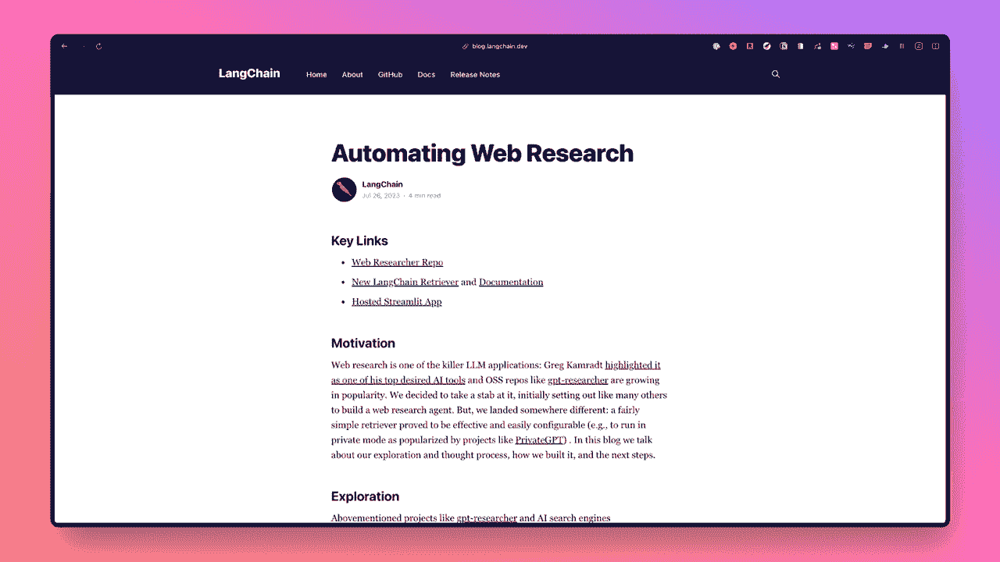

图片加载中

## 本地运行 Llama 2 的综合指南

本文介绍了在本地运行Llama 2的方法，包括在M1/M2 Mac、Windows、Linux甚至手机上运行Llama。本文提到了三种开源工具可以用于在自己的设备上运行Llama 2，分别是Llama.cpp、Ollama和MLC LLM。其中，Llama.cpp是一个C/C++的Llama端口，可以在Mac上使用4位整数量化进行本地运行。Ollama是一个开源的macOS应用程序，可以通过命令行界面运行、创建和共享大型语言模型。MLC LLM是一个开源项目，可以在各种设备和平台上本地运行语言模型，包括iOS和Android。

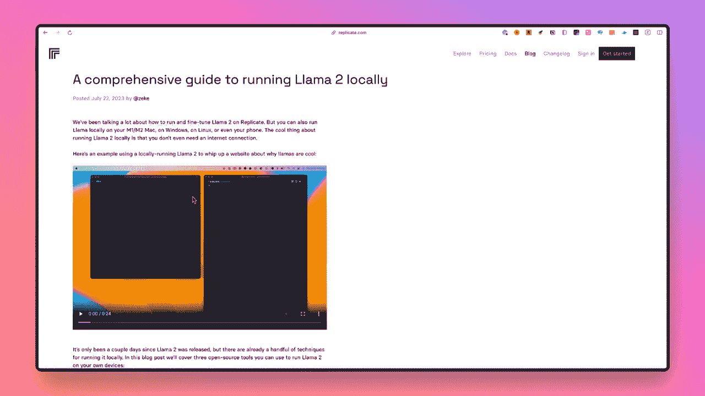

图片加载中

# 💼招聘信息

AI赛道知识类产品公司招全栈工程师，要求一年以上工作经验，坐标余杭EFC附近，感兴趣的同学可以联系一下。

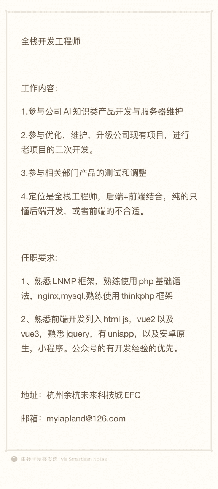

图片加载中

最[后为了感谢王凯大佬的帮忙推广，这里介绍一下他的小报童 AI项目商业](https://xiaobot.net/p/aiyanjiu?refer=a99b14af-e977-43a8-9c7b-2ca3808386b9)解[析](https://xiaobot.net/p/MJ2023?refer=a99b14af-e977-43a8-9c7b-2ca3808386b9)主要研究可以变现的AI项目，群里也有很多大佬。https://xiaobot.net/p/aiyanjiu?refer=a99b14af-e977-43a8-9c7b-2ca3808386b9同时刘飞的Midjourney进阶创意库的内容也非常值得推荐，如果想系统的学习Midjoureny不容错过，我和莱森也会在里面发布一些教程。https://xiaobot.net/p/MJ2023?refer=a99b14af-e977-43a8-9c7b-2ca3808386b9

感谢大家看到这里，如果有觉得有意思的相关内容也可以私信我或者[给我](https://okjk.co/V8F4dO)发邮件[投稿。](https://twitter.com/op7418)你可[以在这里找](https://op7418.zhubai.love/)到我：| 即刻 | 推特 | 竹白订阅 | 微信公众号：歸藏的AI工具箱 |邮箱：guohao631@gmail.com

感谢大家看到这里，如果你也有想推荐的内容的话，可以私信我或者给我发邮件投稿。也可以分享给更多的朋友，让大家都有机会了解这些内容。我也会一直努力，为大家带来更多有趣的内容。

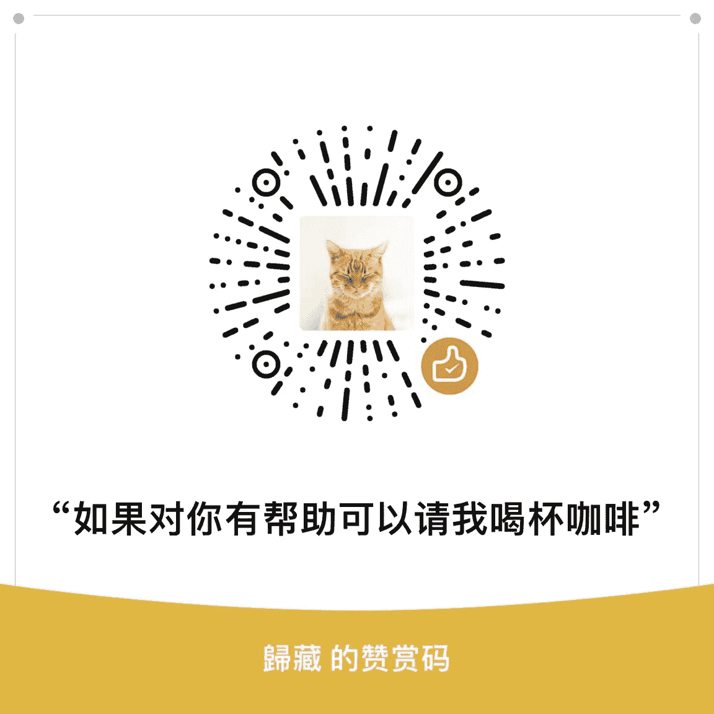

图片加载中