# AIGC Weekly #31

> 来源：[https://waytoagi.feishu.cn/docx/QRvtd7EitoqjDixoKvAcfOlEnRh](https://waytoagi.feishu.cn/docx/QRvtd7EitoqjDixoKvAcfOlEnRh)

> 🔗 原文链接： h[ttps://op7418.zhub](https://op7418.zhubai.love/posts/2295289866264612864)ai.love/posts/22...

> 发表时间：2023-07-24

工具：Nijijourney v5

a photograph of a railway track in motion, in the style of futuristic architecture, Chromed metal, colorful curves, associated press photo, aluminum, rounded --ar 3:2

> 由于竹白已经很长时间没有更新了，该有的很多营销和统计工具也基本处于缺失状态，最近将会计划将邮件组迁移到其他平台上，如果你是邮箱订阅的可以不用管我会直接导入，但是微信订阅的朋友们可以用邮箱订阅一下或者关注一下我最后的推特或者即刻，防止失联。迁移以后也会并行更新几期方便大家切换。

# ❤️上周精选

## Meta 发布并开源了 Llama 2 大语言模型

上周三 Meta 正式发布了和开源了Llama 2 大语言模型，估计接下来的两个月开源语言模型和国产的一些模型都回迎来性能上的飞跃。

模型规模方面Llama2有三个大小的版本分别是7B 13B和70B，Llama 2 的训练数据比 Llama 1 多 40%，上下文长度是 Llama 1 的两倍。预训练的Token为2 万亿，上下文长度为4096。

与第一次泄漏的版本不同，这次Meta开放了商业使用的权限。虽然开源但是 Llama 2 也有一些限制条件，比较重要的就是不允许将Llama 材料或 Llama 材料的任何输出或结果来改进任何其他大型语言模型，还有就是日活大于 7 亿的产品商业使用需要单独申请。

Llama 2官网： https://ai.meta.com/llama/

[Ll](https://ai.meta.com/research/publications/llama-2-open-foundation-and-fine-tuned-chat-models/)ama 2训练的论文介绍： https://ai.meta.com/research/publications/llama-2-open-foundation-and-fine-tuned-chat-models/

Huggingface的模型下载地址： https://huggingface.co/meta-llama

官方模型申请地址： [h](https://ai.meta.com/resources/models-and-libraries/llama-downloads/)ttps://ai.meta.com/resources/models-and-libraries/llama-downloads/

在线试用 7B、13B： https://llama.perplexity.ai/

70B 模型试用： https://huggingface.co/chat/

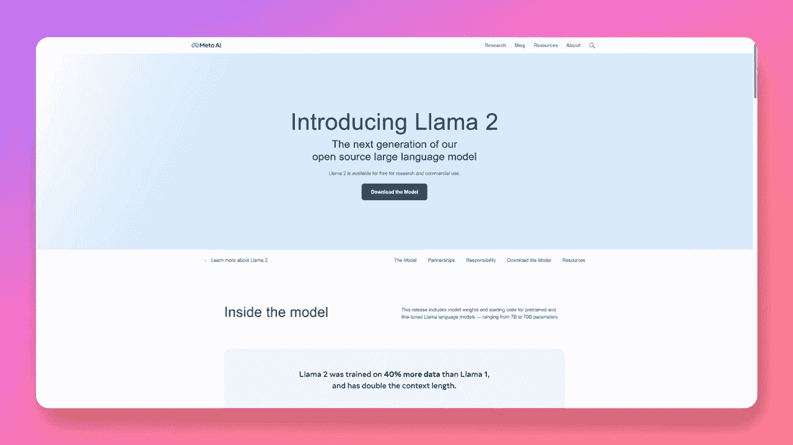

## Open AI的一些消息

ChatGPT 增加了自定义说明功能

ChatGPT更新了一个非常实用的功能，现在可以自定义说明了，不需要每次打开聊天窗口都输入背景信息了。该功能将从Plus计划开始提供测试版，未来几周内将扩展给所有用户。这个功能还支持和插件共享信息，不需要每次都输入相同的内容。但该功能不对英国和欧盟开放，自定义的提示词将对接下来的每个对话生效。

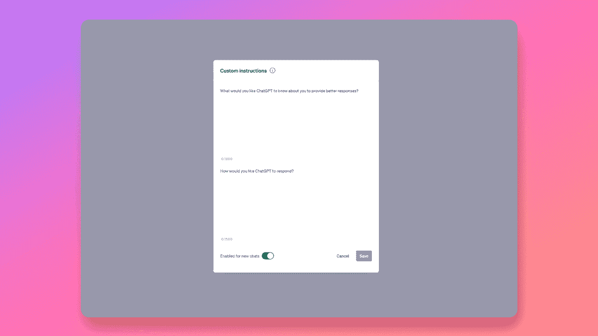

即将推出 ChatGPT 的 Android 客户端

适用于 Android 的官方 ChatGPT 应用程序：OpenAI 已将 ChatGPT 应用程序正式上架 Google Play 商店。该应用程序的界面与 iOS 版本非常相似，如屏幕截图所示。就像 iOS 应用程序一样，它也是免费的。如果你有兴趣，现在可以在 Play 商店中进行预注册，以便在下周推出该应用程序时访问该应用程序。

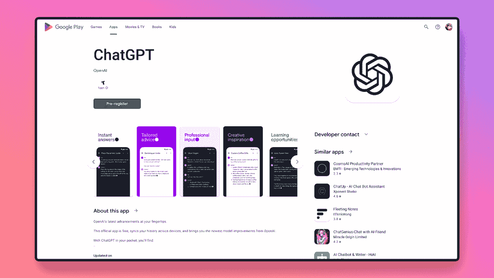

[ChatGPT Plus 用户 ](https://help.openai.com/en/articles/6825453-chatgpt-release-notes)GPT-4 每三小时额度增加至 50 条

从这周开始，所有 Plus 用户每三小时可用的 GPT-4 对话数量从原来的 25 条变成了 50 条，但是从 twitter 上看有的人获得了 100 条有的人变成了 200 条，甚至有的人没有了数量限制，每个月都是 20 美元 Open AI 这波操作有点离谱的。

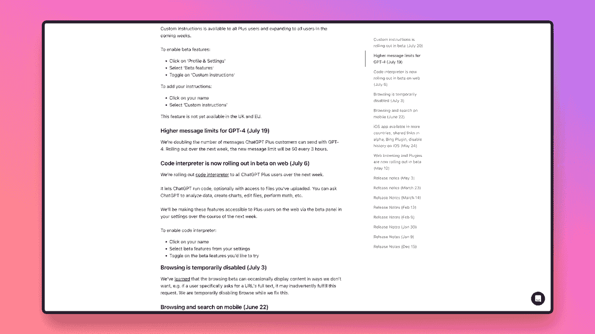

美国国会推动 Open AI 在内的七家AI 公司签署 AI 自愿承诺

OpenAI和其他领先的AI实验室正在作出一系列自愿承诺，以加强AI技术和我们的服务的安全性、可靠性和值得信赖性。这一过程由白宫协调，是推进有意义和有效的AI治理的重要一步，无论是在美国还是全球范围内。

自愿AI承诺以下是公司为促进AI技术的安全、安全和透明发展和使用而作出的承诺。这些自愿承诺与现有法律和法规一致，并旨在推进生成性AI的法律和政策体制。公司打算在涵盖相同问题的监管法规生效之前，保持这些自愿承诺的有效性。个别公司可能会在此处包括的承诺之外作出额外的承诺。

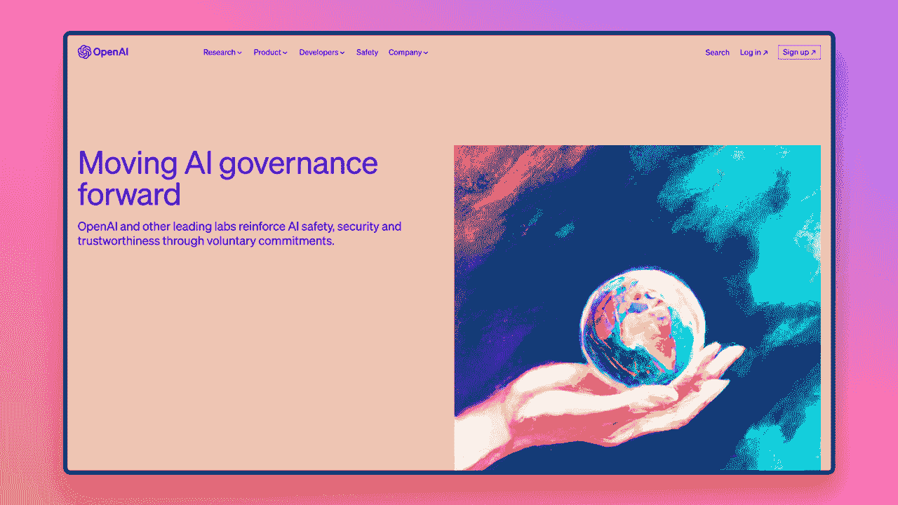

## 网传苹果正在开发自己的大语言模型 AppleGPT

苹果公司正在秘密开发人工智能工具，可能会挑战OpenAI公司、谷歌（Google）等公司的工具，但该公司尚未制定明确的向消费者发布技术的策略。据知情人士透露，苹果公司已经建立了自己的框架来创建大型语言模型，这是新产品（如ChatGPT和谷歌的Bard）的核心，同时苹果还创建了一项聊天机器人服务，一些工程师称之为“Apple GPT”。

苹果最近几个月将人工智能推动发展成为一项重要工作，多个团队正在合作开展这个项目，但由于涉及隐私问题，这些人要求匿名。苹果股价在彭博社周三报道人工智能努力后一度上涨2.3%，创下198.23美元的历史新高，从此前的跌幅中反弹。微软公司，OpenAI的合作伙伴和主要支持者，因此消息下跌约1%。苹果总部位于加利福尼亚州库比蒂诺市的发言人拒绝置评。

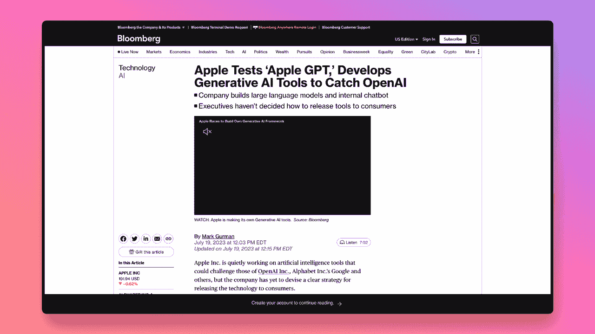

## Midjoureny 和 Stable Diffusion 的一些消息

两个模型目前看来貌似都遭遇了一些困难，上周纷纷宣布新模型跳票

Midjourney工作时间消息汇总

+   V5.3 会推出局部修复功能，功能本身已经就绪，但是现在 Discord 不支持这种交互需要等待 Discord 更新。会有新的美学风格。

+   V6 还是现在目前主要的工作焦点，依然没有确定它应该是什么样的还在探索，没有预计发布日期，比预期完成的时间要长。

+   独立的 Web 客户端，会和 V6 一起推出，没有预计的发布时间。

+   专门负责用户教育和培训的团队已经组建完成开始工作。

+   其他：可能会提高涡轮模式的生成速度，推出新的图象审核。

Stable Diffusion相关消息

+   由于还有一些最后的工作要完成，原定于上周三发布的 SDXL 1.0 版本推迟到这周发布。

+   老牌 SD 动漫微调模型waifu发布了基于 SDXL 0.9 的 waifu-diffusion-xl 版本，建议使用webui 1.5.0-RC 运行。

+   [Reddit 上一个老哥发布了](https://www.reddit.com/r/StableDiffusion/comments/155lgrm/you_guys_seem_to_dont_like_anime_dancing_videos/)一个 非常稳定的 SD 转视频流程 ，使用的ControlNet、Davinci Resolve、Topaz Video Ai。

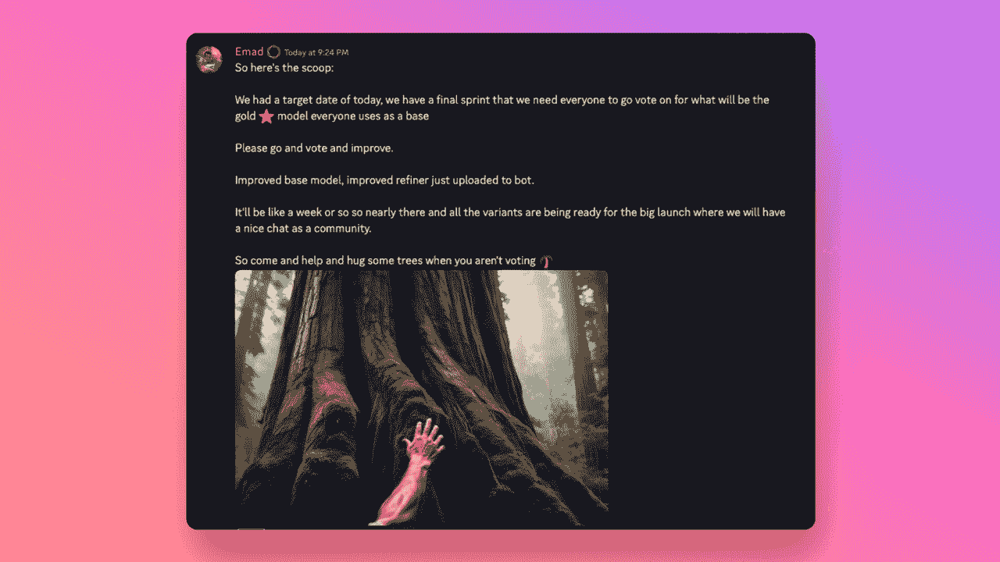

# ⚒️产品推荐

## 妙鸭：制作自己的数字分身拍摄写真

上周被这个小程序刷屏了产品的定位和相关体验细节打磨的都非常成熟，应该是阿里内部孵化的产品，不过理论上，上传照片炼制你的模型以后可以生成任何你的照片，所以介意的还是谨慎尝试。

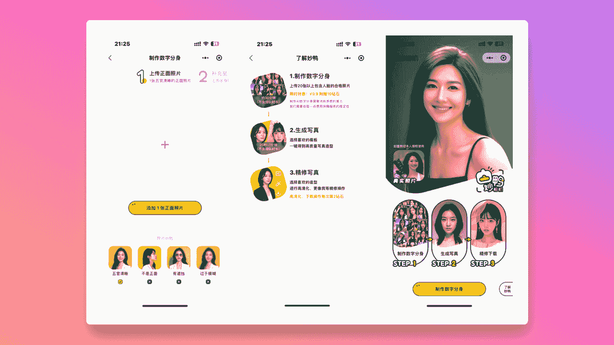

## Contextual Answers：AI幻觉解决方案

Contextual Answers，这是一个端到端的API解决方案，其中的答案完全基于组织知识，并避免了"幻觉"。我们看到企业对于利用Contextual Answers来提升组织生产力并提供优质客户体验的需求非常大。领先的全球信息服务提供商Clarivate与我们合作，在其图书馆解决方案套件中应用Contextual Answers，为学生、教师和研究人员提供基于策划和可信学术内容的问题答案。

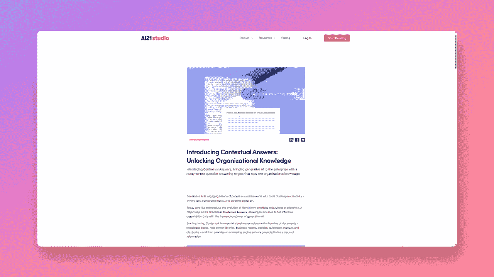

## Sidenote：用AI将笔记转换为可操作的任务

Sidenote 是一款 Chrome 扩展程序，允许用户在浏览网页时做笔记。Sidenote 会读取会议记录，检测操作项目，并处理线性票证、后续电子邮件 ping 和预定提醒。只需轻轻一按，人工智能就会读取您的笔记并在 10 秒内完成后续操作。

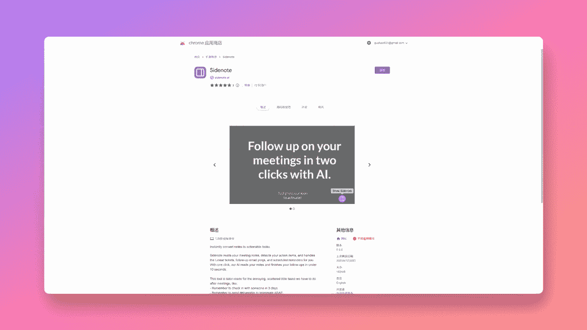

## Taskade：AI团队协作工具

Taskade是一款AI驱动的生产力平台，适用于个人和团队。它提供了生成式工作流、任务自动化、连接式知识和实时协作等功能，集中在一个统一的工作区中。通过AI辅助，可以更快、更智能地完成任务、记录笔记、制作思维导图等。它可以在所有设备上使用，让团队更高效地工作。

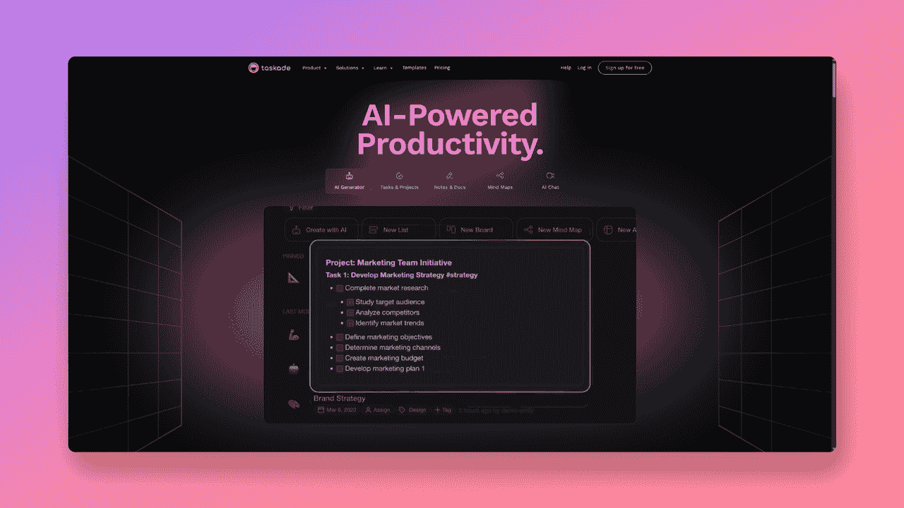

## [Wix推出AI网站建设功能](https://www.wix.com/blog/avishai-abrahami-thoughts-about-ai)

目前，Wix平台已经整合了多项AI功能，包括AI文本生成、AI模板文本生成、替代布局、AI图像生成、自动背景去除和自动增强、自动生成预告片、产品描述、产品推荐和AI域名生成等。未来，Wix还将推出AI网站生成器、AI页面和部分生成器、物体擦除工具和AI助手等功能，以帮助用户更好地管理和提升业务。Wix致力于为用户带来更好的用户体验和创新技术，相信AI技术将为用户的网站和业务带来更多机遇。

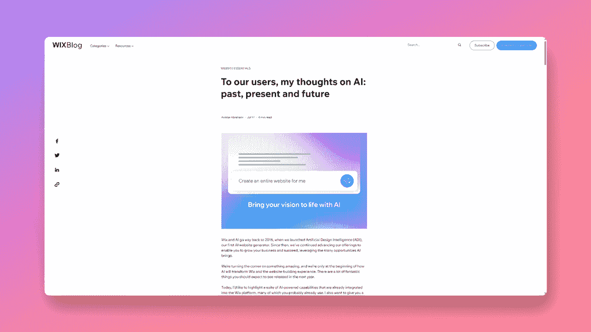

## Taylor AI：开源的语言模型（LLMs）训练平台

Taylor AI是一个开源的语言模型（LLMs）训练平台，可以帮助工程师们进行模型训练，无需设置GPU和破解复杂的库。使用Taylor AI，您可以拥有和控制自己的模型，而不需要将敏感数据暴露给第三方供应商。此外，Taylor AI还可以帮助您节省成本，避免按标记付费的结构，并保持与最新的开源模型同步。最重要的是，Taylor AI简化了模型训练的过程，让您的团队可以专注于业务价值的生成。

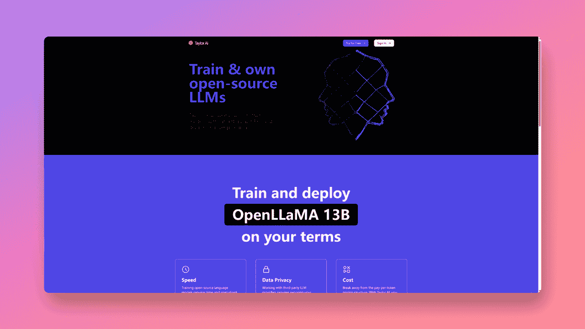

## Browser AI：Opera浏览器AI助手

Opera浏览器中的AI聊天。ChatGPT和Aria是完全集成到您的浏览器中的Opera浏览器AI。在Opera浏览器中与AI聊天。ChatGPT和Aria是完全集成到您的浏览器中的Opera浏览器AI。从ChatGPT获得有用的AI帮助，并从Aria（Opera浏览器AI）获取最新的网络信息。Aria浏览器AI Opera的本地AI完全集成在Opera浏览器中，无论是在桌面上还是在Opera for Android中。

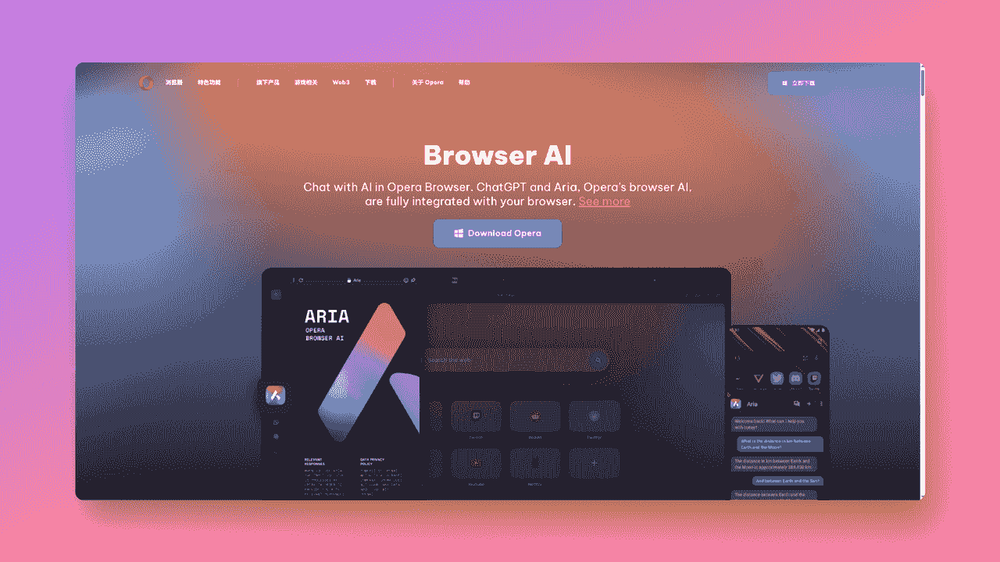

## Text from my ex：分析你和你前任的聊天记录

我们基于GPT的算法将分析你与你的恋人或前任的对话，为你提供一些时髦的关系见解和兼容性评分。解锁对你的关系的更深入理解，学习你的对话，了解附着风格、沟通方式、性感时刻、亮点/低谷、可爱时刻以及为什么无法持续的原因。Amori是一款由斯坦福大学创办的基于人工智能的约会应用，通过声音帮助你了解自己，帮助你在更深层次上与他人建立联系。

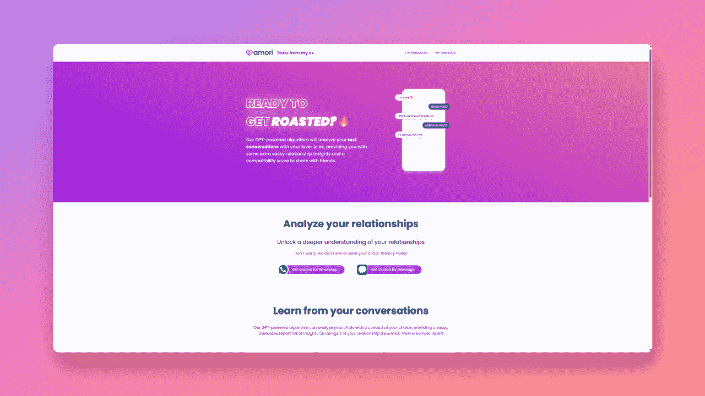

# 🔬精选文章

## [向量数据库简介](https://guangzhengli.com/blog/zh/vector-database/)

这篇文章讨论了向量数据库的应用和相关的搜索算法。向量数据库是将文本转换成向量并存储在数据库中，当用户输入问题时，将问题转换成向量并在数据库中搜索相似的向量和上下文。文章介绍了几种搜索算法，包括K-Means、Faiss、HNSW、LSH和随机投影。这些算法可以通过比较向量之间的距离来判断相似度，并提供高效的搜索结果。

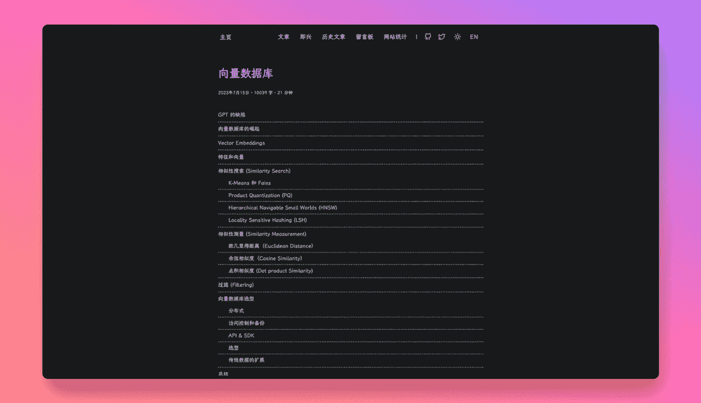

## Open AI研究员：LLM 支持的自主代理

本文介绍了以LLM为核心控制器构建代理系统的概念和关键组件，并探讨了任务分解、自我反思、记忆和工具使用等方面的方法和技术。这些代理系统可以被视为强大的问题解决器，具有广泛的应用潜力。然而，目前仍存在一些挑战，如有限的上下文长度、长期规划和任务分解的困难以及自然语言接口的可靠性等。

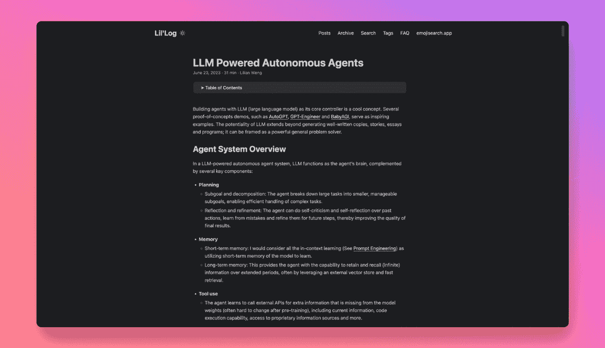

## Niji 官方推出的 AI 绘画和艺术课程

Niji官方最近推出了一系列免费的绘画课程 Niji Academy 这是一门将艺术基础与人工智能技术相结合的实验课程。提高绘画水平是利用人工智能创作更好图片的好方法，但反过来，人工智能也能帮助你更快地学会如何绘画。

我之前的几条推特就说过无论AI绘画技术怎样发展，想要画出一张好的图像应该学习的内容绝不仅仅是抄写别人已经写好的提示词缝缝补补。AI只是节省了你手上需要长期练习的时间，脑子里应该学习的东西还是需要学习。

想要画出美的东西好看的东西，首先你得见过足够多美的和好看的东西，你只有知道美好的东西长什么样子，自己才能创造美好的事物。所以很高兴看到Niji官方的课程也是这样想的，他们选择从最基础的东西开始讲起。

我也会持续翻译这套课程： [https://mp.weixin.qq.com/s/Cx](https://mp.weixin.qq.com/s/CxEv5NQF_wzAtqXnuNbKog)Ev5NQF_wzAtqXnuNbKog

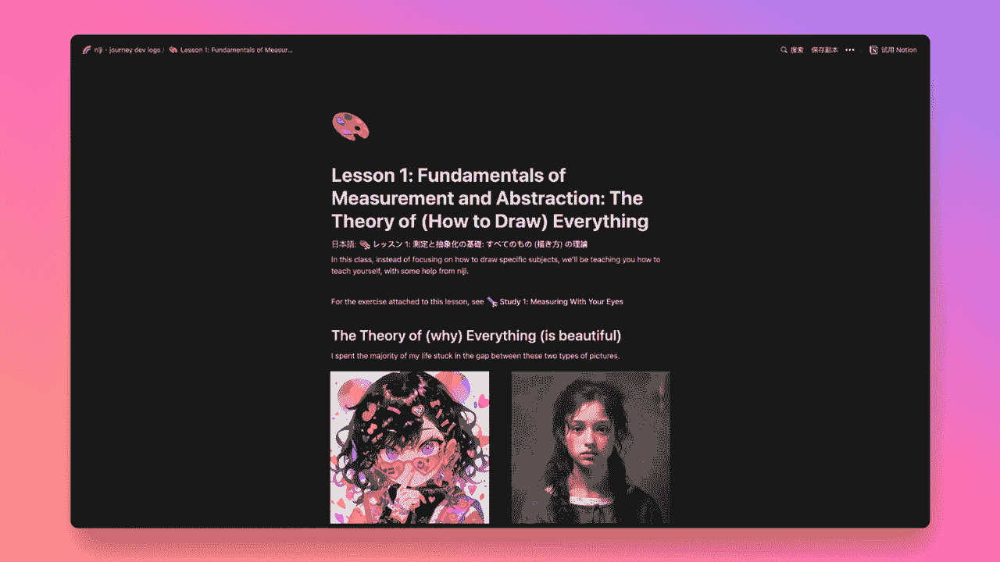

## 深入理解Stable Diffusion-秋葉aaaki

秋叶关于SD模型原理的课程。内容有点深和可以看一下，看不懂也不要为难自己。“今天来直播,给大家做一个关于stable diffusion的分享,这个课程,本来是今年年初说要给一个企业讲的课,但是由于今天早上直播的时候看到别人噶韭菜,实在是绷不住了,所以决定把自己以前录的内容再讲一下呃,这个课会有录播,我稍微晚些时候剪辑一下,会投稿视频,然后这次分享主要会以cable defasion,模型结构为主,重点刷两遍,它的运作过程基于这个结构来介绍一些模型,比如local liqus嗯,然后还有一些其他东西。”

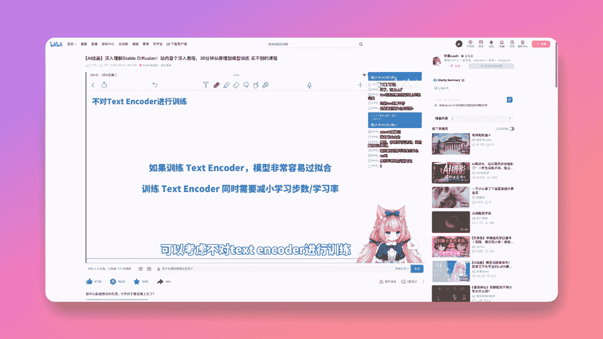

## [SaaS 之后是什么？](https://every.to/chain-of-thought/what-comes-after-saas)

这篇文章介绍了一种新型的软件开发模式，即可塑性软件（Malleable Software）。这种软件允许用户使用人工智能（AI）修改其底层代码，实现个性化定制。作者认为，可塑性软件有助于构建更安全、更具创造力和个性化的软件，模糊了开发者和用户之间的界限。此外，可塑性软件还可能带来新的商业模式和机会。然而，这种模式也面临着一些挑战，如AI的稳定性和更新问题。最后，作者提供了一个示例，展示了如何使用Replit和ChatGPT构建一个可塑性软件应用，并鼓励读者亲自尝试。

## Transformer 开创人工智能革命的谷歌科学家

这篇文章讲述了谷歌的研究科学家在讨论如何改进机器翻译时，偶然发现了“自注意力”这一概念，从而推动了人工智能革命。他们合作开发了一种名为“transformer”的语言处理架构，该架构现在被广泛应用于各种人工智能应用中。然而，由于谷歌的大型官僚机构化，这些科学家最终都离开了公司，创办了自己的初创公司，以进一步推动人工智能的发展。这篇文章介绍了transformer模型的工作原理以及创造它的科学家们的故事。

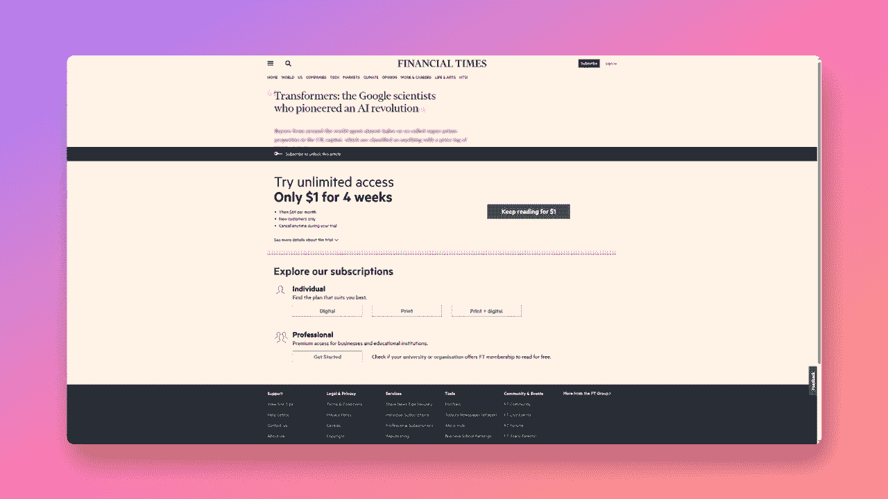

## 如何学习探索自己的LLM - 能力探索、绩效基准测试和红队

这篇文章讨论了如何评估语言模型（LLM）的性能和能力，并提供了一些测试方法和建议。作者强调了在测试过程中减少噪音的重要性，并介绍了一些测试的技巧。文章还提到了不同测试方法的相对实用性，以及在不同情境下的适用性。总体而言，这篇文章为对LLM进行评估和测试的读者提供了一些有用的指导和思路。

## 为什么 GPT-3.5（大部分情况）比 Llama 2 便宜

Llama-2-70B是gpt-3.5的一种诱人的替代选择，但如果寻找廉价的语言模型，偏离OpenAI的API可能不值得。在考虑价格和延迟时，不应该使用Llama-2来处理重负载的工作，而是适用于以提示为主的任务，例如分类。当工作负载没有提示令牌时，使用Llama-2可能也是有意义的（虽然不直观，但稍后会解释）。在其他情况下，gpt-3.5应该更便宜更快。需要注意的是，使用Llama而不是gpt-3.5的一个原因是微调，但在本文中，我们只探讨成本和延迟。我没有将Llama-2与GPT-4进行比较，因为它更接近3.5级模型。

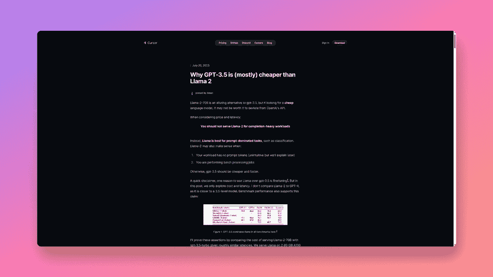

## 关于语言模型的起源： 15,821 个大型语言模型的进化树和图谱

本研究利用Hugging Face LLMs的相对系统的命名法进行层次聚类，并使用n-gram和词频-逆文档频率来识别LLMs之间的社群。我们的方法成功地识别了LLMs的系列，并将LLMs准确地聚类成有意义的子群。我们提供了一个公共网络应用程序，用于浏览和探索Constellation，我们的15,821个LLMs的图谱。Constellation可以快速生成各种可视化，包括树状图、图表、词云和散点图。

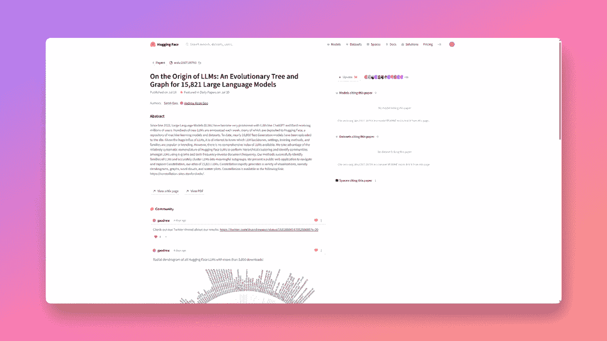

## 谷歌人工智能红队：道德黑客让人工智能更安全

谷歌首次公开发布了AI红队的信息。上个月，谷歌推出了安全AI框架（SAIF），旨在帮助解决AI系统和驱动的风险。为了推动这一势头，今天我们发布了一份新报告，探讨了我们为支持SAIF而部署的一个关键能力：红队。报告介绍了红队在AI系统中的作用、模拟的攻击类型以及我们从中学到的经验。红队是由一组黑客组成，模拟各种对手，从国家级组织和知名高级持续性威胁（APT）组织到骇客、犯罪分子甚至是内部恶意人员。谷歌的AI红队与传统红队密切合作，拥有必要的AI专业知识，可以对AI系统进行复杂的技术攻击。红队攻击的类型包括快速攻击、训练数据提取、模型后门、对抗性示例、数据污染和泄露等

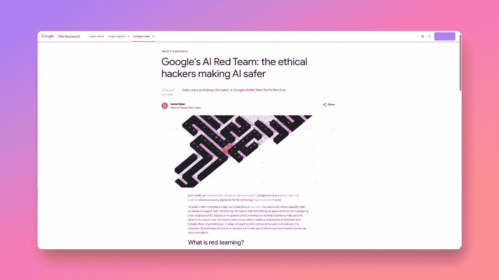

## Meta 为什么要开源 Llama 2？

Llama 2是Meta公司推出的一款商用开源模型，它是基于LLaMA的“仅供学术使用”的模型的进一步发展。许多人对大型科技公司的战略开源产品如Android、Chrome和Visual Studio Code都很熟悉。但是，为什么Meta会将Llama 2的权重商业化呢？这里有一个更深入的分析。

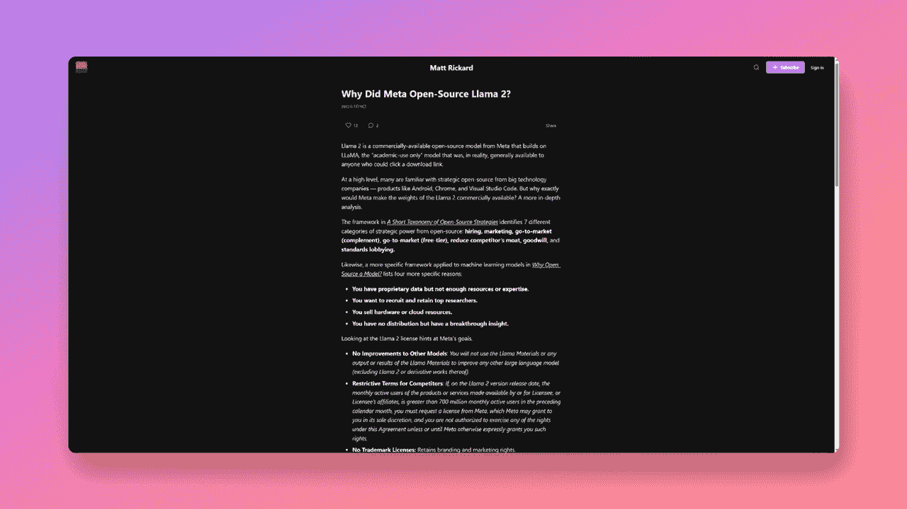