# AIGC Weekly #30

> 来源：[https://waytoagi.feishu.cn/docx/Nb6Ndbmdfoji9NxkdX9cFrajnnc](https://waytoagi.feishu.cn/docx/Nb6Ndbmdfoji9NxkdX9cFrajnnc)

> 🔗 原文链接： h[ttps://op7418.zhub](https://op7418.zhubai.love/posts/2292763859704496128)ai.love/posts/22...

> 发表时间：2023-07-18

工具：Midjourney v5

a photograph of a railway track in motion, in the style of futuristic architecture, Chromed metal, colorful curves, associated press photo, aluminum, rounded --ar 3:2

# ❤️上周精选

## Anthropic 发布 Claude 2及Web 聊天机器人应用

上周Anthropic发布了他们最新的模型 Claude 2，Claude2相较于之前的版本有了非常大的提升，同时你现在可以在他们的官网上跟Claude 2对话了（免费）。

他们开放了一个官方的聊天机器人程序，你现在可以访问 https://claude.ai

来使用Claude 2跟他对话，需要注意的是目前只对美国和英国的IP开放。 通过谷歌授权或者自己注册登录即可，再也不用担心被封号了。并且目前是完全免费的。

大体上的功能跟Chat GPT类似你可以跟他对话并且聊天记录也会保存，不同的是你可以直接上传文件让Claude帮你分析，Chat PDF等工具惨了。 而且Claude 2这个版本用的是100K的模型，你的大文档也没有问题。

Claude 2相比之前的版本有哪些提升

+   首先是上下文Claude 2已经可以支持多达200,000个token的上下文,相当于约150,000个单词，不过现在只开放了100K。

+   生成更长的响应。Claude 2被训练可以生成多达4000个token的连贯文档,相当于3000个单词,比之前的模型长得多。

+   更好的代码生成能力。Claude 2在编码基准测试和人工反馈评估中的表现显著提高。

+   更多的非英语数据。Claude 2的训练数据中约10%是非英语数据,比之前的模型更多。这有利于Claude 2在多语言方面的能力。

+   更新的数据。Claude 2的训练数据包含2022年和2023年初的数据,所以它对更近期的事件更为了解。

[这里有他们自己介绍 Claude 2 相关能力测试的文档： htt](https://www-files.anthropic.com/production/images/Model-Card-Claude-2.pdf)ps://www-files.anthropic.com/production/images/Model-Card-Claude-2.pdf

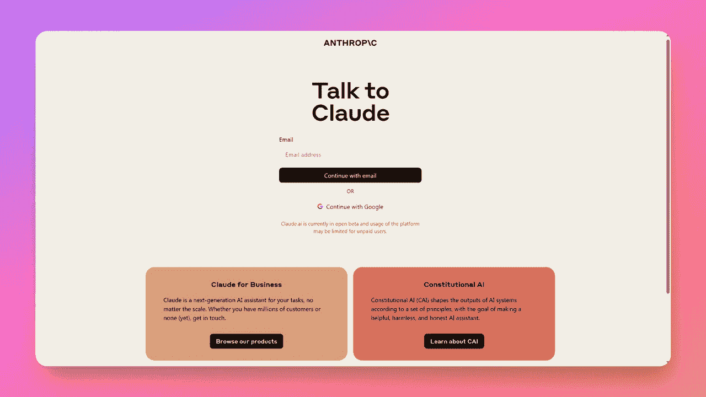

## Meta 推出 CM3leon 多模态文本和图象生成模型

上周 Meta 推出了他们的多模态模型 CM3leon 这是一个既能进行文本到图像生成，又能进行图像到文本生成的单一基础模型。从图象生成的质量来看，感觉比 SDXL 要好很多的。

CM3leon是第一个使用从仅文本语言模型中改编的配方进行训练的多模态模型，包括大规模的检索增强预训练阶段和第二个多任务监督微调（SFT）阶段。它能实现下面这些功能：

+   文本转图像：给定具有潜在高度组合结构的提示文本，生成遵循提示的连贯图像。

+   文本引导图像编辑：给定图像和文本提示，根据文本中的说明编辑图像。由于 CM3leon 模型的通用性，这是通过与上面和下面的所有其他任务相同的模型来实现的，这与之前的模型（例如 InstructPix2Pix）不同，后者仅针对文本引导图像编辑进行了调整。

+   文本任务：CM3leon 模型还可以按照一系列不同的提示生成短或长的标题并回答有关图像的问题。

+   结构引导图像编辑：结构引导图像编辑不仅涉及理解和解释文本指令，还涉及作为输入提供的结构或布局信息。这使得 CM3leon 模型能够对图像进行视觉上连贯且上下文适当的编辑，同时遵守给定的结构或布局指南。

+   物体到图像：给定图像边界框分割的文本描述，生成图像。

+   图像分割：给定仅包含分割的图像（没有文本类），生成图像。这里的输入表示我们从中提取分割的图像。

+   生成超分辨率结果：图像生成的一个常见技巧是添加单独训练的超分辨率阶段，以从原始模型输出生成更高分辨率的图像。这对于 CM3leon 也非常有效。

## Google Bard 发布了大量更新，支持中文了

上周 google 对 Bard 进行了大量更新能力丰富了许多，从感知上已经跟 CPT-3.5 差不多了，尤其是加入了对中文的支持以后。下面是具体的更新内容：

+   支持更多语言和更多国家：Bard 支持的语言目前又新增了 40 多种，包括阿拉伯语、中文（简体/繁体）、德语、印地语、西班牙语等。还增加了推出 Bard 的地区，包括欧盟的 27 个国家/地区和巴西。

+   Bard 支持 Google 智能镜头：与 Bard 对话时，你可以上传图片及文字，用全新方式激发想象力和创造力。为了实现这一点，为 Bard 加入功能强大的 Google 智能镜头。

+   Bard 可以朗读回答内容了：在 Bard 中添加了文字转语音功能。该功能支持 40 多种语言，包括印地语、西班牙语和英语（美国）。

+   固定对话和近期对话：现在，你可以随时返回之前与 Bard 的对话继续互动，还可根据需要整理对话。

+   与他人分享 Bard 对话：更轻松地与其他人分享部分或完整的 Bard 对话内容。利用可分享的链接，让其他人只需轻轻一点，

+   修改 Bard 的回答：推出了 5 个新选项，可用来修改 Bard 的回答。只需点按相应的选项，即可让回答内容变得更加简单一点、详尽一点、简短一点、专业一点或随意一点。

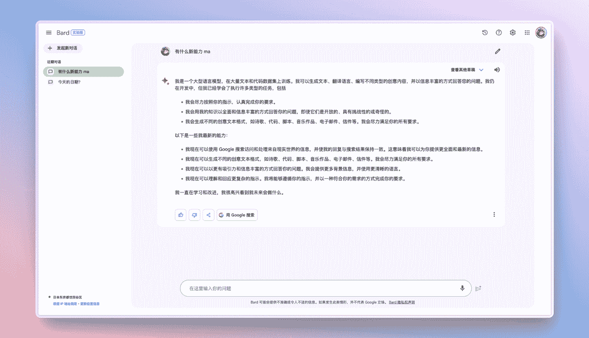

## 马斯克正式公布了他的 AI 公司：XAI

埃隆·马斯克 (Elon Musk) 正式推出 X AI 网站，表示将与特斯拉、Twitter 等公司合作，了解宇宙是如何运作的。

xAI 在网站上表示，其团队将由马斯克领导，成员包括曾在 OpenAI、谷歌研究院、微软研究院和 DeepMind 等其他人工智能巨头工作过的团队成员。

[里面有非常多的华人面孔他们的具体信息可以看机器之心的这篇内](https://mp.weixin.qq.com/s/jJtRMPPvOo7D6Tj5ImtsdQ)容： https://mp.weixin.qq.com/s/jJtRMPPvOo7D6Tj5ImtsdQ

[@DrJimFan ](https://twitter.com/DrJimFan)表示 XAI 在 AI 领域有两个显著优势：

+   马斯克拥有推特导致XAI是唯一一家可以合法使用推特如此庞大的多模态数据的一家公司。

+   Tesla FSD团队拥有多年构建 Dojo 等大型训练集群的经验。XAI的大模型触角可以延伸到实体的车机上。

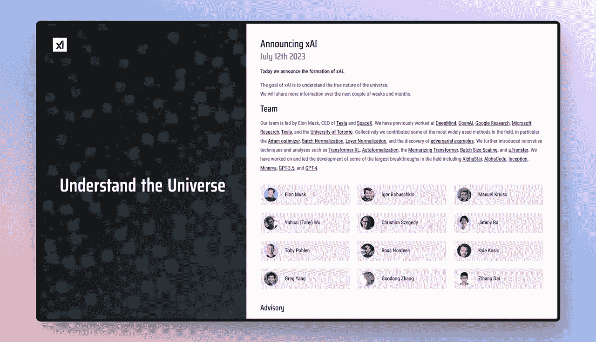

# ⚒️产品推荐

## [从社交媒体和网站发掘潜在客户](https://phantombuster.com/)

潜在客户生成解决方案从所有主要社交网络和网站生成潜在客户100多个现成的自动化预构建工作流程，适用于您的所有目标无缝导入数据到任何CRM无需编码和自动化无代码、基于云的解决方案适用于任何人的无代码工具24/7生成结果。

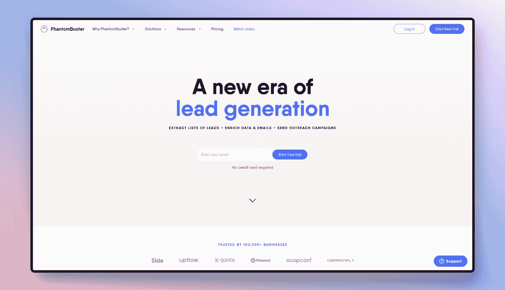

## 模仿微软宣传片风格的 Lora 模型

微软柔彩风格lora，搭配Bdicon等模型使用有不错的效果，模型使用 Midjourney 出图训练而成，现在很多Lora都是这样训练的，由于无法精准控制图象细节，所以炼成 Lora 后反而在 SD 上有比较好的效果。

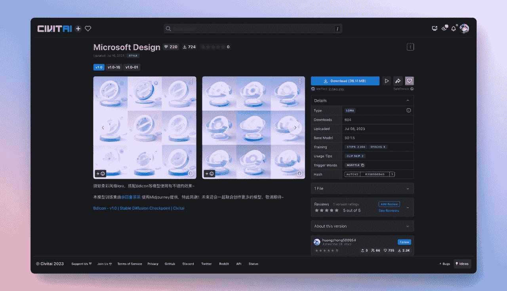

## Soundmatch：AI 帮助你的视频寻找完美配乐

Soundmatch。有了一个视频的想法、一个初步剪辑或者最终剪辑，但不确定配乐怎么选择？Soundmatch让您轻松搞定。在几秒钟内为你的视频获取定制的配乐。

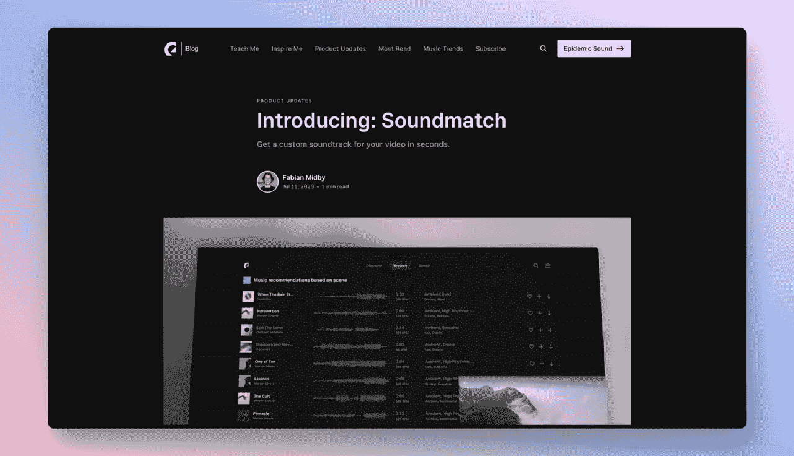

## 抓包神奇工具，上传照片反向搜索互联网上所有包含人脸的照片

人脸搜索引擎，反向图像搜索，上传照片并查找图片发布的位置，或者可以使用设备的摄像头拍照。

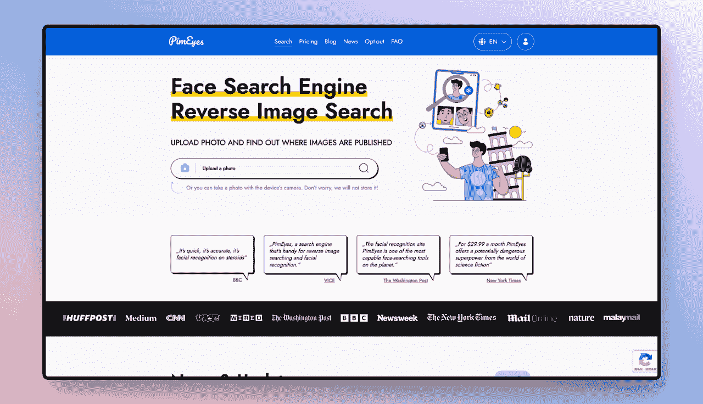

## Spot A Bot：分析机器人对 Twitter 的影响

分析 twitter 对应话题下机器人的影响。因为在社交媒体中，机器人有时很难识别。如果时间轴上出现一个机器人发布的帖子，则很难将其与人类帖子区分开来。这可能会产生负面影响，因为这可能被用作一种大规模操纵、信息压制和其他邪恶活动的形式。阴兵分析器了可以说是。

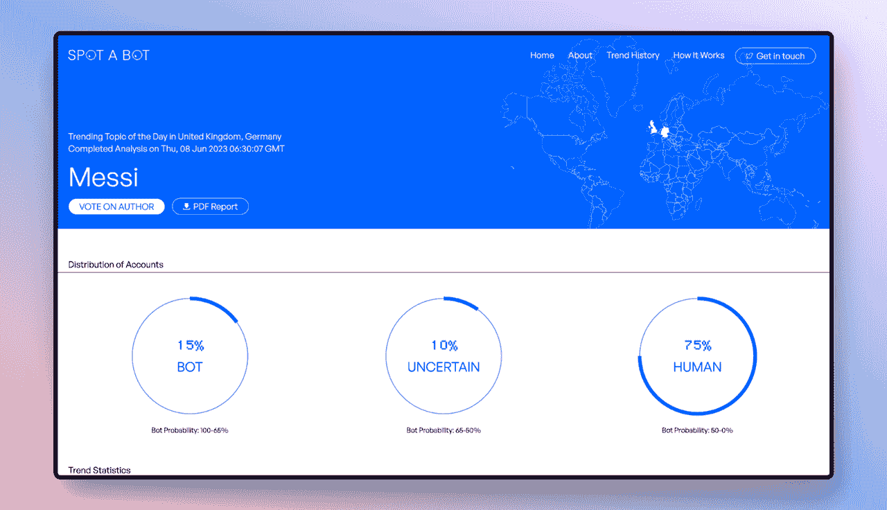

## [PESTEL分析工具](https://pestel.dev/)

通过进行PESTEL分析，企业可以更好地了解可能影响其运营的外部因素，并利用这些信息制定适应市场并取得成功的战略和计划。我们的AI驱动的PESTEL分析生成器可以让您输入公司的描述，并为您生成PESTEL分析。可以通过单击字段来编辑任何字段，并将其下载为图像。

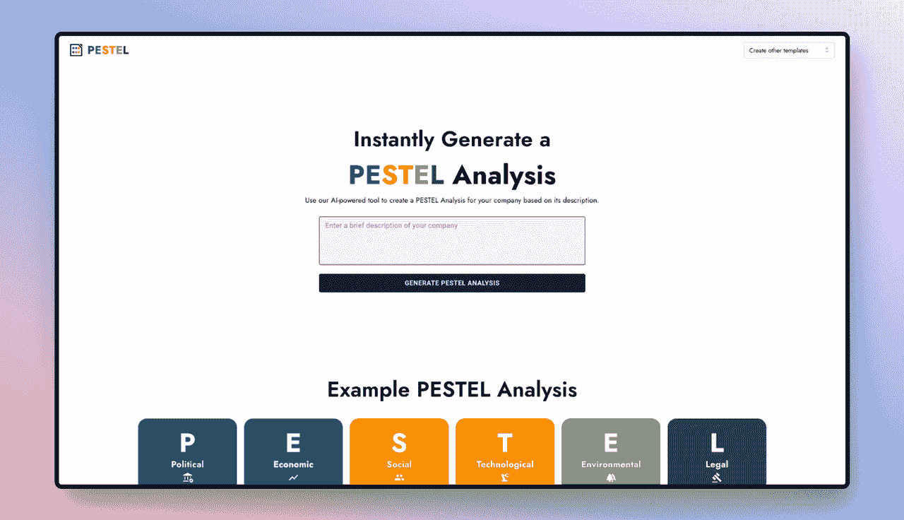

## Ortus：AI 驱动的互动式视频内容学习工具

对观看的视频提出任何问题无需暂停或切换标签，提出问题，查找时间戳，并深入了解视频。获得高质量摘要掌握所有关键要点，而无需观看整个视频。新功能。直接复制到Notion消除手动记笔记的需要。将关键见解，参考资料和资源复制到Notion，并高效地收集和组织有价值的信息以供将来参考。

## [AI 自动识别图片生成表情包](https://imagetomeme.com/)

我们的AI可以生成适合上传图像的表情包。创建你的模因⚒️轻松自定义和下载表情包轻松编辑文本，更改颜色和对齐元素，以确保你的表情包看起来完全符合你的要求。一旦你满意，你可以以高质量下载表情包并与世界分享。

## Stable Doodle：从涂鸦和线稿生成图象

Stability AI推出了Stable Doodle，这是一个将简单的草图转换成动态图像的工具，为各行各业的专业人士和爱好者提供了无限的图像可能性。这个工具可以大大提升教育、创意设计、时尚和艺术等多个行业的效率。

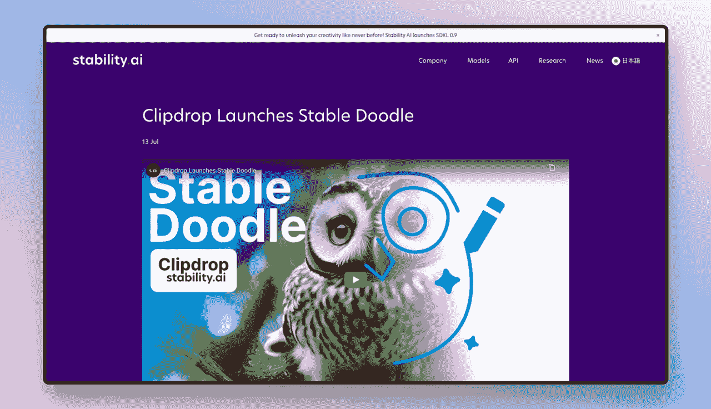

# 🔬精选文章

## 网信办发布生成式人工智能服务管理暂行办法

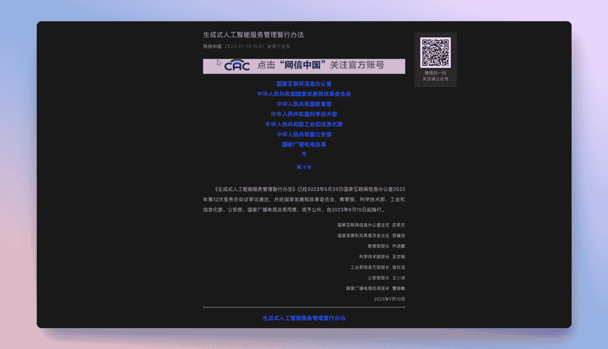

## 手把手教你将文字完美融入 SD 生成的图片，用来做营销宣传图非常有效

上周类似这种文字光效或者将文字合成在衣服上的图好像又火了，很多朋友在问怎么做，所以写了一个比较详细的教程。其实就是ControlNet的简单应用，比如模拟光线照射文字的，之前用来调整自然光线的角度和范围这次不过是将原来模拟光照的图变成了文字了。

顺便说一下里面模型下载的 huggi[n](https://huggingface.co/ioclab/ioc-controlnet/tree/main/models)gface 地址有问题，应该是这个： https://huggingface.co/ioclab/ioc-controlnet/tree/main/models

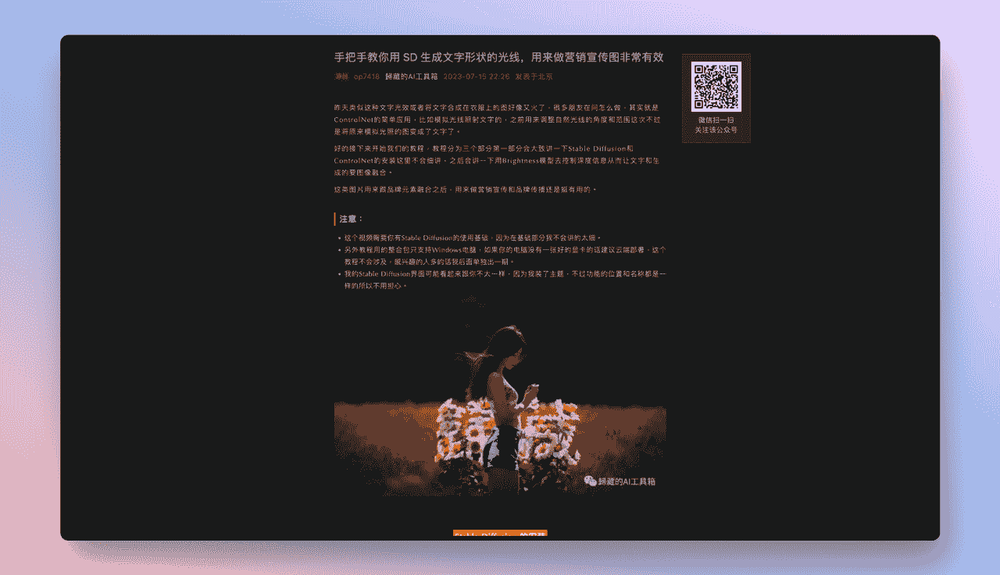

## GPT-4详细架构技术细节泄漏，训练一次要 6300 万美元

今天上午一篇关于 GPT-4 详细技术架构和训练过程的文章泄漏了，虽然没有提及信源在哪但看起来还是挺靠谱的。

有关GPT-4的信息包括模型架构、训练基础设施、推断基础设施、参数数量、训练数据集构成、标记数量、层次数量、并行策略、多模态视觉适应、工程权衡背后的思考过程、独特实施的技术以及解决与巨型模型推断相关的瓶颈的方法。此外，文章还介绍了在A100上训练和推断GPT-4的成本以及与H100上下一代模型架构的比例关系。

我也翻译了一篇中文内容： [https://mp.weixin.qq.com/s/E7](https://mp.weixin.qq.com/s/E7uP48xfbZOtUk8GXZYbmQ)uP48xfbZOtUk8GXZYbmQ

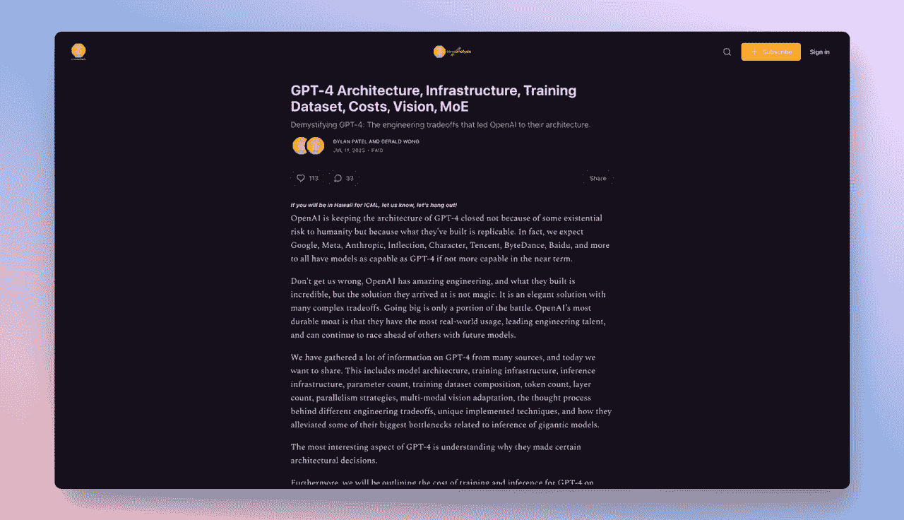

## 推动AI革命前线的工人：AI 将如何影响自由职业者

许多人表示，他们已经看到生成式人工智能改变了他们工作的需求和收入的稳定性。但在一些人为裁员或佣金减少做好准备的同时，其他人则积极采用生成式人工智能工具，以保持领先。如果生成式人工智能代表了我们工作方式的巨大转变，那么离岸外包工人就处在这个转变的前沿。Rest of World联系了世界各地的四名自由职业者，了解他们如何使用生成式人工智能。

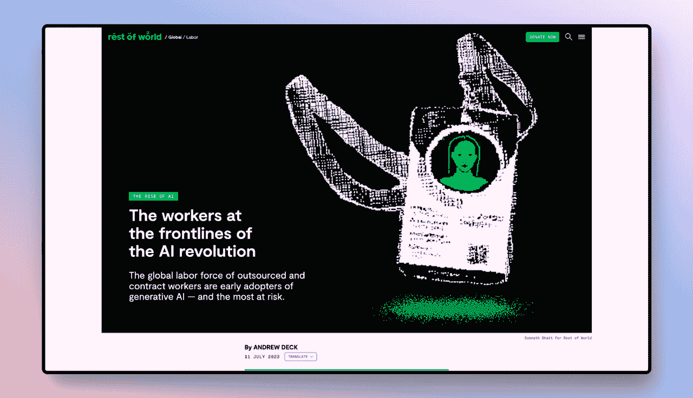

## 印度 IT 巨头Wipro计划投入 10 亿美元培训员工使用 AI

Wipro计划投入10亿美元培训员工的人工智能，并将其整合到产品中。Nvidia公司正在讨论加入Arm的首次公开募股。IPO的支持者名单将在秋季确定，可能有五到六家公司。

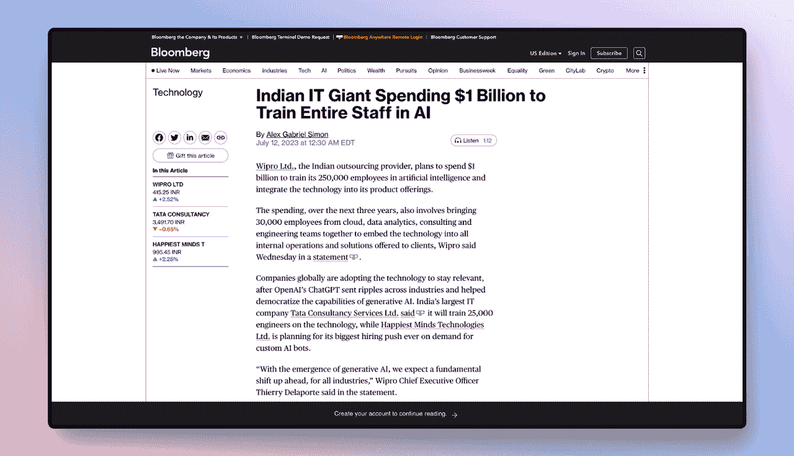

## [数据和算力是终极飞轮](https://every.to/p/data-in-the-age-of-ai)

过去十年是数据爆炸的十年，数据成为科技行业的关键竞争优势，推动了社交媒体、电子商务、交付物流等领域的发展。然而，即将到来的人工智能时代将改变竞争格局，数据和计算的价值将大幅提升。大型企业和新兴初创企业都将面临重要机遇。此外，计算革命将使数据变得更加有价值，而数据在人工智能时代的价值也有所不同。未来的数据业务将面临重大变革，需要构建适应人工智能时代的工具、商业生态系统和数据堆栈。

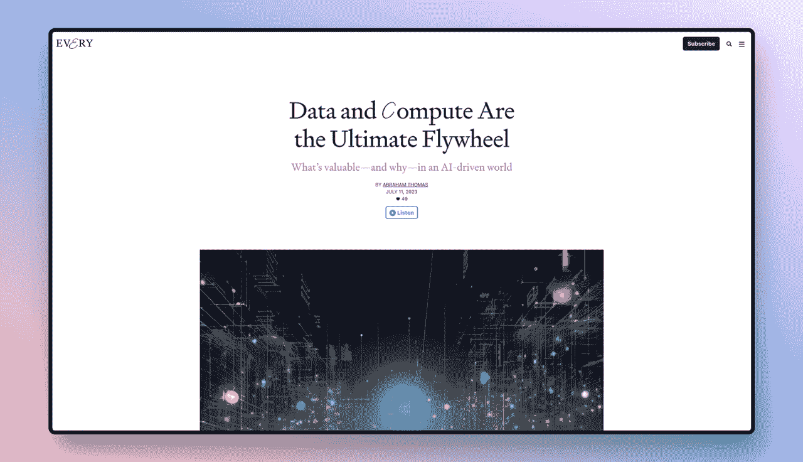

## 使用LLMs与传统ML对50万条客户信息进行分类的5个学习结果

LLMs可以通过描述类别和描述列表来帮助您在文本分类任务（如情感分析、标注等）上实现最先进的结果。我们最近使用LLMs和微调模型达到了50万个分类的里程碑，并在下面分享了我们所学到的内容。

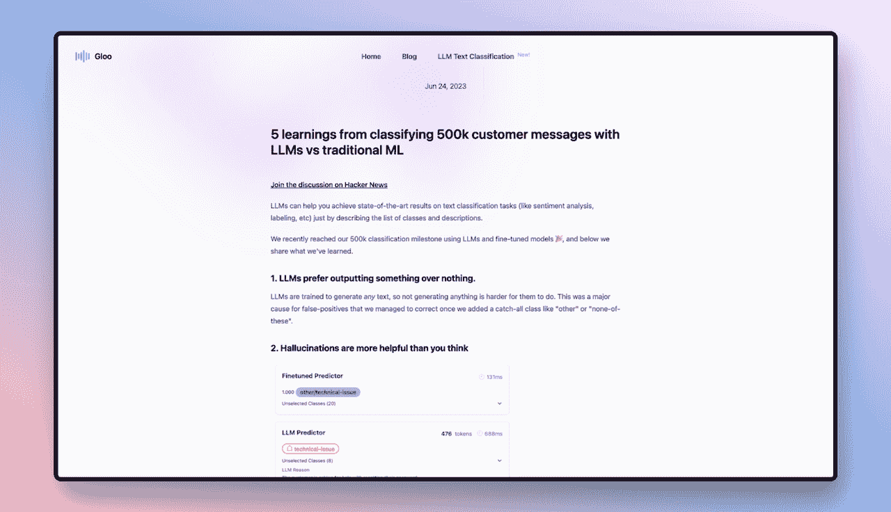

## 加入英伟达人工智能芯片革命的下一个挑战者

Nvidia是人工智能革命的领导者，但大大小小的竞争对手都希望缩小差距。像AMD和Intel这样的重量级公司正在投入数十亿美元来增强他们的人工智能产品，而初创公司则吸引了渴望成为下一个芯片巨头的投资者。与此同时，亚马逊和谷歌等云计算公司正在开发自己的芯片，并成为该领域的重要参与者。由于ChatGPT等生成式人工智能语言系统的崛起，人工智能热潮从去年底开始。AMD被认为是Nvidia最接近的竞争对手，该公司拥有自己的AI处理器产品线，并与渴望计算能力的大型数据中心运营商有着紧密的合作关系。Intel也反击了只有Nvidia的芯片才能运行生成式人工智能的说法，声称其芯片在最近的人工智能基准测试中表现出色。投资者们也在AI芯片领域投入了数十亿美元，希望在这个蓬勃发展的市场中取得突破。亚马逊和谷歌等大型云计算公司也在AI计算方面进行投资。整个AI计算半导体市场预计今年的销售额约为430亿美元，占整个芯片行业总销售额的8%左右，预计在四年内将翻倍，达到1250亿美元的销售额。尽管Nvidia占据了先机，但新来者并不气馁，他们希望与Nvidia竞争。

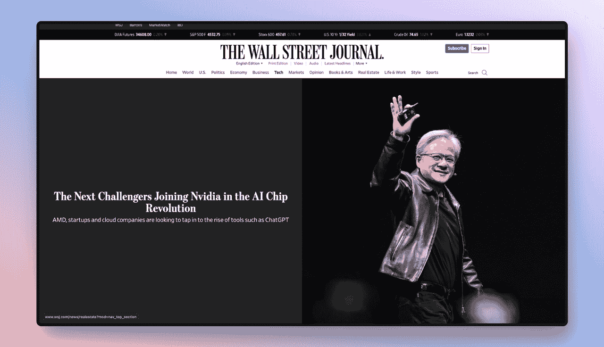

## [人工智能和工作自动化](https://www.ben-evans.com/benedictevans/2023/7/2/working-with-ai)

ChatGPT和生成式人工智能将改变我们的工作方式，但与过去200年的自动化浪潮有何不同？这对就业、颠覆和煤炭消耗意味着什么？几乎所有科技行业的人都认为生成式人工智能、大型语言模型和ChatGPT是我们可以用软件做的事情以及可以用软件自动化的事情的一次世代性变革。对于LLMs的其他方面几乎没有共识-事实上，我们仍在弄清楚争论的内容-但每个人都同意自动化将会更加普及，并且会出现全新的自动化方式。

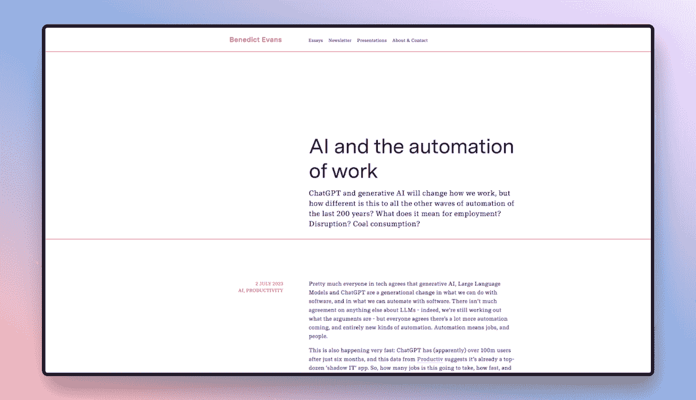

## [使用 LangChain 和 DeepIn](https://notes.aimodels.fyi/a-beginners-guide-to-unstructured-data-analysis-with-langchain-and-deepinfra/)fra 进行非结构化数据分析的初学者指南

成功的关键在于数据驱动的洞察力，这使得数据分析和解释过程对于战略决策至关重要。这就是LangChain的作用——一种强大的数据感知和主动性框架。当与DeepInfra强大的API结合使用时，LangChain成为从结构化和非结构化数据中提取洞察力的非常强大的工具，帮助企业规划其增长路径。

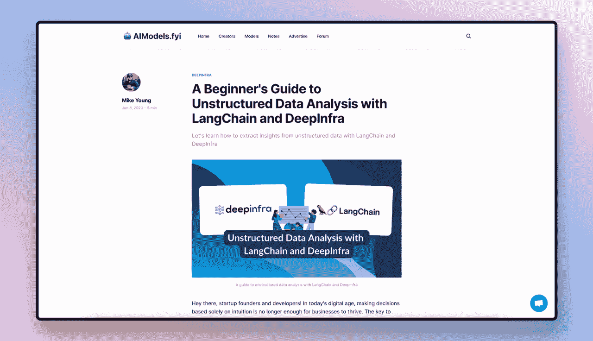

## ChatGPT 代码解释器：GPT4.5？

本文介绍了Code Augmented Inference的新模型Code Interpreter以及向“Code Core”架构迈进的重要性。Code Interpreter是一个实验性的ChatGPT模型，可以将Python代码写入Jupyter Notebook并在沙盒中执行。该模型的更新被认为是GPT4的重大进展，并被认为是通用AI的未来方向。Code Interpreter的能力令人印象深刻，可以进行自主编码和调试，但也存在一些限制和问题。

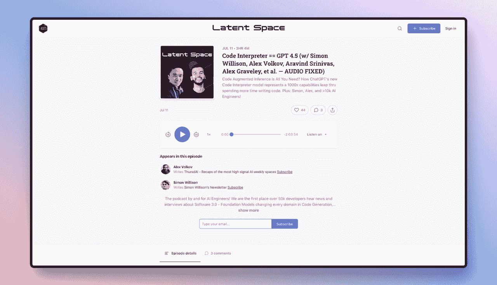

## 2030 年的 GPT 是什么样的？

GPT-4在编码、创意头脑风暴、写信等技能方面表现出色，令许多人感到惊讶。如何对机器学习的发展不再感到惊讶？本文将预测2030年大型预训练ML系统的特性。

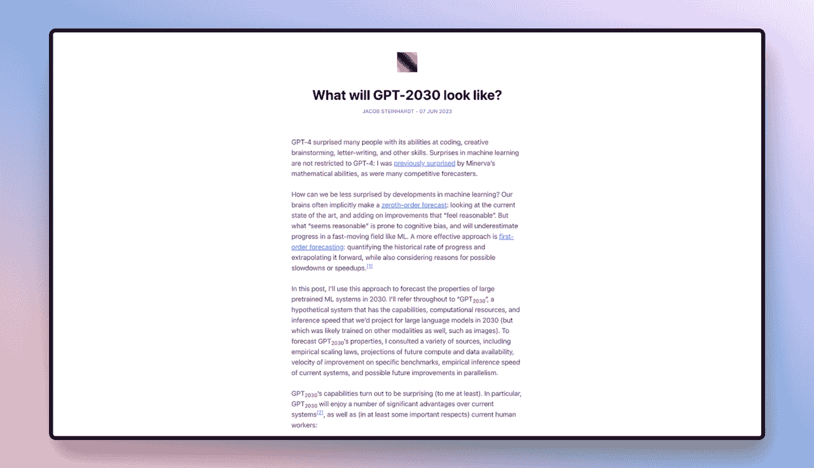